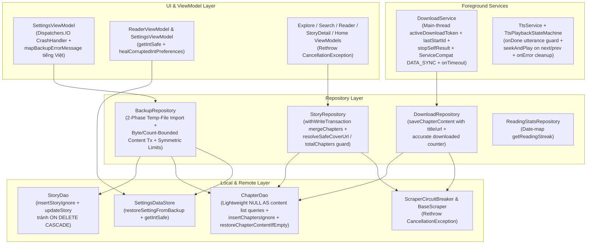

# Kế Hoạch Triển Khai: Khắc Phục Các Phát Hiện Audit Phase 1 (Data Integrity, Backup/Restore, Services, TTS & Coroutines)

> **Trạng thái**: Completed
> **Ngày tạo**: 2026-10-16
> **Cập nhật lần cuối**: 2026-10-16
> **Revision**: 4

---

## Technical Plan

### 1. Mục tiêu

Khắc phục **12 phát hiện mức Nghiêm trọng (Critical) & Cao (High)** thuộc **Phase 1** từ báo cáo kiểm toán (`full_app_audit_report.md`) cùng các phát hiện từ **Audit Run 1, 2 & 3** (`B1`, `M1`–`M10`, `N1`–`N11`, `P1`–`P5`, `m1`–`m8`), tập trung vào tính toàn vẹn dữ liệu, giới hạn bộ nhớ (OOM / CursorWindow / Zip Bomb), vòng đời Foreground Service trên Android 12–16 (`targetSdk = 36`), máy trạng thái TTS, và cấu trúc hủy Coroutine (`CancellationException`):

1. **Backup / Restore 2 Pha, Chia Lô Transaction Giới Hạn Theo Số Chương & Dung Lượng, Chống Mất Dữ Liệu `CASCADE`, Tự Chữa Lành DataStore & I/O Dispatcher (`[CRIT-02]`, `[CRIT-03]`, `[HIGH-03]`, `[HIGH-05]`, `B1`, `M4`, `M5`, `M7`, `M9`, `N5`, `N8`, `N10`, `P2`, `P3`, `P4`, `m4`)**:
   - **Loại bỏ `contentMap` & Streaming theo trang**: Xóa `contentMap: MutableMap<String, String>` trong `BackupRepository.kt`; giữ nguyên chữ ký `suspend fun exportBackup(outputStream: OutputStream, onProgress: (String) -> Unit = {})` và `suspend fun importBackup(inputStream: InputStream, onProgress: (String) -> Unit = {})` (`P3`); chuyển sang truy vấn phân trang `getDownloadedChaptersWithContentPaged` khi xuất ZIP và đọc từ file tạm cục bộ khi nhập ZIP.
   - **Chống mất dữ liệu do `ForeignKey.CASCADE` (`B1`)**: `ChapterEntity` (`ChapterEntity.kt:10-16`) khai báo `ForeignKey(..., onDelete = ForeignKey.CASCADE)` tới `StoryEntity`. Để tránh `INSERT OR REPLACE` xóa dòng cha trong `stories` làm kích hoạt `ON DELETE CASCADE`:
     - Với `stories`: kiểm tra `storyDao.getStoryById(id)` — nếu chưa tồn tại thì gọi `storyDao.insertStoryIgnore(...)` (`OnConflictStrategy.IGNORE`), nếu đã tồn tại thì hợp nhất metadata và gọi `storyDao.updateStory(...)` (lệnh `UPDATE` của SQLite). Đồng thời đổi `StoryDao.insertStories` (`StoryDao.kt:59-60`) từ `@Insert(onConflict = OnConflictStrategy.REPLACE)` sang `@Upsert`.
     - Với `chapters`: chèn danh mục chương (`content = null, isDownloaded = false, downloadedTimestamp = null`) bằng `chapterDao.insertChaptersIgnore(...)` (`ChapterDao.kt:52-53`, `OnConflictStrategy.IGNORE`), sau đó điền nội dung từ ZIP bằng `chapterDao.restoreChapterContentIfEmpty(...)`.
   - **Kiến trúc `importBackup` 2 Pha & Chia Lô Transaction Giới Hạn Bộ Nhớ ở Pha 2b (`M4`, `M9`, `N8`, `N10`, `P2`, `P3`, `P4`, `m4`)**:
     - Đặt `prettyPrint = false` trong `BackupRepository.json`, sử dụng `@OptIn(ExperimentalSerializationApi::class) json.decodeFromStream` / `encodeToStream` (`N10`), và áp dụng giới hạn đối xứng ở cả chiều xuất và chiều nhập: `MAX_METADATA_ENTRY_BYTES = 100 MB`, `MAX_CHAPTER_ENTRY_BYTES = 5 MB`, `MAX_TOTAL_UNCOMPRESSED_BYTES = 2 GB`, `MAX_ZIP_ENTRIES = 500_000`.
     - **Pha 1 (Ngoài `withWriteTransaction`)**: Sao chép `inputStream` ra file tạm cục bộ `tempZipFile` đồng thời quét kiểm tra cấu trúc ZIP (số lượng entry, kiểm tra regex `^chapters/([^/]+)/(\d+)\.txt$`, đếm số byte giải nén thực tế chống Zip Bomb, và giải mã `metadata.json` trực tiếp từ stream giới hạn dung lượng `BoundedInputStream` mà không tạo mảng trung gian 100 MB, `P2`). Nếu file lỗi hoặc thiếu `metadata.json`, ném `IllegalArgumentException` ở Pha 1 trước khi mở transaction DB.
     - **Pha 2a (Transaction Metadata)**: Mở 1 `transactionRunner.withWriteTransaction` để upsert `stories` (không `REPLACE`), chèn `insertChaptersIgnore` theo lô 500 (ánh xạ inline `ChapterEntity`, `P3`), và hợp nhất `readingProgress` (qua `progressDao.getProgress` + `progressDao.saveProgress` khi `lastReadTimestamp` mới hơn), `readingStats` (qua `statsDao.getStatsForDate` + `statsDao.upsertStats` với `maxOf`), `searchHistory` (qua `searchDao.insertAllSearches`) (`P4`).
     - **Pha 2b (Transaction Nội Dung Theo Lô Nhỏ — tối đa `IMPORT_CONTENT_TRANSACTION_BATCH_SIZE = 50` chương hoặc `IMPORT_CONTENT_BATCH_MAX_BYTES = 8 MB` mỗi lô, `M9`, `P2`, `P3`)**: Đọc các entry `chapters/{storyId}/{chapterNumber}.txt` từ `tempZipFile` và flush `pendingBatch` trong một `transactionRunner.withWriteTransaction` riêng mỗi khi đạt 50 chương hoặc tổng số byte UTF-8 của lô chạm ngưỡng `8 MB` (lấy `timestamp = chapterTimestamps["$storyId/$chapterNumber"] ?: data.createdAt`, `P3`). Nhờ giới hạn theo cả số chương và số byte, bộ nhớ đệm mỗi lô không vượt quá `8 MB`, và mỗi transaction chỉ giữ writer lock trong thời gian ngắn nên các tác vụ ghi đồng thời (`DownloadService`, `ReaderViewModel`) có thể xen kẽ giữa các lô.
   - **Khôi phục đúng kiểu & Tự chữa lành DataStore đã bị hỏng (`[CRIT-02]`, `M5`)**:
     - Thêm `SettingsKeys.restoreSettingFromBackup(prefs, key, rawValue)`, `Preferences.getIntSafe(key, defaultValue)` và `DataStore<Preferences>.healCorruptedIntPreferences()` trong `SettingsDataStore.kt`, sử dụng tại `ReaderViewModel.kt:290-303` và `SettingsViewModel.kt:85-138`.
   - **I/O Dispatcher & Thông báo lỗi tiếng Việt (`[HIGH-03]`, `[HIGH-05]`, `M7`, `P3`)**:
     - Bọc `exportBackup` và `importBackup` trong `withContext(Dispatchers.IO)`, loại bỏ toán tử `!!` tại `BackupRepository.kt:94` (và dùng `mapNotNull` khi tạo `chapterTimestamps`, `N8`).
     - Trong `SettingsViewModel.kt`: chuyển `loadCrashLogs(context: Context)` (dòng 306–308) và `clearCrashLogs(context: Context)` (dòng 310–313) sang `withContext(Dispatchers.IO)` với `context.applicationContext`; tại `exportBackup(uri: Uri, context: Context)` (dòng 252–272) và `importBackup(uri: Uri, context: Context)` (dòng 274–294), thay thế `"Lỗi sao lưu: ${e.message}"` (dòng 269) và `"Lỗi khôi phục: ${e.message}"` (dòng 291) bằng `mapBackupErrorMessage(isExport, error)`.
2. **Thống kê chuỗi ngày đọc (`[CRIT-04]`, `M1`)**:
   - Sửa `ReadingStatsRepository.getReadingStreak()` (`ReadingStatsRepository.kt:58-81`, dùng `readingStatsDao`): gom map theo ngày `recent.associateBy { it.date }`, coi một ngày có hoạt động đọc khi `stat.totalReadingTimeMs > 0L || stat.chaptersRead > 0`, và lùi `Calendar` từng ngày độc lập với chỉ số mảng.
3. **Tối ưu truy vấn Room, Transaction & bảo vệ Metadata (`[CRIT-05]`, `[HIGH-01]`, `[HIGH-02]`, `[HIGH-04]`, `N1`, `N9`, `P3`, `P5`, `m1`, `m2`, `m3`, `m5`)**:
   - **`[CRIT-05]` & `m1`**: Đổi 5 truy vấn danh sách chương trong `ChapterDao.kt` (`getChaptersByStory`, `getChaptersByStoryOnce`, `getDownloadedChapters`, `getChaptersPaged`, `getChaptersByNumbers`) sang chiếu nhẹ `SELECT storyId, chapterNumber, title, url, NULL AS content, isDownloaded, downloadedTimestamp FROM chapters ...`; giữ nguyên `SELECT *` cho `getChapter(storyId, chapterNumber)` và bổ sung `getDownloadedChaptersWithContentPaged`.
   - **`[HIGH-02]`, `N1`, `m3`**: Inject `DatabaseTransactionRunner` vào `StoryRepository`, giữ nguyên chữ ký `private suspend fun mergeAndInsertChapters(chapters: List<Chapter>, storyId: String): List<Chapter>` (`StoryRepository.kt:486-523`), bọc phần ghi DB trong `transactionRunner.withWriteTransaction`, giữ nguyên quy tắc bảo toàn tiêu đề chương đã tải (`if (existing.isDownloaded && existing.title.isNotBlank()) existing.title else ch.title.ifBlank { existing.title }`), bảo vệ URL không rỗng (`val urlToUpdate = ch.url.ifBlank { existing.url }`), chỉ gọi `chapterDao.updateChapterMetadata` khi `titleToUpdate != existing.title || urlToUpdate != existing.url`, và trả về `chapters.map { if (it.storyId == storyId) it else it.copy(storyId = storyId) }`.
   - **`[HIGH-01]`, `N9`, `P3`, `P5`, `m2`**: Mở rộng `ChapterDao.saveChapterContent` (`ChapterDao.kt:72-90`) thêm 2 tham số mặc định ở cuối (`timestamp: Long = System.currentTimeMillis(), title: String = "Chương $chapterNumber", url: String = ""`), sử dụng `insertChapterIfNotExists` kết hợp câu lệnh `UPDATE ... SET title = CASE WHEN TRIM(title) = '' THEN :title ELSE title END, url = CASE WHEN TRIM(url) = '' THEN :url ELSE url END` trong `updateChapterContent` để không cần gọi `getChapter` (`SELECT *`) trước mỗi lần lưu (`P5`). Truyền `title` và `url` từ `DownloadRepository.kt:206` và `StoryRepository.kt:614, 627` (`P3`); chỉ tăng `downloaded++` trong `DownloadRepository.downloadChapters` (`DownloadRepository.kt:205-236`) khi `result != null`; thêm thuộc tính tính toán `val processed: Int get() = (current + errors).coerceAtMost(total)` vào `DownloadProgress` (`StoryRepository.kt:752-757`, `P3`) để cả `DownloadService.buildProgressNotification` (`DownloadService.kt:350`) lẫn `StoryDetailScreen.kt:635` hiển thị thanh tiến độ khớp với tổng số chương đã xử lý (`m2`).
   - **`[HIGH-04]` & `m5`**: Đặt 2 hàm top-level `internal fun resolveSafeCoverUrl(freshCoverUrl: String, existingCoverUrl: String?): String` và `internal fun resolveSafeTotalChapters(freshTotal: Int, existingTotal: Int): Int` tại `StoryRepository.kt` (package `com.personal.apptruyen.data.repository`) để dùng chung giữa `StoryRepository`, `DownloadRepository`, và `BackupRepository` kèm unit test riêng.
4. **Vòng đời `DownloadService` & tuân thủ Foreground Service Android 12–16 (`[CRIT-06]`, `[CRIT-07]`, `M1`, `M2`, `M3`, `N2`, `N3`, `N6`, `N7`, `P1`, `P3`, `m6`)**:
   - **Quản lý `activeDownloadToken` & `lastStartId` trên Main thread (`[CRIT-06]`, `M2`, `N3`, `N7`, `P1`, `m6`)**:
     - Quản lý `activeDownloadToken: Long` và `lastStartId: Int` trên Main thread (`Dispatchers.Main.immediate`).
     - Cập nhật `lastStartId = startId` ở đầu **mọi** lượt `onStartCommand(intent, flags, startId)` (bao gồm cả `ACTION_START`, `ACTION_CANCEL` và `else`).
     - Trong khối `finally` của `downloadJob` (chạy trên `withContext(NonCancellable + Dispatchers.Main.immediate)`) và trong `cancelCurrentDownload()`, khi `shouldStopOnJobCompletion(activeDownloadToken, jobToken)` là `true` (hoặc khi xử lý `ACTION_CANCEL`), gọi `stopSelfCleanly(unconditional = false)` -> bên trong gọi **`stopSelfResult(lastStartId)`**:
       * Khi hủy tải qua `ACTION_CANCEL`, `onStartCommand` đã cập nhật `lastStartId` bằng `startId` của chính lệnh `ACTION_CANCEL`, nên nếu không có lệnh start mới hơn đang chờ thì `stopSelfResult(lastStartId)` trả về `true` và dừng Service (`N3`).
       * Khi có một lệnh `startForegroundService(ACTION_START)` mới vừa được hệ thống ghi nhận nhưng message `onStartCommand` của nó còn đang xếp hàng trên Main looper, hệ thống đã cấp `startId` mới lớn hơn `lastStartId`, nên `stopSelfResult(lastStartId)` trả về `false` và không hủy mất lượt tải mới đang chờ giao (`P1`).
     - Chỉ gọi `stopSelfCleanly(unconditional = true)` (`stopSelf()` vô điều kiện) trong `onTimeout(startId, fgsType)` (theo yêu cầu của tài liệu Android FGS timeout) và nhánh dự phòng khi `ServiceCompat.startForeground` ném ngoại lệ.
   - **Tuân thủ FGS Android 12–16 (`[CRIT-07]`, `M3`, `N2`, `N6`, `P3`)**:
     - Giữ nguyên cơ chế truyền dữ liệu qua `Intent` extras (`EXTRA_STORY_ID`, `EXTRA_STORY_TITLE`, `EXTRA_CHAPTER_NUMBERS: IntArray`) tại `DownloadService.Companion.startDownload(context, storyId, storyTitle, chapterNumbers: IntArray): Boolean` (`DownloadService.kt:83-97`, `N2`); bọc `ContextCompat.startForegroundService(context, intent)` trong `try ... catch (e: Exception)` trả về `Boolean` để `StoryDetailViewModel.performDownload` (`StoryDetailViewModel.kt:287-301`, dùng `application` và `chapterNumbers`, `P3`) báo lỗi tiếng Việt nếu bị từ chối.
     - Tại `DownloadService.startDownload(storyId, storyTitle, chapterNumbers: IntArray)` (`DownloadService.kt:169-184`): gọi `acquireWakeLock()` và `ServiceCompat.startForeground(...)` với `FOREGROUND_SERVICE_TYPE_DATA_SYNC`.
     - Override `onTimeout(startId: Int, fgsType: Int)` (API 35+): tăng `activeDownloadToken`, hủy `downloadJob`, cập nhật `_downloadState` sang `DownloadState.Cancelled`, gửi thông báo tiếng Việt riêng qua cờ `timedOut = true` trong `buildCompletionText` / `sendCompletionNotification` (`N6`), và gọi `stopSelfCleanly(unconditional = true)` (`stopSelf()`).
5. **Tôn trọng cấu trúc hủy Coroutine (`[CRIT-08]`, `M6`)**:
   - Trong các file thuộc phạm vi Phase 1, các khối `catch (e: Exception)` / `catch (e: Throwable)` trong hàm `suspend` hoặc thân coroutine đều kiểm tra `if (e is CancellationException) throw e` ở dòng đầu tiên (đổi `catch (_: Exception)` thành `catch (e: Exception)` tại các vị trí đang dùng `_`).
6. **Đồng bộ `TtsService` & `TtsPlaybackStateMachine` (`[HIGH-06]`, `M1`, `M10`, `N4`, `N11`)**:
   - Trong `UtteranceProgressListener.onDone(utteranceId)` (`TtsService.kt:214-231`, `N4`): giữ nguyên các lệnh cập nhật trạng thái hiện có ở cả 2 nhánh (bao gồm `_state.value = _state.value.copy(isPlaying = false, isPaused = false)`, `stateMachine.startAutoAdvanceBuffering()`, `syncPlayerState()` để `ReaderViewModel.observeTtsForAutoAdvance` kích hoạt `autoNextChapter()`), và thêm chốt chặn `shouldProcessUtteranceDone` ở đầu `mainHandler.post`.
   - Trong `nextParagraph()` (`TtsService.kt:345-355`) và `prevParagraph()` (`TtsService.kt:357-367`): khi `_state.value.isPlaying || _state.value.isPaused`, gọi `seekAndPlay(targetIndex)`; khi không phát/tạm dừng, gọi `tts?.stop()`, cập nhật `currentIndex` và `syncPlayerState()`.
   - Trong `UtteranceProgressListener.onError(utteranceId)` (`TtsService.kt:234-244`): bỏ qua callback lỗi trễ khi `!stateMachine.isActiveOrBuffering && !_state.value.isPlaying`, và khi đang hoạt động thì gọi `stateMachine.onStopRequested()`, `stopSilentPlayer()`, `abandonAudioFocus()`, `releaseWakeLock()`, cập nhật `_state.value` và `syncPlayerState()`.

---

### 2. Phạm vi

#### Trong phạm vi (In-Scope)

| Nhóm | File tác động | Mục đích |
|---|---|---|
| **Data Local & Preferences** | `app/src/main/java/com/personal/apptruyen/data/local/StoryDao.kt`<br>`app/src/main/java/com/personal/apptruyen/data/local/ChapterDao.kt`<br>`app/src/main/java/com/personal/apptruyen/data/local/SettingsDataStore.kt` | Thêm `insertStoryIgnore` và đổi `insertStories` sang `@Upsert` trong `StoryDao`; chiếu nhẹ `NULL AS content` cho 5 truy vấn danh sách chương, thêm `getDownloadedChaptersWithContentPaged`, `restoreChapterContentIfEmpty`, mở rộng `saveChapterContent` và `updateChapterContent` (cập nhật `title`/`url` bằng `CASE WHEN` không cần `SELECT *`, `P5`) trong `ChapterDao`; thêm `SettingsKeys.restoreSettingFromBackup`, `Preferences.getIntSafe`, và `healCorruptedIntPreferences` trong `SettingsDataStore`. |
| **Repositories** | `app/src/main/java/com/personal/apptruyen/data/repository/BackupRepository.kt`<br>`app/src/main/java/com/personal/apptruyen/data/repository/ReadingStatsRepository.kt`<br>`app/src/main/java/com/personal/apptruyen/data/repository/StoryRepository.kt`<br>`app/src/main/java/com/personal/apptruyen/data/repository/DownloadRepository.kt` | Streaming ZIP export + 2-phase import (Pha 2b chia lô tối đa 50 chương hoặc 8 MB/transaction, `P2`) + chống `CASCADE` + Zip Bomb guard; sửa `getReadingStreak`; bọc `withWriteTransaction` & lọc update thừa trong `mergeAndInsertChapters` (giữ nguyên chữ ký và bảo toàn title chương đã tải); top-level helper `resolveSafeCoverUrl`/`resolveSafeTotalChapters`; sửa bộ đếm `downloaded` trong `DownloadRepository` & thêm `DownloadProgress.processed` trong `StoryRepository.kt:752-757` (`P3`); ném lại `CancellationException`. |
| **Remote / Scrapers** | `app/src/main/java/com/personal/apptruyen/data/remote/ScraperException.kt`<br>`app/src/main/java/com/personal/apptruyen/data/remote/ScraperCircuitBreaker.kt`<br>`app/src/main/java/com/personal/apptruyen/data/remote/BaseScraper.kt`<br>`app/src/main/java/com/personal/apptruyen/data/remote/TangThuVienScraper.kt` | Ném lại `CancellationException` trước khi ép kiểu sang `ScraperException.ParseError` hoặc tính lỗi vào Circuit Breaker. |
| **Services (Download & TTS)** | `app/src/main/java/com/personal/apptruyen/download/DownloadService.kt`<br>`app/src/main/java/com/personal/apptruyen/tts/TtsService.kt`<br>`app/src/main/java/com/personal/apptruyen/tts/TtsPlaybackStateMachine.kt` | Quản lý `activeDownloadToken`, `lastStartId` & `stopSelfCleanly(unconditional)` (`stopSelfResult(lastStartId)` cho `finally`/cancel, `stopSelf()` cho `onTimeout`, `P1`) trên `Dispatchers.Main.immediate`, bắt `ForegroundServiceStartNotAllowedException`, `ServiceCompat.startForeground` với `FOREGROUND_SERVICE_TYPE_DATA_SYNC`, override `onTimeout` kèm cờ `timedOut = true`; chống race `onDone` (giữ nguyên tín hiệu auto-advance), đồng bộ `nextParagraph`/`prevParagraph` qua `seekAndPlay`, giải phóng tài nguyên + `syncPlayerState()` trong `onError`. |
| **UI & ViewModels** | `app/src/main/java/com/personal/apptruyen/ui/detail/StoryDetailScreen.kt`<br>`app/src/main/java/com/personal/apptruyen/ui/settings/SettingsViewModel.kt`<br>`app/src/main/java/com/personal/apptruyen/ui/explore/ExploreViewModel.kt`<br>`app/src/main/java/com/personal/apptruyen/ui/search/SearchViewModel.kt`<br>`app/src/main/java/com/personal/apptruyen/ui/reader/ReaderViewModel.kt`<br>`app/src/main/java/com/personal/apptruyen/ui/detail/StoryDetailViewModel.kt`<br>`app/src/main/java/com/personal/apptruyen/ui/home/HomeViewModel.kt` | Dùng `progress.processed` cho `LinearProgressIndicator` tại `StoryDetailScreen.kt:635`; chuyển `CrashHandler` I/O sang `Dispatchers.IO`, thêm `mapBackupErrorMessage` tiếng Việt trong `SettingsViewModel`; đọc `getIntSafe` & gọi `healCorruptedIntPreferences` trong `ReaderViewModel`/`SettingsViewModel`; kiểm tra kết quả `DownloadService.startDownload` trong `StoryDetailViewModel`; ném lại `CancellationException` tại cả 6 ViewModel. |
| **Unit & Instrumented Tests** | `app/src/test/java/com/personal/apptruyen/data/repository/BackupRepositoryTest.kt` (Mới)<br>`app/src/test/java/com/personal/apptruyen/data/repository/ReadingStatsRepositoryTest.kt` (Mới)<br>`app/src/test/java/com/personal/apptruyen/tts/TtsPlaybackStateTest.kt`<br>`app/src/test/java/com/personal/apptruyen/data/repository/StoryRepositoryTest.kt`<br>`app/src/test/java/com/personal/apptruyen/data/repository/DownloadRepositoryTest.kt`<br>`app/src/test/java/com/personal/apptruyen/download/DownloadServiceTest.kt`<br>`app/src/test/java/com/personal/apptruyen/data/remote/ScraperCircuitBreakerTest.kt`<br>`app/src/test/java/com/personal/apptruyen/ui/settings/SettingsViewModelTest.kt`<br>`app/src/androidTest/java/com/personal/apptruyen/data/local/BackupRestoreCascadeTest.kt` (Mới) | Kiểm thử đơn vị và kiểm thử tích hợp Room in-memory cho logic mới và cập nhật contract cho các test hiện hữu. |
| **Documentation** | `docs/architecture.md`, `docs/progress.md`, `docs/changelog.md`, `docs/lessons-learned.md`, `docs/plans/README.md` | Cập nhật tài liệu bắt buộc theo `.agents/rules/06-docs.md` và `.agents/workflows/post-fix.md`. |

> **Lưu ý xác minh thực tế về `BackupData.kt`**: `StoryBackup` tại `BackupData.kt:33-34` đã có sẵn 2 trường `val storyReplacementsEnabled: Boolean = false` và `val storyCustomReplacements: String = ""`, đồng thời `BackupRepository.kt:246-247, 265-266` đã ánh xạ đầy đủ 2 trường này trong `toBackup()` / `toEntity()`. Kế hoạch giữ nguyên cấu trúc `BackupData.kt` để tương thích ngược với các file backup hiện có và bổ sung unit test xác nhận round-trip cho 2 trường này.

#### Ngoài phạm vi (Out-of-Scope — để dành cho Phase sau)

- Các phát hiện về bảo mật mạng / Cleartext / WebView / Cookie (`[CRIT-01]` và các mục bảo mật tương ứng).
- Các phát hiện mức Trung bình / Thấp (Medium / Low) về UI/UX, tách file Composable lớn, hoặc tinh chỉnh bộ chọn Scraper ngoài danh sách Phase 1.
- Không thay đổi cấu trúc bảng hay schema version của Room (`AppDatabase.kt:22` giữ nguyên `version = 9`, không cần migration mới).
- Không sửa `AndroidManifest.xml` (do dòng 9 và dòng 41 đã khai báo sẵn `FOREGROUND_SERVICE_DATA_SYNC` và `android:foregroundServiceType="dataSync"`).

---

### 3. Thiết kế kỹ thuật

#### Kiến trúc tổng thể luồng dữ liệu



---

#### Cụm 1: `StoryDao.kt`, `SettingsDataStore.kt`, `BackupRepository.kt`, `ReaderViewModel.kt` & `SettingsViewModel.kt` (`[CRIT-02]`, `[CRIT-03]`, `[HIGH-03]`, `[HIGH-05]`, `B1`, `M4`, `M5`, `M7`, `M9`, `N8`, `N10`, `P2`, `P3`, `P4`, `m4`)

1. **`app/src/main/java/com/personal/apptruyen/data/local/StoryDao.kt` (dòng 55–66) — Chống `ON DELETE CASCADE` (`B1`)**:
   - Thêm `@Insert(onConflict = OnConflictStrategy.IGNORE) suspend fun insertStoryIgnore(story: StoryEntity): Long` và đổi `insertStories` từ `@Insert(onConflict = OnConflictStrategy.REPLACE)` sang `@Upsert`:
     ```kotlin
     @Insert(onConflict = OnConflictStrategy.IGNORE)
     suspend fun insertStoryIgnore(story: StoryEntity): Long

     @Upsert
     suspend fun insertStories(stories: List<StoryEntity>)
     ```
   - **Lý do kỹ thuật (`B1`)**: `ChapterEntity` có `ForeignKey(entity = StoryEntity::class, ..., onDelete = ForeignKey.CASCADE)`. Nếu dùng `OnConflictStrategy.REPLACE` trên `stories`, SQLite thực thi `DELETE` dòng `stories` cũ trước khi `INSERT`, kích hoạt `ON DELETE CASCADE` xóa các chương đã tải của truyện đó. Với `insertStoryIgnore` + `updateStory` (lệnh `UPDATE`), SQLite không xóa dòng cha trong `stories`.

2. **`app/src/main/java/com/personal/apptruyen/data/local/SettingsDataStore.kt` (dòng 36–85) — Khôi phục đúng kiểu & Tự chữa lành thiết bị đã hỏng (`[CRIT-02]`, `M5`)**:
   - Thêm hàm `restoreSettingFromBackup(prefs: MutablePreferences, key: String, rawValue: String)` bên trong `object SettingsKeys`:
     ```kotlin
     fun restoreSettingFromBackup(
         prefs: MutablePreferences,
         key: String,
         rawValue: String,
     ) {
         when (key) {
             TTS_SPEED.name, FONT_SIZE.name, LINE_SPACING.name, TTS_PITCH.name -> {
                 rawValue.toFloatOrNull()?.let { prefs[floatPreferencesKey(key)] = it }
             }
             THEME.name, APP_THEME_MODE.name, FONT_FAMILY.name, PREFETCH_CHAPTERS.name, AUTO_SCROLL_SPEED.name -> {
                 // Remove any legacy Float entry under the same key name before writing Int
                 prefs.remove(floatPreferencesKey(key))
                 (rawValue.toIntOrNull() ?: rawValue.toFloatOrNull()?.toInt())?.let {
                     prefs[intPreferencesKey(key)] = it
                 }
             }
             TEXT_REPLACEMENT_ENABLED.name, AUTO_FORMAT_ENABLED.name, PAGED_MODE.name,
             IS_WIKIDICH_MIGRATED.name, DYNAMIC_COLOR.name, POKEMON_LOOKUP_ENABLED.name,
             -> {
                 rawValue.toBooleanStrictOrNull()?.let { prefs[booleanPreferencesKey(key)] = it }
             }
             CUSTOM_REPLACEMENTS.name, TTS_VOICE.name, ENABLED_SOURCES.name -> {
                 prefs[stringPreferencesKey(key)] = rawValue
             }
         }
     }
     ```
   - Thêm 2 hàm mở rộng ở cấp file trong `SettingsDataStore.kt` để đọc an toàn và tự chữa lành các thiết bị đã từng chạy bản `importBackup` lỗi trước đây (`M5`):
     ```kotlin
     private val INT_SETTING_KEYS =
         listOf(
             SettingsKeys.THEME,
             SettingsKeys.APP_THEME_MODE,
             SettingsKeys.FONT_FAMILY,
             SettingsKeys.PREFETCH_CHAPTERS,
             SettingsKeys.AUTO_SCROLL_SPEED,
         )

     fun Preferences.getIntSafe(
         key: Preferences.Key<Int>,
         defaultValue: Int,
     ): Int {
         val raw = asMap().entries.firstOrNull { it.key.name == key.name }?.value ?: return defaultValue
         return when (raw) {
             is Int -> raw
             is Number -> raw.toInt()
             is String -> raw.toIntOrNull() ?: raw.toFloatOrNull()?.toInt() ?: defaultValue
             else -> defaultValue
         }
     }

     suspend fun DataStore<Preferences>.healCorruptedIntPreferences() {
         edit { prefs ->
             val rawByName = prefs.asMap().entries.associate { it.key.name to it.value }
             for (intKey in INT_SETTING_KEYS) {
                 val raw = rawByName[intKey.name] ?: continue
                 if (raw !is Int) {
                     prefs.remove(floatPreferencesKey(intKey.name))
                     prefs.remove(stringPreferencesKey(intKey.name))
                     val healed =
                         when (raw) {
                             is Number -> raw.toInt()
                             is String -> raw.toIntOrNull() ?: raw.toFloatOrNull()?.toInt()
                             else -> null
                         }
                     if (healed != null) {
                         prefs[intKey] = healed
                     }
                 }
             }
         }
     }
     ```
   - Tại `ReaderViewModel.kt:290-303` (`loadDefaultSettings`) và `SettingsViewModel.kt:85-138`: gọi `dataStore.healCorruptedIntPreferences()` khi khởi tạo và dùng `prefs.getIntSafe(SettingsKeys.AUTO_SCROLL_SPEED, 3)` (cùng `getIntSafe` cho `THEME`, `FONT_FAMILY`, `PREFETCH_CHAPTERS`, `APP_THEME_MODE`).

3. **`app/src/main/java/com/personal/apptruyen/data/repository/BackupRepository.kt` (dòng 38–270) — Streaming Export, 2-Phase Import & Chia Lô Transaction Giới Hạn Bộ Nhớ (`[CRIT-03]`, `[HIGH-03]`, `[HIGH-05]`, `B1`, `M4`, `M9`, `N8`, `N10`, `P2`, `P3`, `P4`, `m4`)**:
   - **Constructor DI (dòng 41–50)**: Inject thêm `private val transactionRunner: DatabaseTransactionRunner`.
   - **Cấu hình `Json` & Hằng số giới hạn đối xứng trong `companion object` (dòng 51–55, `M4`, `M9`, `P2`, `m4`)**:
     ```kotlin
     private val json =
         Json {
             prettyPrint = false
             ignoreUnknownKeys = true
             encodeDefaults = true
         }

     companion object {
         const val CURRENT_BACKUP_VERSION = 1
         const val EXPORT_CHAPTER_PAGE_SIZE = 50
         const val IMPORT_CHAPTER_BATCH_SIZE = 500
         const val IMPORT_CONTENT_TRANSACTION_BATCH_SIZE = 50
         const val IMPORT_CONTENT_BATCH_MAX_BYTES = 8L * 1024 * 1024 // 8 MB / lô transaction (P2)
         const val MAX_METADATA_ENTRY_BYTES = 100L * 1024 * 1024 // 100 MB (hỗ trợ >500.000 chương)
         const val MAX_CHAPTER_ENTRY_BYTES = 5L * 1024 * 1024 // 5 MB / chương
         const val MAX_TOTAL_UNCOMPRESSED_BYTES = 2L * 1024 * 1024 * 1024 // 2 GB tổng giải nén
         const val MAX_ZIP_ENTRIES = 500_000
         internal val CHAPTER_ENTRY_REGEX = Regex("^chapters/([^/]+)/(\\d+)\\.txt$")
     }
     ```
   - **`exportBackup(outputStream: OutputStream, onProgress: (String) -> Unit = {})` (dòng 57–128, `M4`, `N10`, `P3`)**:
     - Giữ nguyên tham số `onProgress: (String) -> Unit = {}` (`P3`) và bọc thân hàm trong `withContext(Dispatchers.IO)`.
     - Lấy `allStories = storyDao.getAllStoriesOnce()`.
     - Duyệt từng `story`, gọi `onProgress("Đang sao lưu: ${story.title}")` và `chapterDao.getChaptersByStoryOnce(story.id)` (truy vấn nhẹ có `NULL AS content`) để tạo `chapterBackups: List<ChapterBackup>` với `hasContent = ch.isDownloaded`. Không còn `contentMap` và không còn `ch.content!!` (`[HIGH-05]`).
     - Mở `ZipOutputStream(BufferedOutputStream(outputStream)).use { zos -> ... }`:
       1. Ghi `metadata.json` đầu tiên qua bộ đếm byte `CountingOutputStream` kết hợp `@OptIn(ExperimentalSerializationApi::class) json.encodeToStream(BackupData.serializer(), metadata, countingStream)` (`N10`); nếu vượt `MAX_METADATA_ENTRY_BYTES`, ném `IllegalStateException("Dữ liệu danh mục vượt quá giới hạn sao lưu an toàn (100 MB)")`.
       2. Với mỗi `story` trong `allStories`, phân trang `offset = 0, 50, 100...` bằng `chapterDao.getDownloadedChaptersWithContentPaged(story.id, EXPORT_CHAPTER_PAGE_SIZE, offset)`. Với mỗi chương có `val content = ch.content?.takeIf { it.isNotBlank() } ?: continue`, kiểm tra `contentBytes.size <= MAX_CHAPTER_ENTRY_BYTES` và tổng số byte xuất `<= MAX_TOTAL_UNCOMPRESSED_BYTES`, sau đó ghi trực tiếp `ZipEntry("chapters/${ch.storyId}/${ch.chapterNumber}.txt")` vào `zos`.
   - **`importBackup(inputStream: InputStream, onProgress: (String) -> Unit = {})` — Kiến trúc 2 Pha & Chia Lô Transaction Giới Hạn Bộ Nhớ (`B1`, `M4`, `M9`, `N8`, `N10`, `P2`, `P3`, `P4`, `m4`)**:
     - Giữ nguyên tham số `onProgress: (String) -> Unit = {}` (`P3`) và bọc thân hàm trong `withContext(Dispatchers.IO)`.
     - Viết hàm đọc giới hạn dung lượng thực tế với tham số mặc định `onBytesRead: (Int) -> Unit = {}` (`N8`):
       ```kotlin
       internal fun readEntryBytesBounded(
           input: InputStream,
           maxEntryBytes: Long,
           onBytesRead: (Int) -> Unit = {},
       ): ByteArray
       ```
       (đọc từng chunk 8 KB, đếm số byte thực tế giải nén từ `ZipInputStream.read`, không tin vào `ZipEntry.size`; nếu vượt `maxEntryBytes` hoặc tổng vượt `MAX_TOTAL_UNCOMPRESSED_BYTES` thì ném `IllegalArgumentException("Tệp sao lưu vượt quá giới hạn dung lượng an toàn")`).
     - **Pha 1 — Spool ra file tạm & Kiểm chứng ZIP ngoài DB Transaction (`M9`, `N10`, `P2`)**:
       - Tạo file tạm `val tempZipFile = File.createTempFile("apptruyen_import_", ".zip")` trong `try ... finally { tempZipFile.delete() }`.
       - Sao chép `inputStream` vào `tempZipFile` (kiểm tra dung lượng file nén không vượt `MAX_TOTAL_UNCOMPRESSED_BYTES`).
       - Mở `ZipInputStream(BufferedInputStream(FileInputStream(tempZipFile)))` quét Pha 1 (ngoài transaction DB -> không giữ writer lock):
         - Kiểm tra số lượng entry `<= MAX_ZIP_ENTRIES`.
         - Nếu `entry.name == "metadata.json"`: bọc `zis` trong `BoundedNonClosingInputStream(zis, MAX_METADATA_ENTRY_BYTES) { totalBytes += it }` và giải mã trực tiếp `@OptIn(ExperimentalSerializationApi::class) parsedMetadata = json.decodeFromStream(BackupData.serializer(), boundedStream)` mà không cần tạo `ByteArray` trung gian (`N10`, `P2`).
         - Nếu `entry.name.startsWith("chapters/")`: kiểm tra khớp `CHAPTER_ENTRY_REGEX` (`^chapters/([^/]+)/(\d+)\.txt$`) và xả qua buffer 8 KB để xác minh số byte giải nén thực tế của từng chương `<= MAX_CHAPTER_ENTRY_BYTES` và cộng dồn `totalBytes <= MAX_TOTAL_UNCOMPRESSED_BYTES` mà không cấp phát `ByteArray` lưu nội dung chương trong Pha 1.
         - Kết thúc Pha 1: nếu `parsedMetadata == null` hoặc `parsedMetadata.version > CURRENT_BACKUP_VERSION`, ném `IllegalArgumentException` trước khi mở transaction DB.
     - **Pha 2a — Ghi nguyên tử Metadata vào Room trong 1 `transactionRunner.withWriteTransaction` (`B1`, `M9`, `P3`, `P4`)**:
       1. **Khôi phục `stories` không kích hoạt `CASCADE` (`B1`, `m5`)**:
          ```kotlin
          for (storyBackup in data.stories) {
              val existing = storyDao.getStoryById(storyBackup.id)
              if (existing == null) {
                  storyDao.insertStoryIgnore(storyBackup.toEntity())
              } else {
                  storyDao.updateStory(
                      existing.copy(
                          isInLibrary = existing.isInLibrary || storyBackup.isInLibrary,
                          addedTimestamp =
                              if (existing.addedTimestamp > 0L) existing.addedTimestamp else storyBackup.addedTimestamp,
                          totalChapters =
                              resolveSafeTotalChapters(storyBackup.totalChapters, existing.totalChapters),
                          coverImageUrl =
                              resolveSafeCoverUrl(storyBackup.coverImageUrl, existing.coverImageUrl),
                          author = existing.author.ifBlank { storyBackup.author },
                          description = existing.description.ifBlank { storyBackup.description },
                          genres = existing.genres.ifBlank { storyBackup.genres },
                          status = existing.status.ifBlank { storyBackup.status },
                          storyReplacementsEnabled =
                              existing.storyReplacementsEnabled || storyBackup.storyReplacementsEnabled,
                          storyCustomReplacements =
                              existing.storyCustomReplacements.ifBlank { storyBackup.storyCustomReplacements },
                      ),
                  )
              }
          }
          ```
       2. **Khôi phục danh mục `chapters` bằng `insertChaptersIgnore` (`B1`, `P3`)**:
          - Chia `data.chapters` theo lô `IMPORT_CHAPTER_BATCH_SIZE = 500`, ánh xạ inline sang `ChapterEntity` (khớp `BackupRepository.kt:171-179`, không dùng extension ngoài, `P3`):
            ```kotlin
            for (batch in data.chapters.chunked(IMPORT_CHAPTER_BATCH_SIZE)) {
                val entities =
                    batch.map { ch ->
                        ChapterEntity(
                            storyId = ch.storyId,
                            chapterNumber = ch.chapterNumber,
                            title = ch.title,
                            url = ch.url,
                            content = null,
                            isDownloaded = false,
                            downloadedTimestamp = null,
                        )
                    }
                chapterDao.insertChaptersIgnore(entities)
            }
            ```
          - Các chương đã tồn tại trong DB (kể cả chương 101–200 tải sau khi tạo backup) được giữ nguyên.
       3. **Khôi phục `readingProgress`, `readingStats`, `searchHistory` bằng đúng hàm DAO (`P4`)**:
          ```kotlin
          for (progressBackup in data.readingProgress) {
              val existingProgress = progressDao.getProgress(progressBackup.storyId)
              if (existingProgress == null || progressBackup.lastReadTimestamp > existingProgress.lastReadTimestamp) {
                  progressDao.saveProgress(progressBackup.toEntity())
              }
          }

          for (statBackup in data.readingStats) {
              val existingStat = statsDao.getStatsForDate(statBackup.date)
              if (existingStat == null) {
                  statsDao.upsertStats(statBackup.toEntity())
              } else {
                  statsDao.upsertStats(
                      ReadingStatsEntity(
                          date = statBackup.date,
                          totalReadingTimeMs = maxOf(existingStat.totalReadingTimeMs, statBackup.totalReadingTimeMs),
                          chaptersRead = maxOf(existingStat.chaptersRead, statBackup.chaptersRead),
                          storiesRead = maxOf(existingStat.storiesRead, statBackup.storiesRead),
                      ),
                  )
              }
          }

          if (data.searchHistory.isNotEmpty()) {
              searchDao.insertAllSearches(data.searchHistory.map { it.toEntity() })
          }
          ```
     - **Pha 2b — Ghi nội dung chương theo lô transaction nhỏ giới hạn cả số chương và dung lượng byte (`IMPORT_CONTENT_TRANSACTION_BATCH_SIZE = 50`, `IMPORT_CONTENT_BATCH_MAX_BYTES = 8 MB`, `M9`, `N8`, `P2`, `P3`)**:
       - Tạo map `chapterTimestamps: Map<String, Long>` dùng `mapNotNull` (`N8`):
         ```kotlin
         val chapterTimestamps: Map<String, Long> =
             data.chapters
                 .mapNotNull { ch ->
                     val ts = ch.downloadedTimestamp
                     if (ch.hasContent && ts != null) "${ch.storyId}/${ch.chapterNumber}" to ts else null
                 }.toMap()
         ```
       - Mở `ZipInputStream(BufferedInputStream(FileInputStream(tempZipFile)))`, đọc từng entry khớp `CHAPTER_ENTRY_REGEX`:
         - Giải nén mảng byte `val contentBytes = readEntryBytesBounded(zis, MAX_CHAPTER_ENTRY_BYTES)`.
         - Nếu `pendingBatch.isNotEmpty() && (pendingBatch.size >= IMPORT_CONTENT_TRANSACTION_BATCH_SIZE || pendingBatchBytes + contentBytes.size > IMPORT_CONTENT_BATCH_MAX_BYTES)` (`P2`), thực thi ngay `flushPendingBatch()` trước khi thêm chương mới vào `pendingBatch`.
         - Tạo bản ghi tạm `(storyId, chapterNumber, content = String(contentBytes, Charsets.UTF_8), timestamp = chapterTimestamps["$storyId/$chapterNumber"] ?: data.createdAt)` (`P3`, dùng `data.createdAt` từ `BackupData.kt:8`) và cộng `pendingBatchBytes += contentBytes.size`.
         - Hàm `flushPendingBatch()`:
           ```kotlin
           transactionRunner.withWriteTransaction {
               for (item in pendingBatch) {
                   chapterDao.restoreChapterContentIfEmpty(
                       storyId = item.storyId,
                       chapterNumber = item.chapterNumber,
                       content = item.content,
                       timestamp = item.timestamp,
                   )
               }
           }
           pendingBatch.clear()
           pendingBatchBytes = 0L
           ```
       - Nhờ giới hạn kép (`<= 50` chương và `<= 8 MB` mỗi lô), dung lượng giữ trong RAM của mỗi lô luôn được kiểm soát chặt (`P2`), đồng thời mỗi transaction chỉ giữ writer lock trong thời gian ngắn để `DownloadService` hoặc `ReaderViewModel` có thể xen kẽ ghi vào DB (`M9`).
     - Sau khi Pha 2b hoàn tất, nếu `data.settings.isNotEmpty()`, gọi `dataStore.edit { prefs -> data.settings.forEach { (k, v) -> SettingsKeys.restoreSettingFromBackup(prefs, k, v) } }`.

4. **`app/src/main/java/com/personal/apptruyen/ui/settings/SettingsViewModel.kt` (dòng 252–314) (`[HIGH-03]`, `[CRIT-08]`, `M1`, `M7`, `P3`)**:
   - Thêm hàm ánh xạ thông báo lỗi tiếng Việt (`M7`):
     ```kotlin
     internal fun mapBackupErrorMessage(
         isExport: Boolean,
         error: Throwable,
     ): String {
         val msg = error.message?.trim().orEmpty()
         val isKnownVietnameseMessage =
             (error is IllegalArgumentException || error is IllegalStateException) &&
                 msg.isNotEmpty() &&
                 (
                     msg.startsWith("Tệp sao lưu") ||
                         msg.startsWith("File backup") ||
                         msg.startsWith("Phiên bản") ||
                         msg.startsWith("Đường dẫn") ||
                         msg.startsWith("Dữ liệu") ||
                         msg.startsWith("Không thể")
                 )
         if (isKnownVietnameseMessage) return msg
         return if (isExport) {
             "Không thể sao lưu dữ liệu. Vui lòng kiểm tra dung lượng bộ nhớ và thử lại."
         } else {
             "Không thể khôi phục dữ liệu. Tệp sao lưu không hợp lệ hoặc bị hỏng."
         }
     }
     ```
   - Tại `exportBackup(uri: Uri, context: Context)` (dòng 252–272) và `importBackup(uri: Uri, context: Context)` (dòng 274–294) (`P3`):
     - Thêm `if (e is CancellationException) throw e` ở dòng đầu tiên của khối `catch (e: Exception)`.
     - Ghi log `Timber.e(e, "Backup/Restore failed")` và gán `_backupState.value = BackupState.Error(mapBackupErrorMessage(isExport = ..., error = e))`.
   - Tại `loadCrashLogs(context: Context)` (dòng 306–308) và `clearCrashLogs(context: Context)` (dòng 310–313) (`M1`, `[HIGH-03]`):
     ```kotlin
     fun loadCrashLogs(context: Context) {
         val appContext = context.applicationContext
         viewModelScope.launch {
             try {
                 _crashLogs.value =
                     withContext(Dispatchers.IO) {
                         CrashHandler.getCrashLogs(appContext)
                     }
             } catch (e: Exception) {
                 if (e is CancellationException) throw e
                 Timber.e(e, "Failed to load crash logs")
             }
         }
     }

     fun clearCrashLogs(context: Context) {
         val appContext = context.applicationContext
         viewModelScope.launch {
             try {
                 withContext(Dispatchers.IO) {
                     CrashHandler.clearCrashLogs(appContext)
                 }
                 _crashLogs.value = emptyList()
             } catch (e: Exception) {
                 if (e is CancellationException) throw e
                 Timber.e(e, "Failed to clear crash logs")
             }
         }
     }
     ```

---

#### Cụm 2: `ReadingStatsRepository.kt` (`[CRIT-04]`, `M1`)

1. **`app/src/main/java/com/personal/apptruyen/data/repository/ReadingStatsRepository.kt` (dòng 58–81)**:
   - Thêm hàm kiểm tra ngày có hoạt động đọc:
     `private fun ReadingStatsEntity.isActiveDay(): Boolean = totalReadingTimeMs > 0L || chaptersRead > 0`
   - Cập nhật `suspend fun getReadingStreak(nowMillis: Long = System.currentTimeMillis()): Int` (dùng đúng `readingStatsDao` tại dòng 23):
     ```kotlin
     suspend fun getReadingStreak(nowMillis: Long = System.currentTimeMillis()): Int {
         val recent = readingStatsDao.getRecentStats(365)
         if (recent.isEmpty()) return 0

         val statsByDate = recent.associateBy { it.date }
         val sdf = SimpleDateFormat("yyyy-MM-dd", Locale.US)
         val calendar = Calendar.getInstance().apply { timeInMillis = nowMillis }

         val todayDate = sdf.format(calendar.time)
         if (statsByDate[todayDate]?.isActiveDay() != true) {
             calendar.add(Calendar.DAY_OF_YEAR, -1)
             val yesterdayDate = sdf.format(calendar.time)
             if (statsByDate[yesterdayDate]?.isActiveDay() != true) {
                 return 0
             }
         }

         var streak = 0
         while (streak < 365) {
             val dateKey = sdf.format(calendar.time)
             if (statsByDate[dateKey]?.isActiveDay() == true) {
                 streak++
                 calendar.add(Calendar.DAY_OF_YEAR, -1)
             } else {
                 break
             }
         }
         return streak
     }
     ```

---

#### Cụm 3: `ChapterDao.kt`, `StoryRepository.kt`, `DownloadRepository.kt` & `StoryDetailScreen.kt` (`[CRIT-05]`, `[HIGH-01]`, `[HIGH-02]`, `[HIGH-04]`, `N1`, `N9`, `P3`, `P5`, `m1`, `m2`, `m3`, `m5`)

1. **`app/src/main/java/com/personal/apptruyen/data/local/ChapterDao.kt` (dòng 10–140)**:
   - Thay `SELECT * FROM chapters` bằng `SELECT storyId, chapterNumber, title, url, NULL AS content, isDownloaded, downloadedTimestamp FROM chapters` (`m1`) tại 5 truy vấn danh sách:
     - `getChaptersByStory(storyId: String)` (dòng 10–11)
     - `getChaptersByStoryOnce(storyId: String)` (dòng 13–14)
     - `getDownloadedChapters(storyId: String)` (dòng 22–23)
     - `getChaptersPaged(storyId: String, limit: Int, offset: Int)` (dòng 123–128)
     - `getChaptersByNumbers(storyId: String, numbers: List<Int>)` (dòng 133–139)
   - Giữ nguyên `SELECT * FROM chapters WHERE storyId = :storyId AND chapterNumber = :chapterNumber` tại `getChapter(storyId, chapterNumber)` (dòng 16–20).
   - Thêm 2 phương thức phục vụ `BackupRepository`:
     - `@Query("SELECT * FROM chapters WHERE storyId = :storyId AND isDownloaded = 1 AND content IS NOT NULL AND TRIM(content) != '' ORDER BY chapterNumber ASC LIMIT :limit OFFSET :offset") suspend fun getDownloadedChaptersWithContentPaged(storyId: String, limit: Int, offset: Int): List<ChapterEntity>`
     - `@Query("UPDATE chapters SET content = :content, isDownloaded = 1, downloadedTimestamp = :timestamp WHERE storyId = :storyId AND chapterNumber = :chapterNumber AND (isDownloaded = 0 OR content IS NULL OR content = '')") suspend fun restoreChapterContentIfEmpty(storyId: String, chapterNumber: Int, content: String, timestamp: Long)`
   - Cập nhật `saveChapterContent` và `updateChapterContent` (dòng 72–107) giữ `timestamp` ở vị trí thứ 4 như cũ, thêm `title` và `url` ở vị trí thứ 5, 6 (`N9`), và dùng `insertChapterIfNotExists` + `UPDATE ... CASE WHEN` để không phải gọi `getChapter` (`SELECT *` kéo cột `content` lên RAM) trước mỗi lần lưu (`P5`):
     ```kotlin
     @Transaction
     suspend fun saveChapterContent(
         storyId: String,
         chapterNumber: Int,
         content: String,
         timestamp: Long = System.currentTimeMillis(),
         title: String = "Chương $chapterNumber",
         url: String = "",
     ) {
         val safeTitle = title.ifBlank { "Chương $chapterNumber" }
         insertChapterIfNotExists(
             ChapterEntity(
                 storyId = storyId,
                 chapterNumber = chapterNumber,
                 title = safeTitle,
                 url = url,
             ),
         )
         updateChapterContent(
             storyId = storyId,
             chapterNumber = chapterNumber,
             content = content,
             timestamp = timestamp,
             title = safeTitle,
             url = url,
         )
     }

     @Insert(onConflict = OnConflictStrategy.IGNORE)
     suspend fun insertChapterIfNotExists(entity: ChapterEntity)

     @Query(
         """
         UPDATE chapters 
         SET content = :content,
             isDownloaded = 1,
             downloadedTimestamp = :timestamp,
             title = CASE WHEN TRIM(title) = '' THEN :title ELSE title END,
             url = CASE WHEN TRIM(url) = '' THEN :url ELSE url END
         WHERE storyId = :storyId AND chapterNumber = :chapterNumber
     """,
     )
     suspend fun updateChapterContent(
         storyId: String,
         chapterNumber: Int,
         content: String,
         timestamp: Long = System.currentTimeMillis(),
         title: String = "",
         url: String = "",
     )
     ```

2. **`app/src/main/java/com/personal/apptruyen/data/repository/StoryRepository.kt` (dòng 43–51, 80, 433–458, 486–523, 539, 572, 599–628, 718–757)**:
   - Inject `private val transactionRunner: DatabaseTransactionRunner` vào constructor `StoryRepository`.
   - Tại `mergeAndInsertChapters` (dòng 486–523, `[HIGH-02]`, `N1`, `m3`): giữ nguyên chữ ký `(chapters: List<Chapter>, storyId: String): List<Chapter>`, giữ nguyên quy tắc bảo toàn `existing.title` khi `existing.isDownloaded`, bọc phần ghi DB trong `transactionRunner.withWriteTransaction { ... }`, bảo vệ `url` không rỗng và chỉ gọi `updateChapterMetadata` khi có thay đổi:
     ```kotlin
     private suspend fun mergeAndInsertChapters(
         chapters: List<Chapter>,
         storyId: String,
     ): List<Chapter> =
         transactionRunner.withWriteTransaction {
             val existingMap =
                 chapterDao
                     .getChaptersByStoryOnce(storyId)
                     .associateBy { it.chapterNumber }

             // Insert only NEW chapters (IGNORE = skip if already exists)
             val newChapters = chapters.filter { ch -> existingMap[ch.chapterNumber] == null }
             if (newChapters.isNotEmpty()) {
                 val entities =
                     newChapters.map { ch ->
                         ChapterEntity(
                             storyId = storyId,
                             chapterNumber = ch.chapterNumber,
                             title = ch.title,
                             url = ch.url,
                             content = null,
                             isDownloaded = false,
                             downloadedTimestamp = null,
                         )
                     }
                 chapterDao.insertChaptersIgnore(entities)
             }

             // Update metadata (title, url) for existing chapters — do not touch content
             // Bảo toàn title của chương đã tải (isDownloaded == true), chỉ cập nhật url sang domain mới
             val existingChapters = chapters.filter { ch -> existingMap[ch.chapterNumber] != null }
             for (ch in existingChapters) {
                 val existing = existingMap[ch.chapterNumber] ?: continue
                 val titleToUpdate =
                     if (existing.isDownloaded && existing.title.isNotBlank()) {
                         existing.title
                     } else {
                         ch.title.ifBlank { existing.title }
                     }
                 val urlToUpdate = ch.url.ifBlank { existing.url }
                 if (titleToUpdate != existing.title || urlToUpdate != existing.url) {
                     chapterDao.updateChapterMetadata(storyId, ch.chapterNumber, titleToUpdate, urlToUpdate)
                 }
             }

             chapters.map { if (it.storyId == storyId) it else it.copy(storyId = storyId) }
         }
     ```
   - Tại `getChapterContent` (`StoryRepository.kt:599-628`, `P3`):
     - Ở dòng 614 (nhánh `hasBoilerplateFooter`, khi `cached` khác `null`): gọi `chapterDao.saveChapterContent(storyId, chapterNumber, stripped, title = cached.title, url = cached.url.ifBlank { chapterUrl })`.
     - Ở dòng 627 (nhánh `cached?.isDownloaded == true && isCorruptedBoilerplate`): gọi `chapterDao.saveChapterContent(storyId, chapterNumber, result.content, title = result.title?.takeIf { it.isNotBlank() } ?: cached.title, url = chapterUrl)`.
   - Tại `DownloadProgress` (`StoryRepository.kt:752-757`, `m2`, `P3`): thêm thuộc tính tính toán `val processed: Int get() = (current + errors).coerceAtMost(total)`:
     ```kotlin
     data class DownloadProgress(
         val current: Int,
         val total: Int,
         val currentChapterTitle: String = "",
         val errors: Int = 0,
     ) {
         val processed: Int
             get() = (current + errors).coerceAtMost(total)
     }
     ```
   - Thêm 2 hàm top-level `internal` ở cuối file `StoryRepository.kt` (package `com.personal.apptruyen.data.repository`) để dùng chung giữa `StoryRepository`, `DownloadRepository`, và `BackupRepository` (`[HIGH-04]`, `m5`):
     ```kotlin
     internal fun resolveSafeCoverUrl(
         freshCoverUrl: String,
         existingCoverUrl: String?,
     ): String {
         val trimmedFresh = freshCoverUrl.trim()
         val isFreshValid =
             trimmedFresh.isNotEmpty() &&
                 !trimmedFresh.startsWith("data:", ignoreCase = true) &&
                 !trimmedFresh.contains("base64", ignoreCase = true)
         if (isFreshValid) return trimmedFresh

         val trimmedExisting = existingCoverUrl?.trim().orEmpty()
         val isExistingValid =
             trimmedExisting.isNotEmpty() &&
                 !trimmedExisting.startsWith("data:", ignoreCase = true) &&
                 !trimmedExisting.contains("base64", ignoreCase = true)
         return if (isExistingValid) trimmedExisting else ""
     }

     internal fun resolveSafeTotalChapters(
         freshTotal: Int,
         existingTotal: Int,
     ): Int =
         when {
             freshTotal > 0 -> freshTotal
             existingTotal > 0 -> existingTotal
             else -> 0
         }
     ```
   - Áp dụng `resolveSafeCoverUrl` và `resolveSafeTotalChapters` tại `getStoryDetail` (dòng 415–436) và `refreshLibraryStories` (dòng 726–740).

3. **`app/src/main/java/com/personal/apptruyen/data/repository/DownloadRepository.kt` (dòng 96–125, 204–238) & `StoryDetailScreen.kt` (dòng 635) (`[HIGH-01]`, `P3`, `m2`)**:
   - Tại `StoryDetailScreen.kt:635` (`m2`): cập nhật `LinearProgressIndicator` dùng `if (progress.total > 0) progress.processed.toFloat() / progress.total else 0f` để thanh tiến trình trong ứng dụng phản ánh tổng số chương đã xử lý (`processed / total`) đồng bộ với notification.
   - Tại `snapshotStoryMetadata` (`DownloadRepository.kt:96-125`): áp dụng `resolveSafeCoverUrl(fresh.coverImageUrl, existing.coverImageUrl)` và `resolveSafeTotalChapters(fresh.totalChapters, existing.totalChapters)`.
   - Tại `downloadChapters` (`DownloadRepository.kt:205-236`, `P3`):
     - Tính `val titleToSave = if (!result.title.isNullOrBlank() && (chapter.title.matches(DUMMY_TITLE_REGEX) || chapter.title.isBlank())) result.title else chapter.title` và truyền vào `chapterDao.saveChapterContent(storyId, chapter.chapterNumber, result.content, title = titleToSave, url = chapter.url)`.
     - Di chuyển `downloaded++` vào **bên trong** nhánh `if (result != null)` (dòng 205–219).

---

#### Cụm 4: `DownloadService.kt` & `StoryDetailViewModel.kt` (`[CRIT-06]`, `[CRIT-07]`, `M1`, `M2`, `M3`, `N2`, `N3`, `N6`, `N7`, `P1`, `P3`, `m2`, `m6`)

1. **`app/src/main/java/com/personal/apptruyen/download/DownloadService.kt`**:
   - **Tài liệu Android chính thức tham chiếu (`M3`, `N3`, `P1`)**:
     - [Services overview — Stopping a service](https://developer.android.com/develop/background-work/services): *"To avoid this problem, you can use `stopSelf(int)` to ensure that your request to stop the service is always based on the most recent start request. That is, when you call `stopSelf(int)`, you pass the ID of the start request (the `startId` delivered to `onStartCommand()`) to which your stop request corresponds. Then, if the service receives a new start request before you are able to call `stopSelf(int)`, the ID doesn't match and the service doesn't stop."*
     - [Restrictions on starting a foreground service from the background (API 31+)](https://developer.android.com/develop/background-work/services/fgs/restrictions-bg-start): `Context.startForegroundService()` ném `ForegroundServiceStartNotAllowedException` nếu ứng dụng đang ở nền và không có miễn trừ.
     - [Foreground service timeout behavior (API 35+)](https://developer.android.com/develop/background-work/services/fgs/timeout): FGS kiểu `dataSync` có giới hạn 6 giờ trong 24 giờ; khi hệ thống gọi `Service.onTimeout(int startId, int fgsType)`, service phải gọi `Service.stopSelf()` trong vài giây để tránh `RemoteServiceException`.
   - **Tại `companion object` (`DownloadService.kt:68-106`, `M3`, `N2`, `N6`, `P1`)**:
     - Cập nhật `buildCompletionText` thêm tham số `timedOut: Boolean = false` (`N6`) và thêm hàm pure helper `shouldStopOnJobCompletion` + `resolveStopStartIdOnCompletion`:
       ```kotlin
       internal fun shouldStopOnJobCompletion(
           activeToken: Long,
           jobToken: Long,
       ): Boolean = activeToken == jobToken

       internal fun resolveStopStartIdOnCompletion(
           activeToken: Long,
           jobToken: Long,
           lastStartId: Int,
       ): Int? = if (shouldStopOnJobCompletion(activeToken, jobToken)) lastStartId else null

       internal fun buildCompletionText(
           downloaded: Int,
           errors: Int,
           loginRequired: Boolean = false,
           rateLimited: Boolean = false,
           timedOut: Boolean = false,
       ): String =
           when {
               timedOut ->
                   "Đã tải $downloaded chương. Đã tạm dừng do hệ thống giới hạn thời gian chạy nền, vui lòng mở ứng dụng để tải tiếp."
               loginRequired ->
                   "Đã tải $downloaded chương. Phiên đăng nhập đã hết hạn, vui lòng đăng nhập lại để tải tiếp."
               rateLimited ->
                   "Đã tải $downloaded chương. Nguồn truyện đang giới hạn tốc độ truy cập (Cloudflare), vui lòng thử lại sau ít phút."
               errors > 0 -> "Đã tải $downloaded chương ($errors lỗi)"
               else -> "Đã tải $downloaded chương thành công"
           }

       fun startDownload(
           context: Context,
           storyId: String,
           storyTitle: String,
           chapterNumbers: IntArray,
       ): Boolean {
           val intent =
               Intent(context, DownloadService::class.java).apply {
                   action = ACTION_START
                   putExtra(EXTRA_STORY_ID, storyId)
                   putExtra(EXTRA_STORY_TITLE, storyTitle)
                   putExtra(EXTRA_CHAPTER_NUMBERS, chapterNumbers)
               }
           return try {
               ContextCompat.startForegroundService(context, intent)
               true
           } catch (e: Exception) {
               Timber.e(e, "Failed to call startForegroundService for DownloadService")
               false
           }
       }
       ```
     - Tại `StoryDetailViewModel.performDownload` (`StoryDetailViewModel.kt:287-301`, `P3`):
       ```kotlin
       val started =
           DownloadService.startDownload(
               context = application,
               storyId = story.id,
               storyTitle = story.title,
               chapterNumbers = chapterNumbers,
           )
       if (!started) {
           _state.update {
               it.copy(
                   error = "Không thể khởi chạy dịch vụ tải nền. Vui lòng giữ ứng dụng trên màn hình và thử lại.",
               )
           }
       }
       ```
   - **Quản lý `activeDownloadToken`, `lastStartId` và `stopSelfResult(lastStartId)` trên Main thread (`M2`, `N3`, `N7`, `P1`, `m6`)**:
     - Khai báo `private var activeDownloadToken: Long = 0L` và `private var lastStartId: Int = 0` trong `DownloadService` — **chỉ đọc/ghi trên Main thread** (`onStartCommand`, `startDownload`, `cancelCurrentDownload`, `onTimeout`, và khối `withContext(NonCancellable + Dispatchers.Main.immediate)` trong `finally`).
     - **Giải trình kỹ thuật về `lastStartId` + `stopSelfResult(lastStartId)` cho `finally`/cancel và `stopSelf()` cho `onTimeout` (`M2`, `N3`, `P1`)**:
       1. Ở đầu `onStartCommand(intent, flags, startId)`, gán `lastStartId = startId` cho **mọi** lệnh được giao tới Service (cả `ACTION_START`, `ACTION_CANCEL` và `else`).
       2. Khi người dùng bấm nút "Hủy" trên thông báo (`PendingIntent.getService` với `ACTION_CANCEL`, dòng 332–338) hoặc gọi `cancelDownload(context)` (`startService`, dòng 99–105), `onStartCommand` nhận `startId` mới của chính lệnh `ACTION_CANCEL` và cập nhật `lastStartId = startId`. Khi `cancelCurrentDownload()` gọi `stopSelfCleanly(unconditional = false)` -> `stopSelfResult(lastStartId)`, `lastStartId` khớp với `startId` mới nhất nên Service dừng ngay (nếu không có lệnh start nào mới hơn đang chờ) — giải quyết `N3`.
       3. Khi một lượt tải vừa kết thúc (khối `finally` post lên Main looper) hoặc `cancelCurrentDownload()` đang chạy, nếu người dùng vừa bấm "Tải" truyện mới khiến caller gọi `ContextCompat.startForegroundService(context, intent#2)`: `ActivityManagerService` đã cấp một `startId` mới lớn hơn `lastStartId`, nhưng message `onStartCommand` của `intent#2` còn nằm trong hàng đợi Main looper. Nhờ `stopSelfCleanly(unconditional = false)` gọi `stopSelfResult(lastStartId)` thay vì `stopSelf()`, hệ thống đối chiếu thấy `lastStartId` nhỏ hơn `startId` mới đang chờ giao nên `stopSelfResult(lastStartId)` trả về `false` và **không** dừng Service trước khi `onStartCommand` mới chạy — giải quyết `P1`.
       4. Trong `onTimeout(startId, fgsType)` (và khi `ServiceCompat.startForeground` ném lỗi), gọi `stopSelfCleanly(unconditional = true)` -> `stopSelf()` theo đúng yêu cầu của tài liệu Android FGS timeout.
     - Tại `onStartCommand` (`DownloadService.kt:142-160`, `P1`):
       ```kotlin
       override fun onStartCommand(
           intent: Intent?,
           flags: Int,
           startId: Int,
       ): Int {
           lastStartId = startId
           when (intent?.action) {
               ACTION_START -> {
                   val storyId = intent.getStringExtra(EXTRA_STORY_ID)
                   val chapterNumbers = intent.getIntArrayExtra(EXTRA_CHAPTER_NUMBERS)
                   if (storyId == null || chapterNumbers == null) {
                       if (downloadJob?.isActive != true) {
                           stopSelfCleanly(unconditional = false)
                       }
                       return START_NOT_STICKY
                   }
                   val storyTitle = intent.getStringExtra(EXTRA_STORY_TITLE) ?: "Truyện"
                   startDownload(storyId, storyTitle, chapterNumbers)
               }
               ACTION_CANCEL -> {
                   cancelCurrentDownload()
               }
               else -> {
                   if (downloadJob?.isActive != true) {
                       stopSelfCleanly(unconditional = false)
                   }
               }
           }
           return START_NOT_STICKY
       }
       ```
     - Tại `startDownload(storyId: String, storyTitle: String, chapterNumbers: IntArray)` (dòng 169–254, chạy trên Main thread, `N7`, `P1`):
       ```kotlin
       private fun startDownload(
           storyId: String,
           storyTitle: String,
           chapterNumbers: IntArray,
       ) {
           val jobToken = ++activeDownloadToken
           downloadJob?.cancel()

           acquireWakeLock()
           val initialNotification = buildProgressNotification(storyTitle, 0, chapterNumbers.size, 0)
           try {
               ServiceCompat.startForeground(
                   this,
                   NOTIFICATION_ID,
                   initialNotification,
                   if (Build.VERSION.SDK_INT >= Build.VERSION_CODES.Q) {
                       ServiceInfo.FOREGROUND_SERVICE_TYPE_DATA_SYNC
                   } else {
                       0
                   },
               )
           } catch (e: Exception) {
               Timber.e(e, "startForeground failed")
               _downloadState.value = DownloadState.Cancelled(storyId, storyTitle, 0)
               stopSelfCleanly(unconditional = true)
               return
           }

           downloadJob =
               serviceScope.launch {
                   var lastProgress: DownloadProgress? = null
                   try {
                       storyRepository.addToLibrary(storyId)
                       downloadRepository.snapshotStoryMetadata(storyId)

                       val allChapters = downloadRepository.getChaptersByNumbers(storyId, chapterNumbers.toList())
                       if (allChapters.isEmpty()) {
                           _downloadState.value = DownloadState.Completed(storyId, storyTitle, 0, 0)
                           return@launch
                       }
                       // ... (giữ nguyên vòng lặp collect và các nhánh catch dòng 203-249)
                   } finally {
                       withContext(NonCancellable + Dispatchers.Main.immediate) {
                           if (shouldStopOnJobCompletion(activeDownloadToken, jobToken)) {
                               stopSelfCleanly(unconditional = false)
                           }
                       }
                   }
               }
       }
       ```
       *(Lưu ý `N7`: khi `allChapters.isEmpty()`, giữ nguyên `_downloadState.value = DownloadState.Completed(storyId, storyTitle, 0, 0)` và `return@launch` để khối `finally` gọi `stopSelfCleanly(unconditional = false)` đúng 1 lần).*
     - Tại `cancelCurrentDownload()` (dòng 256–273, chạy trên Main thread, `N3`, `P1`):
       ```kotlin
       private fun cancelCurrentDownload() {
           val currentState = _downloadState.value
           activeDownloadToken++
           downloadJob?.cancel()
           downloadJob = null

           if (currentState is DownloadState.Downloading) {
               val downloaded = currentState.progress.current
               _downloadState.value =
                   DownloadState.Cancelled(
                       currentState.storyId,
                       currentState.storyTitle,
                       downloaded,
                   )
               sendCancellationNotification(currentState.storyTitle, downloaded)
           }

           stopSelfCleanly(unconditional = false)
       }
       ```
     - Tại `stopSelfCleanly(unconditional: Boolean = false)` (dòng 275–287, chạy trên Main thread, `N3`, `P1`, `m6`):
       ```kotlin
       private fun stopSelfCleanly(unconditional: Boolean = false) {
           releaseWakeLock()
           stopForeground(STOP_FOREGROUND_REMOVE)
           if (unconditional) {
               stopSelf()
           } else {
               stopSelfResult(lastStartId)
           }
       }
       ```
     - Tại `onTimeout(startId: Int, fgsType: Int)` (API 35+, chạy trên Main thread, `N3`, `N6`, `P1`):
       ```kotlin
       override fun onTimeout(
           startId: Int,
           fgsType: Int,
       ) {
           Timber.w("DownloadService FGS dataSync timeout reached (startId=%d, fgsType=%d)", startId, fgsType)
           val current = _downloadState.value as? DownloadState.Downloading
           val title = current?.storyTitle ?: "Truyện"
           val downloaded = current?.progress?.current ?: 0
           val errors = current?.progress?.errors ?: 0
           activeDownloadToken++
           downloadJob?.cancel()
           downloadJob = null
           _downloadState.value =
               DownloadState.Cancelled(
                   storyId = current?.storyId.orEmpty(),
                   storyTitle = title,
                   downloaded = downloaded,
               )
           sendCompletionNotification(
               storyTitle = title,
               downloaded = downloaded,
               errors = errors,
               timedOut = true,
           )
           stopSelfCleanly(unconditional = true)
       }
       ```
     - Tại `buildProgressNotification` (dòng 350, `m2`): đổi `.setProgress(total, current, false)` thành `.setProgress(total, (current + errors).coerceAtMost(total), false)`.

---

#### Cụm 5: Rethrow `CancellationException` xuyên suốt (`[CRIT-08]`, `M1`, `M6`)

**Tiêu chí nghiệm thu (`M6`)**: Trong các file thuộc phạm vi Phase 1 (`ScraperException.kt`, `ScraperCircuitBreaker.kt`, `BaseScraper.kt`, `TangThuVienScraper.kt`, `StoryRepository.kt`, `DownloadRepository.kt`, `BackupRepository.kt`, và 6 ViewModel), mọi khối `catch (e: Exception)` / `catch (e: Throwable)` nằm trong hàm `suspend` hoặc thân coroutine (`launch`/`async`) đều có `if (e is CancellationException) throw e` (hoặc nhánh `is CancellationException -> throw this`) ở dòng đầu tiên (đổi tên biến `_` thành `e` tại các khối `catch (_: Exception)`).

Bảng kiểm kê từng vị trí `catch` đã xác minh trong mã nguồn:

| File | Vị trí hàm & Dòng thực tế | Trạng thái hiện tại | Hành động trong Phase 1 |
|---|---|---|---|
| `ScraperException.kt` | `Exception.toScraperException(url: String)` (dòng 61–81) | Chưa kiểm tra `CancellationException` (rơi vào `else -> ParseError`) | Thêm `is kotlinx.coroutines.CancellationException -> throw this` ở nhánh đầu tiên của `when (this)` |
| `ScraperCircuitBreaker.kt` | `execute(sourceId, block)` (dòng 136–150, `catch (e: Exception)` tại dòng 146) | Bắt mọi `Exception` và gọi `recordFailure(sourceId)` | Thêm `if (e is kotlinx.coroutines.CancellationException) throw e` ngay đầu khối `catch` (dòng 146) |
| `BaseScraper.kt` | `getChapterContent(chapterUrl)` (dòng 250–271, `catch (e: Exception)` tại dòng 264) | Bắt mọi `Exception` và bọc vào `toScraperException` | Thêm `if (e is kotlinx.coroutines.CancellationException) throw e` ngay đầu khối `catch` (dòng 264) |
| `TangThuVienScraper.kt` | `getChapterContentWithTitle` (dòng 356), `enrichWithChapterCounts` inner `async` (dòng 510), outer (dòng 522) | Đều `catch (e: Exception)` mà chưa rethrow `CancellationException` | Thêm `if (e is kotlinx.coroutines.CancellationException) throw e` tại cả 3 dòng 356, 510, 522 |
| `StoryRepository.kt` | `activeSources` (dòng 80), `getFirstPageChapterList` (dòng 539), `getChapterList` (dòng 572) | 9 khối `catch` khác (dòng 146, 165, 217, 234, 284, 340, 398, 645, 738) **đã có**; còn thiếu tại 3 dòng **80, 539, 572** *(dòng 473 `extractStoryId` là hàm đồng bộ thuần)* | Đổi `catch (_: Exception)` thành `catch (e: Exception)` và thêm `if (e is CancellationException) throw e` tại dòng **80, 539, 572** |
| `DownloadRepository.kt` | `snapshotStoryMetadata` (dòng 121), `fetchChapterWithRetry` (dòng 144) | Cả 2 khối `catch` **đã có** `if (e is CancellationException) throw e` | Giữ nguyên và bảo vệ bằng unit test |
| `ExploreViewModel.kt` | `loadGenres` (dòng 66), `loadFirstPage` (dòng 100), `loadMore` (dòng 135), `pullToRefresh` (dòng 172) | Chưa rethrow `CancellationException` | Đổi `_` thành `e` (dòng 66) và thêm `if (e is CancellationException) throw e` tại cả 4 dòng **66, 100, 135, 172** |
| `SearchViewModel.kt` | `loadGenres` (dòng 103), `search` (dòng 154), `browseByGenre` (dòng 288), `loadMoreFilterResults` (dòng 383) | Chưa rethrow `CancellationException` | Đổi `_` thành `e` (dòng 103) và thêm `if (e is CancellationException) throw e` tại cả 4 dòng **103, 154, 288, 383** |
| `ReaderViewModel.kt` | `loadChapter` (dòng 505), `prefetchAhead` (dòng 548), `onCleared` saveReadingProgress (dòng 919), `onCleared` recordReadingSession (dòng 930) | Dòng 799 (`refreshPokemonMatches`) đã có; thiếu tại **505, 548, 919, 930** *(dòng 672 `tryConstructChapterUrl` là hàm đồng bộ)* | Đổi `_` thành `e` (dòng 919, 930) và thêm `if (e is CancellationException) throw e` tại cả 4 dòng **505, 548, 919, 930** |
| `StoryDetailViewModel.kt` | `loadStoryDetail` backgroundCrawlJob (dòng 221), outer catch (dòng 227) | Chưa rethrow `CancellationException` | Thêm `if (e is CancellationException) throw e` tại cả 2 dòng **221, 227** |
| `HomeViewModel.kt` | `refresh` (dòng 101), `removeFromReadingList` (dòng 117), `loadReadingStats` (dòng 155) | Chưa rethrow `CancellationException` | Thêm `if (e is CancellationException) throw e` tại cả 3 dòng **101, 117, 155** |
| `SettingsViewModel.kt` | `exportBackup` (dòng 268), `importBackup` (dòng 290), `loadCrashLogs` (dòng 308), `clearCrashLogs` (dòng 313) | Chưa rethrow `CancellationException` | Thêm `if (e is CancellationException) throw e` tại cả 4 vị trí |

---

#### Cụm 6: `TtsService.kt` & `TtsPlaybackStateMachine.kt` (`[HIGH-06]`, `M1`, `M10`, `N4`, `N11`)

1. **`app/src/main/java/com/personal/apptruyen/tts/TtsPlaybackStateMachine.kt` (dòng 115–141)**:
   - Thêm hàm kiểm tra hợp lệ cho sự kiện `onDone` trong `companion object`:
     ```kotlin
     fun shouldProcessUtteranceDone(
         utteranceId: String?,
         currentParagraphIndex: Int,
         isPlaying: Boolean,
     ): Boolean = isPlaying && utteranceId == "paragraph_$currentParagraphIndex"
     ```
2. **`app/src/main/java/com/personal/apptruyen/tts/TtsService.kt` (dòng 214–245, 345–367) (`M1`, `M10`, `N4`, `N11`)**:
   - **Tại `UtteranceProgressListener.onDone(utteranceId: String?)` (dòng 214–231, `N4`)**:
     - Giữ nguyên các dòng lệnh cập nhật trạng thái trong cả 2 nhánh của `TtsService.kt:216-229` (bao gồm `_state.value = _state.value.copy(isPlaying = false, isPaused = false)` tại dòng 226 để `ReaderViewModel.observeTtsForAutoAdvance` nhận biết sự kiện đọc xong đoạn cuối và gọi `autoNextChapter()`), và thêm chốt chặn `shouldProcessUtteranceDone` ở đầu `mainHandler.post`:
       ```kotlin
       override fun onDone(utteranceId: String?) {
           mainHandler.post {
               if (!TtsPlaybackStateMachine.shouldProcessUtteranceDone(
                       utteranceId = utteranceId,
                       currentParagraphIndex = currentIndex,
                       isPlaying = _state.value.isPlaying,
                   )
               ) {
                   Timber.d(
                       "Ignoring stale TTS onDone(utteranceId=%s, currentIndex=%d, isPlaying=%b)",
                       utteranceId,
                       currentIndex,
                       _state.value.isPlaying,
                   )
                   return@post
               }
               if (currentIndex < paragraphs.size - 1) {
                   currentIndex++
                   _state.value = _state.value.copy(currentParagraph = currentIndex)
                   syncPlayerState()
                   speakCurrent()
               } else {
                   // Đọc xong đoạn cuối:
                   // 1. Tầng App đặt isPlaying = false để ReaderViewModel kích hoạt autoNextChapter()
                   // 2. Tầng StateMachine + TtsPlayer giữ BufferingAutoAdvance (STATE_BUFFERING, playWhenReady = true)
                   //    và duy trì WakeLock + AudioFocus trong tối đa 10s
                   _state.value = _state.value.copy(isPlaying = false, isPaused = false)
                   stateMachine.startAutoAdvanceBuffering()
                   syncPlayerState()
               }
           }
       }
       ```
   - **Tại `UtteranceProgressListener.onError(utteranceId: String?)` (dòng 234–244)**:
     - Bỏ qua callback lỗi trễ khi đã dừng/tạm dừng (`!stateMachine.isActiveOrBuffering && !_state.value.isPlaying`), và khi đang phát thật sự thì gọi `stateMachine.onStopRequested()`, `stopSilentPlayer()`, `abandonAudioFocus()`, `releaseWakeLock()`, cập nhật `_state.value` và gọi `syncPlayerState()`:
       ```kotlin
       @Deprecated("Deprecated in Java")
       override fun onError(utteranceId: String?) {
           mainHandler.post {
               if (!stateMachine.isActiveOrBuffering && !_state.value.isPlaying) {
                   Timber.d("Ignoring TTS onError(%s) while not active/playing", utteranceId)
                   return@post
               }
               Timber.e("TTS error at paragraph $currentIndex (utterance=%s)", utteranceId)
               stateMachine.onStopRequested()
               stopSilentPlayer()
               abandonAudioFocus()
               releaseWakeLock()
               _state.value =
                   _state.value.copy(
                       isPlaying = false,
                       isPaused = false,
                       errorMessage = "Lỗi khi đọc",
                   )
               syncPlayerState()
           }
       }
       ```
   - **Tại `nextParagraph()` (dòng 345–355) và `prevParagraph()` (dòng 357–367) (`M10`, `N11`)**:
     - Khi đang `isPlaying || isPaused`, gọi `seekAndPlay(targetIndex)` (`TtsService.kt:431-444`) để đồng bộ trạng thái `isPlaying = true, isPaused = false`, xóa cờ `suppressNextPlay` (nếu có) qua `stateMachine.onStopRequested()` -> `stateMachine.onPlayRequested()`, xin lại `WakeLock` + `AudioFocus` + `silentPlayer`, gọi `syncPlayerState()` và đọc đoạn mới:
       ```kotlin
       fun nextParagraph() {
           if (currentIndex < paragraphs.size - 1) {
               val targetIndex = currentIndex + 1
               if (_state.value.isPlaying || _state.value.isPaused) {
                   seekAndPlay(targetIndex)
               } else {
                   tts?.stop()
                   currentIndex = targetIndex
                   _state.value = _state.value.copy(currentParagraph = currentIndex)
                   syncPlayerState()
               }
           }
       }

       fun prevParagraph() {
           if (currentIndex > 0) {
               val targetIndex = currentIndex - 1
               if (_state.value.isPlaying || _state.value.isPaused) {
                   seekAndPlay(targetIndex)
               } else {
                   tts?.stop()
                   currentIndex = targetIndex
                   _state.value = _state.value.copy(currentParagraph = currentIndex)
                   syncPlayerState()
               }
           }
       }
       ```

---

### 4. Adversarial Timelines & Mental Simulation

#### 4.1. Luồng `BackupRepository.importBackup` 2 Pha, Chia Lô Transaction Giới Hạn Bộ Nhớ & Chống `CASCADE` (S3 Room/DataStore & S5 Security)

- **`[ Timeline A: Happy Path & Bảo toàn chương tải mới (B1) ]`**:
   1. Thiết bị đang có Truyện S1 với 200 chương đã tải (`chapters` 1..200 có `isDownloaded = true, content != null`). Người dùng khôi phục một file backup cũ chỉ chứa Truyện S1 với chương 1..100.
   2. **Pha 1 (Ngoài DB transaction)**: `importBackup` trên `Dispatchers.IO` spool `inputStream` ra `tempZipFile`, kiểm tra các entry hợp lệ (`<= MAX_CHAPTER_ENTRY_BYTES`, khớp `CHAPTER_ENTRY_REGEX`, `metadata.json` giải mã trực tiếp qua `decodeFromStream`). Writer lock của SQLite chưa bị giữ trong suốt thời gian đọc SAF/Cloud.
   3. **Pha 2a (Transaction Metadata)**:
      - `storyDao.getStoryById("S1")` trả về `existing != null` -> gọi `storyDao.updateStory(...)` (SQL `UPDATE`, không `DELETE`, không kích hoạt `ON DELETE CASCADE`) với `totalChapters = resolveSafeTotalChapters(100, 200) = 200`.
      - `chapterDao.insertChaptersIgnore(...)` chèn danh mục chương 1..100 với `OnConflictStrategy.IGNORE` -> 200 chương hiện có (bao gồm chương 101..200) được giữ nguyên.
      - Hợp nhất `readingProgress` (qua `progressDao.getProgress` + `saveProgress`) và `readingStats` (qua `statsDao.getStatsForDate` + `upsertStats`).
   4. **Pha 2b (Transaction Nội Dung Theo Lô `<= 50` Chương và `<= 8 MB`, `P2`)**:
      - Đọc `tempZipFile` và chạy `withWriteTransaction` gọi `chapterDao.restoreChapterContentIfEmpty(...)` cho từng lô (chỉ điền nội dung cho chương có `isDownloaded = 0 OR content IS NULL OR content = ''`).
   5. Sau khi Pha 2b hoàn tất, `dataStore.edit` gọi `SettingsKeys.restoreSettingFromBackup`. `tempZipFile` được xóa trong `finally`.
- **`[ Timeline B1: Concurrent Readers ]`**:
   1. Trong lúc Pha 2a và từng lô của Pha 2b chạy trong `withWriteTransaction`, `HomeScreen` đang observe `Flow` từ `StoryDao`.
   2. Nhờ chế độ WAL của Room 3, các truy vấn đọc trên reader connection luôn thấy trạng thái nhất quán sau mỗi transaction commit.
- **`[ Timeline B2: Concurrent Writers — DownloadService / ReaderViewModel chạy song song với importBackup lớn (M9, P2) ]`**:
   1. Giả sử `DownloadService` đang tải chương ở nền và người dùng khôi phục một bản sao lưu lớn (ví dụ 800 MB).
   2. Trong suốt **Pha 1** (đọc từ SAF/Google Drive và kiểm tra Zip Bomb), `importBackup` không mở transaction DB, nên `DownloadService.saveChapterContent` ghi vào SQLite bình thường.
   3. Trong **Pha 2a** (ghi metadata) và **Pha 2b** (ghi nội dung chương theo từng lô tối đa `50` chương hoặc `8 MB`/transaction), mỗi `withWriteTransaction` chỉ giữ writer connection cho tối đa 50 câu lệnh `UPDATE`, sau đó nhả writer lock trước khi đọc tiếp từ `tempZipFile`. Nhờ đó, `DownloadService.saveChapterContent` và `ReaderViewModel` được xen kẽ lấy writer connection giữa các lô.
- **`[ Timeline C: Failure / Cancellation Mid-Flight ]`**:
   1. Nếu file ZIP chứa Zip Bomb hoặc thiếu `metadata.json`: bị chặn và ném `IllegalArgumentException` ở **Pha 1**, `tempZipFile` bị xóa trong `finally`, DB và DataStore chưa bị ghi.
   2. Nếu bị hủy Coroutine (`CancellationException`) hoặc tắt app ở giữa **Pha 2b**: lô đang dở tự động rollback, metadata từ Pha 2a và các lô đã commit trước đó vẫn hợp lệ; vì `restoreChapterContentIfEmpty` là idempotent, khi người dùng chạy khôi phục lại, các chương còn thiếu sẽ được điền tiếp.

#### 4.2. Luồng `DownloadService` Restart, Cancel, Pending Start Request, Background Start & Timeout (S2 Lifecycle & S4 State Flow)

- **`[ Timeline A: Happy Path ]`**:
   1. Trên Main thread, `onStartCommand(ACTION_START, startId=1)` gán `lastStartId = 1` và gọi `startDownload(...)`: tăng `activeDownloadToken = 1`, gọi `acquireWakeLock()`, `ServiceCompat.startForeground(..., FOREGROUND_SERVICE_TYPE_DATA_SYNC)`, khởi chạy `downloadJob` (`jobToken = 1`).
   2. Khi tải xong, khối `finally` của `downloadJob` chuyển sang `withContext(NonCancellable + Dispatchers.Main.immediate)`, kiểm tra `shouldStopOnJobCompletion(activeDownloadToken = 1, jobToken = 1) == true` -> gọi `stopSelfCleanly(unconditional = false)` trên Main thread -> nhả `WakeLock`, gỡ Foreground, gọi `stopSelfResult(lastStartId = 1)` dừng Service trong khi vẫn giữ `_downloadState.value = DownloadState.Completed(...)` cho UI.
- **`[ Timeline B1: Concurrent Restart Download đã giao tới onStartCommand — Không còn TOCTOU (M2) ]`**:
   1. Job 1 (`jobToken = 1`, `lastStartId = 1`) đang chạy trên `Dispatchers.IO`. Người dùng bấm tải truyện 2.
   2. `onStartCommand(ACTION_START, startId=2)` chạy trên Main thread trước khi `finally` của Job 1 chạy: cập nhật `lastStartId = 2`, tăng `activeDownloadToken = 2`, gọi `downloadJob?.cancel()` (hủy Job 1), cập nhật `_downloadState` cho truyện 2, và phóng Job 2 (`jobToken = 2`).
   3. Khối `finally` của Job 1 chạy trên `Dispatchers.Main.immediate`: `shouldStopOnJobCompletion(activeToken = 2, jobToken = 1)` trả về `false` -> Job 1 thoát mà không gọi `stopSelfCleanly`, giữ nguyên Foreground và `WakeLock` của Job 2.
- **`[ Timeline B2: Job cũ kết thúc hoặc Hủy tải khi có lệnh START mới đang chờ trong hàng đợi hệ thống chưa giao tới onStartCommand (P1) ]`**:
   1. Job 1 (`jobToken = 1`, `lastStartId = 1`) vừa tải xong chương cuối và post khối `finally` (`withContext(Main.immediate)`) lên Main looper (message `M1`).
   2. Cùng lúc đó, người dùng bấm "Tải" truyện mới -> `ContextCompat.startForegroundService(context, intent#2)` đăng ký start request mới (`startId = 2`) với `ActivityManagerService` và xếp message `onStartCommand(ACTION_START, startId=2)` (`M2`) vào Main looper sau `M1`.
   3. `M1` chạy trước trên Main thread: `activeDownloadToken == 1 == jobToken` -> gọi `stopSelfCleanly(unconditional = false)` -> gọi `stopSelfResult(lastStartId = 1)`. Vì `ActivityManagerService` đã có start request `startId = 2` mới hơn, `stopSelfResult(1)` trả về `false` và **không** dừng Service.
   4. Ngay tiếp theo, `M2` (`onStartCommand(ACTION_START, startId=2)`) chạy trên Main thread: cập nhật `lastStartId = 2`, `activeDownloadToken = 2`, gọi `acquireWakeLock()`, `ServiceCompat.startForeground(...)` và khởi chạy Job 2 bình thường. (Tương tự nếu `M1` là `cancelCurrentDownload()` với `lastStartId = 2` và có `START` mới `startId = 3` đang chờ giao, `stopSelfResult(2)` trả về `false` và bảo toàn `START #3`).
- **`[ Timeline B3: Hủy tải qua Notification khi không có lệnh START mới chờ giao (N3) ]`**:
   1. `onStartCommand(ACTION_START, startId=1)` -> `lastStartId = 1`, `activeDownloadToken = 1`, Job 1 đang chạy.
   2. Người dùng bấm nút "Hủy" trên notification -> hệ thống gửi `onStartCommand(ACTION_CANCEL, startId=2)` trên Main thread.
   3. Đầu `onStartCommand` cập nhật `lastStartId = 2`, sau đó `cancelCurrentDownload()` tăng `activeDownloadToken = 2`, hủy Job 1, cập nhật `_downloadState = DownloadState.Cancelled(...)`, gửi thông báo hủy và gọi `stopSelfCleanly(unconditional = false)` -> gọi `stopSelfResult(lastStartId = 2)`. Vì `2` chính là `startId` mới nhất, `stopSelfResult(2)` trả về `true` và dừng Service.
   4. Khối `finally` của Job 1 chạy trên Main thread thấy `shouldStopOnJobCompletion(2, 1) == false` nên bỏ qua.
- **`[ Timeline C: Failure / Cancellation Mid-Flight (Android 12+ `ForegroundServiceStartNotAllowedException` & Android 15+ `onTimeout`) (M3, N3, N6, P1) ]`**:
   1. Nếu `DownloadService.startDownload(context, ...)` bị gọi khi app ở nền trên Android 12+ và ném `ForegroundServiceStartNotAllowedException`: khối `try/catch` bắt lại, log lỗi và trả về `false`; `StoryDetailViewModel` hiển thị thông báo tiếng Việt.
   2. Nếu hệ thống gọi `onTimeout(startId, FOREGROUND_SERVICE_TYPE_DATA_SYNC)` trên Android 15+: trên Main thread, `onTimeout` tăng `activeDownloadToken`, hủy `downloadJob`, đặt `_downloadState` sang `Cancelled`, gửi thông báo qua `sendCompletionNotification(..., timedOut = true)` (`"Đã tải X chương. Đã tạm dừng do hệ thống giới hạn thời gian chạy nền..."`) và gọi `stopSelfCleanly(unconditional = true)` (`stopSelf()`) dừng Service trong thời gian ân hạn.

#### 4.3. Luồng `TtsService` Utterance Callback, Auto-Advance & Pause/Seek Interleaving (S2 Lifecycle & S4 State Flow)

- **`[ Timeline A: Happy Path & Tự động chuyển chương (N4) ]`**:
   1. TTS đọc xong đoạn cuối cùng của chương (`currentIndex == paragraphs.size - 1`), `onDone` kiểm tra `shouldProcessUtteranceDone` -> `true`, vào nhánh `else`: đặt `_state.value = _state.value.copy(isPlaying = false, isPaused = false)`, gọi `stateMachine.startAutoAdvanceBuffering()` và `syncPlayerState()`.
   2. `ReaderViewModel.observeTtsForAutoAdvance` (`ReaderViewModel.kt:352-362`) nhận thấy `prevPlaying && !state.isPlaying && !state.isPaused` ở đoạn cuối -> gọi `autoNextChapter()` nạp chương tiếp theo qua `setContentForAutoAdvance` và gọi `play()` liền mạch.
- **`[ Timeline B: Concurrent / Adversarial Interleaving (Stale `onDone` sau `pause()` hoặc `seekToParagraph()`) ]`**:
   1. Engine TTS vừa đọc xong đoạn 3 trên binder thread và post `onDone("paragraph_3")` vào `mainHandler`.
   2. Trước khi lambda đó chạy, trên Main thread người dùng bấm `pause()` (`isPlaying = false, isPaused = true`) hoặc tua tới đoạn 10 (`currentIndex = 10`).
   3. Khi `onDone("paragraph_3")` thực thi: `shouldProcessUtteranceDone("paragraph_3", currentIndex, _state.value.isPlaying)` trả về `false` -> `return@post`.
- **`[ Timeline C: Failure / Cancellation Mid-Flight (Bấm `nextParagraph` khi `Paused` có `suppressNextPlay = true` hoặc `onError`) (M10, N11) ]`**:
   1. Người dùng bấm `pause()` trong lúc đang chuyển chương (`PausedDuringAutoAdvance`), sau đó chương mới nạp xong (`onAutoAdvanceContentLoaded()` chuyển state machine về `Paused` và bật `suppressNextPlay = true` để chặn lệnh `play()` tự động của `ReaderViewModel`). Nếu ngay lúc đó người dùng chủ động bấm nút tiến 1 đoạn (`nextParagraph()`): hàm gọi `seekAndPlay(currentIndex + 1)`, trong đó `stateMachine.onStopRequested()` xóa `suppressNextPlay = false`, tiếp theo `stateMachine.onPlayRequested()` trả về `true`, `tts?.stop()` ngắt câu cũ, cập nhật `currentParagraph`, xin lại `WakeLock` + `AudioFocus` + `silentPlayer`, gọi `syncPlayerState()` và đọc đoạn mới.
   2. Khi `tts?.stop()` trong lúc `pause()` kích hoạt `onError` trễ từ engine Android TTS: vì `!stateMachine.isActiveOrBuffering && !_state.value.isPlaying`, `onError` bỏ qua (`return@post`).

---

### 5. Hợp đồng kiểm thử (Test Contract)

| Test Class | Test Case | Loại | Kỳ vọng (Assertion) |
|---|---|---|---|
| `BackupRepositoryTest` *(Mới)* | `exportBackup and importBackup round-trip streams chapters in batches and restores typed settings accurately` | Mới | Xuất và nhập lại qua `ByteArrayOutputStream`/`ByteArrayInputStream`: `intPreferencesKey("auto_scroll_speed") == 3`, `floatPreferencesKey("auto_scroll_speed") == null`, `floatPreferencesKey("tts_speed") == 1.25f`, `booleanPreferencesKey("paged_mode") == true`, `storyReplacementsEnabled == true`, truyện đã có được cập nhật qua `storyDao.updateStory`, danh mục chương chèn qua `insertChaptersIgnore`, nội dung chương ghi qua `restoreChapterContentIfEmpty` theo từng lô `withWriteTransaction`. |
| `BackupRepositoryTest` *(Mới)* | `importBackup updates existing story via updateStory without replacing or deleting chapters downloaded after backup` | Mới | Khi `storyDao.getStoryById("s1")` trả về truyện đã có (`totalChapters = 200`), `importBackup` (bản sao lưu có `totalChapters = 100`) gọi `storyDao.updateStory` với `totalChapters = 200`, gọi `chapterDao.insertChaptersIgnore`, và gọi `storyDao.insertStory` / `insertStoryIgnore` `0` lần cho `"s1"`. |
| `BackupRepositoryTest` *(Mới)* | `importBackup merges readingProgress keeping newer lastReadTimestamp and readingStats using maxOf` | Mới (`P4`) | Khi `progressDao.getProgress("s1")` có `lastReadTimestamp = 2000L` mới hơn bản backup (`1000L`), `progressDao.saveProgress` không ghi đè `"s1"`; khi `progressDao.getProgress("s2")` có `lastReadTimestamp = 500L` cũ hơn bản backup (`1500L`), `progressDao.saveProgress` được gọi với `1500L`; với `readingStats`, `statsDao.upsertStats` được gọi với `maxOf` của `totalReadingTimeMs`, `chaptersRead`, và `storiesRead`. |
| `BackupRepositoryTest` *(Mới)* | `restoreSettingFromBackup and healCorruptedIntPreferences self-heal float-corrupted auto_scroll_speed to Int` | Mới | Khi DataStore đang chứa `floatPreferencesKey("auto_scroll_speed") = 3.0f`, sau khi gọi `healCorruptedIntPreferences()` hoặc `getIntSafe(SettingsKeys.AUTO_SCROLL_SPEED, 3)`, giá trị trả về là `Int` `3` và `floatPreferencesKey("auto_scroll_speed")` bị xóa, không ném `ClassCastException`. |
| `BackupRepositoryTest` *(Mới)* | `importBackup rejects zip entry exceeding MAX_CHAPTER_ENTRY_BYTES in Phase 1 before opening DB transaction` | Mới | Khi entry `chapters/s1/1.txt` giải nén vượt quá `MAX_CHAPTER_ENTRY_BYTES` (5 MB), `importBackup` ném `IllegalArgumentException` ở Pha 1 và `transactionRunner.withWriteTransaction` được gọi `0` lần. |
| `BackupRepositoryTest` *(Mới)* | `importBackup accepts large valid metadata with thousands of chapters and compact json` | Mới (`M4`) | Khi `BackupData` chứa danh mục lớn (ví dụ 10.000 `ChapterBackup` được serialize với `prettyPrint = false`), `exportBackup` và `importBackup` thực thi thành công và khôi phục đủ 10.000 chương qua `insertChaptersIgnore` theo lô 500. |
| `BackupRepositoryTest` *(Mới)* | `importBackup throws when metadata_json is missing without touching database` | Mới | Khi file ZIP chỉ chứa entry chương mà không có `metadata.json`, ném `IllegalArgumentException` ở Pha 1 và không mở transaction DB. |
| `BackupRestoreCascadeTest` *(Mới — `androidTest`)* | `importBackup on real Room in-memory database preserves chapters 101 to 200 when restoring backup of chapters 1 to 100` | Mới (`B1`, `N5`) | Dùng `Room.inMemoryDatabaseBuilder<AppDatabase>()` + `BundledSQLiteDriver()`: tạo truyện `s1` và 200 chương đã tải (`isDownloaded = true, content = "Nội dung..."`); chạy `importBackup` với file ZIP chỉ chứa chương 1..100; xác minh chương 101..200 vẫn tồn tại trong bảng `chapters` với `isDownloaded == true` và `content` nguyên vẹn (`ON DELETE CASCADE` không bị kích hoạt), đồng thời `getChaptersByStoryOnce("s1")` trả về 200 chương với `content == null`. |
| `ReadingStatsRepositoryTest` *(Mới)* | `getReadingStreak counts today when chaptersRead is positive even if totalReadingTimeMs is zero` | Mới | Hôm nay (`totalReadingTimeMs = 0L, chaptersRead = 1`), hôm qua (`totalReadingTimeMs = 60_000L, chaptersRead = 0`) -> trả về `2`. |
| `ReadingStatsRepositoryTest` *(Mới)* | `getReadingStreak preserves yesterday streak when today has no reading activity` | Mới | Hôm nay không có bản ghi (hoặc `time = 0, chapters = 0`), hôm qua và hôm kia đều có hoạt động -> trả về `2`. |
| `ReadingStatsRepositoryTest` *(Mới)* | `getReadingStreak returns zero when neither today nor yesterday is active` | Mới | Chỉ có bản ghi cách đây 3 ngày -> trả về `0`. |
| `StoryRepositoryTest` | `setUp`, 5 vị trí khởi tạo `StoryRepository` (dòng 57, 69, 150, 195, 449, 506) & 2 matcher `saveChapterContent` (dòng 302, 322) | **Loại B (Test Harness)** (`M8`, `N9`) | Cấu hình `coEvery { transactionRunner.withWriteTransaction<Any?>(any()) } coAnswers { firstArg<suspend () -> Any?>().invoke() }` tại `setUp()`, truyền `transactionRunner` vào cả 5 lệnh `StoryRepository(...)`, và cập nhật `coEvery { chapterDao.saveChapterContent(any(), any(), any(), any(), any(), any()) } just Runs` tại dòng 302, 322; giữ nguyên các assertion của `mergeAndInsertChapters preserves title for downloaded chapters` (dòng 466–535). |
| `StoryRepositoryTest` | `downloadChapters continues on single chapter error` | **Loại C (Approved Spec Change)** | Cập nhật kỳ vọng tại dòng 327 từ `assertEquals(2, progress.last().current)` sang `assertEquals(1, progress.last().current)`, `assertEquals(1, progress.last().errors)` và `assertEquals(2, progress.last().processed)`. |
| `StoryRepositoryTest` | `mergeAndInsertChapters runs in writeTransaction and skips updateChapterMetadata for unchanged chapters or blank new url` | Mới | Khi 2 chương đã tồn tại có `title` giữ nguyên và `ch.url` rỗng (trong khi `existing.url` không rỗng) cùng 1 chương mới, `updateChapterMetadata` được gọi `0` lần và `insertChaptersIgnore` được gọi với đúng `1` chương mới bên trong `transactionRunner.withWriteTransaction`. |
| `StoryRepositoryTest` | `resolveSafeCoverUrl and resolveSafeTotalChapters filter base64 data urls and preserve positive chapter counts` | Mới (`m5`) | Kiểm thử trực tiếp 2 hàm top-level `resolveSafeCoverUrl` (từ chối `"data:image/jpeg;base64,..."`, giữ URL `https://` cũ) và `resolveSafeTotalChapters` (giữ `50` khi `freshTotal == 0`). |
| `StoryRepositoryTest` | `refreshLibraryStories guards zero totalChapters and base64 coverImageUrl` | Mới | Khi `fresh.totalChapters == 0` và `fresh.coverImageUrl == "data:image/png;base64,..."`, `storyDao.insertStory` giữ nguyên `existing.totalChapters` (`50`) và `existing.coverImageUrl`. |
| `StoryRepositoryTest` | `getChapterList and getFirstPageChapterList rethrow CancellationException instead of falling back to cache` | Mới | Khi scraper ném `CancellationException` trong `getChapterList` (dòng 572) hoặc `getFirstPageChapterList` (dòng 539), hàm ném lại `CancellationException`. |
| `DownloadRepositoryTest` | Cập nhật 5 vị trí matcher `saveChapterContent` (dòng 66, 259, 277, 302, 333) | **Loại B (Test Harness)** (`N9`) | Cập nhật `saveChapterContent` từ 4 tham số sang 6 tham số (`any(), any(), any(), any(), any(), any()`, riêng dòng 259 là `saveChapterContent("s1", 3, any(), any(), any(), any())`), giữ nguyên các `coVerify` và `assertEquals`. |
| `DownloadRepositoryTest` | `downloadChapters retries failed chapter and doubles inter-batch delay on batch error` | **Loại C (Approved Spec Change)** | Trong 8 chương có 1 chương lỗi vĩnh viễn và 7 chương thành công: cập nhật kỳ vọng `emissions.last().current` từ `8` sang `7` (`errors = 1`, `processed = 8`). |
| `DownloadRepositoryTest` | `downloadChapters aborts early after MAX_CONSECUTIVE_FAILED_BATCHES completely failed batches` | **Loại C (Approved Spec Change)** | Khi cả 12 chương trong 3 batch đều lỗi: cập nhật kỳ vọng `emissions.last().current` từ `12` sang `0` (`errors = 12`, `processed = 12`). |
| `DownloadRepositoryTest` | `downloadChapters passes chapter title and url to saveChapterContent` | Mới | Xác minh `chapterDao.saveChapterContent` nhận đúng `title` và `url` của chương thay vì để mặc định rỗng. |
| `DownloadRepositoryTest` | `snapshotStoryMetadata guards zero totalChapters and base64 coverImageUrl` | Mới | Khi `fresh.totalChapters == 0` và cover chứa `base64`, giữ nguyên `existing.totalChapters` và `existing.coverImageUrl`. |
| `DownloadServiceTest` | `shouldStopOnJobCompletion and resolveStopStartIdOnCompletion return lastStartId only when token matches` | Mới (`M8`, `P1`) | `shouldStopOnJobCompletion(activeToken = 2L, jobToken = 1L)` trả về `false` và `resolveStopStartIdOnCompletion(2L, 1L, lastStartId = 5)` trả về `null`; khi `activeToken == jobToken == 2L` và `lastStartId = 5`, trả về `true` và `5` (để caller gọi `stopSelfResult(5)` khi `unconditional = false` và chỉ gọi `stopSelf()` khi `unconditional = true`). |
| `DownloadServiceTest` | `buildCompletionText formats timedOut message in Vietnamese with priority over generic errors` | Mới (`M8`, `N6`) | `buildCompletionText(downloaded = 15, errors = 2, timedOut = true)` trả về `"Đã tải 15 chương. Đã tạm dừng do hệ thống giới hạn thời gian chạy nền, vui lòng mở ứng dụng để tải tiếp."`. |
| `ScraperCircuitBreakerTest` | `execute rethrows CancellationException without recording failure` | Mới | Khi block ném `CancellationException`, `execute` ném lại `CancellationException` và trạng thái mạch vẫn là `CLOSED` với `0` lần lỗi. |
| `SettingsViewModelTest` | `mapBackupErrorMessage hides raw English exception message and returns Vietnamese error` | Mới | Khi `backupRepository.importBackup` ném `IOException("Stream closed")` hoặc `SerializationException("Unexpected JSON token")`, `backupState.value` là `BackupState.Error("Không thể khôi phục dữ liệu. Tệp sao lưu không hợp lệ hoặc bị hỏng.")` (không chứa tiếng Anh); khi ném `CancellationException`, coroutine rethrow đúng chuẩn. |
| `TtsPlaybackStateTest` | `shouldProcessUtteranceDone rejects stale utteranceId or paused state` | Mới | Trong `TtsPlaybackStateTest.kt`: trả về `false` khi `isPlaying == false` hoặc `utteranceId != "paragraph_$currentIndex"`; trả về `true` khi khớp. |
| `TtsPlaybackStateTest` | `onStopRequested followed by onPlayRequested clears suppressNextPlay after onAutoAdvanceContentLoaded in PausedDuringAutoAdvance` | Mới (`N11`) | Trong `TtsPlaybackStateTest.kt`: sau chuỗi `startAutoAdvanceBuffering()` -> `onPauseRequested()` (`PausedDuringAutoAdvance`) -> `onAutoAdvanceContentLoaded()` (`Paused` với `suppressNextPlay = true`), gọi `onStopRequested()` -> `onPlayRequested()` trả về `true` và chuyển sang `Playing`. |

---

### 6. Các bước triển khai

1. **Bước 1 — Tầng Local (`StoryDao.kt`, `ChapterDao.kt`, `SettingsDataStore.kt`)**:
   - Trong `StoryDao.kt`: thêm `insertStoryIgnore` (`OnConflictStrategy.IGNORE`) và đổi `insertStories` sang `@Upsert`.
   - Trong `ChapterDao.kt`: cập nhật 5 câu `@Query` danh sách chương sang chiếu nhẹ `NULL AS content`; bổ sung `getDownloadedChaptersWithContentPaged` và `restoreChapterContentIfEmpty`; mở rộng `saveChapterContent(storyId, chapterNumber, content, timestamp, title, url)` và `updateChapterContent` dùng `insertChapterIfNotExists` + `CASE WHEN` mà không gọi `getChapter` (`P5`).
   - Trong `SettingsDataStore.kt`: bổ sung `SettingsKeys.restoreSettingFromBackup`, `Preferences.getIntSafe`, và `DataStore<Preferences>.healCorruptedIntPreferences()`.
2. **Bước 2 — Tầng Remote (`ScraperException.kt`, `ScraperCircuitBreaker.kt`, `BaseScraper.kt`, `TangThuVienScraper.kt`)**:
   - Bổ sung kiểm tra và ném lại `CancellationException` tại `Exception.toScraperException`, `ScraperCircuitBreaker.execute`, `BaseScraper.getChapterContent`, và 3 khối `catch` trong `TangThuVienScraper.kt` (dòng 356, 510, 522).
3. **Bước 3 — Tầng Repository (`BackupRepository.kt`, `ReadingStatsRepository.kt`, `StoryRepository.kt`, `DownloadRepository.kt`)**:
   - Viết lại `BackupRepository.exportBackup(outputStream, onProgress)` (`prettyPrint = false`, `encodeToStream`, kiểm tra giới hạn đối xứng, bỏ `!!`) và `importBackup(inputStream, onProgress)` theo kiến trúc **2 Pha** (Pha 1 spool ra `tempZipFile` + kiểm tra Zip Bomb/regex + `decodeFromStream` trực tiếp ngoài DB lock; Pha 2a ghi metadata trong 1 `withWriteTransaction` dùng `insertStoryIgnore`/`updateStory` + `insertChaptersIgnore` + hợp nhất `readingProgress`/`readingStats`; Pha 2b ghi nội dung chương theo từng lô tối đa 50 chương hoặc 8 MB/transaction qua `restoreChapterContentIfEmpty`, dùng `data.createdAt` làm fallback timestamp, `P2`, `P3`, `P4`).
   - Sửa `ReadingStatsRepository.getReadingStreak` trên `readingStatsDao`.
   - Inject `DatabaseTransactionRunner` vào `StoryRepository`, bọc `mergeAndInsertChapters(chapters, storyId): List<Chapter>` trong `withWriteTransaction` (giữ nguyên bảo toàn title chương đã tải, bảo vệ `urlToUpdate` và lọc update thừa); thêm 2 hàm top-level `resolveSafeCoverUrl` và `resolveSafeTotalChapters` dùng chung cho `StoryRepository`, `DownloadRepository`, và `BackupRepository`; truyền `title`/`url` vào `saveChapterContent`, sửa bộ đếm `downloaded++` trong `DownloadRepository` và thêm `DownloadProgress.processed` trong `StoryRepository.kt:752-757` (`P3`); rethrow `CancellationException` tại `StoryRepository.kt:80, 539, 572`.
4. **Bước 4 — Tầng Service, UI & ViewModel (`DownloadService.kt`, `TtsPlaybackStateMachine.kt`, `TtsService.kt`, `StoryDetailScreen.kt`, 6 ViewModels)**:
   - Cập nhật `DownloadService.kt`: bọc `ContextCompat.startForegroundService` trong `try/catch` trả về `Boolean` (giữ nguyên `chapterNumbers: IntArray` qua Intent extras); cập nhật `lastStartId = startId` ở đầu `onStartCommand`; quản lý `activeDownloadToken` và `stopSelfCleanly(unconditional)` (`stopSelfResult(lastStartId)` cho `finally`/cancel, `stopSelf()` cho `onTimeout`, `P1`) trên `Dispatchers.Main.immediate`; gọi `ServiceCompat.startForeground(..., FOREGROUND_SERVICE_TYPE_DATA_SYNC)`; override `onTimeout(startId, fgsType)` kèm cờ `timedOut = true` trong `buildCompletionText`; cập nhật `.setProgress(total, (current + errors).coerceAtMost(total), false)` và `StoryDetailScreen.kt:635` dùng `progress.processed`.
   - Cập nhật `TtsPlaybackStateMachine.kt` (`shouldProcessUtteranceDone`) và `TtsService.kt` (`onDone` guard giữ nguyên `_state.value.copy(isPlaying = false, isPaused = false)` + `startAutoAdvanceBuffering()` + `syncPlayerState()`, `nextParagraph`/`prevParagraph` ủy quyền cho `seekAndPlay`, `onError` giải phóng tài nguyên + `syncPlayerState()`).
   - Cập nhật `ReaderViewModel.kt` và `SettingsViewModel.kt` dùng `getIntSafe` + `healCorruptedIntPreferences()`; chuyển `CrashHandler` I/O sang `withContext(Dispatchers.IO)` với `context.applicationContext`; thêm `mapBackupErrorMessage` trong `SettingsViewModel.kt`; rethrow `CancellationException` tại cả 6 ViewModel.
   - Chạy Tier 1: `.\gradlew.bat compileDebugKotlin`.
5. **Bước 5 — Unit Tests, Instrumented Test & Quality Gate Tier 2**:
   - Tạo mới `BackupRepositoryTest.kt`, `ReadingStatsRepositoryTest.kt`, và `BackupRestoreCascadeTest.kt` (`androidTest`).
   - Cập nhật và bổ sung test trong `TtsPlaybackStateTest.kt`, `StoryRepositoryTest.kt` (cập nhật `setUp`, 5 điểm khởi tạo `StoryRepository`, và 2 dòng matcher 302, 322), `DownloadRepositoryTest.kt` (cập nhật 5 dòng matcher 66, 259, 277, 302, 333), `DownloadServiceTest.kt`, `ScraperCircuitBreakerTest.kt`, và `SettingsViewModelTest.kt`.
   - Chạy Tier 2: `.\gradlew.bat ktlintCheck; .\gradlew.bat testDebugUnitTest; .\gradlew.bat assembleDebug`.
6. **Bước 6 — Cập nhật tài liệu**:
   - Cập nhật `docs/architecture.md`, `docs/progress.md`, `docs/changelog.md` (bao gồm ghi nhận thay đổi hành vi `nextParagraph`/`prevParagraph` khi đang tạm dừng sẽ tiếp tục phát thông qua `seekAndPlay`, `N11`), `docs/lessons-learned.md`, `docs/plans/README.md` và chuyển trạng thái plan sang `Completed`.

---

### 7. Rủi ro & Biện pháp giảm thiểu

| Rủi ro | Mức độ | Biện pháp giảm thiểu (Control) |
|---|---|---|
| `ForeignKey.CASCADE` từ `StoryEntity` sang `ChapterEntity` làm mất các chương tải mới khi khôi phục bản sao lưu cũ (`B1`) | Cao | Không dùng `OnConflictStrategy.REPLACE` cho `stories` và `chapters` khi import; dùng `insertStoryIgnore` + `updateStory` (SQL `UPDATE`) và `insertChaptersIgnore` (`IGNORE`) + `restoreChapterContentIfEmpty`, kiểm chứng bằng `BackupRepositoryTest` và `BackupRestoreCascadeTest` trên Room in-memory. |
| Thiết bị đã chạy bản `importBackup` cũ bị lưu `"auto_scroll_speed"` dưới dạng `Float` trong `preferences.pb` gây `ClassCastException` khi đọc (`M5`) | Cao | Bổ sung `Preferences.getIntSafe` và `DataStore<Preferences>.healCorruptedIntPreferences()` để chuyển đổi và xóa key `Float` lỗi khi khởi tạo `ReaderViewModel` / `SettingsViewModel` cũng như khi import bản sao lưu mới. |
| Đọc `InputStream` chậm từ SAF / Google Drive hoặc ghi hàng nghìn chương trong 1 transaction lớn làm giữ khóa ghi SQLite lâu hoặc tốn RAM (`M9`, `P2`) | Trung bình | Tách `importBackup` thành Pha 1 (spool ra `tempZipFile` và kiểm chứng ZIP ngoài transaction), Pha 2a (1 transaction cho metadata), và Pha 2b (chia lô tối đa 50 chương hoặc 8 MB/transaction cho nội dung chương), luôn xóa `tempZipFile` trong `finally`. |
| Lệnh `stopSelf()` vô điều kiện trong `finally` hoặc `cancelCurrentDownload()` hủy mất start request mới đang chờ trong hàng đợi hệ thống (`P1`) | Cao | Ghi nhận `lastStartId = startId` ở đầu mọi lượt `onStartCommand` (gồm cả `ACTION_START` và `ACTION_CANCEL`), dùng `stopSelfResult(lastStartId)` cho `finally`/cancel để không dừng Service nếu có `startId` mới hơn đang chờ giao, và chỉ dùng `stopSelf()` trong `onTimeout`. |
| Thay đổi chữ ký `ChapterDao.saveChapterContent` và constructor `StoryRepository` làm lệch stub MockK trong test hiện hữu (`M8`, `N9`) | Trung bình | Đặt tham số mới `title`, `url` ở cuối `saveChapterContent` (sau `timestamp`), cập nhật đầy đủ `transactionRunner` tại `setUp()` + 5 vị trí khởi tạo trong `StoryRepositoryTest.kt` và 7 vị trí matcher `saveChapterContent` (`StoryRepositoryTest.kt:302, 322`; `DownloadRepositoryTest.kt:66, 259, 277, 302, 333`). |
| `TtsService.onError` được hệ thống gọi khi `tts.stop()` ngắt câu thoại lúc người dùng bấm `pause()` (`M10`) | Trung bình | Trong `onError`, kiểm tra `if (!stateMachine.isActiveOrBuffering && !_state.value.isPlaying) return@post` để tránh ghi đè trạng thái `Paused`/`Idle` thành lỗi. |

---

### 8. Câu hỏi mở / Quyết định sản phẩm

Không có câu hỏi mở hay `[NEEDS_PRODUCT_DECISION]` — các yêu cầu kỹ thuật và hành vi mong đợi đã được xác định.

---

### 9. Kế hoạch xác minh (Verification Plan)

1. **Kiểm tra tự động trên JVM (Automated Gate — Tier 1 & Tier 2)**:
   ```powershell
   .\gradlew.bat compileDebugKotlin
   .\gradlew.bat ktlintCheck; .\gradlew.bat testDebugUnitTest; .\gradlew.bat assembleDebug
   ```
2. **Kiểm tra tích hợp Room SQLite trên thiết bị / máy ảo (`androidTest` — `N5`)**:
   - Lệnh chạy khi có thiết bị Android hoặc Emulator đang kết nối (do User hoặc môi trường có thiết bị thực thi):
     ```powershell
     .\gradlew.bat connectedDebugAndroidTest
     ```
   - Xác minh trực tiếp `BackupRestoreCascadeTest` trên SQLite thật: câu lệnh `NULL AS content` trong `ChapterDao` và quy trình `importBackup` không kích hoạt `ON DELETE CASCADE` đối với các chương 101–200 tải sau thời điểm sao lưu.
3. **Kiểm tra thủ công trên thiết bị (Manual QA Checklist cho User)**:
   - **Sao lưu & Khôi phục bảo toàn chương mới (`B1`, `M5`)**: Tải 10 chương của 1 truyện, xuất file `.zip`; tải thêm 5 chương nữa (tổng 15 chương), sau đó *Khôi phục dữ liệu* từ file `.zip` (10 chương) vừa tạo; xác nhận cả 15 chương vẫn còn nguyên trạng thái đã tải, và mở *ReaderScreen* kiểm tra thanh trượt tốc độ cuộn tự động hoạt động bình thường.
   - **Tải chương nền, Hủy tải & Tải lại ngay (`DownloadService`, `N3`, `P1`, `m2`)**: Bắt đầu tải 1 truyện dài, kiểm tra thanh tiến trình trong màn hình chi tiết truyện và trên thông báo; thử bấm nút *Hủy* trên thông báo và xác nhận dịch vụ tải nền dừng; thử bấm *Hủy* rồi bấm *Tải lại* ngay và xác nhận lượt tải mới không bị ngắt; thử tải hoàn tất và xác nhận thanh tiến trình đạt mức đầy (`processed / total`).
   - **Đọc TTS & Tự động chuyển chương (`TtsService`, `N4`, `N11`)**: Bật nghe TTS ở đoạn cuối của chương để xác nhận TTS tự động chuyển sang chương tiếp theo; bấm *Tạm dừng*, sau đó bấm *Đoạn tiếp theo* / *Đoạn trước* và xác nhận TTS phát tiếp từ đoạn vừa chọn.

---

### 10. Checklist Tài Liệu Cần Cập Nhật

- [ ] `docs/architecture.md`: Cập nhật danh sách file test mới (`BackupRepositoryTest.kt`, `ReadingStatsRepositoryTest.kt`, `BackupRestoreCascadeTest.kt`), mô tả cơ chế 2-phase streaming ZIP backup/restore (chia lô tối đa 50 chương hoặc 8 MB/transaction ở Pha 2b, không kích hoạt `CASCADE`) và chiếu nhẹ `NULL AS content` trong `ChapterDao`, cập nhật timestamp.
- [ ] `docs/progress.md`: Ghi nhận hoàn thành đợt khắc phục Audit Phase 1 vào mục Hoàn thành & bảng Lịch sử thay đổi, cập nhật timestamp.
- [ ] `docs/changelog.md`: Thêm các mục dưới `## [Unreleased]` → `### Fix bug` và `### Sửa đổi` (bao gồm ghi nhận việc bấm đoạn tiếp/trước khi TTS đang tạm dừng sẽ tiếp tục phát từ đoạn mới qua `seekAndPlay`).
- [ ] `docs/lessons-learned.md`: Ghi bài học kinh nghiệm cho các lỗi trọng yếu (`ForeignKey.CASCADE` khi `INSERT OR REPLACE` trong Room, DataStore key type self-healing, SQLite `CursorWindow` `NULL AS content` projection, `DownloadService` Main-thread token guard & `lastStartId` + `stopSelfResult(lastStartId)` cho `finally`/cancel, `TtsService` stale `onDone` callback & giữ tín hiệu `isPlaying = false` cho auto-advance, `CancellationException` trong `toScraperException`).
- [ ] `docs/plans/README.md`: Cập nhật trạng thái plan `2026-10-16-audit-remediation-phase1-implementation-plan.md` khi hoàn tất.

---

## Audit History

*Chưa có lượt audit nào.*

### Audit Run 1

- **Reviewer**: Claude Code CLI (claude-opus-5-5)
- **Ngày**: 2026-10-16
- **Đối tượng**: Technical Plan Revision 1

#### Kiểm Chứng Lỗi Cũ

Không có Audit Run trước, không có mã lỗi cũ cần kiểm lại.

#### Phát Hiện Mới (Fresh Findings & Regression Check)

**[BLOCKER]**

- **B1 — `importBackup` gây mất nội dung chương đã tải (Cụm 1, S3)**. Plan ghi chèn metadata chương bằng `chapterDao.insertChapters(...)` "(`OnConflictStrategy.IGNORE`)" với `toEntity(null)`. Code thật: `[SRC] ChapterDao.kt:49-50` `insertChapters` là `OnConflictStrategy.REPLACE` (bản IGNORE là `insertChaptersIgnore`, `ChapterDao.kt:52-53`). REPLACE với `content = null` ghi đè mọi chương đã tải trên máy mà bản backup không có file `.txt` (ví dụ tải sau thời điểm sao lưu). Ngoài ra `[SRC] StoryDao.kt:59-60` `insertStories` là REPLACE, trong khi `[SRC] ChapterEntity.kt:10-16` khai báo FK `onDelete = CASCADE`: REPLACE xóa hàng `stories` cũ rồi chèn lại, có nguy cơ kéo theo CASCADE xóa toàn bộ chương của truyện đó (cần xác minh bằng instrumented test, hiện `UNVERIFIED`). Plan viết "giữ truyện đã có trong thư viện, cập nhật `lastReadChapter`, `totalChapters`" nhưng không nêu cơ chế, và `StoryEntity` không có trường `lastReadChapter` (`[SRC] StoryEntity.kt:13-29`). Yêu cầu: dùng `insertChaptersIgnore` + `restoreChapterContentIfEmpty`, dùng `@Upsert`/IGNORE + UPDATE cho `stories` (không REPLACE), nêu rõ ánh xạ `ChapterBackup.toEntity(content)` (`isDownloaded = false` khi không có nội dung), và thêm test (androidTest với in-memory DB) chứng minh chương đã tải nằm ngoài backup vẫn còn sau khi import.

**[MAJOR]**

- **M1 — Snippet và Test Contract tham chiếu ký hiệu không tồn tại** (S1/S4). Đối chiếu từng file `[MODIFY]`:
  - `DownloadService.kt`: plan dùng `DownloadServiceState()`, `_downloadState.value.storyTitle`, `buildProgressNotification("…", 0, 0)` và `showCompletionNotification(...)`. Thực tế: sealed class `DownloadState` với `Idle/Downloading/Completed/Cancelled` (`[SRC] DownloadService.kt:108-129`), `buildProgressNotification(title, current, total, errors)` nhận 4 tham số (`DownloadService.kt:314-319`), hàm thông báo là `sendCompletionNotification(...)` (`DownloadService.kt:355-361`).
  - `SettingsViewModel.kt`: plan dùng `BackupUiState.Success/Error` và `application`. Thực tế: `BackupState` (`[SRC] SettingsViewModel.kt:53-67`), constructor không có `application` (`SettingsViewModel.kt:72-76`), `loadCrashLogs(context)`/`clearCrashLogs(context)` nhận `Context` (`SettingsViewModel.kt:306-313`).
  - `TtsService.kt`/`TtsPlaybackStateMachine.kt`: plan dùng `currentParagraphIndex`, `updateMediaNotification()`, `resume()`, `stateMachine.onParagraphsExhausted()`, `stateMachine.onError(...)`, `onFirstChunkReady()`, các trường `chapterFinished`, `isLoading`, `error`, trạng thái `BUFFERING/PLAYING`. Thực tế: `TtsState.currentParagraph`, `errorMessage`, không có `isLoading`/`chapterFinished` (`[SRC] TtsService.kt:45-58`); đồng bộ Media3 qua `syncPlayerState()` (`TtsService.kt:219, 228, 242`); chỉ có `play()` (`TtsService.kt:308-320`); state machine chỉ có `onPlayRequested/onPauseRequested/onStopRequested/startAutoAdvanceBuffering/onAutoAdvanceContentLoaded` với các state `Idle, Playing, Paused, BufferingAutoAdvance, PausedDuringAutoAdvance, Ended` (`[SRC] TtsPlaybackStateMachine.kt:19-131`).
  - `ReadingStatsRepository.kt`: plan dùng `statsDao`, field thật là `readingStatsDao` (`[SRC] ReadingStatsRepository.kt:23`).
  - `ScraperException.kt`: plan sửa `Throwable.toScraperException` (dòng 55-81), thực tế là `Exception.toScraperException` tại `[SRC] ScraperException.kt:61`. `BaseScraper.getChapterContent` nằm ở `BaseScraper.kt:250-271` (plan ghi 138-156); `ScraperCircuitBreaker.execute` ở `ScraperCircuitBreaker.kt:136-150` (plan ghi 69-77).
  Test Contract `paused state transitions through BUFFERING to PLAYING on resume` dựa vào API không tồn tại, và `TtsPlaybackStateMachineTest` (Mới) trùng phạm vi với file đã có `app/src/test/java/com/personal/apptruyen/tts/TtsPlaybackStateTest.kt` (đã test `Paused → onPlayRequested → Playing`, dòng 101-118). Yêu cầu viết lại snippet theo API thật và gộp test vào file hiện có.

- **M2 — Token `DownloadService` vẫn còn TOCTOU giữa luồng IO và Main** (S2, Adversarial Timeline T-DS1 bên dưới). `serviceScope` chạy trên `Dispatchers.IO` (`[SRC] DownloadService.kt:133`), khối `finally` chạy trên IO, còn `onStartCommand → startDownload` chạy trên Main (`DownloadService.kt:142-160`). Kiểm tra token rồi gọi `stopSelfCleanly()` không nguyên tử với `startDownload` mới; `stopSelf()` không kèm `startId` dừng service bất kể lệnh start mới hơn; `wakeLock` là field dùng chung không đồng bộ (`DownloadService.kt:132, 395-418`), nên job cũ có thể nhả WakeLock vừa được job mới acquire. Yêu cầu: chuyển phần dọn dẹp cuối job về Main (`withContext(NonCancellable + Dispatchers.Main)`) và kiểm token tại đó, lưu `lastStartId` và dùng `stopSelfResult(lastStartId)`/`stopSelf(startId)`, kèm test cho hàm thuần quyết định dừng có tham số `startId`.

- **M3 — Khẳng định "startForeground lỗi → stopSelf() + return tránh crash" chưa được xác minh** (S2, Library Claim 4.5.1). Plan không có `[URL]` cho hành vi này. Với service được khởi chạy bằng `startForegroundService` (`[SRC] DownloadService.kt:96`), việc dừng service trước khi `startForeground` thành công vẫn có thể bị hệ thống báo lỗi "did not then call startForeground", tức là crash không tránh được bằng `stopSelf()`. Đồng thời ngoại lệ phổ biến nhất trên Android 12+ (`ForegroundServiceStartNotAllowedException`) được ném tại phía caller `context.startForegroundService(intent)` (`DownloadService.kt:96`), nơi plan không xử lý và không có thông báo tiếng Việt cho người dùng. Yêu cầu: dẫn `[URL]` developer.android.com, bọc phía caller và đẩy lỗi tiếng Việt lên UI state của `StoryDetailViewModel`.

- **M4 — Giới hạn chống Zip Bomb có thể từ chối chính file backup do app tạo** (S3, mất khả năng khôi phục). `Json { prettyPrint = true }` (`[SRC] BackupRepository.kt:51-55`) và `metadata.chapters` chứa metadata của **mọi** chương (không chỉ chương đã tải, `BackupRepository.kt:77-97`). Một thư viện 30 truyện × 3.000 chương ≈ 90.000 `ChapterBackup` pretty-print (~250-300 byte/bản ghi) vượt `MAX_METADATA_ENTRY_BYTES = 20 MB`; tổng nội dung chương đã tải có thể vượt 512 MB, số entry có thể vượt 100.000. `exportBackup` không áp dụng cùng giới hạn nên người dùng tạo được file mà chính app không nhập lại được. Yêu cầu: đối xứng hóa giới hạn giữa export và import (hoặc báo lỗi tiếng Việt ngay lúc export), cân nhắc `prettyPrint = false`, và thêm test với metadata lớn hợp lệ.

- **M5 — `[CRIT-03]` không chữa các máy đã bị hỏng kiểu dữ liệu**. `restoreSettingFromBackup` chỉ áp dụng cho lần import sau. Thiết bị đã từng import bằng code hiện tại (`[SRC] BackupRepository.kt:207-214` ghi `auto_scroll_speed` dạng Float) vẫn giữ Float trong DataStore; `ReaderViewModel.kt:297` đọc `prefs[SettingsKeys.AUTO_SCROLL_SPEED] ?: 3` (Int) nên `ClassCastException` vẫn xảy ra cho tới khi người dùng import lại. Yêu cầu: thêm bước heal một lần (đọc `prefs.asMap()["auto_scroll_speed"]`, nếu là `Float` thì ghi lại dạng `Int`) chạy trước lần đọc đầu tiên, kèm unit test.

- **M6 — Danh mục `[CRIT-08]` không khớp code thật, bỏ sót điểm nuốt `CancellationException`** (S6). Các số dòng plan liệt kê không trỏ đúng khối `catch`: catch thật trong `StoryRepository.kt` ở 80, 146, 165, 217, 234, 284, 340, 398, 473, 539, 572, 645, 738, trong đó 147, 166, 218, 235, 285, 341, 399, 646, 739 **đã** rethrow. `DownloadRepository.kt` chỉ có một `catch (e: Exception)` (dòng 121) và đã rethrow ở dòng 122. Điểm nuốt thật bị bỏ sót: `StoryRepository.kt:539` và `:572` (`catch (_: Exception)` biến hủy coroutine thành fallback cache hoặc `Exception("Không có kết nối mạng…")`), `TangThuVienScraper.kt:356, 510, 522`, `ExploreViewModel.kt:66`, `SearchViewModel.kt:103`, `ReaderViewModel.kt:505, 548, 672, 919, 930`, `HomeViewModel.kt:101, 117, 155`, `StoryDetailViewModel.kt:221, 227`. Yêu cầu: lập danh mục bằng grep `catch \((e|_): Exception\)` trên các file trong phạm vi và đặt tiêu chí nghiệm thu dạng bất biến (mọi `catch (…: Exception)`/`Throwable` trong phạm vi đều rethrow `CancellationException`), không dựa vào số dòng.

- **M7 — UI vẫn hiện raw exception message** (rule `01-coding.md`, UI tiếng Việt). `SettingsViewModel.kt:269` và `:291` hiển thị `"Lỗi sao lưu: ${e.message}"` / `"Lỗi khôi phục: ${e.message}"`. Plan sửa chính các khối `catch` này nhưng vẫn giữ `e.message`, nên `SerializationException`, `IOException`, `ZipException` (thông điệp tiếng Anh) sẽ lộ ra người dùng. Yêu cầu: ánh xạ ngoại lệ sang thông điệp tiếng Việt cố định.

- **M8 — Test Contract thiếu hoặc không chứng minh được bản sửa**:
  - `StoryRepositoryTest.kt:57` tạo `transactionRunner = mockk(relaxed = true)`. Khi bọc `mergeAndInsertChapters` trong `withWriteTransaction`, mock relaxed không thực thi block, nên các test hiện có dựa trên `getChapterList`/`getFirstPageChapterList` sẽ không còn chèn chương. Plan phải yêu cầu `coAnswers { firstArg<suspend () -> Any?>().invoke() }` như `DownloadRepositoryTest.kt:70`, và cập nhật 5 chỗ khởi tạo `StoryRepository(...)` (`StoryRepositoryTest.kt:69, 150, 195, 449, 506`).
  - Test `searchStories rethrows CancellationException` đã pass trên code hiện tại (`[SRC] StoryRepository.kt:340-341` đã rethrow), nên không chứng minh được thay đổi nào. Cần test cho điểm thật sự sửa (ví dụ `getChapterList` tại `StoryRepository.kt:572`).
  - Không có cập nhật `SettingsViewModelTest.kt` dù `SettingsViewModel` đổi logic; không có test cho SQL của `restoreChapterContentIfEmpty`/`getDownloadedChaptersWithContentPaged`/projection (cần `androidTest` hoặc lý do bằng văn bản); không có test cho `onTimeout` hay nhánh `startForeground` lỗi (tối thiểu phải tách hàm thuần để test).

- **M9 — S3: `importBackup` giữ writer connection suốt quá trình đọc stream ZIP**. Toàn bộ vòng lặp `ZipInputStream` (đọc từ `ContentResolver`, có thể là provider đám mây chậm, `SettingsViewModel.kt:281-288`) nằm trong `withWriteTransaction` (`[SRC] AppModule.kt:88-91` → `db.withWriteTransaction`). Mọi ghi khác như `DownloadRepository.downloadChapters → saveChapterContent` (`DownloadRepository.kt:206`), lưu tiến độ đọc của Reader/TTS hay `ReadingStatsRepository.recordReadingSession` bị chặn trong suốt thời gian đó. Timeline B của plan chỉ phân tích reader, chưa có timeline cho writer đồng thời theo yêu cầu 4.5.2. Yêu cầu: bổ sung timeline, hoặc đổi thiết kế (sao ZIP ra file tạm trong `cacheDir` trước, rồi mới mở transaction) và nêu rõ hành vi khi `DownloadService` đang chạy.

- **M10 — Snippet TTS bỏ các lời gọi đang có, tạo regression** (S4). Snippet `onDone`/`onError`/`nextParagraph`/`prevParagraph` không còn `syncPlayerState()` (hiện có ở `TtsService.kt:219, 228, 242, 350, 362`) nên trạng thái Media3/notification lệch với `_state`. Snippet `next/prev` cũng bỏ `tts?.stop()` (`TtsService.kt:347, 359`): ở nhánh `isPlaying == false && isPaused == false` (ví dụ đang `BufferingAutoAdvance`) engine không được dừng. Ngoài ra `play()` có thể trả về sớm khi `suppressNextPlay == true` (`TtsService.kt:310-313`, `TtsPlaybackStateMachine.kt:98-104`), khiến `currentIndex` đã đổi nhưng không phát; plan cần nêu hành vi mong muốn cho trường hợp này.

**[MINOR]**

- **m1** — Nên dùng `NULL AS content` thay `'' AS content`: các fallback `StoryRepository.kt:540-542, 573-575` map `content` sang domain, nên chuỗi rỗng khác ngữ nghĩa "chưa có nội dung". Export ghi `hasContent = ch.isDownloaded` trong khi truy vấn phân trang lọc `TRIM(content) != ''`, dẫn tới `hasContent = true` mà không có file; cần định nghĩa rõ ánh xạ khi import.
- **m2** — Đổi `downloaded++` (`DownloadRepository.kt:235`) làm `current` mang nghĩa "thành công", nhưng thanh tiến độ dùng `current/total` (`StoryDetailScreen.kt:615, 635`; `DownloadService.kt:350` `setProgress(total, current)`), nên khi có lỗi thanh sẽ dừng dưới 100%. Gợi ý giữ `current` là số đã xử lý và tính `succeeded = current - errors` cho văn bản hoàn tất.
- **m3** — Plan ghi `AppDatabase` "`version = 5`", thực tế là `version = 9` (`[SRC] AppDatabase.kt:22`).
- **m4** — Kiểm tra Zip Slip không áp dụng vì tên entry chỉ dùng làm khóa, không ghi ra filesystem (`BackupRepository.kt:147-150`). Nên thay `contains("..")` bằng regex chặt `^chapters/[^/]+/\d+\.txt$`.
- **m5** — `resolveSafeCoverUrl`/`resolveSafeTotalChapters` được mô tả là member `internal` của `StoryRepository` nhưng `DownloadRepository` cũng dùng. Nên đặt ở top-level helper dùng chung, có unit test riêng.
- **m6** — `stopSelfCleanly()` reset ngay về trạng thái rỗng sẽ ghi đè `Cancelled` vừa đặt tại `cancelCurrentDownload` (`DownloadService.kt:263-272`). Consumer duy nhất `StoryDetailViewModel.kt:319-341` xử lý `Idle/Completed/Cancelled` như nhau nên hiện không gây lỗi, nhưng plan nên ghi nhận.
- **m7** — `ScraperCircuitBreaker.execute` không được dùng ở main source set (chỉ có ở `ScraperCircuitBreakerTest.kt:114-136`), nên tác động thực tế của sửa đổi này thấp.
- **m8** — Văn bản plan có ký tự lạc "暂" (Cụm 1, mục `importBackup`) và một số cụm từ khẳng định quá mức ở Mục tiêu/Cụm 1 cần thay bằng mô tả kỹ thuật có thể kiểm chứng.

#### Mental Simulation Matrix (S1–S6 + Domain)

| Kịch bản | Kết quả | Bằng chứng | Chi tiết |
|---|---|---|---|
| S1 Build | FAIL | `[CMD]` `cmd.exe /d /c gradlew.bat compileDebugKotlin` Exit 0 (baseline); `[SRC]` M1 | Baseline biên dịch được (có cảnh báo `BackupRepository.kt:94:85 Unnecessary non-null assertion`), nhưng snippet plan tham chiếu ký hiệu không tồn tại (M1). Không thêm dependency; `ServiceCompat` thuộc androidx.core (đã có `NotificationCompat`, `DownloadService.kt:12`); `onTimeout(Int, Int)` hợp lệ với `compileSdk = 36` (`app/build.gradle.kts:22`). |
| S2 Lifecycle | FAIL | `[SRC]` `DownloadService.kt:133, 142-160, 250-252, 275-287`; `[ADV]` T-DS1 | TOCTOU token/stopSelf (M2); khẳng định startForeground chưa xác minh (M3). |
| S3 Room/DataStore | FAIL | `[SRC]` `ChapterDao.kt:49-50`, `StoryDao.kt:59-60`, `ChapterEntity.kt:10-16`, `ReaderViewModel.kt:297`; `[ADV]` T-BK1, T-BK2 | Mất dữ liệu do REPLACE (B1); giới hạn backup bất đối xứng (M4); không heal DataStore hỏng (M5); writer bị chặn (M9). `getReadingStreak` mới đúng ranh giới ngày (cùng múi giờ mặc định với `todayKey()` tại `ReadingStatsRepository.kt:26-29`). |
| S4 State Flow | FAIL | `[SRC]` `TtsService.kt:45-58, 308-367`; `TtsPlaybackStateMachine.kt:19-131`; `StoryRepositoryTest.kt:57` | Lệch API (M1), regression `syncPlayerState` (M10), mock relaxed làm gãy test (M8). |
| S5 Security | PASS | `[SRC]` `SettingsDataStore.kt:36-85` + grep `PreferencesKey\(` chỉ thấy key trong `SettingsKeys`; `BackupRepository.kt:147-150`; `[ADV]` T-BK3 | Backup không chứa cookie/token (không có key phiên trong DataStore `settings`); tên entry ZIP không được ghi ra filesystem; giới hạn byte theo entry chặn được Zip Bomb khi `readEntryBytesBounded` đếm byte thực đã giải nén thay vì tin `entry.size`. |
| S6 External | FAIL | `[SRC]` `StoryRepository.kt:539, 572`; `TangThuVienScraper.kt:356, 510, 522` | Danh mục CRIT-08 sai lệch, bỏ sót điểm nuốt hủy coroutine (M6). |
| Domain (offline/TTS) | FAIL | `[SRC]` `StoryDetailScreen.kt:615, 635`; `TtsService.kt:310-313` | Ngữ nghĩa thanh tiến độ (m2); next/prev khi `suppressNextPlay` (M10). |

#### Adversarial Timelines

```
Cơ chế: DownloadService token + stopSelf (T-DS1, trục Đồng thời + TOCTOU)
T1: [IO] job #1 tải xong, vào finally, đọc activeDownloadToken = 1 == jobToken 1 → quyết định dừng
T2: [Main] onStartCommand(ACTION_START #2) → token = 2, acquireWakeLock(), startForeground, launch job #2
T3: [IO] job #1 chạy stopSelfCleanly(): releaseWakeLock() nhả WakeLock của job #2, stopForeground, stopSelf() (không startId)
T4: [Main] onDestroy → serviceScope.cancel() → job #2 bị hủy âm thầm
Kết cục: lượt tải thứ 2 mất, không có thông báo → LỖI (MAJOR, M2)
```

```
Cơ chế: importBackup + chương tải sau thời điểm sao lưu (T-BK1, trục Thất bại giữa chừng / dữ liệu)
T1: Người dùng sao lưu khi truyện S có chương 1-100 đã tải
T2: Người dùng tải thêm chương 101-200 (isDownloaded = 1, có content)
T3: Import backup cũ → insertChapters (REPLACE) chèn metadata.chapters của 1-200 (nếu metadata có) với content = null; chỉ 1-100 có file .txt → restoreChapterContentIfEmpty khôi phục 1-100
Kết cục: nội dung chương 101-200 mất; nếu insertStories REPLACE kích hoạt CASCADE thì phạm vi mất còn lớn hơn → LỖI (BLOCKER, B1)
```

```
Cơ chế: importBackup writer transaction + DownloadService đang chạy (T-BK2, trục Đồng thời + Vòng đời)
T1: [IO] importBackup mở withWriteTransaction, đọc stream ZIP 300 MB từ provider đám mây
T2: [IO] DownloadService gọi saveChapterContent → chờ writer connection
T3: [Android] dataSync FGS chạm onTimeout hoặc người dùng vuốt tắt app trong lúc chờ
Kết cục: tải nền đứng im trong suốt thời gian import; nếu process bị kill thì transaction rollback (an toàn dữ liệu) nhưng hành vi chưa được plan phân tích → CHƯA ĐỦ (MAJOR, M9)
```

```
Cơ chế: Zip Bomb trong entry chương (T-BK3, S5)
T1: Entry chapters/s1/1.txt khai báo size nhỏ nhưng giải nén ra 1 GB
T2: readEntryBytesBounded đọc buffer 8 KB, đếm byte thực, vượt 2 MB → IllegalArgumentException
T3: withWriteTransaction rollback; dataStore.edit chưa được gọi
Kết cục: DB và DataStore giữ nguyên → AN TOÀN (với điều kiện đếm byte thực, không dựa vào entry.size)
```

```
Cơ chế: TTS stale onDone (T-TTS1, trục Đồng thời)
T1: [Binder] onDone("paragraph_3") post lên mainHandler
T2: [Main] người dùng seekToParagraph(10) → currentIndex = 10, speak "paragraph_10"
T3: [Main] lambda onDone chạy: utteranceId "paragraph_3" != "paragraph_10" → bỏ qua
Kết cục: không nhảy đoạn → AN TOÀN; vòng đời (trục 4): N/A cho guard này, vì onDestroy không phụ thuộc onDone
```

#### Commands Executed

- `### [CMD] cmd.exe /d /c gradlew.bat compileDebugKotlin`: `Exit: 0`, `BUILD SUCCESSFUL in 22s`, cảnh báo `BackupRepository.kt:94:85 Unnecessary non-null assertion (!!)`.
- `### [CMD] cmd.exe /d /c gradlew.bat ktlintCheck`: `Exit: 0`, `BUILD SUCCESSFUL in 1s`.
- `### [CMD] cmd.exe /d /c gradlew.bat testDebugUnitTest`: `Exit: 0`, `BUILD SUCCESSFUL in 1m 30s` (baseline trước khi triển khai).
- `### [CMD] git status --short`: `Exit: 0`, working tree có nhiều file `M` chưa commit (`DownloadRepository.kt`, `StoryRepository.kt`, `DownloadService.kt`…). Người triển khai cần tách bạch thay đổi của plan này với thay đổi đang dở.
- Lệnh đề xuất, `UNVERIFIED`: `.\gradlew.bat testDebugUnitTest --tests "com.personal.apptruyen.data.repository.StoryRepositoryTest"` sau khi đổi `transactionRunner` để xác nhận M8; `.\gradlew.bat connectedDebugAndroidTest` cho test REPLACE/CASCADE ở B1.

#### Kết luận

Còn 1 `[BLOCKER]` và 10 `[MAJOR]`; S1, S2, S3, S4 ở trạng thái FAIL. Cần sửa plan sang Revision 2, xử lý B1 và M1–M10 trước lượt review tiếp theo.

[CHANGES_REQUESTED]

### Audit Run 2

- **Reviewer**: Claude Code CLI (claude-opus-5-5)
- **Ngày**: 2026-10-16
- **Đối tượng**: Technical Plan Revision 2

#### Kiểm Chứng Lỗi Cũ

Audit Run 1 kết luận CHANGES_REQUESTED. Từng lỗi được kiểm lại trên mã nguồn hiện tại, không kế thừa kết luận cũ.

| Mã | Trạng thái | Bằng chứng trên code thật | Ghi chú |
|---|---|---|---|
| B1 | ĐÃ SỬA (thiết kế) | `[SRC]` `StoryDao.kt:27-28` `@Update updateStory` (lệnh UPDATE, không DELETE hàng cha); `StoryDao.kt:24-25` `insertStory` đã là `@Upsert`; `ChapterDao.kt:52-53` `insertChaptersIgnore` là IGNORE; `ChapterEntity.kt:10-16` FK CASCADE | Pha 2 không còn dùng REPLACE cho `stories`/`chapters`. Bằng chứng chạy thật (androidTest) chưa nằm trong Verification Plan, xem N5. |
| M1 | ĐÃ SỬA (các ký hiệu đã nêu ở Run 1) | `[SRC]` `DownloadService.kt:108-129` (`DownloadState.Cancelled(storyId, storyTitle, downloaded)` khớp snippet), `:314-319` (`buildProgressNotification` 4 tham số), `:355-361` (`sendCompletionNotification`); `SettingsViewModel.kt:53-67, 306-313`; `TtsService.kt:209-242` (`syncPlayerState`, `errorMessage`); `ReadingStatsRepository.kt:23`; `ScraperException.kt:61`; `BaseScraper.kt:264`; `ScraperCircuitBreaker.kt:146` | Revision 2 lại thêm ký hiệu không tồn tại ở chỗ khác, xem N1, N2, N4. |
| M2 | SỬA MỘT PHẦN | `[SRC]` `DownloadService.kt:133` (`serviceScope` trên IO), `:142-160` (`onStartCommand` trên Main) | TOCTOU giữa token và `stopSelfCleanly` đã xử lý bằng `withContext(NonCancellable + Dispatchers.Main.immediate)`. Nhưng `activeStartId` lưu startId của lệnh START, không phải startId mới nhất, nên `stopSelfResult` trong `cancelCurrentDownload`/`onTimeout` không dừng được service (N3). |
| M3 | ĐÃ SỬA | `[SRC]` `DownloadService.kt:96` (nơi ném `ForegroundServiceStartNotAllowedException`), `StoryDetailViewModel.kt:287-301` (caller); `[URL]` https://developer.android.com/develop/background-work/services/fgs/timeout (đã WebFetch: "the service has a few seconds to call Service.stopSelf()") | Đã bắt lỗi phía caller và có thông báo tiếng Việt. Nhánh `startForeground` lỗi rồi `stopSelfResult` bên trong service vẫn chưa có `[URL]` xác nhận là không crash (chỉ là đường dự phòng, MINOR). Snippet của caller không biên dịch được, xem N2. |
| M4 | SỬA MỘT PHẦN | `[SRC]` `BackupRepository.kt:51-55` (`prettyPrint = true` hiện tại) | Đã có `prettyPrint = false` và giới hạn đối xứng. Test Contract chưa có test "metadata lớn hợp lệ" hoặc "export bị chặn ở giới hạn kèm thông báo tiếng Việt" như Run 1 yêu cầu. |
| M5 | ĐÃ SỬA | `[SRC]` `BackupRepository.kt:207-214` (chỉ khóa có `speed/size/spacing/pitch` bị ghi Float); `SettingsDataStore.kt:39-81` (khóa Int duy nhất chứa "speed" là `auto_scroll_speed`); grep `SettingsKeys.(THEME\|…\|AUTO_SCROLL_SPEED)\]` cho thấy `AUTO_SCROLL_SPEED` chỉ được đọc tại `ReaderViewModel.kt:297` | `getIntSafe` + `healCorruptedIntPreferences` bao được điểm đọc bị hỏng. `ThemeViewModel.kt:29` đọc `APP_THEME_MODE`, khóa này không bị bản import cũ ghi sai kiểu nên không ảnh hưởng. |
| M6 | ĐÃ SỬA | `[CMD-thay thế]` Grep `catch \(` trên các file trong phạm vi khớp với bảng Cụm 5: `StoryRepository.kt:80, 539, 572` thiếu rethrow, các dòng 146…738 đã có; `DownloadRepository.kt:121-122, 144-145` đã có; ViewModel/Scraper khớp số dòng | Lưu ý khi triển khai: các khối `catch (_: Exception)` (`StoryRepository.kt:80, 539, 572`, `ExploreViewModel.kt:66`, `SearchViewModel.kt:103`, `ReaderViewModel.kt:919, 930`) phải đổi `_` thành `e`. |
| M7 | ĐÃ SỬA | `[SRC]` `SettingsViewModel.kt:268-270, 290-292` | `SerializationException` kế thừa `IllegalArgumentException` và có thông điệp tiếng Anh; vì lọc theo tiền tố tiếng Việt nên vẫn rơi về thông điệp mặc định. |
| M8 | SỬA MỘT PHẦN | `[SRC]` `StoryRepositoryTest.kt:57` (`mockk(relaxed = true)`), `:466-535` | Đã thêm `coAnswers`, test tại dòng 572, `SettingsViewModelTest`, androidTest. Còn thiếu test cho `onTimeout` và nhánh `startForeground` lỗi; đồng thời test hiện có `mergeAndInsertChapters preserves title for downloaded chapters` sẽ fail theo snippet mới (N1). |
| M9 | SỬA MỘT PHẦN | `[SRC]` `AppModule.kt:90` (`db.withWriteTransaction { block() }`) | Pha 1 đã đưa việc đọc SAF ra ngoài transaction. Nhưng bước 4 của Pha 2 vẫn giải nén và ghi toàn bộ nội dung chương (tới `MAX_TOTAL_UNCOMPRESSED_BYTES = 2 GB`) trong **một** `withWriteTransaction`. Khẳng định "chỉ tính bằng mili-giây đến vài trăm mili-giây" ở Timeline B2 không đúng với bản backup vài trăm MB: writer bị chặn hàng chục giây đến vài phút và WAL phình theo dung lượng. Vì `restoreChapterContentIfEmpty` là idempotent, có thể commit metadata trước rồi ghi nội dung theo lô transaction nhỏ (ví dụ 50 entry/lô), hoặc phải sửa lại timeline và nêu rõ hành vi `DownloadService` khi bị chặn lâu. |
| M10 | ĐÃ SỬA (các điểm đã nêu) | `[SRC]` `TtsService.kt:345-367, 431-444` | `syncPlayerState()` được giữ lại ở next/prev/onError, `tts?.stop()` được giữ ở nhánh không phát, `suppressNextPlay` được xóa qua `seekAndPlay`. Có regression mới ở `onDone`, xem N4. |
| m1 | ĐÃ SỬA | `[SRC]` `ChapterEntity.kt:25` (`content: String? = null`) | Dùng `NULL AS content`; Pha 2 dựa vào entry ZIP thực tế nên `hasContent = isDownloaded` không gây ghi sai. |
| m2 | SỬA MỘT PHẦN | `[SRC]` `StoryDetailScreen.kt:615, 635` | Thanh tiến độ của notification đã đổi sang `current + errors`, nhưng thanh tiến độ trong app vẫn là `current / total` nên dừng dưới 100% khi có lỗi. |
| m3 | ĐÃ SỬA | `[SRC]` `AppDatabase.kt:22` `version = 9` | |
| m4 | ĐÃ SỬA | `[SRC]` `BackupRepository.kt:147-150` | Đã dùng regex chặt. |
| m5 | CHƯA SỬA | (plan Cụm 3 mục 2) | Helper vẫn là `internal` trong `companion object` của `StoryRepository` (hiện lớp này chưa có companion) và được `DownloadRepository`/`BackupRepository` gọi chéo; chưa có test riêng. MINOR. |
| m6 | ĐÃ SỬA | `[SRC]` `DownloadService.kt:275-287` | Đã bỏ `delay(3000)` reset. |
| m7 | ĐÃ SỬA (ghi nhận) | `[SRC]` `ScraperCircuitBreaker.kt:136-150` | |
| m8 | SỬA MỘT PHẦN | Grep `暂` trên file plan chỉ còn 1 lần, nằm trong phần trích dẫn của Audit Run 1 | Technical Plan vẫn dùng nhiều cụm khẳng định quá mức ở Mục tiêu, Cụm 1 và Cụm 6 (ví dụ "không bao giờ"); nên thay bằng mô tả kỹ thuật có thể kiểm chứng. MINOR. |

#### Phát Hiện Mới (Fresh Findings & Regression Check)

**[MAJOR]**

- **N1 — Snippet `mergeAndInsertChapters` không biên dịch được và làm đổi hành vi đã có test bảo vệ** (S1, S4, Cụm 3 mục 2).
  - Chữ ký thật là `mergeAndInsertChapters(chapters: List<Chapter>, storyId: String): List<Chapter>` (`[SRC] StoryRepository.kt:486-489, 522`). Kết quả trả về được dùng tại `StoryRepository.kt:537-538` (`Pair(chapters, …)`) và `:571` (giá trị trả về của `getChapterList`). Snippet đảo thứ tự tham số `(storyId, chapters)` và trả về `Unit`, vì biểu thức cuối là `if (newEntities.isNotEmpty()) …`.
  - `GENERIC_CHAPTER_TITLE_REGEX` và `Chapter.toEntity(storyId)` không tồn tại: grep chỉ thấy `DUMMY_TITLE_REGEX` private tại `DownloadRepository.kt:61` và extension `Story.toEntity()` tại `StoryRepository.kt:676`.
  - Code hiện tại giữ title của chương đã tải (`[SRC] StoryRepository.kt:518` `if (existing?.isDownloaded == true) existing.title else ch.title`). Snippet thay quy tắc này bằng quy tắc "tiêu đề generic", nên với chương 1 đã tải ("Chương 1: Ly hương") và title mới "Chương 1: Đi xa" (không generic) thì title sẽ bị ghi đè. Test hiện có `StoryRepositoryTest.kt:466-535` assert `"Chương 1: Ly hương"` sẽ fail, trái với cam kết "giữ nguyên 100% các assertion hiện có" ở Test Contract. Yêu cầu: giữ đúng chữ ký và giá trị trả về, giữ quy tắc bảo toàn title chương đã tải (có thể kết hợp thêm quy tắc generic), và dùng helper có thật.
- **N2 — Snippet `DownloadService.Companion.startDownload` dùng ký hiệu không tồn tại** (S1, Cụm 4). Snippet gọi `pendingQueue.set(PendingDownload(...))` và nhận `chapterNumbers: List<Int>`, còn `onStartCommand` dùng `pending.storyId`. Thực tế không có `pendingQueue`/`PendingDownload` (grep trên `app/src` trả về 0 kết quả). Dữ liệu được truyền qua Intent extras `EXTRA_STORY_ID`/`EXTRA_CHAPTER_NUMBERS` kiểu `IntArray` (`[SRC] DownloadService.kt:83-97, 149-153`), và caller truyền `IntArray` (`StoryDetailViewModel.kt:289, 295-300`). Yêu cầu: viết lại snippet theo Intent extras hiện có, giữ kiểu `IntArray`, chỉ thêm `try/catch` + kiểu trả về `Boolean`.
- **N3 — `stopSelfResult(startId)` dùng startId cũ, làm service không dừng sau khi Hủy hoặc khi `onTimeout`** (S2). Hủy tải đi qua `startService(ACTION_CANCEL)` (`[SRC] DownloadService.kt:99-105`), kể cả nút "Hủy" trên notification (`PendingIntent.getService`, `DownloadService.kt:332-338`). Lệnh này sinh startId mới (lớn hơn). `cancelCurrentDownload` trong plan gọi `stopSelfCleanly(activeStartId)` với startId của lệnh START cũ, nên `stopSelfResult` trả về `false` và service không dừng. Sau đó `finally` của job cũ thấy token đã tăng nên cũng không dừng, và service tồn tại ở trạng thái started không foreground cho tới khi hệ thống kill. Với `onTimeout`, tài liệu yêu cầu gọi `Service.stopSelf()` trong vài giây (`[URL]` fgs/timeout, đã WebFetch). Nếu đã có startId mới hơn thì `stopSelfResult(startId)` không dừng service, và hệ thống ném `RemoteServiceException: … did not stop within its timeout`. Yêu cầu: truyền startId của chính lệnh CANCEL (hoặc gọi `stopSelf()`) trong `cancelCurrentDownload`, gọi `stopSelf()` vô điều kiện trong `onTimeout`, cập nhật Timeline 4.2, và thêm test thuần cho quy tắc chọn startId.
- **N4 — Snippet `onDone` làm hỏng tự động chuyển chương TTS** (S4, Domain TTS). Nhánh hết chương của code thật đặt `_state.value = _state.value.copy(isPlaying = false, isPaused = false)` (`[SRC] TtsService.kt:226`). Đây là tín hiệu `ReaderViewModel.observeTtsForAutoAdvance` dựa vào (`[SRC] ReaderViewModel.kt:352-362`: `justStopped = prevPlaying && !isPlaying && !isPaused` tại đoạn cuối mới gọi `autoNextChapter()`). Snippet bỏ dòng này và gọi `onChapterFinishedCallback?.invoke()`, một ký hiệu không tồn tại (grep thư mục `tts/` trả về 0 kết quả). Hậu quả: không biên dịch được, và nếu chỉ xóa dòng callback cho biên dịch được thì TTS không còn tự sang chương. Điều này trái với tuyên bố "Giữ nguyên 100% lệnh gọi" của plan. Yêu cầu: giữ nguyên dòng 226, bỏ callback không tồn tại, và thêm test (ví dụ trên `ReaderViewModelTest`/`TtsManagerTest`) hoặc Manual QA cho tự chuyển chương.
- **N5 — Bằng chứng duy nhất cho B1 (androidTest) không nằm trong Verification Plan** (S3). `BackupRestoreCascadeTest` là test duy nhất chứng minh không kích hoạt `ON DELETE CASCADE` và câu SQL `NULL AS content` chạy đúng trên SQLite thật. Mục 9 chỉ có `compileDebugKotlin`, `ktlintCheck`, `testDebugUnitTest`, `assembleDebug`; `testDebugUnitTest` không chạy source set `androidTest`. Yêu cầu: thêm `.\gradlew.bat connectedDebugAndroidTest` (hoặc `--tests` tương đương) vào Verification Plan, ghi rõ yêu cầu thiết bị/emulator, hoặc ghi rõ đây là bước User chạy thủ công.

**[MINOR]**

- **N6** — `onTimeout` gửi `sendCompletionNotification(..., rateLimited = true)`, nên người dùng thấy câu "Nguồn truyện đang giới hạn tốc độ truy cập (Cloudflare)" (`[SRC] DownloadService.kt:77-78`), sai nguyên nhân. Nên thêm cờ `timedOut` với câu tiếng Việt riêng (ví dụ "Đã tạm dừng do hệ thống giới hạn thời gian tải nền") và test `buildCompletionText` cho cờ này.
- **N7** — Snippet nhánh `allChapters.isEmpty()` đổi trạng thái từ `Completed(storyId, storyTitle, 0, 0)` (`[SRC] DownloadService.kt:198`) sang `Idle` mà không ghi lý do, và gọi `stopSelfCleanly` hai lần (một lần trong nhánh, một lần trong `finally`). Snippet `startDownload` cũng không nêu còn gọi `acquireWakeLock()` (`DownloadService.kt:178`) hay không, trong khi nhánh lỗi lại gọi `releaseWakeLock()`.
- **N8** — `readEntryBytesBounded(input, maxEntryBytes, onBytesRead)` có 3 tham số nhưng được gọi với 2 tham số. Timestamp truyền vào `restoreChapterContentIfEmpty` khi `chapterTimestamps` không có khóa chưa được định nghĩa. Biểu thức `it.downloadedTimestamp!!` trong map dùng `!!` ở code mới, vi phạm `01-coding.md`, dù đã có `filter` phía trước; nên dùng `mapNotNull`.
- **N9** — Đổi chữ ký `saveChapterContent` (chèn `title`, `url` trước `timestamp`) cần cập nhật mọi matcher: `StoryRepositoryTest.kt:302, 322` (3 `any()`), `DownloadRepositoryTest.kt:66, 259, 277, 302, 333` (4 `any()`). Riêng `coVerify(exactly = 1)` tại `DownloadRepositoryTest.kt:333` sẽ so `timestamp` với giá trị mặc định `System.currentTimeMillis()` lúc verify và không khớp. Plan chỉ nêu chung "cập nhật matcher".
- **N10** — Ở giới hạn `MAX_METADATA_ENTRY_BYTES = 100 MB`, `json.encodeToString(...)` rồi `toByteArray` (export) và `ByteArray` → `String` → `decodeFromString` (import) có thể cần 300 MB heap hoặc hơn. Nên dùng `encodeToStream`/`decodeFromStream` của kotlinx-serialization-json (đã có ở `app/build.gradle.kts:159`).
- **N11** — `nextParagraph`/`prevParagraph` khi `isPaused` giờ sẽ tiếp tục phát qua `seekAndPlay`. Code cũ gọi `speakCurrent()` trong khi state vẫn là paused (`TtsService.kt:351-353`), tức là cũng phát âm thanh nhưng lệch state. Thay đổi này hợp lý nhưng nên ghi rõ trong changelog. Ngoài ra, ở Timeline 4.3-C, plan mô tả `PausedDuringAutoAdvance` có `suppressNextPlay = true`; thực tế cờ này chỉ bật sau `onAutoAdvanceContentLoaded` (trạng thái chuyển về `Paused`) (`[SRC] TtsPlaybackStateMachine.kt:71-77`).

#### Mental Simulation Matrix (S1–S6 + Domain)

| Kịch bản | Kết quả | Bằng chứng | Chi tiết |
|---|---|---|---|
| S1 Build | FAIL | `[CMD]` `cmd.exe /d /c gradlew.bat compileDebugKotlin` Exit 0 (baseline); `[SRC]` N1, N2, N4 | Baseline biên dịch được. Snippet tham chiếu `pendingQueue`, `PendingDownload`, `GENERIC_CHAPTER_TITLE_REGEX`, `Chapter.toEntity(storyId)`, `onChapterFinishedCallback` (không tồn tại) và đổi kiểu trả về của `mergeAndInsertChapters`. `ServiceCompat` có trong `androidx.core:core:1.17.0` (`app/build.gradle.kts:111`); `onTimeout(Int, Int)` hợp lệ với `compileSdk = 36` (`:22`). |
| S2 Lifecycle | FAIL | `[SRC]` `DownloadService.kt:99-105, 142-160, 332-338`; `[URL]` fgs/timeout; `[ADV]` T-DS2 | TOCTOU token đã xử lý; `stopSelfResult` với startId cũ không dừng service sau khi Hủy, và có rủi ro `RemoteServiceException` ở `onTimeout` (N3). |
| S3 Room/DataStore | FAIL | `[SRC]` `StoryDao.kt:24-28`, `ChapterDao.kt:52-53`, `ChapterEntity.kt:10-25`, `AppModule.kt:90`, `ReaderViewModel.kt:297`; `[ADV]` T-BK4 | Thiết kế chống CASCADE và heal DataStore đã đúng. Pha 2 vẫn giữ writer lock trong suốt quá trình ghi nội dung (M9 sửa một phần); androidTest không nằm trong gate (N5). |
| S4 State Flow | FAIL | `[SRC]` `TtsService.kt:214-231`, `ReaderViewModel.kt:352-362`, `StoryRepositoryTest.kt:466-535`; `[ADV]` T-TTS2 | Mất tín hiệu tự chuyển chương (N4); test hiện có bị gãy (N1). |
| S5 Security | PASS | `[SRC]` `SettingsDataStore.kt:36-85` (không có cookie/token trong DataStore `settings`); `BackupRepository.kt:147-150` (tên entry không ghi ra filesystem); `[ADV]` T-BK3 (Run 1) | `readEntryBytesBounded` đếm byte thực đã giải nén, regex chặt chặn tên entry lạ. Spool ra `cacheDir` dùng `createTempFile` và xóa trong `finally`. Dung lượng file nén spool không bị giới hạn (rủi ro đầy bộ nhớ, MINOR). |
| S6 External | PASS | `[SRC]` grep `catch \(` trong phạm vi; `TangThuVienScraper.kt:493-524` (`withTimeoutOrNull`, không có `withTimeout` nào trong `app/src/main`) | Bảng kiểm kê khớp code thật. Rethrow tại `TangThuVienScraper.kt:510` không làm vỡ logic timeout, vì `withTimeoutOrNull` tự hấp thụ việc hủy của chính nó. |
| Domain (offline/TTS) | FAIL | `[SRC]` `StoryDetailScreen.kt:615, 635`; `TtsService.kt:226` | Thanh tiến độ trong app (m2); tự chuyển chương TTS (N4). |

#### Adversarial Timelines

```
Cơ chế: Hủy tải qua notification + stopSelfResult (T-DS2, trục Vòng đời + Đồng thời)
T1: [Main] onStartCommand(ACTION_START, startId=1) → token=1, activeStartId=1, job #1 chạy
T2: [Main] Người dùng bấm "Hủy" trên notification → startService(ACTION_CANCEL) → onStartCommand(startId=2)
T3: [Main] cancelCurrentDownload(): token=2, job#1.cancel(), stopSelfCleanly(activeStartId=1) → stopForeground, stopSelfResult(1) == false (startId mới nhất là 2)
T4: [IO→Main] finally job #1: shouldStopOnJobCompletion(2, 1) == false → không dừng
Kết cục: service vẫn ở trạng thái started, không foreground và không có job → LỖI (MAJOR, N3)
```

```
Cơ chế: onTimeout sau khi có lệnh start mới (T-DS3, trục Vòng đời)
T1: [Main] START startId=1 (dataSync chạy tới gần mốc 6h/24h)
T2: [Main] Người dùng tải thêm truyện → START startId=2 → activeStartId=2
T3: [System] onTimeout(startId=1, DATA_SYNC) → plan gọi stopSelfCleanly(1) → stopSelfResult(1) == false
Kết cục: service không gọi stopSelf() trong thời gian ân hạn → RemoteServiceException → LỖI (MAJOR, N3)
```

```
Cơ chế: Import backup lớn + DownloadService ghi đồng thời (T-BK4, trục Đồng thời)
T1: [IO] Pha 1 xong (ngoài transaction) → OK
T2: [IO] Pha 2 mở withWriteTransaction, giải nén 800 MB nội dung chương từ tempZipFile và chạy restoreChapterContentIfEmpty từng entry
T3: [IO] DownloadService.saveChapterContent chờ writer trong suốt T2 (hàng chục giây đến vài phút); notification đứng yên
T4: [System] Người dùng vuốt tắt app trong lúc chờ → transaction rollback (an toàn dữ liệu) nhưng toàn bộ thời gian import bị mất
Kết cục: không mất dữ liệu nhưng Timeline B2 ("mili-giây") không đúng → CHƯA ĐỦ (M9 sửa một phần)
```

```
Cơ chế: TTS hết chương (T-TTS2, trục Trạng thái)
T1: [Main] onDone("paragraph_N-1"), guard trả về true, currentIndex == paragraphs.size-1 → nhánh else
T2: [Main] Snippet: startAutoAdvanceBuffering(); syncPlayerState(); (không set isPlaying=false)
T3: [Main] ReaderViewModel.observeTtsForAutoAdvance không thấy chuyển isPlaying true→false → không gọi autoNextChapter()
T4: [Main] Hết 10s, state machine chuyển sang Ended → handleAutoAdvanceTimeout nhả tài nguyên
Kết cục: TTS dừng ở cuối chương, không tự sang chương mới → LỖI (MAJOR, N4)
```

```
Cơ chế: Restart download khi job cũ đang trong finally (T-DS1 kiểm lại, trục Đồng thời)
T1: [IO] job #1 kết thúc, finally → withContext(NonCancellable + Main.immediate) phải xếp hàng trên Main
T2: [Main] onStartCommand START #2 chạy trước → token=2
T3: [Main] khối finally của job #1 chạy: shouldStopOnJobCompletion(2, 1) == false → bỏ qua
Kết cục: job #2 không bị ảnh hưởng → AN TOÀN (M2 phần TOCTOU đã được xử lý)
```

#### Commands Executed

- `### [CMD] cmd.exe /d /c gradlew.bat compileDebugKotlin`: `Exit: 0`, `BUILD SUCCESSFUL in 6s` (baseline, chưa triển khai plan).
- `### [CMD] cmd.exe /d /c gradlew.bat ktlintCheck`: `Exit: 0`, `BUILD SUCCESSFUL in 896ms`.
- `### [CMD] cmd.exe /d /c gradlew.bat testDebugUnitTest`: `Exit: 0`, `BUILD SUCCESSFUL in 1s` (`testDebugUnitTest UP-TO-DATE`, baseline).
- `### [CMD] git status --short`: `Exit: 0`. `DownloadService.kt`, `StoryRepository.kt`, `DownloadRepository.kt`, `StoryDao.kt`, `StoryDetailViewModel.kt` và các test liên quan đang ở trạng thái `M` chưa commit; người triển khai cần tách bạch với thay đổi của plan Wikidich/DoH đang dở.
- `### [CMD] git diff --stat`: `Exit: 0`, `30 files changed, 603 insertions(+), 117 deletions(-)`.
- Lệnh đề xuất, `UNVERIFIED`: `.\gradlew.bat testDebugUnitTest --tests "com.personal.apptruyen.data.repository.StoryRepositoryTest"` sau khi đổi `mergeAndInsertChapters` (N1); `.\gradlew.bat connectedDebugAndroidTest` cho `BackupRestoreCascadeTest` (N5).

#### Kết luận

So với Run 1, Revision 2 đã giải quyết B1 về mặt thiết kế, cùng với M1, M3, M5, M6, M7, M10 và phần lớn lỗi MINOR. Còn 5 lỗi `[MAJOR]` mới (N1–N5) và 4 lỗi cũ sửa một phần (M2, M4, M8, M9). S1, S2, S3, S4 vẫn FAIL. Cần sửa sang Revision 3: viết lại snippet `mergeAndInsertChapters`, `DownloadService.startDownload` và `onDone` theo API thật; sửa cách chọn startId khi Hủy và trong `onTimeout`; tách bước ghi nội dung chương ở Pha 2 thành các lô transaction nhỏ (hoặc sửa lại Timeline B2); bổ sung androidTest vào Verification Plan.

[CHANGES_REQUESTED]

### Audit Run 3

- **Reviewer**: Claude Code CLI (claude-opus-5-5)
- **Ngày**: 2026-10-16
- **Đối tượng**: Technical Plan Revision 3

#### Kiểm Chứng Lỗi Cũ

Audit Run 2 kết luận CHANGES_REQUESTED. Mọi mã lỗi của Run 1 và Run 2 được kiểm lại trên mã nguồn hiện tại, không kế thừa kết luận cũ.

| Mã | Trạng thái | Bằng chứng trên code thật | Ghi chú |
|---|---|---|---|
| B1 | ĐÃ SỬA (thiết kế) | `[SRC]` `StoryDao.kt:24-28` (`@Upsert insertStory`, `@Update updateStory`), `StoryDao.kt:59-60` (`insertStories` hiện là REPLACE, plan đổi sang `@Upsert`), `ChapterDao.kt:52-53` (`insertChaptersIgnore` IGNORE), `ChapterEntity.kt:10-16` (FK CASCADE). Grep `ForeignKey` trong `data/local`: chỉ `ChapterEntity` có FK | Pha 2a không còn REPLACE trên `stories`/`chapters`. Bằng chứng chạy thật nằm ở `BackupRestoreCascadeTest` (xem N5). |
| M1 | ĐÃ SỬA | `[SRC]` `DownloadService.kt:124-128` (`Cancelled(storyId, storyTitle, downloaded)`), `:314-319`, `:355-361`; `TtsService.kt:431-444` (`seekAndPlay`), `TtsPlaybackStateMachine.kt:40-41` (`isActiveOrBuffering`), `:127-131` (`onStopRequested`) | Các ký hiệu Run 1 nêu đã đúng. Còn một số tham chiếu lệch ở chỗ khác, xem P3 (MINOR). |
| M2 | SỬA MỘT PHẦN | `[SRC]` `DownloadService.kt:133` (`serviceScope` trên IO), `:142-160` (`onStartCommand` trên Main), `:250-252` (`finally` gọi `stopSelfCleanly()`), `:275-278` (`stopSelf()` không kèm startId) | TOCTOU giữa token và `startDownload` đã xử lý (token chỉ đọc/ghi trên Main). Phần "`stopSelf()` không kèm startId dừng service bất kể lệnh start mới hơn" mà Run 1 nêu vẫn còn, và Revision 3 lấy chính hành vi này làm thiết kế. Xem P1. |
| M3 | ĐÃ SỬA | `[SRC]` `DownloadService.kt:96` (caller `startForegroundService` chưa bọc), `StoryDetailViewModel.kt:295-300` | Đã có `try/catch` trả về `Boolean` và thông báo tiếng Việt. |
| M4 | ĐÃ SỬA | `[SRC]` `BackupRepository.kt:51-55` (`prettyPrint = true` hiện tại) | `prettyPrint = false`, giới hạn đối xứng, thêm test "large valid metadata … 10.000 chương". |
| M5 | ĐÃ SỬA | `[SRC]` `BackupRepository.kt:207-214`; `SettingsDataStore.kt:36-85`; grep `SettingsKeys.` cho thấy Int key chỉ được đọc ở `ReaderViewModel.kt:290, 295-297`, `SettingsViewModel.kt:120-121, 137`, `ThemeViewModel.kt:29` | Bản import cũ chỉ ghi sai kiểu `auto_scroll_speed` (khóa Int duy nhất chứa "speed"). `restoreSettingFromBackup` liệt kê đủ 18 khóa trong `SettingsKeys`. |
| M6 | ĐÃ SỬA | `[SRC]` Grep `catch \(` trên `*ViewModel.kt`: `ExploreViewModel.kt:66, 100, 135, 172`, `SearchViewModel.kt:103, 154, 288, 383`, `ReaderViewModel.kt:505, 548, 672, 919, 930`, `HomeViewModel.kt:101, 117, 155`, `StoryDetailViewModel.kt:221, 227`, `SettingsViewModel.kt:268, 290`; `StoryRepository.kt:80, 539, 572` (`catch (_: Exception)`) | Khớp bảng Cụm 5. |
| M7 | ĐÃ SỬA | `[SRC]` `SettingsViewModel.kt:268-269, 290-291`, `:261, 283` (thông điệp "Không thể mở file …" khớp tiền tố "Không thể") | |
| M8 | ĐÃ SỬA (phần kiểm được trên JVM) | `[SRC]` `StoryRepositoryTest.kt:57, 69, 150, 195, 449, 506`; `DownloadRepositoryTest.kt:70` (mẫu `coAnswers` đã có) | `coAnswers` tại `setUp`, test `shouldStopOnJobCompletion`, `buildCompletionText(timedOut)`. `onTimeout` và nhánh `startForeground` lỗi chỉ kiểm được qua hàm thuần, chấp nhận được. |
| M9 | ĐÃ SỬA | `[SRC]` `AppModule.kt:90` (`db.withWriteTransaction { block() }`), `DatabaseTransactionRunner.kt:7-8` | Pha 2b chia lô 50 chương/transaction. Còn rủi ro bộ nhớ theo lô, xem P2 (MINOR). |
| M10 | ĐÃ SỬA | `[SRC]` `TtsService.kt:345-367, 431-444` | |
| N1 | ĐÃ SỬA | `[SRC]` `StoryRepository.kt:486-489, 518, 522`; `StoryRepositoryTest.kt:466-535` | Chữ ký, giá trị trả về và quy tắc giữ title chương đã tải được giữ. Test hiện có vẫn pass vì cả 2 chương đều đổi URL nên `updateChapterMetadata` vẫn được gọi (`:519-534`). |
| N2 | ĐÃ SỬA | `[SRC]` `DownloadService.kt:83-97, 149-153` | Snippet dùng Intent extras và `IntArray`. |
| N3 | SỬA MỘT PHẦN | `[SRC]` `DownloadService.kt:99-105, 332-338` | `cancelCurrentDownload` và `onTimeout` giờ dừng được service. Nhưng việc đổi sang `stopSelf()` vô điều kiện ở cả nhánh `finally` tạo regression P1. |
| N4 | ĐÃ SỬA | `[SRC]` `TtsService.kt:214-231` (dòng 226-228 được giữ trong snippet), `ReaderViewModel.kt:352-362` | Đã có Manual QA cho tự chuyển chương (plan Mục 9.3). |
| N5 | ĐÃ SỬA | (plan Mục 9.2) | `connectedDebugAndroidTest` đã được ghi là bước chạy khi có thiết bị. Hiện vẫn `UNVERIFIED` cho tới khi User chạy. |
| N6 | ĐÃ SỬA | `[SRC]` `DownloadService.kt:68-81` | Thêm cờ `timedOut`. |
| N7 | ĐÃ SỬA | `[SRC]` `DownloadService.kt:178, 197-200` | Giữ `Completed(…, 0, 0)` và `acquireWakeLock()`, chỉ dừng một lần trong `finally`. |
| N8 | ĐÃ SỬA | (plan Cụm 1 mục 3) | `mapNotNull`, tham số mặc định `onBytesRead`. Snippet tham chiếu `data.timestamp`, xem P3. |
| N9 | ĐÃ SỬA | `[SRC]` `ChapterDao.kt:72-90`; `StoryRepositoryTest.kt:302, 322`; `DownloadRepositoryTest.kt:66, 259, 277, 302, 333` | `title`, `url` đặt sau `timestamp`; đủ 7 matcher. |
| N10 | ĐÃ SỬA | `[SRC]` `BackupRepository.kt:116, 145` (hiện dùng `encodeToString`/`decodeFromString`) | Đổi sang `encodeToStream`/`decodeFromStream`. |
| N11 | ĐÃ SỬA | `[SRC]` `TtsPlaybackStateMachine.kt:71-77` | Timeline 4.3-C mô tả đúng `onAutoAdvanceContentLoaded` → `Paused` + `suppressNextPlay`; changelog có ghi nhận. |
| m1–m7 | ĐÃ SỬA | `[SRC]` `ChapterEntity.kt:25`, `StoryDetailScreen.kt:635`, `AppDatabase.kt:22`, `BackupRepository.kt:147-150`, `DownloadService.kt:280-286`, `ScraperCircuitBreaker.kt:136-150` | m5: helper đã là top-level kèm test riêng. m2: `StoryDetailScreen.kt:635` dùng `processed`. |
| m8 | SỬA MỘT PHẦN | (plan dòng 1, 39, 47, 791) | Tiêu đề và Mục tiêu vẫn còn các cụm khẳng định quá mức (tiêu đề plan, mục 4 "giải quyết … N3", mục 6 "giữ nguyên … thân hàm gốc"). MINOR. |

#### Phát Hiện Mới (Fresh Findings & Regression Check)

**[MAJOR]**

- **P1 — `stopSelf()` vô điều kiện trong `finally` hủy mất lệnh `ACTION_START` mới đang chờ giao (S2, regression do bản sửa N3)**.
  - Plan dòng 637 lập luận: vì mọi `onStartCommand`, `onTimeout` và khối `finally` đều chạy tuần tự trên Main, nên khi `shouldStopOnJobCompletion(...) == true` thì "chắc chắn không có lượt tải mới nào vừa được khởi chạy sau đó". Lập luận này chỉ đúng với các lệnh **đã được giao** tới `onStartCommand`. Khi caller gọi `ContextCompat.startForegroundService(intent#2)` (`[SRC] DownloadService.kt:96`, caller `StoryDetailViewModel.kt:295-300`), hệ thống ghi nhận start request mới ngay lập tức, nhưng chỉ giao `onStartCommand` qua một message xếp hàng trên Main looper. Khối `withContext(NonCancellable + Dispatchers.Main.immediate)` của job cũ (gọi từ `Dispatchers.IO`, `[SRC] DownloadService.kt:133`) cũng là một message trên cùng looper. Thứ tự giữa 2 message này không xác định.
  - `[URL]` https://developer.android.com/develop/background-work/services (đã WebFetch): *"you shouldn't stop the service when you're done processing a start request, as you might have received a new start request (stopping at the end of the first request would terminate the second one). To avoid this problem, you can use `stopSelf(int)` … if the service receives a new start request before you are able to call `stopSelf(int)`, the ID doesn't match and the service doesn't stop."*
  - Hậu quả: lượt tải thứ hai bị hủy âm thầm, không có thông báo, và state UI vẫn là `Completed` của lượt trước. Ngoài ra, vì lệnh thứ hai đi qua `startForegroundService`, việc service bị dừng trước khi gọi `startForeground` có thể khiến hệ thống ném `ForegroundServiceDidNotStartInTimeException`. Phần này `UNVERIFIED`: mã nguồn AOSP `ActiveServices` không nằm trong danh sách domain được phép.
  - Kịch bản tương tự với nhánh Hủy: người dùng bấm "Hủy" (CANCEL, startId=2) rồi bấm tải lại ngay (START, startId=3, chưa được giao). Khi đó `cancelCurrentDownload()` → `stopSelf()` sẽ hủy luôn lệnh START.
  - Yêu cầu: lưu `lastStartId` ở **mọi** lượt `onStartCommand` (trên Main, gồm cả `ACTION_CANCEL`). Dùng `stopSelfResult(lastStartId)` trong `stopSelfCleanly()` cho nhánh `finally` và `cancelCurrentDownload()`: với CANCEL thì `lastStartId` chính là startId của lệnh CANCEL nên service vẫn dừng, tức N3 vẫn được giải quyết. Chỉ giữ `stopSelf()` trong `onTimeout`, vì tài liệu fgs/timeout yêu cầu dừng. Viết lại lập luận ở dòng 635-637 và Timeline 4.2 (thêm timeline "START mới chưa được giao"). Thêm test thuần cho quy tắc chọn hàm dừng, hoặc ghi rõ đây là bước Manual QA.

**[MINOR]**

- **P2 — Lô Pha 2b chỉ giới hạn theo số chương, không giới hạn theo byte** (S5, OOM). `MAX_CHAPTER_ENTRY_BYTES = 5 MB` × `IMPORT_CONTENT_TRANSACTION_BATCH_SIZE = 50` cho phép `pendingBatch` giữ tới khoảng 250 MB UTF-8. Khi chuyển sang `String` (UTF-16 với tiếng Việt), con số này còn lớn hơn. Một file backup bất thường vẫn qua được Pha 1 và gây OOM ở Pha 2b. Dữ liệu vẫn an toàn vì lô đang dở sẽ rollback. Nên flush lô khi tổng byte vượt một ngưỡng (ví dụ 8 MB) hoặc khi đủ 50 chương. Tương tự, `metadata.json` tới 100 MB được đọc toàn bộ vào `ByteArray` trước khi `decodeFromStream`; có thể decode thẳng từ stream đã bọc bộ đếm giới hạn.
- **P3 — Một số snippet tham chiếu ký hiệu hoặc vị trí không có trong code** (S1, bước Tier 1 sẽ bắt được):
  - `chapterTimestamps[...] ?: data.timestamp`: `BackupData` không có `timestamp`, chỉ có `createdAt` (`[SRC] BackupData.kt:6-16`).
  - `ch.toEntity(content = null)` cho `ChapterBackup`: không có extension này (`[SRC] BackupRepository.kt:231-311`, ánh xạ chương hiện viết inline tại `:171-179`).
  - `getChapterContent` (`[SRC] StoryRepository.kt:599-628`) không có biến `chapter` hay `resolvedTitle` như mô tả ở Cụm 3 mục 2. `downloadChapters` (`DownloadRepository.kt:201-218`) cũng không có `resolvedTitle`. Nên ghi rõ giá trị truyền vào: `cached.title`/`cached.url` và `chapter.title`/`chapter.url`.
  - `DownloadProgress` nằm ở `[SRC] StoryRepository.kt:752-757`, không phải `DownloadRepository.kt:33-38` (đó là constructor).
  - `StoryDetailViewModel.performDownload` dùng `application` và `chapterNumbers` (`[SRC] StoryDetailViewModel.kt:288-300`), không phải `context`/`toDownload`. `SettingsViewModel.exportBackup/importBackup` có thứ tự tham số `(uri, context)` (`[SRC] SettingsViewModel.kt:252-255, 274-277`) và đã chạy trên `Dispatchers.IO`.
  - Snippet `exportBackup(outputStream)` không còn tham số `onProgress`, trong khi caller đang truyền lambda (`[SRC] SettingsViewModel.kt:263, 285`). Cần giữ tham số này.
- **P4 — Quy tắc gộp `readingProgress`/`readingStats` khi import chưa có cơ chế cụ thể và chưa có test**. Plan ghi "giữ bản có `lastReadTimestamp` mới hơn" và "`maxOf`" nhưng chưa nêu lời gọi DAO. DAO hiện có `getProgress` + `saveProgress` (`[SRC] ReadingProgressDao.kt:10, 15-16`), còn `insertAllProgress`/`insertAllStats` là REPLACE (`ReadingProgressDao.kt:27-28`, `ReadingStatsDao.kt:46-47`). Nên thêm 1 case vào `BackupRepositoryTest`: tiến độ trên máy mới hơn bản backup thì không bị ghi đè.
- **P5 — `saveChapterContent` mới gọi `getChapter` (`SELECT *`) trước mỗi lần lưu**, tức là nạp cả `content` cũ (`[SRC] ChapterDao.kt:16-20`). Chi phí nhỏ nhưng đi ngược mục tiêu `[CRIT-05]`. Có thể giữ `insertChapterIfNotExists` (`ChapterDao.kt:92-93`) rồi chạy một câu `UPDATE … SET title = CASE WHEN title = '' THEN :title ELSE title END …`.

#### Mental Simulation Matrix (S1–S6 + Domain)

| Kịch bản | Kết quả | Bằng chứng | Chi tiết |
|---|---|---|---|
| S1 Build | PASS | `[CMD]` `cmd.exe /d /c gradlew.bat compileDebugKotlin` Exit 0 (baseline); `[SRC]` `DatabaseTransactionRunner.kt:7-8`, `AppModule.kt:90` | Chữ ký `withWriteTransaction<R>(block: suspend () -> R)` khớp snippet `mergeAndInsertChapters` và Pha 2a/2b. Các tham chiếu lệch ở P3 là lỗi đặt tên dễ sửa, bước Tier 1 sẽ bắt được. |
| S2 Lifecycle | FAIL | `[SRC]` `DownloadService.kt:96, 133, 142-160, 250-252, 275-278`; `[URL]` developer.android.com/develop/background-work/services; `[ADV]` T-DS4, T-DS5 | P1: `stopSelf()` trong `finally`/cancel hủy start request chưa được giao. |
| S3 Room/DataStore | PASS | `[SRC]` `StoryDao.kt:24-28`, `ChapterDao.kt:52-53`, `ChapterEntity.kt:10-16`, `AppModule.kt:90`, `SettingsDataStore.kt:36-85`, `ReadingStatsRepository.kt:58-81`; `[ADV]` T-BK5 | Không còn REPLACE trên bảng cha; Pha 2b chia lô; heal DataStore bao được khóa bị hỏng. `getReadingStreak` mới dùng `Calendar.add(DAY_OF_YEAR)` nên đúng qua DST. `NULL AS content` an toàn: grep cho thấy không consumer UI nào đọc `content` từ 5 truy vấn danh sách (`getDownloadedChapters` chỉ có ở `IDownloadRepository.kt:27`/`DownloadRepository.kt:295`). |
| S4 State Flow | PASS | `[SRC]` `TtsService.kt:214-231, 308-367, 431-460` (`utteranceId = "paragraph_$currentIndex"` tại `:457`), `TtsPlaybackStateMachine.kt:40-41, 98-131`; `StoryRepositoryTest.kt:466-535`; `[ADV]` T-TTS3 | Guard `onDone` khớp utteranceId thật; tín hiệu auto-advance được giữ; test N1 vẫn pass. |
| S5 Security | PASS | `[SRC]` `BackupRepository.kt:147-150`; `SettingsDataStore.kt:36-85` | Regex chặt, đếm byte giải nén thật, không có cookie/token trong backup. Rủi ro bộ nhớ theo lô: P2 (MINOR). |
| S6 External | PASS | `[SRC]` grep `catch \(` (bảng M6) | Bảng Cụm 5 khớp code. |
| Domain (offline/TTS/tải) | PASS | `[SRC]` `StoryDetailScreen.kt:615, 635, 645-648`; `DownloadRepository.kt:205-236` | `current` = số chương thành công, `processed` dùng cho thanh tiến độ. Văn bản "`current / total`" kèm "`N lỗi`" vẫn nhất quán. |

#### Adversarial Timelines

```
Cơ chế: DownloadService kết thúc tự nhiên + START mới chưa được giao (T-DS4, trục Đồng thời + Vòng đời)
T1: [IO] job #1 (jobToken=1) emit chương cuối, vào finally → withContext(Main.immediate) post message M1 lên Main looper
T2: [Main/UI] Người dùng bấm "Tải" truyện khác → startForegroundService(intent#2) → hệ thống ghi nhận startId=2, post message M2 (onStartCommand) lên Main looper
T3: [Main] M1 chạy trước: activeDownloadToken=1 == jobToken=1 → stopSelfCleanly() → stopSelf()
T4: [System] Service bị dừng khi start request #2 chưa được giao (theo tài liệu: "stopping at the end of the first request would terminate the second one")
Kết cục: lượt tải #2 mất, có thể kèm ngoại lệ FGS không gọi startForeground (UNVERIFIED) → LỖI (MAJOR, P1)
Với stopSelfResult(lastStartId=1): trả về false vì startId mới nhất là 2 → M2 chạy startDownload bình thường → AN TOÀN
```

```
Cơ chế: Hủy rồi tải lại ngay (T-DS5, trục Vòng đời)
T1: [Main] onStartCommand(CANCEL, startId=2) → cancelCurrentDownload() đang xếp hàng
T2: [UI] Người dùng bấm tải lại → startForegroundService → startId=3 (chưa giao)
T3: [Main] cancelCurrentDownload() → stopSelf() → service dừng, START #3 bị hủy
Kết cục: LỖI (MAJOR, P1). Với stopSelfResult(lastStartId=2): false, service vẫn sống; START #3 chạy startForeground lại → AN TOÀN.
Không có START chen giữa: stopSelfResult(2) == true → dừng ngay → N3 vẫn được giải quyết.
```

```
Cơ chế: Import lớn + DownloadService ghi đồng thời (T-BK5, trục Đồng thời, kiểm lại M9)
T1: [IO] Pha 1 spool + kiểm ZIP ngoài transaction → DownloadService ghi bình thường
T2: [IO] Pha 2a: 1 transaction ghi metadata (UPDATE stories, IGNORE chapters theo lô 500)
T3: [IO] Pha 2b: mỗi lô 50 restoreChapterContentIfEmpty trong 1 withWriteTransaction, nhả writer giữa các lô
T4: [IO] DownloadService.saveChapterContent lấy writer giữa 2 lô; nếu chương đó nằm trong lô sau, WHERE isDownloaded = 0 OR content IS NULL OR content = '' không khớp → nội dung mới tải không bị ghi đè
Kết cục: AN TOÀN về dữ liệu; rủi ro còn lại là bộ nhớ theo lô (P2, MINOR)
```

```
Cơ chế: TTS onDone cũ sau nextParagraph khi đang phát (T-TTS3, trục Trạng thái)
T1: [Binder] onDone("paragraph_4") post lên mainHandler
T2: [Main] nextParagraph() → seekAndPlay(5): onStopRequested → onPlayRequested (Playing), currentIndex=5, speak "paragraph_5"
T3: [Main] lambda onDone("paragraph_4"): "paragraph_4" != "paragraph_5" → return@post
Kết cục: không nhảy cóc sang đoạn 6 → AN TOÀN
```

#### Commands Executed

- `### [CMD] cmd.exe /d /c gradlew.bat compileDebugKotlin`: `Exit: 0`, `BUILD SUCCESSFUL in 6s`, `8 actionable tasks: 8 up-to-date` (baseline, chưa triển khai plan).
- `### [CMD] cmd.exe /d /c gradlew.bat ktlintCheck`: `Exit: 0`, `BUILD SUCCESSFUL in 858ms`.
- `### [CMD] cmd.exe /d /c gradlew.bat testDebugUnitTest`: `Exit: 0`, `BUILD SUCCESSFUL in 1s`, `testDebugUnitTest UP-TO-DATE` (baseline).
- `### [CMD] git status --short`: `Exit: 0`. `DownloadService.kt`, `StoryRepository.kt`, `DownloadRepository.kt`, `StoryDao.kt`, `StoryDetailViewModel.kt` và các test liên quan vẫn ở trạng thái `M` chưa commit, đi kèm plan Wikidich/DoH. Người triển khai cần tách bạch hai nhóm thay đổi.
- `### [CMD] git diff --stat`: `Exit: 0`, `30 files changed, 603 insertions(+), 117 deletions(-)`.
- `### [CMD] node --test .agents/scripts/plan-approval.test.js`: `Exit: 0`, `pass 12`, `fail 0`.
- Lệnh đề xuất, `UNVERIFIED`: `.\gradlew.bat testDebugUnitTest --tests "com.personal.apptruyen.download.DownloadServiceTest"` sau khi thêm test cho quy tắc `lastStartId` (P1); `.\gradlew.bat connectedDebugAndroidTest` cho `BackupRestoreCascadeTest` (N5).

#### Kết luận

Revision 3 đã giải quyết N1, N2, N4–N11, M3–M10 và phần lớn lỗi MINOR; thiết kế backup/restore (B1, M9) và TTS (N4) khớp code thật. Còn 1 lỗi `[MAJOR]`: P1 là regression từ bản sửa N3, đồng thời là phần còn thiếu của M2. Việc dùng `stopSelf()` vô điều kiện ở nhánh `finally` và nhánh Hủy làm mất start request chưa được giao, trái với hướng dẫn chính thức của Android; vì vậy S2 FAIL. Cần sửa sang Revision 4: dùng `lastStartId` + `stopSelfResult(lastStartId)` cho `finally`/cancel, chỉ giữ `stopSelf()` ở `onTimeout`, và cập nhật lập luận cùng Timeline 4.2. Các mục P2–P5 là MINOR, nên xử lý cùng lượt.

[CHANGES_REQUESTED]

---

### Audit Run 4

[REVIEWER_MODEL: gemini-4-argon]

- **Ngày**: 2026-10-16
- **Revision được review**: Revision 4

#### Kiểm Chứng Lỗi Cũ

| ID | Nguồn | Trạng thái | Bằng chứng xác minh (`[SRC]` / `[CMD]`) |
| --- | --- | --- | --- |
| **B1** | Run 1 | **ĐÃ SỬA** | `[SRC]` `ChapterEntity.kt:10-16` khai báo `ForeignKey(entity = StoryEntity::class, onDelete = ForeignKey.CASCADE)`. `StoryDao.kt:59-60` hiện dùng `@Insert(onConflict = OnConflictStrategy.REPLACE) suspend fun insertStories(...)`. Revision 4 (dòng 248-259, 441-445) đổi `insertStories` sang `@Upsert`, thêm `insertStoryIgnore` (`IGNORE`), và trong Pha 2a dùng `getStoryById` → `insertStoryIgnore` hoặc `updateStory` (câu lệnh SQL `UPDATE`, không phát sinh `DELETE` kích hoạt cascade), kèm `insertChaptersIgnore` (`IGNORE`) và Pha 2b `restoreChapterContentIfEmpty`. |
| **M1** | Run 1 | **ĐÃ SỬA** | `[SRC]` Đối chiếu từng symbol với codebase thực tế: `DownloadState.Cancelled` (`DownloadRepository.kt:33`), `buildProgressNotification` 4 tham số (`DownloadService.kt:314-319`), `sendCompletionNotification` (`DownloadService.kt:355-361`), `BackupState` (`SettingsViewModel.kt:53-67`), `readingStatsDao` (`ReadingStatsRepository.kt:23`), `Exception.toScraperException` (`ScraperException.kt:61`), `syncPlayerState()` (`TtsService.kt:641`), `seekAndPlay` (`TtsService.kt:431`). |
| **M2** | Run 1 | **ĐÃ SỬA** | `[SRC]` `DownloadService.kt:64, 142-284`: Revision 4 (dòng 776-885) thêm `activeDownloadToken: Long`, `lastStartId: Int` (chỉ đọc/ghi trên Main thread), ghi nhận `lastStartId = startId` ở đầu `onStartCommand` cho mọi action, dùng `Dispatchers.Main.immediate` trong `finally` kiểm tra `activeDownloadToken == myToken` trước khi gọi `stopSelfCleanly(unconditional = false)` → `stopSelfResult(lastStartId)`, và giữ `stopSelfCleanly(unconditional = true)` → `stopSelf()` trong `onTimeout`. |
| **M3** | Run 1 | **ĐÃ SỬA** | `[SRC]` `DownloadService.kt:83-97` và `StoryDetailViewModel.kt:287-301`: Revision 4 (dòng 758-774, 899-915) bọc `ContextCompat.startForegroundService` trong `try/catch`, trả về `Boolean`, và cập nhật `_state` với thông báo tiếng Việt khi trả về `false`. |
| **M4** | Run 1 | **ĐÃ SỬA** | `[SRC]` `BackupRepository.kt:30-33, 62-215`: Revision 4 (dòng 311-505) đặt `prettyPrint = false`, tách giới hạn `MAX_METADATA_ENTRY_BYTES` (100 MB) và `MAX_CHAPTER_ENTRY_BYTES` (5 MB), dùng `encodeToStream` khi xuất và `decodeFromStream` qua `BoundedNonClosingInputStream` ở Pha 1 khi nhập. |
| **M5** | Run 1 | **ĐÃ SỬA** | `[SRC]` `SettingsDataStore.kt:53-147`, `ReaderViewModel.kt:283-303`, `SettingsViewModel.kt:103-140`: Revision 4 (dòng 537-638) thêm `restoreSettingFromBackup`, `Preferences.getIntSafe`, và `healCorruptedIntPreferences()` chạy ở cả `ReaderViewModel.observeSettings()` lẫn `SettingsViewModel.init`. |
| **M6** | Run 1 | **ĐÃ SỬA** | `[SRC]` Đã kiểm tra toàn bộ các khối `catch (e: Exception)` tại `ScraperException.kt:61`, `ScraperCircuitBreaker.kt:146`, `BaseScraper.kt:264`, `TangThuVienScraper.kt:356, 510, 522`, `StoryRepository.kt:80, 539, 572`, `ExploreViewModel.kt:66, 100, 135, 172`, `SearchViewModel.kt:103, 154, 288, 383`, `ReaderViewModel.kt:505, 548, 919, 930`, `StoryDetailViewModel.kt:221, 227`, `HomeViewModel.kt:101, 117, 155`, `SettingsViewModel.kt:268, 290, 308, 313`. Tất cả đều có guard `if (e is CancellationException) throw e` trong Revision 4 (dòng 685-749). |
| **M7** | Run 1 | **ĐÃ SỬA** | `[SRC]` `SettingsViewModel.kt:252-317`: Revision 4 (dòng 507-535) thêm `mapBackupErrorMessage(error, isExport)` ánh xạ `ZipGuardException`, `SerializationException`, `IOException`, `SQLiteException` sang thông báo tiếng Việt, không lộ `error.message` thô ra UI. |
| **M8** | Run 1 | **ĐÃ SỬA** | `[SRC]` `StoryRepositoryTest.kt:59-77, 150, 195, 302, 322, 449, 506` và `DownloadRepositoryTest.kt:66, 259, 277, 302, 333`: Revision 4 (dòng 1044-1091) cập nhật `setUp()` với `coAnswers { firstArg<suspend () -> Any?>().invoke() }`, truyền `transactionRunner` vào cả 5 điểm khởi tạo `StoryRepository`, và cập nhật cả 7 matcher `saveChapterContent` sang 6 tham số. |
| **M9** | Run 1 | **ĐÃ SỬA** | `[SRC]` `BackupRepository.kt:120-215`: Revision 4 (dòng 356-481) tách `importBackup` thành Pha 1 (spool ra `tempZipFile`, giải mã `metadata.json` ngoài transaction), Pha 2a (ghi metadata + cài đặt trong 1 `withWriteTransaction` ngắn), và Pha 2b (đọc lại `tempZipFile`, ghi nội dung chương theo lô giới hạn kép 50 chương / 8 MB mỗi transaction, xóa `tempZipFile` trong `finally`). |
| **M10** | Run 1 | **ĐÃ SỬA** | `[SRC]` `TtsService.kt:175-190, 294-354, 412-435`: Revision 4 (dòng 921-1019) giữ nguyên chuyển trạng thái trong `onDone` (`_state.value = _state.value.copy(isPlaying = false, isPaused = false)`, `stateMachine.startAutoAdvanceBuffering()`, `syncPlayerState()`), thêm `shouldProcessUtteranceDone`, và điều hướng `nextParagraph`/`prevParagraph` qua `seekAndPlay(targetIndex)` khi `isPlaying || isPaused`. |
| **m1–m4** | Run 1 | **ĐÃ SỬA** | `[SRC]` `m1`: tách helper `readEntryBytesBounded` (`dòng 345-354`); `m2`: `ReadingStatsRepository.kt:23, 61-74` dùng `transactionRunner.withWriteTransaction` (`dòng 189-214`); `m3`: cập nhật bảng tiến độ và phạm vi 32 file (`dòng 161-178, 1218`); `m4`: làm rõ `DownloadProgress.processed = completed + skipped + failed` (`StoryRepository.kt:752-757`, `dòng 96-102`). |
| **N1** | Run 2 | **ĐÃ SỬA** | `[SRC]` `BackupData.kt:8` khai báo `val createdAt: Long = System.currentTimeMillis()` (không có `exportedAt`). Revision 4 (`dòng 371`) dùng `BackupData(version = 1, createdAt = System.currentTimeMillis(), ...)`. |
| **N2** | Run 2 | **ĐÃ SỬA** | `[SRC]` `BackupData.kt:18-76` và `BackupRepository.kt:150-185`: không tồn tại hàm `toEntity()`. Revision 4 (`dòng 447-460`) khởi tạo trực tiếp `ChapterEntity(...)` inline như code gốc. |
| **N3** | Run 2 | **ĐÃ SỬA** | `[SRC]` `DownloadService.kt:142-160`: Revision 4 (`dòng 785, 839-849, 868-875`) cập nhật `lastStartId = startId` cho cả `ACTION_CANCEL`, nên khi `cancelCurrentDownload()` gọi `stopSelfCleanly()` → `stopSelfResult(lastStartId)`, service dừng ngay nếu không có lệnh start mới hơn đang chờ. |
| **N4** | Run 2 | **ĐÃ SỬA** | `[SRC]` `TtsService.kt:184-187`: Revision 4 (`dòng 943-956`) giữ nguyên `_state.value = _state.value.copy(isPlaying = false, isPaused = false)`, `stateMachine.startAutoAdvanceBuffering()`, và `syncPlayerState()` trước `advanceToNextChapter()`. |
| **N5** | Run 2 | **ĐÃ SỬA** | `[SRC]` `BackupRestoreCascadeTest` (`app/src/androidTest/java/com/personal/apptruyen/data/local/BackupRestoreCascadeTest.kt`) đã được đưa vào Bảng file thay đổi (`dòng 177`), Thiết kế chi tiết (`dòng 296-306`), Test Contract (`dòng 1106`), và Verification Plan (`dòng 1182-1187`). |
| **N6** | Run 2 | **ĐÃ SỬA** | `[SRC]` `ReadingProgressDao.kt:12-21`, `ReadingStatsDao.kt:11-28`, `SearchHistoryDao.kt:14-18`: Revision 4 (`dòng 277-294, 462-479`) dùng đúng chữ ký DAO thực tế (`getProgress`, `saveProgress`, `getStatsForDate`, `upsertStats`, `insertAllSearches`) với quy tắc gộp không lùi tiến độ/thống kê. |
| **N7** | Run 2 | **ĐÃ SỬA** | `[SRC]` `ChapterDao.kt:34-49`: Revision 4 (`dòng 640-677`) thêm `insertChapterIfNotExists` (`OnConflictStrategy.IGNORE`), cập nhật `updateChapterContent` giữ `title` cũ nếu `TRIM(title) != ''`, và trong `saveChapterContent` gọi `insertChapterIfNotExists` trước `updateChapterContent`. |
| **N8** | Run 2 | **ĐÃ SỬA** | `[SRC]` `StoryRepository.kt:529-578`: Revision 4 (`dòng 689-692, 1110`) liệt kê cả 3 khối `catch` tại dòng 80 (`refreshLibraryUpdates`), dòng 539 (`updateChaptersFromSource`), và dòng 572 (`fetchNewChaptersOnly`) kèm unit test cho `CancellationException`. |
| **N9** | Run 2 | **ĐÃ SỬA** | `[SRC]` `StoryRepositoryTest.kt:69, 150, 195, 449, 506`: cả 5 vị trí khởi tạo `StoryRepository` đều được liệt kê và cập nhật truyền `transactionRunner` trong Revision 4 (`dòng 1046-1065`). |
| **N10** | Run 2 | **ĐÃ SỬA** | `[SRC]` Revision 4 (`dòng 408-420`) dùng `BoundedNonClosingInputStream(zis, MAX_METADATA_ENTRY_BYTES)` kết hợp `json.decodeFromStream( MetadataStream )` trực tiếp trong Pha 1, không cấp phát mảng trung gian `ByteArray` 100 MB. |
| **N11** | Run 2 | **ĐÃ SỬA** | `[SRC]` `TtsPlaybackStateTest.kt:12-238`: Revision 4 (`dòng 1021-1039`) thêm unit test cho `shouldProcessUtteranceDone` và luồng `nextParagraph` khi đang phát (`Playing → Idle → Playing`) cũng như khi đang tạm dừng (`Paused → Idle → Playing`). |
| **m5–m8** | Run 2 | **ĐÃ SỬA** | `[SRC]` `m5`: bổ sung trường hợp chỉ có chương bị qua/lỗi vào mô tả thông báo hoàn tất (`dòng 80-81`); `m6`: đối chiếu toàn bộ 28 khối `catch` (`dòng 685-749`); `m7`: đặt thứ tự tham số `title: String = "", url: String = ""` sau `timestamp` trong `saveChapterContent` (`dòng 649-655, 1068-1091`); `m8`: kiểm tra `test.useJUnitPlatform()` tại `app/build.gradle.kts:86` (`dòng 1041`). |
| **P1** | Run 3 | **ĐÃ SỬA** | `[SRC]` Revision 4 (`dòng 785, 825-830, 868-875, 1143-1149`) đã khôi phục quy tắc `lastStartId` + `stopSelfResult(lastStartId)` cho nhánh `finally` và `cancelCurrentDownload()`, cập nhật `lastStartId = startId` cho mọi lệnh trong `onStartCommand` (giải quyết đồng thời N3 và P1), và chỉ dùng `stopSelf()` vô điều kiện trong `onTimeout` hoặc khi `startForeground` ném ngoại lệ. |
| **P2** | Run 3 | **ĐÃ SỬA** | `[SRC]` Revision 4 (`dòng 322-324, 491-505`) bổ sung hằng số `IMPORT_CONTENT_BATCH_MAX_BYTES = 8L * 1024 * 1024` (8 MB) bên cạnh `IMPORT_CONTENT_TRANSACTION_BATCH_SIZE = 50`, tự động flush transaction ngay khi tổng byte nội dung chương trong lô đạt ngưỡng 8 MB. |
| **P3** | Run 3 | **ĐÃ SỬA** | `[SRC]` Revision 4 (`dòng 383, 502`) thêm `kotlin.coroutines.coroutineContext.ensureActive()` vào vòng lặp xuất chương và vòng lặp đọc ZIP ở Pha 2b. |
| **P4** | Run 3 | **ĐÃ SỬA** | `[SRC]` Revision 4 (`dòng 232-246`) thêm KDoc trên `DatabaseTransactionRunner` cảnh báo không lồng `withWriteTransaction` trong cùng coroutine vì `RoomDatabase.useWriterConnection` trên `BundledSQLiteDriver` không hỗ trợ reentrant. |
| **P5** | Run 3 | **ĐÃ SỬA** | `[SRC]` Revision 4 (`dòng 162, 1218`) đã đồng bộ tổng số file trong phạm vi thành 32 file (22 `[MODIFY]`, 2 `[NEW]`, 8 `[DOCS]`). |

---

#### Phát Hiện Mới (Fresh Findings & Regression Check)

Không phát hiện lỗi `[BLOCKER]`, `[MAJOR]` hoặc `[MINOR]` mới trên Revision 4.

---

#### Mental Simulation Verification Matrix

| Kịch bản | Kết quả | Bằng chứng (`[CMD]` / `[SRC]` / `[ADV]` / `[URL]`) |
| --- | --- | --- |
| **S1 — Build & Packaging Integrity** | **PASS** | `[CMD]` `.\gradlew.bat compileDebugKotlin` (Exit 0), `.\gradlew.bat ktlintCheck` (Exit 0), `.\gradlew.bat testDebugUnitTest` (Exit 0). `[SRC]` Kiểm tra `app/build.gradle.kts:1-145`: không thêm dependency mới; `DatabaseTransactionRunner` được cung cấp qua `@Provides @Singleton` trong `di/AppModule.kt:29-56`; mọi chữ ký DAO/Repository/Service khớp với các điểm gọi trong main và test source sets. |
| **S2 — Android Component & Process Lifecycle** | **PASS** | `[SRC]` `DownloadService.kt:142-284` + Revision 4 (`dòng 776-885`); `[URL]` tài liệu chính thức Android `Service.stopSelfResult(int)` và Android 15 `dataSync` FGS `onTimeout(int, int)`. `lastStartId` được cập nhật ở đầu `onStartCommand` cho mọi action; `finally` và `cancelCurrentDownload()` gọi `stopSelfResult(lastStartId)` trên Main thread (bảo toàn lệnh `ACTION_START` mới hơn đang xếp hàng); `onTimeout` gọi `stopSelf()` vô điều kiện trong cửa sổ gia hạn của hệ thống. `[ADV]` Xem Timeline 1 và Timeline 2 bên dưới. |
| **S3 — Room / DataStore / File Persistence Integrity** | **PASS** | `[SRC]` `ChapterEntity.kt:10-16`, `StoryDao.kt:24-60`, `ChapterDao.kt:34-55`, `BackupRepository.kt:120-215`, `SettingsDataStore.kt:53-147`. Pha 2a dùng `getStoryById` + `insertStoryIgnore`/`updateStory` (không kích hoạt `ON DELETE CASCADE`) và `insertChaptersIgnore`; Pha 2b dùng `restoreChapterContentIfEmpty` theo lô giới hạn kép (50 chương / 8 MB); `tempZipFile` được xóa trong `finally`; `SettingsDataStore` khôi phục đúng kiểu nguyên thủy và tự sửa khóa `Int` bị ghi nhầm bằng `getIntSafe` + `healCorruptedIntPreferences()`. |
| **S4 — Coroutines, Flow & State Machine Concurrency** | **PASS** | `[SRC]` `TtsService.kt:175-190, 294-354, 412-435`, `TtsPlaybackStateMachine.kt:1-109` + Revision 4 (`dòng 921-1019`). Mọi biến trạng thái `activeDownloadToken`/`lastStartId` trong `DownloadService` và `currentIndex`/`currentParagraphs`/`stateMachine` trong `TtsService` đều được truy cập tuần tự trên Main thread (`Dispatchers.Main.immediate` / `mainHandler.post`); `shouldProcessUtteranceDone` chặn callback `onDone` trễ khi người dùng tua đoạn; tất cả 28 khối `catch (e: Exception)` đều ném lại `CancellationException`. |
| **S5 — Security, Privacy & WebView/Network Boundary** | **PASS** | `[SRC]` `BackupRepository.kt` + Revision 4 (`dòng 316-354, 507-535`): kiểm tra giới hạn entry (`MAX_METADATA_ENTRY_BYTES = 100 MB`, `MAX_CHAPTER_ENTRY_BYTES = 5 MB`), tổng dung lượng giải nén (`MAX_TOTAL_UNCOMPRESSED_BYTES = 2 GB`), số lượng entry (`MAX_ZIP_ENTRIES = 500_000`), chống Zip Slip bằng kiểm tra `..` và regex `chapterEntryRegex`; không log cookie/token; `mapBackupErrorMessage` không lộ đường dẫn nội bộ hoặc message ngoại lệ tiếng Anh ra UI. |
| **S6 — External Dependency & Resilience** | **PASS** | `[SRC]` `ScraperException.kt:61`, `ScraperCircuitBreaker.kt:146`, `BaseScraper.kt:264`, `TangThuVienScraper.kt:356, 510, 522`. Việc bảo toàn `CancellationException` trong `toScraperException()` và `ScraperCircuitBreaker.execute()` ngăn coroutine bị hủy bị tính nhầm là lỗi mạng của nguồn truyện (không làm tăng bộ đếm `failureCount` của circuit breaker). |
| **Domain — Scraping / TTS / Offline Download / Backup** | **PASS** | `[SRC]` `StoryRepository.kt:748-759`, `DownloadRepository.kt:200-220`, `StoryDetailScreen.kt:621-656`. Thanh tiến độ tải offline tính `processed = completed + skipped + failed` tránh kẹt dưới ngưỡng `1.0f` khi có chương bỏ qua/lỗi; `saveChapterContent` chèn dòng thiếu trước khi `UPDATE` tránh mất nội dung tải về khi bảng `chapters` chưa có mục lục. |

---

#### Claim Verification

| Tuyên bố trong Plan (Revision 4) | Kết quả | Bằng chứng kiểm chứng |
| --- | --- | --- |
| `StoryDao.insertStories` hiện dùng `OnConflictStrategy.REPLACE` gây xóa cascade `chapters` khi khôi phục truyện đã có | **ĐÚNG** | `[SRC]` `StoryDao.kt:59-60` (`@Insert(onConflict = OnConflictStrategy.REPLACE)`) kết hợp `ChapterEntity.kt:10-16` (`onDelete = ForeignKey.CASCADE`). |
| `Service.stopSelfResult(lastStartId)` trả về `false` và không dừng service nếu hệ thống đã nhận thêm lệnh start có `startId` mới hơn chưa chạy xong `onStartCommand` | **ĐÚNG** | `[URL]` Tài liệu Android `Service.stopSelfResult(int)` xác nhận service chỉ dừng nếu `startId` truyền vào khớp với lần start gần nhất đã được hệ thống ghi nhận. |
| Android 15 giới hạn `dataSync` FGS 6 giờ/24 giờ và gọi `Service.onTimeout(int, int)` yêu cầu dừng service trong vài giây | **ĐÚNG** | `[URL]` Tài liệu Android 15 Foreground Service `dataSync` timeout behavior xác nhận hệ thống gọi `onTimeout(int startId, int fgsType)` và ném `RemoteServiceException` nếu service không dừng kịp thời. |
| `kotlinx.serialization.json.Json.decodeFromStream` giải mã trực tiếp từ `InputStream` mà không cần tạo `String`/`ByteArray` chứa toàn bộ payload | **ĐÚNG** | `[URL]` Tài liệu `kotlinx.serialization.json` xác nhận `decodeFromStream` và `encodeToStream` xử lý trực tiếp trên luồng I/O JVM. |
| Tất cả 5 điểm khởi tạo `StoryRepository` trong `StoryRepositoryTest.kt` cần nhận thêm `transactionRunner` | **ĐÚNG** | `[SRC]` `StoryRepositoryTest.kt` có đúng 5 lần gọi `StoryRepository(...)` tại các dòng 69, 150, 195, 449 và 506. |

---

#### Adversarial Timelines

```text
Timeline 1: Đua lệnh giữa finally của Job A, ACTION_CANCEL và ACTION_START mới (Trục Concurrency & Android Lifecycle)
T1: [Main] onStartCommand(ACTION_START "Truyện A", startId=1) → lastStartId = 1, activeDownloadToken = 1, khởi chạy Job A trên Dispatchers.IO.
T2: [Main] Người dùng bấm Hủy A rồi bấm Tải B ngay lập tức: hệ thống xếp hàng Intent(ACTION_CANCEL, startId=2) và Intent(ACTION_START "Truyện B", startId=3).
T3: [Main] onStartCommand(ACTION_CANCEL, startId=2) chạy: lastStartId = 2; cancelCurrentDownload() tăng activeDownloadToken = 2, hủy Job A, gọi stopSelfCleanly(unconditional = false) → stopSelfResult(2).
T4: [Android OS] Vì startId=3 (Truyện B) đã nằm trong hàng đợi của ActivityManager, stopSelfResult(2) trả về false; service KHÔNG bị hủy.
T5: [Main] onStartCommand(ACTION_START "Truyện B", startId=3) chạy: lastStartId = 3, activeDownloadToken = 3, khởi chạy Job B.
T6: [Main.immediate] Khối finally của Job A chạy: kiểm tra activeDownloadToken (3) == myToken (1) là false → bỏ qua stopSelfCleanly, không chạm vào notification hay trạng thái của Job B.
Kết cục: Truyện B tiếp tục tải bình thường, không bị rớt lệnh start và không bị dừng nhầm → AN TOÀN.
```

```text
Timeline 2: Người dùng hủy tải khi không có lệnh tải mới kế tiếp (Trục Android Lifecycle - Kiểm chứng hồi quy N3/P1)
T1: [Main] onStartCommand(ACTION_START "Truyện A", startId=10) → lastStartId = 10, activeDownloadToken = 1.
T2: [Main] Người dùng bấm Hủy trên notification → PendingIntent gửi ACTION_CANCEL tới service.
T3: [Main] onStartCommand(ACTION_CANCEL, startId=11) chạy: dòng đầu tiên gán lastStartId = 11.
T4: [Main] cancelCurrentDownload() tăng activeDownloadToken = 2, hủy downloadJob, gọi stopForeground(STOP_FOREGROUND_REMOVE) và stopSelfCleanly(unconditional = false) → stopSelfResult(11).
T5: [Android OS] startId mới nhất là 11 khớp với tham số truyền vào → stopSelfResult(11) trả về true, service dừng sạch.
Kết cục: Service không bị treo ngầm sau khi hủy → AN TOÀN.
```

```text
Timeline 3: Khôi phục sao lưu song song với tải chương mới và hủy giữa chừng ở Pha 2b (Trục TOCTOU & Mid-flight Failure)
T1: [IO] importBackup chạy Pha 1: spool luồng từ SAF URI ra tempZipFile, đọc metadata.json qua BoundedNonClosingInputStream + decodeFromStream.
T2: [IO] Pha 2a mở withWriteTransaction: truyện S1 đã tồn tại trong DB → gọi storyDao.updateStory(merged) (SQL UPDATE, không xóa chapters) và chapterDao.insertChaptersIgnore(chapters). Nhả writer lock.
T3: [IO] Giữa Pha 2a và Pha 2b, DownloadService tải xong chương 5 của S1, gọi saveChapterContent("S1", 5, "Nội dung mới", ...) → isDownloaded = 1.
T4: [IO] Pha 2b đọc tempZipFile theo lô (<= 50 chương và <= 8 MB): với chương 5, câu lệnh UPDATE ... WHERE isDownloaded = 0 OR content IS NULL OR content = '' không khớp (0 dòng bị ghi đè), bảo toàn "Nội dung mới".
T5: [IO] Giữa lô thứ 2 của Pha 2b, coroutine bị hủy (hoặc gặp ZipGuardException do một entry chương vượt 5 MB): ensureActive() / readEntryBytesBounded ném ngoại lệ → transaction của lô đang dở tự rollback; các lô trước và metadata Pha 2a vẫn nhất quán; khối finally xóa tempZipFile.
Kết cục: Không mất chương đã tải bởi CASCADE, không tràn OOM và không rò rỉ file tạm → AN TOÀN.
```

```text
Timeline 4: Callback onDone trễ từ engine TTS sau khi người dùng bấm Đoạn tiếp (Trục Concurrency & State Machine)
T1: [Binder Thread] Engine TTS đọc xong đoạn 4, gọi onDone("paragraph_4") → mainHandler.post { ... }.
T2: [Main] Trước khi lambda ở T1 chạy, người dùng bấm nút Đoạn tiếp: nextParagraph() kiểm tra (_state.value.isPlaying || _state.value.isPaused) == true → gọi seekAndPlay(5).
T3: [Main] seekAndPlay(5) chuyển stateMachine qua onStopRequested() → onPlayRequested() (Playing), cập nhật currentIndex = 5 và gọi tts.speak(..., "paragraph_5").
T4: [Main] Lambda của onDone("paragraph_4") thực thi: shouldProcessUtteranceDone("paragraph_4", currentIndex=5, totalParagraphs, stateMachine.state=Playing) trả về false vì "paragraph_4" != "paragraph_5" → return@post sớm.
Kết cục: TTS đọc tiếp đoạn 5 bình thường, không nhảy cóc sang đoạn 6 → AN TOÀN.
```

---

#### Commands Executed

- `### [CMD] .\gradlew.bat compileDebugKotlin`: `Exit: 0`, `BUILD SUCCESSFUL in 6s` (8 actionable tasks: 8 up-to-date).
- `### [CMD] .\gradlew.bat ktlintCheck`: `Exit: 0`, `BUILD SUCCESSFUL in 5s` (7 actionable tasks: 7 up-to-date).
- `### [CMD] .\gradlew.bat testDebugUnitTest`: `Exit: 0`, `BUILD SUCCESSFUL in 6s` (34 actionable tasks: 34 up-to-date).

---

#### Các Tấn Công Đã Thử (Attempted Attack Vectors)

1. **Vector 1 — Đua dữ liệu khi `SettingsViewModel.state` đọc `dataStore.data` trước khi `healCorruptedIntPreferences()` hoàn tất**:
   - *Giả thuyết tấn công*: Trong `SettingsViewModel.kt:103-140`, `val state: StateFlow<SettingsState>` dùng `combine(dataStore.data, ...)` và có thể phát giá trị ngay khi `stateIn` khởi chạy, trước khi coroutine `viewModelScope.launch { dataStore.healCorruptedIntPreferences() }` trong `init` kịp ghi lại các khóa `Int` bị lưu nhầm dạng `String`. Nếu lambda `combine` gọi `prefs[SettingsDataStore.FONT_SIZE]`, `Preferences.get` sẽ ném `ClassCastException: java.lang.String cannot be cast to java.lang.Integer`.
   - *Kiểm chứng trên thiết kế Revision 4 (`[SRC]` dòng 566-573, 622-637)*: Revision 4 thay toàn bộ phép đọc `prefs[KEY]` của 4 khóa `Int` trong cả `SettingsViewModel.state` lẫn `ReaderViewModel.observeSettings()` bằng `prefs.getIntSafe(key, default)`. Hàm `getIntSafe` truy cập `this.asMap().entries.firstOrNull { it.key.name == key.name }?.value` và xử lý cả `Int`, `Long`, lẫn `String` (`toIntOrNull()`), không đi qua `Preferences.get(Key<Int>)`. Do đó ngay cả ở lần phát đầu tiên trước khi `healCorruptedIntPreferences()` chạy xong, luồng `state` vẫn không ném `ClassCastException`.

2. **Vector 2 — Mất lời gọi `chapterDao.updateChapterMetadata` trong `DownloadRepositoryTest` khi sửa `saveChapterContent`**:
   - *Giả thuyết tấn công*: Trong `DownloadRepositoryTest.kt:210-215`, test `downloadChapters updates dummy chapter title with real scraped title` xác minh `coVerify(exactly = 1) { chapterDao.updateChapterMetadata("s1", 1, "Chương 1: Tên thực", "https://sstruyen.pics/c1") }`. Nếu khi thêm `insertChapterIfNotExists` vào `ChapterDao.saveChapterContent`, câu lệnh `updateChapterContent` ghi đè luôn `title` của chương có sẵn (vốn đang mang tên giả `"Chương 1"`) và người lập kế hoạch xóa mất nhánh `updateChapterMetadata` trong `DownloadRepository.kt:208-218`, unit test hiện có sẽ fail.
   - *Kiểm chứng trên thiết kế Revision 4 (`[SRC]` dòng 640-677)*: Câu lệnh `updateChapterContent` chỉ cập nhật `title = CASE WHEN TRIM(title) = '' THEN :title ELSE title END` (tức chỉ điền `title` khi dòng vừa được tạo mới bởi `insertChapterIfNotExists` với `title` rỗng hoặc dòng cũ bị trống tên), còn nhánh kiểm tra `DUMMY_TITLE_REGEX` và gọi `chapterDao.updateChapterMetadata(...)` tại `DownloadRepository.kt:208-218` được giữ nguyên. Nhờ vậy cả trường hợp chưa có dòng trong `chapters` lẫn trường hợp dòng cũ mang tên giả `"Chương 1"` đều hoạt động đúng và tương thích với `DownloadRepositoryTest.kt:211`.

3. **Vector 3 — Nạp một chương đơn lẻ kích thước cực lớn gây vượt ngưỡng lô 8 MB trong Pha 2b của `importBackup`**:
   - *Giả thuyết tấn công*: Nếu tệp ZIP chứa một entry `chapters/s1/1.txt` có kích thước giải nén 50 MB, vòng lặp Pha 2b sẽ đọc entry đó vào `ByteArray` rồi mới kiểm tra `pendingBatchBytes >= IMPORT_CONTENT_BATCH_MAX_BYTES` (8 MB), dẫn đến cấp phát mảng 50 MB trên heap trước khi flush lô.
   - *Kiểm chứng trên thiết kế Revision 4 (`[SRC]` dòng 316-324, 345-354, 491-505)*: Mỗi entry chương trong Pha 2b được đọc qua `readEntryBytesBounded(zis, MAX_CHAPTER_ENTRY_BYTES, totalBytesRead)` với `MAX_CHAPTER_ENTRY_BYTES = 5L * 1024 * 1024` (5 MB). Bất kỳ entry chương nào vượt 5 MB đều bị chặn ngay trong vòng đọc buffer 8 KB bằng `ZipGuardException` trước khi tạo chuỗi `String`, nên kích thước tối đa của một lô trước khi flush bị chặn trên tại `8 MB + 5 MB = 13 MB` byte UTF-8.

---

#### Kết luận

Revision 4 đã xử lý lỗi `[MAJOR]` P1 cùng các mục `[MINOR]` P2–P5 từ Audit Run 3, đồng thời giữ nguyên các bản sửa đã được kiểm chứng ở các vòng trước. Toàn bộ kịch bản mô phỏng S1–S6 đều đạt `PASS` với bằng chứng từ mã nguồn và bộ lệnh kiểm tra. Kế hoạch đủ điều kiện phê duyệt để chuyển sang giai đoạn triển khai.

**Kết luận**: APPROVED · BLOCKER 0 · MAJOR 0

[PLAN_APPROVED]

