# Kế hoạch triển khai: Khắc phục các phát hiện Audit Phase 2 (Reader, StoryDetail & TextFormatHelper)

> **Trạng thái**: Completed
> **Revision**: 1
> **Ngày tạo**: 2026-10-16
> **Planner**: @planner (gemini-4-argon)

## Technical Plan

### 1. Mục Tiêu

Khắc phục triệt để **12 phát hiện mức Critical, High & Medium** thuộc **Phase 2** từ Báo cáo Kiểm toán Toàn diện (`full_app_audit_report.md`), tập trung vào trải nghiệm đọc truyện (`ui/reader/`), màn hình chi tiết truyện (`ui/detail/`), hệ màu đọc truyện (`ui/theme/ReaderThemeColors.kt`) và bộ định dạng văn bản chương truyện (`util/TextFormatHelper.kt`):

1. **`[CRIT-09]` — Khôi phục và lưu chính xác vị trí cuộn đoạn văn (`scrollPosition`)**:
   - Trong `ReaderViewModel.kt`: bổ sung `initialScrollIndex: Int = 0` và `paragraphs: ImmutableList<String> = persistentListOf()` vào `ReaderState`; duy trì biến trạng thái `currentScrollPosition: Int = 0`. Khi `loadChapter(number, url, autoPlay, scrollToEnd)` chạy, đọc `readingProgressRepository.getReadingProgress(storyId)`: nếu `!scrollToEnd && savedProgress?.lastChapterNumber == number && savedProgress.scrollPosition > 0` thì khôi phục `currentScrollPosition = savedProgress.scrollPosition` và `initialScrollIndex = savedProgress.scrollPosition`; ngược lại (khi chuyển sang chương khác hoặc `scrollToEnd == true`) đặt `currentScrollPosition = 0` và `initialScrollIndex = 0`. Lưu `scrollPosition = currentScrollPosition` khi gọi `saveReadingProgress` trong `loadChapter` và trong `onCleared()` (không bao giờ ghi đè `0` làm mất vị trí cuộn).
   - Trong `ReaderScreen.kt`: sau khi chương tải xong (`!state.isLoading && state.error == null && paragraphs.isNotEmpty()`), cuộn `listState.scrollToItem(state.initialScrollIndex.coerceIn(0, (paragraphs.size + 1).coerceAtLeast(0)))` (tính cả 2 item header `PrevChapterSection` và `chapterTitle` trong `LazyColumn`), sau đó mới kích hoạt `snapshotFlow { listState.firstVisibleItemIndex }.distinctUntilChanged().drop(1).collectLatest { index -> delay(1000L); viewModel.onIntent(ReaderIntent.SaveScrollPosition(index)) }`, đồng thời lưu ngay khi `ON_PAUSE` hoặc `onDispose`.
2. **`[CRIT-10]` — Giữ độ sáng màn hình tùy chỉnh trong suốt phiên đọc truyện**:
   - Trong `ReaderScreen.kt`: đưa state `brightness` (`rememberSaveable`), `LaunchedEffect(currentActivity, brightness)` áp dụng độ sáng và `DisposableEffect(currentActivity)` khôi phục `lp.screenBrightness = -1f` ra **cấp gốc của `ReaderScreen`** (bên ngoài `AnimatedVisibility(visible = state.showSettings)`), để việc đóng bảng Cài đặt không làm reset độ sáng màn hình về mặc định hệ thống, và độ sáng chỉ trả về `-1f` khi thực sự rời khỏi `ReaderScreen`.
3. **`[CRIT-11]` & `[MED-04]` (phần `DownloadRangeDialog`) — Chặn crash `IllegalArgumentException` khi `totalChapters == 0` và dùng bàn phím số**:
   - Trong `StoryDetailScreen.kt`: vô hiệu hóa nút `"Tải khoảng"` và `"Tải tất cả"` khi `state.chapters.isEmpty()`; chỉ mở `DownloadRangeDialog` khi `state.chapters.isNotEmpty()`.
   - Trong `DownloadRangeDialog`: tính `val safeMaxChapters = totalChapters.coerceAtLeast(1)` trước mọi lệnh `.coerceIn(1, safeMaxChapters)`, khóa nút xác nhận `"Tải xuống"` khi `totalChapters <= 0 || startVal > endVal`, và gắn `KeyboardOptions(keyboardType = KeyboardType.Number)` cho cả 2 ô nhập chương bắt đầu/kết thúc.
4. **`[CRIT-12]` & `[MED-03]` (phần Coroutines & Background Processing) — Chống Race Condition khi chuyển chương nhanh, đồng bộ `loadDefaultSettings()` trước `loadChapter()`, tách cache nội dung thô và xử lý văn bản trên `Dispatchers.Default`**:
   - Trong `ReaderViewModel.kt`:
     * Lưu `private var loadChapterJob: Job? = null` và hủy `loadChapterJob?.cancel()` trước khi khởi chạy lượt `loadChapter` mới; cập nhật `currentChapterNumber = number` ngay đầu `loadChapter` để bấm chuyển chương liên tiếp tăng/giảm đúng số chương.
     * Đồng bộ thứ tự khởi tạo bằng `private val settingsLoadedDeferred = CompletableDeferred<Unit>()`: `loadDefaultSettings()` hoàn tất trong `finally { settingsLoadedDeferred.complete(Unit) }`, và `loadChapter()` gọi `settingsLoadedDeferred.await()` trước khi định dạng văn bản, áp dụng thay chữ và gọi `prefetchAhead(number)`.
     * Giữ văn bản thô trong `contentCache` (`contentCache[number]` thay vì `contentCache.remove(number)`): khi người dùng bật/tắt `ToggleAutoFormat`, `ToggleTextReplacement`, `ToggleStoryReplacements` hoặc sửa danh sách từ thay thế, gọi `reprocessCurrentChapter()` tái xử lý ngay từ `contentCache[currentChapter]` mà không xóa cache mạng, không bật loading và không mất vị trí cuộn.
     * Chuyển `TextFormatHelper.formatChapter`, `TextReplacementHelper.applyAllReplacements` và `TtsManager.splitIntoParagraphs` vào `processRawChapterContent(...)` chạy trên `withContext(Dispatchers.Default)`.
5. **`[HIGH-10]` — Sửa thống kê thời gian đọc (`recordReadingSession`) theo vòng đời thực tế và ghi nhận đầy đủ số chương đã đọc (`recordChapterRead`)**:
   - Bổ sung `ReaderIntent.OnReaderResumed` và `ReaderIntent.OnReaderPaused`: khi `ON_PAUSE` hoặc `onCleared()`, gọi `flushReadingSession()` ghi thời gian đọc thực tế (`>= 5_000L` ms) vào `readingStatsRepository.recordReadingSession(durationMs, storyId)` rồi đặt `sessionStartTime = 0L` (không tính thời gian tắt màn hình/ẩn app vào thời gian đọc và không mất thống kê nếu process bị thu hồi ở background); khi `ON_RESUME`, đặt lại `sessionStartTime = timeProvider()`.
   - Gọi `recordChapterReadOnTransition(targetNumber)` nhất quán ở mọi luồng chuyển sang chương khác chương hiện tại (`nextChapter`, `prevChapter`, `loadNextChapterOnScroll`, `loadPrevChapterOnScroll`, `navigateToChapter`, và `autoNextChapter` của TTS), không tính trùng khi mở chương đầu hoặc thử lại cùng chương.
6. **`[HIGH-14]`, `[HIGH-15]`, `[HIGH-16]`, `[MED-01]`, `[MED-02]`, `[MED-03]` (Compose), `[MED-04]`, `[MED-08]` — Hoàn thiện UX/UI Đọc truyện, Chi tiết truyện và `TextFormatHelper`**:
   - **`[HIGH-14]`**: Trong `ReaderViewModel.sendReplacementToGlobal`, cập nhật ngay `customReplacements` trong bộ nhớ, gọi `reprocessCurrentChapter()`, và phát thông báo tiếng Việt qua `ReaderState.snackbarMessage` (hiển thị trên `ReaderScreen` kèm `ReaderIntent.ClearSnackbar`).
   - **`[HIGH-15]`**: Trong `PokemonLookupDialog` (`ReaderPokemonSupport.kt`), thêm `.verticalScroll(rememberScrollState())` cho `Column` thân dialog để xem đầy đủ Hệ và Hình thái khi xoay ngang màn hình.
   - **`[HIGH-16]`**: Chuẩn hóa `ReaderThemeColors.kt` với bộ màu độc lập đạt độ tương phản WCAG AA (`> 4.5:1`) cho cả 3 chế độ `LIGHT` (`accentColor = Color(0xFF8B5000)` trên nền `#FFFBF5`), `SEPIA` (`accentColor = Color(0xFF7A4510)` trên nền `#F5E6D3`), và `DARK` (`accentColor = Color(0xFFE8C49A)` trên nền `#1C1B1F`), áp dụng cho vòng xoay loading, nút `"Quay lại"` / `"Thử lại"` trên `ReaderScreen.kt` và ô chọn giao diện trên `ReaderSettingsPanel.kt`.
   - **`[MED-01]`**: Giữ `contentPadding` của `LazyColumn` trong `ReaderScreen.kt` cố định (`top = 80.dp, bottom = 156.dp`), loại bỏ `animateDpAsState` theo `state.areBarsVisible` làm nhảy văn bản 64dp mỗi lần chạm.
   - **`[MED-02]`**: Bọc `SelectionContainer` quanh `LazyColumn` khi `copyMode == true` và bỏ `.clickable { onToggleBars() }` trên từng đoạn văn ở chế độ Copy; tự động tắt `autoScrollEnabled` khi `!listState.canScrollForward`.
   - **`[MED-03]` (Compose keys & animation)**: Bổ sung `key` ổn định cho các item trong `ReaderScreen.kt`, `StoryDetailScreen.kt` (`ChapterJumpSheet`), `ChapterListPanel.kt`, và đưa `animateColorAsState` ra ngoài `if (isActive)` trong `ReaderScreen.kt`.
   - **`[MED-04]`**: Hiển thị nút `"Tiếp tục đọc (Chương X)"` trên `StoryDetailScreen.kt` dựa vào `state.lastReadChapter` ngay cả khi chương `X` chưa nằm trong trang 1 của `state.chapters` (kèm `StoryDetailViewModel.resolveChapterUrlForReading` và fallback `cached?.url` trong `StoryRepository.getChapterContent`); bổ sung ô tìm kiếm nhanh theo số chương/tên chương trong `ChapterListPanel.kt`.
   - **`[MED-08]`**: Pre-compile toàn bộ `Regex` thành hằng số `private val` trong `TextFormatHelper.kt` và sửa quy tắc thêm khoảng trắng sau dấu câu để bảo toàn số thập phân/hàng nghìn (`3.14`, `1.000`, `1,5`), giờ/tỷ số (`12:30`, `3:2`), từ viết tắt (`S.H.I.E.L.D`) và URL/tên miền (`https://wikicv.org`, `sstruyen.pics`).

---

### 2. Pre-Work Reading

- **Governance & Rules đã đọc**:
  - `AGENTS.md`
  - `.agents/rules/00-core.md`, `.agents/rules/01-coding.md`, `.agents/rules/02-quality.md`, `.agents/rules/03-ui.md`, `.agents/rules/05-plan-review.md`, `.agents/rules/06-docs.md`
  - `.agents/agents/planner/agent.md`, `.agents/agents/reviewer/evidence-bar.md`, `.agents/agents/reviewer/mental-simulation.md`
- **Project Docs & Plans đã đọc**:
  - `docs/architecture.md`, `docs/progress.md`, `docs/lessons-learned.md`, `docs/plans/README.md`
  - `docs/plans/2026-10-16-audit-remediation-phase1-implementation-plan.md`
  - Báo cáo kiểm toán: `full_app_audit_report.md`
- **Source & Test Files đã đọc bằng `view_file`**:
  - `app/build.gradle.kts` (dòng 1–202)
  - `app/src/main/java/com/personal/apptruyen/ui/reader/ReaderViewModel.kt` (dòng 1–949)
  - `app/src/main/java/com/personal/apptruyen/ui/reader/ReaderScreen.kt` (dòng 1–734)
  - `app/src/main/java/com/personal/apptruyen/ui/reader/ReaderSettingsPanel.kt` (dòng 1–647)
  - `app/src/main/java/com/personal/apptruyen/ui/reader/ReaderPokemonSupport.kt` (dòng 1–456)
  - `app/src/main/java/com/personal/apptruyen/ui/reader/ChapterListPanel.kt` (dòng 1–177)
  - `app/src/main/java/com/personal/apptruyen/ui/reader/ChapterNavigation.kt` (dòng 1–177)
  - `app/src/main/java/com/personal/apptruyen/ui/reader/TtsControlBar.kt` (dòng 1–289)
  - `app/src/main/java/com/personal/apptruyen/ui/theme/ReaderThemeColors.kt` (dòng 1–71)
  - `app/src/main/java/com/personal/apptruyen/ui/theme/Color.kt` (dòng 1–82)
  - `app/src/main/java/com/personal/apptruyen/ui/theme/Theme.kt` (dòng 1–104)
  - `app/src/main/java/com/personal/apptruyen/ui/detail/StoryDetailViewModel.kt` (dòng 1–360)
  - `app/src/main/java/com/personal/apptruyen/ui/detail/StoryDetailScreen.kt` (dòng 1–944)
  - `app/src/main/java/com/personal/apptruyen/ui/navigation/AppNavigation.kt` (dòng 1–387)
  - `app/src/main/java/com/personal/apptruyen/ui/navigation/NavigationUtils.kt` (dòng 1–23)
  - `app/src/main/java/com/personal/apptruyen/data/repository/IReadingProgressRepository.kt` (dòng 1–23)
  - `app/src/main/java/com/personal/apptruyen/data/repository/ReadingProgressRepository.kt` (dòng 1–85)
  - `app/src/main/java/com/personal/apptruyen/data/repository/ReadingStatsRepository.kt` (dòng 1–94)
  - `app/src/main/java/com/personal/apptruyen/data/repository/ITextReplacementRepository.kt` (dòng 1–33)
  - `app/src/main/java/com/personal/apptruyen/data/repository/TextReplacementRepository.kt` (dòng 1–86)
  - `app/src/main/java/com/personal/apptruyen/data/repository/IStoryRepository.kt` (dòng 1–78)
  - `app/src/main/java/com/personal/apptruyen/data/repository/StoryRepository.kt` (dòng 540–700)
  - `app/src/main/java/com/personal/apptruyen/tts/TtsManager.kt` (dòng 1–271)
  - `app/src/main/java/com/personal/apptruyen/util/TextFormatHelper.kt` (dòng 1–98)
  - `app/src/main/java/com/personal/apptruyen/util/TextReplacementHelper.kt` (dòng 1–112)
  - `app/src/test/java/com/personal/apptruyen/ui/reader/ReaderViewModelTest.kt` (dòng 1–282)
  - `app/src/test/java/com/personal/apptruyen/ui/detail/StoryDetailViewModelTest.kt` (dòng 1–71)
  - `app/src/test/java/com/personal/apptruyen/util/TextFormatHelperTest.kt` (dòng 1–55)

---

### 3. Assumptions & Cross-Task Dependencies

#### 3.1. Phụ thuộc từ các Task trước (Phase 1)
- **Phase 1 (`2026-10-16-audit-remediation-phase1-implementation-plan.md`, trạng thái `Completed`)**:
  - `SettingsDataStore.kt` đã có `Preferences.getIntSafe(key, defaultValue)` và `DataStore<Preferences>.healCorruptedIntPreferences()`, đang được gọi trong `ReaderViewModel.loadDefaultSettings()` (`ReaderViewModel.kt:288-305`).
  - `ReadingStatsRepository.kt` đã có `recordReadingSession(durationMs: Long, storyId: String)` (dòng 34–42, bỏ qua nếu `durationMs <= 0`), `recordChapterRead()` (dòng 47–51), và `getReadingStreak()` (dòng 60–90, coi một ngày là active khi `totalReadingTimeMs > 0L || chaptersRead > 0`).
  - `IReadingProgressRepository` (`IReadingProgressRepository.kt:10-22`) là interface đã tách riêng khỏi `IStoryRepository` từ đợt refactor A3, cung cấp `suspend fun getReadingProgress(storyId: String): ReadingProgress?` (dòng 11), `fun observeReadingProgress(storyId: String): Flow<ReadingProgress?>` (dòng 13), và `suspend fun saveReadingProgress(progress: ReadingProgress)` (dòng 15). `ReaderViewModel` đã inject `private val readingProgressRepository: IReadingProgressRepository` tại dòng 136.
  - `ChapterDao` đã chiếu nhẹ `NULL AS content` cho 5 truy vấn danh sách chương (`getChaptersByStory`, `getChaptersByStoryOnce`, `getDownloadedChapters`, `getChaptersPaged`, `getChaptersByNumbers`), chỉ `getChapter(storyId, chapterNumber)` lấy đầy đủ cột `content` và `url`.
- **Database Schema**: Giữ nguyên Room Database `version = 9` (`AppDatabase.kt`). Bảng `reading_progress` đã có cột `scrollPosition: Int` (`ReadingProgressEntity.kt`). Không thay đổi schema hay migration.

#### 3.2. Phạm vi (Scope) & Ngoài phạm vi (Non-Goals)
- **Trong phạm vi (In-Scope)**:
  - Toàn bộ 12 mã phát hiện của Phase 2: `[CRIT-09]`, `[CRIT-10]`, `[CRIT-11]`, `[CRIT-12]`, `[HIGH-10]`, `[HIGH-14]`, `[HIGH-15]`, `[HIGH-16]` (phạm vi `ReaderScreen`, `ReaderSettingsPanel`, `ReaderThemeColors`), `[MED-01]`, `[MED-02]`, `[MED-03]`, `[MED-04]`, `[MED-08]` (phạm vi `TextFormatHelper`).
- **Ngoài phạm vi (Non-Goals — dành cho Phase 3 & Phase 4)**:
  - Các màn hình `HomeScreen`, `ExploreScreen`, `SearchScreen`, `SettingsScreen`, `SourceLoginScreen`, `SplashScreen`, `AppNavigation` (`[CRIT-13]`..`[CRIT-16]`, `[HIGH-07]`, `[HIGH-11]`..`[HIGH-13]`, `[HIGH-17]`..`[HIGH-19]`, `[MED-05]`, `[MED-06]`).
  - Cấu hình `abortOnError` của Android Lint, `proguard-rules.pro`, `AndroidManifest.xml` (`[HIGH-23]`, `[MED-08]` phần `BaseScraper`/`AndroidManifest`, `[MED-09]`).

#### 3.3. Kiến trúc Hiện tại vs. Đề xuất (Current vs. Proposed Architecture)

```mermaid
flowchart TD
    subgraph Current["Hiện trạng (Trước Phase 2)"]
        C1["ReaderVM.init: loadDefaultSettings() & loadChapter() chạy đua song song"]
        C2["ReaderVM.loadChapter: không cancel job cũ, xóa contentCache.remove(num), luôn lưu scrollPosition = 0"]
        C3["ReaderVM.onCleared: ghi đè scrollPosition = 0, tính cả thời gian tắt màn hình vào session"]
        C4["ReaderScreen: brightness & DisposableEffect nằm trong AnimatedVisibility(showSettings)"]
        C5["ReaderScreen: contentPadding động 64dp/140dp làm nhảy chữ; splitIntoParagraphs trên Main thread"]
        C6["StoryDetailScreen: DownloadRangeDialog coerceIn(1, 0) crash; mất nút Tiếp tục đọc nếu chương > trang 1"]
    end

    subgraph Proposed["Đề xuất (Phase 2)"]
        P1["ReaderVM.init: CompletableDeferred settingsLoadedDeferred đồng bộ cấu hình trước khi xử lý chương đầu"]
        P2["ReaderVM.loadChapter: cancel loadChapterJob cũ; giữ raw contentCache; processRawChapterContent trên Dispatchers.Default"]
        P3["ReaderVM & ReaderScreen: khôi phục initialScrollIndex từ ReadingProgress; giữ currentScrollPosition; flushReadingSession khi ON_PAUSE/onCleared"]
        P4["ReaderScreen: brightness rememberSaveable + DisposableEffect ở cấp gốc ReaderScreen; contentPadding cố định; SelectionContainer cấp danh sách"]
        P5["StoryDetail & ChapterListPanel: safeMaxChapters + KeyboardType.Number; lastReadChapter + resolveChapterUrlForReading; ô tìm kiếm chương"]
        P6["TextFormatHelper: pre-compiled Regex constants + bảo vệ số thập phân (3.14), giờ (12:30), viết tắt (S.H.I.E.L.D) & URL"]
    end

    Current --> Proposed
```



---

### 4. Verified Versions Table

> Task này **không thêm, xóa hay nâng cấp bất kỳ dependency nào** trong `app/build.gradle.kts`. Các API sử dụng (`CompletableDeferred`, `Dispatchers.Default`, `LifecycleEventObserver`, `rememberSaveable`, `LazyListState`, `SelectionContainer`, `KeyboardOptions`) đều thuộc các thư viện hiện có của dự án và đã được xác minh trực tuyến (Bước 2).

| Thư viện | Version hiện tại (`app/build.gradle.kts`) | Version đề xuất | Latest đã xác minh (2026) | Nguồn URL | Tương thích `minSdk 26`? |
| --- | --- | --- | --- | --- | --- |
| `androidx.compose:compose-bom` | `2026.05.01` | `2026.05.01` (Giữ nguyên) | `2026.05.01` | `https://developer.android.com/jetpack/compose/bom` | Có (`LazyListState`, `SelectionContainer`, `KeyboardOptions`, `rememberSaveable`) |
| `androidx.lifecycle:lifecycle-runtime-compose` | `2.10.0` | `2.10.0` (Giữ nguyên) | `2.10.0` | `https://developer.android.com/jetpack/androidx/releases/lifecycle` | Có (`LocalLifecycleOwner`, `LifecycleEventObserver`) |
| `org.jetbrains.kotlinx:kotlinx-coroutines-android` | `1.11.0` | `1.11.0` (Giữ nguyên) | `1.11.0` | `https://kotlinlang.org/api/kotlinx.coroutines/kotlinx-coroutines-core/kotlinx.coroutines/-completable-deferred/` | Có (`CompletableDeferred`, `Dispatchers.Default`, `collectLatest`) |
| `org.junit.jupiter:junit-jupiter` / `io.mockk:mockk` | `5.11.4` / `1.14.11` | `5.11.4` / `1.14.11` (Giữ nguyên) | `5.11.4` / `1.14.11` | `https://junit.org/junit5/` | Có (Unit test JVM) |

---

### 5. Files Cần Chỉnh Sửa / Tạo Mới

| Nhãn | File | Tầng | Ghi chú (file nhạy cảm → lý do) |
| --- | --- | --- | --- |
| `[MODIFY]` | `app/src/main/java/com/personal/apptruyen/ui/reader/ReaderViewModel.kt` | `ui/reader` | `[CRIT-09]`, `[CRIT-12]`, `[HIGH-10]`, `[HIGH-14]`, `[MED-03]`: Khôi phục & lưu `scrollPosition`/`currentScrollPosition`, hủy `loadChapterJob`, đồng bộ `settingsLoadedDeferred`, giữ `contentCache` thô + `reprocessCurrentChapter()` trên `Dispatchers.Default`, theo dõi `OnReaderResumed`/`OnReaderPaused` (`flushReadingSession`) & `recordChapterReadOnTransition`, cập nhật `customReplacements` + `snackbarMessage` khi `sendReplacementToGlobal`. |
| `[MODIFY]` | `app/src/main/java/com/personal/apptruyen/ui/reader/ReaderScreen.kt` | `ui/reader` | `[CRIT-09]`, `[CRIT-10]`, `[HIGH-10]`, `[HIGH-14]`, `[HIGH-16]`, `[MED-01]`, `[MED-02]`, `[MED-03]`: Khôi phục vị trí cuộn & debounce lưu scroll sau khi tải xong, đưa `brightness` + `DisposableEffect` ra cấp gốc `ReaderScreen`, gắn `LifecycleEventObserver` (`ON_RESUME`/`ON_PAUSE`), nối `state.snackbarMessage`, giữ `contentPadding` cố định, bọc `SelectionContainer` quanh `LazyColumn` khi `copyMode`, tự dừng `AutoScroll` ở cuối chương, đưa `animateColorAsState` ra ngoài `if (isActive)`, thêm `key` ổn định và dùng màu `ReaderThemeColors`. |
| `[MODIFY]` | `app/src/main/java/com/personal/apptruyen/ui/reader/ReaderSettingsPanel.kt` | `ui/reader` | `[HIGH-16]`: Dùng màu từ `rememberReaderThemeColors(t)` và `BorderStroke(2.dp, previewColors.accentColor)` cho các thẻ chọn giao diện đọc thay vì hardcode `Color(0x...)` và `ButtonDefaults.outlinedButtonBorder`. |
| `[MODIFY]` | `app/src/main/java/com/personal/apptruyen/ui/reader/ReaderPokemonSupport.kt` | `ui/reader` | `[HIGH-15]`: Thêm `.verticalScroll(rememberScrollState())` vào `Column` của `PokemonLookupDialog` để không bị cắt phần Hệ và Hình thái khi xoay ngang màn hình. |
| `[MODIFY]` | `app/src/main/java/com/personal/apptruyen/ui/reader/ChapterListPanel.kt` | `ui/reader` | `[MED-03]`, `[MED-04]`: Thêm ô tìm kiếm nhanh theo số chương / tên chương (`OutlinedTextField` tiếng Việt), thêm `key` không trùng lặp cho `LazyColumn`. |
| `[MODIFY]` | `app/src/main/java/com/personal/apptruyen/ui/theme/ReaderThemeColors.kt` | `ui/theme` | `[HIGH-16]`: Chuẩn hóa bảng màu độc lập cho `LIGHT`, `SEPIA`, `DARK` đạt độ tương phản WCAG AA (`> 4.5:1`) bất kể App đang ở Dark Mode hay Light Mode. |
| `[MODIFY]` | `app/src/main/java/com/personal/apptruyen/ui/detail/StoryDetailViewModel.kt` | `ui/detail` | `[MED-04]`: Thêm thuộc tính `lastReadChapter: Int?` trên `DetailState` và hàm `resolveChapterUrlForReading(chapterNumber: Int): String` để điều hướng đọc tiếp ngay cả khi chương thuộc trang phân trang chưa tải về trong `state.chapters`. |
| `[MODIFY]` | `app/src/main/java/com/personal/apptruyen/ui/detail/StoryDetailScreen.kt` | `ui/detail` | `[CRIT-11]`, `[MED-03]`, `[MED-04]`: Khóa nút `"Tải khoảng"` / `"Tải tất cả"` khi `state.chapters.isEmpty()`, dùng `safeMaxChapters` + `KeyboardType.Number` trong `DownloadRangeDialog`, hiển thị nút `"Tiếp tục đọc (Chương X)"` theo `state.lastReadChapter`, và bổ sung `key` cho `LazyColumn` trong `ChapterJumpSheet`. |
| `[MODIFY]` | `app/src/main/java/com/personal/apptruyen/data/repository/StoryRepository.kt` | `data/repository` | `[MED-04]`: Trong `getChapterContent(storyId, chapterNumber, chapterUrl)`, dùng `val effectiveUrl = chapterUrl.takeIf { it.isNotBlank() && it != storyDao.getStoryById(storyId)?.url } ?: cached?.url?.takeIf { it.isNotBlank() } ?: chapterUrl` để đọc URL chương đã lưu trong DB nếu UI chỉ mới truyền URL fallback. |
| `[MODIFY]` | `app/src/main/java/com/personal/apptruyen/util/TextFormatHelper.kt` | `util` | `[MED-08]`: Pre-compile toàn bộ `Regex` thành hằng số `private val` và sửa quy tắc khoảng trắng sau dấu câu để bảo vệ số thập phân (`3.14`, `1.000`, `1,5`), giờ/tỷ số (`12:30`, `3:2`), từ viết tắt (`S.H.I.E.L.D`) và URL/tên miền. |
| `[MODIFY]` | `app/src/test/java/com/personal/apptruyen/ui/reader/ReaderViewModelTest.kt` | `test` | **⚠️ File nhạy cảm (Test Suite)**: Chỉ bổ sung các unit test JUnit 5 mới kiểm chứng `[CRIT-09]`, `[CRIT-12]`, `[HIGH-10]`, `[HIGH-14]`, `[MED-03]`. Giữ nguyên 100% test và `assert*`/`verify` hiện có. |
| `[MODIFY]` | `app/src/test/java/com/personal/apptruyen/ui/detail/StoryDetailViewModelTest.kt` | `test` | **⚠️ File nhạy cảm (Test Suite)**: Chỉ bổ sung các unit test JUnit 5 mới cho `StoryDetailViewModel` (`lastReadChapter`, `resolveChapterUrlForReading`, `loadStoryDetail`, `downloadRange`). Giữ nguyên 100% test hiện có. |
| `[MODIFY]` | `app/src/test/java/com/personal/apptruyen/util/TextFormatHelperTest.kt` | `test` | **⚠️ File nhạy cảm (Test Suite)**: Chỉ bổ sung các unit test JUnit 5 mới kiểm chứng số thập phân, phân cách hàng nghìn, giờ/tỷ số và URL/tên miền (`[MED-08]`). Giữ nguyên 100% test hiện có. |
| `[MODIFY]` | `docs/architecture.md`, `docs/progress.md`, `docs/changelog.md`, `docs/lessons-learned.md`, `docs/plans/README.md` | `docs` | Cập nhật tài liệu bắt buộc theo `.agents/rules/06-docs.md` và `.agents/workflows/post-fix.md`. |

---

### 6. Các Bước Thực Hiện

- [ ] **Bước 1: Chuẩn hóa `ReaderThemeColors.kt`, `ReaderSettingsPanel.kt` và `ReaderPokemonSupport.kt` (`[HIGH-15]`, `[HIGH-16]`)**
  1. Trong `app/src/main/java/com/personal/apptruyen/ui/theme/ReaderThemeColors.kt` (dòng 30–70):
     - Cập nhật `rememberReaderThemeColors(theme: ReaderViewModel.ReaderTheme)` để sử dụng bảng màu độc lập cho từng chế độ đọc (không phụ thuộc vào việc `MaterialTheme.colorScheme` của toàn app đang ở Dark Mode hay Light Mode, tránh lỗi lấy `PrimaryDark = #E8C49A` hoặc `SurfaceDark = #121212` áp vào `ReaderTheme.LIGHT`):
       ```kotlin
       @Composable
       fun rememberReaderThemeColors(theme: ReaderViewModel.ReaderTheme): ReaderThemeColors =
           remember(theme) {
               when (theme) {
                   ReaderViewModel.ReaderTheme.LIGHT ->
                       ReaderThemeColors(
                           backgroundColor = BackgroundLight, // Color(0xFFFFFBF5)
                           textColor = Color(0xFF1A1A1A),
                           accentColor = Color(0xFF8B5000), // WCAG AA ~6.4:1 on #FFFBF5
                           panelBackground = Surface1Light, // Color(0xFFFFF8F0)
                           panelContentColor = OnSurfaceLight, // Color(0xFF1C1B1F)
                           highlightBackground = Color(0xFFFFF3CD),
                           highlightText = Color(0xFF5D3A00),
                       )
                   ReaderViewModel.ReaderTheme.DARK ->
                       ReaderThemeColors(
                           backgroundColor = Color(0xFF1C1B1F),
                           textColor = Color(0xFFF0ECF0),
                           accentColor = PrimaryDark, // Color(0xFFE8C49A), WCAG AA ~9.8:1 on #1C1B1F
                           panelBackground = Color(0xFF252525),
                           panelContentColor = Color(0xFFF0ECF0),
                           highlightBackground = Color(0xFF3A3000),
                           highlightText = Color(0xFFFFD54F),
                       )
                   ReaderViewModel.ReaderTheme.SEPIA ->
                       ReaderThemeColors(
                           backgroundColor = SepiaBackground, // Color(0xFFF5E6D3)
                           textColor = SepiaText, // Color(0xFF3E2723)
                           accentColor = Color(0xFF7A4510), // WCAG AA ~6.1:1 on #F5E6D3
                           panelBackground = SepiaBackground,
                           panelContentColor = SepiaText,
                           highlightBackground = Color(0xFFD0B286),
                           highlightText = SepiaText,
                       )
               }
           }
       ```
  2. Trong `app/src/main/java/com/personal/apptruyen/ui/reader/ReaderSettingsPanel.kt` (dòng 275–330):
     - Thay các màu hardcode `previewBg` / `previewText` và `ButtonDefaults.outlinedButtonBorder` bằng `val previewColors = rememberReaderThemeColors(t)` và `BorderStroke(2.dp, previewColors.accentColor)` (`import androidx.compose.foundation.BorderStroke`).
  3. Trong `app/src/main/java/com/personal/apptruyen/ui/reader/ReaderPokemonSupport.kt` (dòng 233–240):
     - Thêm `import androidx.compose.foundation.rememberScrollState` và `import androidx.compose.foundation.verticalScroll`.
     - Thêm `.verticalScroll(rememberScrollState())` vào `Modifier` của `Column` bên trong `PokemonLookupDialog`:
       ```kotlin
       Column(
           modifier =
               Modifier
                   .fillMaxWidth()
                   .verticalScroll(rememberScrollState())
                   .padding(20.dp),
           horizontalAlignment = Alignment.CenterHorizontally,
           verticalArrangement = Arrangement.spacedBy(12.dp),
       )
       ```

- [ ] **Bước 2: Tối ưu hóa và sửa lỗi `TextFormatHelper.kt` (`[MED-08]`)**
  1. Trong `app/src/main/java/com/personal/apptruyen/util/TextFormatHelper.kt` (dòng 10–97):
     - Chuyển toàn bộ các biểu thức `Regex` sang hằng số `private val` được compile 1 lần duy nhất khi khởi tạo `object TextFormatHelper`:
       ```kotlin
       private val FOUR_OR_MORE_DOTS_REGEX = Regex("\\.{4,}")
       private val SPACED_ELLIPSIS_REGEX = Regex("\\.{3,}\\s+\\.")
       private val MULTIPLE_EXCLAMATION_REGEX = Regex("!{2,}")
       private val MULTIPLE_QUESTION_REGEX = Regex("\\?{2,}")
       private val MIXED_INTERROGATIVE_REGEX = Regex("(!\\?|\\?!)")
       private val SPECIAL_CHARS_NOISE_REGEX = Regex("([*~^=+_%$#@&|/<>{\\[\\]\\\\])\\1{2,}")
       private val SPACE_BEFORE_PUNCTUATION_REGEX = Regex("(?<!https?:)\\s+([.,?!:;])")
       private val ACRONYM_DOT_REGEX = Regex("(?<=\\p{Lu})\\.(?=\\p{Lu})")
       private val URL_OR_DOMAIN_REGEX =
           Regex(
               "(?i)\\b(?:https?://\\S+|www\\.\\S+|[a-z0-9](?:[a-z0-9-]{0,61}[a-z0-9])?\\.(?:com|net|org|vn|io|me|info|pics|today|la|cc|tv|co|edu|gov|html|htm|php)\\b(?:/\\S*)?)",
           )
       // Bước 5:
       // - Dấu ? ! ; : luôn thêm khoảng trắng nếu liền sau là chữ cái hoặc chữ số
       // - Dấu , và : : thêm khoảng trắng nếu liền sau là chữ cái, hoặc liền sau là chữ số nhưng liền trước KHÔNG phải chữ số (bảo vệ 1,5 / 10,000 / 12:30 / 3:2)
       // - Dấu . : thêm khoảng trắng nếu liền sau là chữ cái, hoặc liền sau là chữ số nhưng liền trước KHÔNG phải chữ số (bảo vệ 3.14 / 1.000)
       private val SPACE_AFTER_EXCL_QUEST_SEMI_REGEX = Regex("([?!;])(?=[\\p{L}\\p{N}])")
       private val SPACE_AFTER_COMMA_COLON_REGEX = Regex("([,:])(?=\\p{L}|(?<!\\p{N})\\p{N})")
       private val SPACE_AFTER_DOT_REGEX = Regex("\\.(?=\\p{L}|(?<!\\p{N})\\p{N})")
       private val QUOTED_DIALOGUE_REGEX = Regex("(\"[^\"]+\")")
       private val PARAGRAPH_SPLIT_REGEX = Regex("\n\\s*\n")
       private val INLINE_DIALOGUE_END_REGEX = Regex("([?!])\\s+(?=[\\p{L}\"\\-–—])")
       private val SENTENCE_SPLIT_REGEX =
           Regex("(?<=(?:\\.{3}|(?<!\\b\\p{L})\\.))\\s+(?=[\\p{Lu}\\p{Ll}\\p{N}\"\\-–—])")
       ```
     - Trước Bước 3–5, nếu `URL_OR_DOMAIN_REGEX.containsMatchIn(result)` là `true`, thay thế tạm các match bằng token `\u0001<index>\u0001` rồi khôi phục lại sau Bước 5, đồng thời giữ cơ chế bảo vệ từ viết tắt `ACRONYM_DOT_REGEX` (`\u0000`). Nhờ đó:
       * Số thập phân và phân cách hàng nghìn (`3.14`, `1.000`, `1,5`, `100.000`) được giữ nguyên tuyệt đối.
       * Giờ và tỷ số (`12:30`, `08:05:30`, `3:2`) được giữ nguyên tuyệt đối.
       * URL và tên miền (`https://wikicv.org/truyen/abc`, `sstruyen.pics`, `tangthuvien.vn`) không bị xóa `//` ở Bước 3 và không bị chèn khoảng trắng sau dấu `.` hay `:`.
       * Các câu văn bị dính chữ sau dấu câu (`"Hắn bước vào.Nhưng không ai thấy"`, `"Chương 1:Mở đầu"`, `"Đi thôi,đừng sợ"`, `"Thật sao?Không thể!"`) vẫn được tự động thêm khoảng trắng chuẩn xác.

- [ ] **Bước 3: Tái cấu trúc `ReaderViewModel.kt` (`[CRIT-09]`, `[CRIT-12]`, `[HIGH-10]`, `[HIGH-14]`, `[MED-03]`)**
  1. **Mở rộng `ReaderIntent` (dòng 44–127) và `ReaderState` (dòng 176–209)**:
     - Thêm vào `ReaderIntent`:
       ```kotlin
       object OnReaderResumed : ReaderIntent
       object OnReaderPaused : ReaderIntent
       object ClearSnackbar : ReaderIntent
       ```
     - Thêm vào `ReaderState`:
       ```kotlin
       val paragraphs: ImmutableList<String> = persistentListOf(),
       val initialScrollIndex: Int = 0,
       val snackbarMessage: String? = null,
       ```
  2. **Biến trạng thái đồng bộ & vòng đời trong `ReaderViewModel` (dòng 225–280)**:
     - Khai báo:
       ```kotlin
       private val settingsLoadedDeferred = kotlinx.coroutines.CompletableDeferred<Unit>()
       private var loadChapterJob: Job? = null
       private var reprocessJob: Job? = null
       @Volatile private var currentScrollPosition: Int = 0
       internal var timeProvider: () -> Long = { System.currentTimeMillis() }
       private var sessionStartTime: Long = timeProvider()
       ```
     - Trong `loadDefaultSettings()` (dòng 285–350):
       Bọc trong `try { ... } finally { settingsLoadedDeferred.complete(Unit) }`. Bỏ lệnh `refreshPokemonMatches(_state.value.content, pokemonLookupEnabled)` ở cuối `loadDefaultSettings()` vì `loadChapter()` sẽ `settingsLoadedDeferred.await()` trước khi xử lý văn bản và gọi `refreshPokemonMatches` (tránh chạy trùng 2 lần lúc khởi tạo).
  3. **Xử lý văn bản trên `Dispatchers.Default` & giữ cache nội dung thô (`[CRIT-12]`, `[MED-03]`)**:
     - Tạo hàm `processRawChapterContent(...)`:
       ```kotlin
       private suspend fun processRawChapterContent(
           rawContent: String,
           autoFormat: Boolean,
           textReplace: Boolean,
           globalCustom: List<Pair<String, String>>,
           storyReplace: Boolean,
           storyCustom: List<Pair<String, String>>,
       ): Pair<String, ImmutableList<String>> =
           kotlinx.coroutines.withContext(kotlinx.coroutines.Dispatchers.Default) {
               var processed = rawContent
               if (autoFormat) {
                   processed = com.personal.apptruyen.util.TextFormatHelper.formatChapter(processed)
               }
               processed =
                   TextReplacementHelper.applyAllReplacements(
                       processed,
                       textReplace,
                       globalCustom,
                       storyReplace,
                       storyCustom,
                   )
               val splitParagraphs =
                   if (processed.isBlank()) {
                       persistentListOf()
                   } else {
                       TtsManager.splitIntoParagraphs(processed).toImmutableList()
                   }
               processed to splitParagraphs
           }
       ```
     - Tạo hàm `reprocessCurrentChapter()` để áp dụng ngay thay đổi khi bật/tắt format hoặc thay chữ mà không xóa cache mạng và không mất vị trí cuộn:
       ```kotlin
       private fun reprocessCurrentChapter() {
           val currentNum = _state.value.currentChapterNumber
           val cachedRaw = contentCache[currentNum]
           if (cachedRaw == null) {
               if (!_state.value.isLoading) {
                   loadChapter(currentNum, currentChapterUrl)
               }
               return
           }
           reprocessJob?.cancel()
           reprocessJob =
               viewModelScope.launch {
                   try {
                       settingsLoadedDeferred.await()
                       val s = _state.value
                       val (processed, splitParagraphs) =
                           processRawChapterContent(
                               rawContent = cachedRaw.content,
                               autoFormat = s.autoFormatEnabled,
                               textReplace = s.textReplacementEnabled,
                               globalCustom = customReplacements,
                               storyReplace = storyReplacementsEnabled,
                               storyCustom = storyCustomReplacements,
                           )
                       _state.update {
                           it.copy(
                               content = processed,
                               paragraphs = splitParagraphs,
                               initialScrollIndex = currentScrollPosition,
                           )
                       }
                       refreshPokemonMatches(splitParagraphs, _state.value.pokemonLookupEnabled)
                       if (!ttsManager.state.value.isPlaying && !ttsManager.state.value.isPaused) {
                           ttsManager.setContent(processed, _state.value.chapterTitle)
                       }
                   } catch (e: Exception) {
                       if (e is CancellationException) throw e
                   }
               }
       }
       ```
     - Trong `loadChapter(number, url, autoPlay, scrollToEnd)` (dòng 432–524):
       * Hủy `loadChapterJob?.cancel()`, `reprocessJob?.cancel()`, `pokemonMatchJob?.cancel()`.
       * Nếu `number != _state.value.currentChapterNumber || scrollToEnd`, đặt `currentScrollPosition = 0`.
       * Cập nhật ngay `_state.update { it.copy(currentChapterNumber = number, isLoading = true, error = null, isLoadingNextChapter = false, scrollToEnd = false, initialScrollIndex = 0, selectedPokemon = null, paragraphPokemonMatches = persistentMapOf()) }`.
       * Bên trong `loadChapterJob = viewModelScope.launch { ... }`:
         1. Giải quyết URL chương hiệu quả: `val resolvedUrl = chapters.find { it.chapterNumber == number }?.url?.takeIf { it.isNotBlank() } ?: url`. Lưu `currentChapterUrl = resolvedUrl`.
         2. Lấy nội dung thô từ `contentCache[number]` (KHÔNG dùng `.remove(number)`!) hoặc gọi `repository.getChapterContent(storyId, number, resolvedUrl)` rồi lưu vào `contentCache[number] = result` (kèm giới hạn kích thước `contentCache` tối đa `maxOf(prefetchCount + 3, 5)` chương).
         3. Đợi `settingsLoadedDeferred.await()`.
         4. Đọc tiến độ đã lưu `val savedProgress = runCatching { readingProgressRepository.getReadingProgress(storyId) }.getOrNull()`:
            Nếu `!scrollToEnd && savedProgress != null && savedProgress.lastChapterNumber == number && savedProgress.scrollPosition > 0`:
            `currentScrollPosition = savedProgress.scrollPosition`
            Ngược lại nếu `scrollToEnd`:
            `currentScrollPosition = 0`
         5. Gọi `val (content, splitParagraphs) = processRawChapterContent(...)` trên `Dispatchers.Default`.
         6. Cập nhật `_state.update { it.copy(chapterTitle = title, content = content, paragraphs = splitParagraphs, isLoading = false, isLoadingPrevChapter = false, scrollToEnd = scrollToEnd, initialScrollIndex = currentScrollPosition, currentChapterNumber = number, hasNextChapter = maxChapter == 0 || number < maxChapter, hasPrevChapter = number > 1) }`.
         7. Gọi `refreshPokemonMatches(splitParagraphs, _state.value.pokemonLookupEnabled)`.
         8. Cập nhật TTS (`setContentForAutoAdvance` / `setContent` + `play()`).
         9. Gọi `readingProgressRepository.saveReadingProgress(ReadingProgress(storyId = storyId, lastChapterNumber = number, scrollPosition = currentScrollPosition))` (bảo toàn `currentScrollPosition` vừa khôi phục thay vì ghi đè `0`!).
         10. Gọi `prefetchAhead(number)`.
  4. **Thống kê đọc chính xác (`[HIGH-10]`) & Lưu `scrollPosition` (`[CRIT-09]`)**:
     - Tạo hàm `private fun flushReadingSession()`:
       ```kotlin
       private fun flushReadingSession() {
           val start = sessionStartTime
           if (start <= 0L) return
           val now = timeProvider()
           sessionStartTime = 0L
           val durationMs = now - start
           if (durationMs >= MIN_READING_SESSION_MS) {
               appScope.launch {
                   try {
                       readingStatsRepository.recordReadingSession(durationMs, storyId)
                   } catch (e: Exception) {
                       if (e is CancellationException) throw e
                   }
               }
           }
       }
       ```
       với `const val MIN_READING_SESSION_MS = 5_000L` trong `companion object`.
     - Tạo hàm `private fun onReaderResumed()` (`if (sessionStartTime <= 0L) sessionStartTime = timeProvider()`) và `private fun onReaderPaused()` (`flushReadingSession()`).
     - Tạo hàm `private fun recordChapterReadOnTransition(targetChapterNumber: Int)`:
       ```kotlin
       private fun recordChapterReadOnTransition(targetChapterNumber: Int) {
           if (targetChapterNumber == _state.value.currentChapterNumber) return
           viewModelScope.launch {
               try {
                   readingStatsRepository.recordChapterRead()
               } catch (e: Exception) {
                   if (e is CancellationException) throw e
               }
           }
       }
       ```
     - Gọi `recordChapterReadOnTransition(targetNum)` tại mọi hàm chuyển chương khi tìm được URL chương hợp lệ và `targetNum != _state.value.currentChapterNumber`:
       * `nextChapter()` (dòng 581)
       * `prevChapter()` (dòng 648)
       * `loadNextChapterOnScroll()` (dòng 605)
       * `loadPrevChapterOnScroll()` (dòng 628)
       * `autoNextChapter()` (dòng 377)
       * `navigateToChapter(chapter: Chapter)` (dòng 886 — nếu `chapter.chapterNumber == _state.value.currentChapterNumber && !_state.value.isLoading && _state.value.error == null` thì chỉ đóng `showChapterList = false`, không tải lại chương và không tăng `recordChapterRead`).
     - Cập nhật `saveScrollPosition(position: Int)` (dòng 893):
       ```kotlin
       fun saveScrollPosition(position: Int) {
           val safePos = position.coerceAtLeast(0)
           currentScrollPosition = safePos
           _state.update { it.copy(initialScrollIndex = safePos) }
           val chapterNum = _state.value.currentChapterNumber
           appScope.launch {
               try {
                   readingProgressRepository.saveReadingProgress(
                       ReadingProgress(
                           storyId = storyId,
                           lastChapterNumber = chapterNum,
                           scrollPosition = safePos,
                       ),
                   )
               } catch (e: Exception) {
                   if (e is CancellationException) throw e
               }
           }
       }
       ```
     - Cập nhật `onCleared()` (dòng 914–947):
       Sử dụng `scrollPosition = currentScrollPosition` (thay vì `0`) khi gọi `readingProgressRepository.saveReadingProgress(...)`, và gọi `flushReadingSession()`.
  5. **Hoàn thiện `sendReplacementToGlobal` (`[HIGH-14]`)**:
     - Trong `toggleTextReplacement()`, `toggleAutoFormat()`, `toggleStoryReplacements()`, `addStoryReplacement()`, `removeStoryReplacement()`: gọi `reprocessCurrentChapter()` thay vì `loadChapter(...)`.
     - Trong `sendReplacementToGlobal(from, to)` (dòng 865):
       ```kotlin
       suspend fun sendReplacementToGlobal(
           from: String,
           to: String,
       ): Boolean {
           val added = textReplacementRepository.sendReplacementToGlobal(from, to)
           if (added) {
               if (customReplacements.none { it.first == from && it.second == to }) {
                   customReplacements = customReplacements + (from to to)
               }
               _state.update {
                   it.copy(snackbarMessage = "Đã thêm \"$from\" → \"$to\" vào cài đặt thay chữ chung")
               }
               reprocessCurrentChapter()
           } else {
               _state.update {
                   it.copy(snackbarMessage = "Từ \"$from\" → \"$to\" đã tồn tại trong cài đặt chung")
               }
           }
           return added
       }
       ```

- [ ] **Bước 4: Cập nhật `ReaderScreen.kt` và `ChapterListPanel.kt` (`[CRIT-09]`, `[CRIT-10]`, `[HIGH-10]`, `[HIGH-14]`, `[HIGH-16]`, `[MED-01]`, `[MED-02]`, `[MED-03]`, `[MED-04]`)**
  1. **Độ sáng màn hình ở cấp gốc `ReaderScreen` (`[CRIT-10]`)**:
     - Đưa `currentActivity`, `brightness` (`rememberSaveable`), `LaunchedEffect(currentActivity, brightness)` và `DisposableEffect(currentActivity)` ra ngay đầu `ReaderScreen` (bên ngoài `AnimatedVisibility(visible = state.showSettings)`):
       ```kotlin
       val currentActivity = LocalContext.current as? Activity
       var brightness by rememberSaveable {
           val windowBrightness = currentActivity?.window?.attributes?.screenBrightness ?: -1f
           mutableFloatStateOf(if (windowBrightness in 0.01f..1f) windowBrightness else -1f)
       }
       LaunchedEffect(currentActivity, brightness) {
           if (brightness in 0.01f..1f) {
               currentActivity?.window?.let { window ->
                   val lp = window.attributes
                   lp.screenBrightness = brightness
                   window.attributes = lp
               }
           }
       }
       DisposableEffect(currentActivity) {
           onDispose {
               currentActivity?.window?.let { window ->
                   val lp = window.attributes
                   lp.screenBrightness = -1f
                   window.attributes = lp
               }
           }
       }
       ```
     - Trong `ReaderSettingsPanel`: truyền `brightness = if (brightness < 0f) 0.5f else brightness` và `onBrightnessChange = { value -> brightness = value.coerceIn(0.01f, 1f) }`.
  2. **Khôi phục & lưu vị trí cuộn (`[CRIT-09]`) và theo dõi vòng đời đọc (`[HIGH-10]`)**:
     - Lấy `val paragraphs = if (state.paragraphs.isNotEmpty()) state.paragraphs else remember(state.content) { if (state.content.isBlank()) emptyList() else TtsManager.splitIntoParagraphs(state.content) }`.
     - Thay thế 2 `LaunchedEffect` cuộn/lưu scroll cũ (dòng 70–76 và 111–117) bằng 1 `LaunchedEffect(state.currentChapterNumber, state.isLoading)` thống nhất:
       ```kotlin
       LaunchedEffect(state.currentChapterNumber, state.isLoading) {
           if (state.isLoading || state.error != null || paragraphs.isEmpty()) return@LaunchedEffect
           if (state.scrollToEnd) {
               snapshotFlow { listState.layoutInfo.totalItemsCount }
                   .first { it > 2 }
               listState.scrollToItem(listState.layoutInfo.totalItemsCount - 1)
           } else if (state.initialScrollIndex > 0) {
               val maxItemIndex = (paragraphs.size + 1).coerceAtLeast(0)
               listState.scrollToItem(state.initialScrollIndex.coerceIn(0, maxItemIndex))
           }
           snapshotFlow { listState.firstVisibleItemIndex }
               .distinctUntilChanged()
               .drop(1)
               .collectLatest { index ->
                   delay(1000L)
                   viewModel.onIntent(ReaderIntent.SaveScrollPosition(index))
               }
       }
       ```
     - Thay `DisposableEffect(Unit)` (dòng 79–83) bằng `DisposableEffect(lifecycleOwner)` lắng nghe `ON_RESUME` / `ON_PAUSE`:
       ```kotlin
       val lifecycleOwner = androidx.lifecycle.compose.LocalLifecycleOwner.current
       val currentState by rememberUpdatedState(state)
       val currentParagraphs by rememberUpdatedState(paragraphs)
       DisposableEffect(lifecycleOwner, listState) {
           val observer =
               androidx.lifecycle.LifecycleEventObserver { _, event ->
                   when (event) {
                       androidx.lifecycle.Lifecycle.Event.ON_RESUME -> {
                           viewModel.onIntent(ReaderIntent.OnReaderResumed)
                       }
                       androidx.lifecycle.Lifecycle.Event.ON_PAUSE -> {
                           if (!currentState.isLoading && currentState.error == null && currentParagraphs.isNotEmpty()) {
                               viewModel.onIntent(ReaderIntent.SaveScrollPosition(listState.firstVisibleItemIndex))
                           }
                           viewModel.onIntent(ReaderIntent.OnReaderPaused)
                       }
                       else -> Unit
                   }
               }
           lifecycleOwner.lifecycle.addObserver(observer)
           onDispose {
               lifecycleOwner.lifecycle.removeObserver(observer)
               if (!currentState.isLoading && currentState.error == null && currentParagraphs.isNotEmpty()) {
                   viewModel.onIntent(ReaderIntent.SaveScrollPosition(listState.firstVisibleItemIndex))
               }
               viewModel.onIntent(ReaderIntent.OnReaderPaused)
           }
       }
       ```
  3. **Cố định `contentPadding` (`[MED-01]`), dừng `AutoScroll` ở đáy chương (`[MED-02]`), `SelectionContainer` toàn danh sách (`[MED-02]`), sửa `animateColorAsState` + `key` (`[MED-03]`), nối `snackbarMessage` (`[HIGH-14]`) và màu `ReaderThemeColors` (`[HIGH-16]`)**:
     - Xóa `animateDpAsState` của `topPadding` và `bottomPadding` (dòng 204–213); truyền hằng số cố định `topPadding = 64.dp, bottomPadding = 140.dp` vào `ReaderContentArea`.
     - Trong `AutoScroll` (`ReaderScreen.kt:120-131`):
       ```kotlin
       if (state.autoScrollEnabled && !state.showSettings && !state.showChapterList && !state.isLoading) {
           LaunchedEffect(state.autoScrollSpeed, state.autoScrollEnabled, state.currentChapterNumber) {
               while (isActive) {
                   if (listState.layoutInfo.totalItemsCount > 0 && !listState.canScrollForward) {
                       viewModel.onIntent(ReaderIntent.ToggleAutoScroll)
                       break
                   }
                   val pixelsPerTick = state.autoScrollSpeed * 1.2f
                   listState.animateScrollBy(
                       pixelsPerTick,
                       tween(durationMillis = 50, easing = LinearEasing),
                   )
                   delay(50)
               }
           }
       }
       ```
     - Nối `state.snackbarMessage` vào `Snackbar` phản hồi (dòng 438–462): tự động gọi `viewModel.onIntent(ReaderIntent.ClearSnackbar)` sau `3000L` ms hoặc khi bấm nút `"Đóng"`.
     - Lấy `bgColor = readerColors.backgroundColor`, `textColor = readerColors.textColor`, `highlightColor = readerColors.highlightBackground`, `accentColor = readerColors.accentColor` từ `rememberReaderThemeColors(state.readerTheme)`; truyền `accentColor` và `bgColor` xuống `ReaderContentArea` cho `CircularProgressIndicator`, `OutlinedButton("Quay lại")` và `Button("Thử lại")`.
     - Trong `ReaderContentArea`:
       * Khi `copyMode == true`, bọc `SelectionContainer` bên ngoài `LazyColumn`, và trong từng item đoạn văn chỉ hiển thị `Text` không gắn `.clickable { onToggleBars() }`.
       * Đưa `val paragraphBgColor by animateColorAsState(targetValue = if (isActive) highlightColor else Color.Transparent, animationSpec = tween(400), label = "paragraphHighlight")` ra ngoài câu lệnh `if (isActive)`.
       * Đặt `key` rõ ràng cho mọi item trong `LazyColumn`: `item(key = "prev_chapter_section")`, `item(key = "chapter_title")`, `itemsIndexed(paragraphs, key = { index, _ -> "paragraph_$index" })`, `item(key = "next_chapter_section")`.
  4. **Thêm ô tìm kiếm chương trong `ChapterListPanel.kt` (`[MED-04]`)**:
     - Trong `app/src/main/java/com/personal/apptruyen/ui/reader/ChapterListPanel.kt` (dòng 35–170):
       * Thêm `var searchQuery by remember { mutableStateOf("") }` (reset `searchQuery = ""` khi `!visible`).
       * Thêm `OutlinedTextField` tìm kiếm chương ngay dưới `HorizontalDivider` của Header với placeholder `"Tìm số hoặc tên chương..."`, nút xóa nhanh `Icons.Default.Clear` (`contentDescription = "Xóa tìm kiếm"`).
       * Lọc `val filteredChapters = remember(chapters, searchQuery) { ... }` và dùng `key = { index, ch -> "panel_ch_${ch.chapterNumber}_$index" }`. Khi `filteredChapters.isEmpty()`, hiển thị `"Không tìm thấy chương phù hợp"`.

- [ ] **Bước 5: Cập nhật `StoryDetailViewModel.kt`, `StoryDetailScreen.kt` và `StoryRepository.kt` (`[CRIT-11]`, `[MED-03]`, `[MED-04]`)**
  1. Trong `app/src/main/java/com/personal/apptruyen/ui/detail/StoryDetailViewModel.kt` (dòng 41–56 và 257–283):
     - Trong `DetailState`: thêm thuộc tính tính toán:
       ```kotlin
       val lastReadChapter: Int?
           get() = readingProgress?.lastChapterNumber?.takeIf { it > 0 }
       ```
     - Thêm hàm `resolveChapterUrlForReading(chapterNumber: Int): String`:
       ```kotlin
       fun resolveChapterUrlForReading(chapterNumber: Int): String {
           val s = _state.value
           val exact = s.chapters.find { it.chapterNumber == chapterNumber }?.url
           if (!exact.isNullOrBlank()) return exact

           val sampleUrl = s.chapters.firstOrNull()?.url.orEmpty()
           if (sampleUrl.isNotBlank() && CHAPTER_URL_REGEX.containsMatchIn(sampleUrl)) {
               return sampleUrl.replace(CHAPTER_URL_REGEX, "/chuong-$chapterNumber")
           }
           return s.story?.url?.takeIf { it.isNotBlank() }
               ?: com.personal.apptruyen.ui.navigation.Screen.StoryDetail.decodeUrl(storyUrl)
       }
       ```
       với `private val CHAPTER_URL_REGEX = Regex("/chuong-\\d+(-[A-Za-z0-9_!-]+)?")` trong `companion object`.
  2. Trong `app/src/main/java/com/personal/apptruyen/data/repository/StoryRepository.kt` (dòng 618–655):
     - Trong `getChapterContent(storyId, chapterNumber, chapterUrl)`:
       Sau khi đọc `val cached = chapterDao.getChapter(storyId, chapterNumber)` (dòng 624), trước khi gọi `sourceFor(...)` ở dòng 648, tính:
       ```kotlin
       val cachedChapterUrl = cached?.url?.takeIf { it.isNotBlank() }
       val effectiveChapterUrl =
           if (cachedChapterUrl != null && (chapterUrl.isBlank() || !chapterUrl.contains("chuong", ignoreCase = true))) {
               cachedChapterUrl
           } else {
               cachedChapterUrl ?: chapterUrl
           }
       ```
       và truyền `effectiveChapterUrl` vào `sourceFor(effectiveChapterUrl)` và `source.getChapterContentWithTitle(effectiveChapterUrl)`. Nhờ đó, nếu người dùng bấm `"Tiếp tục đọc (Chương X)"` khi chương `X` đã có trong Room DB nhưng chưa nạp vào `state.chapters` (hoặc nguồn Wikidich dùng URL không có `/chuong-X`), `StoryRepository` tự động lấy đúng `cached.url` từ Room DB!
  3. Trong `app/src/main/java/com/personal/apptruyen/ui/detail/StoryDetailScreen.kt`:
     - Tại dòng 130–137 & `ActionButtonsSection` (dòng 505–584):
       * Truyền `lastReadChapterNumber = state.lastReadChapter`, `hasChapters = state.chapters.isNotEmpty()`, và `onContinueReading = { chNum -> onReadChapter(story.id, chNum, viewModel.resolveChapterUrlForReading(chNum)) }`.
       * Hiển thị nút `FilledTonalButton` khi `lastReadChapterNumber != null` với nhãn `"Tiếp tục đọc (Chương $lastReadChapterNumber)"`.
       * Đặt `enabled = hasChapters` trên cả 2 nút `"Tải khoảng"` và `"Tải tất cả"`.
     - Tại dòng 312: `if (showDownloadDialog && state.chapters.isNotEmpty())`.
     - Tại `ChapterJumpSheet` (dòng 832): thêm `key = { index, ch -> "jump_${ch.chapterNumber}_$index" }` cho `itemsIndexed`.
     - Tại `DownloadRangeDialog` (dòng 875–943):
       * Tính `val safeMaxChapters = totalChapters.coerceAtLeast(1)`.
       * Khởi tạo `var fromText by remember(safeMaxChapters) { mutableStateOf("1") }` và `var toText by remember(safeMaxChapters) { mutableStateOf(safeMaxChapters.toString()) }`.
       * Thêm `keyboardOptions = KeyboardOptions(keyboardType = KeyboardType.Number)` cho cả 2 `OutlinedTextField`.
       * Tính `val parsedFrom = fromText.trim().toIntOrNull()`, `val parsedTo = toText.trim().toIntOrNull()`, `val isValidRange = totalChapters > 0 && parsedFrom != null && parsedTo != null && parsedFrom in 1..safeMaxChapters && parsedTo in 1..safeMaxChapters && parsedFrom <= parsedTo`.
       * Đặt `enabled = isValidRange` trên `Button("Tải xuống")` và dùng `.coerceIn(1, safeMaxChapters)` an toàn.

- [ ] **Bước 6: Bổ sung Unit Tests cho `ReaderViewModelTest`, `StoryDetailViewModelTest`, `TextFormatHelperTest` và cập nhật Docs**
  1. Bổ sung unit test JUnit 5 trong:
     - `app/src/test/java/com/personal/apptruyen/ui/reader/ReaderViewModelTest.kt`
     - `app/src/test/java/com/personal/apptruyen/ui/detail/StoryDetailViewModelTest.kt`
     - `app/src/test/java/com/personal/apptruyen/util/TextFormatHelperTest.kt`
     (Chi tiết từng test case xem Mục 7 & Mục 8 bên dưới; giữ nguyên 100% các test và assert hiện có).
  2. Chạy kiểm chứng đầy đủ Tier 2 (`.\gradlew.bat ktlintCheck; .\gradlew.bat testDebugUnitTest; .\gradlew.bat assembleDebug`).
  3. Cập nhật `docs/architecture.md`, `docs/progress.md`, `docs/changelog.md`, `docs/lessons-learned.md`, `docs/plans/README.md`.

---

#### 6.1. Kịch Bản Đối Kháng (Adversarial Failure-Mode Timelines — S2, S3, S4, S5, S6)

##### Timeline 1 — Đồng thời & Race Condition khi chuyển chương liên tiếp (`[CRIT-12]`, S4)
```text
Cơ chế: ReaderViewModel.loadChapterJob cancellation & currentChapterNumber update
T1: Người dùng ở Chương 1 bấm NextChapter -> loadChapter(2) bắt đầu gọi mạng (tốn 800ms), cập nhật ngay currentChapterNumber = 2.
T2: Sau 100ms, người dùng bấm NextChapter lần nữa -> nextChapter() đọc currentChapterNumber = 2, tính nextNum = 3, gọi loadChapter(3).
T3: Đầu hàm loadChapter(3) gọi loadChapterJob?.cancel() -> Coroutine tải Chương 2 bị hủy ngay tại điểm suspend repository.getChapterContent, ném CancellationException và thoát sạch mà không ghi đè _state, không gọi ttsManager.setContent và không lưu ReadingProgress(lastChapterNumber = 2). Chương 3 tải xong và hiển thị.
Kết cục: UI, TTS và ReadingProgress đồng bộ chính xác ở Chương 3 → AN TOÀN
```

##### Timeline 2 — Khoảng trống Check→Use (TOCTOU) giữa `loadDefaultSettings()` và `loadChapter()` lúc khởi tạo (`[CRIT-12]`, S3/S4)
```text
Cơ chế: CompletableDeferred settingsLoadedDeferred trong ReaderViewModel.init
T1: ReaderViewModel khởi tạo -> loadDefaultSettings() đọc DataStore + StoryDao; đồng thời loadChapter(1) đọc nội dung chương 1 đã tải offline từ Room (trả về ngay sau 2ms).
T2: loadChapter(1) lấy xong rawContent nhưng gặp settingsLoadedDeferred.await() nên tạm dừng đợi loadDefaultSettings() nạp xong customReplacements, storyCustomReplacements, autoFormatEnabled và prefetchCount (mất 15ms).
T3: loadDefaultSettings() hoàn tất và gọi settingsLoadedDeferred.complete(Unit) trong khối finally -> loadChapter(1) tiếp tục chạy processRawChapterContent trên Dispatchers.Default với đầy đủ từ thay thế và kích hoạt prefetchAhead(1) với đúng prefetchCount.
Kết cục: Chương đầu tiên mở lên luôn được áp dụng đầy đủ quy tắc thay chữ và prefetch → AN TOÀN
```

##### Timeline 3 — Vòng đời Android: Tắt màn hình / Ẩn app xuống nền / Xoay màn hình khi đang đọc (`[CRIT-09]`, `[CRIT-10]`, `[HIGH-10]`, S2/S3)
```text
Cơ chế: LifecycleEventObserver (ON_PAUSE / ON_RESUME) + currentScrollPosition + rememberSaveable brightness
T1: Người dùng đang đọc Chương 5 ở đoạn văn thứ 24 (firstVisibleItemIndex = 26) trong 3 phút, chỉnh độ sáng màn hình 25% rồi đóng bảng cài đặt.
T2: Đóng bảng cài đặt (showSettings = false) -> brightness vẫn giữ ở cấp gốc ReaderScreen (25%). Sau đó người dùng bấm khóa màn hình đi ngủ 7 tiếng -> ON_PAUSE kích hoạt.
T3: ON_PAUSE gửi SaveScrollPosition(26) (cập nhật currentScrollPosition = 26 và lưu Room) VÀ gửi OnReaderPaused -> flushReadingSession() ghi đúng 3 phút vào reading_stats rồi đặt sessionStartTime = 0L. Nếu Android OS kill process trong đêm, cả vị trí cuộn 26 lẫn 3 phút đọc đều đã nằm an toàn trong Room DB. Nếu sáng hôm sau mở lại màn hình, ON_RESUME đặt lại sessionStartTime = now (không cộng 7 tiếng ngủ). Khi thoát ReaderScreen, onCleared() lưu currentScrollPosition = 26 và DisposableEffect gốc trả độ sáng về -1f.
Kết cục: Không mất vị trí cuộn, không mất độ sáng khi đóng panel, không tính thời gian ngủ vào thống kê đọc → AN TOÀN
```

##### Timeline 4 — Thất bại giữa chừng khi tải chương & Bật/tắt cài đặt định dạng (`[MED-03]`, S6)
```text
Cơ chế: rawContentCache (contentCache) tách biệt với văn bản đã định dạng & xử lý lỗi tải chương
T1: Người dùng mở Chương 10 khi có mạng -> nội dung thô lưu vào contentCache[10], vị trí cuộn hiện tại ở đoạn 15 (currentScrollPosition = 17).
T2: Thiết bị mất kết nối mạng. Người dùng mở ReaderSettingsPanel bật/tắt "Tự động format văn bản" và thêm 1 từ thay thế riêng cho truyện.
T3: reprocessCurrentChapter() lấy trực tiếp nội dung thô từ contentCache[10] (không gọi mạng lại), chạy format + replacement trên Dispatchers.Default, cập nhật _state.content & _state.paragraphs và giữ nguyên initialScrollIndex = 17.
Kết cục: Văn bản được định dạng/thay chữ tức thì ngay cả khi đã mất mạng và giữ nguyên vị trí đang đọc → AN TOÀN
```

---

### 7. Test Contract

| # | Hành vi (ngôn ngữ nghiệp vụ) | Input | Kết quả mong đợi / thông báo lỗi tiếng Việt |
| --- | --- | --- | --- |
| **TC-01** | Khôi phục `scrollPosition` khi mở lại đúng chương đang đọc dở (`[CRIT-09]`) | `ReadingProgress(storyId = "test-story", lastChapterNumber = 1, scrollPosition = 14)` trong `readingProgressRepository`; mở `ReaderViewModel` ở chương `1` | `state.value.initialScrollIndex == 14`, và `saveReadingProgress` được gọi với `scrollPosition = 14` (không bị ghi đè về `0`). |
| **TC-02** | Đặt lại `scrollPosition = 0` khi chuyển sang chương khác chương đã lưu (`[CRIT-09]`) | `ReadingProgress(lastChapterNumber = 1, scrollPosition = 14)`; người dùng bấm `ReaderIntent.NextChapter` sang chương `2` | Ở chương `2`, `state.value.initialScrollIndex == 0` và `saveReadingProgress` lưu `lastChapterNumber = 2, scrollPosition = 0`. |
| **TC-03** | Bảo toàn `currentScrollPosition` khi nhận `SaveScrollPosition` và khi `onCleared()` (`[CRIT-09]`) | Người dùng cuộn tới đoạn `22` (`ReaderIntent.SaveScrollPosition(22)`), sau đó thoát màn hình (`onCleared()`) | `saveReadingProgress` trong `onCleared()` lưu `scrollPosition = 22` (không ghi đè `0`). |
| **TC-04** | Đồng bộ `loadDefaultSettings()` trước khi `loadChapter()` xử lý chương đầu tiên (`[CRIT-12]`) | DataStore có `CUSTOM_REPLACEMENTS = [{"from":"Bì Khả Khâu","to":"Pikachu"}]` nhưng phát trễ hơn `repository.getChapterContent` | `loadChapter` đợi `settingsLoadedDeferred.await()`, văn bản chương đầu tiên sau khi tải xong có `"Pikachu"` (đã áp dụng thay chữ). |
| **TC-05** | Hủy `loadChapterJob` cũ khi chuyển chương liên tiếp (`[CRIT-12]`) | Chương 2 tải chậm (treo 500ms), người dùng bấm `NextChapter` tiếp sang Chương 3 (tải xong sau 50ms) | Job tải Chương 2 bị hủy; kết quả cuối cùng là `currentChapterNumber == 3`, `chapterTitle == "Chương 3"`. |
| **TC-06** | Tái xử lý văn bản từ `contentCache` khi bật/tắt `ToggleAutoFormat` / `ToggleTextReplacement` mà không gọi mạng lại (`[MED-03]`) | Chương 1 đã tải xong; gửi `ReaderIntent.ToggleAutoFormat` và `ReaderIntent.ToggleTextReplacement` | `repository.getChapterContent` chỉ được gọi **đúng 1 lần** (lúc mở chương); văn bản và `state.paragraphs` được cập nhật theo cấu hình mới. |
| **TC-07** | Ghi nhận thời gian đọc khi `OnReaderPaused` và không tính thời gian ở background (`[HIGH-10]`) | Đọc 10 giây (`timeProvider` +10_000ms) -> `OnReaderPaused` -> ở background 1 giờ (+3_600_000ms) -> `OnReaderResumed` -> đọc thêm 6 giây (+6_000ms) -> `OnReaderPaused` | `readingStatsRepository.recordReadingSession` được gọi 2 lần với `10_000L` và `6_000L` (không bao gồm 1 giờ ở background). |
| **TC-08** | Ghi nhận `recordChapterRead()` trên mọi luồng chuyển chương (`[HIGH-10]`) | Lần lượt gọi `NextChapter`, `LoadNextOnScroll`, `NavigateToChapter(ch4)`, `autoNextChapter` (qua TTS finish) | Mỗi lần chuyển sang chương mới đều gọi `readingStatsRepository.recordChapterRead()` đúng 1 lần; bấm lại chương hiện tại không tăng bộ đếm. |
| **TC-09** | Phản hồi tiếng Việt và cập nhật ngay khi gửi từ thay thế sang cài đặt tổng (`[HIGH-14]`) | Gửi `ReaderIntent.SendReplacementToGlobal("nàn", "nàng")` (trả về `true`, sau đó gửi lại trả về `false`) | Lần 1: `state.snackbarMessage == "Đã thêm \"nàn\" → \"nàng\" vào cài đặt thay chữ chung"`, chương hiện tại được thay `"nàn"` thành `"nàng"`. Lần 2: `state.snackbarMessage == "Từ \"nàn\" → \"nàng\" đã tồn tại trong cài đặt chung"`. `ClearSnackbar` xóa `snackbarMessage` về `null`. |
| **TC-10** | Hiển thị `"Tiếp tục đọc (Chương X)"` và phân giải URL chương khi chương `X` chưa nằm trong trang 1 (`[MED-04]`) | `ReadingProgress(lastChapterNumber = 150)`, `state.chapters` chỉ mới có chương `1..50` (URL mẫu `https://sstruyen.pics/truyen/abc/chuong-1`) | `state.lastReadChapter == 150`; `viewModel.resolveChapterUrlForReading(150)` trả về `"https://sstruyen.pics/truyen/abc/chuong-150"` (hoặc URL truyện fallback không rỗng). |
| **TC-11** | `TextFormatHelper.formatChapter` bảo toàn số thập phân, phân cách hàng nghìn, giờ/tỷ số và URL/tên miền (`[MED-08]`) | `"Chỉ số 3.14 và 1.000 người lúc 12:30 với tỷ số 3:2 tại https://wikicv.org hoặc sstruyen.pics.Nhưng hắn không tin:thật sao?"` | Kết quả giữ nguyên `"3.14"`, `"1.000"`, `"12:30"`, `"3:2"`, `"https://wikicv.org"`, `"sstruyen.pics"`, đồng thời sửa `".Nhưng"` thành `". Nhưng"` và `":thật"` thành `": thật"`. |

---

### 8. Verification Plan

#### 8.1. Unit Tests (JUnit 5 + MockK + `kotlinx-coroutines-test`)
1. **`app/src/test/java/com/personal/apptruyen/ui/reader/ReaderViewModelTest.kt`**:
   - Giữ nguyên 5 test hiện có và bổ sung 8 test mới:
     * `loadChapter restores initialScrollIndex when savedProgress matches current chapter and resets when chapter differs` (`TC-01`, `TC-02`)
     * `SaveScrollPosition updates currentScrollPosition and onCleared preserves it` (`TC-03`)
     * `init awaits loadDefaultSettings before processing first chapter content` (`TC-04`)
     * `rapid chapter navigation cancels previous loadChapterJob and settles on latest chapter` (`TC-05`)
     * `ToggleAutoFormat and ToggleTextReplacement reprocess from raw cache without refetching network` (`TC-06`)
     * `OnReaderPaused flushes reading session and excludes background duration before OnReaderResumed` (`TC-07`)
     * `recordChapterRead is called across NextChapter LoadNextOnScroll NavigateToChapter and TTS autoNextChapter` (`TC-08`)
     * `SendReplacementToGlobal updates in-memory replacements reprocesses chapter and emits Vietnamese snackbarMessage` (`TC-09`)
2. **`app/src/test/java/com/personal/apptruyen/ui/detail/StoryDetailViewModelTest.kt`**:
   - Giữ nguyên 3 test hiện có và bổ sung 3 test mới:
     * `lastReadChapter reflects readingProgress even when chapter is not in first page chapters` (`TC-10`)
     * `resolveChapterUrlForReading returns exact chapter url or constructs fallback url safely` (`TC-10`)
     * `downloadRange filters chapters within bounds and ignores empty range when chapters list is empty` (`[CRIT-11]`)
3. **`app/src/test/java/com/personal/apptruyen/util/TextFormatHelperTest.kt`**:
   - Giữ nguyên 4 test hiện có và bổ sung 3 test mới:
     * `formatChapter preserves decimal numbers and thousand separators like 3.14 and 1.000` (`TC-11`)
     * `formatChapter preserves time and ratio expressions like 12:30 and 3:2 while spacing normal colons` (`TC-11`)
     * `formatChapter preserves URLs and domain names without corrupting slashes or dots` (`TC-11`)

#### 8.2. Lệnh Kiểm Chứng Tự Động (Quality Gate Tier 2)
```powershell
.\gradlew.bat ktlintCheck; .\gradlew.bat testDebugUnitTest; .\gradlew.bat assembleDebug
```
Chạy riêng từng test class khi phát triển:
```powershell
.\gradlew.bat testDebugUnitTest --tests "com.personal.apptruyen.util.TextFormatHelperTest" --tests "com.personal.apptruyen.ui.reader.ReaderViewModelTest" --tests "com.personal.apptruyen.ui.detail.StoryDetailViewModelTest"
```

#### 8.3. Kiểm Thử Thủ Công Trên Thiết Bị (Manual UI Verification)
1. **Khôi phục vị trí cuộn (`[CRIT-09]`)**: Mở một chương dài, cuộn xuống đoạn thứ 20, đợi 1 giây rồi bấm Back ra trang Chi tiết truyện, sau đó bấm `"Tiếp tục đọc (Chương X)"` → xác nhận màn hình tự cuộn đúng tới đoạn thứ 20.
2. **Độ sáng màn hình (`[CRIT-10]`)**: Trong màn hình đọc, mở Cài đặt đọc, kéo thanh độ sáng xuống 20%, đóng bảng Cài đặt → xác nhận độ sáng màn hình vẫn giữ ở mức 20%; bấm Back thoát khỏi màn hình đọc → độ sáng trả về mức mặc định của hệ thống.
3. **Ẩn/hiện thanh công cụ & Chế độ Copy (`[MED-01]`, `[MED-02]`)**: Chạm vào giữa trang để ẩn/hiện thanh công cụ → xác nhận các dòng chữ đứng yên không bị nhảy lên/xuống 64dp; bật `"Chế độ Copy"` → xác nhận có thể bôi đen qua nhiều đoạn văn mà không làm bật/tắt thanh công cụ.
4. **Tự cuộn (`[MED-02]`)**: Bật `"Tự cuộn"` ở gần cuối chương → khi chạm đáy chương, huy hiệu `"Tự cuộn"` tự động tắt.
5. **Xoay ngang `PokemonLookupDialog` (`[HIGH-15]`)**: Xoay ngang điện thoại, chạm vào tên Pokémon có nhiều hình thái (ví dụ `"Bì Khả Khâu"` / `"Pikachu"`) → xác nhận cuộn dọc xem được đầy đủ ảnh, hệ và toàn bộ nút chuyển hình thái.
6. **Tìm kiếm chương trong `ChapterListPanel` (`[MED-04]`)**: Mở danh sách chương từ thanh dưới của màn hình đọc, gõ số chương vào ô `"Tìm số hoặc tên chương..."` → danh sách lọc tức thì.

---

### 9. Rủi Ro & Phòng Ngừa

| Rủi ro | Mức (Cao/TB/Thấp) | Technical control |
| --- | --- | --- |
| **R1**: `snapshotFlow { listState.firstVisibleItemIndex }` phát giá trị `0` ngay khi chương vừa tải xong trước khi `scrollToItem(initialScrollIndex)` kịp chạy, làm ghi đè `scrollPosition = 0` vào Room DB. | **Cao** | Gộp việc khôi phục `listState.scrollToItem(initialScrollIndex)` và `snapshotFlow` vào chung một `LaunchedEffect(state.currentChapterNumber, state.isLoading)`: chỉ chạy khi `!state.isLoading && state.error == null && paragraphs.isNotEmpty()`, thực thi `scrollToItem` đồng bộ trước, rồi mới `snapshotFlow { listState.firstVisibleItemIndex }.distinctUntilChanged().drop(1).collectLatest { delay(1000L); ... }`. |
| **R2**: Khi người dùng ẩn app xuống nền (`ON_PAUSE`) rồi sau đó thoát hẳn (`onCleared()`), `flushReadingSession()` có nguy cơ ghi trùng thời gian đọc 2 lần. | **Trung bình** | Trong `flushReadingSession()`, đọc `val start = sessionStartTime`; nếu `start <= 0L` thì `return` ngay, nếu `> 0L` thì đặt `sessionStartTime = 0L` trước khi tính `durationMs`. Nhờ đó `onCleared()` chạy sau `ON_PAUSE` thấy `sessionStartTime == 0L` sẽ không ghi lần 2. |
| **R3**: Nếu `loadDefaultSettings()` gặp ngoại lệ khi đọc DataStore/Room, `settingsLoadedDeferred` không hoàn tất khiến `loadChapter()` treo mãi ở `settingsLoadedDeferred.await()`. | **Cao** | Đặt `settingsLoadedDeferred.complete(Unit)` bên trong khối `finally` của `loadDefaultSettings()` để luôn giải phóng `await()` trong mọi trường hợp. |
| **R4**: Khi bấm `"Tiếp tục đọc (Chương X)"` lúc chương `X` chưa có trong `state.chapters`, nếu truyền `chapterUrl = ""` vào `Screen.Reader.createRoute` sẽ làm gãy path segment của Navigation Compose. | **Cao** | `StoryDetailViewModel.resolveChapterUrlForReading(chapterNumber)` luôn trả về URL không rỗng (ưu tiên URL chương trong `state.chapters` → URL dựng theo mẫu `/chuong-X` → URL của `story`), kết hợp fallback `cached?.url` trong `StoryRepository.getChapterContent`. |
| **R5**: Regex định dạng khoảng trắng sau dấu chấm trong `TextFormatHelper` làm hỏng URL hoặc từ viết tắt. | **Trung bình** | Mask tạm các chuỗi khớp `URL_OR_DOMAIN_REGEX` và `ACRONYM_DOT_REGEX` trước Bước 3–5 và khôi phục sau Bước 5; dùng negative lookbehind `(?<!\\p{N})\\p{N}` cho dấu `.`, `,`, `:`, kèm unit test `TextFormatHelperTest` cho mọi biên. |

---

### 10. Cập Nhật Docs

Theo ma trận `.agents/rules/06-docs.md` và `.agents/workflows/post-fix.md`, sau khi triển khai và pass Tier 2 sẽ cập nhật:
- `docs/architecture.md`: Cập nhật mục "Luồng dữ liệu" (luồng khôi phục `scrollPosition`, `rawContentCache` trên `Dispatchers.Default`, `LifecycleEventObserver` cho `ReadingStats`, tìm kiếm chương trong `ChapterListPanel`) và timestamp "Cập nhật lần cuối".
- `docs/progress.md`: Đánh dấu hoàn thành **Audit Remediation Phase 2 (Reader, StoryDetail & TextFormatHelper)** trong danh sách tính năng và bảng lịch sử thay đổi cuối file, cập nhật timestamp.
- `docs/changelog.md`: Thêm mục dưới `## [Unreleased]` (`### Fix bug` và `### Sửa đổi`) liệt kê đầy đủ 12 phát hiện Phase 2 đã khắc phục.
- `docs/lessons-learned.md`: Ghi bài học kinh nghiệm về (1) đặt `DisposableEffect` khôi phục tài nguyên Activity (độ sáng) ngoài `AnimatedVisibility` con, (2) đồng bộ `CompletableDeferred` cho cấu hình khởi tạo ViewModel trước khi xử lý dữ liệu chương, và (3) bảo vệ số thập phân / giờ / URL khi chuẩn hóa dấu câu bằng Regex.
- `docs/plans/README.md`: Thêm dòng kế hoạch Phase 2 vào Bảng Trạng Thái và cập nhật sang `Completed` khi hoàn tất.

## Audit History

<!-- Reviewer chỉ append "### Audit Run N" ở dưới. Không sửa phần Technical Plan. -->

### Audit Run 1

[REVIEWER_MODEL: gemini-4-argon]
- **Ngày thẩm định**: 2026-10-16
- **Revision được review**: Revision 1
- **Chế độ**: Fallback Lead Architecture Reviewer (7-Step Protocol)

#### 1. Kiểm Chứng Lỗi Cũ
- Không áp dụng (đây là lượt thẩm định đầu tiên cho Revision 1).

#### 2. Phát Hiện Mới (Fresh Findings & Regression Check)

- **`[MINOR-01]` (Testability / Coroutines Dispatcher trong `ReaderViewModel`)**:
  - **Bằng chứng `[SRC]`**: `app/src/test/java/com/personal/apptruyen/ui/reader/ReaderViewModelTest.kt:49-50,84` đang dùng `val testDispatcher = UnconfinedTestDispatcher()` và `Dispatchers.setMain(testDispatcher)`. Trong Bước 3.3 của plan, hàm `processRawChapterContent(...)` dùng trực tiếp `withContext(kotlinx.coroutines.Dispatchers.Default)`. Khi chạy unit test JVM với `runTest` và `advanceUntilIdle()`, việc chuyển sang thread pool thật của `Dispatchers.Default` nằm ngoài `TestCoroutineScheduler` của `Main`, có thể gây race condition giữa lúc `advanceUntilIdle()` kết thúc và lúc worker thread của `Dispatchers.Default` hoàn tất cập nhật `_state`.
  - **Khuyến nghị (`[Advisory Recommendations]`)**: Khai báo `internal var workDispatcher: kotlinx.coroutines.CoroutineDispatcher = kotlinx.coroutines.Dispatchers.Default` trong `ReaderViewModel` (tương tự `internal var timeProvider: () -> Long`) và dùng `withContext(workDispatcher)` trong `processRawChapterContent(...)` (cũng như `refreshPokemonMatches`). Trong `ReaderViewModelTest.createViewModel()`, gán `workDispatcher = testDispatcher` để các unit test chạy đồng bộ trên `TestCoroutineScheduler`.
- **`[MINOR-02]` (Đồng bộ chữ ký `refreshPokemonMatches` trong `ReaderViewModel`)**:
  - **Bằng chứng `[SRC]`**: `app/src/main/java/com/personal/apptruyen/ui/reader/ReaderViewModel.kt:769,789-811` hiện tại định nghĩa `private fun refreshPokemonMatches(content: String, enabled: Boolean)` và gọi lại `TtsManager.splitIntoParagraphs(content)` tại dòng 801. Trong Bước 3.3 của plan, `loadChapter()` và `reprocessCurrentChapter()` truyền `splitParagraphs: ImmutableList<String>` vào `refreshPokemonMatches(splitParagraphs, ...)`, trong khi `togglePokemonLookup()` tại dòng 769 vẫn gọi `refreshPokemonMatches(..., newValue)`.
  - **Khuyến nghị (`[Advisory Recommendations]`)**: Đổi chữ ký thành `private fun refreshPokemonMatches(paragraphs: List<String>, enabled: Boolean)` (chạy `pokemonRepository.findMatchesInParagraphs(paragraphs)` trên `workDispatcher` mà không cần gọi lại `TtsManager.splitIntoParagraphs`), đồng thời tại `togglePokemonLookup()` truyền `_state.value.paragraphs.ifEmpty { TtsManager.splitIntoParagraphs(_state.value.content) }`.

#### 3. Mental Simulation Verification Matrix

| Kịch bản | Status | Evidence Type | Chi tiết kiểm chứng |
| --- | --- | --- | --- |
| **S1: Cold-start & Build (Gradle / KSP / ktlint)** | `PASS` | `[CMD]`, `[SRC]`, `[URL]` | `[CMD]` `.\gradlew.bat compileDebugKotlin` (exit 0) và `.\gradlew.bat ktlintCheck` (exit 0). `[SRC]` `app/build.gradle.kts:106-186`: không thêm dependency mới; các API `CompletableDeferred`, `Dispatchers.Default`, `SelectionContainer`, `LifecycleEventObserver`, `rememberSaveable`, `KeyboardOptions` đều thuộc Compose BOM `2026.05.01`, Lifecycle `2.10.0`, Coroutines `1.11.0`, tương thích `minSdk 26` (`app/build.gradle.kts:26`). |
| **S2: Lifecycle & Teardown (Coroutines, Service, TTS, Brightness)** | `PASS` | `[SRC]`, `[ADV]` | `[SRC]` `app/src/main/java/com/personal/apptruyen/ui/reader/ReaderScreen.kt:339-365`: hiện tại `brightness` và `DisposableEffect` nằm bên trong `AnimatedVisibility(visible = state.showSettings)`, khiến đóng panel cài đặt làm mất độ sáng tùy chỉnh. Đưa `brightness` (`rememberSaveable`), `LaunchedEffect(currentActivity, brightness)` và `DisposableEffect(currentActivity)` ra cấp gốc `ReaderScreen` giữ độ sáng trong suốt phiên đọc và khôi phục `screenBrightness = -1f` khi thoát màn hình. `[SRC]` `ReaderViewModel.kt:914-947`: `onCleared()` dùng `appScope` lưu `currentScrollPosition` và gọi `flushReadingSession()`. |
| **S3: Database & Temporal Logic (Room + DataStore)** | `PASS` | `[SRC]`, `[ADV]` | `[SRC]` `app/src/main/java/com/personal/apptruyen/data/local/AppDatabase.kt:14-24` (`version = 9`), `ReadingProgressRepository.kt:27-48`, `ReadingStatsRepository.kt:34-51`. Không đổi schema Room. `flushReadingSession()` kiểm tra `val start = sessionStartTime; if (start <= 0L) return; sessionStartTime = 0L` trước khi ghi `recordReadingSession`, tránh tính thời gian tắt màn hình hoặc ghi trùng khi `ON_PAUSE` tiếp nối bởi `onCleared()`. |
| **S4: Cross-Task State Flow (MVI & Repository)** | `PASS` | `[SRC]`, `[CMD]` | `[SRC]` `ReaderViewModel.kt:44-127,176-209,237-272` (MVI `ReaderIntent` → `ReaderState`), `StoryDetailViewModel.kt:41-56,142-237`, `StoryDetailScreen.kt:128-178,505-584`, `StoryRepository.kt:618-689`. Mọi luồng dữ liệu đi qua `ViewModel` → `IStoryRepository` / `IReadingProgressRepository` / `ITextReplacementRepository` / `ReadingStatsRepository`. `[CMD]` `.\gradlew.bat testDebugUnitTest --tests "com.personal.apptruyen.util.TextFormatHelperTest" --tests "com.personal.apptruyen.ui.reader.ReaderViewModelTest" --tests "com.personal.apptruyen.ui.detail.StoryDetailViewModelTest"` (exit 0). |
| **S5: Security & Privacy Boundary** | `PASS` | `[SRC]` | `[SRC]` `app/src/main/AndroidManifest.xml:1-46`, `ReaderViewModel.kt:285-350`: không chạm tới cookie/auth, không thêm component manifest, không log dữ liệu nhạy cảm. |
| **S6: External Resilience (Offline Fallback & Error Handling)** | `PASS` | `[SRC]`, `[ADV]` | `[SRC]` `StoryRepository.kt:624-688`: khi `chapterUrl` truyền vào là URL fallback nhưng chương đã có trong Room DB, việc ưu tiên `cached?.url?.takeIf { it.isNotBlank() }` giúp định tuyến đúng scraper và hỗ trợ fallback offline. Trong `ReaderViewModel.kt`, giữ `contentCache[number]` thô cho phép `reprocessCurrentChapter()` định dạng/thay chữ lại ngay cả khi thiết bị đã mất mạng. |
| **Domain: AppTruyen (UI tiếng Việt, Compose Performance, TextFormatHelper)** | `PASS` | `[SRC]`, `[CMD]` | `[SRC]` `TextFormatHelper.kt:12-96`, `ReaderThemeColors.kt:15-70`, `ReaderSettingsPanel.kt:275-330`, `ReaderPokemonSupport.kt:199-240`, `ChapterListPanel.kt:27-176`. Toàn bộ chuỗi hiển thị mới đều bằng tiếng Việt; màu `ReaderThemeColors` tách biệt khỏi Dark/Light mode của hệ thống với độ tương phản đạt chuẩn; `LazyColumn` có `key` ổn định và `contentPadding` cố định. |

#### 4. Claim Verification

1. **Hành vi `CompletableDeferred<Unit>` đồng bộ `loadDefaultSettings()` và `loadChapter()`**:
   - **`[SRC]`**: `app/src/main/java/com/personal/apptruyen/ui/reader/ReaderViewModel.kt:274-280,285-350,432-468`. Hiện tại `init` gọi `loadDefaultSettings()` và `loadChapter(...)` trong 2 coroutine riêng biệt, dẫn tới `loadChapter` có thể đọc `customReplacements` / `storyCustomReplacements` / `prefetchCount` trước khi `loadDefaultSettings()` nạp xong từ DataStore và Room.
   - **`[URL]`**: Theo tài liệu chính thức `kotlinx.coroutines.CompletableDeferred` (`https://kotlinlang.org/api/kotlinx.coroutines/kotlinx-coroutines-core/kotlinx.coroutines/-completable-deferred/`), `await()` tạm dừng coroutine gọi cho tới khi `complete(Unit)` được gọi; đặt `settingsLoadedDeferred.complete(Unit)` trong khối `finally` của `loadDefaultSettings()` đảm bảo không bao giờ deadlock ngay cả khi đọc DataStore/Room ném ngoại lệ.
2. **Hành vi `SelectionContainer` và `LazyColumn` trong `ReaderScreen.kt`**:
   - **`[SRC]`**: `app/src/main/java/com/personal/apptruyen/ui/reader/ReaderScreen.kt:639-650`. Hiện tại mỗi đoạn văn bọc một `SelectionContainer` riêng kèm `.clickable { onToggleBars() }`, khiến thao tác chạm/kéo chọn văn bản bị chặn bởi clickable của từng item và không chọn xuyên đoạn được.
   - **`[URL]`**: Theo tài liệu Jetpack Compose Text Selection (`https://developer.android.com/develop/ui/compose/text/user-interactions`), bọc `SelectionContainer` ở cấp danh sách cha và bỏ `.clickable` trên từng `Text` con khi `copyMode == true` cho phép chọn văn bản liên tục.
3. **Hành vi `DownloadRangeDialog` và `coerceIn(1, totalChapters)`**:
   - **`[SRC]`**: `app/src/main/java/com/personal/apptruyen/ui/detail/StoryDetailScreen.kt:312-315,875-931`. Hiện tại `totalChapters = state.chapters.size` có thể bằng `0`, khiến `.coerceIn(1, 0)` tại dòng 923–924 ném `IllegalArgumentException: Cannot coerce value to an empty range: maximum 0 is less than minimum 1`. Khóa nút khi `state.chapters.isEmpty()` và dùng `val safeMaxChapters = totalChapters.coerceAtLeast(1)` loại bỏ hoàn toàn ngoại lệ này.
4. **Hành vi `TextFormatHelper` với số thập phân, giờ, viết tắt và URL**:
   - **`[SRC]`**: `app/src/main/java/com/personal/apptruyen/util/TextFormatHelper.kt:30-40`. Hiện tại dòng 30 xóa `//` trong `https://...` (do `/` nằm trong nhóm ký tự lặp `>= 2`? Không, `\\1{2,}` xóa `>= 3` ký tự giống nhau, nhưng dòng 39 `Regex("([.,?!:;])(?=[\\p{L}\\p{N}])")` chèn khoảng trắng vào `3.14` → `3. 14`, `1.000` → `1. 000`, `12:30` → `12: 30`, `sstruyen.pics` → `sstruyen. pics`). Tách regex cho `.`, `,`, `:` kèm negative lookbehind `(?<!\\p{N})\\p{N}` và mask `URL_OR_DOMAIN_REGEX` giữ nguyên các biểu thức số, giờ và URL.

#### 5. Adversarial Timelines

##### Trục 1 — Đồng thời (Concurrency): Chuyển chương liên tiếp khi mạng chậm
```text
Cơ chế: ReaderViewModel.loadChapterJob cancellation & currentChapterNumber update
T1: Người dùng ở Chương 1 bấm NextChapter -> loadChapter(2) cập nhật ngay currentChapterNumber = 2 và khởi chạy loadChapterJob tải Chương 2 (mạng chậm 800ms).
T2: Sau 100ms, người dùng bấm NextChapter lần nữa -> nextChapter() đọc currentChapterNumber = 2, tính nextNum = 3, gọi loadChapter(3).
T3: loadChapter(3) gọi loadChapterJob?.cancel() -> job tải Chương 2 bị hủy tại điểm suspend repository.getChapterContent, ném CancellationException và kết thúc mà không ghi đè _state hay ReadingProgress. Job tải Chương 3 hoàn tất và cập nhật UI.
Kết cục: Trạng thái cuối ở Chương 3 nhất quán giữa UI, TTS và Room DB → AN TOÀN
```

##### Trục 2 — Khoảng trống Check→Use (TOCTOU): Khôi phục vị trí cuộn vs. `snapshotFlow` auto-save
```text
Cơ chế: LaunchedEffect(state.currentChapterNumber, state.isLoading) trong ReaderScreen.kt
T1: Mở lại Chương 5 đã lưu scrollPosition = 20 -> khi đang tải (isLoading = true), LazyListState mới tạo có firstVisibleItemIndex = 0 nhưng LaunchedEffect dừng ở guard if (state.isLoading || state.error != null || paragraphs.isEmpty()) return@LaunchedEffect.
T2: Chương 5 tải xong -> state.isLoading = false, state.initialScrollIndex = 20, paragraphs có 50 đoạn.
T3: LaunchedEffect chạy lại: gọi listState.scrollToItem(20) đồng bộ trước, sau đó mới bắt đầu collect snapshotFlow { listState.firstVisibleItemIndex }.distinctUntilChanged().drop(1) kèm delay(1000L).
Kết cục: Vị trí cuộn 20 được khôi phục trên UI và không bị giá trị khởi tạo 0 ghi đè → AN TOÀN
```

##### Trục 3 — Thất bại giữa chừng (Mid-flight Failure): Mất mạng khi đang đọc và bật/tắt định dạng văn bản
```text
Cơ chế: contentCache giữ nội dung thô + reprocessCurrentChapter() trong ReaderViewModel.kt
T1: Chương 8 tải thành công khi có mạng, nội dung thô được giữ tại contentCache[8] (không bị remove), người dùng cuộn tới đoạn 12 (currentScrollPosition = 14).
T2: Thiết bị mất kết nối mạng; người dùng mở bảng cài đặt bật/tắt ToggleAutoFormat hoặc thêm từ thay thế.
T3: reprocessCurrentChapter() đọc trực tiếp cachedRaw từ contentCache[8], xử lý trên Dispatchers.Default và cập nhật _state.content, _state.paragraphs cùng initialScrollIndex = 14 mà không gọi repository.getChapterContent.
Kết cục: Văn bản cập nhật ngay khi offline, không hiện màn hình lỗi mạng và không mất vị trí cuộn → AN TOÀN
```

##### Trục 4 — Vòng đời Android (Android Lifecycle): Đóng bảng cài đặt độ sáng & Ẩn app xuống nền
```text
Cơ chế: Brightness rememberSaveable ở cấp gốc ReaderScreen + LifecycleEventObserver (ON_PAUSE / ON_RESUME)
T1: Người dùng chỉnh độ sáng 20% trong ReaderSettingsPanel rồi đóng panel (state.showSettings = false) -> state brightness và DisposableEffect nằm ở cấp gốc ReaderScreen nên không bị hủy, màn hình giữ nguyên độ sáng 20%.
T2: Sau 4 phút đọc, người dùng khóa màn hình nghỉ 2 giờ -> ON_PAUSE kích hoạt SaveScrollPosition(listState.firstVisibleItemIndex) và OnReaderPaused.
T3: flushReadingSession() ghi 4 phút vào ReadingStatsRepository và đặt sessionStartTime = 0L. Khi mở lại màn hình (ON_RESUME), sessionStartTime được đặt lại bằng timeProvider(); nếu thoát hẳn màn hình đọc, onCleared() thấy sessionStartTime == 0L (nếu chưa resume) nên không ghi trùng, và DisposableEffect gốc trả screenBrightness = -1f.
Kết cục: Độ sáng giữ đúng trong phiên đọc, thống kê thời gian đọc chính xác và không mất vị trí cuộn khi process bị thu hồi → AN TOÀN
```

#### 6. Commands Executed

| Lệnh | Exit Code | Kết quả tóm tắt |
| --- | --- | --- |
| `.\gradlew.bat compileDebugKotlin; .\gradlew.bat testDebugUnitTest --tests "com.personal.apptruyen.util.TextFormatHelperTest" --tests "com.personal.apptruyen.ui.reader.ReaderViewModelTest" --tests "com.personal.apptruyen.ui.detail.StoryDetailViewModelTest"` | `0` | `compileDebugKotlin UP-TO-DATE`, `testDebugUnitTest BUILD SUCCESSFUL` (13 unit tests hiện có trong 3 test class đều pass). |
| `.\gradlew.bat ktlintCheck; node .agents/scripts/plan-approval.js status` | `0` | `ktlintCheck UP-TO-DATE BUILD SUCCESSFUL`; `plan-approval.js status` báo `approved: false`, blocking plan duy nhất là `2026-10-16-audit-remediation-phase2-implementation-plan.md` (`Ready for Review`). |

#### 7. Các Tấn Công Đã Thử (Attempted Attack Vectors)

1. **Vector 1 — Gãy điều hướng khi bấm `"Tiếp tục đọc (Chương X)"` với truyện có hàng nghìn chương đang phân trang (`[MED-04]`)**:
   - **Tấn công**: Kiểm tra xem khi `ReadingProgress.lastChapterNumber = 250` nhưng `StoryDetailViewModel` mới tải trang 1 (`chapters` chỉ có chương `1..50`) hoặc nguồn truyện dùng URL hash không theo mẫu `/chuong-N` (như Wikidich), việc bấm `"Tiếp tục đọc (Chương 250)"` có truyền `chapterUrl = ""` làm hỏng route `reader/{storyId}/{chapterNumber}/{chapterUrl}` (`AppNavigation.kt:71-79`) hay gọi sai scraper trong `StoryRepository.getChapterContent` (`StoryRepository.kt:648`) không.
   - **Kết quả kiểm chứng (`[SRC]`)**: Trong Bước 5.1 & 5.2, `resolveChapterUrlForReading(250)` luôn trả về chuỗi không rỗng (fallback về `s.story?.url` hoặc `decodedUrl` vốn cùng domain nguồn truyện nên `sourceFor(...)` nhận diện đúng nguồn), và trong `StoryRepository.getChapterContent`, `effectiveChapterUrl` ưu tiên lấy `cached?.url` từ bảng `chapters` trong Room DB trước khi gọi mạng. Không xảy ra lỗi gãy route hay lệch nguồn.
2. **Vector 2 — Ghi đè `scrollPosition = 0` khi `loadChapter` hoàn tất (`[CRIT-09]`)**:
   - **Tấn công**: Đối chiếu `ReaderViewModel.kt:503-509` và `922-928`: hiện tại ngay cuối `loadChapter()` có lệnh `readingProgressRepository.saveReadingProgress(ReadingProgress(storyId, number, scrollPosition = 0))`. Nếu chỉ đọc `savedProgress.scrollPosition` đưa lên `ReaderState.initialScrollIndex` mà quên sửa lệnh `saveReadingProgress` ở cuối `loadChapter()`, DB sẽ lập tức bị ghi đè về `0` ngay khi chương vừa mở!
   - **Kết quả kiểm chứng (`[SRC]`)**: Bước 3.3 (mục 4 và mục 9) và `TC-01` trong plan đã xử lý cả hai điểm: gán `currentScrollPosition = savedProgress.scrollPosition` trước, rồi truyền `scrollPosition = currentScrollPosition` vào `saveReadingProgress` ở cuối `loadChapter()` cũng như trong `onCleared()`.
3. **Vector 3 — Đột biến `TextFormatHelper` làm hỏng URL có chứa `//` hoặc dấu hai chấm (`[MED-08]`)**:
   - **Tấn công**: Đối chiếu `TextFormatHelper.kt:30,34,39`: nếu chương truyện có chứa ghi chú nguồn như `"Nguồn: https://truyenfull.today/truyen-a/chuong-1/"` hoặc `"3.14"`, Bước 3 (`SPECIAL_CHARS_NOISE_REGEX`), Bước 4 (`SPACE_BEFORE_PUNCTUATION_REGEX`) và Bước 5 (`SPACE_AFTER_*`) có làm biến dạng URL hoặc số thập phân không.
   - **Kết quả kiểm chứng (`[SRC]`)**: Bước 2.1 mask toàn bộ chuỗi khớp `URL_OR_DOMAIN_REGEX` bằng token tạm trước khi chạy Bước 3–5 và khôi phục sau Bước 5, đồng thời tách regex dấu `.`, `,`, `:` với negative lookbehind `(?<!\\p{N})\\p{N}` và có `TC-11` kiểm chứng trực tiếp.

**Kết luận**: APPROVED · BLOCKER 0 · MAJOR 0

[PLAN_APPROVED]
