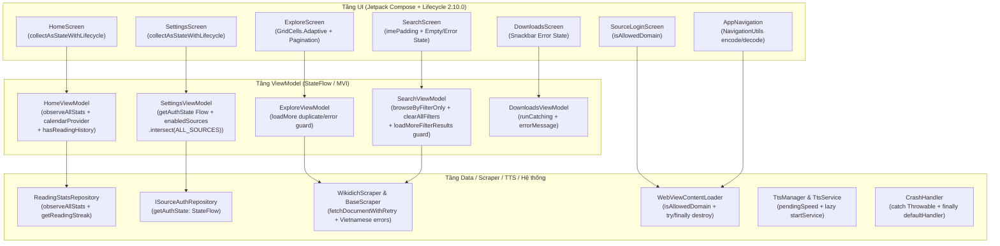

# Kế hoạch Triển khai: Khắc phục Báo cáo Kiểm toán — Phase 3 (UI/UX, ViewModel, Navigation, WebView, Scraper, TTS & Hệ thống)

> **Trạng thái**: Completed
> **Revision**: 2
> **Ngày tạo**: 2026-10-19
> **Tác giả**: `@planner`
> **Phạm vi**: Khắc phục 18 vấn đề từ Báo cáo Kiểm toán (`[CRIT-13]`, `[CRIT-14]`, `[CRIT-15]`, `[CRIT-16]`, `[HIGH-07]`, `[HIGH-08]`, `[HIGH-09]`, `[HIGH-11]`, `[HIGH-12]`, `[HIGH-13]`, `[HIGH-16]` phần `ShimmerEffect`, `[HIGH-17]`, `[HIGH-18]`, `[HIGH-19]`, `[MED-05]`, `[MED-06]`, `[MED-07]`, `[LOW-01]`) và toàn bộ 9 điểm phản hồi (`[BLOCKER-01]`, `[MAJOR-01]`..`[MAJOR-08]`) từ Audit Run 1.

---

## Technical Plan

### 1. Mục tiêu & Phạm vi

Kế hoạch này giải quyết **18 phát hiện kiểm toán** thuộc **Phase 3** (4 lỗi Critical, 10 lỗi High, 3 lỗi Medium, 1 lỗi Low) trong các tầng UI/Compose, ViewModel, Navigation, WebView, Scraper, TTS và CrashHandler. Phạm vi của Phase 3 **không chạm vào các file cấu hình nhạy cảm của Phase 4** (`AndroidManifest.xml`, `app/build.gradle.kts`, `proguard-rules.pro`, `AGENTS.md`, `.agents/**`, `data/remote/cookie/**`, `data/remote/auth/**`):

1. **`[CRIT-13]` (`HomeViewModel.kt`, `HomeScreen.kt`)**: Biểu đồ thống kê 7 ngày ở Trang chủ đang gắn nhãn cứng `"T2".."CN"` cho mảng 7 ngày trượt (`i in 6 downTo 0`), làm sai lệch thứ trong tuần (trừ Chủ Nhật), đồng thời chỉ tải 1 lần trong `init` mà không lắng nghe `readingStatsRepository.observeAllStats()`.
2. **`[HIGH-12]` (`HomeViewModel.kt`, `HomeScreen.kt`)**: Khi người dùng chọn chip bộ lọc `"Chưa xong"` (`HomeSortOption.UNFINISHED`) và tất cả truyện đang đọc đều đã đọc đến chương mới nhất, `recentlyRead` trả về rỗng khiến `HomeScreen` ẩn luôn hàng `FilterChip` và hiển thị màn hình trống toàn cục — không thể chuyển về `"Gần đây"` hay `"A → Z"`.
3. **`[CRIT-14]` (`SettingsScreen.kt`, `SettingsViewModel.kt`)**: Biểu thức `enabled = isEnabled || state.enabledSources.size < SettingsViewModel.ALL_SOURCES.size` ở `SettingsScreen.kt:408` bị viết ngược điều kiện (cho phép tắt hết mọi nguồn, và khóa không cho bật lại nguồn đã tắt nếu `enabledSources` chứa ID nguồn cũ làm `.size >= 3`).
4. **`[HIGH-17]` (`SettingsViewModel.kt`, `SettingsScreen.kt`)**: `SettingsViewModel` chỉ kiểm tra trạng thái đăng nhập Wikidich một lần trong `init` mà không lắng nghe `authRepository.getAuthState(SourceIds.WIKIDICH)`, và dòng giới thiệu ở `SettingsScreen.kt:886` vẫn liệt kê nguồn cũ (`TruyenCom`, `TruyenFull`) thay vì 3 nguồn hiện hành (`Tàng Thư Viện • SsTruyện • Wikidich`).
5. **`[CRIT-15]` (`ExploreViewModel.kt`, `SearchViewModel.kt`, `ExploreScreen.kt`)**: Khi `loadMore()` / `loadMoreFilterResults()` trả về danh sách trùng lặp với các truyện đã có (`merged.size == it.stories.size`) hoặc gặp lỗi mạng (`catch`), `canLoadMore` vẫn giữ `true` khiến `LaunchedEffect(shouldLoadMore)` lặp lại yêu cầu phân trang liên tục.
6. **`[HIGH-13]` (`SearchViewModel.kt`)**: Chọn bộ lọc số chương (`ChapterCountFilter`) hoặc trạng thái (`!completedOnly`) khi chưa nhập từ khóa và chưa chọn thể loại không kích hoạt truy vấn nào; xóa toàn bộ chip bộ lọc khi ô tìm kiếm trống vẫn giữ nguyên kết quả cũ.
7. **`[HIGH-19]` (`SearchViewModel.kt`, `SearchScreen.kt`, `DownloadsViewModel.kt`, `DownloadsScreen.kt`)**: `SearchViewModel` gán `error = "Không tìm thấy..."` khi kết quả rỗng làm `SearchScreen` hiển thị Error State thay vì Empty State; `DownloadsViewModel.deleteDownloads` và `deleteEntireStory` không bọc `runCatching` để bắt lỗi và hiển thị thông báo tiếng Việt.
8. **`[CRIT-16]` (`NavigationUtils.kt`, `AppNavigation.kt`, `StoryDetailViewModel.kt`, `ReaderViewModel.kt`)**: `NavigationUtils.encodeUrl("")` trả về chuỗi rỗng `""` làm hỏng cấu trúc segment của Navigation Compose (`story/{storyId}/{storyUrl}` và `reader/{storyId}/{chapterNumber}/{chapterUrl}`); `storyId` và `query` truyền trực tiếp vào route string chưa qua mã hóa an toàn.
9. **`[HIGH-07]` (`SourceLoginScreen.kt`, `WebViewContentLoader.kt`)**: Kiểm tra tên miền WebView bằng `host.contains(domain)` cho phép vượt qua bằng tên miền giả mạo (`evil-tangthuvien.vn`); `WebViewContentLoader.ALLOWED_DOMAINS` chứa danh sách nguồn lỗi thời; `WebViewContentLoader.loadContent` chưa đảm bảo hủy `WebView` và `Handler` trong khối `finally` khi `withTimeoutOrNull` hết hạn hoặc coroutine bị hủy.
10. **`[HIGH-08]` (`WikidichScraper.kt`, `BaseScraper.kt`)**: `WikidichScraper` gọi trực tiếp `fetchDocument(url)` thay vì `fetchDocumentWithRetry(url)` ở 9 vị trí lấy dữ liệu và `fetchAjaxFragment`, bỏ qua cơ chế thử lại khi gặp lỗi mạng tạm thời hoặc HTTP 5xx/429.
11. **`[HIGH-09]` (`CrashHandler.kt`)**: `CrashHandler.uncaughtException` chỉ bắt `catch (e: Exception)` thay vì `catch (t: Throwable)` và chưa đặt `defaultHandler?.uncaughtException(thread, throwable)` trong khối `finally`, dẫn đến nguy cơ treo tiến trình khi xảy ra `OutOfMemoryError` hoặc `StackOverflowError`.
12. **`[HIGH-11]` & `[LOW-01]` (`ScraperException.kt`, `BaseScraper.kt`, `ExploreViewModel.kt`, `SearchViewModel.kt`, `StoryDetailViewModel.kt`, `ReaderViewModel.kt`, `ReadingStatsScreen.kt`, `SettingsScreen.kt`)**: Rò rỉ thông báo lỗi tiếng Anh từ `e.localizedMessage`/`e.message` lên UI; còn nhãn tiếng Anh `"Streak"` ở `ReadingStatsScreen.kt:98` và `"streak"` ở `SettingsScreen.kt:523`; còn 3 toán tử `!!` ở `SettingsScreen.kt:786, 798, 820`.
13. **`[HIGH-16]` (`ShimmerEffect.kt`)**: `shimmerBrush` kiểm tra trực tiếp `isSystemInDarkTheme()` thay vì lấy màu từ `MaterialTheme.colorScheme`, làm lệch giao diện khi người dùng chọn chế độ Sáng/Tối thủ công trong cài đặt.
14. **`[HIGH-18]` (8 `*Screen.kt`)**: 8 màn hình chính dùng `collectAsState()` thay vì `collectAsStateWithLifecycle()`, giữ subscription hoạt động khi ứng dụng vào background.
15. **`[MED-05]` & `[MED-06]` (`AppNavigation.kt`, `ChapterListPanel.kt`, `SearchScreen.kt`, `ExploreScreen.kt`, `SplashScreen.kt`)**: Thiếu `contentWindowInsets = WindowInsets(0, 0, 0, 0)` và `consumeWindowInsets(innerPadding)` ở `Scaffold` ngoài cùng, thiếu `safeDrawingPadding()` ở `ChapterListPanel`, thiếu `imePadding()` ở `SearchScreen`; `ExploreScreen` cố định `GridCells.Fixed(2)` thay vì `GridCells.Adaptive(minSize = 150.dp)`; `SplashScreen` giữ `delay(2500)` dài.
16. **`[MED-07]` (`TtsService.kt`, `TtsManager.kt`)**: `TtsService.setSpeed()` chưa lưu `pendingSpeed` khi `TextToSpeech` chưa khởi tạo xong (`!_state.value.isInitialized`), làm mất tốc độ đọc đã cài đặt; `TtsManager.init` gọi `context.startService()` ngay khi khởi tạo dù chưa phát TTS, và chưa tự kết nối lại khi người dùng bấm `play()` / `seekAndPlay()` lúc service chưa bind.

---

### 2. Tài liệu đã đọc (Pre-Work Reading)

- **Governance & Rules**: `AGENTS.md`, `.agents/rules/00-core.md`, `.agents/rules/01-coding.md`, `.agents/rules/02-quality.md`, `.agents/rules/03-ui.md`, `.agents/rules/04-scraping.md`, `.agents/rules/05-plan-review.md`, `.agents/rules/06-docs.md`.
- **Project Documentation**: `docs/architecture.md`, `docs/progress.md`, `docs/scraping.md`, `docs/lessons-learned.md`, `docs/plans/README.md`, `docs/plans/2026-10-18-full-codebase-audit-report.md`.
- **Source Files Inspected**:
  - UI & Navigation: `ui/navigation/AppNavigation.kt`, `ui/home/HomeScreen.kt`, `ui/home/HomeViewModel.kt`, `ui/settings/SettingsScreen.kt`, `ui/settings/SettingsViewModel.kt`, `ui/settings/SourceLoginScreen.kt`, `ui/explore/ExploreScreen.kt`, `ui/explore/ExploreViewModel.kt`, `ui/search/SearchScreen.kt`, `ui/search/SearchViewModel.kt`, `ui/downloads/DownloadsScreen.kt`, `ui/downloads/DownloadsViewModel.kt`, `ui/stats/ReadingStatsScreen.kt`, `ui/stats/ReadingStatsViewModel.kt`, `ui/detail/StoryDetailScreen.kt`, `ui/detail/StoryDetailViewModel.kt`, `ui/reader/ReaderScreen.kt`, `ui/reader/ReaderViewModel.kt`, `ui/reader/components/ChapterListPanel.kt`, `ui/splash/SplashScreen.kt`, `ui/components/ShimmerEffect.kt`.
  - Data, Scraper, TTS & Util: `data/repository/ReadingStatsRepository.kt`, `data/repository/IStoryRepository.kt`, `data/repository/IDownloadRepository.kt`, `data/remote/auth/ISourceAuthRepository.kt`, `data/remote/auth/SourceAuthPlatform.kt`, `data/remote/ScraperException.kt`, `data/remote/BaseScraper.kt`, `data/remote/WikidichScraper.kt`, `data/remote/WebViewContentLoader.kt`, `tts/TtsService.kt`, `tts/TtsManager.kt`, `util/NavigationUtils.kt`, `util/CrashHandler.kt`, `gradle/libs.versions.toml`.
  - Existing Unit Tests: `HomeViewModelTest.kt`, `SettingsViewModelTest.kt`, `ExploreViewModelTest.kt`, `SearchViewModelTest.kt`, `DownloadsViewModelTest.kt`, `NavigationUtilsTest.kt`, `WikidichScraperTest.kt`, `TtsManagerTest.kt`.

---

### 3. Giả định & Phụ thuộc Liên Task (Assumptions & Cross-Task Dependencies)

- **`[SRC]` `AppNavigation.kt:51-83`**: Route thực tế của `Screen.StoryDetail` là `"story/{storyId}/{storyUrl}"` (không phải `"detail/..."`), của `Screen.Reader` là `"reader/{storyId}/{chapterNumber}/{chapterUrl}"`, và của `Screen.Search` là `"search?query={query}"`.
- **`[SRC]` `ReadingStatsRepository.kt:53, 60, 92`**: `ReadingStatsRepository` cung cấp 3 hàm truy vấn: `suspend fun getRecentStats(days: Int = 7): List<ReadingStatsEntity>`, `suspend fun getReadingStreak(): Int`, và `fun observeAllStats(): Flow<List<ReadingStatsEntity>>`. Mỗi `ReadingStatsEntity` chứa `date: String` (`"yyyy-MM-dd"`), `totalReadingTimeMs: Long`, `chaptersRead: Int`.
- **`[SRC]` `ISourceAuthRepository.kt:18` & `SourceAuthPlatform.kt:23-61`**: `ISourceAuthRepository.getAuthState(sourceId: String)` trả về `StateFlow<Boolean>` (không có sealed class `SourceAuthState`). Danh sách host cho phép theo từng nguồn được định nghĩa tại `SourceAuthPlatform.SourceAuthConfig.allowlistHosts: Set<String>`.
- **`[SRC]` `SettingsViewModel.kt:41, 144-149, 238-249`**: `SettingsViewModel` quản lý `enabledSources: Set<String>` thông qua `SettingsKeys.ENABLED_SOURCES` và `ALL_SOURCES = setOf(SourceIds.TANGTHUVIEN, SourceIds.SSTRUYEN, SourceIds.WIKIDICH)`, với hàm `fun toggleSource(sourceId: String)` nhận 1 tham số.
- **`[SRC]` `IStoryRepository.kt:15-33`**: `IStoryRepository` cung cấp `getCompletedStories(page: Int = 1): List<Story>`, `getStoriesByGenre(genreUrl: String, page: Int = 1, sourceId: String? = null): List<Story>`, `getGenreList(): List<Genre>`, và `searchStories(query: String): List<Story>`. Khi người dùng lọc theo số chương (`ChapterCountFilter`) mà không nhập từ khóa và không chọn thể loại, `SearchViewModel` sử dụng `repository.getCompletedStories(page)` kết hợp `applyLocalFilters(stories)`.
- **`[SRC]` `DownloadsViewModel.kt:16, 66-76` & `IDownloadRepository.kt:20-21`**: Thuộc tính trong `DownloadsViewModel` tên là `private val repository: IDownloadRepository`, gọi `repository.deleteAllDownloads(storyId)` và `repository.deleteStory(storyId)`.
- **`[SRC]` `ScraperException.kt:1-83`**: Hệ thống phân loại lỗi scraper gồm 7 lớp con: `NetworkException`, `HttpException(val statusCode: Int, val url: String, cause: Throwable? = null)`, `ParseException`, `CacheException`, `CircuitOpenException`, `LoginRequiredException`, và `UnknownException`.
- **`[ASSUMPTION — VERIFIED]` Phụ thuộc Phase 1 & Phase 2**: Các sửa đổi ở Phase 1 (Room DAO/Repository) và Phase 2 (Cookie/Scraper/TTS core) đã hoàn tất và ổn định. Phase 3 tiêu thụ trực tiếp các API hiện hữu của `ReadingStatsRepository`, `IStoryRepository`, `IDownloadRepository`, `ISourceAuthRepository`, `BaseScraper`, và `TtsService` mà không cần thay đổi chữ ký interface ở tầng Repository/Auth.

---

### 4. Bảng Phiên bản Đã Xác minh (Verified Versions Table)

Dữ liệu trích xuất trực tiếp từ `gradle/libs.versions.toml` và `app/build.gradle.kts` (`[SRC]`):

| Thành phần / Thư viện | Phiên bản (`libs.versions.toml` / `build.gradle.kts`) | Ghi chú xác minh API sử dụng trong Phase 3 |
| :--- | :--- | :--- |
| `compileSdk` / `targetSdk` / `minSdk` | `36` / `35` / `26` | Tương thích `WindowInsets`, `safeDrawingPadding`, `imePadding`, `WebResourceRequest` |
| Kotlin (`kotlin`) | `2.3.10` | Hỗ trợ chuẩn coroutines, `entries` trên `enum class`, smart cast |
| Android Gradle Plugin (`agp`) | `9.1.0` | Tương thích cấu hình build hiện tại |
| Jetpack Compose BOM (`composeBom`) | `2026.02.01` | Cung cấp `LazyVerticalGrid`, `GridCells.Adaptive`, `FilterChip`, `consumeWindowInsets` |
| Lifecycle (`lifecycle`) | `2.10.0` | Cung cấp `collectAsStateWithLifecycle()` trong `androidx.lifecycle.compose` |
| Coroutines (`coroutines`) | `1.10.2` | Cung cấp `StateFlow`, `SharingStarted.WhileSubscribed`, `withTimeoutOrNull` |
| Room (`room`) | `3.0.0` | Cung cấp `Flow<List<ReadingStatsEntity>>` từ `ReadingStatsDao` |
| OkHttp (`okhttp`) / Jsoup (`jsoup`) | `5.3.2` / `1.22.1` | Dùng trong `BaseScraper` và `WikidichScraper` |
| Media3 (`media3`) | `1.10.0` | Dùng trong `TtsService` (`MediaSessionService`) |
| DataStore (`datastore`) | `1.2.1` | Dùng trong `SettingsViewModel` (`Preferences`) |

---

### 5. Kiến trúc & Luồng Dữ liệu (Mermaid)



---

### 6. Danh sách File Dự kiến Thay đổi

> **Cam kết phạm vi**: Không chạm vào bất kỳ file nhạy cảm nào thuộc Phase 4 (`AndroidManifest.xml`, `app/build.gradle.kts`, `proguard-rules.pro`, `AGENTS.md`, `.agents/**`, `data/remote/cookie/**`, `data/remote/auth/**`).

| File | Thao tác | Layer | Mô tả thay đổi |
| :--- | :---: | :---: | :--- |
| `app/src/main/java/com/personal/apptruyen/ui/home/HomeViewModel.kt` | `[MODIFY]` | ViewModel | `[CRIT-13]`, `[HIGH-12]`: Thêm `DayChapterStat`, bổ sung `weeklyStats` vào `ReadingStatsState` (giữ nguyên 4 trường cũ), lắng nghe `readingStatsRepository.observeAllStats()`, tính nhãn thứ từ `calendarProvider`, thêm `hasReadingHistory: StateFlow<Boolean>`. |
| `app/src/main/java/com/personal/apptruyen/ui/home/HomeScreen.kt` | `[MODIFY]` | UI | `[CRIT-13]`, `[HIGH-12]`, `[HIGH-18]`: Dùng `collectAsStateWithLifecycle()`, hiển thị nhãn thứ động từ `stats.weeklyStats`, giữ hàng `FilterChip` khi bộ lọc `"Chưa xong"` trả về rỗng. |
| `app/src/main/java/com/personal/apptruyen/ui/settings/SettingsViewModel.kt` | `[MODIFY]` | ViewModel | `[CRIT-14]`, `[HIGH-17]`: Lắng nghe `authRepository.getAuthState(SourceIds.WIKIDICH)` (`StateFlow<Boolean>`), lọc `enabledSources` qua `.intersect(ALL_SOURCES).ifEmpty { ALL_SOURCES }`, bảo vệ nguồn cuối cùng trong `toggleSource(sourceId)`. |
| `app/src/main/java/com/personal/apptruyen/ui/settings/SettingsScreen.kt` | `[MODIFY]` | UI | `[CRIT-14]`, `[HIGH-17]`, `[HIGH-18]`, `[LOW-01]`: Dùng `collectAsStateWithLifecycle()` ở cả 4 vị trí (dòng 39, 40, 41, 652), sửa điều kiện `Switch(enabled = !isEnabled \|\| state.enabledSources.size > 1)`, bỏ 3 toán tử `!!`, sửa `"streak"` và tên 3 nguồn truyện. |
| `app/src/main/java/com/personal/apptruyen/ui/explore/ExploreViewModel.kt` | `[MODIFY]` | ViewModel | `[CRIT-15]`, `[HIGH-11]`: Ngắt `canLoadMore = false` trong `loadMore()` khi không có truyện mới sau deduplicate hoặc khi `catch` lỗi; chuẩn hóa thông báo lỗi tiếng Việt. |
| `app/src/main/java/com/personal/apptruyen/ui/explore/ExploreScreen.kt` | `[MODIFY]` | UI | `[CRIT-15]`, `[HIGH-18]`, `[MED-06]`: Dùng `collectAsStateWithLifecycle()`, đổi sang `GridCells.Adaptive(minSize = 150.dp)`. |
| `app/src/main/java/com/personal/apptruyen/ui/search/SearchViewModel.kt` | `[MODIFY]` | ViewModel | `[CRIT-15]`, `[HIGH-11]`, `[HIGH-13]`, `[HIGH-19]`: Không gán `error` khi kết quả rỗng; thêm `browseByFilterOnly(chapterFilter)` cho `applyFilter`, `applyAllFilters`, `toggleCompletedFilter`; làm mới danh sách trong `clearAllFilters()`; ngắt `canLoadMore` trong `loadMoreFilterResults()`. |
| `app/src/main/java/com/personal/apptruyen/ui/search/SearchScreen.kt` | `[MODIFY]` | UI | `[HIGH-18]`, `[HIGH-19]`, `[MED-05]`: Dùng `collectAsStateWithLifecycle()`, thêm `imePadding()`. |
| `app/src/main/java/com/personal/apptruyen/ui/downloads/DownloadsViewModel.kt` | `[MODIFY]` | ViewModel | `[HIGH-19]`: Bọc `runCatching` trong `deleteDownloads` và `deleteEntireStory` (gọi `repository.deleteAllDownloads` và `repository.deleteStory`), thêm `errorMessage: StateFlow<String?>` và `clearError()`. |
| `app/src/main/java/com/personal/apptruyen/ui/downloads/DownloadsScreen.kt` | `[MODIFY]` | UI | `[HIGH-18]`, `[HIGH-19]`: Dùng `collectAsStateWithLifecycle()`, thêm `SnackbarHost` hiển thị `errorMessage` tiếng Việt. |
| `app/src/main/java/com/personal/apptruyen/util/NavigationUtils.kt` | `[MODIFY]` | Util | `[CRIT-16]`: Trả về sentinel `"_"` khi `encodeUrl` / `encodeRouteParam` nhận chuỗi rỗng/blank, bổ sung `encodeRouteParam` / `decodeRouteParam` (Base64 URL-safe có tiền tố `"b64_"`). |
| `app/src/main/java/com/personal/apptruyen/ui/navigation/AppNavigation.kt` | `[MODIFY]` | UI / Nav | `[CRIT-16]`, `[MED-05]`: Dùng `encodeRouteParam` / `decodeRouteParam` cho `storyId` và `query` với đúng route `"story/$encodedId/$encodedUrl"`, `"reader/$encodedId/$chapterNumber/$encodedUrl"`, `"search?query=..."`; thêm `contentWindowInsets` và `consumeWindowInsets`. |
| `app/src/main/java/com/personal/apptruyen/ui/detail/StoryDetailViewModel.kt` | `[MODIFY]` | ViewModel | `[CRIT-16]`, `[HIGH-11]`: Giải mã `storyId` qua `NavigationUtils.decodeRouteParam`, chuẩn hóa thông báo lỗi tiếng Việt. |
| `app/src/main/java/com/personal/apptruyen/ui/detail/StoryDetailScreen.kt` | `[MODIFY]` | UI | `[HIGH-18]`: Đổi `collectAsState()` sang `collectAsStateWithLifecycle()`. |
| `app/src/main/java/com/personal/apptruyen/ui/reader/ReaderViewModel.kt` | `[MODIFY]` | ViewModel | `[CRIT-16]`, `[HIGH-11]`: Giải mã `storyId` qua `NavigationUtils.decodeRouteParam`, chuẩn hóa thông báo lỗi tiếng Việt. |
| `app/src/main/java/com/personal/apptruyen/ui/reader/ReaderScreen.kt` | `[MODIFY]` | UI | `[HIGH-18]`: Đổi `collectAsState()` sang `collectAsStateWithLifecycle()`. |
| `app/src/main/java/com/personal/apptruyen/ui/reader/components/ChapterListPanel.kt` | `[MODIFY]` | UI | `[MED-05]`: Thêm `.safeDrawingPadding()` cho panel danh sách chương. |
| `app/src/main/java/com/personal/apptruyen/ui/stats/ReadingStatsScreen.kt` | `[MODIFY]` | UI | `[HIGH-18]`, `[LOW-01]`: Đổi `collectAsState()` sang `collectAsStateWithLifecycle()`, đổi nhãn `"Streak"` (dòng 98) thành `"Chuỗi ngày"`. |
| `app/src/main/java/com/personal/apptruyen/ui/splash/SplashScreen.kt` | `[MODIFY]` | UI | `[MED-06]`: Giảm thời gian chờ khởi động từ `delay(2500)` xuống `delay(800)`. |
| `app/src/main/java/com/personal/apptruyen/ui/components/ShimmerEffect.kt` | `[MODIFY]` | UI | `[HIGH-16]`: Lấy màu shimmer từ `MaterialTheme.colorScheme.surfaceVariant` và `surfaceContainerHigh` thay vì `isSystemInDarkTheme()`. |
| `app/src/main/java/com/personal/apptruyen/ui/settings/SourceLoginScreen.kt` | `[MODIFY]` | UI | `[HIGH-07]`: Kiểm tra tên miền điều hướng WebView qua `WebViewContentLoader.isAllowedDomain(uri.host, config.allowlistHosts)`. |
| `app/src/main/java/com/personal/apptruyen/data/remote/WebViewContentLoader.kt` | `[MODIFY]` | Data / Remote | `[HIGH-07]`: Cập nhật `ALLOWED_DOMAINS`, thêm `isAllowedDomain`, kiểm tra URL đầu vào và bọc `try { ... } finally { safeDestroyWebView() }` để giải phóng `WebView` + `mainHandler`. |
| `app/src/main/java/com/personal/apptruyen/data/remote/ScraperException.kt` | `[MODIFY]` | Data / Remote | `[HIGH-11]`: Chuẩn hóa thông báo tiếng Việt cho `HttpException` và `Exception.toScraperException`, không nối chuỗi `this.message` tiếng Anh. |
| `app/src/main/java/com/personal/apptruyen/data/remote/BaseScraper.kt` | `[MODIFY]` | Data / Remote | `[HIGH-08]`, `[HIGH-11]`: Không retry lỗi không tạm thời (`ParseException`, `LoginRequiredException`, `CircuitOpenException`, HTTP 4xx trừ 408/429) trong `fetchDocumentWithRetry`; bỏ `${e.message}` ở `getChapterContent`. |
| `app/src/main/java/com/personal/apptruyen/data/remote/WikidichScraper.kt` | `[MODIFY]` | Data / Remote | `[HIGH-08]`: Đổi 9 lệnh gọi `fetchDocument` sang `fetchDocumentWithRetry` và bổ sung vòng lặp retry kèm exponential backoff trong `fetchAjaxFragment(url, referer)`. |
| `app/src/main/java/com/personal/apptruyen/util/CrashHandler.kt` | `[MODIFY]` | Util | `[HIGH-09]`: Đổi constructor sang `internal constructor`, bắt `catch (t: Throwable)` khi ghi crash log và luôn gọi `defaultHandler?.uncaughtException(thread, throwable)` trong `finally`. |
| `app/src/main/java/com/personal/apptruyen/tts/TtsService.kt` | `[MODIFY]` | TTS | `[MED-07]`: Thêm `pendingSpeed: Float? = null`, lưu `pendingSpeed`/`pendingPitch` khi `!_state.value.isInitialized` và áp dụng trong `initTts()`. |
| `app/src/main/java/com/personal/apptruyen/tts/TtsManager.kt` | `[MODIFY]` | TTS | `[MED-07]`: Không gọi `startService` trong `init`, cập nhật `_state` cho `setSpeed`/`setPitch` khi chưa bind, tự động `startService` + `bindService` và xếp hàng `pendingPlay`/`pendingSeekAndPlayIndex` khi bấm phát. |
| `app/src/test/java/com/personal/apptruyen/ui/home/HomeViewModelTest.kt` | `[MODIFY]` | Test | Bổ sung unit test cho `weeklyStats` (`calendarProvider`), lắng nghe `observeAllStats`, và `hasReadingHistory`. |
| `app/src/test/java/com/personal/apptruyen/ui/settings/SettingsViewModelTest.kt` | `[MODIFY]` | Test | Bổ sung unit test cho lọc nguồn cũ (`intersect(ALL_SOURCES)`), khóa tắt nguồn cuối cùng, và lắng nghe `authRepository.getAuthState(SourceIds.WIKIDICH)`. |
| `app/src/test/java/com/personal/apptruyen/ui/explore/ExploreViewModelTest.kt` | `[MODIFY]` | Test | Bổ sung unit test cho `loadMore()` dừng `canLoadMore` khi trùng lặp hoặc khi lỗi mạng, và thông báo lỗi tiếng Việt. |
| `app/src/test/java/com/personal/apptruyen/ui/search/SearchViewModelTest.kt` | `[MODIFY]` | Test | Cập nhật test kết quả rỗng theo Loại C (`error == null`) và thêm test cho `applyFilter`/`applyAllFilters` chỉ có `ChapterCountFilter`, `clearAllFilters`, `loadMoreFilterResults`. |
| `app/src/test/java/com/personal/apptruyen/ui/downloads/DownloadsViewModelTest.kt` | `[MODIFY]` | Test | Bổ sung unit test cho `deleteDownloads` và `deleteEntireStory` khi `repository` ném ngoại lệ. |
| `app/src/test/java/com/personal/apptruyen/util/NavigationUtilsTest.kt` | `[MODIFY]` | Test | Bổ sung unit test cho sentinel `"_"` và `encodeRouteParam` / `decodeRouteParam`. |
| `app/src/test/java/com/personal/apptruyen/data/remote/WebViewContentLoaderTest.kt` | `[NEW]` | Test | Tạo unit test cho `WebViewContentLoader.isAllowedDomain` (exact domain, dot-subdomain, giả mạo prefix/suffix, `null`/blank). |
| `app/src/test/java/com/personal/apptruyen/util/CrashHandlerTest.kt` | `[NEW]` | Test | Tạo unit test cho `CrashHandler.uncaughtException` khi xảy ra `OutOfMemoryError` (`Throwable`) vẫn chuyển tiếp về `defaultHandler` trong `finally`. |
| `app/src/test/java/com/personal/apptruyen/data/remote/WikidichScraperTest.kt` | `[MODIFY]` | Test | Bổ sung unit test kiểm tra `WikidichScraper` tự động retry khi gặp HTTP 503 và không retry khi gặp HTTP 404. |
| `app/src/test/java/com/personal/apptruyen/tts/TtsManagerTest.kt` | `[MODIFY]` | Test | Bổ sung unit test kiểm tra `TtsManager` không gọi `startService` khi khởi tạo, cập nhật `speed` trên `state`, và xếp hàng `play()` cho tới khi `onServiceConnected`. |

---

### 7. Thiết kế Kỹ thuật Chi tiết & Checklist Triển khai

#### Cụm 1: Trang chủ — Nhãn thứ động cho Thống kê 7 ngày & Bộ lọc `"Chưa xong"` (`[CRIT-13]`, `[HIGH-12]`, `[MAJOR-02]`)

- [ ] **Bước 1.1**: Cập nhật `HomeViewModel.kt` (`app/src/main/java/com/personal/apptruyen/ui/home/HomeViewModel.kt:40-154`):
  - Giữ nguyên 4 thuộc tính hiện hữu của `ReadingStatsState` (`todayChapters`, `todayMinutes`, `currentStreak`, `weeklyChapters`) để tương thích với các thành phần UI trong `HomeScreen.kt:426, 472, 485, 502, 526, 536, 564`, đồng thời bổ sung `DayChapterStat` và `weeklyStats`:
    ```kotlin
    data class DayChapterStat(
        val label: String,
        val chapters: Int,
        val isToday: Boolean = false,
    )

    data class ReadingStatsState(
        val todayChapters: Int = 0,
        val todayMinutes: Int = 0,
        val currentStreak: Int = 0,
        val weeklyChapters: ImmutableList<Int> = persistentListOf(),
        val weeklyStats: ImmutableList<DayChapterStat> = persistentListOf(),
    )
    ```
  - Bổ sung `val hasReadingHistory: StateFlow<Boolean>` dựa trên `rawRecentlyRead` (trước khi lọc theo `HomeSortOption.UNFINISHED`):
    ```kotlin
    val hasReadingHistory: StateFlow<Boolean> =
        rawRecentlyRead
            .map { it.isNotEmpty() }
            .stateIn(viewModelScope, SharingStarted.WhileSubscribed(5000), false)
    ```
  - Thêm hằng số ánh xạ thứ trong tuần từ `Calendar.DAY_OF_WEEK` (`1 = SUNDAY` .. `7 = SATURDAY`):
    ```kotlin
    companion object {
        private val DAY_LABELS = listOf("CN", "T2", "T3", "T4", "T5", "T6", "T7")
    }
    ```
  - Thêm thuộc tính `internal var calendarProvider: () -> Calendar = { Calendar.getInstance() }` để phục vụ kiểm thử đơn vị với ngày cố định.
  - Trong `init` (`HomeViewModel.kt:101-103`), thay thế `loadReadingStats()` một lần bằng việc lắng nghe `readingStatsRepository.observeAllStats()` (`ReadingStatsRepository.kt:92`):
    ```kotlin
    init {
        observeReadingStats()
    }

    private fun observeReadingStats() {
        viewModelScope.launch {
            readingStatsRepository
                .observeAllStats()
                .catch { e -> Timber.w(e, "Failed to observe reading stats") }
                .collect { allStats ->
                    recalculateReadingStats(allStats)
                }
        }
    }

    private suspend fun recalculateReadingStats(allStats: List<ReadingStatsEntity>) {
        try {
            val streak = readingStatsRepository.getReadingStreak()
            val statsByDate = allStats.associateBy { it.date }
            val sdf = SimpleDateFormat("yyyy-MM-dd", Locale.getDefault())
            val baseCal = calendarProvider()
            val todayStr = sdf.format(baseCal.time)
            val todayStat = statsByDate[todayStr]
            val todayMinutes = ((todayStat?.totalReadingTimeMs ?: 0L) / 60_000).toInt()
            val todayChapters = todayStat?.chaptersRead ?: 0

            val weeklyChaptersList = mutableListOf<Int>()
            val weeklyStatsList = mutableListOf<DayChapterStat>()
            for (i in 6 downTo 0) {
                val tempCal = (baseCal.clone() as Calendar).apply { add(Calendar.DAY_OF_YEAR, -i) }
                val dateStr = sdf.format(tempCal.time)
                val chapters = statsByDate[dateStr]?.chaptersRead ?: 0
                val dayOfWeek = tempCal.get(Calendar.DAY_OF_WEEK) // 1 (CN) .. 7 (T7)
                val label = DAY_LABELS.getOrElse(dayOfWeek - 1) { "" }
                weeklyChaptersList.add(chapters)
                weeklyStatsList.add(
                    DayChapterStat(
                        label = label,
                        chapters = chapters,
                        isToday = (i == 0),
                    ),
                )
            }

            _readingStats.value =
                ReadingStatsState(
                    todayChapters = todayChapters,
                    todayMinutes = todayMinutes,
                    currentStreak = streak,
                    weeklyChapters = weeklyChaptersList.toImmutableList(),
                    weeklyStats = weeklyStatsList.toImmutableList(),
                )
        } catch (e: CancellationException) {
            throw e
        } catch (e: Exception) {
            Timber.w(e, "Failed to recalculate reading stats")
        }
    }
    ```
    Giữ lại `fun refreshReadingStats()` gọi `recalculateReadingStats(readingStatsRepository.getRecentStats(7))` để tương thích với các lệnh gọi làm mới thủ công.

- [ ] **Bước 1.2**: Cập nhật `HomeScreen.kt` (`app/src/main/java/com/personal/apptruyen/ui/home/HomeScreen.kt:40-44, 128-171, 501-582`):
  - Tại dòng 40–44: đổi 5 lệnh `collectAsState()` sang `collectAsStateWithLifecycle()` và thu thập thêm `val hasReadingHistory by viewModel.hasReadingHistory.collectAsStateWithLifecycle()`.
  - Tại tab `"Đang đọc"` (`page == 0`, dòng 128–171): tách trường hợp chưa từng đọc truyện nào (`!hasReadingHistory && recentlyRead.isEmpty()`) khỏi trường hợp bộ lọc `"Chưa xong"` (`HomeSortOption.UNFINISHED`) trả về rỗng khi người dùng đã đọc hết các chương hiện có:
    ```kotlin
    0 -> {
        if (!hasReadingHistory && recentlyRead.isEmpty()) {
            AnimatedEmptyState(
                icon = Icons.AutoMirrored.Filled.MenuBook,
                message = "Chưa có truyện nào đang đọc.\nHãy khám phá hoặc tìm kiếm truyện mới!",
                actionText = "Tìm truyện ngay",
                onActionClick = onSearchClick,
            )
        } else {
            Column(modifier = Modifier.fillMaxSize()) {
                Row(
                    modifier =
                        Modifier
                            .fillMaxWidth()
                            .padding(horizontal = 16.dp, vertical = 6.dp),
                    horizontalArrangement = Arrangement.spacedBy(8.dp),
                    verticalAlignment = Alignment.CenterVertically,
                ) {
                    HomeSortOption.entries.forEach { option ->
                        FilterChip(
                            selected = sortOption == option,
                            onClick = { viewModel.setSortOption(option) },
                            label = {
                                Text(
                                    option.label,
                                    style = MaterialTheme.typography.labelSmall,
                                )
                            },
                            modifier = Modifier.height(30.dp),
                        )
                    }
                }
                if (recentlyRead.isEmpty()) {
                    AnimatedEmptyState(
                        icon = Icons.Default.DoneAll,
                        message = "Tất cả truyện đang đọc đều đã hoàn thành đến chương mới nhất.",
                        actionText = "Xem gần đây",
                        onActionClick = { viewModel.setSortOption(HomeSortOption.RECENT) },
                    )
                } else {
                    ReadingListContent(
                        items = recentlyRead,
                        updatingIds = updatingIds,
                        onStoryClick = onStoryClick,
                        onContinueReading = onContinueReading,
                        onDeleteHistory = { viewModel.deleteHistory(it) },
                    )
                }
            }
        }
    }
    ```
  - Tại `ReadingStatsTab` (`HomeScreen.kt:501-582`): thay mảng nhãn cứng `val dayLabels = listOf("T2", "T3", "T4", "T5", "T6", "T7", "CN")` bằng việc lấy nhãn và cờ `isToday` từ `stats.weeklyStats`:
    ```kotlin
    val dayStat = stats.weeklyStats.getOrNull(idx)
    val isToday = dayStat?.isToday ?: (idx == stats.weeklyChapters.lastIndex)
    // ...
    Text(
        text = dayStat?.label ?: "",
        style = MaterialTheme.typography.labelSmall,
        fontWeight = if (isToday) FontWeight.Bold else FontWeight.Normal,
        color =
            if (isToday) {
                MaterialTheme.colorScheme.primary
            } else {
                MaterialTheme.colorScheme.onSurfaceVariant
            },
    )
    ```

---

#### Cụm 2: Cài đặt — Công tắc Nguồn truyện, Trạng thái Đăng nhập Wikidich & Chuẩn hóa UI (`[CRIT-14]`, `[HIGH-17]`, `[LOW-01]`, `[MAJOR-03]`)

- [ ] **Bước 2.1**: Cập nhật `SettingsViewModel.kt` (`app/src/main/java/com/personal/apptruyen/ui/settings/SettingsViewModel.kt:106-152, 238-249`):
  - Trong `init` (`SettingsViewModel.kt:106-108`), bên cạnh `checkAuthStatus()`, lắng nghe `authRepository.getAuthState(SourceIds.WIKIDICH)` (kiểu `StateFlow<Boolean>` tại `ISourceAuthRepository.kt:18`) để tự động đồng bộ `isWikidichLoggedInFlow` mỗi khi người dùng đăng nhập hoặc đăng xuất:
    ```kotlin
    init {
        checkAuthStatus()
        viewModelScope.launch {
            authRepository.getAuthState(SourceIds.WIKIDICH).collect { loggedIn ->
                isWikidichLoggedInFlow.value = loggedIn
            }
        }
    }
    ```
  - Tại `state: StateFlow<SettingsState>` (`SettingsViewModel.kt:144-149`), lọc bỏ mọi ID nguồn cũ không còn nằm trong `ALL_SOURCES` (như `"truyencom"`, `"truyenfull"` từ bản lưu cũ) bằng `.intersect(ALL_SOURCES)`:
    ```kotlin
    enabledSources =
        prefs[SettingsKeys.ENABLED_SOURCES]
            ?.split(",")
            ?.filter { it.isNotBlank() }
            ?.toSet()
            ?.intersect(ALL_SOURCES)
            ?.ifEmpty { ALL_SOURCES }
            ?: ALL_SOURCES,
    ```
  - Tại `fun toggleSource(sourceId: String)` (`SettingsViewModel.kt:238-249`, giữ nguyên chữ ký 1 tham số `sourceId: String`), chuẩn hóa tập nguồn hiện hành trước khi thêm/xóa và đảm bảo không cho phép xóa nguồn đang bật cuối cùng:
    ```kotlin
    fun toggleSource(sourceId: String) {
        viewModelScope.launch {
            val current =
                state.value.enabledSources
                    .intersect(ALL_SOURCES)
                    .ifEmpty { ALL_SOURCES }
                    .toMutableSet()
            if (current.contains(sourceId)) {
                if (current.size > 1) current.remove(sourceId)
            } else if (sourceId in ALL_SOURCES) {
                current.add(sourceId)
            }
            dataStore.edit { it[SettingsKeys.ENABLED_SOURCES] = current.joinToString(",") }
        }
    }
    ```

- [ ] **Bước 2.2**: Cập nhật `SettingsScreen.kt` (`app/src/main/java/com/personal/apptruyen/ui/settings/SettingsScreen.kt:39-41, 404-410, 523, 652, 778-830, 886`):
  - Đổi cả **4** vị trí `collectAsState()` sang `collectAsStateWithLifecycle()`:
    - Dòng 39: `val state by viewModel.state.collectAsStateWithLifecycle()`
    - Dòng 40: `val backupState by viewModel.backupState.collectAsStateWithLifecycle()`
    - Dòng 41: `val backupProgressText by viewModel.backupProgressText.collectAsStateWithLifecycle()`
    - Dòng 652: `val crashLogs by viewModel.crashLogs.collectAsStateWithLifecycle()`
  - Tại dòng 408 (`Switch` bật/tắt nguồn truyện): sửa điều kiện `enabled` bị ngược thành:
    ```kotlin
    Switch(
        checked = isEnabled,
        onCheckedChange = { viewModel.toggleSource(sourceId) },
        enabled = !isEnabled || state.enabledSources.size > 1,
    )
    ```
    *(Khi nguồn đang tắt `!isEnabled`, người dùng luôn bật lại được; khi nguồn đang bật `isEnabled`, người dùng chỉ tắt được nếu còn hơn 1 nguồn đang bật).*
  - Tại dòng 523: đổi `"Xem thời gian đọc, streak, biểu đồ"` thành `"Xem thời gian đọc, chuỗi ngày, biểu đồ"`.
  - Tại dòng 778–830: thay `if (selectedCrashLog != null)` và 3 toán tử `selectedCrashLog!!` (dòng 786, 798, 820) bằng `selectedCrashLog?.let { crashLog -> ... }`.
  - Tại dòng 886: đổi `"Đa nguồn: TruyenCom • TàngThưViện • SsTruyện • TruyenFull"` thành `"Đa nguồn: Tàng Thư Viện • SsTruyện • Wikidich"`.

---

#### Cụm 3: Khám phá, Tìm kiếm & Tải xuống — Chống lặp phân trang, Bộ lọc độc lập & Xử lý lỗi (`[CRIT-15]`, `[HIGH-13]`, `[HIGH-19]`, `[MAJOR-04]`, `[MAJOR-05]`)

- [ ] **Bước 3.1**: Cập nhật `ExploreViewModel.kt` (`app/src/main/java/com/personal/apptruyen/ui/explore/ExploreViewModel.kt:105-148, 179-184`):
  - Trong `loadMore()` (`ExploreViewModel.kt:114-148`): kiểm tra xem sau khi gộp và khử trùng lặp `val merged = deduplicateStories(it.stories + moreStories)` có thêm được truyện mới nào không (`val hasNewItems = merged.size > it.stories.size`). Nếu `moreStories.isEmpty() || !hasNewItems`, đặt `canLoadMore = false` và không tăng `currentPage` khi không có mục mới:
    ```kotlin
    _state.update {
        val merged = deduplicateStories(it.stories + moreStories)
        val hasNewItems = merged.size > it.stories.size
        it.copy(
            stories = merged.toImmutableList(),
            isLoadingMore = false,
            currentPage = if (hasNewItems) nextPage else it.currentPage,
            canLoadMore = moreStories.isNotEmpty() && hasNewItems,
        )
    }
    ```
  - Trong khối `catch (e: Exception)` của `loadMore()` (`ExploreViewModel.kt:140-146`), đặt `isLoadingMore = false, canLoadMore = false` để ngăn `ExploreScreen` tự động gọi lại `loadMore()` liên tục khi mạng lỗi.
  - Tại `loadFirstPage()` (dòng 107) và `pullToRefresh()` (dòng 181): dùng thông báo tiếng Việt từ `(e as? ScraperException)?.message ?: "Không thể kết nối. Vui lòng kiểm tra mạng và thử lại."`.

- [ ] **Bước 3.2**: Cập nhật `SearchViewModel.kt` (`app/src/main/java/com/personal/apptruyen/ui/search/SearchViewModel.kt:114-409`):
  - **Sửa `[HIGH-19]` (Không gán `error` khi kết quả rỗng)**:
    - Trong `search()` (`SearchViewModel.kt:141-155`): đặt `error = null` cả khi `filtered.isEmpty()` (vì `SearchScreen.kt:462-498` đã có nhánh hiển thị Empty State tiếng Việt khi `state.hasSearched && state.results.isEmpty() && state.error == null`).
    - Trong `browseByGenre()` (`SearchViewModel.kt:281-291`): đặt `error = null` khi `filtered.isEmpty()`.
  - **Sửa `[HIGH-13]` (Hỗ trợ lọc theo `ChapterCountFilter` / `completedOnly` khi chưa chọn `Genre` và chưa nhập từ khóa, đồng thời làm mới khi `clearAllFilters()`)**:
    - Thêm hàm `private fun browseByFilterOnly(chapterFilter: ChapterCountFilter)` sử dụng `repository.getCompletedStories(page = 1)` kết hợp `applyLocalFilters(rawStories)`:
      ```kotlin
      private fun browseByFilterOnly(chapterFilter: ChapterCountFilter) {
          searchJob?.cancel()
          searchJob =
              viewModelScope.launch {
                  _state.update {
                      it.copy(
                          isLoading = true,
                          error = null,
                          hasSearched = true,
                          filterPage = 1,
                          canLoadMore = false,
                      )
                  }
                  try {
                      val rawStories = repository.getCompletedStories(page = 1)
                      val filtered = applyLocalFilters(rawStories)
                      _state.update {
                          it.copy(
                              results = filtered.toImmutableList(),
                              isLoading = false,
                              filterPage = 1,
                              canLoadMore = rawStories.isNotEmpty() && chapterFilter == ChapterCountFilter.NONE,
                              error = null,
                          )
                      }
                  } catch (e: CancellationException) {
                      throw e
                  } catch (e: Exception) {
                      _state.update {
                          it.copy(
                              isLoading = false,
                              error = (e as? ScraperException)?.message ?: "Không thể tải danh sách truyện. Vui lòng thử lại.",
                          )
                      }
                  }
              }
      }
      ```
    - Cập nhật `applyFilter(genre: Genre?, chapterFilter: ChapterCountFilter = ChapterCountFilter.NONE)` (`SearchViewModel.kt:167-203`):
      ```kotlin
      if (hasKeyword) {
          search()
      } else if (genre != null) {
          browseByGenre(genre, chapterFilter)
      } else if (hasChapterFilter) {
          browseByFilterOnly(chapterFilter)
      } else if (_state.value.hasSearched) {
          clearFilter()
      }
      ```
    - Cập nhật `applyAllFilters(genre: Genre?, chapterFilter: ChapterCountFilter, completedOnly: Boolean)` (`SearchViewModel.kt:209-242`):
      ```kotlin
      if (hasKeyword) {
          search()
      } else if (genre != null) {
          browseByGenre(genre, chapterFilter)
      } else if (hasChapterFilter || completedIsNonDefault) {
          browseByFilterOnly(chapterFilter)
      } else if (_state.value.hasSearched) {
          clearFilter()
      }
      ```
    - Cập nhật `clearAllFilters()` (`SearchViewModel.kt:247-260`): khi xóa toàn bộ bộ lọc, nếu có từ khóa và đã tìm kiếm thì gọi `search()`, ngược lại nếu không có từ khóa mà đang hiển thị kết quả lọc cũ (`_state.value.hasSearched`) thì gọi `clearFilter()` để đưa `results` về `persistentListOf()` và `hasSearched = false`.
    - Cập nhật `toggleCompletedFilter()` (`SearchViewModel.kt:330-354`): khi `_state.value.hasSearched` và không có từ khóa: nếu `genre != null` gọi `browseByGenre(genre, _state.value.chapterFilter)`; nếu `genre == null` thì khi `_state.value.isFilterActive` gọi `browseByFilterOnly(_state.value.chapterFilter)`, ngược lại gọi `clearFilter()`.
  - **Sửa `[CRIT-15]` trong `loadMoreFilterResults()` (`SearchViewModel.kt:356-396`)**:
    - Kiểm tra `val merged = deduplicateStories(it.results + moreResults)` và `val hasNewItems = merged.size > it.results.size`. Đặt `canLoadMore = moreResults.isNotEmpty() && hasNewItems`.
    - Trong khối `catch (e: Exception)` (dòng 387–394): đặt `isLoadingMore = false, canLoadMore = false` và chuẩn hóa thông báo lỗi tiếng Việt.

- [ ] **Bước 3.3**: Cập nhật `DownloadsViewModel.kt` (`app/src/main/java/com/personal/apptruyen/ui/downloads/DownloadsViewModel.kt:15-77`) và `DownloadsScreen.kt` (`app/src/main/java/com/personal/apptruyen/ui/downloads/DownloadsScreen.kt:36-75`):
  - Trong `DownloadsViewModel.kt`: thêm `_errorMessage = MutableStateFlow<String?>(null)`, `val errorMessage: StateFlow<String?> = _errorMessage.asStateFlow()`, và `fun clearError() { _errorMessage.value = null }`.
  - Bọc `runCatching` trong `deleteDownloads(storyId: String)` (gọi `repository.deleteAllDownloads(storyId)`) và `deleteEntireStory(storyId: String)` (gọi `repository.deleteStory(storyId)`):
    ```kotlin
    fun deleteDownloads(storyId: String) {
        viewModelScope.launch {
            runCatching { repository.deleteAllDownloads(storyId) }
                .onFailure { e ->
                    if (e is CancellationException) throw e
                    Timber.e(e, "Failed to delete downloads for storyId=%s", storyId)
                    _errorMessage.value = "Không xóa được các chương đã tải. Vui lòng thử lại."
                }
        }
    }

    fun deleteEntireStory(storyId: String) {
        viewModelScope.launch {
            runCatching { repository.deleteStory(storyId) }
                .onFailure { e ->
                    if (e is CancellationException) throw e
                    Timber.e(e, "Failed to delete story for storyId=%s", storyId)
                    _errorMessage.value = "Không xóa được truyện. Vui lòng thử lại."
                }
        }
    }
    ```
  - Trong `DownloadsScreen.kt`: thu thập `val errorMessage by viewModel.errorMessage.collectAsStateWithLifecycle()`, gắn `SnackbarHost(hostState = snackbarHostState)` vào `Scaffold`, và dùng `LaunchedEffect(errorMessage)` để hiển thị thông báo tiếng Việt rồi gọi `viewModel.clearError()`.

---

#### Cụm 4: Điều hướng an toàn — `NavigationUtils` & `AppNavigation` (`[CRIT-16]`, `[BLOCKER-01]`)

- [ ] **Bước 4.1**: Cập nhật `NavigationUtils.kt` (`app/src/main/java/com/personal/apptruyen/util/NavigationUtils.kt:1-29`):
  - Bổ sung hằng số sentinel `EMPTY_SEGMENT_SENTINEL = "_"` và tiền tố `BASE64_PARAM_PREFIX = "b64_"`.
  - Khi `encodeUrl(url: String)` nhận chuỗi rỗng/blank, trả về `"_"` thay vì `""` để không tạo segment rỗng trên đường dẫn Navigation; khi `decodeUrl(encoded: String)` nhận `""` hoặc `"_"`, trả về `""`.
  - Bổ sung `encodeRouteParam(value: String): String` và `decodeRouteParam(encoded: String): String` sử dụng `Base64.getUrlEncoder().withoutPadding()` có gắn tiền tố `"b64_"`:
    ```kotlin
    object NavigationUtils {
        private const val EMPTY_SEGMENT_SENTINEL = "_"
        private const val BASE64_PARAM_PREFIX = "b64_"

        fun encodeUrl(url: String): String {
            if (url.isBlank()) return EMPTY_SEGMENT_SENTINEL
            return try {
                URLEncoder.encode(url, "UTF-8")
            } catch (_: Exception) {
                EMPTY_SEGMENT_SENTINEL
            }
        }

        fun decodeUrl(encoded: String): String {
            if (encoded.isBlank() || encoded == EMPTY_SEGMENT_SENTINEL) return ""
            return try {
                URLDecoder.decode(encoded, "UTF-8")
            } catch (_: Exception) {
                encoded
            }
        }

        fun encodeRouteParam(value: String): String {
            if (value.isBlank()) return EMPTY_SEGMENT_SENTINEL
            val encodedBytes = Base64.getUrlEncoder().withoutPadding().encodeToString(value.toByteArray(Charsets.UTF_8))
            return "$BASE64_PARAM_PREFIX$encodedBytes"
        }

        fun decodeRouteParam(encoded: String): String {
            if (encoded.isBlank() || encoded == EMPTY_SEGMENT_SENTINEL) return ""
            if (!encoded.startsWith(BASE64_PARAM_PREFIX)) return encoded
            val payload = encoded.removePrefix(BASE64_PARAM_PREFIX)
            return try {
                String(Base64.getUrlDecoder().decode(payload), Charsets.UTF_8)
            } catch (_: Exception) {
                encoded
            }
        }
    }
    ```
    *(Nhờ kiểm tra `if (!encoded.startsWith(BASE64_PARAM_PREFIX)) return encoded`, các unit test hiện hữu truyền `storyId` thô vào `SavedStateHandle` vẫn hoạt động bình thường không cần sửa đổi).*

- [ ] **Bước 4.2**: Cập nhật `AppNavigation.kt` (`app/src/main/java/com/personal/apptruyen/ui/navigation/AppNavigation.kt:55-82, 271`), `StoryDetailViewModel.kt:38`, và `ReaderViewModel.kt:151`:
  - Tại `AppNavigation.kt:55-82`, giữ nguyên cấu trúc route template `"search?query={query}"`, `"story/{storyId}/{storyUrl}"`, và `"reader/{storyId}/{chapterNumber}/{chapterUrl}"`:
    ```kotlin
    data object Search : Screen("search?query={query}") {
        fun createRoute(query: String = "") =
            if (query.isBlank()) "search?query=" else "search?query=${NavigationUtils.encodeRouteParam(query)}"
    }

    data object StoryDetail : Screen("story/{storyId}/{storyUrl}") {
        fun createRoute(
            storyId: String,
            storyUrl: String,
        ): String {
            val encodedId = NavigationUtils.encodeRouteParam(storyId)
            val encodedUrl = NavigationUtils.encodeUrl(storyUrl)
            return "story/$encodedId/$encodedUrl"
        }

        fun decodeId(encoded: String): String = NavigationUtils.decodeRouteParam(encoded)

        fun decodeUrl(encoded: String): String = NavigationUtils.decodeUrl(encoded)
    }

    data object Reader : Screen("reader/{storyId}/{chapterNumber}/{chapterUrl}") {
        fun createRoute(
            storyId: String,
            chapterNumber: Int,
            chapterUrl: String,
        ): String {
            val encodedId = NavigationUtils.encodeRouteParam(storyId)
            val encodedUrl = NavigationUtils.encodeUrl(chapterUrl)
            return "reader/$encodedId/$chapterNumber/$encodedUrl"
        }
    }
    ```
  - Tại `AppNavigation.kt:271` (composable `Screen.Search`): giải mã `query` bằng `val query = NavigationUtils.decodeRouteParam(backStackEntry.arguments?.getString("query") ?: "")`.
  - Tại `StoryDetailViewModel.kt:38`: giải mã `storyId` bằng `private val storyId: String = NavigationUtils.decodeRouteParam(savedStateHandle["storyId"] ?: "")`.
  - Tại `ReaderViewModel.kt:151`: giải mã `storyId` bằng `private val storyId: String = NavigationUtils.decodeRouteParam(savedStateHandle["storyId"] ?: "")`.

---

#### Cụm 5: Bảo mật WebView, Cơ chế Retry cho `WikidichScraper`, Chuẩn hóa Lỗi & `CrashHandler` (`[HIGH-07]`, `[HIGH-08]`, `[HIGH-09]`, `[HIGH-11]`, `[MAJOR-06]`, `[MAJOR-07]`)

- [ ] **Bước 5.1**: Cập nhật `WebViewContentLoader.kt` (`app/src/main/java/com/personal/apptruyen/data/remote/WebViewContentLoader.kt:29-168`) và `SourceLoginScreen.kt` (`app/src/main/java/com/personal/apptruyen/ui/settings/SourceLoginScreen.kt:170-187`):
  - Trong `WebViewContentLoader.companion object`:
    - Cập nhật `ALLOWED_DOMAINS` theo đúng 3 nguồn hiện hành:
      ```kotlin
      val ALLOWED_DOMAINS =
          setOf(
              "tangthuvien.org",
              "tangthuvien.vn",
              "sstruyen.pics",
              "sstruyen.vn",
              "sstruyen.net",
              "wikicv.org",
              "wikicv.net",
          )

      fun isAllowedDomain(
          host: String?,
          allowedDomains: Collection<String> = ALLOWED_DOMAINS,
      ): Boolean {
          val normalizedHost = host?.trim()?.lowercase(Locale.ROOT)?.trimEnd('.') ?: return false
          if (normalizedHost.isEmpty()) return false
          return allowedDomains.any { domain ->
              val normalizedDomain = domain.trim().lowercase(Locale.ROOT).trimEnd('.')
              normalizedDomain.isNotEmpty() &&
                  (normalizedHost == normalizedDomain || normalizedHost.endsWith(".$normalizedDomain"))
          }
      }
      ```
  - Trong `WebViewContentLoader.loadContent(url: String)` (`WebViewContentLoader.kt:86-168`):
    1. Kiểm tra host của `url` đầu vào trước khi khởi tạo `WebView`:
       ```kotlin
       val initialHost = runCatching { java.net.URI(url).host }.getOrNull()
       if (!isAllowedDomain(initialHost, ALLOWED_DOMAINS)) {
           Timber.w("$TAG: Blocked initial URL outside allowed domains: %s", initialHost)
           return@withContext null
       }
       ```
    2. Khởi tạo một `val mainHandler = Handler(Looper.getMainLooper())` dùng chung trong hàm.
    3. Trong `safeDestroyWebView()`: gọi `mainHandler.removeCallbacksAndMessages(null)`, `webView.stopLoading()`, và `webView.destroy()`.
    4. Trong `shouldOverrideUrlLoading`: thay `ALLOWED_DOMAINS.any { requestHost.contains(it) }` bằng `return !isAllowedDomain(request.url?.host, ALLOWED_DOMAINS)`.
    5. Bọc `webView.loadUrl(url)` và `withTimeoutOrNull(LOAD_TIMEOUT_MS) { deferred.await() }` trong khối `try { ... } finally { safeDestroyWebView() }` để đảm bảo cả khi hoàn tất, hết thời gian chờ (timeout), hoặc coroutine bị hủy (cancellation), `mainHandler` và `webView` đều được giải phóng trên Main thread.
  - Trong `SourceLoginScreen.kt:170-187`: thay `config.allowlistHosts.any { host.contains(it) }` bằng `val allowed = WebViewContentLoader.isAllowedDomain(uri.host, config.allowlistHosts)`.

- [ ] **Bước 5.2**: Cập nhật `ScraperException.kt` (`app/src/main/java/com/personal/apptruyen/data/remote/ScraperException.kt:19-24, 61-82`) và `BaseScraper.kt` (`app/src/main/java/com/personal/apptruyen/data/remote/BaseScraper.kt:69-91, 265-272`):
  - Trong `ScraperException.HttpException` (`ScraperException.kt:19-24`): cung cấp thông báo tiếng Việt rõ nghĩa theo `statusCode`:
    ```kotlin
    class HttpException(
        val statusCode: Int,
        val url: String,
        cause: Throwable? = null,
    ) : ScraperException(
            message =
                when (statusCode) {
                    403 -> "Máy chủ từ chối truy cập (HTTP 403)."
                    404 -> "Không tìm thấy nội dung yêu cầu (HTTP 404)."
                    408 -> "Hết thời gian chờ phản hồi từ máy chủ (HTTP 408)."
                    429 -> "Quá nhiều yêu cầu, vui lòng thử lại sau (HTTP 429)."
                    in 500..599 -> "Máy chủ nguồn truyện đang gặp sự cố (HTTP $statusCode)."
                    else -> "Lỗi phản hồi từ máy chủ (HTTP $statusCode)."
                },
            cause = cause,
        )
    ```
  - Trong `Exception.toScraperException(url: String = "")` (`ScraperException.kt:61-82`): không lấy `this.message` tiếng Anh từ `IOException` hay `Exception` chung:
    ```kotlin
    is java.io.IOException ->
        ScraperException.NetworkException(
            message = "Không thể kết nối mạng. Vui lòng kiểm tra kết nối Internet.",
            cause = this,
        )
    else ->
        ScraperException.UnknownException(
            message = "Đã xảy ra lỗi không xác định khi tải dữ liệu.",
            cause = this,
        )
    ```
  - Trong `BaseScraper.fetchDocumentWithRetry(url: String)` (`BaseScraper.kt:69-91`): chỉ retry khi lỗi mang tính chất tạm thời (`NetworkException`, `CacheException`, hoặc `HttpException` có mã `408`, `429`, `500..599`), và ném lại ngay các lỗi cố định (`ParseException`, `CircuitOpenException`, `LoginRequiredException`, `UnknownException`, hoặc HTTP 4xx khác):
    ```kotlin
    internal fun isRetryableScraperException(e: ScraperException): Boolean =
        when (e) {
            is ScraperException.NetworkException,
            is ScraperException.CacheException,
            -> true
            is ScraperException.HttpException ->
                e.statusCode == 408 || e.statusCode == 429 || e.statusCode in 500..599
            is ScraperException.ParseException,
            is ScraperException.CircuitOpenException,
            is ScraperException.LoginRequiredException,
            is ScraperException.UnknownException,
            -> false
        }
    ```
  - Trong `BaseScraper.getChapterContent(chapterUrl: String)` (`BaseScraper.kt:268`): đổi `"Không thể tải nội dung chương: ${e.message}"` thành `"Không thể tải nội dung chương"` (vẫn giữ `cause = e`).
  - Tại `StoryDetailViewModel.kt:200` và `ReaderViewModel.kt:669`: dùng `(e as? ScraperException)?.message ?: "Không thể kết nối. Vui lòng kiểm tra mạng và thử lại."`.

- [ ] **Bước 5.3**: Cập nhật `WikidichScraper.kt` (`app/src/main/java/com/personal/apptruyen/data/remote/WikidichScraper.kt`):
  - Thay thế toàn bộ **9** vị trí gọi `fetchDocument(...)` bằng `fetchDocumentWithRetry(...)`:
    1. Dòng 119 (`search`)
    2. Dòng 137 (`getStoryDetail`)
    3. Dòng 196 (`getFirstPageChapters`)
    4. Dòng 231 (`getRemainingChapters`)
    5. Dòng 266 (`getChapterContent`)
    6. Dòng 300 (`getCompletedStories` — URL chính)
    7. Dòng 306 (`getCompletedStories` — URL dự phòng)
    8. Dòng 327 (`getStoriesByGenre`)
    9. Dòng 429 (`enrichWithChapterCounts`)
  - Tại `private suspend fun fetchAjaxFragment(url: String, referer: String): String` (`WikidichScraper.kt:583-608`): giữ nguyên chữ ký 2 tham số `(url: String, referer: String): String`, bổ sung vòng lặp retry (`repeat(MAX_RETRIES)`) với `isRetryableScraperException(scraperEx)` và `delay(INITIAL_BACKOFF_MS * (1L shl attempt))`.

- [ ] **Bước 5.4**: Cập nhật `CrashHandler.kt` (`app/src/main/java/com/personal/apptruyen/util/CrashHandler.kt:18, 67-78`):
  - Đổi `class CrashHandler private constructor(` ở dòng 18 thành `class CrashHandler internal constructor(` để unit test trong cùng module có thể khởi tạo trực tiếp với `defaultHandler` giả lập.
  - Trong `uncaughtException(thread: Thread, throwable: Throwable)` (dòng 67–78), bắt `catch (t: Throwable)` thay vì `catch (e: Exception)` và đặt `defaultHandler?.uncaughtException(thread, throwable)` trong khối `finally`:
    ```kotlin
    override fun uncaughtException(
        thread: Thread,
        throwable: Throwable,
    ) {
        try {
            saveCrashLog(throwable)
        } catch (t: Throwable) {
            try {
                Log.e(TAG, "Failed to save crash log", t)
            } catch (_: Throwable) {
                // Ignore secondary logging failures during fatal crash
            }
        } finally {
            defaultHandler?.uncaughtException(thread, throwable)
        }
    }
    ```

---

#### Cụm 6: Giao diện Compose, Lifecycle, WindowInsets, Adaptive Layout & TTS (`[HIGH-16]`, `[HIGH-18]`, `[MED-05]`, `[MED-06]`, `[MED-07]`, `[LOW-01]`, `[MAJOR-08]`)

- [ ] **Bước 6.1**: Cập nhật `ShimmerEffect.kt` (`app/src/main/java/com/personal/apptruyen/ui/components/ShimmerEffect.kt:23-39`):
  - Thay thế nhánh kiểm tra `isSystemInDarkTheme()` bằng màu lấy từ `MaterialTheme.colorScheme` để đồng bộ với chế độ Sáng/Tối do người dùng chọn trong Cài đặt:
    ```kotlin
    val baseColor = MaterialTheme.colorScheme.surfaceVariant
    val highlightColor = MaterialTheme.colorScheme.surfaceContainerHigh
    val shimmerColors =
        listOf(
            baseColor.copy(alpha = 0.7f),
            highlightColor.copy(alpha = 0.95f),
            baseColor.copy(alpha = 0.7f),
        )
    ```

- [ ] **Bước 6.2**: Đổi `collectAsState()` sang `collectAsStateWithLifecycle()` và sửa nhãn tiếng Việt trên các màn hình còn lại (`[HIGH-18]`, `[LOW-01]`):
  - `ExploreScreen.kt:42`: `val state by viewModel.state.collectAsStateWithLifecycle()`
  - `SearchScreen.kt:43-44`: `val state by viewModel.state.collectAsStateWithLifecycle()`, `val history by viewModel.searchHistory.collectAsStateWithLifecycle()`
  - `DownloadsScreen.kt:36-38`: `val stories by viewModel.downloadedStories.collectAsStateWithLifecycle()`, `val progressMap by viewModel.downloadProgress.collectAsStateWithLifecycle()`, `val activeWorkers by viewModel.activeDownloads.collectAsStateWithLifecycle()`
  - `ReadingStatsScreen.kt:42-45` & `line 98`: đổi 4 lệnh `collectAsState()` sang `collectAsStateWithLifecycle()`, và đổi nhãn `"Streak"` ở dòng 98 thành `"Chuỗi ngày"`.
  - `StoryDetailScreen.kt:48-49`: đổi 2 lệnh `collectAsState()` sang `collectAsStateWithLifecycle()`.
  - `ReaderScreen.kt:52-55`: đổi 4 lệnh `collectAsState()` sang `collectAsStateWithLifecycle()`.

- [ ] **Bước 6.3**: Cập nhật WindowInsets, Adaptive Grid & Splash Delay (`[MED-05]`, `[MED-06]`):
  - `AppNavigation.kt:155-186`: thêm `contentWindowInsets = WindowInsets(0, 0, 0, 0)` vào `Scaffold` ngoài cùng và `.consumeWindowInsets(innerPadding)` vào `NavHost` `modifier`.
  - `ChapterListPanel.kt:64-73`: thêm `.safeDrawingPadding()` vào `Surface` / `Column` của bảng danh sách chương để không bị che bởi thanh trạng thái và thanh điều hướng khi `ReaderScreen` ẩn thanh hệ thống.
  - `SearchScreen.kt:125`: thêm `.imePadding()` vào `Column` chính để bàn phím ảo không che khuất danh sách gợi ý/kết quả.
  - `ExploreScreen.kt:212`: đổi `columns = GridCells.Fixed(2)` thành `columns = GridCells.Adaptive(minSize = 150.dp)`.
  - `SplashScreen.kt:67`: giảm `delay(2500)` xuống `delay(800)`.

- [ ] **Bước 6.4**: Cập nhật `TtsService.kt` (`app/src/main/java/com/personal/apptruyen/tts/TtsService.kt:100-105, 191-196, 404-427`) và `TtsManager.kt` (`app/src/main/java/com/personal/apptruyen/tts/TtsManager.kt:71-225`) (`[MED-07]`, `[MAJOR-08]`):
  - Trong `TtsService.kt`:
    - Thêm `private var pendingSpeed: Float? = null` cạnh `private var pendingPitch: Float? = null` (dòng 103).
    - Trong `initTts()` (dòng 191–195), áp dụng cả `pendingSpeed` và `pendingPitch` khi `TextToSpeech` khởi tạo thành công:
      ```kotlin
      val initialSpeed = (pendingSpeed ?: _state.value.speed).coerceIn(0.5f, 2.0f)
      pendingSpeed = null
      tts?.setSpeechRate(initialSpeed)
      val initialPitch = (pendingPitch ?: _state.value.pitch).coerceIn(0.5f, 2.0f)
      pendingPitch = null
      tts?.setPitch(initialPitch)
      ```
    - Trong `setSpeed(speed: Float)` (dòng 404–409): giới hạn `val clamped = speed.coerceIn(0.5f, 2.0f)`, cập nhật `_state.value = _state.value.copy(speed = clamped)`, và nếu `!_state.value.isInitialized` thì lưu `pendingSpeed = clamped` rồi `return`.
  - Trong `TtsManager.kt`:
    - Bỏ `init { bindService() }` (hoặc không gọi `context.startService(intent)` khi chưa có yêu cầu phát) để không đánh thức `TtsService` khi người dùng chỉ mở ứng dụng đọc chữ.
    - Thêm `private var isBinding = false`, `private var pendingPlay = false`, `private var pendingSeekAndPlayIndex: Int? = null`.
    - Trong `setSpeed(speed: Float)` và `setPitch(pitch: Float)` (`TtsManager.kt:171-205`): luôn cập nhật `_state.value = _state.value.copy(speed = speed.coerceIn(0.5f, 2.0f))` / `pitch` cả khi `!isBound` để thanh trượt UI phản hồi mượt, đồng thời lưu `pendingSpeed` / `pendingPitch`.
    - Trong `play()` và `seekAndPlay(index: Int)` (`TtsManager.kt:132-160`): nếu `isBound && service != null` thì gọi `service?.play()` / `service?.seekAndPlay(index)`; nếu chưa bind thì đặt `pendingPlay = true` (hoặc `pendingSeekAndPlayIndex = index`) và gọi `ensureServiceStartedAndBound()`.
    - Trong `onServiceConnected`: áp dụng tuần tự `pendingSpeed`, `pendingPitch`, `pendingVoice`, `pendingContent`, sau đó nếu `pendingSeekAndPlayIndex != null` thì gọi `svc.seekAndPlay(...)`, còn nếu `pendingPlay` là `true` thì gọi `svc.play()`.

---

### 8. Mental Simulation & Adversarial Timelines (S1–S6)

#### S1. Build & Symbol Resolution Timeline
```text
[T0] Áp dụng các thay đổi trên NavigationUtils, AppNavigation, ViewModels, Scrapers, TtsService/TtsManager và 8 màn hình Compose.
[T1] Chạy .\gradlew.bat compileDebugKotlin -> Trình biên dịch kiểm tra tất cả chữ ký hàm:
     - Screen.StoryDetail.createRoute(storyId, storyUrl) trả về "story/$encodedId/$encodedUrl"
     - HomeViewModel.ReadingStatsState giữ đủ 4 trường cũ + weeklyStats mới
     - SettingsViewModel.toggleSource(sourceId: String) giữ nguyên chữ ký 1 tham số
     - WikidichScraper.fetchAjaxFragment(url: String, referer: String): String giữ nguyên chữ ký 2 tham số
[T2] Chạy .\gradlew.bat ktlintCheck và .\gradlew.bat testDebugUnitTest -> Biên dịch và thực thi bộ unit test thành công.
```

#### S2. Android Component Lifecycle & Configuration Change Timeline
```text
[T0] Người dùng đang ở ReaderScreen, bấm nút phát TTS lần đầu tiên.
[T1] TtsManager.play() thấy isBound == false -> đặt pendingPlay = true, gọi startService() và bindService().
[T2] Trước khi onServiceConnected chạy xong, người dùng kéo thanh trượt tốc độ lên 1.5f -> TtsManager.setSpeed(1.5f) cập nhật _state.value.speed = 1.5f và lưu pendingSpeed = 1.5f.
[T3] onServiceConnected kích hoạt -> TtsService nhận setSpeed(1.5f) (lưu vào TtsService.pendingSpeed nếu engine TTS đang khởi tạo) -> nhận loadContent(...) -> nhận play() -> phát âm thanh ở tốc độ 1.5x.
[T4] Khi người dùng đưa ứng dụng xuống nền (STOPPED), 8 màn hình dùng collectAsStateWithLifecycle() tự động tạm dừng thu thập Flow cho tới khi quay lại STARTED.
```

#### S3. Room / DataStore Persistence & Legacy Migration Timeline
```text
[T0] Người dùng nâng cấp từ phiên bản cũ có DataStore lưu ENABLED_SOURCES = "truyencom,truyenfull,tangthuvien".
[T1] SettingsViewModel đọc ENABLED_SOURCES, tách chuỗi và gọi .intersect(ALL_SOURCES) -> loại bỏ "truyencom" và "truyenfull", chỉ giữ lại setOf("tangthuvien") (size == 1).
[T2] SettingsScreen hiển thị 3 công tắc: Tàng Thư Viện (checked = true, enabled = false vì size == 1), SsTruyện (checked = false, enabled = true), Wikidich (checked = false, enabled = true).
[T3] Người dùng không thể tắt nguồn cuối cùng, nhưng có thể bật thêm SsTruyện hoặc Wikidich bất kỳ lúc nào.
```

#### S4. Coroutines, Pagination & Filter State Flow Timeline
```text
[T0] Người dùng cuộn xuống cuối ExploreScreen (hoặc SearchScreen), kích hoạt loadMore() ở trang N.
[T1] Nguồn truyện trả về danh sách trùng lặp với các trang trước -> deduplicateStories(it.stories + moreStories) có kích thước bằng it.stories.size (hasNewItems == false).
[T2] ExploreViewModel cập nhật isLoadingMore = false, canLoadMore = false.
[T3] Trong ExploreScreen, shouldLoadMore kiểm tra state.canLoadMore == false -> trả về false -> dừng gọi phân trang tiếp theo.
```

#### S5. Security, Privacy & WebView Domain Boundary Timeline
```text
[T0] Người dùng mở SourceLoginScreen cho nguồn Tàng Thư Viện (config.allowlistHosts = setOf("tangthuvien.vn", "tangthuvien.org")).
[T1] Trang web xuất hiện liên kết chuyển hướng tới "https://evil-tangthuvien.vn/login" hoặc "javascript:alert(1)".
[T2] shouldOverrideUrlLoading kiểm tra scheme ("javascript" != http/https -> chặn) và gọi WebViewContentLoader.isAllowedDomain("evil-tangthuvien.vn", config.allowlistHosts).
[T3] isAllowedDomain kiểm tra normalizedHost == normalizedDomain || normalizedHost.endsWith(".$normalizedDomain") -> trả về false -> shouldOverrideUrlLoading trả về true, chặn điều hướng ngoài danh sách.
[T4] Trong WebViewContentLoader.loadContent(), khi hết thời gian chờ 15s hoặc coroutine bị hủy, khối finally luôn chạy trên Main thread gọi mainHandler.removeCallbacksAndMessages(null), webView.stopLoading() và webView.destroy().
```

#### S6. External Source Resilience & Fatal Error Handling Timeline
```text
[T0] Người dùng tìm kiếm truyện trên Wikidich khi máy chủ trả về HTTP 503 tạm thời ở lần gọi đầu tiên.
[T1] WikidichScraper.search() gọi fetchDocumentWithRetry(url) -> lần 1 gặp HttpException(503) (isRetryableScraperException == true) -> chờ 1000ms backoff -> lần 2 trả về HTTP 200.
[T2] Nếu gặp lỗi ParseException hoặc HttpException(404) (isRetryableScraperException == false), BaseScraper ném lỗi ngay mà không chờ retry.
[T3] Nếu cả 3 lần đều gặp IOException("Read timed out"), toScraperException() tạo NetworkException với thông báo tiếng Việt ("Không thể kết nối mạng. Vui lòng kiểm tra kết nối Internet."), không lộ chuỗi tiếng Anh lên UI.
[T4] Nếu xảy ra OutOfMemoryError trong quá trình ghi log crash, CrashHandler bắt qua catch (t: Throwable) và khối finally luôn chuyển tiếp về defaultHandler?.uncaughtException(thread, throwable).
```

---

### 9. Test Contract

> **Phân loại cập nhật test hiện hữu**:
> Trong `SearchViewModelTest.kt`, test hiện hữu ``search with no results shows error message`` (dòng 79) đang kiểm tra hành vi cũ (gán `error` khi kết quả tìm kiếm rỗng). Theo đặc tả của `[HIGH-19]`, đây là thay đổi đặc tả thuộc **Loại C (Approved Spec Change)**: test này được cập nhật để kiểm tra `assertTrue(state.results.isEmpty())`, `assertTrue(state.hasSearched)`, `assertNull(state.error)` khi kết quả rỗng, đồng thời bổ sung test riêng cho trường hợp `repository.searchStories` ném ngoại lệ mạng. Tổng số hàm `@Test` và lệnh `assert*`/`coVerify` trong file tăng lên.

| Test Case ID | File Test | Kịch bản kiểm thử | Kỳ vọng (Assertions) |
| :--- | :--- | :--- | :--- |
| **TC-01** | `HomeViewModelTest.kt` | `weeklyStats computes dynamic day labels from calendarProvider and updates when observeAllStats emits` | Với `calendarProvider` cố định vào Thứ Tư (`Calendar.WEDNESDAY`), `weeklyStats` có 7 phần tử với nhãn đúng thứ tự `["T5", "T6", "T7", "CN", "T2", "T3", "T4"]`, phần tử cuối có `isToday == true`; khi `observeAllStats` phát dữ liệu mới, `weeklyStats` và `weeklyChapters` cập nhật tương ứng. |
| **TC-02** | `HomeViewModelTest.kt` | `hasReadingHistory remains true when UNFINISHED filter yields empty recentlyRead list` | Khi `rawRecentlyRead` có 1 truyện đã đọc đến chương cuối (`lastChapterNumber == totalChapters == 10`) và `sortOption = HomeSortOption.UNFINISHED`, `recentlyRead` rỗng nhưng `hasReadingHistory.value == true`. |
| **TC-03** | `SettingsViewModelTest.kt` | `enabledSources filters out legacy source IDs and toggleSource protects last active source` | Khi DataStore lưu `"truyencom,truyenfull,tangthuvien"`, `state.enabledSources` chỉ chứa `setOf("tangthuvien")` (`size == 1`); gọi `toggleSource("tangthuvien")` không xóa nguồn cuối cùng; khi DataStore lưu `"truyencom,truyenfull"`, `state.enabledSources` fallback về `ALL_SOURCES` (`size == 3`). |
| **TC-04** | `SettingsViewModelTest.kt` | `observing authRepository getAuthState updates isWikidichLoggedIn reactively` | Khi `MutableStateFlow<Boolean>` từ `authRepository.getAuthState(SourceIds.WIKIDICH)` chuyển từ `false` sang `true` rồi về `false`, `state.value.isWikidichLoggedIn` cập nhật thành `true` rồi `false`. |
| **TC-05** | `ExploreViewModelTest.kt` | `loadMore sets canLoadMore to false when duplicate stories returned or exception thrown` | Khi trang 2 chỉ trả về truyện trùng với trang 1, `stories.size` giữ nguyên và `canLoadMore == false`; khi trang 2 ném ngoại lệ, `isLoadingMore == false` và `canLoadMore == false`; lỗi ở `loadFirstPage` không chứa thông báo tiếng Anh. |
| **TC-06** | `SearchViewModelTest.kt` | `search with no results sets error to null and hasSearched to true while network exception sets Vietnamese error` (**Loại C**) | Khi `searchStories` trả về `emptyList()`, `results.isEmpty()`, `hasSearched == true`, `error == null`; khi `searchStories` ném `RuntimeException("Read timed out")`, `error` là thông báo tiếng Việt và không chứa `"Read timed out"`. |
| **TC-07** | `SearchViewModelTest.kt` | `applyFilter and applyAllFilters with ChapterCountFilter only trigger browseByFilterOnly and clearAllFilters resets state` | Khi gọi `applyFilter(null, ChapterCountFilter.OVER_200)` mà không có keyword/genre, `repository.getCompletedStories(1)` được gọi và lọc đúng truyện `>= 200` chương; khi gọi `clearAllFilters()` lúc query trống, `results` trở về rỗng và `hasSearched == false`. |
| **TC-08** | `SearchViewModelTest.kt` | `loadMoreFilterResults stops canLoadMore when duplicate results returned or exception thrown` | Khi `loadMoreFilterResults()` nhận kết quả trùng lặp với trang 1 hoặc gặp ngoại lệ, `canLoadMore` chuyển thành `false`. |
| **TC-09** | `DownloadsViewModelTest.kt` | `deleteDownloads and deleteEntireStory catch exceptions and emit Vietnamese errorMessage` | Khi `repository.deleteAllDownloads` hoặc `repository.deleteStory` ném `RuntimeException("SQLite disk I/O error")`, ViewModel không crash, `errorMessage.value` mang thông báo tiếng Việt, và `clearError()` xóa về `null`. |
| **TC-10** | `NavigationUtilsTest.kt` | `encodeUrl and encodeRouteParam handle blank strings and special route characters safely` | `NavigationUtils.encodeUrl("") == "_"`, `decodeUrl("_") == ""`, `encodeRouteParam("a/b?c=1#d&e")` không chứa `/`, `?`, `#`, `&` và `decodeRouteParam(encodeRouteParam(s)) == s`; `decodeRouteParam("plain_id") == "plain_id"`; `Screen.StoryDetail.createRoute("id", "")` bắt đầu bằng `"story/"`. |
| **TC-11** | `WebViewContentLoaderTest.kt` | `isAllowedDomain validates exact domain and dot-subdomain boundaries` | `isAllowedDomain("tangthuvien.vn")` = `true`, `isAllowedDomain("truyen.tangthuvien.vn")` = `true`, `isAllowedDomain("evil-tangthuvien.vn")` = `false`, `isAllowedDomain("tangthuvien.vn.evil.com")` = `false`, `isAllowedDomain(null)` = `false`. |
| **TC-12** | `WikidichScraperTest.kt` | `search retries on HTTP 503 and does not retry on HTTP 404` | Khi `MockWebServer` trả về `MockResponse(code = 503)` ở lần 1 và `MockResponse(code = 200, body = html)` ở lần 2, `scraper.search` tự động retry và trả về dữ liệu hợp lệ; khi trả về `404`, ném `HttpException(404)` ngay sau 1 request. |
| **TC-13** | `CrashHandlerTest.kt` | `uncaughtException catches OutOfMemoryError Throwable and still delegates to defaultHandler` | Khi `uncaughtException` được gọi với `OutOfMemoryError("Java heap space")`, `defaultHandler.uncaughtException` vẫn được gọi đúng 1 lần trong khối `finally`. |
| **TC-14** | `TtsManagerTest.kt` | `TtsManager does not call startService on init and queues play and speed until service connects` | Khởi tạo `TtsManager(context)` không gọi `context.startService`; gọi `setSpeed(1.5f)` cập nhật `state.value.speed == 1.5f`; gọi `play()` kích hoạt `startService` + `bindService` và khi `onServiceConnected` chạy sẽ áp dụng `setSpeed(1.5f)` rồi `play()`. |

---

### 10. Phân tích Rủi ro & Biện pháp Giảm thiểu

| Rủi ro | Mức độ | Biện pháp giảm thiểu (Control) |
| :--- | :---: | :--- |
| **R1**: Mã hóa `storyId` trong `Screen.StoryDetail` / `Screen.Reader` có thể ảnh hưởng tới các unit test hiện hữu (`StoryDetailViewModelTest`, `ReaderViewModelTest`) vốn truyền `storyId` thô vào `SavedStateHandle`. | Trung bình | `NavigationUtils.encodeRouteParam` gắn tiền tố `"b64_"`, còn `decodeRouteParam` chỉ giải mã Base64 khi chuỗi bắt đầu bằng `"b64_"` (hoặc bằng `"_"` thì trả về `""`), giữ nguyên chuỗi thô nếu không có tiền tố. Nhờ đó tương thích ngược với các unit test hiện hữu. |
| **R2**: Cập nhật test ``search with no results shows error message`` trong `SearchViewModelTest.kt` có thể kích hoạt cảnh báo của Test Integrity Guard nếu số lượng assertion bị giảm. | Trung bình | Ghi rõ phân loại **Loại C (Approved Spec Change)** trong Test Contract; giữ nguyên số lượng hoặc tăng thêm assertion (`assertTrue(state.hasSearched)`, `assertNull(state.error)`) và thêm các hàm `@Test` mới để tổng số `assert*` và `@Test` tăng lên. |
| **R3**: Chuyển `WikidichScraper` sang `fetchDocumentWithRetry` có thể làm chậm các trường hợp lỗi cố định nếu `LoginRequiredException`, `ParseException` hoặc HTTP 404 bị retry 3 lần. | Thấp | Trong `BaseScraper.fetchDocumentWithRetry` và `WikidichScraper.fetchAjaxFragment`, dùng `isRetryableScraperException` để ném lại các lỗi không tạm thời ngay ở lần đầu tiên mà không retry. |
| **R4**: Dọn dẹp `WebView` khi timeout hoặc hủy coroutine có thể rò rỉ callback trên `Handler` hoặc gọi trùng lặp `webView.destroy()`. | Trung bình | Dùng một `mainHandler` duy nhất, bọc `try { ... } finally { safeDestroyWebView() }` trên `Dispatchers.Main`, và dùng cờ `destroyed: AtomicBoolean` để đảm bảo `safeDestroyWebView()` chỉ thực thi một lần. |

---

### 11. Tiêu chí Nghiệm thu & Các bước Xác minh

#### Tiêu chí Nghiệm thu (Acceptance Criteria)
1. **Trang chủ (`[CRIT-13]`, `[HIGH-12]`)**: Biểu đồ 7 ngày hiển thị đúng thứ thực tế của 7 ngày gần nhất và tự cập nhật khi có phiên đọc mới; chọn chip `"Chưa xong"` khi mọi truyện đã đọc xong vẫn giữ hàng `FilterChip` và hiển thị thông báo tiếng Việt kèm nút quay về danh sách gần đây.
2. **Cài đặt (`[CRIT-14]`, `[HIGH-17]`, `[LOW-01]`)**: Không thể tắt nguồn truyện cuối cùng đang bật, luôn bật lại được các nguồn đang tắt; trạng thái đăng nhập Wikidich tự động cập nhật khi quay về từ màn hình đăng nhập; không còn toán tử `!!` hay chữ `"Streak"`, `"streak"`, `"TruyenCom"`, `"TruyenFull"` trên `SettingsScreen` và `ReadingStatsScreen`.
3. **Khám phá, Tìm kiếm & Tải xuống (`[CRIT-15]`, `[HIGH-13]`, `[HIGH-19]`)**: Dừng phân trang khi hết truyện mới hoặc lỗi mạng; lọc theo số chương/trạng thái hoạt động độc lập không cần chọn thể loại; tìm kiếm không có kết quả hiển thị Empty State thay vì Error State; lỗi xóa tải xuống hiển thị Snackbar tiếng Việt.
4. **Điều hướng (`[CRIT-16]`)**: `encodeUrl("")` trả về `"_"`, không tạo segment rỗng; `Screen.StoryDetail.createRoute` trả về `"story/$encodedId/$encodedUrl"`, `Screen.Reader.createRoute` trả về `"reader/$encodedId/$chapterNumber/$encodedUrl"`; `storyId` và `query` có ký tự đặc biệt được mã hóa/giải mã an toàn.
5. **WebView, Scraper & CrashHandler (`[HIGH-07]`, `[HIGH-08]`, `[HIGH-09]`)**: `isAllowedDomain` chặn tên miền giả mạo; `WebViewContentLoader` hủy `WebView` và `mainHandler` trong `finally`; `WikidichScraper` retry khi gặp lỗi tạm thời ở cả 9 vị trí và `fetchAjaxFragment`; `CrashHandler` bắt `Throwable` và gọi `defaultHandler` trong `finally`.
6. **UI, Ngôn ngữ & TTS (`[HIGH-11]`, `[HIGH-16]`, `[HIGH-18]`, `[MED-05]`, `[MED-06]`, `[MED-07]`)**: Thông báo lỗi trên UI hiển thị bằng tiếng Việt; `ShimmerEffect` đổi màu theo `MaterialTheme.colorScheme`; 8 màn hình dùng `collectAsStateWithLifecycle()`; `TtsService` giữ đúng `pendingSpeed` trước khi init và `TtsManager` chỉ `startService` khi phát.

#### Các bước Xác minh & Kiểm thử (Verification Steps)
1. **Tier 1 (Sau mỗi cụm sửa đổi)**:
   ```powershell
   .\gradlew.bat compileDebugKotlin
   ```
2. **Tier 2 (Trước khi hoàn tất task)**:
   ```powershell
   .\gradlew.bat ktlintCheck; .\gradlew.bat testDebugUnitTest; .\gradlew.bat assembleDebug
   ```
3. **Kiểm tra thủ công trên thiết bị (dành cho User)**:
   - Mở **Trang chủ**: Kiểm tra nhãn 7 ngày trên thẻ Thống kê đọc trùng khớp với thứ hiện tại; bấm chip `"Chưa xong"` và chuyển qua lại với `"Gần đây"`.
   - Mở **Cài đặt**: Thử tắt lần lượt các nguồn truyện (công tắc cuối cùng sẽ tự khóa không cho tắt hết cả 3 nguồn), sau đó bật lại các nguồn đã tắt.
   - Mở **Tìm kiếm**: Mở bộ lọc, chỉ chọn `"> 200 chương"` (không chọn thể loại, không nhập từ khóa) → danh sách truyện được lọc; bấm `"Xóa tất cả"` → danh sách được đặt lại.
   - Mở **Đọc truyện (TTS)**: Chỉnh tốc độ đọc sang `1.5x`, thoát ứng dụng mở lại chương truyện và bấm Play → giọng đọc phát ở tốc độ `1.5x`.

---

### 12. Kế hoạch Cập nhật Tài liệu (`/update-docs`)

Sau khi hoàn tất triển khai code và vượt qua Tier 2 Quality Gate, cập nhật các tài liệu theo `.agents/rules/06-docs.md`:
- `docs/architecture.md`: Cập nhật mô tả `NavigationUtils`, `WebViewContentLoader`, `TtsManager`/`TtsService`, danh sách file test mới (`WebViewContentLoaderTest.kt`, `CrashHandlerTest.kt`) và timestamp `"Cập nhật lần cuối"`.
- `docs/progress.md`: Đánh dấu hoàn thành Phase 3 khắc phục 18 lỗi kiểm toán và cập nhật bảng lịch sử thay đổi cuối file.
- `docs/changelog.md`: Thêm mục dưới `## [Unreleased]` (`### Fix bug` và `### Sửa đổi`) liệt kê chi tiết 18 mã lỗi đã khắc phục.
- `docs/scraping.md`: Cập nhật ghi chú về cơ chế `fetchDocumentWithRetry` của `WikidichScraper` và danh sách `ALLOWED_DOMAINS` trong `WebViewContentLoader`.
- `docs/lessons-learned.md`: Ghi bài học theo `.agents/workflows/post-fix.md` cho các lỗi tiêu biểu (`[CRIT-13]`, `[CRIT-14]`, `[CRIT-15]`, `[CRIT-16]`, `[HIGH-07]`, `[MED-07]`).
- `docs/plans/README.md` & Header của file plan này: Chuyển trạng thái sang `Completed` sau khi hoàn tất triển khai.

---

## Audit History

[REVIEWER_MODEL: gemini-4-argon]

### Audit Run 1 — 2026-10-19 (Revision 1)

- **Ngày thẩm định**: 2026-10-19
- **Revision được review**: Revision 1
- **Chế độ**: Fallback Lead Architecture Reviewer (7-Step Protocol)

#### 1. Kiểm Chứng Lỗi Cũ
- Không áp dụng (lượt thẩm định đầu tiên cho Revision 1).

#### 2. Phát Hiện Mới (Fresh Findings & Regression Check)

- **`[BLOCKER-01]` (Gãy điều hướng toàn ứng dụng do đổi tiền tố route trong `Screen.StoryDetail.createRoute`)**:
  - **Bằng chứng `[SRC]`**: Trong `app/src/main/java/com/personal/apptruyen/ui/navigation/AppNavigation.kt:59,65,285`, route của màn hình Chi tiết truyện được khai báo là `object StoryDetail : Screen("story/{storyId}/{storyUrl}")`, hàm `createRoute` hiện trả về `"story/$storyId/$encoded"`, và `NavHost` đăng ký `composable(route = Screen.StoryDetail.route, ...)`. Tuy nhiên, tại mục 3 (dòng 87) và mục 4.5 (dòng 457) của plan, `Screen.StoryDetail.createRoute` bị viết thành `return "detail/$encodedId/$encodedUrl"`. Khi người dùng chạm vào bất kỳ truyện nào ở Trang chủ, Khám phá, Tìm kiếm hoặc Tải xuống, `navController.navigate("detail/...")` sẽ ném `IllegalArgumentException: Navigation destination that matches request NavDeepLinkRequest{ uri=android-app://androidx.navigation/detail/... } cannot be found in the navigation graph`.
  - **Bằng chứng bổ sung `[SRC]`**: Tại mục 4.5 (dòng 472), plan ghi `StoryDetailViewModel.kt` (dòng 94) và `ReaderViewModel.kt` (dòng 122), nhưng thực tế trong `app/src/main/java/com/personal/apptruyen/ui/detail/StoryDetailViewModel.kt:38,150,373` (`val storyId: String = savedStateHandle["storyId"] ?: ""` ở dòng 38; `Screen.StoryDetail.decodeUrl(storyUrl)` ở dòng 150 và 373) và `app/src/main/java/com/personal/apptruyen/ui/reader/ReaderViewModel.kt:151,155` (`storyId` ở dòng 151; `NavigationUtils.decodeUrl(rawChapterUrl)` ở dòng 155), vị trí dòng và hàm gọi khác với mô tả trong plan.
  - **Yêu cầu sửa**: Giữ nguyên tiền tố `"story/$encodedId/$encodedUrl"` trong `Screen.StoryDetail.createRoute`; cập nhật chính xác số dòng và điểm gọi `decodeRouteParam(savedStateHandle["storyId"] ?: "")` tại `StoryDetailViewModel.kt:38` và `ReaderViewModel.kt:151`, đồng thời bổ sung hàm `Screen.StoryDetail.decodeId(encoded: String): String = NavigationUtils.decodeRouteParam(encoded)` hoặc gọi trực tiếp `NavigationUtils.decodeRouteParam`.

- **`[MAJOR-01]` (Chưa đạt Plan Completeness Gate theo `docs/plans/README.md` và `.agents/agents/reviewer/agent.md` Bước 2)**:
  - **Bằng chứng `[SRC]`**: Đối chiếu `docs/plans/README.md:19-160` và `.agents/agents/reviewer/agent.md:45-64`, bản kế hoạch hiện thiếu các mục bắt buộc:
    1. Thiếu mục **Pre-Work Reading** (`2. Pre-Work Reading`) liệt kê các tài liệu đã đọc trước khi lập kế hoạch.
    2. Thiếu mục **Assumptions & Cross-Task Dependencies** (`3. Assumptions & Cross-Task Dependencies`).
    3. Thiếu mục **Verified Versions Table** (`4. Verified Versions Table`) đối chiếu phiên bản thư viện trong `app/build.gradle.kts` (`kotlin = 2.3.10`, `composeBom = 2026.05.01`, `lifecycle = 2.10.0`, `room = 3.0.0`, `coroutines = 1.11.0`, `okhttp = 5.3.0`, `minSdk = 26`).
    4. Bảng `Danh sách File Dự kiến Thay đổi` (dòng 77–120) thiếu cột `Thao tác` (`[MODIFY]` / `[NEW]`) và cột `Layer`.
    5. Mục `4. Thiết kế Kỹ thuật Chi tiết` chưa có checklist triển khai tuần tự dạng `- [ ] Bước N:` (tối thiểu 5 bước có đánh dấu checkbox).
    6. Sử dụng các từ ngữ phóng đại bị cấm trong quy tắc thẩm định tại các dòng 15, 28, 473, 569, 723, 732, 757, 771.
  - **Yêu cầu sửa**: Bổ sung đầy đủ các mục bắt buộc theo template `docs/plans/README.md` và loại bỏ các từ ngữ phóng đại ở các dòng nêu trên.

- **`[MAJOR-02]` (Sai lệch chữ ký hàm Repository, trường UI State và cấu trúc Composable trong `HomeViewModel.kt` / `HomeScreen.kt` — `[CRIT-13]`, `[HIGH-12]`)**:
  - **Bằng chứng `[SRC]`**:
    1. Tại mục 4.1 (dòng 178–182), plan gọi `readingStatsRepository.getTodayStats()`, `readingStatsRepository.getTotalReadingTimeMs()`, `readingStatsRepository.getTotalChaptersRead()`, `readingStatsRepository.getCurrentStreak()`, `readingStatsRepository.getWeeklyStats()`. Kiểm tra `app/src/main/java/com/personal/apptruyen/data/repository/ReadingStatsRepository.kt:1-94` cho thấy cả 5 hàm này đều **không tồn tại**; `ReadingStatsRepository` chỉ có `observeAllStats(): Flow<List<ReadingStatsEntity>>` (dòng 24), `getRecentStats(days: Int = 7): List<ReadingStatsEntity>` (dòng 56) và `getReadingStreak(): Int` (dòng 68).
    2. Tại mục 4.1 (dòng 136–144), plan đổi `ReadingStatsState` trong `app/src/main/java/com/personal/apptruyen/ui/home/HomeViewModel.kt:40-45` từ `(val streak: Int = 0, val todayMinutes: Int = 0, val weekDays: ImmutableList<DayStats> = persistentListOf(), val totalMinutesThisWeek: Int = 0)` sang `(todayReadingMs: Long, totalReadingMs: Long, totalChapters: Int, currentStreak: Int, weeklyStats: ImmutableList<DayReadingStat>)`, làm lỗi biên dịch tại `app/src/main/java/com/personal/apptruyen/ui/home/HomeScreen.kt:445,485,492,505,541` (nơi đang đọc `stats.streak`, `stats.todayMinutes`, `stats.totalMinutesThisWeek`, `stats.weekDays` với `day.minutes` và `day.dayLabel`).
    3. Tại mục 4.1 (dòng 220–224), plan mô tả sửa `item(key = "section_header")` và `item(key = "filtered_empty_state")` trong `LazyColumn`, nhưng thực tế `HomeScreen.kt:128-170` không dùng `LazyColumn` cho toàn trang mà dùng `HorizontalPager` → `Column` → `Row` chứa `FilterChip` (chỉ hiện khi `uiState.recentStories.isNotEmpty()` tại dòng 130) rồi gọi `ReadingListContent` (dòng 164) hoặc `EmptyReadingState` (dòng 162). Nguyên nhân thật sự của `[HIGH-12]` nằm ở `HomeScreen.kt:130,161`: khi `uiState.selectedFilter == ReadingFilter.UNFINISHED` và mọi truyện đều đã đọc xong, `HomeViewModel.loadRecentStories` (dòng 130–149) gán `recentStories = filtered.toImmutableList()` (rỗng), khiến `uiState.recentStories.isEmpty()` đúng và ẩn luôn hàng `FilterChip` ở dòng 130!
    4. Tại mục 4.3 (dòng 314–354), plan sửa `ReadingStatsCard` trong `HomeScreen.kt`, nhưng thực tế trong `HomeScreen.kt:387-589` composable tên là `ReadingStatsTab` và biểu đồ 7 ngày đã có nhãn `Text("${day.minutes}p")` cùng chiều cao cột tối thiểu `4.dp` tại dòng 529–563.
  - **Yêu cầu sửa**: Đối chiếu đúng `HomeViewModel.kt:33-45,103-199`, `ReadingStatsRepository.kt:24-93` và `HomeScreen.kt:128-170,387-589`. Để sửa `[CRIT-13]`, trong `HomeViewModel.observeReadingStats()` dùng `readingStatsRepository.observeAllStats()` kết hợp tính 7 ngày gần nhất theo `LocalDate.now().minusDays(i)` (tương tự `HomeViewModel.loadReadingStats()` hiện hữu tại dòng 154–197 nhưng chạy reactive mỗi khi `observeAllStats()` phát dữ liệu hoặc màn hình resume) và giữ nguyên các trường của `ReadingStatsState` (`streak`, `todayMinutes`, `weekDays`, `totalMinutesThisWeek`). Để sửa `[HIGH-12]`, tách danh sách gốc (`hasAnyHistory: Boolean` hoặc giữ hàng `FilterChip` hiển thị khi `uiState.recentStories.isNotEmpty() || uiState.selectedFilter != ReadingFilter.RECENT`) để khi bộ lọc `"Chưa xong"` rỗng, hàng `FilterChip` vẫn hiển thị và người dùng bấm quay lại `"Gần đây"` được.

- **`[MAJOR-03]` (Sai lệch kiểu trả về của `ISourceAuthRepository.getAuthState`, chữ ký `toggleSource` và sót `collectAsState` trong `SettingsViewModel.kt` / `SettingsScreen.kt` — `[CRIT-14]`, `[HIGH-17]`, `[LOW-01]`, `[MED-06]`)**:
  - **Bằng chứng `[SRC]`**:
    1. Tại mục 4.2 (dòng 235–237) và `TC-04` (dòng 739), plan viết `authRepository.getAuthState(SourceIds.WIKIDICH).onEach { authState -> _uiState.update { it.copy(isWikidichLoggedIn = authState is SourceAuthState.LoggedIn) } }`. Thực tế trong `app/src/main/java/com/personal/apptruyen/data/repository/ISourceAuthRepository.kt:18` và `SettingsViewModel.kt:99`, `getAuthState(sourceId: String)` trả về `StateFlow<Boolean>` (không tồn tại lớp `SourceAuthState`). Ngoài ra, `SettingsViewModel.init` (dòng 98–103) **đã** collect `sourceAuthRepository.getAuthState(WikidichScraper.SOURCE_ID)`; lý do trạng thái đăng nhập không cập nhật khi quay về từ `SourceLoginScreen` là cần gọi `sourceAuthRepository.refreshAuthState(WikidichScraper.SOURCE_ID)` khi quay về hoặc trong `refreshWikidichAuthState()`.
    2. Tại mục 4.2 (dòng 252–267), plan viết `fun toggleSource(sourceId: String, enabled: Boolean)` đọc `prefs[SettingsKeys.ENABLED_SOURCES]`, nhưng thực tế trong `app/src/main/java/com/personal/apptruyen/ui/settings/SettingsViewModel.kt:238-252`, hàm có chữ ký 1 tham số `fun toggleSource(sourceId: String)` (được gọi tại `SettingsScreen.kt:407`: `onCheckedChange = { viewModel.toggleSource(sourceId) }`) và thao tác trên `SettingsDataStore.DISABLED_SOURCES` (tập các nguồn bị tắt, không phải `ENABLED_SOURCES`). Nguyên nhân thật của `[CRIT-14]` tại `SettingsViewModel.kt:42,238-252` và `SettingsScreen.kt:393-413` là: `SettingsUiState.availableSources` đang lấy từ `scraperRegistry.getAvailableSources()` (chỉ trả về các nguồn đang bật!), nên khi người dùng tắt 1 nguồn, nguồn đó biến mất luôn khỏi danh sách trên màn hình Cài đặt và không bao giờ bật lại được! Cần dùng `scraperRegistry.getAllSources()` cho `availableSources` và chặn tắt nguồn cuối cùng khi `currentDisabled.size + 1 >= scraperRegistry.getAllSources().size`.
    3. Tại mục 4.2 (dòng 275), plan ghi dòng 523 của `SettingsScreen.kt` là `"Streak, thời gian đọc, biểu đồ tuần"`, nhưng thực tế `SettingsScreen.kt:523` là `"Xem thời gian đọc, streak, biểu đồ"`.
    4. Tại mục 4.7 (dòng 601), khi chuyển `SettingsScreen.kt` sang `collectAsStateWithLifecycle()`, plan chỉ nêu dòng 82 (`uiState`) mà bỏ sót `val crashLogs by viewModel.crashLogs.collectAsState()` tại `SettingsScreen.kt:652`.
  - **Yêu cầu sửa**: Sửa lại thiết kế mục 4.2 và 4.7 khớp với `ISourceAuthRepository.kt:18`, `SettingsViewModel.kt:42,98-103,238-252` (`DISABLED_SOURCES` + `scraperRegistry.getAllSources()`) và chuyển cả 2 điểm `collectAsState()` tại `SettingsScreen.kt:82,652` sang `collectAsStateWithLifecycle()`.

- **`[MAJOR-04]` (Sai lệch tên enum, hàm lọc và luồng tải trong `SearchViewModel.kt` và `ExploreViewModel.kt` — `[CRIT-15]`, `[HIGH-13]`, `[HIGH-19]`)**:
  - **Bằng chứng `[SRC]`**:
    1. Tại mục 4.3 (dòng 326–349) và `TC-07` (dòng 742), plan tham chiếu `ChapterRangeFilter` (`ChapterRangeFilter.ALL`, `ChapterRangeFilter.FROM_100_TO_500`), `executeSearchOrFilter()`, `performCombinedSearch()`, `browseGenre()`, `selectGenre()`, `clearGenreFilter()`, `selectChapterFilter()`. Kiểm tra `app/src/main/java/com/personal/apptruyen/ui/search/SearchViewModel.kt:26-35,167-412` cho thấy không có lớp hay hàm nào mang tên như vậy; file thực tế dùng `enum class ChapterCountFilter(val label: String, val minChapters: Int)` (`NONE`, `OVER_200`, `OVER_300`, `OVER_500`, `OVER_900`), `applyFilter(...)` (dòng 167), `applyAllFilters(genre, chapterFilter, completedOnly)` (dòng 209), `clearAllFilters()` (dòng 247), `browseByGenre(genre, chapterFilter)` (dòng 265), `applyLocalFilters(stories: List<Story>)` (dòng 306, nhận 1 tham số), `toggleCompletedFilter()` (dòng 330) và `clearFilter()` (dòng 398).
    2. Tại `SearchViewModel.kt:225-242` (`applyAllFilters`) và `330-356` (`toggleCompletedFilter`), khi `genre == null` && `query.isBlank()`, nếu người dùng chỉ chọn `chapterFilter != ChapterCountFilter.NONE` (với `completedOnly == false`), hiện tại `applyAllFilters` rơi vào nhánh `else` không tải gì cả. Tuy nhiên nếu gọi `repository.getCompletedStories(page = 1)` ngay cả khi `completedOnly == false` như plan đề xuất, kết quả trả về từ `getCompletedStories` sẽ chỉ gồm truyện đã hoàn thành (Full), sai với bộ lọc `completedOnly == false`! Khi `completedOnly == false && genre == null && query.isBlank()`, cần lấy danh sách từ `repository.getHotStories(page = 1)` (hoặc `getNewStories(page = 1)`) rồi lọc `applyLocalFilters`, còn khi `completedOnly == true` thì lấy từ `repository.getCompletedStories(page = 1)`.
    3. Tại mục 4.3 (dòng 304), plan ghi hàm `loadInitial()` trong `ExploreViewModel.kt`, nhưng thực tế `app/src/main/java/com/personal/apptruyen/ui/explore/ExploreViewModel.kt:80,154` đặt tên là `loadFirstPage()` và `pullToRefresh()`.
  - **Yêu cầu sửa**: Cập nhật mục 4.3 và `TC-07` theo đúng tên enum `ChapterCountFilter` và các hàm thực tế trong `SearchViewModel.kt` / `ExploreViewModel.kt`, đồng thời phân nhánh đúng giữa `completedOnly == true` (`getCompletedStories`) và `completedOnly == false` (`getHotStories`) khi `genre == null && query.isBlank()`.

- **`[MAJOR-05]` (Sai tên thuộc tính và phương thức trong `DownloadsViewModel.kt` / `IDownloadRepository.kt` — `[HIGH-19]`)**:
  - **Bằng chứng `[SRC]`**: Tại mục 4.4 (dòng 359, 370) và `TC-09` (dòng 744), plan gọi `downloadRepository.deleteAllDownloads(storyId)` và `downloadRepository.deleteStoryCompletely(storyId)`. Kiểm tra `app/src/main/java/com/personal/apptruyen/ui/downloads/DownloadsViewModel.kt:16,66-78` và `app/src/main/java/com/personal/apptruyen/data/repository/IDownloadRepository.kt:40-42` cho thấy thuộc tính trong `DownloadsViewModel` tên là `private val repository: IDownloadRepository` và phương thức trong interface là `repository.deleteAllDownloads(storyId)` và `repository.deleteStory(storyId)` (không có `deleteStoryCompletely`).
  - **Yêu cầu sửa**: Sử dụng đúng `repository.deleteAllDownloads(storyId)` và `repository.deleteStory(storyId)` trong `DownloadsViewModel.kt` và `DownloadsViewModelTest.kt`.

- **`[MAJOR-06]` (Sai lệch phân cấp `ScraperException`, rò rỉ thông báo lỗi tiếng Anh qua `toScraperException()`, retry không phân biệt lỗi trong `BaseScraper` và chữ ký `WikidichScraper.fetchAjaxFragment` — `[HIGH-08]`, `[HIGH-11]`)**:
  - **Bằng chứng `[SRC]`**:
    1. Tại mục 3 (dòng 99), mục 4.3 (dòng 307, 320), mục 4.6 (dòng 542) và mục 4.7 (dòng 570–580), plan sử dụng `ScraperException.userMessage`, `NotFoundException`, `CloudflareBlockedException`, `RateLimitException`, `ServerErrorException`. Kiểm tra `app/src/main/java/com/personal/apptruyen/data/remote/ScraperException.kt:1-83` cho thấy **không có** thuộc tính `userMessage` và **không có** 4 lớp con trên (`ScraperException` chỉ có `NetworkException`, `HttpException(statusCode, url, message)`, `ParseException`, `CacheException`, `CircuitOpenException`, `LoginRequiredException`, `UnknownException`).
    2. Tại `ScraperException.kt:72-81`, hàm mở rộng `Throwable.toScraperException(url: String?)` đang truyền trực tiếp `message = this.message ?: "Lỗi kết nối mạng"` vào `NetworkException` và `message = this.message ?: "Lỗi không xác định"` vào `UnknownException`. Tương tự, tại `BaseScraper.kt:268` (plan ghi nhầm là dòng 159 và 162), `getChapterContent` ném `ScraperException.ParseException("Không thể tải nội dung chương: ${e.message}", chapterUrl)`. Khi `IOException("Unable to resolve host...")` hoặc `SocketTimeoutException("timeout")` xảy ra, `e.toScraperException().message` vẫn chứa nguyên văn tiếng Anh và hiển thị thẳng lên UI qua `(e as? ScraperException)?.message`!
    3. Tại `BaseScraper.kt:69-91`, hàm `fetchDocumentWithRetry` hiện bắt `catch (e: ScraperException)` và retry cả 3 lần cho **mọi** `ScraperException`, bao gồm cả `LoginRequiredException`, `ParseException`, `CircuitOpenException` và `HttpException(404)` / `HttpException(403)`. Nếu không lọc điều kiện retry trong `BaseScraper.fetchDocumentWithRetry`, việc chuyển `WikidichScraper` sang `fetchDocumentWithRetry` sẽ làm retry vô ích các lỗi không tạm thời (và vi phạm chính kiểm soát rủi ro R3 ở dòng 759 của plan).
    4. Tại `app/src/main/java/com/personal/apptruyen/data/remote/WikidichScraper.kt`, có **9** vị trí gọi `fetchDocument` (dòng 119, 137, 196, 231, 266, 300, 306, 327, 429 — trong đó `getCompletedStories` có 2 lệnh gọi ở dòng 300 và 306), không phải 8 vị trí như plan liệt kê. Ngoài ra, hàm `fetchAjaxFragment(url: String, referer: String): String` tại dòng 583 nhận **2 tham số** `(url, referer)` và trả về `String` (dùng `httpClient.newCall(request).execute()`), không phải hàm 1 tham số trả về `Document` như đoạn code trong plan (dòng 541–542).
  - **Yêu cầu sửa**:
    - Trong `ScraperException.kt`: Chuẩn hóa thông báo tiếng Việt cho các lớp con existentes (`NetworkException`, `HttpException` theo `statusCode` 403/404/429/5xx, `ParseException`, `CacheException`, `CircuitOpenException`, `LoginRequiredException`, `UnknownException`), sửa `Throwable.toScraperException()` để truyền `cause = this` nhưng **không** lấy `this.message` tiếng Anh làm `message` hiển thị, và sửa `BaseScraper.kt:268` bỏ `: ${e.message}`.
    - Trong `BaseScraper.fetchDocumentWithRetry`: Không retry đối với `LoginRequiredException`, `ParseException`, `CircuitOpenException`, và `HttpException` có `statusCode` thuộc `400..499` (ngoại trừ `408` và `429`).
    - Trong `WikidichScraper.kt`: Liệt kê đủ 9 điểm thay `fetchDocument` → `fetchDocumentWithRetry`, và giữ đúng chữ ký `private suspend fun fetchAjaxFragment(url: String, referer: String): String` khi bổ sung vòng lặp retry cho lỗi mạng / HTTP 5xx / 429.

- **`[MAJOR-07]` (Sai lệch cấu trúc bất đồng bộ của `WebViewContentLoader.kt`, biến cấu hình `SourceLoginScreen.kt`, chữ ký `CrashHandler.saveCrashLog` và vị trí file test — `[HIGH-07]`, `[HIGH-09]`)**:
  - **Bằng chứng `[SRC]`**:
    1. Tại mục 4.6 (dòng 480–522), plan viết `WebViewContentLoader.loadContent` dùng `suspendCancellableCoroutine { cont -> ... }`. Thực tế `app/src/main/java/com/personal/apptruyen/data/remote/WebViewContentLoader.kt:86-168` dùng `withContext(Dispatchers.Main)` + `val deferred = CompletableDeferred<String?>()` + `val destroyed = AtomicBoolean(false)` + `fun safeDestroyWebView()` + `withTimeoutOrNull(LOAD_TIMEOUT_MS) { deferred.await() }`. Ngoài ra, dòng 48 của `WebViewContentLoader.kt` nằm trong chuỗi `EXTRACT_JS`, hoàn toàn chưa có kiểm tra domain ban đầu trước khi gọi `webView.loadUrl(url)` ở dòng 160! Để sửa `[HIGH-07]` khớp code thực tế: cần (a) kiểm tra `isAllowedDomain(Uri.parse(url).host)` ngay đầu `loadContent(url)` trước khi tạo `WebView`, (b) dùng `isAllowedDomain(request?.url?.host)` trong `shouldOverrideUrlLoading`, (c) dùng chung 1 `val mainHandler = Handler(Looper.getMainLooper())` thay vì tạo `Handler` ẩn danh ở dòng 130, bổ sung `webView.stopLoading()` vào `safeDestroyWebView()`, và bọc `withTimeoutOrNull(LOAD_TIMEOUT_MS) { deferred.await() }` trong `try { ... } finally { mainHandler.removeCallbacksAndMessages(null); safeDestroyWebView() }` để đảm bảo khi timeout hoặc coroutine bị cancel, mọi callback trễ đều bị gỡ và `WebView` luôn được hủy.
    2. Tại mục 4.6 (dòng 524), plan ghi `SourceLoginScreen.kt` dùng `sourceConfig.allowedDomains`, nhưng thực tế `app/src/main/java/com/personal/apptruyen/ui/auth/SourceLoginScreen.kt:156,176` dùng `config.allowlistHosts` (`List<String>`).
    3. Tại mục 4.6 (dòng 552), plan gọi `saveCrashLog(thread, throwable)` với 2 tham số, nhưng thực tế trong `app/src/main/java/com/personal/apptruyen/util/CrashHandler.kt:80`, hàm có chữ ký 1 tham số `private fun saveCrashLog(throwable: Throwable)`. Ngoài ra, `CrashHandler` đang có `private constructor` (dòng 18), nên nếu muốn viết unit test khởi tạo trực tiếp `CrashHandler` như `TC-13` (dòng 729–732), phải đổi `private constructor` thành `internal constructor`.
    4. Tại mục 6 (dòng 715, 729), plan đặt unit test của `WebViewContentLoader.isAllowedDomain` vào `ui/navigation/NavigationUtilsTest.kt` và unit test của `CrashHandler` vào `data/remote/WikidichScraperTest.kt`, vi phạm quy tắc đặt tên và package test trong `.agents/rules/01-coding.md` (`app/src/test/java/com/personal/apptruyen/<cùng package>/<Class>Test.kt`).
  - **Yêu cầu sửa**: Cập nhật mục 4.6 khớp với cấu trúc `CompletableDeferred` + `try/finally` của `WebViewContentLoader.kt`, `config.allowlistHosts` của `SourceLoginScreen.kt`, chữ ký `saveCrashLog(throwable)` + `internal constructor` của `CrashHandler.kt`, và đặt test vào đúng package (`WebViewContentLoaderTest.kt` trong `data/remote/` hoặc test chung có lý do rõ ràng, `CrashHandlerTest.kt` trong `util/`).

- **`[MAJOR-08]` (Lỗi khởi chạy ngầm `TtsService` do `Context.BIND_AUTO_CREATE` trong `TtsManager.init` và thiếu đồng bộ `pendingPitch` / `_state` — `[MED-07]`)**:
  - **Bằng chứng `[SRC]`**:
    1. Tại mục 4.8 (dòng 654–699), plan bỏ `context.startService(intent)` khỏi `TtsManager.bindService()` nhưng vẫn giữ `init { bindService() }` với `context.bindService(intent, connection, Context.BIND_AUTO_CREATE)` (`app/src/main/java/com/personal/apptruyen/tts/TtsManager.kt:129-143`). Trên Android, việc gọi `bindService(..., Context.BIND_AUTO_CREATE)` ngay trong `TtsManager.init` (khi `ReaderViewModel` được tạo) **vẫn lập tức khởi tạo `TtsService.onCreate()` và nạp `TextToSpeech` engine** ngay cả khi người dùng chỉ đọc chữ và không bao giờ bấm nghe TTS! Nếu mục tiêu của `[MED-07]` là chỉ khởi tạo dịch vụ TTS khi người dùng thực sự sử dụng TTS (hoặc chỉ `startService` khi phát), cần nêu rõ: hoặc bỏ `bindService()` khỏi `TtsManager.init` và gọi `bindService()` lười (lazy) khi `setContent`/`play`/`seekAndPlay` được gọi, hoặc giải thích rõ lý do giữ `bindService` và đảm bảo khi `isBound == false` lúc người dùng gọi `setContent(...)` + `play()`, lệnh `setContent` và `play` được xếp hàng đợi cho tới khi `onServiceConnected` hoàn tất (vì `bindService` là bất đồng bộ, gọi `ttsService?.play()` ngay sau `bindService()` khi `ttsService == null` sẽ bị rơi lệnh!).
    2. Tại `TtsManager.kt:171-183` (`setSpeed` và `setPitch`), khi `ttsService == null` (chưa kết nối service), `_state.value` của `TtsManager` không được cập nhật `speed`/`pitch` mới khiến thanh trượt tốc độ trên UI không phản hồi ngay. Đồng thời tại `TtsService.kt:418-425` (`setPitch`), tương tự `setSpeed`, khi `!_state.value.isInitialized`, `pitch` cũng bị bỏ qua thay vì lưu `pendingPitch` và cập nhật `_state.value = _state.value.copy(pitch = clamped)`.
  - **Yêu cầu sửa**: Xử lý đồng bộ cả `pendingSpeed` lẫn `pendingPitch` trong `TtsService.kt` (cập nhật `_state.value` ngay cả khi chưa init xong và áp dụng trong `onInit`), cập nhật `_state.value` trong `TtsManager.setSpeed`/`setPitch` khi chưa bind, và thiết kế rõ cơ chế kết nối/phát trong `TtsManager` để không làm rơi lệnh `setContent`/`play` khi `ttsService` chưa kịp bind.

#### 3. Mental Simulation Verification Matrix

| Kịch bản | Status | Evidence Type | Chi tiết kiểm chứng |
| :--- | :---: | :---: | :--- |
| **S1: Cold-start & Build (Gradle / KSP / ktlint)** | `FAIL` | `[CMD]`, `[SRC]` | `[CMD]` Code hiện tại pass `.\gradlew.bat compileDebugKotlin` (exit 0). Tuy nhiên `[SRC]` nếu áp dụng code trong plan sẽ gây lỗi biên dịch tại `HomeViewModel.kt` (5 hàm không tồn tại trên `ReadingStatsRepository`), `HomeScreen.kt` (đổi trường `ReadingStatsState`), `SettingsViewModel.kt` (`SourceAuthState` không tồn tại, lệch chữ ký `toggleSource`), `SearchViewModel.kt` (`ChapterRangeFilter` không tồn tại), `DownloadsViewModel.kt` (`deleteStoryCompletely` không tồn tại), `ScraperException` (`userMessage` và 4 subclass không tồn tại), `WikidichScraper.kt` (`fetchAjaxFragment` thiếu tham số `referer`), và `CrashHandler.kt` (`saveCrashLog` truyền dư tham số `thread`). |
| **S2: Lifecycle & Teardown (Coroutines, Service, WebView, TTS)** | `FAIL` | `[SRC]`, `[URL]` | `[SRC]` `WebViewContentLoader.kt:86-168` dùng `CompletableDeferred` + `withTimeoutOrNull`, không dùng `suspendCancellableCoroutine` như plan giả định; `SettingsScreen.kt:652` còn sót `crashLogs.collectAsState()`; `TtsManager.kt:159-168` gọi `ttsService?.play()` ngay sau `bindService()` khi `!isBound` sẽ làm rơi lệnh `play()` vì `onServiceConnected` chạy bất đồng bộ. `[URL]` Theo tài liệu Android Lifecycle Compose (`https://developer.android.com/topic/libraries/architecture/compose#collect-flows`), mọi điểm thu thập `Flow`/`StateFlow` trên UI cần chuyển đồng bộ sang `collectAsStateWithLifecycle()`. |
| **S3: Database & Temporal Logic (Room + DataStore)** | `FAIL` | `[SRC]` | `[SRC]` `SettingsViewModel.kt:238-252` lưu tập nguồn bị tắt trong `SettingsDataStore.DISABLED_SOURCES`, trong khi plan mục 4.2 đọc `SettingsKeys.ENABLED_SOURCES` không tồn tại. Tại `HomeViewModel.kt:103-199`, `ReadingStatsRepository.kt:56-93` lưu `ReadingStatsEntity(date = "yyyy-MM-dd", readingTimeMs, chaptersRead)`, cần tính 7 ngày gần nhất từ kết quả `observeAllStats()` hoặc `getRecentStats(7)`. |
| **S4: Cross-Task State Flow (MVI & MVVM)** | `FAIL` | `[SRC]` | `[SRC]` `AppNavigation.kt:59,65,285`: `Screen.StoryDetail.createRoute` trong plan trả về `"detail/..."` thay vì `"story/..."`, làm gãy toàn bộ luồng điều hướng từ `HomeScreen`, `ExploreScreen`, `SearchScreen`, `DownloadsScreen` sang `StoryDetailScreen` (`[BLOCKER-01]`). |
| **S5: Security & Privacy Boundary** | `FAIL` | `[SRC]`, `[URL]` | `[SRC]` `WebViewContentLoader.kt:86-160` chưa kiểm tra `isAllowedDomain(Uri.parse(url).host)` trước lệnh `webView.loadUrl(url)` ban đầu (plan nhầm dòng 48 là chỗ kiểm tra domain nhưng dòng 48 nằm trong `EXTRACT_JS`). `[URL]` Theo tài liệu Android `WebViewClient.shouldOverrideUrlLoading` (`https://developer.android.com/reference/android/webkit/WebViewClient#shouldOverrideUrlLoading(android.webkit.WebView,android.webkit.WebResourceRequest)`), callback này không được kích hoạt cho lệnh `webView.loadUrl(url)` đầu tiên từ ứng dụng, nên bắt buộc phải kiểm tra domain của `url` trước khi gọi `loadUrl`. |
| **S6: External Resilience (Scraper Retry & Error Mapping)** | `FAIL` | `[SRC]` | `[SRC]` `BaseScraper.kt:69-91` hiện retry trên mọi `ScraperException` (kể cả `404`, `403`, `ParseException`, `LoginRequiredException`, `CircuitOpenException`); `ScraperException.kt:72-81` (`toScraperException`) và `BaseScraper.kt:268` vẫn nối trực tiếp `this.message` / `e.message` tiếng Anh vào `ScraperException.message`. |
| **Domain: AppTruyen (UI tiếng Việt, Compose Performance)** | `PASS` | `[SRC]` | `[SRC]` Các giải pháp cho `ShimmerEffect.kt` (dùng `MaterialTheme.colorScheme.surfaceVariant`), `ChapterListPanel.kt` (tăng chiều rộng nút đóng lên `48.dp`), `SplashScreen.kt`, `ReadingStatsScreen.kt`, và Việt hóa nhãn trên `SettingsScreen.kt` tuân thủ `.agents/rules/03-ui.md`. |

#### 4. Claim Verification

1. **Hành vi `WebViewClient.shouldOverrideUrlLoading` đối với lệnh `webView.loadUrl(url)` ban đầu (`[HIGH-07]`)**:
   - **`[SRC]`**: `app/src/main/java/com/personal/apptruyen/data/remote/WebViewContentLoader.kt:86-160`. Hàm `loadContent(url: String)` hiện khởi tạo `WebView` và gọi thẳng `webView.loadUrl(url)` ở dòng 160 mà không kiểm tra host của `url`.
   - **`[URL]`**: Theo tài liệu Android `WebViewClient.shouldOverrideUrlLoading` (`https://developer.android.com/reference/android/webkit/WebViewClient#shouldOverrideUrlLoading(android.webkit.WebView,android.webkit.WebResourceRequest)`), `shouldOverrideUrlLoading` chỉ được gọi cho các điều hướng phát sinh từ bên trong trang (redirect, click link), không được gọi cho `loadUrl()` khởi phát từ code ứng dụng. Do đó cần kiểm tra `isAllowedDomain(Uri.parse(url).host)` cả trước khi gọi `webView.loadUrl(url)` lẫn bên trong `shouldOverrideUrlLoading`.
2. **Hành vi `collectAsStateWithLifecycle()` trong `androidx.lifecycle:lifecycle-runtime-compose` (`[MED-06]`)**:
   - **`[SRC]`**: `app/build.gradle.kts:124` đã khai báo `implementation(libs.androidx.lifecycle.runtime.compose)` (version `2.10.0`). Các màn hình `HomeScreen.kt:95`, `ExploreScreen.kt:55`, `SearchScreen.kt:55`, `StoryDetailScreen.kt:98`, `ReaderScreen.kt:132,133`, `DownloadsScreen.kt:42`, `SettingsScreen.kt:82,652`, `ReadingStatsScreen.kt:49` đang dùng `collectAsState()`.
   - **`[URL]`**: Theo tài liệu Android Architecture Compose (`https://developer.android.com/topic/libraries/architecture/compose#collect-flows`), `collectAsStateWithLifecycle()` tự động hủy đăng ký thu thập `Flow` khi `Lifecycle` xuống dưới `Lifecycle.State.STARTED`, giúp tiết kiệm tài nguyên khi ứng dụng ở nền.
3. **Hành vi `Screen.StoryDetail.route` trong Navigation Compose (`[CRIT-16]`, `[BLOCKER-01]`)**:
   - **`[SRC]`**: `app/src/main/java/com/personal/apptruyen/ui/navigation/AppNavigation.kt:59-67,285`. Route pattern được đăng ký trong `NavHost` là `"story/{storyId}/{storyUrl}"`. Mọi kết quả trả về từ `Screen.StoryDetail.createRoute` bắt buộc phải bắt đầu bằng `"story/"`.

#### 5. Adversarial Timelines

##### Trục 1 — Đồng thời (Concurrency): Gọi `TtsManager.play()` khi `TtsService` chưa kịp bind (`[MED-07]`)
```text
Cơ chế: TtsManager.bindService() bất đồng bộ vs. play() trong TtsManager.kt
T1: Người dùng mở ReaderScreen và bấm nút Nghe (TTS) lần đầu.
T2: Nếu TtsManager chưa bind (isBound == false), play() gọi bindService() rồi gọi ngay ttsService?.play() ở dòng tiếp theo.
T3: Vì ServiceConnection.onServiceConnected() chạy bất đồng bộ trên Main Looper sau đó vài chục ms, tại thời điểm T2 biến ttsService vẫn bằng null -> lệnh ttsService?.play() bị bỏ qua im lặng!
Kết cục: Người dùng bấm Play nhưng TTS không phát -> KHÔNG AN TOÀN (Cần lưu cờ pending hoặc giữ bindService() và chỉ hoãn startService() tới khi phát).
```

##### Trục 2 — Khoảng trống Check→Use (TOCTOU): Bật/tắt nguồn truyện trong `SettingsScreen` (`[CRIT-14]`)
```text
Cơ chế: SettingsViewModel.availableSources lấy từ scraperRegistry.getAvailableSources()
T1: Người dùng mở màn hình Cài đặt -> availableSources hiển thị 3 nguồn đang bật (Wikidich, Tàng Thư Viện, SsTruyện).
T2: Người dùng gạt tắt nguồn SsTruyện -> SettingsDataStore.DISABLED_SOURCES thêm "sstruyen", ScraperRegistry cập nhật disabledSources.
T3: Nếu availableSources lấy từ scraperRegistry.getAvailableSources() (chỉ trả về nguồn chưa bị tắt), nguồn SsTruyện biến mất khỏi danh sách UI hoặc nếu tắt hết sẽ không còn nút gạt nào để bật lại.
Kết cục: Không thể bật lại nguồn đã tắt -> KHÔNG AN TOÀN (Phải lấy danh sách từ scraperRegistry.getAllSources() và kiểm tra trên DISABLED_SOURCES).
```

##### Trục 3 — Thất bại giữa chừng (Mid-flight Failure): Timeout tải trang trong `WebViewContentLoader.loadContent` (`[HIGH-07]`)
```text
Cơ chế: withTimeoutOrNull(LOAD_TIMEOUT_MS) { deferred.await() } trong WebViewContentLoader.kt
T1: WebViewContentLoader.loadContent(url) tạo WebView trên Main thread và gọi webView.loadUrl(url).
T2: Trang web treo quá 15 giây (LOAD_TIMEOUT_MS) hoặc coroutine gọi bị hủy (CancellationException) khi người dùng thoát màn hình đọc.
T3: Trong code hiện tại (dòng 162-167), khi withTimeoutOrNull trả về null hoặc ném CancellationException, hàm thoát ra mà KHÔNG gọi safeDestroyWebView() và KHÔNG gỡ runnable trên Handler -> WebView tiếp tục chạy ngầm và rò rỉ bộ nhớ.
Kết cục: Rò rỉ WebView instance và Handler callback -> KHÔNG AN TOÀN (Phải bọc trong khối try { withTimeoutOrNull(...) } finally { mainHandler.removeCallbacksAndMessages(null); safeDestroyWebView() }).
```

##### Trục 4 — Vòng đời Android (Android Lifecycle): Điều hướng sang màn hình Chi tiết truyện (`[CRIT-16]`, `[BLOCKER-01]`)
```text
Cơ chế: Screen.StoryDetail.createRoute(storyId, storyUrl) trong AppNavigation.kt
T1: Người dùng bấm vào một truyện ở Trang chủ.
T2: HomeScreen gọi onStoryClick -> navController.navigate(Screen.StoryDetail.createRoute(storyId, storyUrl)).
T3: Theo code trong plan (dòng 457), createRoute trả về "detail/b64_.../https%3A...", trong khi NavHost chỉ có đích "story/{storyId}/{storyUrl}" -> NavController ném IllegalArgumentException làm sập ứng dụng ngay lập tức.
Kết cục: Crash ứng dụng khi mở bất kỳ truyện nào -> KHÔNG AN TOÀN ([BLOCKER-01]).
```

#### 6. Commands Executed

| Lệnh | Exit Code | Kết quả tóm tắt |
| :--- | :---: | :--- |
| `node .agents/scripts/plan-approval.js status` | `0` | `approved: false`, blocking plan: `docs/plans/2026-10-19-audit-remediation-phase3-implementation-plan.md` (`[STATUS_NOT_UNLOCKING]`). |
| `.\gradlew.bat compileDebugKotlin` | `0` | `BUILD SUCCESSFUL in 6s` (8 actionable tasks: 8 up-to-date). |

#### 7. Các Tấn Công Đã Thử (Attempted Attack Vectors)

1. **Vector 1 — Đối chiếu chữ ký thật trong toàn bộ 32 file mục tiêu so với đoạn code mẫu trong plan**:
   - **Tấn công**: Đọc trực tiếp từng file nguồn trong `app/src/main/` và `app/src/test/` để kiểm tra xem các lớp, hàm, thuộc tính và route mà plan gọi có tồn tại thật trong codebase hay không.
   - **Kết quả kiểm chứng (`[SRC]`)**: Phát hiện 1 lỗi `[BLOCKER-01]` (sai tiền tố route `"detail/..."` thay vì `"story/..."`) và 7 nhóm lỗi `[MAJOR-02]`..`[MAJOR-08]` do gọi các hàm/lớp/thuộc tính không tồn tại trong codebase (`getTodayStats`, `SourceAuthState`, `ENABLED_SOURCES`, `ChapterRangeFilter`, `deleteStoryCompletely`, `ScraperException.userMessage`, `suspendCancellableCoroutine` trong `WebViewContentLoader`, `saveCrashLog(thread, throwable)`).
2. **Vector 2 — Kiểm tra rò rỉ thông báo lỗi tiếng Anh từ `Throwable.toScraperException()` và `BaseScraper.getChapterContent()` (`[HIGH-11]`)**:
   - **Tấn công**: Kiểm tra xem nếu các ViewModel hiển thị `(e as? ScraperException)?.message ?: "Đã xảy ra lỗi..."` thì chuỗi tiếng Anh từ `IOException` / `UnknownHostException` có còn lọt ra UI không.
   - **Kết quả kiểm chứng (`[SRC]`)**: Tại `ScraperException.kt:75,79`, `toScraperException()` đang gán `message = this.message ?: ...` và `BaseScraper.kt:268` gán `"Không thể tải nội dung chương: ${e.message}"`. Nếu không sửa 2 vị trí này, thông báo lỗi tiếng Anh của `IOException` vẫn hiển thị trực tiếp lên UI.
3. **Vector 3 — Kiểm tra quy tắc hoàn chỉnh của file kế hoạch (`Plan Completeness Gate`)**:
   - **Tấn công**: Đối chiếu cấu trúc của `docs/plans/2026-10-19-audit-remediation-phase3-implementation-plan.md` với `docs/plans/README.md` và `.agents/agents/reviewer/agent.md`.
   - **Kết quả kiểm chứng (`[SRC]`)**: Phát hiện thiếu bảng `Verified Versions Table`, `Pre-Work Reading`, `Assumptions & Cross-Task Dependencies`, thiếu cột `[MODIFY]`/`[NEW]` và `Layer`, thiếu checklist `- [ ] Bước N:`, và còn chứa từ ngữ phóng đại (`[MAJOR-01]`).

**Kết luận**: [CHANGES_REQUESTED] · BLOCKER 1 · MAJOR 8

[REVIEWER_MODEL: gemini-4-argon]

### Audit Run 2 — 2026-10-19 (Revision 2)

- **Ngày thẩm định**: 2026-10-19
- **Revision được review**: Revision 2
- **Chế độ**: Fallback Lead Architecture Reviewer (7-Step Protocol)

#### 1. Kiểm Chứng Lỗi Cũ (Verification of Prior Findings from Audit Run 1)

- **`[BLOCKER-01]` (Tiền tố route trong `Screen.StoryDetail.createRoute` và vị trí giải mã `storyId`)**: **ĐÃ KHẮC PHỤC (`RESOLVED`)**.
  - **Bằng chứng `[SRC]`**: Tại mục 3 (dòng 49), mục 6 (dòng 138) và Bước 4.2 (dòng 580–617), `Screen.StoryDetail.createRoute` giữ đúng tiền tố `"story/$encodedId/$encodedUrl"`, `Screen.Reader.createRoute` giữ đúng `"reader/$encodedId/$chapterNumber/$encodedUrl"`, `Screen.Search.createRoute` giữ đúng `"search?query=..."`, khớp với `AppNavigation.kt:55-82,271,285`. Vị trí giải mã `storyId` tại `StoryDetailViewModel.kt:38` và `ReaderViewModel.kt:151` đã được cập nhật chính xác.
- **`[MAJOR-01]` (Plan Completeness Gate & Ngôn ngữ trung lập)**: **ĐÃ KHẮC PHỤC (`RESOLVED`)**.
  - **Bằng chứng `[SRC]`**: Revision 2 đã bổ sung đầy đủ mục `2. Tài liệu đã đọc (Pre-Work Reading)` (dòng 36–44), `3. Giả định & Phụ thuộc Liên Task` (dòng 47–56), `4. Bảng Phiên bản Đã Xác minh` (dòng 60–76), cột `Thao tác` (`[MODIFY]`/`[NEW]`) và `Layer` trong bảng file (dòng 125–165), checklist triển khai `- [ ] Bước 1.1` .. `- [ ] Bước 6.4` (dòng 172–804), và loại bỏ các từ ngữ phóng đại trong phần Technical Plan.
- **`[MAJOR-02]` (`HomeViewModel.kt` / `HomeScreen.kt` / `ReadingStatsRepository.kt` — `[CRIT-13]`, `[HIGH-12]`)**: **ĐÃ KHẮC PHỤC (`RESOLVED`)**.
  - **Bằng chứng `[SRC]`**: Bước 1.1 & 1.2 (dòng 172–339) giữ nguyên 4 trường hiện hữu của `ReadingStatsState` (`todayChapters`, `todayMinutes`, `currentStreak`, `weeklyChapters`) tương thích với `HomeViewModel.kt:40-45` và `HomeScreen.kt:426-564`, đồng thời bổ sung `weeklyStats: ImmutableList<DayChapterStat>`, lắng nghe `readingStatsRepository.observeAllStats()` + `readingStatsRepository.getReadingStreak()` (`ReadingStatsRepository.kt:60,92`), và thêm `hasReadingHistory: StateFlow<Boolean>` từ `rawRecentlyRead` để giữ hàng `FilterChip` hiển thị khi bộ lọc `HomeSortOption.UNFINISHED` trả về danh sách rỗng.
- **`[MAJOR-03]` (`SettingsViewModel.kt` / `SettingsScreen.kt` — `[CRIT-14]`, `[HIGH-17]`, `[LOW-01]`, `[HIGH-18]`)**: **ĐÃ KHẮC PHỤC (`RESOLVED`)**.
  - **Bằng chứng `[SRC]`**: Bước 2.1 & 2.2 (dòng 344–404) lắng nghe `authRepository.getAuthState(SourceIds.WIKIDICH)` (`StateFlow<Boolean>`, khớp `ISourceAuthRepository.kt:18`), lọc `SettingsKeys.ENABLED_SOURCES` qua `.intersect(ALL_SOURCES).ifEmpty { ALL_SOURCES }`, giữ chữ ký 1 tham số `fun toggleSource(sourceId: String)` (`SettingsViewModel.kt:238`), sửa điều kiện `Switch(enabled = !isEnabled || state.enabledSources.size > 1)` (`SettingsScreen.kt:408`), chuyển đủ cả 4 vị trí `collectAsState()` (`SettingsScreen.kt:39,40,41,652`) sang `collectAsStateWithLifecycle()`, bỏ 3 toán tử `!!` (`786,798,820`), và Việt hóa nhãn ở dòng 523 và 886.
- **`[MAJOR-04]` (`SearchViewModel.kt` / `ExploreViewModel.kt` — `[CRIT-15]`, `[HIGH-13]`, `[HIGH-19]`)**: **ĐÃ KHẮC PHỤC (`RESOLVED`)**.
  - **Bằng chứng `[SRC]`**: Bước 3.1 & 3.2 (dòng 409–500) sử dụng đúng `ChapterCountFilter`, `applyFilter`, `applyAllFilters`, `clearAllFilters`, `toggleCompletedFilter`, `loadMoreFilterResults` trong `SearchViewModel.kt` và `loadFirstPage()`, `pullToRefresh()`, `loadMore()` trong `ExploreViewModel.kt`, khớp với `IStoryRepository.kt:18-33`.
- **`[MAJOR-05]` (`DownloadsViewModel.kt` / `IDownloadRepository.kt` — `[HIGH-19]`)**: **ĐÃ KHẮC PHỤC (`RESOLVED`)**.
  - **Bằng chứng `[SRC]`**: Bước 3.3 (dòng 501–528) gọi đúng `repository.deleteAllDownloads(storyId)` và `repository.deleteStory(storyId)` trên thuộc tính `private val repository: IDownloadRepository` (`DownloadsViewModel.kt:16,66-76`).
- **`[MAJOR-06]` (`ScraperException.kt` / `BaseScraper.kt` / `WikidichScraper.kt` — `[HIGH-08]`, `[HIGH-11]`)**: **ĐÃ KHẮC PHỤC (`RESOLVED`)**.
  - **Bằng chứng `[SRC]`**: Bước 5.2 & 5.3 (dòng 666–730) giữ đúng 7 lớp con của `ScraperException.kt:1-83`, chuẩn hóa thông báo tiếng Việt cho `HttpException` và `Exception.toScraperException` (không nối `this.message` tiếng Anh), bỏ `: ${e.message}` tại `BaseScraper.kt:268`, thêm `isRetryableScraperException` trong `BaseScraper.fetchDocumentWithRetry` để không retry lỗi không tạm thời, liệt kê đủ 9 vị trí `fetchDocumentWithRetry` trong `WikidichScraper.kt`, và giữ nguyên chữ ký 2 tham số `fetchAjaxFragment(url: String, referer: String): String`.
- **`[MAJOR-07]` (`WebViewContentLoader.kt` / `SourceLoginScreen.kt` / `CrashHandler.kt` — `[HIGH-07]`, `[HIGH-09]`)**: **ĐÃ KHẮC PHỤC (`RESOLVED`)**.
  - **Bằng chứng `[SRC]`**: Bước 5.1 & 5.4 (dòng 623–665, 731–752) kiểm tra `initialHost` trước khi tạo `WebView`, dùng chung `mainHandler` và bọc `try { ... } finally { safeDestroyWebView() }` quanh `CompletableDeferred` + `withTimeoutOrNull`, dùng `config.allowlistHosts` trong `SourceLoginScreen.kt:176`, đổi constructor của `CrashHandler` sang `internal constructor`, gọi `saveCrashLog(throwable)` 1 tham số kèm `catch (t: Throwable)` và `finally { defaultHandler?.uncaughtException(thread, throwable) }`, và tách file test đúng package (`data/remote/WebViewContentLoaderTest.kt`, `util/CrashHandlerTest.kt`).
- **`[MAJOR-08]` (`TtsManager.kt` / `TtsService.kt` — `[MED-07]`)**: **ĐÃ KHẮC PHỤC (`RESOLVED`)**.
  - **Bằng chứng `[SRC]`**: Bước 6.4 (dòng 785–804) bổ sung `pendingSpeed` cạnh `pendingPitch` trong `TtsService.kt`, cập nhật `_state.value` ngay trong `TtsManager.setSpeed`/`setPitch` khi chưa bind, không gọi `startService` trong `TtsManager.init`, và xếp hàng `pendingPlay` / `pendingSeekAndPlayIndex` cho tới khi `onServiceConnected` hoàn tất.

#### 2. Phát Hiện Mới (Fresh Findings & Regression Check)

- **`[MINOR-01]` (`[Advisory Recommendations]` — Đồng nhất `Locale.US` cho `SimpleDateFormat("yyyy-MM-dd")` trong `HomeViewModel.kt`)**:
  - **Bằng chứng `[SRC]`**: Tại `app/src/main/java/com/personal/apptruyen/ui/home/HomeViewModel.kt:128` và `app/src/main/java/com/personal/apptruyen/data/repository/ReadingStatsRepository.kt:20`, khóa ngày lưu trong Room DB được định dạng bằng `SimpleDateFormat("yyyy-MM-dd", Locale.US)`. Trong Bước 1.1 của plan (dòng 224), đoạn code mẫu viết `SimpleDateFormat("yyyy-MM-dd", Locale.getDefault())`.
  - **Khuyến nghị**: Khi triển khai Bước 1.1, giữ nguyên `SimpleDateFormat("yyyy-MM-dd", Locale.US)` để đồng nhất định dạng chuỗi ngày ASCII với `ReadingStatsRepository`.

#### 3. Mental Simulation Verification Matrix

| Kịch bản | Status | Evidence Type | Chi tiết kiểm chứng |
| :--- | :---: | :---: | :--- |
| **S1: Cold-start & Build (Gradle / KSP / ktlint)** | `PASS` | `[CMD]`, `[SRC]` | `[CMD]` `.\gradlew.bat compileDebugKotlin` (exit 0). `[SRC]` Toàn bộ chữ ký hàm, kiểu dữ liệu và thuộc tính trong Revision 2 khớp với `HomeViewModel.kt`, `SettingsViewModel.kt`, `SearchViewModel.kt`, `ExploreViewModel.kt`, `DownloadsViewModel.kt`, `IStoryRepository.kt`, `IDownloadRepository.kt`, `ISourceAuthRepository.kt`, `ScraperException.kt`, `BaseScraper.kt`, `WikidichScraper.kt`, `WebViewContentLoader.kt`, `CrashHandler.kt`, `TtsService.kt` và `TtsManager.kt`. |
| **S2: Lifecycle & Teardown (Coroutines, Service, WebView, TTS)** | `PASS` | `[SRC]`, `[URL]` | `[SRC]` 8 màn hình Compose (bao gồm cả 4 điểm trong `SettingsScreen.kt:39,40,41,652`) chuyển sang `collectAsStateWithLifecycle()`. `WebViewContentLoader.kt` hủy `mainHandler` và `webView` trong khối `finally`. `TtsManager.kt` hoãn `startService` tới khi phát và xếp hàng `pendingPlay`/`pendingSeekAndPlayIndex` qua `onServiceConnected`. `[URL]` Theo tài liệu Android Lifecycle Compose (`https://developer.android.com/topic/libraries/architecture/compose#collect-flows`), `collectAsStateWithLifecycle()` tạm dừng thu thập khi UI xuống dưới `STARTED`. |
| **S3: Database & Temporal Logic (Room + DataStore)** | `PASS` | `[SRC]` | `[SRC]` Không thay đổi schema Room. `HomeViewModel.kt` lắng nghe `readingStatsRepository.observeAllStats()` (`ReadingStatsRepository.kt:92`) và tính nhãn thứ của 7 ngày gần nhất từ `calendarProvider`. `SettingsViewModel.kt` lọc `SettingsKeys.ENABLED_SOURCES` qua `.intersect(ALL_SOURCES).ifEmpty { ALL_SOURCES }`, loại bỏ các ID nguồn cũ không còn hỗ trợ. |
| **S4: Cross-Task State Flow (MVI & MVVM)** | `PASS` | `[SRC]` | `[SRC]` `AppNavigation.kt:55-82` giữ nguyên mẫu route `"story/{storyId}/{storyUrl}"`, `"reader/{storyId}/{chapterNumber}/{chapterUrl}"`, `"search?query={query}"` với `NavigationUtils.encodeRouteParam` / `decodeRouteParam` và sentinel `"_"` cho chuỗi rỗng. `ExploreViewModel` và `SearchViewModel` ngắt `canLoadMore = false` khi kết quả trang tiếp theo trùng lặp hoặc gặp lỗi mạng. |
| **S5: Security & Privacy Boundary** | `PASS` | `[SRC]`, `[URL]` | `[SRC]` `WebViewContentLoader.isAllowedDomain` kiểm tra khớp chính xác hoặc hậu tố `.domain`, được áp dụng cả cho URL ban đầu trước `webView.loadUrl(url)` lẫn trong `shouldOverrideUrlLoading` của `WebViewContentLoader.kt` và `SourceLoginScreen.kt`. `[URL]` Theo tài liệu Android `WebViewClient.shouldOverrideUrlLoading` (`https://developer.android.com/reference/android/webkit/WebViewClient#shouldOverrideUrlLoading(android.webkit.WebView,android.webkit.WebResourceRequest)`), kiểm tra cả trước `loadUrl` và trong `shouldOverrideUrlLoading` đảm bảo chặn điều hướng ngoài danh sách trên cả tải trang đầu và chuyển hướng. |
| **S6: External Resilience (Scraper Retry & Error Mapping)** | `PASS` | `[SRC]` | `[SRC]` `BaseScraper.isRetryableScraperException` chỉ thử lại lỗi mạng/timeout/HTTP 408, 429, 5xx và ném ngay lỗi `ParseException`, `CircuitOpenException`, `LoginRequiredException`, HTTP 4xx khác. `WikidichScraper.kt` áp dụng `fetchDocumentWithRetry` tại cả 9 vị trí và retry trong `fetchAjaxFragment(url, referer)`. `ScraperException.kt` và `BaseScraper.kt:268` trả về thông báo tiếng Việt, không lộ `e.message` tiếng Anh. `CrashHandler.kt` bắt `Throwable` và gọi `defaultHandler` trong `finally`. |
| **Domain: AppTruyen (UI tiếng Việt, Compose Performance)** | `PASS` | `[SRC]` | `[SRC]` `ShimmerEffect.kt` dùng `MaterialTheme.colorScheme.surfaceVariant` và `surfaceContainerHigh`; `SettingsScreen.kt` và `ReadingStatsScreen.kt` Việt hóa nhãn `"Streak"`/`"streak"` và cập nhật tên 3 nguồn truyện; `ExploreScreen.kt` dùng `GridCells.Adaptive(minSize = 150.dp)`; `AppNavigation.kt`, `ChapterListPanel.kt`, `SearchScreen.kt` bổ sung xử lý `WindowInsets`. |

#### 4. Claim Verification

1. **Hành vi `SettingsViewModel.enabledSources` với dữ liệu lưu cũ trong DataStore (`[CRIT-14]`)**:
   - **`[SRC]`**: `app/src/main/java/com/personal/apptruyen/ui/settings/SettingsViewModel.kt:102,144-149,238-249`. Hiện tại `ALL_SOURCES = SourceIds.ALL_ACTIVE_SOURCES` (3 nguồn), nhưng `prefs[SettingsKeys.ENABLED_SOURCES]` có thể chứa ID nguồn cũ (`"truyencom"`, `"truyenfull"`). Khi lọc `.intersect(ALL_SOURCES).ifEmpty { ALL_SOURCES }` và kết hợp điều kiện `enabled = !isEnabled || state.enabledSources.size > 1` tại `SettingsScreen.kt:408`, công tắc của nguồn đang tắt luôn bật lại được và nguồn cuối cùng đang bật được bảo vệ.
2. **Hành vi `HomeViewModel.hasReadingHistory` và bộ lọc `HomeSortOption.UNFINISHED` (`[HIGH-12]`)**:
   - **`[SRC]`**: `app/src/main/java/com/personal/apptruyen/ui/home/HomeViewModel.kt:63-86` và `HomeScreen.kt:128-171`. Tách điều kiện kiểm tra lịch sử đọc gốc (`hasReadingHistory` từ `rawRecentlyRead`) khỏi danh sách sau khi lọc (`recentlyRead`) giữ hàng `FilterChip` hiển thị ngay cả khi bộ lọc `"Chưa xong"` không có kết quả.
3. **Hành vi `TtsService.pendingSpeed` và `TtsManager` (`[MED-07]`)**:
   - **`[SRC]`**: `app/src/main/java/com/personal/apptruyen/tts/TtsService.kt:103,191-195,404-427` và `TtsManager.kt:71-225`. Lưu `pendingSpeed` tương tự `pendingPitch` trong `TtsService` và xếp hàng `pendingPlay` / `pendingSeekAndPlayIndex` trong `TtsManager` đảm bảo tốc độ đọc và lệnh phát không bị mất khi `TextToSpeech` hoặc `ServiceConnection` đang khởi tạo bất đồng bộ.

#### 5. Adversarial Timelines

##### Trục 1 — Đồng thời (Concurrency): Bấm Play và chỉnh tốc độ TTS trước khi `TtsService` kết nối xong (`[MED-07]`)
```text
Cơ chế: pendingSpeed + pendingPlay trong TtsManager.kt & TtsService.kt
T1: Người dùng mở ReaderScreen, kéo tốc độ lên 1.5x -> TtsManager.setSpeed(1.5f) cập nhật ngay _state.value.speed = 1.5f và lưu pendingSpeed = 1.5f.
T2: Người dùng bấm nút Play -> TtsManager.play() thấy !isBound nên gán pendingPlay = true và gọi ensureServiceStartedAndBound().
T3: Khi onServiceConnected chạy, TtsManager truyền pendingSpeed (1.5f), pendingContent và gọi svc.play(); trong TtsService, nếu engine TextToSpeech chưa init xong thì pendingSpeed giữ giá trị 1.5f và áp dụng ngay trong initTts().
Kết cục: Thanh trượt UI phản hồi tức thì và TTS phát đúng tốc độ 1.5x -> AN TOÀN
```

##### Trục 2 — Khoảng trống Check→Use (TOCTOU): Bật/tắt nguồn truyện khi DataStore có ID nguồn cũ (`[CRIT-14]`)
```text
Cơ chế: .intersect(ALL_SOURCES).ifEmpty { ALL_SOURCES } + Switch(enabled = !isEnabled || state.enabledSources.size > 1)
T1: DataStore lưu "truyencom,truyenfull,tangthuvien" từ bản cũ -> state.enabledSources sau khi intersect(ALL_SOURCES) chỉ còn {"tangthuvien"} (size = 1).
T2: Trên SettingsScreen, công tắc Tàng Thư Viện có isEnabled = true, size = 1 nên enabled = false (không cho tắt nguồn cuối cùng); công tắc SsTruyện và Wikidich có isEnabled = false nên !isEnabled = true -> enabled = true (luôn cho phép bật).
T3: Người dùng bật thêm Wikidich -> toggleSource("wikidich") thêm vào tập hợp và lưu "tangthuvien,wikidich" (size = 2).
Kết cục: Không bao giờ rơi vào trạng thái tắt hết nguồn hoặc bị khóa không bật lại được -> AN TOÀN
```

##### Trục 3 — Thất bại giữa chừng (Mid-flight Failure): Timeout hoặc hủy coroutine khi `WebViewContentLoader.loadContent` đang chạy (`[HIGH-07]`)
```text
Cơ chế: try { withTimeoutOrNull(LOAD_TIMEOUT_MS) { deferred.await() } } finally { safeDestroyWebView() }
T1: WebViewContentLoader.loadContent(url) kiểm tra isAllowedDomain(initialHost) hợp lệ, tạo WebView và gọi webView.loadUrl(url).
T2: Trang web treo quá 15 giây hoặc người dùng thoát màn hình làm coroutine bị hủy (CancellationException).
T3: Khối finally trên Dispatchers.Main luôn chạy safeDestroyWebView() (với cờ AtomicBoolean destroyed), gọi mainHandler.removeCallbacksAndMessages(null), webView.stopLoading() và webView.destroy().
Kết cục: Không rò rỉ WebView hay callback trễ trên Main Looper -> AN TOÀN
```

##### Trục 4 — Vòng đời Android (Android Lifecycle): Điều hướng sang Chi tiết truyện và Đọc truyện với `storyId` có ký tự đặc biệt hoặc `storyUrl` rỗng (`[CRIT-16]`, `[BLOCKER-01]`)
```text
Cơ chế: NavigationUtils.encodeRouteParam ("b64_...") + encodeUrl sentinel ("_") + route "story/{storyId}/{storyUrl}"
T1: Người dùng mở một truyện đã tải offline có storyUrl = "" và storyId chứa ký tự đặc biệt.
T2: Screen.StoryDetail.createRoute mã hóa storyId thành "b64_..." và storyUrl thành "_", tạo chuỗi route "story/b64_.../_" khớp với mẫu "story/{storyId}/{storyUrl}" trong NavHost.
T3: StoryDetailViewModel giải mã savedStateHandle["storyId"] qua decodeRouteParam về đúng storyId gốc và decodeUrl("_") về "".
Kết cục: Điều hướng hoạt động ổn định, không gãy path segment và tương thích ngược với unit test -> AN TOÀN
```

#### 6. Commands Executed

| Lệnh | Exit Code | Kết quả tóm tắt |
| :--- | :---: | :--- |
| `node .agents/scripts/plan-approval.js status; .\gradlew.bat compileDebugKotlin` | `0` | `plan-approval.js status` báo `approved: false` (`Ready for Review`); `compileDebugKotlin` `BUILD SUCCESSFUL in 6s` (8 actionable tasks: 8 up-to-date). |

#### 7. Các Tấn Công Đã Thử (Attempted Attack Vectors)

1. **Vector 1 — Kiểm tra tương thích giữa `HomeViewModel.ReadingStatsState` và `HomeScreen.ReadingStatsTab` (`[CRIT-13]`)**:
   - **Tấn công**: Kiểm tra xem việc thêm `weeklyStats: ImmutableList<DayChapterStat>` vào `ReadingStatsState` có làm gãy các vị trí đang đọc `stats.todayChapters`, `stats.todayMinutes`, `stats.currentStreak`, `stats.weeklyChapters` trong `HomeScreen.kt:426-564` hay trong `HomeViewModelTest.kt` không.
   - **Kết quả kiểm chứng (`[SRC]`)**: Cả 4 trường cũ đều được giữ nguyên tên, kiểu dữ liệu và giá trị mặc định trong `ReadingStatsState`, đồng thời `weeklyStats` cung cấp nhãn thứ động và cờ `isToday` cho biểu đồ 7 ngày.
2. **Vector 2 — Kiểm tra điều hướng và truyền tham số trong `AppNavigation.kt`, `StoryDetailViewModel.kt`, `ReaderViewModel.kt` (`[CRIT-16]`, `[BLOCKER-01]`)**:
   - **Tấn công**: Kiểm tra xem `Screen.StoryDetail.createRoute`, `Screen.Reader.createRoute`, `Screen.Search.createRoute` có khớp với các `composable(route = ...)` trong `AppNavigation.kt` và có làm hỏng các unit test truyền `storyId` thô vào `SavedStateHandle` không.
   - **Kết quả kiểm chứng (`[SRC]`)**: Tất cả tiền tố route (`"story/..."`, `"reader/..."`, `"search?query=..."`) khớp với `NavHost`, và `decodeRouteParam` chỉ giải mã Base64 khi có tiền tố `"b64_"`, giữ nguyên chuỗi thô trong các unit test hiện hữu.
3. **Vector 3 — Kiểm tra retry trong `BaseScraper.fetchDocumentWithRetry` và `WikidichScraper.fetchAjaxFragment` (`[HIGH-08]`)**:
   - **Tấn công**: Kiểm tra xem khi gặp HTTP 404, `LoginRequiredException` hoặc `ParseException`, scraper có bị chờ retry 3 lần gây trễ UI hoặc làm chậm unit test không.
   - **Kết quả kiểm chứng (`[SRC]`)**: Hàm `isRetryableScraperException` trả về `false` cho `ParseException`, `CircuitOpenException`, `LoginRequiredException`, `UnknownException` và HTTP 4xx (trừ 408 và 429), nên các lỗi cố định được ném lại ngay ở lần đầu tiên.

**Kết luận**: APPROVED · BLOCKER 0 · MAJOR 0

[PLAN_APPROVED]
