# Kế Hoạch Triển Khai: Khắc Phục Báo Cáo Kiểm Toán — Giai Đoạn 4 (Kiểm Thử, Cấu Hình Build/Lint/ProGuard, Cookie/Cache & Đồng Bộ Tài Liệu)

> **Trạng thái**: Completed
> **Revision**: 6
> **Ngày tạo**: 2026-10-19
> **Cập nhật lần cuối**: 2026-10-19
> **Tác giả**: @planner
> **Liên kết**: `docs/architecture.md`, `docs/progress.md`, `docs/scraping.md`, `docs/contributing.md`

---

## Technical Plan

### 1. Mục Tiêu & Phạm Vi (Goal & Scope)

#### Mục tiêu
Khắc phục nhóm lỗi còn lại của báo cáo kiểm toán (`full_app_audit_report.md`) thuộc **Giai đoạn 4 (Phase 4 — Final Phase)**: bổ sung bộ kiểm thử `TangThuVienScraperTest` dùng `MockWebServer`, loại bỏ các "Mirror Tests" để kiểm thử trực tiếp hàm production trên `TtsManager` / `NavigationUtils` / `StoryDetailViewModel`, chuyển hóa các file test tạp (`CookieTest.kt`, `LacaTruyenApiTest.kt`, `TestJsoup.java`) thành unit test offline hợp lệ và xóa dead code `CryptoJS.kt`, bật cổng chặn Android Lint (`abortOnError = true`) kèm tạo `app/lint.xml` và sửa 2 lỗi Lint cấp `error` trong source code, tinh chỉnh `proguard-rules.pro` kèm kiểm chứng R8, hoàn thiện xóa cookie (cả host-only lẫn wildcard domain) khi `cookieNames.isEmpty()` trong `AndroidCookieStore`, thêm thời hạn sống (TTL 10 phút) dùng chung một đồng hồ `nowMs()` cho `BaseScraper.CacheEntry`, khóa Cleartext HTTP trong `AndroidManifest.xml:24` kèm chuẩn hóa nâng cấp `http://` → `https://` trong các scraper và repository (có đầy đủ unit test cho từng điểm sửa), thay thế các lệnh `android.util.Log` còn sót bằng `Timber`, và đồng bộ hóa bộ tài liệu dự án (`AGENTS.md`, `.agents/rules/04-scraping.md`, `.agents/agents/reviewer/mental-simulation.md`, `docs/scraping_lacatruyen_decryption.md`, `docs/architecture.md`, `docs/contributing.md`, `docs/scraping.md`, `docs/progress.md`, `docs/changelog.md`, `docs/lessons-learned.md`).

#### Trong phạm vi (In Scope)
1. **Cụm 1 — Kiểm thử `TangThuVienScraperTest` với `MockWebServer` & Chuẩn hóa `TangThuVienScraper` (`[HIGH-20]`, `[MED-06]`, khắc phục `[MAJOR-R3-01]`, `[MINOR-R4-01]`)**:
   - Trong `app/src/main/java/com/personal/apptruyen/data/remote/TangThuVienScraper.kt` (dòng 31, 40, 160, 202–216, 287, 359, 367, 382, 399, 443–446, 470, 472, 539–544, 556, 558, 562):
     * Bổ sung `@VisibleForTesting internal var customBaseUrl: String? = null` và sửa `override val baseUrl: String get() = customBaseUrl ?: BASE_URL` (đồng nhất với `SsTruyenScraper.kt:44-47`).
     * Thay thế các tham chiếu `$BASE_URL` cứng bằng `$baseUrl` tại dòng 40 (`buildExtraHeaders`), 160 (`search`), 287 (`generateChapters`), 367 (`getCompletedStories`), 382 (`getStoriesByGenre`), 399 (`getGenreList`), 470 (`parseStoryList`), và 556, 558, 562 (`migrateUrl`).
     * Tại `getStoryDetail` (dòng 202–216) và `parseStoryList` (dòng 443–446, 472): đổi điều kiện giải mã ảnh proxy Next.js từ `startsWith("/_next/image?url=")` sang `contains("/_next/image?url=")` (vì `img.attr("abs:src")` luôn trả về URL tuyệt đối nên `startsWith` trước đây không bao giờ khớp — `[MINOR-R4-01]`) và bọc kết quả qua `validateCoverUrl(...)` (`BaseScraper.kt:332`) để tự động nâng cấp `http://` → `https://` (`[MAJOR-R3-01]`).
     * Cập nhật `extractSlug(url: String)` (dòng 539–544): thêm `.removePrefix(baseUrl.trimEnd('/') + "/")` trước `.substringAfter("/doc-truyen/").substringAfter("tangthuvien.org/")` để trích xuất đúng `slug` khi chạy với URL `http://localhost:<port>/<slug>` của `MockWebServer`.
     * Tại dòng 359 (`getChapterContentWithTitle`), đổi `throw ScraperException.ParseException("Không thể tải nội dung chương: ${e.message}", chapterUrl)` thành `throw ScraperException.ParseException("Không thể tải nội dung chương", chapterUrl, e)` để không làm lộ thông báo ngoại lệ tiếng Anh.
   - Tạo mới `app/src/test/java/com/personal/apptruyen/data/remote/TangThuVienScraperTest.kt` kiểm thử `search` (kèm làm giàu số chương `enrichWithChapterCounts`, giải mã `/_next/image?url=` và nâng cấp HTTPS cho `coverImageUrl` ở `parseStoryList`), `getStoryDetail` (kèm nâng cấp HTTPS cho `coverImageUrl`), `getChapterList`, `getChapterContentWithTitle` (gồm cả cắt tiền tố `#8 ` và gộp dòng thoại bắt đầu bằng `-`), và xử lý lỗi HTTP 404/500 (`ScraperException.HttpException`).
2. **Cụm 2 — Loại bỏ Mirror Tests & Mở rộng Unit Test Production (`[HIGH-21]`, khắc phục `[MAJOR-R2-01]`, `[MINOR-R2-01]`, `[MINOR-R2-03]`, `[MINOR-R3-03]`, `[MINOR-R3-04]`, `[MINOR-R4-02]`)**:
   - Trong `app/src/main/java/com/personal/apptruyen/tts/TtsManager.kt` (dòng 300–333): **giữ nguyên** `PARAGRAPH_SPLIT_REGEX = Regex("\n\\s*\n")` và **giữ nguyên** dòng 332 `return result.ifEmpty { listOf(text) }` (vì `ReaderViewModel.kt:487-492`, `ReaderScreen.kt:106-117`, `ReaderViewModel.kt:929-937` và `TtsService.kt:299,322` dùng chung hàm này, còn `TextFormatHelper.kt:86,92,97` chủ đích giữ `\n` đơn bên trong đoạn và lưu `scrollPosition` theo chỉ số đoạn vào `reading_progress` ở `ReadingProgressEntity.kt:15`); chỉ bổ sung guard `if (text.isBlank()) return emptyList()` ở đầu hàm `splitIntoParagraphs(text, maxLength)`.
   - Trong `app/src/test/java/com/personal/apptruyen/tts/TtsManagerTest.kt` (dòng 13–126, hiện có 11 `@Test` và 25 lệnh `assert*`/`verify` gồm 10 bài gọi mirror và 1 bài `TtsManager`): xóa hàm mirror `private fun splitIntoParagraphs` (dòng 13–44), chuyển cả 10 bài test tách đoạn sang gọi trực tiếp `TtsManager.splitIntoParagraphs(...)`, và cập nhật kỳ vọng của 2 bài test `splits text by single newlines` (trả về 1 đoạn giữ nguyên `\n` đơn) và `handles mixed newline styles` (trả về 3 đoạn tách theo `\n\n`) theo đúng đặc tả của `TtsManager` và `ReaderScreen` (Test Contract Loại C, tăng từ 25 lên 29 lệnh `assert*`/`verify`, `assertionDelta = +4`).
   - Trong `app/src/test/java/com/personal/apptruyen/ui/navigation/NavigationUtilsTest.kt` (dòng 15–70, hiện có 7 `@Test` và 20 lệnh `assert*`): xóa 2 hàm mirror `private fun testEncode` và `private fun testDecode` (dòng 15–21) và chuyển 6 bài test đầu sang gọi trực tiếp `NavigationUtils.encodeUrl(...)` và `NavigationUtils.decodeUrl(...)` (tăng từ 20 lên 21 lệnh `assert*`, `assertionDelta = +1`).
   - Trong `app/src/test/java/com/personal/apptruyen/ui/detail/StoryDetailViewModelTest.kt` (dòng 1–242): bổ sung 2 bài test khởi tạo trực tiếp `StoryDetailViewModel` (kèm `UnconfinedTestDispatcher`, `mockkObject(Screen.StoryDetail)` và `finally` dọn dẹp theo mẫu dòng 117–166) để kiểm thử `loadMoreChapters()`, `toggleStoryReplacements()` và `addStoryReplacement(from, to)`.
3. **Cụm 3 — Chuẩn hóa Test Tạp, Xóa Dead Code `CryptoJS.kt` & Sửa `AndroidCookieStore.removeCookies` (`[HIGH-22]`, `[MED-08]`, khắc phục `[MINOR-R2-04]`, `[MINOR-R2-05]`, `[MINOR-R3-01]`, `[MINOR-R4-03]`)**:
   - Trong `app/src/main/java/com/personal/apptruyen/data/remote/cookie/AndroidCookieStore.kt` (dòng 8–43): thêm constructor nội bộ `internal constructor(private val cookieManagerProvider: () -> CookieManager)` kèm computed property `private val cookieManager: CookieManager get() = cookieManagerProvider()`; trong `removeCookies(url, cookieNames)`, chuẩn hóa `val normalizedUrl = if (url.startsWith("http://") || url.startsWith("https://")) url else "https://$url"` và `val domain = normalizedUrl.substringAfter("://").substringBefore("/").substringBefore(":")` để hỗ trợ cả khi caller truyền domain trần (như `WebViewCookieHandler.kt:44-46`), khi `cookieNames.isEmpty()` thì trích xuất danh sách tên cookie từ `getCookie(normalizedUrl)` và xóa cả cookie host-only lẫn wildcard domain (`Domain=.$domain`) trước khi gọi `cookieManager.flush()`.
   - Trong `app/src/test/java/com/personal/apptruyen/CookieTest.kt` (dòng 1–21): thay thế bài test nháp chỉ có `println` (0 assertion) bằng 2 unit test JUnit 5 có 8 lệnh `verify` cho `AndroidCookieStore.removeCookies` (`testDelta = +1`, `assertionDelta = +8`).
   - Trong `app/src/test/java/com/personal/apptruyen/data/remote/LacaTruyenApiTest.kt` (dòng 1–46): gỡ bỏ `@Disabled`, gỡ bỏ lời gọi mạng thật tới `www.lacatruyen.buzz` và sự phụ thuộc vào `CryptoJS.encrypt`, đổi tên class bên trong thành `class BaseScraperCacheTest` (giữ đường dẫn file `LacaTruyenApiTest.kt` để `assessTestIntegrity` trong `code-freeze-guard.js:343-355` ghi nhận `testDelta = +1, assertionDelta = +6` thay vì cảnh báo xóa file test) với `FakeCacheScraper` override đủ 7 hàm trừu tượng của `StorySource` và 2 unit test JUnit 5 dùng `MockWebServer` kiểm thử trực tiếp cơ chế Cache TTL (`CACHE_TTL_MS`) của `BaseScraper` (`[MED-08]`).
   - Trong `app/src/test/java/com/personal/apptruyen/TestJsoup.java` (dòng 1–22): thay hàm `main()` gọi mạng thật `tangthuvien.org` bằng bài test JUnit 5 offline `@Test` kiểm tra parse HTML tĩnh bằng `Jsoup.parse` với `Assertions.assertEquals`.
   - Xóa file dead code `app/src/main/java/com/personal/apptruyen/data/remote/CryptoJS.kt` (dòng 1–85).
4. **Cụm 4 — Cache TTL `BaseScraper`, Khóa Cleartext HTTP kèm Nâng cấp HTTPS & Unit Test, Cổng Chặn Lint/ProGuard & Chuẩn hóa `Timber` (`[HIGH-23]`, `[MED-08]`, `[MED-09]`, khắc phục `[MAJOR-R2-02]`..`[MAJOR-R2-05]`, `[MAJOR-R3-01]`, `[MAJOR-R4-01]`, `[MAJOR-R5-01]`, `[MINOR-R3-02]`, `[MINOR-R3-05]`, `[MINOR-R5-01]`, `[MINOR-R5-02]`)**:
   - Trong `app/src/main/java/com/personal/apptruyen/data/remote/BaseScraper.kt` (dòng 3, 47–59, 114–174, 281, 332, 355–363): thêm `const val CACHE_TTL_MS = 10 * 60 * 1000L` (10 phút), hàm `protected open fun nowMs(): Long = System.currentTimeMillis()`, thêm trường `val timestamp: Long` (**không có giá trị mặc định** để trình biên dịch bắt buộc truyền `nowMs()` tại cả 3 điểm ghi cache ở dòng 150, 160, 170) vào `CacheEntry`, kiểm tra hạn `nowMs() - entry.timestamp <= CACHE_TTL_MS` trong `fetchDocument` (nếu hết hạn gọi `cache.remove(absUrl, entry)`), và nâng cấp `http://` → `https://` trong `validateCoverUrl(url: String?)` (dòng 332).
   - Trong `TangThuVienScraper.kt` (dòng 202–216, 443–446, 472), `WikidichScraper.kt` (dòng 624–630), `StoryRepository.kt` (dòng 380–393, 729–742, 802–819, thông qua helper `internal fun upgradeToHttps(url: String): String` và hàm mở rộng dùng chung `internal fun StoryEntity.toDomain(): Story`), `ReadingProgressRepository.kt` (dòng 54–71), và `DownloadRepository.kt` (dòng 286–303): chuẩn hóa nâng cấp các URL ảnh bìa / truyện bắt đầu bằng `http://` (trừ `http://localhost` và `http://127.0.0.1` phục vụ `MockWebServer`) sang `https://` trên mọi luồng ghi Room (`resolveSafeCoverUrl`, bao gồm cả nhánh refresh nền tại `StoryRepository.kt:380-393`) và mọi luồng đọc Room (`StoryEntity.toDomain()` dùng chung cho cả `StoryRepository`, `ReadingProgressRepository`, `DownloadRepository` — `[MAJOR-R5-01]`); riêng `SsTruyenScraper.normalizeCoverUrl` tại `SsTruyenScraper.kt:139-156` đã gọi `validateCoverUrl(fullUrl)` ở dòng 155 nên tự động kế thừa logic nâng cấp từ `BaseScraper.validateCoverUrl`; bổ sung unit test tương ứng trong `WikidichScraperTest.kt`, `SsTruyenScraperTest.kt` và `StoryRepositoryTest.kt` (`[MAJOR-R4-01]`, `[MAJOR-R5-01]`, `[MINOR-R5-01]`).
   - Trong `app/src/main/AndroidManifest.xml` (**dòng 24**): đổi `android:usesCleartextTraffic="true"` thành `android:usesCleartextTraffic="false"`.
   - Trong `app/src/main/java/com/personal/apptruyen/ui/reader/ReaderScreen.kt` (dòng 3, 33, 74) và `app/src/main/java/com/personal/apptruyen/ui/settings/SettingsScreen.kt` (dòng 718, 786): xóa 2 import dư (`android.app.Activity`, `androidx.compose.ui.platform.LocalContext`), thêm `import androidx.activity.compose.LocalActivity` và sửa lỗi Lint `ContextCastToActivity` bằng `LocalActivity.current`; sửa 2 lỗi Lint `NonObservableLocale` bằng `Locale.ROOT`.
   - Tạo mới `app/lint.xml` bỏ qua `PropertyEscape` cho riêng file cục bộ `local.properties` (bao phủ cả regexp và đường dẫn tương đối), và trong `app/build.gradle.kts` (**dòng 79–85**) chỉ đổi `abortOnError = false` thành `abortOnError = true` (không tắt rule `PropertyEscape` cho toàn project).
   - Trong `app/proguard-rules.pro` (dòng 36–41, 59–76): thu hẹp rule Jsoup thành `-keep class org.jsoup.nodes.** { *; }`, `-keep class org.jsoup.select.** { *; }`, `-keep class org.jsoup.parser.** { *; }` kèm `-dontwarn org.jsoup.**`; thay `-keep class com.personal.apptruyen.data.model.** { *; }` bằng `-keep @kotlinx.serialization.Serializable class com.personal.apptruyen.data.model.** { *; }` và giữ nguyên các rule `$$serializer`, `Companion`, `serializer(...)` ở dòng 70–76; bổ sung unit test kiểm tra `@Serializable` descriptor trong `BackupRepositoryTest.kt` và bước kiểm chứng R8 (`minifyReleaseWithR8` / `assembleRelease` do User xác nhận).
   - Thay thế các lời gọi `android.util.Log` còn sót sang `Timber` tại 7 file: `BaseScraper.kt` (dòng 3, 281), `TangThuVienScraper.kt` (dòng 3, 358, 513, 526), `ScraperCircuitBreaker.kt` (dòng 3, 53, 93, 109, 111, 121, 129), `DownloadRepository.kt` (dòng 3, 120, 123, 233, 261), `StoryRepository.kt` (dòng 3, 158, 164, 171, 174, 229, 234, 240, 243, 281, 284, 289, 303, 327, 336, 346, 349, 403), `StoryDetailViewModel.kt` (thêm `import timber.log.Timber` ở đầu file và sửa dòng 229), và `ReaderViewModel.kt` (dòng 3, 315, 375, 699, 702). Giữ nguyên `android.util.Log` duy nhất trong `CrashHandler.kt` (dòng 33, 75, 135).
5. **Cụm 5 — Đồng bộ hóa Tài liệu (`[HIGH-24]`, khắc phục `[MINOR-R2-02]`)**:
   - Cập nhật `AGENTS.md` (dòng 3): sửa mô tả từ 4 nguồn cũ sang 3 nguồn hiện hành (`Tàng Thư Viện`, `SsTruyện`, `Wikidich`).
   - Cập nhật `.agents/rules/04-scraping.md` (dòng 44), `.agents/agents/reviewer/mental-simulation.md` (dòng 45), và `docs/scraping_lacatruyen_decryption.md` (dòng 1–5, 50–53): ghi chú rõ nguồn LacaTruyen và class `CryptoJS.kt` đã được gỡ bỏ khỏi codebase (tài liệu giải mã chỉ giữ lại làm tư liệu kỹ thuật lịch sử).
   - Cập nhật `docs/architecture.md` (dòng 81, 207, 245 và sơ đồ thư mục), `docs/contributing.md`, `docs/scraping.md`, `docs/progress.md`, `docs/changelog.md`, `docs/lessons-learned.md` và `docs/plans/README.md`.
   - Giữ nguyên `.agents/agents/reviewer/allowlist.md` vì dòng 30 và khối `# hook-allow-examples` (dòng 50–59) đang đồng bộ với `SOURCE_HOSTS` trong `.agents/scripts/code-freeze-guard.js:92-101` và được kiểm chứng bởi bài test `H7b` / `H8` trong `.agents/scripts/code-freeze-guard.test.js:538-605`.

#### Ngoài phạm vi (Out of Scope)
- Không thay đổi Room Database schema (giữ nguyên version 10).
- Không thay đổi giao diện người dùng, bố cục chia đoạn đọc truyện hay thêm màn hình mới.
- Không nâng cấp phiên bản thư viện trong `app/build.gradle.kts`.

---

### 2. Tài Liệu Đã Đọc Trước Khi Lập Kế Hoạch (Pre-Work Reading)

- **Quản trị & Quy tắc (`.agents/`)**:
  - `AGENTS.md`, `.agents/rules/00-core.md`, `.agents/rules/01-coding.md`, `.agents/rules/02-quality.md`, `.agents/rules/03-ui.md`, `.agents/rules/04-scraping.md`, `.agents/rules/05-plan-review.md`, `.agents/rules/06-docs.md`.
  - `.agents/agents/planner/agent.md`, `.agents/agents/reviewer/agent.md`, `.agents/agents/reviewer/allowlist.md`, `.agents/agents/reviewer/evidence-bar.md`, `.agents/agents/reviewer/mental-simulation.md`.
  - `.agents/scripts/code-freeze-guard.js` (dòng 1–750) và `.agents/scripts/code-freeze-guard.test.js` (dòng 500–650).
- **Tài liệu dự án (`docs/`)**:
  - `docs/architecture.md`, `docs/progress.md`, `docs/changelog.md`, `docs/scraping.md`, `docs/scraping_lacatruyen_decryption.md`, `docs/contributing.md`, `docs/lessons-learned.md`, `docs/plans/README.md`.
- **Mã nguồn & Kiểm thử mục tiêu (`app/`)**:
  - `app/src/main/java/com/personal/apptruyen/data/remote/TangThuVienScraper.kt` (dòng 1–567), `SsTruyenScraper.kt` (dòng 40–160), `WikidichScraper.kt` (dòng 1–632), `BaseScraper.kt` (dòng 1–364), `StorySource.kt` (dòng 1–64), `CryptoJS.kt` (dòng 1–85), `ScraperCircuitBreaker.kt` (dòng 1–153), `cookie/AndroidCookieStore.kt` (dòng 1–44).
  - `app/src/main/java/com/personal/apptruyen/data/model/BackupData.kt` (dòng 1–69), `PokemonModels.kt` (dòng 1–55), `data/repository/StoryRepository.kt` (dòng 150–830), `ReadingProgressRepository.kt` (dòng 1–85), `BackupRepository.kt` (dòng 415–440), `DownloadRepository.kt` (dòng 100–310), `ITextReplacementRepository.kt` (dòng 1–33).
  - `app/src/main/java/com/personal/apptruyen/tts/TtsManager.kt` (dòng 1–336), `tts/TtsService.kt` (dòng 295–345), `ui/navigation/NavigationUtils.kt` (dòng 1–55), `ui/detail/StoryDetailViewModel.kt` (dòng 1–387), `ui/reader/ReaderViewModel.kt` (dòng 310–715), `ui/reader/ReaderScreen.kt` (dòng 1–120), `ui/settings/SettingsScreen.kt` (dòng 710–800), `util/CrashHandler.kt` (dòng 1–144).
  - `app/build.gradle.kts` (dòng 1–202), `app/proguard-rules.pro` (dòng 1–77), `app/src/main/AndroidManifest.xml` (dòng 1–46), `app/build/reports/lint/lint-report.html` (dòng 175–860).
  - `app/src/test/java/com/personal/apptruyen/data/remote/SsTruyenScraperTest.kt` (dòng 1–581), `WikidichScraperTest.kt` (dòng 1–322), `LacaTruyenApiTest.kt` (dòng 1–46), `data/repository/StoryRepositoryTest.kt` (dòng 1–750), `data/repository/BackupRepositoryTest.kt` (dòng 1–150), `tts/TtsManagerTest.kt` (dòng 1–168), `ui/navigation/NavigationUtilsTest.kt` (dòng 1–97), `ui/detail/StoryDetailViewModelTest.kt` (dòng 1–242), `CookieTest.kt` (dòng 1–21), `TestJsoup.java` (dòng 1–22).

---

### 3. Giả Định & Phụ Thuộc Liên Tác Vụ (Assumptions & Cross-Task Dependencies)

- **Phụ thuộc vào Phase 1, Phase 2, Phase 3 (đã hoàn tất)**:
  - Phase 1 (`2026-10-16-audit-remediation-phase1-implementation-plan.md` — `Completed`): đã hoàn thiện `BackupRepository`, `ReadingStatsRepository`, `ChapterDao`, `DownloadService`, `TtsService` và rethrow `CancellationException`.
  - Phase 2 (`2026-10-16-audit-remediation-phase2-implementation-plan.md` — `Completed`): đã hoàn thiện `ReaderViewModel`, `ReaderScreen` (đưa điều khiển độ sáng `currentActivity` lên dòng 74), `StoryDetailScreen`, và `TextFormatHelper`.
  - Phase 3 (`2026-10-19-audit-remediation-phase3-implementation-plan.md` — `Completed`): đã chuyển `NavigationUtils` sang `java.util.Base64`, bổ sung `BaseScraper.isRetryableScraperException`, việt hóa `ScraperException.kt`, và cập nhật `TtsManager` khởi tạo `TtsService` theo yêu cầu (`on-demand`).
- **Bằng chứng đã đối chiếu (`[SRC]`) & Kế hoạch chạy lệnh (`[CMD]`)**:
  - `[SRC]` Đối chiếu báo cáo Lint hiện có tại `app/build/reports/lint/lint-report.html:180` (`Lint Report: 4 errors and 82 warnings`) — sẽ được chạy kiểm chứng trực tiếp bằng `[CMD] .\gradlew.bat lintDebug` ở Bước Probe A và Bước Probe B của Bước 4:
    1. `PropertyEscape` (1 error): `local.properties:3` (`sdk.dir=C:\\Users\\wyemh\\AppData\\Local\\Android\\Sdk`) — `lint-report.html:454-467`.
    2. `NonObservableLocale` (2 errors): `SettingsScreen.kt:718` và `SettingsScreen.kt:786` (`Locale.getDefault()`) — `lint-report.html:504-523`.
    3. `ContextCastToActivity` (1 error): `ReaderScreen.kt:74` (`LocalContext.current as? Activity`) — `lint-report.html:843-851`.
  - `[SRC]` Kiểm tra `CryptoJS`: trong mã nguồn Kotlin chỉ còn `CryptoJS.kt` và `LacaTruyenApiTest.kt:21-25`; trong tài liệu còn nhắc tới tại `.agents/rules/04-scraping.md:44`, `.agents/agents/reviewer/mental-simulation.md:45` và `docs/scraping_lacatruyen_decryption.md:51`.

---

### 4. Bảng Phiên Bản Thư Viện Đã Xác Minh (Verified Versions Table)

| Thành phần / Thư viện | Phiên bản đang dùng | Nguồn xác minh (`file:line`) | Ghi chú tương thích (2026) |
| :--- | :---: | :--- | :--- |
| **Android Gradle Plugin (AGP)** | `9.4.0` | `build.gradle.kts:3`, `lint-report.html:182` | Hỗ trợ khối `lint { abortOnError = true }` và `app/lint.xml` |
| **Gradle Wrapper** | `9.6.0` | `gradle/wrapper/gradle-wrapper.properties:3` | Tương thích JVM 17 |
| **Kotlin & KSP** | `2.4.21` / `2.3.12` | `build.gradle.kts:4-6` | Tương thích `kotlinx-serialization` `1.11.0` |
| **Compose BOM** | `2026.05.01` | `app/build.gradle.kts:106` | Cung cấp `androidx.compose.ui` & `material3` |
| **Activity Compose** | `1.13.0` | `app/build.gradle.kts:115` | Cung cấp `androidx.activity.compose.LocalActivity` |
| **Room 3 Runtime & Compiler** | `3.0.3` | `app/build.gradle.kts:138-139` | Dùng `@androidx.room3.Entity` và `@androidx.room3.Dao` |
| **SQLite Bundled** | `2.7.1` | `app/build.gradle.kts:140` | Driver SQLite đóng gói sẵn |
| **OkHttp & MockWebServer3** | `5.3.2` | `app/build.gradle.kts:143,175` | Dùng package `mockwebserver3.MockWebServer` và `MockResponse` |
| **Jsoup** | `1.22.2` | `app/build.gradle.kts:144` | Parse HTML tĩnh và DOM selector |
| **Kotlinx Serialization JSON** | `1.11.0` | `app/build.gradle.kts:159` | Serialize các class `@Serializable` trong `com.personal.apptruyen.data.model` |
| **Timber** | `5.0.1` | `app/build.gradle.kts:168` | Chỉ plant `DebugTree` khi `BuildConfig.DEBUG == true` |
| **JUnit Jupiter (JUnit 5)** | `5.11.4` | `app/build.gradle.kts:171-172` | Chạy qua `useJUnitPlatform()` (`app/build.gradle.kts:189`) |
| **MockK** | `1.14.11` | `app/build.gradle.kts:173` | Hỗ trợ mock class/interface Kotlin & Android trong unit test |

---

### 5. Kiến Trúc & Ranh Giới Tầng (Architecture & Layer Boundaries)

```mermaid
flowchart TD
    subgraph UI["UI Layer (ui/)"]
        RS["ReaderScreen.kt (LocalActivity)"]
        SS["SettingsScreen.kt (Locale.ROOT)"]
        SDVM["StoryDetailViewModel.kt (Timber)"]
        RVM["ReaderViewModel.kt (Timber)"]
    end

    subgraph TTS["TTS Layer (tts/)"]
        TM["TtsManager.splitIntoParagraphs() (blank guard, keep \\n\\s*\\n)"]
    end

    subgraph Data["Data Layer (data/)"]
        SR["StoryRepository.kt (Timber + upgradeToHttps in toDomain & resolveSafeCoverUrl)"]
        DR["DownloadRepository.kt (Timber)"]
        BS["BaseScraper.kt (CacheEntry TTL 10m + nowMs() + validateCoverUrl HTTPS + Timber)"]
        TTV["TangThuVienScraper.kt (customBaseUrl + validateCoverUrl + Timber)"]
        WD["WikidichScraper.kt (fixUrl HTTPS upgrade)"]
        SST["SsTruyenScraper.kt (inherits validateCoverUrl HTTPS)"]
        CB["ScraperCircuitBreaker.kt (Timber)"]
        ACS["AndroidCookieStore.kt (removeCookies normalizedUrl + all when empty)"]
    end

    subgraph Tests["Unit Tests (app/src/test/)"]
        TTVT["TangThuVienScraperTest (MockWebServer)"]
        WDT["WikidichScraperTest (fixUrl HTTPS test)"]
        SSTT["SsTruyenScraperTest (normalizeCoverUrl HTTPS test)"]
        SRT["StoryRepositoryTest (upgradeToHttps & resolveSafeCoverUrl test)"]
        TMT["TtsManagerTest -> TtsManager.splitIntoParagraphs"]
        NUT["NavigationUtilsTest -> NavigationUtils.encodeUrl/decodeUrl"]
        SDVMT["StoryDetailViewModelTest -> StoryDetailViewModel"]
        CT["CookieTest -> AndroidCookieStore"]
        LT["LacaTruyenApiTest (BaseScraperCacheTest) -> BaseScraper Cache TTL"]
        TJ["TestJsoup -> Offline Jsoup HTML Fixture"]
        BRT["BackupRepositoryTest -> @Serializable descriptors"]
    end

    TTVT --> TTV
    WDT --> WD
    SSTT --> SST
    SRT --> SR
    TTV --> BS
    WD --> BS
    SST --> BS
    TMT --> TM
    SDVMT --> SDVM
    CT --> ACS
    LT --> BS
```



- **Tuân thủ Clean Architecture**:
  - `Screen → ViewModel → Repository → (Scraper | Room)` giữ nguyên ranh giới.
  - Không thêm dependency Android framework mới vào ViewModel hoặc Repository (`Timber` đã được khai báo trong dự án và an toàn trong JVM unit test khi không plant tree).
  - Các bài kiểm thử đơn vị trong `app/src/test/` chỉ sử dụng `MockWebServer`, `MockK` và HTML tĩnh, không thực hiện kết nối mạng ra internet.

---

### 6. Thiết Kế Chi Tiết & Luồng Dữ Liệu (Detailed Design & Data Flow)

#### 6.1. Hỗ trợ `MockWebServer` trên `TangThuVienScraper` & Tạo `TangThuVienScraperTest` (`[HIGH-20]`, `[MED-06]`, `[MINOR-R2-06]`, `[MAJOR-R3-01]`, `[MINOR-R4-01]`)

1. **`app/src/main/java/com/personal/apptruyen/data/remote/TangThuVienScraper.kt`**:
   - Tại dòng 31, thay `override val baseUrl = BASE_URL` bằng:
     ```kotlin
     @androidx.annotation.VisibleForTesting
     internal var customBaseUrl: String? = null

     override val baseUrl: String
         get() = customBaseUrl ?: BASE_URL
     ```
   - Thay thế toàn bộ 10 vị trí đang nối chuỗi bằng hằng số `$BASE_URL` sang thuộc tính `$baseUrl`:
     * `buildExtraHeaders(builder: Request.Builder)` (dòng 40): `.header("Referer", "$baseUrl/")`
     * `search(keyword: String, completedOnly: Boolean)` (dòng 160): `val url = "$baseUrl/truyen?keyword=$encoded$statusParam"`
     * `generateChapters(slug: String, total: Int)` (dòng 287): `url = "$baseUrl/$slug/$i"`
     * `getCompletedStories(page: Int)` (dòng 367): `val url = "$baseUrl/truyen?status=COMPLETED&sort=createdAt&order=desc&page=$page"`
     * `getStoriesByGenre(...)` (dòng 382): `val url = "$baseUrl/truyen?genre=$genreSlug&page=$page$statusParam"`
     * `getGenreList()` (dòng 399): `val doc = fetchDocumentWithRetry("$baseUrl/truyen")`
     * `parseStoryList(doc: Document)` (dòng 470): `url = "$baseUrl$href"`
     * `migrateUrl(oldUrl: String)` (dòng 556, 558, 562): đổi cả 3 vị trí `"$BASE_URL/$slug/$chapterNum"`, `"$BASE_URL/$slug"`, và `"$BASE_URL$oldUrl"` sang dùng `$baseUrl`.
   - Tại cả `getStoryDetail` (dòng 202–216) và `parseStoryList` (dòng 443–446, 472):
     * Lý do đổi `startsWith("/_next/image?url=")` sang `contains("/_next/image?url=")` (`[MINOR-R4-01]`): `BaseScraper.fetchDocument` (`BaseScraper.kt:171`) gọi `Jsoup.parse(body, absUrl)` với `baseUri = absUrl`, nên `img.attr("abs:src")` tại dòng 209 và 443 luôn trả về URL tuyệt đối (`https://tangthuvien.org/_next/image?url=...` hoặc `http://localhost:PORT/_next/image?url=...`), khiến điều kiện `startsWith("/_next/image?url=")` trước đây không bao giờ khớp. Việc đổi sang `contains("/_next/image?url=")` và lấy `substringAfter("/_next/image?url=").substringBefore("&")` giúp giải mã đúng URL ảnh gốc từ proxy Next.js.
     * Bọc kết quả cuối cùng qua `validateCoverUrl(...)` (`BaseScraper.kt:332`) để tự động nâng cấp `http://` → `https://` (`[MAJOR-R3-01]`):
     ```kotlin
     // Tại getStoryDetail (dòng 202–216):
     val coverImageUrl =
         doc
             .select("img")
             .firstOrNull {
                 val src = it.attr("src")
                 src.contains("cover") || src.contains("/_next/image")
             }?.let {
                 val src = it.attr("abs:src").ifEmpty { it.attr("src") }
                 val decoded =
                     if (src.contains("/_next/image?url=")) {
                         java.net.URLDecoder.decode(src.substringAfter("/_next/image?url=").substringBefore("&"), "UTF-8")
                     } else {
                         src
                     }
                 val absolute = if (decoded.startsWith("/")) "$baseUrl$decoded" else decoded
                 validateCoverUrl(absolute)
             } ?: ""

     // Tại parseStoryList (dòng 443–446):
     val rawCover = img.attr("abs:src").ifEmpty { img.attr("src") }
     val decodedCover =
         if (rawCover.contains("/_next/image?url=")) {
             java.net.URLDecoder.decode(rawCover.substringAfter("/_next/image?url=").substringBefore("&"), "UTF-8")
         } else {
             rawCover
         }
     val coverUrl = validateCoverUrl(if (decodedCover.startsWith("/")) "$baseUrl$decodedCover" else decodedCover)
     ```
   - Cập nhật `extractSlug(url: String)` (dòng 539–544) để hỗ trợ cả URL `http://localhost:<port>/<slug>` của `MockWebServer`, URL tương đối `/<slug>`, URL `https://tangthuvien.org/<slug>` và URL cũ `/doc-truyen/<slug>`:
     ```kotlin
     private fun extractSlug(url: String): String {
         val normalizedBase = baseUrl.trimEnd('/')
         val path =
             url
                 .trimEnd('/')
                 .removePrefix("$normalizedBase/")
                 .substringAfter("/doc-truyen/")
                 .substringAfter("tangthuvien.org/")
                 .removePrefix("/")
         return path.substringBefore("/").substringBefore("?").ifBlank { path.replace("/", "") }
     }
     ```
   - Tại dòng 359 (`getChapterContentWithTitle`), đổi `throw ScraperException.ParseException("Không thể tải nội dung chương: ${e.message}", chapterUrl)` thành `throw ScraperException.ParseException("Không thể tải nội dung chương", chapterUrl, e)` để ẩn thông báo ngoại lệ tiếng Anh thô (đồng bộ với `BaseScraper.kt:283`).
   - Thay 3 lệnh `Log.d("TTVScraper", ...)` (dòng 358, 513, 526) bằng `Timber.tag("TTVScraper").d(...)` và đổi import `android.util.Log` (dòng 3) thành `timber.log.Timber`.

2. **`app/src/test/java/com/personal/apptruyen/data/remote/TangThuVienScraperTest.kt` (`[NEW]`)**:
   - Khởi tạo `MockWebServer` trong `@BeforeEach`, gán `scraper = TangThuVienScraper(OkHttpClient()).apply { customBaseUrl = server.url("/").toString().removeSuffix("/") }`, và đóng server trong `@AfterEach`.
   - Bổ sung 5 bài kiểm thử khớp với CSS selector thực tế của `TangThuVienScraper.kt`:
     * `search parses story cards and enriches chapter counts from detail page`:
       - Enqueue HTML tìm kiếm khớp selector `div.flex.items-start.gap-2` (`TangThuVienScraper.kt:426-475`) với ảnh bìa qua proxy `/_next/image?url=` chứa URL `http://` (`[MINOR-R4-01]`):
         ```html
         <html><body>
         <div class="flex items-start gap-2">
             <a href="/tien-nghich"></a>
             <div class="flex-1">
                 <h3><a href="/tien-nghich">Tiên Nghịch</a></h3>
                 <p class="text-muted-foreground truncate">Nhĩ Căn</p>
                 <span>Hoàn thành</span>
             </div>
         </div>
         </body></html>
         ```
       - Enqueue HTML chi tiết cho `enrichWithChapterCounts` (`TangThuVienScraper.kt:488-537`): `<html><body><span>2088<!-- --> Chương</span></body></html>`.
       - Kiểm tra `results.size == 1`, `id == "tangthuvien_tien-nghich"`, `slug == "tien-nghich"`, `title == "Tiên Nghịch"`, `author == "Nhĩ Căn"`, `status == "Hoàn thành"`, `totalChapters == 2088`, và `results[0].coverImageUrl == "https://cdn.tangthuvien.org/covers/tien-nghich.jpg"` (kiểm chứng đồng thời giải mã `/_next/image?url=` và nâng cấp `http://` → `https://` qua `validateCoverUrl` trong `parseStoryList`).
     * `getStoryDetail parses metadata genres description and totalChapters`:
       - Enqueue HTML trang chi tiết khớp selector tại `TangThuVienScraper.kt:173-236`:
         ```html
         <html><body>
         <h1 class="text-xl font-bold">Tiên Nghịch</h1>
         <a href="/tac-gia/nhi-can">Nhĩ Căn</a>
         <a href="/truyen?genre=tien-hiep">Tiên Hiệp</a>
         
         <span>Hoàn thành</span>
         <span>241<!-- --> Chương</span>
         <div class="leading-relaxed"><p>Mô tả truyện Tiên Nghịch</p></div>
         </body></html>
         ```
       - Kiểm tra `story.id == "tangthuvien_tien-nghich"`, `story.title == "Tiên Nghịch"`, `story.author == "Nhĩ Căn"`, `story.genres == listOf("Tiên Hiệp")`, `story.description == "Mô tả truyện Tiên Nghịch"`, `story.status == "Hoàn thành"`, `story.totalChapters == 241`, và `story.coverImageUrl == "https://cdn.tangthuvien.org/covers/tien-nghich.jpg"` (kiểm chứng `getStoryDetail` gọi `validateCoverUrl`).
     * `getChapterList generates sequential chapters from detail page totalChapters`:
       - Enqueue HTML chi tiết với `<span>3<!-- --> Chương</span>`; kiểm tra `getChapterList` trả về 3 chương (`chapterNumber` 1..3, tiêu đề `"Chương 1"`..`"Chương 3"`, URL `${scraper.baseUrl}/tien-nghich/1`..`/3`).
     * `getChapterContentWithTitle strips hash prefix and merges dialogue lines`:
       - Enqueue HTML chương khớp selector tại `TangThuVienScraper.kt:305-345`:
         ```html
         <html><body>
         <h1>#8 Chương 8: Nhập Môn</h1>
         <div class="chapter-content">
             <p>Nội dung đoạn 1 đủ dài trên năm mươi ký tự để vượt qua kiểm tra độ dài tối thiểu của scraper.</p>
             <p>- Câu thoại bắt đầu bằng gạch ngang được gộp vào đoạn trước.</p>
             <p>Nội dung đoạn 2 tiếp theo.</p>
         </div>
         </body></html>
         ```
       - Kiểm tra `result.title == "Chương 8: Nhập Môn"` (đã cắt `#8 `), `result.content` không chứa `"#8"`, và dòng thoại `"- Câu thoại..."` được nối bằng khoảng trắng vào đoạn 1.
     * `getStoryDetail throws HttpException on 404 and after retries on 500`:
       - Enqueue `MockResponse(code = 404)` kiểm tra ném `ScraperException.HttpException` với `statusCode == 404` và `server.requestCount == 1`; enqueue 3 lần `MockResponse(code = 500)` kiểm tra ném `ScraperException.HttpException` với `statusCode == 500` và `server.requestCount == 4` (ghi chú: nhánh retry 500 dùng `delay` bên trong `withContext(Dispatchers.IO)` tại `BaseScraper.kt:91-93` nên mất ~3 giây thời gian thực).

#### 6.2. Loại bỏ Mirror Tests trong `TtsManagerTest`, `NavigationUtilsTest` & Mở rộng `StoryDetailViewModelTest` (`[HIGH-21]`, khắc phục `[MAJOR-R2-01]`, `[MINOR-R2-01]`, `[MINOR-R2-03]`, `[MINOR-R3-03]`, `[MINOR-R3-04]`, `[MINOR-R4-02]`)

1. **`app/src/main/java/com/personal/apptruyen/tts/TtsManager.kt` (dòng 300–333)**:
   - **Giữ nguyên** `private val PARAGRAPH_SPLIT_REGEX = Regex("\n\\s*\n")` tại dòng 300 và **giữ nguyên** dòng 332 `return result.ifEmpty { listOf(text) }` để bảo toàn cách chia đoạn của `ReaderViewModel.kt:487-492`, `ReaderScreen.kt:106-117`, `ReaderViewModel.kt:929-937`, `TtsService.kt:299,322` và không làm lệch chỉ số `scrollPosition` đã lưu trong Room (`ReadingProgressEntity.kt:15`).
   - Chỉ thêm guard `if (text.isBlank()) return emptyList()` ở đầu hàm `splitIntoParagraphs` (dòng 307). Khi `text.isBlank()` trả về `emptyList()`, các caller (`ReaderViewModel.kt:487-492`, `ReaderScreen.kt:111-112`) vốn đã kiểm tra văn bản rỗng trước đó, đồng thời `TtsService.play()` (`TtsService.kt:337`) có sẵn `if (paragraphs.isEmpty()) return` nên thoát sớm an toàn (`[MINOR-R3-03]`):
     ```kotlin
     private val PARAGRAPH_SPLIT_REGEX = Regex("\n\\s*\n")
     private val SENTENCE_SPLIT_REGEX = Regex("(?<=[.!?。！？])\\s+")

     fun splitIntoParagraphs(
         text: String,
         maxLength: Int = 500,
     ): List<String> {
         if (text.isBlank()) return emptyList()
         val rawParagraphs =
             text
                 .split(PARAGRAPH_SPLIT_REGEX)
                 .map { it.trim() }
                 .filter { it.isNotBlank() }
         // ... giữ nguyên phần tách câu khi p.length > maxLength ...
         return result.ifEmpty { listOf(text) }
     }
     ```
2. **`app/src/test/java/com/personal/apptruyen/tts/TtsManagerTest.kt` (dòng 13–126)**:
   - File hiện có **11** `@Test` (dòng 46–128) và **25** lệnh `assert*`/`verify` (18 lệnh trong 10 bài tách đoạn + 7 lệnh trong bài `TtsManager`), trong đó **10** `@Test` (dòng 49, 58, 65, 71, 77, 84, 94, 105, 115, 123) gọi hàm mirror nội bộ.
   - Xóa hàm mirror `private fun splitIntoParagraphs(text: String, maxLength: Int = 3000): List<String>` (dòng 13–44).
   - Chuyển cả 10 bài test tách đoạn sang gọi trực tiếp `TtsManager.splitIntoParagraphs(...)`.
   - Cập nhật kỳ vọng của 2 bài test từng viết theo regex sai của hàm mirror (đăng ký trong Test Contract Loại C ở mục 10):
     * `splits text by single newlines` (dòng 55–60): `TtsManager.splitIntoParagraphs("Line one.\nLine two.\nLine three.")` giữ `\n` đơn bên trong cùng một đoạn (đồng bộ với `TextFormatHelper.kt:86,97`), kiểm tra `assertEquals(1, result.size)` và `assertEquals("Line one.\nLine two.\nLine three.", result[0])`.
     * `handles mixed newline styles` (dòng 120–125): `TtsManager.splitIntoParagraphs("Para 1.\n\nPara 2.\nPara 3.\n\n\nPara 4.")` tách theo `\n\n` thành 3 đoạn, kiểm tra `assertEquals(3, result.size)`, `assertEquals("Para 1.", result[0])`, `assertEquals("Para 2.\nPara 3.", result[1])`, `assertEquals("Para 4.", result[2])`.
3. **`app/src/test/java/com/personal/apptruyen/ui/navigation/NavigationUtilsTest.kt` (dòng 15–70)**:
   - File hiện có **7** `@Test` (dòng 23–95) và **20** lệnh `assert*`, trong đó 6 bài đầu gọi `testEncode`/`testDecode`.
   - Xóa 2 hàm mirror `private fun testEncode(url: String)` và `private fun testDecode(encoded: String)` (dòng 15–21).
   - Thay thế mọi lời gọi `testEncode(...)` và `testDecode(...)` trong 6 bài test (dòng 24–70) bằng `NavigationUtils.encodeUrl(...)` và `NavigationUtils.decodeUrl(...)`. Trong bài `handles empty URL` (dòng 48–53), kiểm tra `assertEquals("_", NavigationUtils.encodeUrl(""))` và `assertEquals("", NavigationUtils.decodeUrl(NavigationUtils.encodeUrl("")))`.
4. **`app/src/test/java/com/personal/apptruyen/ui/detail/StoryDetailViewModelTest.kt` (dòng 1–242)**:
   - Giữ nguyên 6 bài test hiện có và bổ sung 2 bài test mới tuân theo đúng mẫu harness tại `StoryDetailViewModelTest.kt:117-121,150-166` (`Dispatchers.setMain(UnconfinedTestDispatcher(testScheduler))`, `mockkObject(Screen.StoryDetail)`, khởi tạo trực tiếp `StoryDetailViewModel(...)`, và khối `finally { unmockkObject(Screen.StoryDetail); Dispatchers.resetMain() }` — khắc phục `[MINOR-R4-02]`):
     * `loadMoreChapters appends next paged batch and updates canLoadMoreChapters`:
       ```kotlin
       val testDispatcher = UnconfinedTestDispatcher(testScheduler)
       Dispatchers.setMain(testDispatcher)
       mockkObject(Screen.StoryDetail)
       try {
           every { Screen.StoryDetail.decodeUrl(any()) } answers { firstArg() }
           val repo = mockk<IStoryRepository>(relaxed = true)
           val textRepo = mockk<ITextReplacementRepository>(relaxed = true)
           val progressRepo = mockk<IReadingProgressRepository>(relaxed = true)
           val notifHelper = mockk<DownloadNotificationHelper>(relaxed = true)
           val app = mockk<Application>(relaxed = true)
           val sampleStory = Story(id = "s1", slug = "s1", title = "Truyện 1", url = "https://sstruyen.pics/truyen/s1", totalChapters = 150)
           val page1 = (1..100).map { Chapter("s1", it, "Chương $it", "u$it") }
           val page2 = (101..150).map { Chapter("s1", it, "Chương $it", "u$it") }
           coEvery { repo.getStoryDetail(any()) } returns sampleStory
           coEvery { repo.getFirstPageChapterList(any(), any()) } returns (page1 to 1)
           coEvery { repo.getChapterCount("s1") } returns 150
           coEvery { repo.getChaptersPaged("s1", 100, 0) } returns page1
           coEvery { repo.getChaptersPaged("s1", 100, 100) } returns page2
           every { repo.observeChapters(any()) } returns emptyFlow()
           every { progressRepo.observeReadingProgress(any()) } returns emptyFlow()
           every { repo.observeStory(any()) } returns emptyFlow()

           val vm =
               StoryDetailViewModel(
                   savedStateHandle = SavedStateHandle(mapOf("storyId" to "s1", "storyUrl" to sampleStory.url)),
                   repository = repo,
                   textReplacementRepository = textRepo,
                   readingProgressRepository = progressRepo,
                   notificationHelper = notifHelper,
                   application = app,
               )
           advanceUntilIdle()
           assertEquals(100, vm.state.value.displayedChapters.size)
           assertTrue(vm.state.value.canLoadMoreChapters)

           vm.loadMoreChapters()
           advanceUntilIdle()
           assertEquals(150, vm.state.value.displayedChapters.size)
           assertFalse(vm.state.value.canLoadMoreChapters)
       } finally {
           unmockkObject(Screen.StoryDetail)
           Dispatchers.resetMain()
       }
       ```
     * `toggleStoryReplacements and addStoryReplacement call repository and update state`:
       - Lưu ý: `SavedStateHandle(mapOf("storyId" to "s1", "storyUrl" to sampleStory.url))` có `"storyId"` trùng với `sampleStory.id = "s1"`, nên nhánh `if (story.id != storyId)` tại `StoryDetailViewModel.kt:155-157` không gọi `loadStoryReplacements` lần thứ hai trong `init` (`[MINOR-R3-03]`).
       - Trong cùng mẫu `try { ... } finally { unmockkObject(Screen.StoryDetail); Dispatchers.resetMain() }`, stub `coEvery { textRepo.getStoryReplacements("s1") } returnsMany listOf(StoryReplacementData(false, "[]"), StoryReplacementData(true, """[{"from":"lão","to":"ông"}]"""))`, `every { repo.observeChapters(any()) } returns emptyFlow()`, `every { progressRepo.observeReadingProgress(any()) } returns emptyFlow()`, `every { repo.observeStory(any()) } returns emptyFlow()`.
       - Khởi tạo trực tiếp `StoryDetailViewModel(...)`, gọi `vm.toggleStoryReplacements()` và `vm.addStoryReplacement("lão", "ông")`, `advanceUntilIdle()`, xác minh `coVerify { textRepo.setStoryReplacementsEnabled("s1", true) }`, `coVerify { textRepo.addStoryReplacement("s1", "lão", "ông") }`, `assertTrue(vm.state.value.storyReplacementsEnabled)` và `assertEquals(1, vm.state.value.storyReplacements.size)`.

#### 6.3. Hoàn thiện `AndroidCookieStore.removeCookies`, Chuyển hóa Test Tạp & Xóa `CryptoJS.kt` (`[HIGH-22]`, `[MED-08]`, khắc phục `[MINOR-R2-04]`, `[MINOR-R2-05]`, `[MINOR-R3-01]`, `[MINOR-R4-03]`)

1. **`app/src/main/java/com/personal/apptruyen/data/remote/cookie/AndroidCookieStore.kt` (dòng 8–43)**:
   - Dùng `internal constructor(private val cookieManagerProvider: () -> CookieManager)` kèm `@Inject constructor() : this({ CookieManager.getInstance() })` và computed property `private val cookieManager: CookieManager get() = cookieManagerProvider()` để không gọi `CookieManager.getInstance()` tại thời điểm khởi tạo class trong unit test.
   - Trong `removeCookies(url: String, cookieNames: List<String>)` (dòng 23–34), chuẩn hóa `normalizedUrl` có scheme `https://` khi caller truyền domain trần (như `WebViewCookieHandler.kt:44-46`) và xóa cả cookie host-only lẫn wildcard domain (`Domain=.$domain`):
     ```kotlin
     override fun removeCookies(
         url: String,
         cookieNames: List<String>,
     ) {
         val normalizedUrl =
             if (url.startsWith("http://") || url.startsWith("https://")) {
                 url
             } else {
                 "https://${url.trimStart('/')}"
             }
         val domain = normalizedUrl.substringAfter("://").substringBefore("/").substringBefore(":")
         val namesToRemove =
             cookieNames.ifEmpty {
                 getCookie(normalizedUrl)
                     ?.split(";")
                     ?.mapNotNull { segment ->
                         segment.substringBefore("=", "").trim().takeIf { it.isNotEmpty() }
                     }?.distinct()
                     ?: emptyList()
             }
         for (name in namesToRemove) {
             if (name.isNotEmpty()) {
                 // Xóa host-only
                 cookieManager.setCookie(
                     normalizedUrl,
                     "$name=; Path=/; Max-Age=0; Expires=Thu, 01 Jan 1970 00:00:00 GMT",
                 )
                 // Xóa wildcard domain
                 if (domain.isNotEmpty()) {
                     cookieManager.setCookie(
                         "https://$domain",
                         "$name=; Path=/; Domain=.$domain; Max-Age=0; Expires=Thu, 01 Jan 1970 00:00:00 GMT",
                     )
                 }
             }
         }
         cookieManager.flush()
     }
     ```
2. **`app/src/test/java/com/personal/apptruyen/CookieTest.kt` (dòng 1–21)**:
   - Thay thế hàm `testParsing()` (vốn chỉ gọi `println` và có 0 assertion) bằng 2 bài test JUnit 5 kiểm thử `AndroidCookieStore` với `mockCookieManager = mockk<CookieManager>(relaxed = true)` (tổng cộng 8 lệnh `verify` — `[MINOR-R4-03]`):
     * `removeCookies with explicit cookieNames expires host and domain cookies and flushes` (3 lệnh `verify`): xác minh `verify` cả lệnh `setCookie("https://wikicv.org", "express.sid=; Path=/; Max-Age=0; Expires=Thu, 01 Jan 1970 00:00:00 GMT")`, `setCookie("https://wikicv.org", "express.sid=; Path=/; Domain=.wikicv.org; Max-Age=0; Expires=Thu, 01 Jan 1970 00:00:00 GMT")`, và `flush()`.
     * `removeCookies with empty cookieNames and bare domain parses existing cookies and expires all` (5 lệnh `verify`): giả lập `every { mockCookieManager.getCookie("https://wikicv.org") } returns "express.sid=abc; cf_clearance=xyz"`, gọi `store.removeCookies("wikicv.org", emptyList())`, xác minh `verify` lệnh xóa host-only và `Domain=.wikicv.org` cho cả `express.sid` lẫn `cf_clearance` (4 lệnh `setCookie`) kèm `flush()`.
3. **`app/src/test/java/com/personal/apptruyen/data/remote/LacaTruyenApiTest.kt` (dòng 1–46)**:
   - Gỡ bỏ `@Disabled`, gỡ bỏ kết nối mạng tới `www.lacatruyen.buzz` và gỡ bỏ `CryptoJS.encrypt`.
   - Đổi tên class kiểm thử bên trong thành `class BaseScraperCacheTest` (giữ nguyên đường dẫn file `LacaTruyenApiTest.kt` để tránh kích hoạt cảnh báo xóa file test của `assessTestIntegrity` trong `.agents/scripts/code-freeze-guard.js:343-355`, giúp guard đối chiếu trực tiếp thấy `testDelta = +1, assertionDelta = +6`).
   - Định nghĩa subclass kiểm thử đầy đủ bên trong `BaseScraperCacheTest` với đủ 7 phương thức trừu tượng của `StorySource` (`StorySource.kt:33-63`, khắc phục `[MINOR-R3-01]`):
     ```kotlin
     private class FakeCacheScraper(
         client: OkHttpClient,
         override val baseUrl: String,
         override val useEtagCaching: Boolean = false,
     ) : BaseScraper(client) {
         var fakeNowMs: Long = 1_000_000L
         override val sourceId: String = "fake"
         override val sourceName: String = "Fake"
         override fun nowMs(): Long = fakeNowMs
         fun fetch(url: String): Document = fetchDocument(url)
         override suspend fun search(keyword: String, completedOnly: Boolean) = emptyList<Story>()
         override suspend fun getStoryDetail(storyUrl: String) = throw UnsupportedOperationException()
         override suspend fun getFirstPageChapters(storyUrl: String) = StorySource.FirstPageResult(emptyList(), 1)
         override suspend fun getRemainingChapters(storyUrl: String, totalPages: Int, onBatchReady: suspend (List<Chapter>) -> Unit) {}
         override suspend fun getCompletedStories(page: Int): List<Story> = emptyList()
         override suspend fun getStoriesByGenre(
             genreSlug: String,
             page: Int,
             minChapters: Int,
             completedOnly: Boolean,
         ): List<Story> = emptyList()
         override suspend fun getGenreList(): List<Genre> = emptyList()
     }
     ```
   - Bổ sung 2 bài test JUnit 5 dùng `MockWebServer` kiểm thử `BaseScraper` Cache TTL (`[MED-08]`, `[MAJOR-R2-03]`):
     * `fetchDocument returns cached document within CACHE_TTL_MS without second network request`:
       - Đặt `scraper.fakeNowMs = 0L`, enqueue 2 response (`"<html><body>Lần 1</body></html>"` và `"<html><body>Lần 2</body></html>"`).
       - Gọi `scraper.fetch("/page")` tại `fakeNowMs = 0L`, tăng `scraper.fakeNowMs = BaseScraper.CACHE_TTL_MS - 1L`, gọi lại `scraper.fetch("/page")`.
       - Kiểm tra cả 2 lần đều trả về `"Lần 1"` và `assertEquals(1, server.requestCount)`.
     * `fetchDocument evicts expired cache entry after CACHE_TTL_MS and fetches fresh document from server`:
       - Đặt `scraper.fakeNowMs = 0L`, gọi `scraper.fetch("/page")` lần 1 (nhận `"Lần 1"`, `assertEquals(1, server.requestCount)`).
       - Tăng `scraper.fakeNowMs = BaseScraper.CACHE_TTL_MS + 1L`, gọi `scraper.fetch("/page")` lần 2.
       - Kiểm tra kết quả lần 2 trả về `"Lần 2"` và `assertEquals(2, server.requestCount)`.
4. **`app/src/test/java/com/personal/apptruyen/TestJsoup.java` (dòng 1–22)**:
   - Thay thế hàm `public static void main(String[] args)` (gọi mạng thật `https://tangthuvien.org/truyen`) bằng bài test JUnit 5 `@Test void parseStaticHtmlExtractsStoryLinks()` parse chuỗi HTML tĩnh bằng `Jsoup.parse` và kiểm tra kết quả với `Assertions.assertEquals`.
5. **Xóa `app/src/main/java/com/personal/apptruyen/data/remote/CryptoJS.kt` (`[DELETE]`)**:
   - Sau khi cập nhật `LacaTruyenApiTest.kt`, mã nguồn không còn tham chiếu nào tới `CryptoJS`. Thực hiện xóa file `CryptoJS.kt` và cập nhật ghi chú lịch sử trong `.agents/rules/04-scraping.md`, `.agents/agents/reviewer/mental-simulation.md`, `docs/scraping_lacatruyen_decryption.md`.

#### 6.4. Cache TTL trong `BaseScraper`, Khóa Cleartext HTTP kèm Nâng cấp HTTPS & Unit Test, Cổng Chặn Lint/ProGuard & Chuẩn hóa `Timber` (`[HIGH-23]`, `[MED-08]`, `[MED-09]`, khắc phục `[MAJOR-R2-02]`..`[MAJOR-R2-05]`, `[MAJOR-R3-01]`, `[MAJOR-R4-01]`, `[MINOR-R3-02]`, `[MINOR-R3-05]`)

1. **`app/src/main/java/com/personal/apptruyen/data/remote/BaseScraper.kt` (dòng 3, 47–59, 114–174, 281, 332, 355–363)**:
   - Thêm `const val CACHE_TTL_MS = 10 * 60 * 1000L` vào `companion object` (dòng 355–363).
   - Thêm `protected open fun nowMs(): Long = System.currentTimeMillis()`.
   - Cập nhật `CacheEntry` (dòng 47–51) **không có giá trị mặc định** cho `timestamp` để bắt buộc mọi điểm ghi cache dùng `nowMs()` (`[MAJOR-R2-03]`):
     ```kotlin
     protected data class CacheEntry(
         val body: String,
         val etag: String? = null,
         val lastModified: String? = null,
         val timestamp: Long,
     )
     ```
   - Trong `fetchDocument(url: String)` (dòng 114–174), đồng nhất kiểm tra hạn và ghi `timestamp = nowMs()` tại cả 3 vị trí ghi (`BaseScraper.kt:150, 160, 170`):
     ```kotlin
     protected fun fetchDocument(url: String): Document {
         val absUrl = url.ensureAbsolute()
         val now = nowMs()

         if (!useEtagCaching) {
             cache[absUrl]?.let { entry ->
                 if (now - entry.timestamp <= CACHE_TTL_MS) {
                     return Jsoup.parse(entry.body, absUrl)
                 } else {
                     cache.remove(absUrl, entry)
                 }
             }
         }

         val requestBuilder =
             Request
                 .Builder()
                 .url(absUrl)
                 .header("User-Agent", userAgent)
                 .header("Accept", "text/html,application/xhtml+xml")
                 .header("Accept-Language", "vi-VN,vi;q=0.9,en;q=0.8")

         buildExtraHeaders(requestBuilder)

         if (useEtagCaching) {
             val existing =
                 cache[absUrl]?.let { entry ->
                     if (now - entry.timestamp <= CACHE_TTL_MS || entry.etag != null || entry.lastModified != null) {
                         entry
                     } else {
                         cache.remove(absUrl, entry)
                         null
                     }
                 }
             existing?.etag?.let { requestBuilder.header("If-None-Match", it) }
             existing?.lastModified?.let { requestBuilder.header("If-Modified-Since", it) }
         }

         return client.newCall(requestBuilder.build()).execute().use { response ->
             val writeTime = nowMs()
             if (useEtagCaching) {
                 val existing = cache[absUrl]
                 val newEtag = response.header("ETag") ?: existing?.etag
                 val newLastMod = response.header("Last-Modified") ?: existing?.lastModified

                 if (response.code == 304) {
                     val cachedBody =
                         existing?.body
                             ?: throw ScraperException.CacheException("304 nhưng không có cache cho $absUrl")
                     cache[absUrl] = CacheEntry(cachedBody, newEtag, newLastMod, timestamp = writeTime)
                     return@use Jsoup.parse(cachedBody, absUrl)
                 }

                 if (!response.isSuccessful) {
                     throw ScraperException.HttpException(response.code, absUrl)
                 }
                 val body =
                     response.body?.string()
                         ?: throw ScraperException.ParseException("Phản hồi rỗng từ $absUrl", absUrl)
                 cache[absUrl] = CacheEntry(body, newEtag, newLastMod, timestamp = writeTime)
                 Jsoup.parse(body, absUrl)
             } else {
                 if (!response.isSuccessful) {
                     throw ScraperException.HttpException(response.code, absUrl)
                 }
                 val body =
                     response.body?.string()
                         ?: throw ScraperException.ParseException("Phản hồi rỗng từ $absUrl", absUrl)
                 cache[absUrl] = CacheEntry(body, timestamp = writeTime)
                 Jsoup.parse(body, absUrl)
             }
         }
     }
     ```
   - Tại `validateCoverUrl(url: String?)` (`BaseScraper.kt:332`), tự động nâng cấp URL ảnh bìa `http://` sang `https://` (`[MAJOR-R2-02]`):
     ```kotlin
     protected fun validateCoverUrl(url: String?): String {
         val valid = url?.trim()?.takeIf { it.isNotBlank() && it.startsWith("http") } ?: return ""
         return if (valid.startsWith("http://") && !valid.startsWith("http://localhost") && !valid.startsWith("http://127.0.0.1")) {
             "https://${valid.removePrefix("http://")}"
         } else {
             valid
         }
     }
     ```
   - Thay `Log.d(sourceId, "Failed to load chapter: $chapterUrl", e)` (dòng 281) bằng `Timber.tag(sourceId).d(e, "Failed to load chapter: %s", chapterUrl)`.

2. **Khóa Cleartext HTTP tại `app/src/main/AndroidManifest.xml:24`, Chuẩn hóa nâng cấp `http://` → `https://` & Bổ sung Unit Test (`[MAJOR-R2-02]`, `[MAJOR-R3-01]`, `[MAJOR-R4-01]`, `[MAJOR-R5-01]`, `[MINOR-R5-01]`)**:
   - Trong `app/src/main/AndroidManifest.xml` (**dòng 24**): đổi `android:usesCleartextTraffic="true"` thành `android:usesCleartextTraffic="false"`.
   - Trong `app/src/main/java/com/personal/apptruyen/data/remote/TangThuVienScraper.kt` (dòng 202–216 và 443–446, 472), bọc URL ảnh bìa trong `getStoryDetail` và `parseStoryList` qua `validateCoverUrl(...)` như đã mô tả tại mục 6.1.1 (`[MAJOR-R3-01]`).
   - Trong `app/src/main/java/com/personal/apptruyen/data/remote/WikidichScraper.kt` (dòng 624–630), nâng cấp `http://` sang `https://` trong `fixUrl(url: String)` (trừ `http://localhost` / `http://127.0.0.1` khi chạy `MockWebServer`):
     ```kotlin
     private fun fixUrl(url: String): String =
         when {
             url.startsWith("https://") -> url
             url.startsWith("http://localhost") || url.startsWith("http://127.0.0.1") -> url
             url.startsWith("http://") -> "https://${url.removePrefix("http://")}"
             url.startsWith("//") -> "https:$url"
             url.startsWith("/") -> "$baseUrl$url"
             else -> "$baseUrl/$url"
         }
     ```
   - Đối với `SsTruyenScraper.normalizeCoverUrl` (`SsTruyenScraper.kt:139-156`): dòng 147 (`trimmed.startsWith("http://") || trimmed.startsWith("https://") -> trimmed`) đi thẳng vào `return validateCoverUrl(fullUrl)` ở dòng 155, nên tự động kế thừa việc nâng cấp `http://` → `https://` (và giữ `http://localhost` / `http://127.0.0.1`) từ `BaseScraper.validateCoverUrl` mà không cần sửa `SsTruyenScraper.kt`.
   - Trong `app/src/main/java/com/personal/apptruyen/data/repository/StoryRepository.kt` (dòng 380–393, 729–742 và 802–819), `ReadingProgressRepository.kt` (dòng 54–71), và `DownloadRepository.kt` (dòng 286–303), bổ sung helper `internal fun upgradeToHttps(url: String): String`, chuyển mapper `StoryEntity.toDomain()` thành hàm mở rộng top-level `internal fun StoryEntity.toDomain(): Story` dùng chung cho cả 3 repository, và đồng nhất nhánh refresh nền tại `StoryRepository.kt:380-393` qua `resolveSafeCoverUrl` (`[MAJOR-R4-01]`, `[MAJOR-R5-01]`):
     ```kotlin
     // 1. Tại StoryRepository.kt:380-393 (nhánh refresh nền trong getStoryDetail):
     // Thay đoạn tính cachedCoverClean + fresh.coverImageUrl.ifBlank { cachedCoverClean } (dòng 380-389) bằng:
     val safeCoverImageUrl = resolveSafeCoverUrl(fresh.coverImageUrl, cached.coverImageUrl)
     val entity =
         fresh.toEntity().copy(
             id = cached.id,
             coverImageUrl = safeCoverImageUrl,
             isInLibrary = cached.isInLibrary,
             addedTimestamp = cached.addedTimestamp,
             storyReplacementsEnabled = cached.storyReplacementsEnabled,
             storyCustomReplacements = cached.storyCustomReplacements,
             totalChapters = safeTotalChapters,
         )

     // 2. Xóa private fun StoryEntity.toDomain() bên trong class StoryRepository (dòng 729-742)
     // và đặt ở top-level của StoryRepository.kt (cạnh resolveSafeCoverUrl tại dòng 802-819):
     internal fun StoryEntity.toDomain(): Story =
         Story(
             id = id,
             slug = slug,
             title = title,
             author = author,
             genres = genres.split(",").filter { it.isNotBlank() },
             description = description,
             url = url,
             totalChapters = totalChapters,
             coverImageUrl = upgradeToHttps(coverImageUrl),
             sourceId = sourceId,
             status = status,
         )

     internal fun upgradeToHttps(url: String): String {
         val trimmed = url.trim()
         if (trimmed.startsWith("http://", ignoreCase = true) &&
             !trimmed.startsWith("http://localhost", ignoreCase = true) &&
             !trimmed.startsWith("http://127.0.0.1")
         ) {
             return "https://" + trimmed.substring(7)
         }
         return trimmed
     }

     internal fun resolveSafeCoverUrl(
         freshCoverUrl: String,
         existingCoverUrl: String?,
     ): String {
         val trimmedFresh = freshCoverUrl.trim()
         val isFreshValid =
             trimmedFresh.isNotEmpty() &&
                 !trimmedFresh.startsWith("data:", ignoreCase = true) &&
                 !trimmedFresh.contains("base64", ignoreCase = true)
         if (isFreshValid) return upgradeToHttps(trimmedFresh)

         val trimmedExisting = existingCoverUrl?.trim().orEmpty()
         val isExistingValid =
             trimmedExisting.isNotEmpty() &&
                 !trimmedExisting.startsWith("data:", ignoreCase = true) &&
                 !trimmedExisting.contains("base64", ignoreCase = true)
         return if (isExistingValid) upgradeToHttps(trimmedExisting) else ""
     }

     // 3. Tại ReadingProgressRepository.kt:54-71:
     override fun getRecentlyReadStories(): Flow<List<Story>> =
         storyDao.getRecentlyReadStories().map { list ->
             list.map { it.toDomain() }
         }

     // 4. Tại DownloadRepository.kt:286-303:
     override fun getDownloadedStories(): Flow<List<Story>> =
         storyDao.getDownloadedStories().map { list ->
             list.map { it.toDomain() }
         }
     ```
     * **Phân tích ảnh hưởng tới toàn bộ luồng ghi và đọc `StoryEntity` (`[MAJOR-R5-01]`)**:
       1. **Luồng ghi Room (`resolveSafeCoverUrl`)**: `StoryRepository.getStoryDetail` (cả nhánh refresh nền ở dòng 389 lẫn nhánh fetch trực tiếp ở dòng 432, 441), `StoryRepository.refreshLibraryStories` (`StoryRepository.kt:771`), `BackupRepository.importBackup` (`BackupRepository.kt:426`), và `DownloadRepository.snapshotStoryMetadata` (`DownloadRepository.kt:111`) đều đi qua `resolveSafeCoverUrl`, nên mọi URL ảnh bìa `http://` (kể cả khi `fresh.coverImageUrl` rỗng và fallback về `cached.coverImageUrl`) đều được nâng cấp thành `https://` trước khi ghi vào Room.
       2. **Luồng đọc Room (`internal fun StoryEntity.toDomain()`)**: `StoryRepository.getSavedStories` (`StoryRepository.kt:194`), `StoryRepository.getStoryDetail` (`StoryRepository.kt:406`), `ReadingProgressRepository.getRecentlyReadStories` (`ReadingProgressRepository.kt:56`), và `DownloadRepository.getDownloadedStories` (`DownloadRepository.kt:288`) đều dùng chung `StoryEntity.toDomain()`, đảm bảo các bản ghi `StoryEntity` đã lưu sẵn trong Room trước khi nâng cấp ứng dụng (bao gồm cả truyện đã tải offline và lịch sử đọc gần đây) đều chuyển `coverImageUrl` sang `https://` khi đọc lên UI.
   - **Bổ sung 3 Unit Test cho logic nâng cấp `http://` → `https://` (`[MAJOR-R4-01]`, `[MAJOR-R5-01]`, `[MINOR-R5-01]`)**:
     * Trong `app/src/test/java/com/personal/apptruyen/data/remote/WikidichScraperTest.kt` (hiện có **13** `@Test` và **47** lệnh `assert*`): thêm 1 `@Test` với HTML fixture cụ thể khớp selector `.info-col a.tooltipped` và `.cover-col img` tại `WikidichScraper.kt:460-470` (`testDelta = +1`, `assertionDelta = +4` — `[MINOR-R5-01]`):
       ```kotlin
       @Test
       fun `search upgrades http story url and coverImageUrl to https while preserving localhost`() =
           runTest {
               val html =
                   """
                   <html><body>
                     <div class="book-item">
                       <div class="cover-col"></div>
                       <div class="info-col">
                         <a class="tooltipped" href="http://truyenwikidich.net/truyen/tien-nghich-123">Tiên Nghịch</a>
                       </div>
                     </div>
                     <div class="book-item">
                       <div class="cover-col"></div>
                       <div class="info-col">
                         <a class="tooltipped" href="/truyen/pham-nhan-456">Phàm Nhân</a>
                       </div>
                     </div>
                   </body></html>
                   """.trimIndent()
               server.enqueue(MockResponse().setResponseCode(200).setBody(html))
               val stories = scraper.search("tien", page = 1)
               assertEquals(2, stories.size)
               assertEquals("https://truyenwikidich.net/truyen/tien-nghich-123", stories[0].url)
               assertEquals("https://cdn.truyenwikidich.net/covers/a.jpg", stories[0].coverImageUrl)
               assertEquals("http://localhost:8080/covers/b.jpg", stories[1].coverImageUrl)
           }
       ```
     * Trong `app/src/test/java/com/personal/apptruyen/data/remote/SsTruyenScraperTest.kt` (hiện có **21** `@Test` và **87** lệnh `assert*`): thêm 1 `@Test` (`normalizeCoverUrl upgrades http cover to https via validateCoverUrl and preserves localhost`) kiểm tra `assertEquals("https://cdn.sstruyen.vn/cover.jpg", scraper.normalizeCoverUrl("http://cdn.sstruyen.vn/cover.jpg"))` và `assertEquals("http://localhost:8080/cover.jpg", scraper.normalizeCoverUrl("http://localhost:8080/cover.jpg"))` (`testDelta = +1`, `assertionDelta = +2`).
     * Trong `app/src/test/java/com/personal/apptruyen/data/repository/StoryRepositoryTest.kt` (hiện có **24** `@Test` và **60** lệnh `assert*`/`verify`): thêm 1 `@Test` (`upgradeToHttps and toDomain upgrade http covers across StoryRepository DownloadRepository and ReadingProgressRepository`) kiểm tra cả `upgradeToHttps`, `resolveSafeCoverUrl`, `storyRepository.getStoryDetail`, `downloadRepository.getDownloadedStories()` và `readingProgressRepository.getRecentlyReadStories()` (`testDelta = +1`, `assertionDelta = +7` — `[MAJOR-R5-01]`):
       ```kotlin
       @Test
       fun `upgradeToHttps and toDomain upgrade http covers across StoryRepository DownloadRepository and ReadingProgressRepository`() =
           runTest {
               assertEquals("https://example.com/a.jpg", upgradeToHttps("http://example.com/a.jpg"))
               assertEquals("https://example.com/new.jpg", resolveSafeCoverUrl("http://example.com/new.jpg", null))
               assertEquals("https://example.com/old.jpg", resolveSafeCoverUrl("data:image/png;base64,AAA", "http://example.com/old.jpg"))
               assertEquals("http://localhost:8080/local.jpg", resolveSafeCoverUrl("http://localhost:8080/local.jpg", null))

               val cachedEntity =
                   StoryEntity(
                       id = "test.http",
                       slug = "test.http",
                       title = "Test HTTP Cover",
                       author = "Author",
                       url = "https://truyencom.com/test.http/",
                       coverImageUrl = "http://example.com/cached.jpg",
                       sourceId = "truyencom",
                   )
               coEvery { storyDao.getStoryById("test.http") } returns cachedEntity
               every { storyDao.getDownloadedStories() } returns
                   flowOf(listOf(cachedEntity.copy(coverImageUrl = "http://example.com/dl.jpg")))
               every { storyDao.getRecentlyReadStories() } returns
                   flowOf(listOf(cachedEntity.copy(coverImageUrl = "http://example.com/recent.jpg")))

               val detail = storyRepository.getStoryDetail("https://truyencom.com/test.http/")
               val downloaded = downloadRepository.getDownloadedStories().first()
               val recent = readingProgressRepository.getRecentlyReadStories().first()

               assertEquals("https://example.com/cached.jpg", detail.coverImageUrl)
               assertEquals("https://example.com/dl.jpg", downloaded.single().coverImageUrl)
               assertEquals("https://example.com/recent.jpg", recent.single().coverImageUrl)
           }
       ```

3. **Sửa 2 lỗi Lint cấp `error` trong `ReaderScreen.kt` và `SettingsScreen.kt`, Tạo `app/lint.xml` & Bật `abortOnError = true` trong `app/build.gradle.kts` (`[HIGH-23]`, khắc phục `[MAJOR-R2-04]`, `[MINOR-R2-07]`, `[MINOR-R3-02]`, `[MINOR-R3-05]`)**:
   - Trong `app/src/main/java/com/personal/apptruyen/ui/reader/ReaderScreen.kt` (dòng 3, 33, 74): xóa 2 dòng import không còn sử dụng (`import android.app.Activity` ở dòng 3 và `import androidx.compose.ui.platform.LocalContext` ở dòng 33), thêm `import androidx.activity.compose.LocalActivity`, và tại dòng 74 thay `val currentActivity = LocalContext.current as? Activity` bằng `val currentActivity = LocalActivity.current` (xóa lỗi Lint `ContextCastToActivity`, đồng thời không phát sinh lỗi ktlint `no-unused-imports` — `[MINOR-R3-02]`).
   - Trong `app/src/main/java/com/personal/apptruyen/ui/settings/SettingsScreen.kt` (dòng 718 và 786): thay `Locale.getDefault()` trong `SimpleDateFormat("dd/MM HH:mm:ss", Locale.ROOT)` và `SimpleDateFormat("dd/MM/yyyy HH:mm", Locale.ROOT)` (xóa 2 lỗi Lint `NonObservableLocale`).
   - Tạo mới `app/lint.xml` để chỉ bỏ qua lỗi `PropertyEscape` trên file cấu hình máy cục bộ `local.properties` (bao phủ cả `regexp` lẫn đường dẫn tương đối từ `:app` và root project theo AGP 9.4.0 — `[MINOR-R3-05]`):
     ```xml
     <?xml version="1.0" encoding="utf-8"?>
     <lint>
         <issue id="PropertyEscape">
             <ignore regexp=".*local\.properties" />
             <ignore path="local.properties" />
             <ignore path="../local.properties" />
         </issue>
     </lint>
     ```
   - Trong `app/build.gradle.kts` (**dòng 79–85**), chỉ đổi `abortOnError = false` thành `abortOnError = true`:
     ```kotlin
     lint {
         abortOnError = true
         warningsAsErrors = false
         checkDependencies = true
         htmlReport = true
         htmlOutput = layout.buildDirectory.file("reports/lint/lint-report.html").get().asFile
     }
     ```

4. **Tinh chỉnh `app/proguard-rules.pro` & Kiểm chứng R8 (`[MED-09]`, khắc phục `[BLOCKER-01]`, `[MAJOR-R2-05]`)**:
   - Tại dòng 36–41 của `app/proguard-rules.pro`, thu hẹp quy tắc Jsoup thành:
     ```proguard
     # --- Jsoup ---
     -keeppackagenames org.jsoup.nodes
     -keep class org.jsoup.nodes.** { *; }
     -keep class org.jsoup.select.** { *; }
     -keep class org.jsoup.parser.** { *; }
     -dontwarn org.jsoup.**
     -dontwarn com.google.re2j.Matcher
     -dontwarn com.google.re2j.Pattern
     ```
   - Tại dòng 59–76 của `app/proguard-rules.pro`, thay `-keep class com.personal.apptruyen.data.model.** { *; }` bằng `-keep @kotlinx.serialization.Serializable class com.personal.apptruyen.data.model.** { *; }` để giữ nguyên các model có `@Serializable` trong `com.personal.apptruyen.data.model` (`BackupData`, `StoryBackup`, `ChapterBackup`, `ProgressBackup`, `StatsBackup`, `SearchBackup`, `PokemonCatalog`, `PokemonEntry`, `PokemonForm`) và giữ nguyên các rule `$$serializer`, `Companion`, `serializer(...)` ở dòng 70–76:
     ```proguard
     # --- Keep data classes used by Room entities & kotlinx.serialization ---
     -keep class com.personal.apptruyen.data.local.entity.** { *; }
     -keep @kotlinx.serialization.Serializable class com.personal.apptruyen.data.model.** { *; }

     # --- Kotlinx Serialization ---
     -keepattributes *Annotation*, InnerClasses
     -dontnote kotlinx.serialization.AnnotationsKt
     -keepclassmembers class kotlinx.serialization.json.** { *** Companion; }
     -keepclasseswithmembers class kotlinx.serialization.json.** {
         kotlinx.serialization.KSerializer serializer(...);
     }
     -keep,includedescriptorclasses class com.personal.apptruyen.data.model.**$$serializer { *; }
     -keepclassmembers class com.personal.apptruyen.data.model.** {
         *** Companion;
     }
     -keepclasseswithmembers class com.personal.apptruyen.data.model.** {
         kotlinx.serialization.KSerializer serializer(...);
     }
     ```
   - Trong `app/src/test/java/com/personal/apptruyen/data/repository/BackupRepositoryTest.kt`: bổ sung 1 bài test `serializableModelsHaveRuntimeSerializationDescriptorsForProGuardRule` xác nhận cả 9 class `@Serializable` (`BackupData`, `StoryBackup`, `ChapterBackup`, `ProgressBackup`, `StatsBackup`, `SearchBackup`, `PokemonCatalog`, `PokemonEntry`, `PokemonForm`) đều round-trip JSON thành công qua `Json.encodeToString` / `Json.decodeFromString` và có `serializer().descriptor.serialName` thuộc `com.personal.apptruyen.data.model.*`.

5. **Thay thế `android.util.Log` bằng `Timber` (`[MED-09]`, `[MINOR-R5-02]`)**:
   - Chuyển các lệnh `Log.d`, `Log.w`, `Log.e` sang `Timber.tag(...).d/w/e(...)` tại:
     * `BaseScraper.kt` (dòng 3, 281)
     * `TangThuVienScraper.kt` (dòng 3, 358, 513, 526)
     * `ScraperCircuitBreaker.kt` (dòng 3, 53, 93, 109, 111, 121, 129)
     * `DownloadRepository.kt` (dòng 3, 120, 123, 233, 261)
     * `StoryRepository.kt` (dòng 3, 158, 164, 171, 174, 229, 234, 240, 243, 281, 284, 289, 303, 327, 336, 346, 349, 403)
     * `StoryDetailViewModel.kt` (thêm `import timber.log.Timber` ở đầu file và thay `android.util.Log.d` tại dòng 229 bằng `Timber.tag("StoryDetail").d(e, "Background chapter crawl failed")`)
     * `ReaderViewModel.kt` (dòng 3, 315, 375, 699, 702)
   - Lưu ý (`[MINOR-R5-02]`): Trong `StoryRepositoryTest.kt:66-71,101`, các dòng `mockkStatic(android.util.Log::class)` / `unmockkStatic(android.util.Log::class)` trong `setUp`/`tearDown` không gây ảnh hưởng khi `StoryRepository` và `DownloadRepository` chuyển sang `Timber` (vì `Timber` khi chưa plant tree trong unit test là no-op); giữ nguyên `setUp`/`tearDown` hiện có để tránh tạo diff không cần thiết.

#### 6.5. Đồng bộ hóa Tài liệu (`[HIGH-24]`, khắc phục `[MAJOR-04]`, `[MINOR-02]`, `[MINOR-R2-02]`)

- **`AGENTS.md` (dòng 3)**: cập nhật từ `"4 nguồn (TruyenCom, Tàng Thư Viện, SsTruyện, TruyenFull)"` thành `"3 nguồn hoạt động (Tàng Thư Viện, SsTruyện, Wikidich)"`.
- **`.agents/rules/04-scraping.md` (dòng 44)**, **`.agents/agents/reviewer/mental-simulation.md` (dòng 45)**, và **`docs/scraping_lacatruyen_decryption.md` (dòng 1–5, 50–53)**: cập nhật ghi chú rằng nguồn LacaTruyen và class `CryptoJS.kt` đã được gỡ bỏ khỏi codebase trong Phase 4 (tài liệu `docs/scraping_lacatruyen_decryption.md` chỉ lưu giữ làm tư liệu kỹ thuật lịch sử).
- **`docs/architecture.md`**:
  - Dòng 81: đổi `# Scrape truyen.tangthuvien.vn (extends BaseScraper)` thành `# Scrape tangthuvien.org (extends BaseScraper)`.
  - Dòng 207: cập nhật cột mô tả `sourceId` thành `Nguồn truyện: "tangthuvien", "sstruyen", "wikidich" (tương thích dữ liệu offline cũ từ "truyencom", "truyenfull", "metruyenchu")`.
  - Dòng 245: cập nhật luồng `1b. Lọc theo thể loại` thành `(TTV: status=COMPLETED, SST: status=completed, WD: status=5794f03dd7ced228f4419191)`.
- **Không chỉnh sửa `.agents/agents/reviewer/allowlist.md`**: Danh sách 8 host ở `allowlist.md:30` và khối `# hook-allow-examples` (`allowlist.md:50-59`) đang khớp với `SOURCE_HOSTS` trong `.agents/scripts/code-freeze-guard.js:92-101` và `.agents/scripts/claude-reviewer-settings.json`, được kiểm tra tự động bởi test `H7b` và `H8` trong `code-freeze-guard.test.js:538-605`.

---

### 7. Thiết Kế Giao Diện & Trải Nghiệm Người Dùng (UI/UX Design)

- Không thay đổi bố cục, cách chia đoạn văn bản (`PARAGRAPH_SPLIT_REGEX = Regex("\n\\s*\n")`), hay thành phần hiển thị trên giao diện người dùng.
- Việc thay `LocalContext.current as? Activity` bằng `LocalActivity.current` trên `ReaderScreen.kt:74` giữ nguyên hành vi điều chỉnh độ sáng màn hình khi đọc truyện.
- Việc dùng `Locale.ROOT` cho định dạng ngày giờ kiểu số `dd/MM HH:mm:ss` và `dd/MM/yyyy HH:mm` trên `SettingsScreen.kt:718,786` giữ nguyên chuỗi hiển thị tiếng Việt trong mục Nhật ký lỗi.

---

### 8. Danh Sách File Dự Kiến Chạm Tới (Files to Modify / Create)

> **Lưu ý về Code Freeze Guard (`.agents/scripts/code-freeze-guard.js`)**:
> Các file được đánh dấu **`[NHẠY CẢM — HỎI USER]`** nằm trong danh sách khóa nhạy cảm của `code-freeze-guard.js` (gồm `AndroidManifest.xml`, `app/build.gradle.kts`, `app/proguard-rules.pro`, `data/remote/cookie/**`, `app/src/test/**`, `AGENTS.md`, `.agents/**`). Khi triển khai sau khi plan được duyệt, hook sẽ hiển thị hộp thoại xác nhận cho từng thao tác trên các file này.

| File Path | Tầng (Layer) | Hành động | Mô tả thay đổi |
| :--- | :---: | :---: | :--- |
| `app/src/main/java/com/personal/apptruyen/data/remote/TangThuVienScraper.kt` | Remote | `[MODIFY]` | Thêm `customBaseUrl`, dùng `$baseUrl` tại 10 vị trí tạo URL, sửa giải mã `contains("/_next/image?url=")` và bọc `validateCoverUrl` tại `getStoryDetail` (dòng 202–216) và `parseStoryList` (dòng 443–446, 472), sửa `extractSlug` cho `MockWebServer`, ẩn `${e.message}` ở dòng 359, và chuyển 3 lệnh `Log.d` sang `Timber`. |
| `app/src/test/java/com/personal/apptruyen/data/remote/TangThuVienScraperTest.kt` | Test | `[NEW]` **[NHẠY CẢM — HỎI USER]** | Tạo mới 5 unit test với `MockWebServer` cho `TangThuVienScraper` (`search` + giải mã `/_next/image?url=` + nâng cấp HTTPS cover, `getStoryDetail` + nâng cấp HTTPS cover, `getChapterList`, `getChapterContentWithTitle`, lỗi HTTP 404/500). |
| `app/src/main/java/com/personal/apptruyen/tts/TtsManager.kt` | TTS | `[MODIFY]` | Giữ nguyên `PARAGRAPH_SPLIT_REGEX = Regex("\n\\s*\n")` và dòng 332 `return result.ifEmpty { listOf(text) }`, chỉ thêm guard `if (text.isBlank()) return emptyList()` ở đầu `splitIntoParagraphs`. |
| `app/src/test/java/com/personal/apptruyen/tts/TtsManagerTest.kt` | Test | `[MODIFY]` **[NHẠY CẢM — HỎI USER]** | Xóa hàm mirror `private fun splitIntoParagraphs`, gọi trực tiếp `TtsManager.splitIntoParagraphs` trong cả 10 bài test tách đoạn (tổng 11 `@Test`), cập nhật kỳ vọng 2 bài theo regex production (tăng từ 25 lên 29 lệnh `assert*`/`verify`, `assertionDelta = +4`). |
| `app/src/test/java/com/personal/apptruyen/ui/navigation/NavigationUtilsTest.kt` | Test | `[MODIFY]` **[NHẠY CẢM — HỎI USER]** | Xóa 2 hàm mirror `testEncode`/`testDecode`, gọi trực tiếp `NavigationUtils.encodeUrl` và `NavigationUtils.decodeUrl` trong 6 bài test (tổng 7 `@Test`, tăng từ 20 lên 21 lệnh `assert*`, `assertionDelta = +1`). |
| `app/src/test/java/com/personal/apptruyen/ui/detail/StoryDetailViewModelTest.kt` | Test | `[MODIFY]` **[NHẠY CẢM — HỎI USER]** | Bổ sung 2 bài test cho `loadMoreChapters()`, `toggleStoryReplacements()` và `addStoryReplacement()` với đầy đủ harness `UnconfinedTestDispatcher` + `mockkObject(Screen.StoryDetail)`. |
| `app/src/main/java/com/personal/apptruyen/data/remote/cookie/AndroidCookieStore.kt` | Remote (Cookie) | `[MODIFY]` **[NHẠY CẢM — HỎI USER]** | Thêm `internal constructor` nhận `cookieManagerProvider`, chuẩn hóa `normalizedUrl` có scheme `https://`, xóa cả cookie host-only và `Domain=.$domain` khi `cookieNames.isEmpty()`, kèm `flush()`. |
| `app/src/test/java/com/personal/apptruyen/CookieTest.kt` | Test | `[MODIFY]` **[NHẠY CẢM — HỎI USER]** | Chuyển từ scratch `println` (0 assertion) thành 2 unit test JUnit 5 kiểm thử `AndroidCookieStore.removeCookies` (`testDelta = +1`, `assertionDelta = +8`). |
| `app/src/test/java/com/personal/apptruyen/data/remote/LacaTruyenApiTest.kt` | Test | `[MODIFY]` **[NHẠY CẢM — HỎI USER]** | Gỡ bỏ `@Disabled`, gỡ kết nối mạng thật và `CryptoJS`, đổi tên class thành `BaseScraperCacheTest` với `FakeCacheScraper` (override đủ 7 hàm `StorySource`) và 2 unit test `MockWebServer` cho `BaseScraper` Cache TTL. |
| `app/src/test/java/com/personal/apptruyen/TestJsoup.java` | Test | `[MODIFY]` **[NHẠY CẢM — HỎI USER]** | Thay hàm `main()` gọi mạng thật bằng unit test JUnit 5 `@Test` parse HTML tĩnh offline. |
| `app/src/main/java/com/personal/apptruyen/data/remote/CryptoJS.kt` | Remote | `[DELETE]` **[NHẠY CẢM — HỎI USER]** | Xóa file dead code giải mã AES của nguồn cũ LacaTruyen không còn sử dụng. |
| `app/src/main/java/com/personal/apptruyen/data/remote/BaseScraper.kt` | Remote | `[MODIFY]` | Thêm `CACHE_TTL_MS = 10 * 60 * 1000L`, `nowMs()`, `timestamp: Long` (không default) vào `CacheEntry` truyền tại cả 3 điểm ghi (dòng 150, 160, 170), nâng cấp `http://` → `https://` trong `validateCoverUrl`, và dùng `Timber`. |
| `app/src/main/java/com/personal/apptruyen/data/remote/WikidichScraper.kt` | Remote | `[MODIFY]` | Nâng cấp URL `http://` (trừ localhost/127.0.0.1) sang `https://` trong `fixUrl` (dòng 624–630). |
| `app/src/test/java/com/personal/apptruyen/data/remote/WikidichScraperTest.kt` | Test | `[MODIFY]` **[NHẠY CẢM — HỎI USER]** | Bổ sung 1 `@Test` với HTML fixture cụ thể kiểm chứng `fixUrl` / `parseStoryList` nâng cấp `http://` sang `https://` cho cả URL truyện và `coverImageUrl` đồng thời giữ nguyên `http://localhost` (tăng từ 13 lên 14 `@Test`, `assertionDelta = +4`). |
| `app/src/test/java/com/personal/apptruyen/data/remote/SsTruyenScraperTest.kt` | Test | `[MODIFY]` **[NHẠY CẢM — HỎI USER]** | Bổ sung 1 `@Test` kiểm chứng `normalizeCoverUrl` nâng cấp `http://` sang `https://` qua `BaseScraper.validateCoverUrl` và giữ nguyên `http://localhost` (tăng từ 21 lên 22 `@Test`, `assertionDelta = +2`). |
| `app/src/main/java/com/personal/apptruyen/data/repository/StoryRepository.kt` | Repository | `[MODIFY]` | Thay `android.util.Log` bằng `Timber`, dùng `resolveSafeCoverUrl` ở nhánh refresh nền (dòng 380–393), thêm `internal fun upgradeToHttps(url: String): String`, và chuyển `StoryEntity.toDomain()` (dòng 729–742) thành hàm mở rộng top-level `internal fun StoryEntity.toDomain(): Story` dùng chung với `ReadingProgressRepository` và `DownloadRepository`. |
| `app/src/main/java/com/personal/apptruyen/data/repository/ReadingProgressRepository.kt` | Repository | `[MODIFY]` | Tại `getRecentlyReadStories` (dòng 54–71), thay khối khởi tạo `Story(...)` thủ công bằng `list.map { it.toDomain() }` để tự động nâng cấp `coverImageUrl` `http://` sang `https://`. |
| `app/src/main/java/com/personal/apptruyen/data/repository/DownloadRepository.kt` | Repository | `[MODIFY]` | Thay `android.util.Log` bằng `Timber` (dòng 3, 120, 123, 233, 261) và tại `getDownloadedStories` (dòng 286–303) thay khối khởi tạo `Story(...)` thủ công bằng `list.map { it.toDomain() }` để tự động nâng cấp `coverImageUrl` `http://` sang `https://`. |
| `app/src/test/java/com/personal/apptruyen/data/repository/StoryRepositoryTest.kt` | Test | `[MODIFY]` **[NHẠY CẢM — HỎI USER]** | Bổ sung 1 `@Test` kiểm chứng `upgradeToHttps`, `resolveSafeCoverUrl` và `StoryEntity.toDomain()` (qua `storyRepository.getStoryDetail`, `downloadRepository.getDownloadedStories`, `readingProgressRepository.getRecentlyReadStories`) nâng cấp `http://` sang `https://` đồng thời giữ nguyên `http://localhost` (tăng từ 24 lên 25 `@Test`, từ 60 lên 67 lệnh `assert*`/`verify`, `assertionDelta = +7`). |
| `app/src/main/AndroidManifest.xml` | Manifest | `[MODIFY]` **[NHẠY CẢM — HỎI USER]** | Tại **dòng 24**, đặt `android:usesCleartextTraffic="false"`. |
| `app/src/main/java/com/personal/apptruyen/ui/reader/ReaderScreen.kt` | UI | `[MODIFY]` | Xóa 2 import dư (`Activity`, `LocalContext`), thêm `import androidx.activity.compose.LocalActivity`, và dùng `LocalActivity.current` tại dòng 74 để sửa lỗi Lint `ContextCastToActivity`. |
| `app/src/main/java/com/personal/apptruyen/ui/settings/SettingsScreen.kt` | UI | `[MODIFY]` | Dùng `Locale.ROOT` tại dòng 718, 786 để sửa lỗi Lint `NonObservableLocale`. |
| `app/lint.xml` | Build | `[NEW]` | Chỉ bỏ qua rule `PropertyEscape` cho riêng file cục bộ `local.properties` (`regexp` và `path`). |
| `app/build.gradle.kts` | Build | `[MODIFY]` **[NHẠY CẢM — HỎI USER]** | Tại dòng 79–85, đổi `abortOnError = false` thành `abortOnError = true` trong khối `lint {}`. |
| `app/proguard-rules.pro` | Build | `[MODIFY]` **[NHẠY CẢM — HỎI USER]** | Thu hẹp rule Jsoup (dòng 36–41) và đổi dòng 61 thành `-keep @kotlinx.serialization.Serializable class com.personal.apptruyen.data.model.** { *; }` (giữ nguyên serializer rules dòng 70–76). |
| `app/src/test/java/com/personal/apptruyen/data/repository/BackupRepositoryTest.kt` | Test | `[MODIFY]` **[NHẠY CẢM — HỎI USER]** | Bổ sung 1 `@Test` kiểm chứng runtime descriptor và JSON round-trip cho cả 9 class `@Serializable` trong `com.personal.apptruyen.data.model`. |
| `app/src/main/java/com/personal/apptruyen/data/remote/ScraperCircuitBreaker.kt` | Remote | `[MODIFY]` | Thay `android.util.Log` bằng `Timber`. |
| `app/src/main/java/com/personal/apptruyen/ui/detail/StoryDetailViewModel.kt` | ViewModel | `[MODIFY]` | Thêm `import timber.log.Timber` và thay `android.util.Log.d` tại dòng 229 bằng `Timber.tag("StoryDetail").d`. |
| `app/src/main/java/com/personal/apptruyen/ui/reader/ReaderViewModel.kt` | ViewModel | `[MODIFY]` | Thay `android.util.Log` bằng `Timber`. |
| `AGENTS.md` | Governance | `[MODIFY]` **[NHẠY CẢM — HỎI USER]** | Cập nhật mô tả 3 nguồn truyện hiện hành (`Tàng Thư Viện`, `SsTruyện`, `Wikidich`). |
| `.agents/rules/04-scraping.md` | Governance | `[MODIFY]` **[NHẠY CẢM — HỎI USER]** | Cập nhật dòng 44 ghi chú nguồn LacaTruyen và `CryptoJS.kt` đã được gỡ bỏ. |
| `.agents/agents/reviewer/mental-simulation.md` | Governance | `[MODIFY]` **[NHẠY CẢM — HỎI USER]** | Cập nhật dòng 45 ghi chú `CryptoJS.kt` đã được gỡ bỏ. |
| `docs/scraping_lacatruyen_decryption.md` | Docs | `[MODIFY]` | Ghi chú ở đầu file và mục Triển khai rằng nguồn LacaTruyen và `CryptoJS.kt` đã được gỡ bỏ (lưu trữ lịch sử). |
| `docs/architecture.md` | Docs | `[MODIFY]` | Cập nhật dòng 81, 207, 245, cấu trúc file và timestamp. |
| `docs/contributing.md` | Docs | `[MODIFY]` | Cập nhật hướng dẫn thêm scraper và kiểm thử theo 3 nguồn hiện hành. |
| `docs/scraping.md` | Docs | `[MODIFY]` | Ghi chú `customBaseUrl` trên `TangThuVienScraper` và Cache TTL 10 phút trên `BaseScraper`. |
| `docs/progress.md` | Docs | `[MODIFY]` | Đánh dấu hoàn thành Audit Remediation Phase 4. |
| `docs/changelog.md` | Docs | `[MODIFY]` | Ghi nhận chi tiết các thay đổi của Phase 4 dưới mục `## [Unreleased]`. |
| `docs/lessons-learned.md` | Docs | `[MODIFY]` | Ghi bài học về Mirror Tests, Cache TTL và cổng chặn Android Lint. |
| `docs/plans/README.md` | Docs | `[MODIFY]` | Cập nhật trạng thái kế hoạch Phase 4 sang `Completed` khi hoàn tất. |

---

### 9. Các Bước Thực Hiện (Implementation Steps)

- [ ] **Bước 1 (Cụm 1 — `TangThuVienScraper` & `TangThuVienScraperTest`)**:
  - Sửa `TangThuVienScraper.kt` (thêm `customBaseUrl`, dùng `baseUrl` thay `BASE_URL` ở 10 vị trí, sửa giải mã `contains("/_next/image?url=")` và bọc `validateCoverUrl` tại `getStoryDetail` dòng 202–216 và `parseStoryList` dòng 443–446, 472, cập nhật `extractSlug`, ẩn `${e.message}` ở dòng 359, đổi `Log.d` sang `Timber`).
  - Tạo `TangThuVienScraperTest.kt` với 5 bài kiểm thử `MockWebServer` dùng HTML fixture khớp selector thực tế (bao gồm kiểm tra giải mã `/_next/image?url=` và nâng cấp `http://` → `https://` cho `coverImageUrl` ở cả `search` và `getStoryDetail`).
- [ ] **Bước 2 (Cụm 2 — Xóa Mirror Tests & Mở rộng Test)**:
  - Sửa `TtsManager.splitIntoParagraphs` trong `TtsManager.kt` (giữ nguyên `PARAGRAPH_SPLIT_REGEX = Regex("\n\\s*\n")` và dòng 332 `return result.ifEmpty { listOf(text) }`, thêm `if (text.isBlank()) return emptyList()`).
  - Cập nhật `TtsManagerTest.kt` (xóa hàm mirror, cập nhật 2 bài test theo Test Contract Loại C), `NavigationUtilsTest.kt`, và `StoryDetailViewModelTest.kt`.
- [ ] **Bước 3 (Cụm 3 — `AndroidCookieStore`, Chuẩn hóa Test Tạp & Xóa `CryptoJS.kt`)**:
  - Sửa `AndroidCookieStore.kt` (`internal constructor(cookieManagerProvider)` + `normalizedUrl` + `removeCookies` xóa cả host-only lẫn `Domain=.$domain` khi `cookieNames.isEmpty()`).
  - Cập nhật `CookieTest.kt`, `LacaTruyenApiTest.kt` (`class BaseScraperCacheTest` với `FakeCacheScraper` override đủ 7 hàm `StorySource`), `TestJsoup.java` và xóa `CryptoJS.kt`.
- [ ] **Bước 4 (Cụm 4 — Cache TTL `BaseScraper`, Manifest + HTTPS Upgrade & Tests, Lint Probe, ProGuard/R8 & `Timber`)**:
  - Thêm `CACHE_TTL_MS = 10 * 60 * 1000L`, `nowMs()`, `timestamp: Long` (không default, truyền tại dòng 150, 160, 170) và nâng cấp HTTPS trong `validateCoverUrl` vào `BaseScraper.kt`; nâng cấp HTTPS trong `WikidichScraper.fixUrl`, `StoryRepository.kt` (dùng `resolveSafeCoverUrl` ở dòng 389, thêm `upgradeToHttps` và chuyển `StoryEntity.toDomain()` thành `internal`), `ReadingProgressRepository.kt` (`getRecentlyReadStories` gọi `toDomain()`), và `DownloadRepository.kt` (`getDownloadedStories` gọi `toDomain()`); thêm 3 bài unit test tương ứng trong `WikidichScraperTest.kt`, `SsTruyenScraperTest.kt` và `StoryRepositoryTest.kt`.
  - Thay `android.util.Log` bằng `Timber` trong `BaseScraper.kt`, `ScraperCircuitBreaker.kt`, `DownloadRepository.kt`, `StoryRepository.kt`, `StoryDetailViewModel.kt`, `ReaderViewModel.kt`.
  - Đặt `android:usesCleartextTraffic="false"` tại `AndroidManifest.xml:24`, cập nhật `app/proguard-rules.pro:36-41,59-76`, và thêm bài test `@Serializable` trong `BackupRepositoryTest.kt`.
  - Thực hiện **Negative Probe cho Lint**: tạo `app/lint.xml` và bật `abortOnError = true` trong `app/build.gradle.kts:79-85` trước khi sửa `ReaderScreen.kt:74` và `SettingsScreen.kt:718,786` → chạy `.\gradlew.bat lintDebug` xác nhận exit code ≠ 0 (`ContextCastToActivity` / `NonObservableLocale`); sau đó sửa `ReaderScreen.kt` (xóa 2 import dư ở dòng 3, 33, thêm `import androidx.activity.compose.LocalActivity`, dùng `LocalActivity.current` ở dòng 74) và `SettingsScreen.kt:718,786` (`Locale.ROOT`) → chạy lại `.\gradlew.bat lintDebug` xác nhận exit code 0.
  - Chạy Tier 1 & Tier 2 (`compileDebugKotlin`, `ktlintCheck`, `lintDebug`, `testDebugUnitTest`, `assembleDebug`) và bước xác minh R8 (`minifyReleaseWithR8` / `assembleRelease` khi User xác nhận).
- [ ] **Bước 5 (Cụm 5 — Đồng bộ hóa Tài liệu)**:
  - Cập nhật `AGENTS.md`, `.agents/rules/04-scraping.md`, `.agents/agents/reviewer/mental-simulation.md`, `docs/scraping_lacatruyen_decryption.md`, `docs/architecture.md`, `docs/contributing.md`, `docs/scraping.md`, `docs/progress.md`, `docs/changelog.md`, `docs/lessons-learned.md`, `docs/plans/README.md`, và chuyển trạng thái plan sang `Completed`.

---

### 10. Kế Hoạch Xác Minh (Verification Plan & Test Contract)

#### Test Contract (Loại C — Thay đổi đặc tả kiểm thử có chủ đích & Mở rộng unit test)
1. **`TtsManagerTest.kt`**:
   - Hiện trạng: **11** `@Test` (dòng 46–128) và **25** lệnh `assert*`/`verify` (18 lệnh trong 10 bài tách đoạn + 7 lệnh trong bài `TtsManager`), trong đó **10** `@Test` gọi hàm mirror `private fun splitIntoParagraphs` (dùng regex sai `\n\s*\n|\n`).
   - Thay đổi: Xóa hàm mirror nội bộ `private fun splitIntoParagraphs` (dòng 13–44) và chuyển cả 10 `@Test` sang gọi `TtsManager.splitIntoParagraphs` (dùng regex production `\n\s*\n` để giữ nguyên `\n` đơn bên trong đoạn như `TextFormatHelper` và `ReaderScreen` thiết kế). Cập nhật kỳ vọng của 2 bài test:
     * `splits text by single newlines` (dòng 55–60): đổi từ `assertEquals(3, result.size)` sang `assertEquals(1, result.size)` + `assertEquals("Line one.\nLine two.\nLine three.", result[0])`.
     * `handles mixed newline styles` (dòng 120–125): đổi từ `assertEquals(4, result.size)` sang `assertEquals(3, result.size)` + kiểm tra nội dung cả 3 phần tử (`"Para 1."`, `"Para 2.\nPara 3."`, `"Para 4."`).
   - Tổng số `@Test` giữ nguyên (**11** test), tổng số `assert*`/`verify` tăng từ **25** lên **29** (`assertionDelta = +4`).
2. **`NavigationUtilsTest.kt`**:
   - Hiện trạng: **7** `@Test` (dòng 23–95) và **20** lệnh `assert*`, trong đó 6 bài đầu gọi `testEncode`/`testDecode`.
   - Thay đổi: Xóa 2 hàm mirror nội bộ `testEncode`/`testDecode` (dòng 15–21) và chuyển 6 `@Test` sang gọi `NavigationUtils.encodeUrl`/`NavigationUtils.decodeUrl`. Tổng số `@Test` (**7** test) giữ nguyên, tổng số `assert*` tăng từ **20** lên **21** (`assertionDelta = +1`).
3. **`CookieTest.kt`**:
   - Hiện trạng: **1** `@Test` nháp không có assertion (`println`, 0 `assert*`).
   - Thay đổi: Thay bằng **2** `@Test` kiểm thử `AndroidCookieStore.removeCookies` với MockK và 8 lệnh `verify` (3 lệnh ở test 1 + 5 lệnh ở test 2 — `testDelta = +1`, `assertionDelta = +8`).
4. **`LacaTruyenApiTest.kt` (`class BaseScraperCacheTest`)**:
   - Hiện trạng: **1** `@Test` bị gắn `@Disabled` gọi mạng thật (`lacatruyen.buzz`, 0 `assert*`).
   - Thay đổi: Xóa `@Disabled` và thay bằng **2** `@Test` offline dùng `MockWebServer` và `FakeCacheScraper` kiểm thử `BaseScraper` Cache TTL (`testDelta = +1`, `assertionDelta = +6`).
5. **`TestJsoup.java`**:
   - Hiện trạng: hàm `main()` gọi mạng thật (`tangthuvien.org`, **0** `@Test`, 0 `assert*`).
   - Thay đổi: Thay bằng **1** `@Test` JUnit 5 offline kiểm thử `Jsoup.parse` với `Assertions.assertEquals` (`testDelta = +1`, `assertionDelta = +2`).
6. **`WikidichScraperTest.kt` (`[MAJOR-R4-01]`, `[MINOR-R5-01]`)**:
   - Hiện trạng: **13** `@Test` (dòng 51–320) và **47** lệnh `assert*`.
   - Thay đổi: Thêm **1** `@Test` với HTML fixture cụ thể kiểm tra `fixUrl` / `parseStoryList` nâng cấp `http://` sang `https://` cho cả URL truyện và `coverImageUrl` đồng thời giữ nguyên `http://localhost` (tăng lên **14** `@Test`, **51** lệnh `assert*`, `testDelta = +1`, `assertionDelta = +4`).
7. **`SsTruyenScraperTest.kt` (`[MAJOR-R4-01]`)**:
   - Hiện trạng: **21** `@Test` (dòng 39–579) và **87** lệnh `assert*`.
   - Thay đổi: Thêm **1** `@Test` kiểm tra `normalizeCoverUrl` nâng cấp `http://` sang `https://` qua `validateCoverUrl` và giữ nguyên `http://localhost` (tăng lên **22** `@Test`, **89** lệnh `assert*`, `testDelta = +1`, `assertionDelta = +2`).
8. **`StoryRepositoryTest.kt` (`[MAJOR-R4-01]`, `[MAJOR-R5-01]`)**:
   - Hiện trạng: **24** `@Test` (dòng 106–748) và **60** lệnh `assert*`/`verify`.
   - Thay đổi: Thêm **1** `@Test` kiểm tra `upgradeToHttps`, `resolveSafeCoverUrl` và `StoryEntity.toDomain()` (qua `storyRepository.getStoryDetail`, `downloadRepository.getDownloadedStories`, `readingProgressRepository.getRecentlyReadStories`) nâng cấp `http://` sang `https://` đồng thời giữ nguyên `http://localhost` (tăng lên **25** `@Test`, **67** lệnh `assert*`/`verify`, `testDelta = +1`, `assertionDelta = +7`).

#### Kịch bản kiểm thử đơn vị (Unit Tests)
- `TangThuVienScraperTest`:
  - `search parses story cards and enriches chapter counts from detail page` (Happy Path + `/_next/image?url=` decode + HTTPS cover upgrade in `parseStoryList`)
  - `getStoryDetail parses metadata genres description and totalChapters` (Happy Path + HTTPS cover upgrade in `getStoryDetail`)
  - `getChapterList generates sequential chapters from detail page totalChapters` (Happy Path)
  - `getChapterContentWithTitle strips hash prefix and merges dialogue lines` (Edge Case)
  - `getStoryDetail throws HttpException on 404 and after retries on 500` (Error Case — chạy ~3 giây do backoff thực)
- `WikidichScraperTest`:
  - `search upgrades http story url and coverImageUrl to https while preserving localhost` (Edge Case `[MAJOR-R4-01]`, `[MINOR-R5-01]`)
- `SsTruyenScraperTest`:
  - `normalizeCoverUrl upgrades http cover to https via validateCoverUrl and preserves localhost` (Edge Case `[MAJOR-R4-01]`)
- `StoryRepositoryTest`:
  - `upgradeToHttps and toDomain upgrade http covers across StoryRepository DownloadRepository and ReadingProgressRepository` (Edge Case `[MAJOR-R4-01]`, `[MAJOR-R5-01]`)
- `StoryDetailViewModelTest`:
  - `loadMoreChapters appends next paged batch and updates canLoadMoreChapters` (Happy Path)
  - `toggleStoryReplacements and addStoryReplacement call repository and update state` (Happy Path)
- `CookieTest`:
  - `removeCookies with explicit cookieNames expires host and domain cookies and flushes` (Happy Path)
  - `removeCookies with empty cookieNames and bare domain parses existing cookies and expires all` (Edge Case `[MED-08]`, `[MINOR-R2-04]`)
- `LacaTruyenApiTest` (`BaseScraperCacheTest`):
  - `fetchDocument returns cached document within CACHE_TTL_MS without second network request` (Happy Path)
  - `fetchDocument evicts expired cache entry after CACHE_TTL_MS and fetches fresh document from server` (Edge Case `[MED-08]`)
- `BackupRepositoryTest`:
  - `serializableModelsHaveRuntimeSerializationDescriptorsForProGuardRule` (Edge Case `[MAJOR-R2-05]`)

#### Negative Probe (Theo `evidence-bar.md` 4.5.3 — Khắc phục `[MAJOR-R2-04]`)
1. **Quy trình 2 bước kiểm chứng cổng chặn Android Lint (`abortOnError = true`)**:
   - **Bước Probe A (Negative — chứng minh cổng chặn bắt lỗi)**: Tạo `app/lint.xml` và bật `abortOnError = true` trong `app/build.gradle.kts:79-85` khi **chưa** sửa `ReaderScreen.kt:74` và `SettingsScreen.kt:718,786`, sau đó chạy `.\gradlew.bat lintDebug`. Xác nhận lệnh kết thúc với **exit code ≠ 0 (`BUILD FAILED`)** và báo lỗi `ContextCastToActivity` (`ReaderScreen.kt:74`) cùng `NonObservableLocale` (`SettingsScreen.kt:718,786`).
   - **Bước Probe B (Positive — chứng minh bản sửa hết lỗi)**: Sửa `ReaderScreen.kt` (`LocalActivity.current`, xóa 2 import dư) và `SettingsScreen.kt:718,786` (`Locale.ROOT`), chạy lại `.\gradlew.bat lintDebug`. Xác nhận lệnh kết thúc với **exit code `0` (`BUILD SUCCESSFUL`)** và báo cáo `0 errors`.
2. **Kiểm chứng Negative Probe cho `TangThuVienScraper` và `BaseScraper` Cache TTL**:
   - Trong `TangThuVienScraperTest`: máy chủ `MockWebServer` trả về HTTP `404` (`server.requestCount == 1`) và `500` (`server.requestCount == 4`) phải ném đúng `ScraperException.HttpException` thay vì trả về `Story` rỗng.
   - Trong `LacaTruyenApiTest` (`BaseScraperCacheTest`): khi `fakeNowMs` bắt đầu từ `0L` và tăng lên `CACHE_TTL_MS + 1L` (`600_001L`), mục cache cũ bị loại bỏ và `fetchDocument` phải gửi request HTTP thứ 2 tới `MockWebServer` (`server.requestCount == 2`).
3. **Kiểm chứng bộ test quản trị Code Freeze Guard**:
   - Chạy `node --test .agents/scripts/code-freeze-guard.test.js` đảm bảo toàn bộ 31/31 bài kiểm thử (bao gồm `H7b` và `H8: allowlist.md example synchronization`) đều pass.

#### Lệnh kiểm chứng (Verification Gate)
```powershell
.\gradlew.bat compileDebugKotlin
.\gradlew.bat ktlintCheck
.\gradlew.bat lintDebug
.\gradlew.bat testDebugUnitTest
.\gradlew.bat assembleDebug
node --test .agents/scripts/code-freeze-guard.test.js
# Bước xác minh R8/ProGuard do User xác nhận/chạy theo .agents/rules/00-core.md & 05-plan-review.md:
.\gradlew.bat :app:minifyReleaseWithR8
```

#### Tiêu chí nghiệm thu (Acceptance Criteria)
- [ ] `.\gradlew.bat compileDebugKotlin` pass, không còn file `CryptoJS.kt` và không còn lệnh `android.util.Log` ngoài `CrashHandler.kt`.
- [ ] `.\gradlew.bat ktlintCheck` pass với 0 lỗi định dạng.
- [ ] Negative Probe cho `.\gradlew.bat lintDebug`: Bước Probe A trả về exit code ≠ 0 với `ContextCastToActivity` / `NonObservableLocale`; Bước Probe B trả về exit code 0 (`0 errors`) với `abortOnError = true` trong `app/build.gradle.kts:79-85` và `app/lint.xml`.
- [ ] `.\gradlew.bat testDebugUnitTest` pass toàn bộ các bài test (bao gồm 5 bài mới trong `TangThuVienScraperTest`, 1 bài mới trong `WikidichScraperTest`, 1 bài mới trong `SsTruyenScraperTest`, 1 bài mới trong `StoryRepositoryTest`, 2 bài mới trong `StoryDetailViewModelTest`, 2 bài trong `CookieTest`, 2 bài trong `LacaTruyenApiTest` / `BaseScraperCacheTest`, 1 bài trong `TestJsoup`, và 1 bài mới trong `BackupRepositoryTest`).
- [ ] `.\gradlew.bat assembleDebug` tạo APK thành công.
- [ ] Xác minh R8/ProGuard (`[MAJOR-R2-05]`): chạy `.\gradlew.bat :app:minifyReleaseWithR8` (hoặc `assembleRelease` khi User xác nhận), kiểm tra `app/build/outputs/mapping/release/configuration.txt` chứa rule `-keep @kotlinx.serialization.Serializable class com.personal.apptruyen.data.model.** { *; }` và `app/build/outputs/mapping/release/seeds.txt` giữ lại cả 9 class `@Serializable` (`BackupData`, `StoryBackup`, `ChapterBackup`, `ProgressBackup`, `StatsBackup`, `SearchBackup`, `PokemonCatalog`, `PokemonEntry`, `PokemonForm`) cùng `org.jsoup.nodes.Document`, và thực hiện smoke test xuất/nhập Backup, tra cứu Pokémon catalog, tìm kiếm + đọc chương Tàng Thư Viện.
- [ ] `node --test .agents/scripts/code-freeze-guard.test.js` pass 31/31 bài test.

---

### 11. Phân Tích Rủi Ro, Mô Phỏng Tinh Thần & Điểm Quyết Định Sản Phẩm

#### Bảng Rủi Ro & Biện Pháp Kiểm Soát (Risk Analysis & Mitigation)

| Rủi ro | Mức độ | Biện pháp kiểm soát (Technical Control) |
| :--- | :---: | :--- |
| **R1**: Bật `abortOnError = true` trong `app/build.gradle.kts:79-85` làm gãy lệnh `lintDebug` nếu còn lỗi Lint cấp `error`. | **Cao** | Đã đối chiếu `[SRC]` `app/build/reports/lint/lint-report.html:180,454,504,843`: dự án có đúng 4 lỗi cấp `error` gồm `PropertyEscape` (`local.properties:3`), `NonObservableLocale` (`SettingsScreen.kt:718,786`), và `ContextCastToActivity` (`ReaderScreen.kt:74`). Tạo `app/lint.xml` ignore `PropertyEscape` cho riêng `local.properties` (`regexp` và `path`) và sửa 2 file Kotlin kèm kiểm chứng bằng Negative Probe 2 bước (Probe A fail → Probe B pass). |
| **R2**: Thu hẹp `-keep` trong `proguard-rules.pro` có thể ảnh hưởng tới R8 khi đóng gói bản release. | **Cao** | Dùng `-keep @kotlinx.serialization.Serializable class com.personal.apptruyen.data.model.** { *; }` giữ nguyên cả 9 class `@Serializable` (`BackupData.kt`, `PokemonModels.kt`) cùng các rule `$$serializer`, `Companion`, `serializer(...)` (dòng 70–76) và 3 package `org.jsoup.nodes/select/parser`; kiểm chứng bằng bài test descriptor trong `BackupRepositoryTest.kt`, đối chiếu `configuration.txt` + `seeds.txt` từ `:app:minifyReleaseWithR8`, và smoke test Backup / Pokémon / Jsoup. |
| **R3**: Chỉnh sửa các file trong `app/src/test/**` kích hoạt cảnh báo suy giảm chất lượng test của `assessTestIntegrity` trong `code-freeze-guard.js`. | **Trung bình** | Giữ nguyên đường dẫn file test (`LacaTruyenApiTest.kt` chứa `class BaseScraperCacheTest`), đảm bảo trong mọi file test được sửa số lượng `@Test` và số lượng lệnh `assert*` / `verify` đều giữ nguyên hoặc tăng thêm (`assertionDelta >= 0`), không dùng `@Disabled`, không nới lỏng matcher. |
| **R4**: Đặt `android:usesCleartextTraffic="false"` tại `AndroidManifest.xml:24` có thể làm OkHttp/Coil từ chối các URL ảnh bìa hoặc chương dùng `http://`. | **Trung bình** | Tự động nâng cấp `http://` → `https://` (trừ `localhost`/`127.0.0.1` cho `MockWebServer`) tại `BaseScraper.validateCoverUrl` (`BaseScraper.kt:332` — bao phủ `SsTruyenScraper.normalizeCoverUrl` ở dòng 155, `TangThuVienScraper.getStoryDetail` ở dòng 202–216, và `TangThuVienScraper.parseStoryList` ở dòng 443–446, 472), `WikidichScraper.fixUrl` (`WikidichScraper.kt:624-630`), `resolveSafeCoverUrl` (`StoryRepository.kt:389,432,441,771,802-819`, `BackupRepository.kt:426`, `DownloadRepository.kt:111`), và hàm mở rộng dùng chung `internal fun StoryEntity.toDomain()` (`StoryRepository.kt`, gọi bởi cả `StoryRepository`, `ReadingProgressRepository.getRecentlyReadStories:56` và `DownloadRepository.getDownloadedStories:288`), kèm unit test cho từng điểm sửa (`[MAJOR-R4-01]`, `[MAJOR-R5-01]`). |

#### Mô Phỏng Tinh Thần (Mental Simulation — S1 đến S6)
- **S1 — Build & Packaging (R8/Lint/Gradle)**:
  - `TangThuVienScraper.customBaseUrl` có phạm vi `internal`, cho phép `TangThuVienScraperTest` cùng module `app` truy cập trực tiếp (tương tự `SsTruyenScraper.kt:44-47`).
  - `ReaderScreen.kt` xóa 2 import dư (`android.app.Activity`, `androidx.compose.ui.platform.LocalContext`) khi chuyển sang `LocalActivity.current`, tránh lỗi ktlint `no-unused-imports` (`[MINOR-R3-02]`).
  - `app/lint.xml` kết hợp `<ignore regexp=".*local\.properties" />`, `<ignore path="local.properties" />` và `<ignore path="../local.properties" />`, chỉ bỏ qua `PropertyEscape` trên `local.properties` bất kể AGP 9.4.0 đánh giá đường dẫn từ `:app` hay root (`[MINOR-R3-05]`).
  - Quy tắc `-keep @kotlinx.serialization.Serializable class com.personal.apptruyen.data.model.** { *; }` trong `app/proguard-rules.pro` được xác minh qua `BackupRepositoryTest` và `:app:minifyReleaseWithR8` (`configuration.txt` / `seeds.txt`).
- **S2 — Android Component & Lifecycle**:
  - `ReaderScreen.kt:74` dùng `LocalActivity.current` lấy trực tiếp `Activity?` từ CompositionLocal của `activity-compose` `1.13.0` thay vì ép kiểu `LocalContext.current as? Activity`.
- **S3 — Room, DataStore & Temporal Logic**:
  - Giữ nguyên `PARAGRAPH_SPLIT_REGEX = Regex("\n\\s*\n")` trong `TtsManager.kt:300`, bảo toàn số lượng phần tử `state.paragraphs` trên `ReaderScreen` và chỉ số `reading_progress.scrollPosition` đã lưu trong Room (`[MAJOR-R2-01]`).
  - `BaseScraper.CacheEntry` bỏ giá trị mặc định của `timestamp` và truyền `nowMs()` tại cả 3 vị trí ghi (`BaseScraper.kt:150, 160, 170`), đảm bảo `FakeCacheScraper` trong test kiểm soát đồng hồ nhất quán từ `0L` đến `CACHE_TTL_MS + 1L` (`[MAJOR-R2-03]`).
  - Timeline `Truyện đã tải offline hoặc đọc gần đây có ảnh bìa http:// sau khi nâng cấp app (S3/S6 — [MAJOR-R5-01])`:
    * `T1`: Trước khi nâng cấp app, Room lưu `StoryEntity(coverImageUrl = "http://cdn.x/a.jpg")`.
    * `T2`: Sau khi nâng cấp app (`usesCleartextTraffic="false"`), User mở màn Tải xuống (`DownloadRepository.getDownloadedStories` tại `DownloadRepository.kt:286-303`) hoặc danh sách Đọc gần đây (`ReadingProgressRepository.getRecentlyReadStories` tại `ReadingProgressRepository.kt:54-71`).
    * `T3`: Cả hai hàm đều gọi `list.map { it.toDomain() }` (`StoryRepository.kt`), trong đó `upgradeToHttps(coverImageUrl)` chuyển `"http://cdn.x/a.jpg"` thành `"https://cdn.x/a.jpg"` trước khi trả `Story` về UI để Coil tải ảnh qua HTTPS.
  - Timeline `Refresh nền trong getStoryDetail khi nguồn trả cover rỗng (S3 — [MAJOR-R5-01])`:
    * `T1`: `StoryRepository.getStoryDetail(url)` tìm thấy `cached` (`coverImageUrl = "http://cdn.x/old.jpg"`) và trả `cached.toDomain()` (đã nâng lên `"https://cdn.x/old.jpg"`) về UI.
    * `T2`: Trong `appScope.launch` (`StoryRepository.kt:380-393`), khi `fresh.coverImageUrl = ""`, `resolveSafeCoverUrl(fresh.coverImageUrl, cached.coverImageUrl)` được gọi và trả về `upgradeToHttps(cached.coverImageUrl) = "https://cdn.x/old.jpg"`.
    * `T3`: `storyDao.insertStory(entity)` ghi `"https://cdn.x/old.jpg"` vào Room, chấm dứt việc lưu lại URL `http://` cũ.
- **S4 — Coroutines, StateFlow & MVI/MVVM**:
  - `BaseScraper.cache` dùng `cache.remove(absUrl, entry)` khi hết hạn để tránh xóa nhầm entry mới nếu có coroutine khác vừa cập nhật.
  - Khi `TtsManager.splitIntoParagraphs` trả về `emptyList()` cho văn bản trắng, `ReaderViewModel.kt:487-492` và `ReaderScreen.kt:111-112` đã chặn văn bản trắng từ trước, đồng thời `TtsService.play()` (`TtsService.kt:337`) có `if (paragraphs.isEmpty()) return` nên thoát sớm an toàn (`[MINOR-R3-03]`).
- **S5 — Security, Privacy & WebView**:
  - `AndroidManifest.xml:24` đặt `android:usesCleartextTraffic="false"` bảo vệ lưu lượng mạng khỏi hạ cấp HTTP.
  - `AndroidCookieStore.removeCookies` chuẩn hóa `normalizedUrl` có scheme `https://`, xóa cả cookie host-only lẫn `Domain=.$domain` rồi gọi `cookieManager.flush()`.
  - Tại `TangThuVienScraper.kt:359`, thông báo ngoại lệ `ParseException` không còn nối `${e.message}` tiếng Anh thô; thay `android.util.Log` bằng `Timber` đảm bảo bản build release không rò rỉ log debug ra Logcat.
- **S6 — External Resilience & Scraping**:
  - Các URL `http://` từ HTML hoặc dữ liệu cũ trong Room được nâng cấp lên `https://` tại `BaseScraper.validateCoverUrl` (được gọi bởi `TangThuVienScraper.getStoryDetail`, `TangThuVienScraper.parseStoryList`, và `SsTruyenScraper.normalizeCoverUrl`), `WikidichScraper.fixUrl`, `resolveSafeCoverUrl`, và `StoryEntity.toDomain()` (dùng chung cho `StoryRepository`, `ReadingProgressRepository`, `DownloadRepository`), được kiểm chứng bằng unit test tại `TangThuVienScraperTest`, `WikidichScraperTest`, `SsTruyenScraperTest` và `StoryRepositoryTest` (`[MAJOR-R2-02]`, `[MAJOR-R3-01]`, `[MAJOR-R4-01]`, `[MAJOR-R5-01]`).

#### Điểm Quyết Định Sản Phẩm (Product Decisions)
- Không có điểm quyết định sản phẩm mở (`[NEEDS_PRODUCT_DECISION]`).

---

### 12. Ma Trận Cập Nhật Tài Liệu & Checklist Tự Kiểm

| File Tài Liệu | Mục Cần Cập Nhật |
| :--- | :--- |
| `AGENTS.md` | Cập nhật dòng 3 sang 3 nguồn hiện hành (`Tàng Thư Viện`, `SsTruyện`, `Wikidich`). |
| `.agents/rules/04-scraping.md` | Cập nhật dòng 44 ghi chú nguồn LacaTruyen và `CryptoJS.kt` đã được gỡ bỏ khỏi codebase. |
| `.agents/agents/reviewer/mental-simulation.md` | Cập nhật dòng 45 ghi chú `CryptoJS.kt` đã được gỡ bỏ khỏi codebase. |
| `docs/scraping_lacatruyen_decryption.md` | Ghi chú ở đầu file và mục Triển khai rằng nguồn LacaTruyen và `CryptoJS.kt` đã được gỡ bỏ (tài liệu lưu trữ lịch sử). |
| `docs/architecture.md` | Cập nhật dòng 81 (`tangthuvien.org`), dòng 207 (`sourceId` gồm `"wikidich"`), dòng 245 (luồng lọc theo thể loại của 3 nguồn `TTV`, `SST`, `WD`), cấu trúc thư mục (`data/remote/` sau khi xóa `CryptoJS.kt`) và timestamp. |
| `docs/contributing.md` | Cập nhật ví dụ nguồn truyện và quy tắc viết unit test bằng `MockWebServer`. |
| `docs/scraping.md` | Bổ sung mô tả `CACHE_TTL_MS = 10 phút` của `BaseScraper`, chuẩn hóa nâng cấp `http://` → `https://`, và `customBaseUrl` phục vụ kiểm thử của `TangThuVienScraper`. |
| `docs/progress.md` | Đánh dấu hoàn thành **Audit Remediation Phase 4** và cập nhật bảng lịch sử thay đổi. |
| `docs/changelog.md` | Thêm mục **Khắc phục Audit Phase 4** dưới `## [Unreleased]`. |
| `docs/lessons-learned.md` | Thêm bài học về tác hại của Mirror Tests (regex lệch giữa test và production), Cache TTL dùng chung một đồng hồ `nowMs()`, và việc bật `abortOnError = true` cho Android Lint. |
| `docs/plans/README.md` | Cập nhật trạng thái kế hoạch Phase 4 sang `Completed` sau khi triển khai xong. |

#### Checklist Tự Kiểm Trước Khi Gửi Review (Planner Self-Check — Revision 6)
- [x] **`[MAJOR-R5-01]`**: Chuyển `StoryEntity.toDomain()` thành hàm mở rộng top-level `internal fun StoryEntity.toDomain(): Story` trong `StoryRepository.kt` (có `coverImageUrl = upgradeToHttps(coverImageUrl)`), sử dụng tại cả `StoryRepository`, `ReadingProgressRepository.getRecentlyReadStories` (`ReadingProgressRepository.kt:54-71`) và `DownloadRepository.getDownloadedStories` (`DownloadRepository.kt:286-303`); đồng thời đổi nhánh refresh nền tại `StoryRepository.kt:380-393` sang gọi `resolveSafeCoverUrl(fresh.coverImageUrl, cached.coverImageUrl)`; bổ sung `ReadingProgressRepository.kt` vào bảng File Changes (Mục 8); mở rộng bài test trong `StoryRepositoryTest.kt` kiểm tra thêm `downloadRepository.getDownloadedStories().first()` và `readingProgressRepository.getRecentlyReadStories().first()` (`assertionDelta = +7`); cập nhật R4 và 2 timeline S3 trong Mục 11.
- [x] **`[MINOR-R5-01]`**: Viết tường minh chuỗi HTML fixture trong snippet `WikidichScraperTest` (Mục 6.4.2) với đầy đủ `.cover-col img` và `.info-col a.tooltipped` cho cả 2 khối `.book-item`, khớp chính xác selector tại `WikidichScraper.kt:460-470`.
- [x] **`[MINOR-R5-02]`**: Ghi chú rõ tại Mục 6.4.5 về việc giữ nguyên `mockkStatic(android.util.Log::class)` trong `StoryRepositoryTest.kt:66-71,101`.
- [x] Không sử dụng các từ ngữ cường điệu bị cấm trong `## Technical Plan`.

---

## Audit History

[REVIEWER_MODEL: gemini-4-argon]

### Audit Run 1 — 2026-10-19 (Fallback @reviewer)

**Trạng thái**: `[CHANGES_REQUESTED]`

#### 1. Plan Completeness Gate (Bước 1)
- **Thiếu các mục bắt buộc theo template `docs/plans/README.md` và `.agents/agents/reviewer/agent.md`**:
  1. Thiếu mục **Pre-Work Reading** (`2. Pre-Work Reading` — liệt kê các tài liệu và rules đã đọc trước khi lập kế hoạch).
  2. Thiếu mục **Assumptions & Cross-Task Dependencies** (`3. Assumptions & Cross-Task Dependencies` — ghi rõ sự phụ thuộc vào kết quả của Phase 1–3 đã hoàn thành).
  3. Thiếu mục **Verified Versions Table** (`4. Verified Versions Table` — đối chiếu thực tế từ `app/build.gradle.kts` & `gradle/wrapper/gradle-wrapper.properties`: AGP `9.4.0`, Gradle `9.6.0`, Kotlin `2.4.21`, KSP `2.3.12`, Compose BOM `2026.05.01`, Activity Compose `1.13.0`, Room `3.0.3`, OkHttp `5.3.2`, Jsoup `1.22.2`, MockWebServer3 `5.3.2`, JUnit Jupiter `6.0.3`, MockK `1.14.9`).
  4. Bảng `Danh Sách File Dự Kiến Chạm Tới` (dòng 289–321) thiếu cột `Tầng` (Layer: UI / ViewModel / Repository / Remote / Local / TTS / Util / Build / Test / Governance / Docs), và mục `Thứ Tự Triển Khai` (dòng 424–442) đang dùng danh sách đánh số thay vì checkbox `- [ ] Bước N:`.
  5. Mục `Kế Hoạch Xác Minh` (dòng 345–361) thiếu **Negative Probe** bắt buộc theo `.agents/agents/reviewer/evidence-bar.md` mục 4.5.3 khi tuyên bố cưỡng chế bằng công cụ (`abortOnError = true` cho Android Lint).

#### 2. Scope & Non-Negotiables Check (Bước 2)
- **Ngôn ngữ UI**: Đạt yêu cầu tiếng Việt cho các thông báo lỗi mới trong `BaseScraper.kt`, `ReaderScreen.kt`, `SettingsScreen.kt` (lưu ý bổ sung `TangThuVienScraper.kt:359` bên dưới).
- **Công nghệ cấm**: Không sử dụng XML layout, RxJava, Koin hay `!!` mới trong main source set.
- **Neutrality Check**: Không phát hiện từ ngữ cường điệu bị cấm trong `## Technical Plan`.

#### 3. Architecture & Layer Boundary Audit (Bước 3)
- Ranh giới kiến trúc `Screen → ViewModel → Repository → (Scraper | Room)` được giữ nguyên.
- Việc truyền `customBaseUrl: String? = null` qua constructor phụ của `TangThuVienScraper` tương thích với `@Inject constructor(client: OkHttpClient, circuitBreaker: ScraperCircuitBreaker) : this(client, circuitBreaker, null)` của Hilt (giống mẫu đã dùng trong `SsTruyenScraper` và `WikidichScraper`).

#### 4. Evidence Verification (Bước 4)

##### `[SRC]` — Đối chiếu mã nguồn thực tế
- `app/proguard-rules.pro:60-76` & `app/src/main/java/com/personal/apptruyen/data/model/BackupData.kt:1-69`: Các class `@Serializable` phục vụ sao lưu (`BackupData`, `StoryBackup`, `ChapterBackup`, `ProgressBackup`, `StatsBackup`, `SearchBackup`) nằm trong package `com.personal.apptruyen.data.model`. Package `com.personal.apptruyen.data.local.backup` mà kế hoạch đề xuất **không tồn tại** trong dự án.
- `app/src/main/java/com/personal/apptruyen/data/remote/TangThuVienScraper.kt`:
  - Không có hàm `rewriteLegacyUrl(url: String)` ở dòng 40; dòng 40 là `.header("Referer", "$BASE_URL/")` trong `buildExtraHeaders`, và hàm chuyển đổi URL cũ là `private fun migrateUrl(oldUrl: String): String` ở dòng 546–565 (chứa 3 vị trí dùng `$BASE_URL` tại dòng 556, 558, 562).
  - Hàm `extractSlug(url: String)` ở dòng 539–544 dùng `.substringAfter("/doc-truyen/").substringAfter("tangthuvien.org/")` rồi `.substringBefore("/")`. Khi chạy với `MockWebServer` (`http://localhost:<port>/tien-nghich`), `extractSlug` trả về `"http:"` thay vì `"tien-nghich"`.
  - Selector thực tế trong `TangThuVienScraper.kt`: `parseStoryList` (dòng 426) dùng `div.flex.items-start.gap-2` (không phải `div.group`); `getStoryDetail` (dòng 183, 189, 193) dùng `a[href^=/tac-gia/]`, `a[href^=/truyen?genre=]`, `div.leading-relaxed p` / `.text-muted-foreground` (không phải `a[href*="/tac-gia?author="]`, `a[href^="/the-loai/"]`, `#GioiThieu p`); `getChapterContentWithTitle` (dòng 320–343) lọc theo `txt.length > 5`, xóa prefix `TITLE_HASH_PREFIX` (`^#\d+\s+`) và gộp thoại bắt đầu bằng `-` (không có bộ lọc chuỗi `"like fanpage"`).
  - Dòng 359 vẫn còn `throw ScraperException.ParseException("Không thể tải nội dung chương: ${e.message}", chapterUrl)` làm rò rỉ thông báo lỗi tiếng Anh.
- `app/src/main/java/com/personal/apptruyen/data/remote/cookie/AndroidCookieStore.kt:1-44`:
  - Không có hàm `extractDomain(url)` trong file (dòng 27 hiện tính `val domain = url.substringAfter("://").substringBefore("/")`).
  - Dòng 32 hiện xóa cookie wildcard domain bằng `Domain=.$domain; Max-Age=0; Expires=Thu, 01 Jan 1970 00:00:00 GMT`, nhưng đoạn code thay thế ở dòng 194 của plan đã bỏ `Domain=.$domain`, dẫn tới không xóa được cookie gắn domain khi đăng xuất.
- `app/build.gradle.kts:79-85`: Khối `lint {}` nằm ở dòng 79–85 (không phải dòng 119–125) và đang cấu hình `warningsAsErrors = false`, `checkDependencies = true`, `htmlReport = true`, `htmlOutput = layout.buildDirectory.file("reports/lint/lint-report.html").get().asFile`.
- `.agents/agents/reviewer/allowlist.md:30, 50-59` & `.agents/scripts/code-freeze-guard.js:92-105` & `.agents/scripts/code-freeze-guard.test.js:581-605`:
  - Hằng số trong `code-freeze-guard.js:92-105` tên là `SOURCE_HOSTS` và `CURL_URL_RE` (không phải `ALLOWED_CURL_URL_RE`).
  - `allowlist.md:30` đã khớp danh sách `SOURCE_HOSTS`, còn dòng 50–59 là khối `# hook-allow-examples` được kiểm chứng tự động bởi test `H8: allowlist.md example synchronization` (`code-freeze-guard.test.js:581-605`).

##### `[CMD]` — Lệnh kiểm chứng độc lập đã chạy
- `node .agents/scripts/plan-approval.js status; .\gradlew.bat compileDebugKotlin; .\gradlew.bat ktlintCheck` → Exit code `0`, `BUILD SUCCESSFUL`.
- `node --test .agents/scripts/code-freeze-guard.test.js` → Exit code `0`, `31/31 tests passed` (bao gồm `H8: allowlist.md example synchronization`).
- `Select-String -Path "app\src\main\java\com\personal\apptruyen\*\*.kt","app\src\main\java\com\personal\apptruyen\*\*\*.kt" -Pattern "android\.util\.Log"` → Xác nhận đúng 8 file có `android.util.Log` (`CrashHandler.kt` + 7 file trong danh sách của plan).

##### `[WEB]` — Đối chiếu tài liệu trực tuyến (2026)
- `androidx.activity.compose.LocalActivity`: CompositionLocal chính thức từ `androidx.activity:activity-compose` (từ bản `1.10.0+`, dự án đang dùng `1.13.0`), tự động duyệt cây `ContextWrapper` để trả về `Activity?` an toàn thay cho ép kiểu `context as? Activity` (Nguồn: developer.android.com — Activity Compose Release Notes).
- `android:usesCleartextTraffic="false"` & `networkSecurityConfig`: Trên Android 9+ (API 28+), mặc định cleartext bị chặn; đặt `usesCleartextTraffic="false"` trong `AndroidManifest.xml` khóa HTTP không mã hóa cho toàn ứng dụng trừ các domain được khai báo tường minh trong `network_security_config` (Nguồn: developer.android.com — Network security configuration).

#### 5. Mental Simulation (Bước 5 — S1 đến S6 & Domain Playbooks)

| Kịch bản | Kết quả | Ghi chú |
| :--- | :--- | :--- |
| **S1 — Build & Packaging (R8/Lint/Gradle)** | `FAIL` | Xem `[BLOCKER-01]` (R8 xóa/làm rối `BackupData` trong `data.model` khi build release) và `[MAJOR-04]` (sai dòng/cấu hình `lint {}` và `allowlist.md`). |
| **S2 — Component & Coroutine Lifecycle** | `PASS` | `TtsManagerTest` dọn dẹp `Dispatchers.resetMain()` và `unmockkStatic(Log::class)` trong `@AfterEach`; `LocalActivity.current` xử lý null-safe trong `DisposableEffect`. |
| **S3 — Room / DataStore Persistence** | `PASS` | Không thay đổi schema Room hay key DataStore trong Phase 4. |
| **S4 — State Flow & Concurrency** | `PASS` | `StoryDetailViewModelTest` dùng `StandardTestDispatcher` + `advanceUntilIdle()` kiểm tra bất biến `isRefreshing = false` khi lỗi mạng. |
| **S5 — Security & Privacy** | `FAIL` | Xem `[MAJOR-02]` (`TangThuVienScraper.kt:359` còn nối `${e.message}` vào `ParseException`) và `[MAJOR-03]` (`AndroidCookieStore.removeCookies` thiếu xóa cookie `Domain=.$domain`). |
| **S6 — External Resilience (Scraper / TTS / Crypto)** | `FAIL` | Xem `[MAJOR-02]` (`TangThuVienScraper.extractSlug` trả `"http:"` với `MockWebServer`, fixture HTML trong `TangThuVienScraperTest` sai selector so với parser thật). |

#### 6. Danh Sách Phát Hiện Theo Mức Độ Nghiêm Trọng (Bước 6)

##### `[BLOCKER]`

1. **`[BLOCKER-01]` (`[MED-09]` — Quy tắc ProGuard/R8 trong `app/proguard-rules.pro` trỏ tới package không tồn tại làm hỏng tính năng Sao lưu / Khôi phục ở bản Release)**:
   - **Vị trí trong plan**: Mục 1 (dòng 39), Mục 4 Cụm 4 (dòng 261–263), Mục 8 (dòng 332).
   - **Bằng chứng `[SRC]`**: Toàn bộ các data class `@Serializable` dùng cho JSON backup/restore (`BackupData`, `StoryBackup`, `ChapterBackup`, `ProgressBackup`, `StatsBackup`, `SearchBackup`) nằm tại `app/src/main/java/com/personal/apptruyen/data/model/BackupData.kt:1-69` thuộc `package com.personal.apptruyen.data.model`. Package `com.personal.apptruyen.data.local.backup` không tồn tại. Khi `isMinifyEnabled = true` (`app/build.gradle.kts:51`), việc xóa `-keep class com.personal.apptruyen.data.model.**` cùng các quy tắc `$$serializer` / `$Companion` ở `app/proguard-rules.pro:60-76` và thay bằng `com.personal.apptruyen.data.local.backup.**` sẽ khiến R8 thu gọn/đổi tên các lớp backup trong `data.model`, làm `BackupRepository.exportBackup` / `importBackup` văng lỗi `SerializationException` lúc chạy.
   - **Yêu cầu sửa**: Trong `app/proguard-rules.pro:60-76`, thay quy tắc wildcard `-keep class com.personal.apptruyen.data.model.** { *; }` quá rộng bằng quy tắc giữ riêng các lớp có `@kotlinx.serialization.Serializable` và serializer của chúng trong `com.personal.apptruyen.data.model`:
     ```proguard
     -keep @kotlinx.serialization.Serializable class com.personal.apptruyen.data.model.** { *; }
     -keepclassmembers class com.personal.apptruyen.data.model.** {
         *** Companion;
     }
     -keepclasseswithmembers class com.personal.apptruyen.data.model.** {
         kotlinx.serialization.KSerializer serializer(...);
     }
     -keep class com.personal.apptruyen.data.model.**$$serializer { *; }
     ```

##### `[MAJOR]`

1. **`[MAJOR-01]` (Plan Completeness Gate — Thiếu các mục bắt buộc của Template Plan và Negative Probe)**:
   - **Vị trí trong plan**: Toàn văn `## Technical Plan`.
   - **Yêu cầu sửa**:
     - Bổ sung mục **Pre-Work Reading**, **Assumptions & Cross-Task Dependencies**, và **Verified Versions Table** (kèm bảng version thực tế từ `app/build.gradle.kts`).
     - Thêm cột `Tầng` vào bảng `Danh Sách File Dự Kiến Chạm Tới` (dòng 289–321).
     - Đổi danh sách đánh số ở mục `Thứ Tự Triển Khai` (dòng 424–442) sang định dạng checkbox `- [ ] Bước N:`.
     - Bổ sung **Negative Probe** vào mục `Kế Hoạch Xác Minh` theo `evidence-bar.md` 4.5.3 (ví dụ: kiểm chứng cấu hình `abortOnError = true` trong `app/build.gradle.kts` hoặc kiểm chứng test bắt lỗi khi dữ liệu đầu vào vi phạm).

2. **`[MAJOR-02]` (`[HIGH-20]` & `[MED-06]` — Lỗi `extractSlug` với `MockWebServer`, thiếu vị trí `$BASE_URL`, sai CSS selector trong `TangThuVienScraperTest` và sót `${e.message}` ở `TangThuVienScraper.kt:359`)**:
   - **Vị trí trong plan**: Mục 1 (dòng 21), Mục 4 Cụm 1 (dòng 114–135), Mục 10.1 (dòng 404).
   - **Bằng chứng `[SRC]` (`TangThuVienScraper.kt`)**:
     1. **Lỗi `extractSlug` với `http://localhost:<port>`**: Tại `TangThuVienScraper.kt:539-544`:
        ```kotlin
        val path = url.trimEnd('/').substringAfter("/doc-truyen/").substringAfter("tangthuvien.org/")
        return path.substringBefore("/").substringBefore("?").ifBlank { path.replace("/", "") }
        ```
        Khi `baseUrl` là `http://localhost:<port>`, `url` truyền vào là `http://localhost:<port>/tien-nghich`. Do không chứa `"tangthuvien.org/"`, `path` giữ nguyên `"http://localhost:<port>/tien-nghich"` và `path.substringBefore("/")` trả về `"http:"`, làm hỏng `story.slug`, `story.id` và toàn bộ URL trong `getChapterList`.
        **Cách sửa**: Trong `extractSlug(url: String)`, loại bỏ tiền tố `baseUrl.trimEnd('/') + "/"` (hoặc `.substringAfter("://").substringAfter("/")`) trước khi gọi `.substringBefore("/")`.
     2. **Sai tên hàm và số dòng các vị trí `$BASE_URL`**: Thay thế đầy đủ các vị trí dùng `$BASE_URL` trong `TangThuVienScraper.kt`:
        - Dòng 36: `override val baseUrl: String = customBaseUrl ?: BASE_URL`
        - Dòng 40 (`buildExtraHeaders`): `.header("Referer", "$baseUrl/")`
        - Dòng 160 (`search`): `"$baseUrl/truyen?keyword=$encoded$statusParam"`
        - Dòng 251 (`getChapterList`): `url = "$baseUrl/$slug/$i"`
        - Dòng 367 (`getCompletedStories`): `"$baseUrl/truyen?status=COMPLETED&page=$page"`
        - Dòng 382 (`getStoriesByGenre`): `"$baseUrl/truyen?genre=$genreUrlSlug&page=$page$statusParam"`
        - Dòng 399 (`getGenreList`): `fetchDocumentWithRetry("$baseUrl/truyen")`
        - Dòng 470 (`parseStoryList`): `url = "$baseUrl/$slug"`
        - Dòng 556, 558, 562 (`migrateUrl`): đổi cả 3 chỗ `"$BASE_URL/..."` sang `"$baseUrl/..."`.
     3. **Sai CSS selector và logic lọc trong fixture `TangThuVienScraperTest`**:
        - `search`: `parseStoryList` (`TangThuVienScraper.kt:426-475`) chọn `div.flex.items-start.gap-2` (bên trong có `a[href="/tien-nghich"]`, `a[href*="/tac-gia/"]`, `img[src]`), **không phải** `div.group`.
        - `getStoryDetail`: `TangThuVienScraper.kt:180-204` chọn `h1`, `a[href^="/tac-gia/"]`, `a[href^="/truyen?genre="]`, `div.leading-relaxed p` (hoặc `.text-muted-foreground`), và `span` khớp regex `(\d+)\s*Chương` (ví dụ `<span>241 Chương</span>`), **không phải** `a[href*="/tac-gia?author="]`, `a[href^="/the-loai/"]`, `#GioiThieu p`.
        - `getChapterContentWithTitle`: `TangThuVienScraper.kt:287-345` chọn `h1, h2, div.font-semibold` cho tiêu đề (xóa `TITLE_HASH_PREFIX = ^#\d+\s+`), chọn `doc.select("p")` với điều kiện `txt.length > 5` và gộp các dòng thoại liên tiếp bắt đầu bằng `"-"`. Không có bộ lọc `"like fanpage"`. Cần cập nhật fixture HTML và assert trong `TangThuVienScraperTest` khớp đúng logic thật của `TangThuVienScraper`.
     4. **Rò rỉ `${e.message}` ở `TangThuVienScraper.kt:359`**: Đổi `throw ScraperException.ParseException("Không thể tải nội dung chương: ${e.message}", chapterUrl)` ở dòng 359 thành `throw ScraperException.ParseException("Không thể tải nội dung chương", chapterUrl, e)` đồng bộ với `BaseScraper.kt:283` trong `[MED-06]`.

3. **`[MAJOR-03]` (`[MED-08]` & `[HIGH-22]` — Gọi hàm `extractDomain(url)` không tồn tại và làm mất khả năng xóa cookie `Domain=.$domain` trong `AndroidCookieStore.kt`)**:
   - **Vị trí trong plan**: Mục 4 Cụm 2 (dòng 173–198).
   - **Bằng chứng `[SRC]` (`AndroidCookieStore.kt:1-44`)**:
     - `AndroidCookieStore.kt` không có hàm `extractDomain(url)` (dòng 27 hiện viết `val domain = url.substringAfter("://").substringBefore("/")`).
     - Việc bỏ `Domain=.$domain` trong chuỗi hết hạn ở dòng 194 của plan sẽ khiến các cookie cấp miền (như `.wikicv.org` hoặc `.dichtienghoa.com`) không bị xóa khi người dùng đăng xuất.
   - **Yêu cầu sửa**:
     - Trong `AndroidCookieStore.kt`, dùng `private val cookieManager: CookieManager get() = cookieManagerProvider()` (computed property) để không gọi `CookieManager.getInstance()` lúc khởi tạo class.
     - Trong `removeCookies(url: String)`, trích xuất `val domain = url.substringAfter("://").substringBefore("/").substringBefore(":")` và xóa cả cookie host-only lẫn domain-scoped cho mỗi tên cookie không rỗng (`if (name.isNotEmpty())`):
       ```kotlin
       cookieManager.setCookie(url, "$name=; Path=/; Max-Age=0; Expires=Thu, 01 Jan 1970 00:00:00 GMT")
       cookieManager.setCookie(url, "$name=; Path=/; Domain=.$domain; Max-Age=0; Expires=Thu, 01 Jan 1970 00:00:00 GMT")
       ```
     - Cập nhật `CookieTest.kt` để `verify` cả lệnh xóa cookie hết hạn được gọi trên `mockCookieManager` và `flush()`.

4. **`[MAJOR-04]` (`[HIGH-24]` & `[MED-09]` — Sai lệch thông tin `.agents/agents/reviewer/allowlist.md` / `code-freeze-guard.js` và sai số dòng/cấu hình `lint {}` trong `app/build.gradle.kts`)**:
   - **Vị trí trong plan**: Mục 1 (dòng 38, 45), Mục 4 Cụm 4 (dòng 250–258), Mục 5 (dòng 314), Mục 10.2 (dòng 412–414).
   - **Bằng chứng `[SRC]`**:
     1. Trong `.agents/agents/reviewer/allowlist.md:30, 50-59`, dòng 30 đã liệt kê đúng 8 host trong `SOURCE_HOSTS` của `.agents/scripts/code-freeze-guard.js:92-101`, còn dòng 50–59 là `# hook-allow-examples` được kiểm tra bởi test `H8: allowlist.md example synchronization` (`code-freeze-guard.test.js:581-605`). Nếu sửa ví dụ trong `allowlist.md` sang các domain chưa có trong `SOURCE_HOSTS` của `code-freeze-guard.js` (như `sstruyen.pics` hay `wikicv.org`) mà không cập nhật `SOURCE_HOSTS` trong `code-freeze-guard.js`, test `H8` (`node --test .agents/scripts/code-freeze-guard.test.js`) sẽ **FAIL**.
        - **Cách sửa**: Hoặc (a) giữ nguyên `.agents/agents/reviewer/allowlist.md` (vì đã khớp `code-freeze-guard.js`) và chỉ đồng bộ danh sách 3 nguồn hoạt động (`Tàng Thư Viện`, `SsTruyện`, `Wikidich`) trong các tài liệu dự án (`AGENTS.md:3`, `docs/architecture.md:81,207,245`, `docs/progress.md`, `docs/contributing.md`); hoặc (b) nếu muốn thêm `sstruyen.pics` và `wikicv.org` vào allowlist của `curl.exe`, phải cập nhật đồng bộ cả `SOURCE_HOSTS` trong `.agents/scripts/code-freeze-guard.js:92-101`, `.agents/agents/reviewer/allowlist.md:30`, và test trong `.agents/scripts/code-freeze-guard.test.js`.
     2. Trong `app/build.gradle.kts`, khối `lint {}` nằm ở **dòng 79–85** (không phải 119–125):
        ```kotlin
        lint {
            abortOnError = false
            warningsAsErrors = false
            checkDependencies = true
            htmlReport = true
            htmlOutput = layout.buildDirectory.file("reports/lint/lint-report.html").get().asFile
        }
        ```
        Cần trích dẫn đúng dòng 79–85 và chỉ đổi `abortOnError = false` thành `abortOnError = true` (giữ nguyên `warningsAsErrors = false`, `checkDependencies = true`, `htmlReport = true`, `htmlOutput = layout.buildDirectory.file("reports/lint/lint-report.html").get().asFile`).

##### `[MINOR]`

1. **`[MINOR-01]` (`[HIGH-23]` — Import `Timber` trong `StoryDetailViewModel.kt`)**:
   - `app/src/main/java/com/personal/apptruyen/ui/detail/StoryDetailViewModel.kt:1-34` hiện chưa có `import timber.log.Timber`. Khi đổi `android.util.Log.d("StoryDetail", "Background chapter crawl failed", e)` ở dòng 229 sang `Timber.d(e, "Background chapter crawl failed")`, cần ghi chú thêm `import timber.log.Timber` ở đầu file.
2. **`[MINOR-02]` (`[HIGH-24]` — Đồng bộ các dòng nguồn truyện cũ còn sót trong `docs/architecture.md`)**:
   - Ngoài `AGENTS.md:3`, `docs/architecture.md` vẫn còn 3 dòng thông tin cũ nên được cập nhật luôn trong Cụm 5: dòng 81 (`# Scrape truyen.tangthuvien.vn` → `tangthuvien.org`), dòng 207 (bổ sung `"wikidich"` vào cột mô tả `sourceId`), và dòng 245 (cập nhật luồng lọc theo thể loại của 3 nguồn hoạt động `TTV`, `SST`, `WD`).

---

Kết luận: `[CHANGES_REQUESTED]` — Vui lòng cập nhật bản kế hoạch theo các điểm `[BLOCKER]` và `[MAJOR]` ở trên và gửi lại để thẩm định vòng tiếp theo.

### Audit Run 2

- **Reviewer**: Claude Code CLI (claude-opus-5-5)
- **Ngày**: 2026-10-19
- **Đối tượng**: Technical Plan Revision 2

#### 1. Kiểm Chứng Lỗi Cũ (Audit Run 1 — kết luận CHANGES_REQUESTED, chỉ dùng làm danh sách kiểm lại)

| Mã lỗi | Trạng thái | Bằng chứng trên code thật |
| :--- | :---: | :--- |
| `[BLOCKER-01]` ProGuard trỏ package không tồn tại | **ĐÃ SỬA** (phần đích rule) | `[SRC]` `app/proguard-rules.pro:61,70-76` đang dùng `com.personal.apptruyen.data.model.**`; `[SRC]` `data/model/BackupData.kt:5-65` và `data/model/PokemonModels.kt:6-27` là các class `@Serializable` duy nhất trong package này; các class còn lại (`Story.kt:6`, `Chapter.kt:6`, `Genre.kt:7`, `ReadingProgress.kt:6`, `SourceAuth.kt:6`, `PokemonModels.kt:36,45,51`) không có `@Serializable`. Rule mới khớp tập class cần giữ. Việc **chưa có bước xác minh R8** được tách thành Phát Hiện Mới `[MAJOR-R2-05]`. |
| `[MAJOR-01]` Thiếu mục bắt buộc + Negative Probe | **SỬA MỘT PHẦN** | Các mục Pre-Work Reading, Assumptions, Versions Table, cột `Tầng`, checkbox đã có (chỉ là nội dung plan). Đối chiếu Versions Table với `[SRC]` `app/build.gradle.kts:115,143-144,159,168,171-175`: khớp (`activity-compose 1.13.0`, `okhttp 5.3.2`, `jsoup 1.22.2`, `junit-jupiter 5.11.4`, `mockk 1.14.11`, `mockwebserver3 5.3.2`). Negative Probe cho Lint **chưa đạt** `evidence-bar.md` 4.5.3 — xem `[MAJOR-R2-04]`. |
| `[MAJOR-02]` `extractSlug`, vị trí `$BASE_URL`, selector fixture, `${e.message}` | **ĐÃ SỬA** | `[SRC]` `TangThuVienScraper.kt:31,40,160,287,367,382,399,470,556,558,562` đúng là 11 vị trí (1 khai báo + 10 nối chuỗi) plan liệt kê. Lần theo `extractSlug` mới với `http://localhost:P/tien-nghich` → `removePrefix` → `tien-nghich`; với href tương đối `/tien-nghich` (`parseStoryList` `:442`) → `removePrefix("/")` → `tien-nghich`; với `https://tangthuvien.org/tien-nghich/5` → `tien-nghich`. Fixture search khớp `:426-460` (container `div.flex.items-start.gap-2`, `h3`, `.text-muted-foreground.truncate`, `img`); fixture detail khớp `:173-233`; fixture chương khớp `:305-345` (h1 có “Chương”, `p` dài > 5, gộp dòng `-` tại `:334-338`). `ParseException(message, url, cause)` tồn tại — `[SRC]` `BaseScraper.kt:282-286`. |
| `[MAJOR-03]` `extractDomain` không tồn tại / mất `Domain=.$domain` | **ĐÃ SỬA** | `[SRC]` `cookie/AndroidCookieStore.kt:11-12` đã là computed property, `:27-33` đang xóa cả host-only lẫn `Domain=.$domain`; snippet plan giữ cả hai nhánh và thêm `substringBefore(":")`. |
| `[MAJOR-04]` Sai dòng `lint {}` / `allowlist.md` | **ĐÃ SỬA** | `[SRC]` `app/build.gradle.kts:79-85` khớp khối plan trích. `[CMD] node --test .agents/scripts/code-freeze-guard.test.js` — `Exit: 0`, `✔ H7b ...`, `✔ H8: allowlist.md example synchronization`, `ℹ pass 31`. |
| `[MINOR-01]` Import Timber cho `StoryDetailViewModel` | **ĐÃ SỬA** | `[SRC]` `StoryDetailViewModel.kt:229` dùng FQN `android.util.Log.d`, plan đã nêu thêm import. |
| `[MINOR-02]` `docs/architecture.md` dòng 81/207/245 | **ĐÃ SỬA** | Đối chiếu `docs/architecture.md:81` (`truyen.tangthuvien.vn`), `:207` (thiếu `wikidich`), `:245` (TC/TF cũ) — đúng các dòng plan nhắm tới. |

#### 2. Phát Hiện Mới (Fresh Findings & Regression Check)

##### `[MAJOR]`

1. **`[MAJOR-R2-01]` Đổi `PARAGRAPH_SPLIT_REGEX` của `TtsManager` làm thay đổi cách Reader chia đoạn và lệch vị trí đọc đã lưu (regression do chính bản sửa `[HIGH-21]`)**
   - `TtsManager.splitIntoParagraphs` không chỉ phục vụ TTS: `[SRC]` `ReaderViewModel.kt:487-492` dùng nó để tạo `state.paragraphs`, `ReaderScreen.kt:106-117` render mỗi phần tử thành 1 item `LazyColumn`, `ReaderViewModel.kt:929-937` dùng cho Pokémon match, `TtsService.kt:299,322` dùng cho hàng đợi đọc.
   - `TextFormatHelper` cố ý chèn `\n` đơn **bên trong** một đoạn: `[SRC]` `TextFormatHelper.kt:86` (`"\n$1\n"` tách thoại) và `:97` (`"$1\n"` sau `!`/`?`), sau đó ghép đoạn bằng `\n\n` (`:92`). Regex hiện tại `\n\s*\n` (`TtsManager.kt:300`) tôn trọng ngữ nghĩa này; regex mới `\n\s*\n|\n` sẽ tách mỗi dòng thành 1 item riêng → bố cục đọc thay đổi, trái với khẳng định “Không thay đổi giao diện” ở mục 1 (Out of Scope) và mục 7.
   - Vị trí đọc lưu trong Room là chỉ số item: `[SRC]` `ReaderScreen.kt:130,152,163` gửi `listState.firstVisibleItemIndex` → `ReaderViewModel.kt:1088-1104` lưu `scrollPosition` → `data/local/entity/ReadingProgressEntity.kt:15`. Sau khi đổi cách tách, `scrollPosition` cũ của mọi truyện đang đọc trỏ sang đoạn khác (thường sớm hơn), kể cả dữ liệu khôi phục từ backup (`BackupData.kt:52`).
   - Plan sửa production để khớp mirror test, thay vì sửa test để khớp production.
   - **Yêu cầu sửa**: giữ `PARAGRAPH_SPLIT_REGEX = Regex("\n\\s*\n")`, chỉ thêm guard `if (text.isBlank()) return emptyList()`; khai báo trong Test Contract (Loại C) việc đổi kỳ vọng của `splits text by single newlines` (3 → 1) và `handles mixed newline styles` (4 → 3) kèm lý do. Nếu thật sự muốn tách theo `\n` đơn thì phải gắn `[NEEDS_PRODUCT_DECISION]`, phân tích ảnh hưởng `scrollPosition` và cập nhật mục 7.

2. **`[MAJOR-R2-02]` Rủi ro R4 (`usesCleartextTraffic="false"`) dựa trên khẳng định sai “các scraper đều chuẩn hóa URL sang https://”**
   - `[SRC]` `WikidichScraper.kt:624-630` (`fixUrl`) giữ nguyên URL `http://`; `[SRC]` `SsTruyenScraper.kt:147` (`normalizeCoverUrl`) giữ nguyên `http://`. Ảnh bìa/URL chương đã lưu trong Room từ các nguồn cũ (`truyencom`, `truyenfull`, `metruyenchu` — `docs/architecture.md:207`) cũng không được rà soát. Không có `network_security_config` (`[SRC]` `AndroidManifest.xml:13-25`).
   - Khi tắt cleartext, OkHttp/Coil trên Android sẽ từ chối các URL `http://` này → ảnh bìa trống hoặc lỗi tải chương mà không có thông báo tiếng Việt.
   - Plan cũng ghi sai vị trí: thuộc tính nằm ở `AndroidManifest.xml:24`, không phải dòng 15 (dòng 15 là `android:allowBackup`).
   - **Yêu cầu sửa**: thêm bước nâng `http://` → `https://` trong `WikidichScraper.fixUrl` và `SsTruyenScraper.normalizeCoverUrl` (kèm unit test), hoặc nêu rõ hành vi chấp nhận mất ảnh `http://` kèm bằng chứng; đổi mức rủi ro R4 và sửa số dòng.

3. **`[MAJOR-R2-03]` Thiết kế Cache TTL dùng hai đồng hồ khác nhau, khiến test `[MED-08]` không tất định**
   - Plan đặt `CacheEntry.timestamp: Long = System.currentTimeMillis()` (mục 6.4.1) nhưng kiểm tra hạn bằng `nowMs()`. Chỉ nhánh ETag được yêu cầu truyền `timestamp = nowMs()`; nhánh simple mode — `[SRC]` `BaseScraper.kt:170` `cache[absUrl] = CacheEntry(body)` — không được nhắc tới, nên sẽ dùng giá trị mặc định `System.currentTimeMillis()`. TTV dùng đúng nhánh này (`[SRC]` `TangThuVienScraper.kt:35` `useEtagCaching = false`).
   - Nếu test override `nowMs()` bằng đồng hồ giả (ví dụ bắt đầu từ `0L`), `nowMs() - timestamp` âm → luôn cache hit → test “evicts expired cache entry” fail; test chỉ pass khi đồng hồ giả bám theo giờ thật.
   - Plan cũng không mô tả test harness: `BaseScraper` là abstract và implement `StorySource`, `fetchDocument` là `protected` (`[SRC]` `BaseScraper.kt:20-22,114`) → cần một subclass test (override `nowMs`, `baseUrl`, các hàm abstract của `StorySource`, cách gọi `fetchDocument`).
   - **Yêu cầu sửa**: bỏ default của `timestamp`, truyền `nowMs()` tại cả ba điểm ghi (`BaseScraper.kt:150,160,170`); mô tả subclass `FakeScraper` có `var fakeNow` và các assertion `server.requestCount` cho từng test.

4. **`[MAJOR-R2-04]` Negative Probe cho `abortOnError = true` chưa đạt `evidence-bar.md` 4.5.3 và claim Lint chưa có `[CMD]`**
   - Probe hiện tại chỉ trích báo cáo SARIF cũ (`app/build/reports/lint-results-debug.sarif`, build artifact, không phải `[SRC]`/`[CMD]`) và mô tả “nếu có lỗi … sẽ dừng”. `evidence.md` không có `lintDebug` → giả định “chỉ 3 rule error” là UNVERIFIED (artifact có `ruleId` `PropertyEscape`/`NonObservableLocale`/`ContextCastToActivity` tại dòng 713/782/850/2075, nhưng có thể đã cũ so với working tree đang sửa nhiều file theo `[CMD] git status --short`).
   - **Yêu cầu sửa**: thêm bước rõ ràng: (a) bật `abortOnError = true` trước khi sửa `ReaderScreen.kt:74`, chạy `.\gradlew.bat lintDebug` và ghi nhận exit code ≠ 0 kèm rule id `ContextCastToActivity`; (b) sửa 2 file, chạy lại và ghi nhận exit 0. Hoặc tạo vi phạm tạm rồi xóa theo đúng 4.5.3.

5. **`[MAJOR-R2-05]` Thay đổi ProGuard/R8 không có bước xác minh trên bản release (rủi ro R2 mức Cao chưa có control đã kiểm chứng — 4.5.4)**
   - R8 chỉ chạy ở release: `[SRC]` `app/build.gradle.kts:49-58` (`isMinifyEnabled = true`, `isShrinkResources = true`). Verification Gate (mục 10) chỉ có `assembleDebug`, không chạy R8, nên việc thu hẹp rule Jsoup (`proguard-rules.pro:36-41`) và `data.model` (`:61`) không được kiểm chứng ở bất kỳ bước nào.
   - **Yêu cầu sửa**: thêm bước do User chạy (lệnh nằm ngoài allowlist của reviewer): `.\gradlew.bat :app:minifyReleaseWithR8` hoặc `assembleRelease`, kiểm tra `app/build/outputs/mapping/release/configuration.txt` chứa rule mới, và smoke test trên APK release: xuất/nhập Backup (`BackupRepository`), tải Pokémon catalog, tìm kiếm + đọc chương TTV (Jsoup). Ghi kết quả vào Acceptance Criteria.

##### `[MINOR]`

1. **`[MINOR-R2-01]` Số liệu Test Contract sai so với file thật**: `[SRC]` `TtsManagerTest.kt` có 11 `@Test` (dòng 46–127) và **10** test gọi mirror (dòng 49, 58, 65, 71, 77, 84, 94, 105, 115, 123), plan ghi 12 test / 9 test. `[SRC]` `NavigationUtilsTest.kt` có 7 `@Test`, plan ghi 9. `SsTruyenScraper.customBaseUrl` nằm ở `SsTruyenScraper.kt:44-47`, không phải `:29-31`. Cần sửa để `assessTestIntegrity` so sánh đúng.
2. **`[MINOR-R2-02]` Tham chiếu `CryptoJS` còn sót sau khi xóa**: ngoài `LacaTruyenApiTest.kt`, `CryptoJS` còn xuất hiện trong `.agents/rules/04-scraping.md`, `.agents/agents/reviewer/mental-simulation.md:45` (S5 yêu cầu soi `CryptoJS.kt`) và `docs/scraping_lacatruyen_decryption.md`. Khẳng định “không còn tham chiếu nào” ở mục 6.3.5 chỉ đúng cho mã Kotlin; nên thêm cập nhật/ghi chú cho các file này vào mục 12.
3. **`[MINOR-R2-03]` Test `toggleStoryReplacements and addStoryReplacement` cần stub cụ thể**: `[SRC]` `StoryDetailViewModel.kt:86-103,117-121` — sau `addStoryReplacement`, `loadStoryReplacements` đọc lại `getStoryReplacements`; với mock relaxed, giá trị trả về khác null và `storyReplacementsEnabled = false` sẽ ghi đè state vừa toggle. Test `loadMoreChapters` cũng cần `observeChapters` trả `emptyFlow()` để `:183-199` không ghi đè `displayedChapters`. Cần ghi rõ stub và assertion state.
4. **`[MINOR-R2-04]` Nhánh `cookieNames.isEmpty()` chỉ có một caller nhận domain trần**: `[SRC]` `WebViewCookieHandler.kt:44-46` truyền `domain` (không có scheme) và hiện không có caller nào (Grep `clearCookies(` chỉ thấy định nghĩa). `CookieManager.getCookie("wikicv.org")` có thể trả null → nhánh mới thành no-op. Nên chuẩn hóa `url` (thêm `https://` khi thiếu scheme) hoặc ghi chú giới hạn; cookie có `Path` khác `/` cũng không bị xóa bởi chuỗi `Path=/`.
5. **`[MINOR-R2-05]` Đặt tên test**: nội dung `LacaTruyenApiTest.kt` sau khi chuyển đổi kiểm thử `BaseScraper` cache, nên tạo `BaseScraperCacheTest.kt` và xóa file cũ để tên khớp nội dung.
6. **`[MINOR-R2-06]` Test 500 chạy chậm ~3 giây thật**: retry dùng `delay` (`BaseScraper.kt:91-93`) bên trong `withContext(Dispatchers.IO)` (`TangThuVienScraper.kt:168`) nên virtual time của `runTest` không áp dụng; chấp nhận được nhưng nên ghi chú.
7. **`[MINOR-R2-07]` `disable += "PropertyEscape"` tắt rule cho toàn project** vì một lỗi trong `local.properties` (file không commit). Cân nhắc dùng `lint.xml` `ignore path` cho riêng `local.properties`.

#### 3. Mental Simulation Matrix (S1–S6 + Domain)

| Kịch bản | Kết quả | Loại bằng chứng | Chi tiết |
| :--- | :---: | :--- | :--- |
| **S1 — Build & Packaging** | **FAIL** | `[CMD]`, `[SRC]` | Baseline: `[CMD] cmd.exe /d /c gradlew.bat compileDebugKotlin` — `Exit: 0`, `BUILD SUCCESSFUL in 6s`; `[CMD] ... ktlintCheck` — `Exit: 0`. `customBaseUrl` `internal` dùng được từ test cùng module (mẫu `SsTruyenScraper.kt:44-47` + `SsTruyenScraperTest.kt:29`). Nhưng R8 không được xác minh (`[MAJOR-R2-05]`) và Lint gate chưa có probe/`[CMD]` (`[MAJOR-R2-04]`). |
| **S2 — Lifecycle & Teardown** | PASS | `[SRC]`, `[URL]` | `ReaderScreen.kt:74-96` dùng `currentActivity` nullable trong `LaunchedEffect`/`DisposableEffect` có key; `LocalActivity` có từ activity 1.10.0-alpha03 (developer.android.com/jetpack/androidx/releases/activity: “Added a new `LocalActivity` composition local…”), dự án dùng 1.13.0 (`app/build.gradle.kts:115`). MockWebServer `start/close` theo mẫu `SsTruyenScraperTest.kt:24,36`. |
| **S3 — Database & Temporal** | **FAIL** | `[SRC]` | Không đổi schema, nhưng ngữ nghĩa `reading_progress.scrollPosition` (`ReadingProgressEntity.kt:15`) bị đổi gián tiếp do `[MAJOR-R2-01]`. Cache TTL dùng hai đồng hồ (`[MAJOR-R2-03]`). |
| **S4 — Cross-Task State Flow** | PASS | `[SRC]`, `[ADV]` | Chữ ký `IStoryRepository.getChaptersPaged(storyId, limit, offset)` khớp `StoryDetailViewModel.kt:168,251`; `setStoryReplacementsEnabled`/`addStoryReplacement` khớp `:109,119`. `CookieStore` interface (`CookieStore.kt:6-22`) không đổi chữ ký → fake ở `SourceAuthManagerTest.kt:52` không phải sửa. Timeline cache bên dưới. |
| **S5 — Security & Privacy** | PASS | `[SRC]`, `[ADV]` | Timber chỉ plant `DebugTree` khi `BuildConfig.DEBUG` (`AppTruyenApplication.kt:15-16`) → log release bị tắt; `TangThuVienScraper.kt:359` hết lộ `${e.message}`; `removeCookies` giữ cả 2 nhánh xóa (`AndroidCookieStore.kt:27-33`) và thêm `flush()`. Timeline cookie bên dưới. |
| **S6 — External Resilience** | **FAIL** | `[SRC]` | Fixture TTV khớp selector thật (xem bảng lỗi cũ), lỗi 404 không retry (`BaseScraper.kt:70-71,89`), 500 retry 3 lần (`:85-105`). Nhưng tắt cleartext làm hỏng URL `http://` còn được chấp nhận (`[MAJOR-R2-02]`). |
| **Domain — TTS / Reader** | **FAIL** | `[SRC]` | Chia đoạn TTS và Reader dùng chung một hàm; đổi regex ảnh hưởng highlight, Pokémon match và vị trí đọc (`[MAJOR-R2-01]`). |

#### 4. Adversarial Timelines

```
Cơ chế: BaseScraper cache TTL (check-then-remove trên synchronizedMap)
T1: Coroutine A đọc cache[url] → entry hết hạn | T2: Coroutine B fetch xong, ghi cache[url] = entry mới | T3: A gọi cache.remove(url) → xóa entry mới của B, rồi A tự fetch lại
Kết cục: chỉ mất 1 lần cache hit, thêm 1 request; không trả dữ liệu sai, không crash → AN TOÀN (có thể dùng cache.remove(url, entry) để tránh)
```

```
Cơ chế: CacheEntry.timestamp mặc định vs nowMs() giả trong test
T1: Test đặt fakeNow = 0, fetch lần 1 → ghi CacheEntry(body) với timestamp = System.currentTimeMillis() ≈ 1.79e12 (BaseScraper.kt:170) | T2: Test đặt fakeNow = CACHE_TTL_MS + 1 | T3: fetch lần 2 tính nowMs() - timestamp < 0 ≤ TTL → trả cache
Kết cục: server.requestCount == 1 thay vì 2 → test eviction FAIL → LỖI ([MAJOR-R2-03])
```

```
Cơ chế: Vị trí đọc sau khi đổi PARAGRAPH_SPLIT_REGEX
T1: Bản cũ, user đọc tới item 40 (đoạn có thoại tách bằng \n đơn), Room lưu scrollPosition = 40 (ReaderViewModel.kt:1102) | T2: Cập nhật app, chương được tách lại theo \n đơn → số item tăng | T3: ReaderScreen.kt:126-128 scrollToItem(40) → item 40 giờ là đoạn sớm hơn
Kết cục: user bị đưa lùi vị trí đọc, TTS bắt đầu sai đoạn → LỖI ([MAJOR-R2-01])
```

```
Cơ chế: Đăng xuất / nhập cookie mới (SourceAuthManager.kt:94-96, 176-184)
T1: importCookies gọi removeCookies("https://wikicv.org", ["express.sid"]) → 2 lệnh hết hạn + flush() mới | T2: ngay sau đó setCookie host-only mới + flush() (:180-184) | T3: CookieManager xử lý tuần tự trên cùng instance
Kết cục: cookie cũ (host + .wikicv.org) bị hết hạn trước khi ghi cookie mới; flush thừa vô hại → AN TOÀN
```

- **Trục thất bại giữa chừng**: `removeCookies` ném lỗi giữa vòng lặp (WebView chưa khởi tạo) → không đến `flush()`; caller `logout` tự gọi `flush()` sau (`SourceAuthManager.kt:96`) nhưng cũng bị bỏ qua vì exception lan ra → hành vi giống hiện tại, không xấu hơn.
- **Trục vòng đời Android**: process bị kill khi cache đang giữ entry → cache chỉ trong bộ nhớ, mất là an toàn; `LocalActivity` khi xoay màn hình được cung cấp lại bởi `ComponentActivity.setContent` → `DisposableEffect(currentActivity)` dọn và gắn lại.

#### 5. Commands Executed (trích từ `evidence.md`)

- `### [CMD] git status --short` — `Exit: 0` — working tree có nhiều file `M`/`??` trong `app/src/main` và `app/src/test` (dùng cho nhận định SARIF có thể đã cũ).
- `### [CMD] node --test .agents/scripts/code-freeze-guard.test.js` — `Exit: 0` — `ℹ tests 31`, `ℹ pass 31`, `✔ H8: allowlist.md example synchronization`.
- `### [CMD] cmd.exe /d /c gradlew.bat compileDebugKotlin` — `Exit: 0` — `BUILD SUCCESSFUL in 6s`.
- `### [CMD] cmd.exe /d /c gradlew.bat ktlintCheck` — `Exit: 0` — `BUILD SUCCESSFUL in 904ms`.
- `### [CMD] cmd.exe /d /c gradlew.bat testDebugUnitTest` — `Exit: 0` — `BUILD SUCCESSFUL in 1s` (baseline trước khi sửa).
- UNVERIFIED (không có trong `evidence.md`): `.\gradlew.bat lintDebug` (đề xuất chạy để xác nhận danh sách lỗi cấp `error` hiện tại); `.\gradlew.bat :app:minifyReleaseWithR8` (User tự chạy, ngoài allowlist reviewer).

#### 6. Các Tấn Công Đã Thử (Attempted Attack Vectors)

1. `extractSlug` với URL MockWebServer, URL tương đối, URL production có số chương và URL legacy `/doc-truyen/` → cả 4 trường hợp ra đúng slug (`TangThuVienScraper.kt:442,470,539-544`). Không làm vỡ được.
2. Fixture `search` có thể bị `enrichWithChapterCounts` bỏ qua nếu `totalChapters` đã > 0 → kiểm tra: container không chứa “Chương” nên `:449-455` trả 0, `:489` đưa story vào danh sách enrich, request thứ 2 được tiêu thụ đúng. Không làm vỡ được.
3. Hilt với `internal constructor` + `@Inject constructor()` phụ trên `AndroidCookieStore`: chỉ một constructor có `@Inject`, `CookieStore` interface không đổi → binding hiện có không đổi. Không làm vỡ được.

---

Kết luận: `[CHANGES_REQUESTED]` — Còn 5 lỗi `[MAJOR]` mới (`[MAJOR-R2-01]` … `[MAJOR-R2-05]`) và các kịch bản S1, S3, S6 FAIL. Cần sửa các điểm trên và gửi Revision 3.

### Audit Run 3

- **Reviewer**: Claude Code CLI (claude-opus-5-5)
- **Ngày**: 2026-10-19
- **Đối tượng**: Technical Plan Revision 3

#### 1. Kiểm Chứng Lỗi Cũ (Audit Run 2 — kết luận CHANGES_REQUESTED, chỉ dùng làm danh sách kiểm lại)

| Mã lỗi | Trạng thái | Bằng chứng trên code thật |
| :--- | :---: | :--- |
| `[MAJOR-R2-01]` Đổi `PARAGRAPH_SPLIT_REGEX` | **ĐÃ SỬA** | `[SRC]` `tts/TtsManager.kt:300` đang là `Regex("\n\\s*\n")`, plan giữ nguyên. Lần theo kỳ vọng mới: `"Line one.\nLine two.\nLine three."` không khớp `\n\s*\n` → 1 phần tử, đúng nguyên chuỗi; `"Para 1.\n\nPara 2.\nPara 3.\n\n\nPara 4."` → `["Para 1.", "Para 2.\nPara 3.", "Para 4."]`. Khớp hành vi production mà `ReaderViewModel.kt:487-492`, `ReaderScreen.kt:110-116`, `TtsService.kt:299,322` đang dùng. Hai test `handles empty input`/`handles whitespace-only input` (`TtsManagerTest.kt:70-79`) cần guard mới vì hiện production trả `listOf(text)` (`TtsManager.kt:332`) — guard trong plan xử lý đúng. |
| `[MAJOR-R2-02]` Cleartext + nâng `http→https` | **SỬA MỘT PHẦN** | `[SRC]` `AndroidManifest.xml:24` đúng vị trí `usesCleartextTraffic="true"`. `[SRC]` `WikidichScraper.kt:624-630`, `SsTruyenScraper.kt:147,155`, `BaseScraper.kt:332`, `StoryRepository.kt:739,802-819` đúng là các điểm plan nhắm tới. **Còn thiếu**: `TangThuVienScraper` không gọi `validateCoverUrl` ở bất kỳ đâu (Grep `validateCoverUrl` chỉ thấy `BaseScraper.kt:332` và `SsTruyenScraper.kt:155`), nên ảnh bìa TTV không được nâng cấp — xem `[MAJOR-R3-01]`. |
| `[MAJOR-R2-03]` Hai đồng hồ trong Cache TTL | **ĐÃ SỬA** | Grep `CacheEntry(` trong `app/src`: chỉ có `BaseScraper.kt:150,160,170` (và `ResilientDohDns.kt:27,151` là class riêng, private). Bỏ default `timestamp` → trình biên dịch buộc truyền tại cả 3 chỗ. TTV dùng nhánh simple (`TangThuVienScraper.kt:35`). Timeline test ở mục 4 cho kết quả đúng. Harness `FakeCacheScraper` còn thiếu override — xem `[MINOR-R3-01]`. |
| `[MAJOR-R2-04]` Negative Probe cho Lint | **ĐÃ SỬA** (thiết kế) | Plan đã có Probe A (bật `abortOnError` trước khi sửa → exit ≠ 0) và Probe B (sau khi sửa → exit 0), đúng yêu cầu Run 2. `[SRC]` `app/build.gradle.kts:79-85` khớp khối `lint {}` plan trích; `[SRC]` `ReaderScreen.kt:74` (`LocalContext.current as? Activity`), `SettingsScreen.kt:718,786` (`Locale.getDefault()`) khớp vị trí. Ghi chú: `lintDebug` **không có** trong `evidence.md`, nên khẳng định `[CMD] lintDebug` ở mục 3 của plan là UNVERIFIED với reviewer; artifact `app/build/reports/lint/lint-report.html:180` (“4 errors and 82 warnings”) khớp mô tả nhưng chỉ là build artifact. Probe A/B lúc triển khai là control thay thế. |
| `[MAJOR-R2-05]` Không xác minh R8 | **ĐÃ SỬA** | `[SRC]` `app/build.gradle.kts:49-58` (`isMinifyEnabled = true`). Grep `@Serializable` trong `app/src/main/java`: đúng 9 class — `BackupData.kt:5,18,37,48,56,64`, `PokemonModels.kt:6,13,26` — khớp danh sách plan đưa vào `seeds.txt` và test descriptor. Bước `:app:minifyReleaseWithR8` + smoke test đã nằm trong Acceptance Criteria (do User chạy). |
| `[MINOR-R2-01]` Số liệu Test Contract | **SỬA MỘT PHẦN** | Số `@Test` đã đúng (`TtsManagerTest.kt` 11, `NavigationUtilsTest.kt` 7). Số lệnh `assert*`/`verify` vẫn lệch: đếm trên `TtsManagerTest.kt:50-163` được **25** (18 ở 10 test tách đoạn + 7 ở test `TtsManager`), plan ghi 23; `NavigationUtilsTest.kt:28-94` được **20**, plan ghi 18. `assertionDelta` (+4, +1) vẫn đúng. |
| `[MINOR-R2-02]` Tham chiếu `CryptoJS` còn sót | **ĐÃ SỬA** | Grep `CryptoJS` (ngoài `build/`): `CryptoJS.kt:10`, `LacaTruyenApiTest.kt:21-25`, `.agents/rules/04-scraping.md:44`, `.agents/agents/reviewer/mental-simulation.md:45`, `docs/scraping_lacatruyen_decryption.md:51`, `docs/plans/README.md:40` — tất cả đã nằm trong mục 8/12 của plan. |
| `[MINOR-R2-03]` Stub test `StoryDetailViewModel` | **ĐÃ SỬA** | `[SRC]` `StoryDetailViewModel.kt:86-121`: init gọi `loadStoryReplacements(storyId)` (tiêu thụ giá trị 1 của `returnsMany`), `addStoryReplacement` reload (tiêu thụ giá trị 2) → state cuối `enabled = true`, 1 cặp. `parseCustomReplacements` dùng `org.json.JSONArray` (`TextReplacementHelper.kt:85-96`), có sẵn trên test classpath (`app/build.gradle.kts:176`). Điều kiện: `savedStateHandle["storyId"]` phải bằng `story.id` (`"s1"`), nếu không `StoryDetailViewModel.kt:155-157` reload thêm một lần và đảo thứ tự giá trị — nên ghi rõ khi triển khai. |
| `[MINOR-R2-04]` Domain trần ở `removeCookies` | **ĐÃ SỬA** | `[SRC]` `WebViewCookieHandler.kt:44-46` truyền `domain` trần; snippet plan thêm `https://`. Caller khác (`SourceAuthManager.kt:94-95,176-177`, `targetDomain = "https://wikicv.org"` tại `:48`) đã có scheme → nhánh `normalizedUrl = url` không đổi hành vi. |
| `[MINOR-R2-05]` Tên file test | **ĐÃ SỬA** (có lý do) | Plan giữ đường dẫn để guard so sánh delta; chấp nhận được. |
| `[MINOR-R2-06]` Test 500 chạy ~3 s | **ĐÃ SỬA** | Đã ghi chú tại mục 6.1; `[SRC]` `BaseScraper.kt:91-93`, `TangThuVienScraper.kt:168`. |
| `[MINOR-R2-07]` Tắt `PropertyEscape` toàn project | **ĐÃ SỬA** (thiết kế) | Đã chuyển sang `app/lint.xml` `ignore path`. Việc pattern có khớp vị trí thật của `local.properties` hay không là UNVERIFIED — xem `[MINOR-R3-05]`. |

#### 2. Phát Hiện Mới (Fresh Findings & Regression Check)

##### `[MAJOR]`

1. **`[MAJOR-R3-01]` Test `getStoryDetail` của `TangThuVienScraperTest` sẽ FAIL theo thiết kế, và control R4 (tắt cleartext) bỏ sót ảnh bìa của Tàng Thư Viện**
   - Plan (mục 6.1, test 2) đặt `` và kỳ vọng `story.coverImageUrl == "https://cdn.tangthuvien.org/covers/tien-nghich.jpg"` “kiểm chứng luôn việc nâng cấp `http://` → `https://` của `validateCoverUrl`”. Mục 6.4.2, R4 và S6 cũng nói URL `http://` được nâng cấp tại `BaseScraper.validateCoverUrl`.
   - `[SRC]` `TangThuVienScraper.kt:202-216` (`getStoryDetail`) gán `coverImageUrl` trực tiếp từ `abs:src`/`src` (có nhánh decode `/_next/image?url=`), **không** đi qua `validateCoverUrl`. `[SRC]` `TangThuVienScraper.kt:443-446,472` (`parseStoryList`) cũng vậy. Grep `validateCoverUrl` trong `app/src`: chỉ có định nghĩa `BaseScraper.kt:332` và một caller `SsTruyenScraper.kt:155`.
   - Hệ quả: (a) với fixture trên, `coverImageUrl` vẫn là `http://cdn.tangthuvien.org/...` → assertion fail, gate `testDebugUnitTest` đỏ; (b) sau khi đặt `usesCleartextTraffic="false"` (`AndroidManifest.xml:24`), mọi ảnh bìa `http://` từ kết quả tìm kiếm / thể loại / chi tiết TTV sẽ bị Coil (qua OkHttp) từ chối. `StoryRepository.toDomain()` (`StoryRepository.kt:729-742`) chỉ áp dụng cho truyện đã lưu Room, không phủ luồng hiển thị kết quả tìm kiếm.
   - Mục 8 không liệt kê thay đổi nào cho cover trong `TangThuVienScraper.kt`, nên đây là mâu thuẫn nội tại giữa mục 6.1, 6.4.2, R4, S6 và danh sách file.
   - **Yêu cầu sửa**: trong `TangThuVienScraper.kt`, bọc kết quả cover ở `getStoryDetail` (`:202-216`) và `parseStoryList` (`:443-446`) bằng `validateCoverUrl(...)` **sau** bước decode `/_next/image` (nếu URL decode ra là đường dẫn tương đối thì cần `ensureAbsolute()` trước, vì `validateCoverUrl` trả `""` cho URL không bắt đầu bằng `http`); cập nhật mục 8, R4, S6 và thêm assertion cover cho test `search`. Hoặc bỏ assertion HTTPS khỏi test 2 và ghi rõ trong R4 là chấp nhận mất ảnh bìa `http://` của TTV (kèm lý do).

##### `[MINOR]`

1. **`[MINOR-R3-01]` `FakeCacheScraper` (mục 6.3.3, ghi là “đầy đủ”) sẽ không biên dịch**: `[SRC]` `StorySource.kt:51,54-59,62` khai báo `getCompletedStories`, `getStoriesByGenre`, `getGenreList` không có thân mặc định, và `BaseScraper` (`BaseScraper.kt:20-363`) không override chúng. Snippet chỉ override `search`, `getStoryDetail`, `getFirstPageChapters`, `getRemainingChapters` → lỗi “is not abstract and does not implement abstract member”. Cần thêm 3 override trả `emptyList()`.
2. **`[MINOR-R3-02]` Import thừa sau khi sửa `ReaderScreen.kt:74`**: `[SRC]` `ReaderScreen.kt:3` (`android.app.Activity`) và `:33` (`LocalContext`) chỉ được dùng tại dòng 74 (Grep `\bActivity\b|LocalContext`). Sau khi chuyển sang `LocalActivity.current`, hai import này thừa → `ktlintCheck` (rule `no-unused-imports`) sẽ fail. Nên ghi bước xóa import (và thêm `import androidx.activity.compose.LocalActivity` thay cho FQN).
3. **`[MINOR-R3-03]` Snippet `TtsManager` đổi ngầm fallback và hành vi `TtsService` với nội dung rỗng**: snippet ghi `return result.ifEmpty { listOf(text.trim()) }`, còn `[SRC]` `TtsManager.kt:332` là `listOf(text)` — plan nói “chỉ thêm guard” nên cần giữ đúng dòng cũ. Ngoài ra guard đổi kết quả của input rỗng từ `[""]` sang `[]`: `TtsService.setContent/setContentForAutoAdvance` (`TtsService.kt:299,322`) sẽ có `paragraphs = []`, và `play()` thoát sớm tại `TtsService.kt:337`. `ReaderViewModel.kt:487-492` và `ReaderScreen.kt:111-112` đã tự chặn chuỗi rỗng nên không đổi; nhánh TTS chỉ gặp khi nội dung sau thay thế là rỗng (hiếm, vì scraper ném `ParseException` khi rỗng). Nên ghi một dòng phân tích trong mục 11.
4. **`[MINOR-R3-04]` Số `assert*`/`verify` trong Test Contract** (xem `[MINOR-R2-01]` ở bảng trên): 25 và 20, không phải 23 và 18.
5. **`[MINOR-R3-05]` `app/lint.xml` `<ignore path="local.properties" />` có thể không khớp**: artifact `lint-report.html:462` hiển thị vị trí lỗi là `../../../local.properties` (tương đối so với `app/build/reports/lint/`). Lint so `path` với đường dẫn tương đối của file so với thư mục chứa `lint.xml`/project; nếu file thực ở thư mục gốc repo thì đường dẫn tương đối là `../local.properties` và ignore không có tác dụng → Probe B fail. UNVERIFIED (reviewer không đọc được `local.properties`). Đề xuất dùng `<ignore regexp=".*local\.properties" />` hoặc ghi sẵn phương án dự phòng nếu Probe B vẫn báo `PropertyEscape`.

#### 3. Mental Simulation Matrix (S1–S6 + Domain)

| Kịch bản | Kết quả | Loại bằng chứng | Chi tiết |
| :--- | :---: | :--- | :--- |
| **S1 — Build & Packaging** | PASS | `[CMD]`, `[SRC]` | Baseline `[CMD] cmd.exe /d /c gradlew.bat compileDebugKotlin` — `Exit: 0`, `ktlintCheck` — `Exit: 0`. Không thêm dependency; `org.json` test (`app/build.gradle.kts:176`), `mockwebserver3` (`:175`), `activity-compose 1.13.0` (`:115`) đã có. `customBaseUrl` `internal` dùng được từ test cùng module (mẫu `SsTruyenScraper.kt:44-47`). R8 có bước xác minh. Rủi ro còn lại là lỗi biên dịch/ktlint dễ phát hiện (`[MINOR-R3-01]`, `[MINOR-R3-02]`) và pattern `lint.xml` (`[MINOR-R3-05]`), đều bị gate của mục 10 bắt. `lintDebug` không có trong `evidence.md` → Probe A/B lúc triển khai là control. |
| **S2 — Lifecycle & Teardown** | PASS | `[SRC]` | `ReaderScreen.kt:74-96`: `currentActivity` nullable dùng trong `LaunchedEffect`/`DisposableEffect` có key; `LocalActivity.current` cũng trả `Activity?`. `TangThuVienScraperTest`/`BaseScraperCacheTest` khởi tạo và đóng `MockWebServer` trong `@BeforeEach`/`@AfterEach`. OkHttp `Response` vẫn trong `use {}` (`BaseScraper.kt:140`). |
| **S3 — Database & Temporal** | PASS | `[SRC]`, `[ADV]` | Không đổi schema Room/DataStore. Ngữ nghĩa `scrollPosition` giữ nguyên do không đổi regex (`TtsManager.kt:300`). Cache TTL dùng một đồng hồ `nowMs()` tại cả 3 điểm ghi (timeline mục 4). |
| **S4 — Cross-Task State Flow** | PASS | `[SRC]` | `CookieStore` interface không đổi (`CookieStore.kt:14`) → fake ở `SourceAuthManagerTest.kt:52` không phải sửa. `IStoryRepository.getChaptersPaged(storyId, limit, offset)` khớp `StoryDetailViewModel.kt:168,251`; `loadMoreChapters` (`:244-260`) dùng `totalChapterCount = 150` → sau trang 2 `canLoadMoreChapters = false`, đúng kỳ vọng plan. Hilt: `AndroidCookieStore` chỉ có một constructor `@Inject`. |
| **S5 — Security & Privacy** | PASS | `[SRC]`, `[ADV]` | `removeCookies` giữ cả 2 nhánh hết hạn (`AndroidCookieStore.kt:27-33`) và thêm `flush()`; `TangThuVienScraper.kt:359` hết nối `${e.message}`; `ParseException(message, url, cause)` có sẵn (`BaseScraper.kt:282-286`). Không log cookie qua Timber: Grep `android\.util\.Log|\bLog\.[dwei]\(` trong `app/src/main/java` cho thấy các dòng sẽ chuyển (`StoryRepository.kt`, `DownloadRepository.kt`, `ScraperCircuitBreaker.kt`, `TangThuVienScraper.kt`, `BaseScraper.kt`, `ReaderViewModel.kt`, `StoryDetailViewModel.kt:229`) chỉ ghi tên nguồn/URL/số lượng, không chứa cookie; `CrashHandler.kt:33,75,135` giữ nguyên. |
| **S6 — External Resilience** | **FAIL** | `[SRC]` | Fixture TTV khớp selector thật: search `:426-460`, detail `:173-233`, chương `:305-345` (gộp dòng `-` tại `:334-338`); 404 không retry (`BaseScraper.kt:70-71,89`), 500 retry 3 lần (`:85-105`) → `requestCount` 1 và 4 đúng. Nhưng ảnh bìa TTV không qua `validateCoverUrl` (`[MAJOR-R3-01]`) → test 2 fail và ảnh `http://` bị chặn khi tắt cleartext. |
| **Domain — TTS / Reader** | PASS | `[SRC]` | Chia đoạn Reader/TTS/Pokémon không đổi; chỉ đổi nhánh input rỗng (`[MINOR-R3-03]`). |

#### 4. Adversarial Timelines

```
Cơ chế: BaseScraper cache TTL với FakeCacheScraper (S3)
T1: fakeNowMs = 0 → fetch("/page") miss → request #1 → writeTime = nowMs() = 0 → CacheEntry(body="Lần 1", timestamp = 0) (BaseScraper.kt:170 sau sửa)
T2: fakeNowMs = CACHE_TTL_MS - 1 → now - 0 <= TTL → trả "Lần 1", requestCount = 1
T3: (test 2) fakeNowMs = CACHE_TTL_MS + 1 → now - 0 > TTL → cache.remove(absUrl, entry) → request #2 → "Lần 2", requestCount = 2
Kết cục: cả hai test tất định, không phụ thuộc giờ thật → AN TOÀN
```

```
Cơ chế: Hai coroutine cùng URL khi entry hết hạn (S4, synchronizedMap)
T1: A đọc cache[url] = E_old (hết hạn) | T2: B fetch xong, ghi cache[url] = E_new | T3: A gọi cache.remove(url, E_old) → so equals với E_new → khác (timestamp/body khác) → không xóa
Kết cục: E_new được giữ; A tự fetch thêm 1 lần → AN TOÀN. Collections.synchronizedMap đồng bộ cả remove(key, value).
```

```
Cơ chế: Đăng xuất / xóa cookie với domain trần (S5)
T1: WebViewCookieHandler.clearCookies("wikicv.org") → removeCookies("wikicv.org", emptyList()) (WebViewCookieHandler.kt:44-46)
T2: normalizedUrl = "https://wikicv.org" → getCookie(normalizedUrl) = "express.sid=abc; cf_clearance=xyz" → names = [express.sid, cf_clearance]
T3: mỗi tên 2 lệnh setCookie hết hạn (host-only + Domain=.wikicv.org) → flush()
Kết cục: cookie Path=/ bị hết hạn; cookie có Path khác "/" vẫn còn (giới hạn đã biết từ Run 2) → AN TOÀN ở mức hiện tại
```

```
Cơ chế: Ảnh bìa TTV sau khi tắt cleartext (S6)
T1: Trang TTV trả  | T2: TangThuVienScraper.kt:202-216 gán thẳng coverImageUrl = "http://..." (không qua validateCoverUrl) | T3: UI kết quả tìm kiếm truyền URL cho Coil → OkHttp chặn cleartext (usesCleartextTraffic="false")
Kết cục: ảnh bìa trống, không có thông báo → LỖI ([MAJOR-R3-01])
```

#### 5. Commands Executed (trích từ `evidence.md`)

- `### [CMD] git status --short` — `Exit: 0` — working tree có nhiều file `M` trong `app/src/main`/`app/src/test`; `BackupRepositoryTest.kt` là `??` (file mới chưa commit).
- `### [CMD] node --test .agents/scripts/code-freeze-guard.test.js` — `Exit: 0` — `ℹ tests 31`, `ℹ pass 31`, `✔ H7b: Reviewer CLI configuration synchronization`, `✔ H8: allowlist.md example synchronization`.
- `### [CMD] node --test .agents/scripts/plan-approval.test.js` — `Exit: 0` — `ℹ pass 12`.
- `### [CMD] node --test .agents/scripts/review-run.test.js` — `Exit: 0` — `ℹ pass 10`.
- `### [CMD] cmd.exe /d /c gradlew.bat compileDebugKotlin` — `Exit: 0` — `BUILD SUCCESSFUL in 6s`.
- `### [CMD] cmd.exe /d /c gradlew.bat ktlintCheck` — `Exit: 0` — `BUILD SUCCESSFUL in 1s`.
- `### [CMD] cmd.exe /d /c gradlew.bat testDebugUnitTest` — `Exit: 0` — `BUILD SUCCESSFUL in 1s` (baseline, `UP-TO-DATE`).
- UNVERIFIED (không có trong `evidence.md`): `.\gradlew.bat lintDebug` (đề xuất đưa vào danh sách evidence để xác nhận 4 lỗi cấp `error` và kiểm `[MINOR-R3-05]`); `.\gradlew.bat :app:minifyReleaseWithR8` (User chạy).
- `[URL]` WebFetch `https://tangthuvien.org/truyen` để xem scheme ảnh bìa thật → HTTP 521, không lấy được; mức ảnh hưởng thực tế của `[MAJOR-R3-01]` (b) với dữ liệu production là UNVERIFIED, còn phần (a) (test fail) được xác định bằng `[SRC]`.

#### 6. Các Tấn Công Đã Thử (Attempted Attack Vectors)

1. **Fixture `search` có bị tiêu thụ sai thứ tự request không**: `parseStoryList` không thấy “Chương” trong container (`TangThuVienScraper.kt:449-455`) → `totalChapters = 0` → `enrichWithChapterCounts` (`:488-503`) gọi `migrateUrl("$baseUrl/tien-nghich")` (giữ nguyên vì không bắt đầu bằng `/`, `:561`) → request thứ 2 lấy đúng fixture `2088<!-- --> Chương`; `CHAPTER_COUNT_REGEX` (`:47`) chạy trên `doc.html()` nên giữ được comment. Không làm vỡ được.
2. **`extractSlug` mới với URL MockWebServer khi test `getChapterList`**: `getFirstPageChapters` (`:254-259`) → `getStoryDetail` → `extractSlug("http://localhost:P/tien-nghich")` → `removePrefix("$baseUrl/")` → `tien-nghich` → `generateChapters` dùng `$baseUrl/$slug/$i` → khớp kỳ vọng `${scraper.baseUrl}/tien-nghich/1..3`. Không làm vỡ được.
3. **`fixUrl`/`normalizeCoverUrl` mới có làm vỡ test hiện có không**: Grep `http://[a-z]` trong `app/src/test` chỉ thấy JSON-LD `schema.org`/`wikidich.com` trong `fixtures/wikidich/search_logged_in.html:1856-1861` (không đi qua `fixUrl`); `SsTruyenScraperTest.kt:566-577` chỉ kiểm URL `https://` và tương đối. Không làm vỡ được.
4. **ProGuard thu hẹp có bỏ sót class cần reflection không**: Grep `@Serializable` cho đúng 9 class trong `data.model`; Room entity vẫn được giữ bằng rule riêng `proguard-rules.pro:60`. Không làm vỡ được ở mức source; xác nhận cuối nằm ở bước R8 của User.

---

Kết luận: `[CHANGES_REQUESTED]` — Còn 1 lỗi `[MAJOR]` mới (`[MAJOR-R3-01]`: `TangThuVienScraper` không gọi `validateCoverUrl`, làm test `getStoryDetail` fail và bỏ sót ảnh bìa TTV khi tắt cleartext) và kịch bản S6 FAIL. Các lỗi `[MAJOR]` của Run 2 đã được sửa (riêng `[MAJOR-R2-02]` sửa một phần do chính lỗi trên). Cần sửa `[MAJOR-R3-01]`, nên xử lý kèm các `[MINOR-R3-01]`…`[MINOR-R3-05]`, rồi gửi Revision 4.

### Audit Run 4

- **Reviewer**: Claude Code CLI (claude-opus-5-5)
- **Ngày**: 2026-10-19
- **Đối tượng**: Technical Plan Revision 4

#### 1. Kiểm Chứng Lỗi Cũ (Run 1–3 — kết luận CHANGES_REQUESTED, chỉ dùng làm danh sách kiểm lại)

| Mã lỗi | Trạng thái | Bằng chứng trên code thật |
| :--- | :---: | :--- |
| `[BLOCKER-01]` ProGuard trỏ package không tồn tại | **ĐÃ SỬA** | `[SRC]` `app/proguard-rules.pro:61,70-76` dùng `com.personal.apptruyen.data.model.**`; Grep `Parcelize\|Gson\|Moshi\|@Keep` trong `app/src/main/java` không có kết quả liên quan tới `data.model` (chỉ `::class.java` cho `Intent`/`getSystemService` ở `DownloadService.kt`, `TtsService.kt`, `TtsManager.kt:147`) → class `data.model` không có `@Serializable` không bị truy cập qua reflection, thu hẹp rule an toàn ở mức source. |
| `[MAJOR-01]` Thiếu mục bắt buộc + Negative Probe | **ĐÃ SỬA** | Mục 2–4, cột `Tầng`, checkbox và Negative Probe A/B đã có. Versions Table đối chiếu với `[SRC]` `app/build.gradle.kts` đã được Run 2 xác nhận; không có thay đổi dependency trong Rev 4. |
| `[MAJOR-02]` `extractSlug` / `$BASE_URL` / selector / `${e.message}` | **ĐÃ SỬA** | `[SRC]` `TangThuVienScraper.kt:31,40,160,287,367,382,399,470,556,558,562` khớp 11 vị trí; `:359` vẫn còn `${e.message}` (plan sửa); `:539-544` là `extractSlug` hiện tại. Lần theo snippet mới (mục 6.1) với `http://localhost:P/tien-nghich`, `/tien-nghich`, `https://tangthuvien.org/tien-nghich/5` → đều ra `tien-nghich`. |
| `[MAJOR-03]` `extractDomain` / mất `Domain=.$domain` | **ĐÃ SỬA** | `[SRC]` `cookie/AndroidCookieStore.kt:27-33` có cả 2 nhánh hết hạn; snippet plan giữ cả 2 và thêm `flush()`. |
| `[MAJOR-04]` Sai dòng `lint {}` / `allowlist.md` | **ĐÃ SỬA** | `[CMD] node --test .agents/scripts/code-freeze-guard.test.js` — `Exit: 0`, `✔ H7b: Reviewer CLI configuration synchronization`, `✔ H8: allowlist.md example synchronization`, `ℹ pass 31`. |
| `[MINOR-01]`, `[MINOR-02]` | **ĐÃ SỬA** | `[SRC]` `StoryDetailViewModel.kt:229` dùng FQN `android.util.Log.d`, plan thêm import `Timber`. `docs/architecture.md` dòng 81/207/245 nằm trong mục 6.5. |
| `[MAJOR-R2-01]` Đổi `PARAGRAPH_SPLIT_REGEX` | **ĐÃ SỬA** | `[SRC]` `TtsManager.kt:300` `Regex("\n\\s*\n")`, `:332` `result.ifEmpty { listOf(text) }`; snippet plan (mục 6.2.1) giữ cả hai, chỉ thêm guard. Lần theo 10 test tách đoạn với production `maxLength = 500` (mirror dùng 3000, `TtsManagerTest.kt:15`): các input ngắn không bị ảnh hưởng; test câu dài tự truyền `maxLength = 500` (`:94`), thuật toán tách câu ở `TtsManager.kt:318-329` giống mirror `:29-40` → chunk ≤ 600 vẫn đúng. `handles empty input`/`whitespace-only` (`:70-79`) chỉ pass nhờ guard mới. |
| `[MAJOR-R2-02]` Cleartext + nâng `http→https` | **SỬA MỘT PHẦN** | Thiết kế đã phủ đủ các điểm: `[SRC]` `BaseScraper.kt:332`, `TangThuVienScraper.kt:202-216,443-446,472`, `WikidichScraper.kt:147,466,469,526,624-630`, `SsTruyenScraper.kt:147,155`, `StoryRepository.kt:739,802-819`; Grep `http://` trong `app/src/main` chỉ còn namespace XML và 3 dòng logic trên → không còn endpoint cleartext cứng. **Còn thiếu** unit test cho logic nâng cấp ngoài nhánh TTV — Run 2 đã yêu cầu “kèm unit test” — xem `[MAJOR-R4-01]`. |
| `[MAJOR-R2-03]` Hai đồng hồ trong Cache TTL | **ĐÃ SỬA** | `[SRC]` `BaseScraper.kt:47-51` (`CacheEntry` 3 trường), 3 điểm ghi tại `:150,160,170`; snippet plan bỏ default `timestamp` → trình biên dịch buộc truyền `writeTime` ở cả 3 chỗ. Chỉ TTV khai báo `useEtagCaching` (`TangThuVienScraper.kt:35`, `= false`), không scraper nào bật ETag → nhánh ETag của snippet chỉ ảnh hưởng lý thuyết. |
| `[MAJOR-R2-04]` Negative Probe Lint | **ĐÃ SỬA** (thiết kế) | `[SRC]` `ReaderScreen.kt:3,33,74`, `SettingsScreen.kt:718,786` khớp vị trí. Artifact `app/build/reports/lint/lint-report.html:180,182` (“4 errors and 82 warnings”, “Check performed at Mon Oct 19 02:10:13 CEST 2026 by AGP (9.4.0)”) được tạo khoảng 1 giờ trước lượt review này — vẫn chỉ là build artifact; `lintDebug` không có trong `evidence.md`. Probe A/B lúc triển khai là control. |
| `[MAJOR-R2-05]` Không xác minh R8 | **ĐÃ SỬA** | Bước `:app:minifyReleaseWithR8` + `configuration.txt`/`seeds.txt` + smoke test nằm trong Acceptance Criteria (mục 10). |
| `[MINOR-R2-01]`, `[MINOR-R3-04]` Số liệu Test Contract | **ĐÃ SỬA** | Đếm lại trên `[SRC]` `TtsManagerTest.kt:46-166`: 10 test tách đoạn có 3+1+1+1+1+2+2+4+2+1 = 18 lệnh, test `TtsManager` có 7 (`:139,140,144,148,149,162,163`) → 25; sau sửa `:59` (+1) và `:124` (+3) → 29. `NavigationUtilsTest.kt:23-95`: 1+1+1+1+2+1+13 = 20; `handles empty URL` thêm 1 → 21. Khớp plan. |
| `[MINOR-R2-02]` Tham chiếu `CryptoJS` | **ĐÃ SỬA** | `[SRC]` `LacaTruyenApiTest.kt:21-25` là caller Kotlin duy nhất; các file tài liệu đã nằm trong mục 8/12. |
| `[MINOR-R2-03]`, `[MINOR-R3-03]` Stub `StoryDetailViewModel` / fallback `TtsManager` | **ĐÃ SỬA** | `[SRC]` `StoryDetailViewModel.kt:69-73` init gọi `loadStoryReplacements()` (tiêu thụ giá trị 1), `:113-121` reload (giá trị 2); `:155` chỉ reload khi `story.id != storyId`. Snippet `TtsManager` giữ `listOf(text)`. Xem thêm `[MINOR-R4-02]` về harness. |
| `[MINOR-R2-04]` Domain trần | **ĐÃ SỬA** | Snippet chuẩn hóa `normalizedUrl`; `[SRC]` `AndroidCookieStore.kt:14` `getCookie` gọi `cookieManager.getCookie(url)` → stub `getCookie("https://wikicv.org")` trong test 2 được dùng đúng. |
| `[MINOR-R2-05]`, `[MINOR-R2-06]`, `[MINOR-R2-07]` | **ĐÃ SỬA** | Giữ đường dẫn file có lý do; ghi chú ~3 s; chuyển sang `app/lint.xml`. |
| `[MAJOR-R3-01]` TTV không gọi `validateCoverUrl` | **ĐÃ SỬA** (thiết kế) | `[SRC]` `BaseScraper.kt:332` `validateCoverUrl` là `protected` → gọi được từ `TangThuVienScraper`. Lần theo fixture search: `img.attr("abs:src")` = `http://cdn.tangthuvien.org/covers/tien-nghich.jpg` → snippet `validateCoverUrl` → `https://cdn...` khớp assertion; fixture detail: `firstOrNull { src.contains("cover") }` (`TangThuVienScraper.kt:205-208`) chọn đúng ảnh → `https://cdn...`. Mục 8, R4, S6 đã đồng bộ. Xem `[MINOR-R4-01]` về hành vi phụ. |
| `[MINOR-R3-01]` `FakeCacheScraper` thiếu override | **ĐÃ SỬA** | Đối chiếu `[SRC]` `StorySource.kt:13-15,19-35,51,54-59,62`: snippet override `sourceId`, `sourceName`, `baseUrl`, `search`, `getStoryDetail`, `getFirstPageChapters`, `getRemainingChapters`, `getCompletedStories`, `getStoriesByGenre`, `getGenreList`; `getChapterList`/`getChapterContent` có sẵn ở `BaseScraper.kt:242,265`; `FirstPageResult(chapters, totalPages)` khớp `StorySource.kt:65-68`. Không còn member trừu tượng chưa implement. |
| `[MINOR-R3-02]` Import thừa `ReaderScreen.kt` | **ĐÃ SỬA** | Grep `LocalContext\|import android.app.Activity\|\bActivity\b` trong `ReaderScreen.kt` chỉ ra `:3`, `:33`, `:74` → plan xóa cả 2 import. |
| `[MINOR-R3-05]` Pattern `lint.xml` | **ĐÃ SỬA** (thiết kế) | Đã thêm `regexp` và 2 `path`. Hiệu lực thực tế UNVERIFIED tới Probe B. |

#### 2. Phát Hiện Mới (Fresh Findings & Regression Check)

##### `[MAJOR]`

1. **`[MAJOR-R4-01]` Logic nâng cấp `http://` → `https://` tại `WikidichScraper.fixUrl`, `SsTruyenScraper.normalizeCoverUrl` và `StoryRepository` không có unit test, và thay đổi ở `StoryRepository` chưa có thiết kế cụ thể**
   - Quy tắc: `[SRC]` `.agents/rules/01-coding.md:59` — sửa logic trong `data/repository/` hoặc `data/remote/` thì **bắt buộc** thêm/cập nhật unit test cùng package; `.agents/rules/05-plan-review.md:55` xếp thiếu test vào `[MAJOR]`.
   - `WikidichScraper.fixUrl` (`[SRC]` `WikidichScraper.kt:624-630`) được dùng cho ảnh bìa (`:147`, `:469`), **URL truyện** (`:466`) và **URL chương** (`:526`). Snippet mục 6.4.2 thêm 2 nhánh mới (giữ `localhost`/`127.0.0.1`, nâng `http://`). Grep `http://|coverImageUrl|fixUrl` trong `WikidichScraperTest.kt` không có kết quả → không test nào chạm tới nhánh mới; plan mục 10 cũng không liệt kê test nào cho Wikidich.
   - `StoryRepository` (`[SRC]` `StoryRepository.kt:729-742` `toDomain()`, `:802-819` `resolveSafeCoverUrl`): plan (mục 6.4.2, mục 8) chỉ viết một câu “nâng cấp `coverImageUrl`… trong `toDomain()` và `resolveSafeCoverUrl`”, không có snippet, không nêu có giữ ngoại lệ `localhost` hay không. `resolveSafeCoverUrl` còn được gọi từ `BackupRepository.kt:426` và `DownloadRepository.kt:111` — thay đổi tại đây đổi luôn giá trị ghi vào Room khi khôi phục backup và khi tải chương, nhưng plan không phân tích. Test hiện có `StoryRepositoryTest.kt:657-684` chỉ dùng URL `https://` nên không bắt được nhánh mới.
   - `SsTruyenScraper.kt:147`: nhánh này trả về `trimmed` rồi đi qua `validateCoverUrl` ở `:155`; sau khi `validateCoverUrl` tự nâng cấp (mục 6.4.1) thì sửa `:147` là thừa, nhưng vẫn là thay đổi logic chưa có test (`SsTruyenScraperTest.kt:566-578` chỉ kiểm `/covers/…`, `https://…`, `data:`).
   - **Yêu cầu sửa**: (a) viết snippet cụ thể cho `StoryRepository` (khuyến nghị một hàm `internal fun upgradeToHttps(url: String): String` dùng chung, có ngoại lệ `localhost`/`127.0.0.1`) và ghi rõ ảnh hưởng tới `BackupRepository.kt:426`, `DownloadRepository.kt:111`; (b) bổ sung vào mục 10 và mục 8 các test: `WikidichScraperTest` (fixture `.book-item` có `img src="http://…"` và `href` tuyệt đối `http://…` → kỳ vọng `https://`), `SsTruyenScraperTest` (`normalizeCoverUrl("http://cdn.example/x.jpg")` → `https://…`), `StoryRepositoryTest` (`resolveSafeCoverUrl("http://…", null)` → `https://…`, và URL `http://localhost` giữ nguyên nếu chọn giữ ngoại lệ). Hoặc bỏ thay đổi ở `SsTruyenScraper.kt:147` vì đã được `validateCoverUrl` phủ.

##### `[MINOR]`

1. **`[MINOR-R4-01]` Snippet `getStoryDetail` đổi ngầm `startsWith("/_next/image?url=")` thành `contains("/_next/image?url=")`**: `[SRC]` `BaseScraper.kt:171` parse với `baseUri = absUrl`, nên `it.attr("abs:src")` (`TangThuVienScraper.kt:209`, `:443`) trả về URL tuyệt đối `https://tangthuvien.org/_next/image?url=…` → nhánh decode ở `:211`/`:444` hiện không bao giờ chạy và ảnh bìa đang dùng URL của bộ tối ưu ảnh Next.js. Với `contains`, nhánh decode trở nên khả dụng và ảnh bìa đổi sang URL gốc (sau đó bị `validateCoverUrl` nâng `https://`). Có thể là sửa lỗi hợp lý, nhưng plan không ghi lại thay đổi hành vi production này và fixture không có ảnh `/_next/image`. Đề nghị ghi chú trong mục 6.1 và thêm 1 assertion với ``. `[URL]` WebFetch `https://tangthuvien.org/truyen` → HTTP 521, không xác nhận được định dạng `src` thật (UNVERIFIED về mức ảnh hưởng thực tế).
2. **`[MINOR-R4-02]` Harness `StoryDetailViewModelTest` tham chiếu `createViewModel()` không tồn tại**: mục 6.2.4 viết “`createViewModel()` khởi tạo `SavedStateHandle(...)`”, nhưng `[SRC]` `StoryDetailViewModelTest.kt:150-158,208-216` dựng VM trực tiếp, không có helper. Plan cũng không nhắc `Dispatchers.setMain(UnconfinedTestDispatcher(testScheduler))`, `mockkObject(Screen.StoryDetail)` + `every { Screen.StoryDetail.decodeUrl(any()) } answers { firstArg() }` và `resetMain()` trong `finally` như mẫu `:117-121,163-166`. Nên ghi rõ để 2 test mới chạy tất định.
3. **`[MINOR-R4-03]` `assertionDelta` của `CookieTest.kt` (+6) có thể thấp hơn thực tế**: test 2 cần `verify` 4 lệnh `setCookie` (2 tên × host-only/`Domain=`) + `flush()` = 5, test 1 có 3 → tổng 8. Không ảnh hưởng guard (`assertionDelta ≥ 0`), chỉ cần số liệu chính xác.

#### 3. Mental Simulation Matrix (S1–S6 + Domain)

| Kịch bản | Kết quả | Loại bằng chứng | Chi tiết |
| :--- | :---: | :--- | :--- |
| **S1 — Build & Packaging** | PASS | `[CMD]`, `[SRC]` | `[CMD] cmd.exe /d /c gradlew.bat compileDebugKotlin` — `Exit: 0`; `ktlintCheck` — `Exit: 0` (baseline). Không thêm dependency. `@androidx.annotation.VisibleForTesting` chưa được dùng ở đâu trong `app/src/main/java` (Grep) nhưng `androidx.annotation` có sẵn qua `androidx.core`/Compose; gate `compileDebugKotlin` sẽ bắt nếu thiếu. `TestJsoup.java` biên dịch qua `compileDebugUnitTestJavaWithJavac` (có trong `[CMD] testDebugUnitTest`). Lint: artifact `lint-report.html:180,182` cùng ngày; Probe A/B là control. R8: rule `@kotlinx.serialization.Serializable` khớp 9 class, bước R8 do User chạy. |
| **S2 — Lifecycle & Teardown** | PASS | `[SRC]` | `ReaderScreen.kt:74` → `LocalActivity.current` (`Activity?`), các effect có key giữ nguyên. `MockWebServer` mở/đóng theo `@BeforeEach`/`@AfterEach`. OkHttp `Response` vẫn trong `use {}` (`BaseScraper.kt:140`). |
| **S3 — Database & Temporal** | PASS | `[SRC]`, `[ADV]` | Không đổi schema Room/DataStore. `scrollPosition` giữ ngữ nghĩa (`TtsManager.kt:300` không đổi). Cache TTL một đồng hồ `nowMs()` (timeline bên dưới). Điểm ghi Room mới qua `resolveSafeCoverUrl` chưa có thiết kế/test — đã tách thành `[MAJOR-R4-01]`, không đổi schema. |
| **S4 — Cross-Task State Flow** | PASS | `[SRC]`, `[ADV]` | `loadMoreChapters` (`StoryDetailViewModel.kt:244-260`): trang 1 = 100, `getChapterCount = 150` → `canLoadMore = true`; offset 100 → trang 2 = 50 → 150 < 150 sai → `false`. `observeChapters = emptyFlow()` không ghi đè (`:183-199`). `cache.remove(absUrl, entry)` trên `synchronizedMap` (`BaseScraper.kt:54-59`). |
| **S5 — Security & Privacy** | PASS | `[SRC]`, `[ADV]` | `usesCleartextTraffic` tại `AndroidManifest.xml:24`; Grep `http://` trong `app/src/main` không còn endpoint cứng. `removeCookies` giữ 2 nhánh + `flush()`. `TangThuVienScraper.kt:359` hết lộ `${e.message}`. Timber thay `android.util.Log`: Grep đếm `Log.` khớp danh sách plan (BaseScraper 2, TTV 4, CircuitBreaker 7, DownloadRepository 5, StoryRepository 18, ReaderViewModel 5, StoryDetailViewModel 1; `CrashHandler.kt` 4 giữ nguyên; `SettingsScreen.kt` 3 kết quả chỉ là `crashLog.` không phải `android.util.Log`). |
| **S6 — External Resilience** | PASS | `[SRC]` | Fixture TTV khớp selector thật (`TangThuVienScraper.kt:173-233,305-345,426-460`); 404 không retry (`BaseScraper.kt:70-71,89`), 500 retry 3 lần (`:85-105`). Logic nâng `https://` đúng khi lần theo, nhưng thiếu test ngoài TTV — `[MAJOR-R4-01]`. `[URL]` tangthuvien.org trả 521, không đối chiếu được HTML thật. |
| **Domain — TTS / Reader** | PASS | `[SRC]` | Chia đoạn Reader/TTS/Pokémon không đổi; guard rỗng an toàn với `TtsService.play()` (Run 3 đã kiểm, `TtsService.kt:337`). |

#### 4. Adversarial Timelines

```
Cơ chế: Cache TTL với FakeCacheScraper (S3)
T1: fakeNowMs = 0 → fetch("/page") miss → request #1 → writeTime = nowMs() = 0 → CacheEntry("Lần 1", timestamp = 0) (điểm ghi BaseScraper.kt:170)
T2: fakeNowMs = CACHE_TTL_MS - 1 → 599_999 - 0 <= 600_000 → hit, requestCount = 1
T3: (test 2) fakeNowMs = CACHE_TTL_MS + 1 → 600_001 > 600_000 → cache.remove(absUrl, entry) → request #2 → "Lần 2", requestCount = 2
Kết cục: tất định, không phụ thuộc giờ thật → AN TOÀN
```

```
Cơ chế: Hai coroutine cùng URL khi entry hết hạn (S4)
T1: A đọc E_old (hết hạn) | T2: B ghi E_new | T3: A gọi cache.remove(url, E_old) → equals(E_new) sai (timestamp khác) → không xóa
Kết cục: E_new được giữ, A fetch thêm 1 lần → AN TOÀN
```

```
Cơ chế: Xóa cookie với domain trần (S5)
T1: WebViewCookieHandler.clearCookies("wikicv.org") → removeCookies("wikicv.org", emptyList())
T2: normalizedUrl = "https://wikicv.org", domain = "wikicv.org" → getCookie(normalizedUrl) = "express.sid=abc; cf_clearance=xyz" → [express.sid, cf_clearance]
T3: 4 lệnh setCookie hết hạn → flush()
Kết cục: cookie Path=/ hết hạn; cookie Path khác "/" còn (giới hạn đã biết) → AN TOÀN ở mức hiện tại
```

```
Cơ chế: Khôi phục backup chứa ảnh bìa http:// sau khi tắt cleartext (S3/S6)
T1: importBackup đọc storyBackup.coverImageUrl = "http://cdn.x/a.jpg" → BackupRepository.kt:426 gọi resolveSafeCoverUrl(...)
T2: Nếu nâng cấp chỉ đặt ở toDomain() → Room giữ "http://", UI đọc qua toDomain() nhận "https://" → hiển thị được; nếu đặt ở resolveSafeCoverUrl → Room lưu "https://"
T3: Plan không chỉ định nhánh nào và không có test cho cả hai
Kết cục: hành vi cuối không xác định được từ plan → LỖI về thiết kế/test ([MAJOR-R4-01]), không mất dữ liệu
```

- **Trục thất bại giữa chừng**: `removeCookies` ném lỗi trước `flush()` → giống hiện tại (Run 2 đã phân tích). Fetch chương TTV ném `IOException` trong `enrichWithChapterCounts` → bắt tại `TangThuVienScraper.kt:511-515`, với Timber không cần `mockkStatic(Log)` (hiện không có `isReturnDefaultValues` trong `app/build.gradle.kts` — Grep `unitTests` không thấy — nên giữ `Log.d` sẽ làm test JVM ném “not mocked”; việc chuyển sang Timber ở cùng Bước 1 là cần thiết).
- **Trục vòng đời Android**: cache chỉ trong bộ nhớ; process bị kill → mất cache an toàn.

#### 5. Commands Executed (trích từ `evidence.md`)

- `### [CMD] git status --short` — `Exit: 0` — `M app/src/main/java/com/personal/apptruyen/data/remote/TangThuVienScraper.kt`, `?? docs/plans/2026-10-19-audit-remediation-phase4-implementation-plan.md`, nhiều file `M` khác.
- `### [CMD] git diff --stat` — `Exit: 0` — `78 files changed, 4528 insertions(+), 1123 deletions(-)`.
- `### [CMD] node --test .agents/scripts/code-freeze-guard.test.js` — `Exit: 0` — `ℹ tests 31`, `ℹ pass 31`, `✔ H8: allowlist.md example synchronization`.
- `### [CMD] node --test .agents/scripts/plan-approval.test.js` — `Exit: 0` — `ℹ pass 12`.
- `### [CMD] node --test .agents/scripts/review-run.test.js` — `Exit: 0` — `ℹ pass 10`.
- `### [CMD] cmd.exe /d /c gradlew.bat compileDebugKotlin` — `Exit: 0` — `BUILD SUCCESSFUL in 6s`.
- `### [CMD] cmd.exe /d /c gradlew.bat ktlintCheck` — `Exit: 0` — `BUILD SUCCESSFUL in 931ms`.
- `### [CMD] cmd.exe /d /c gradlew.bat testDebugUnitTest` — `Exit: 0` — `BUILD SUCCESSFUL in 1s` (`UP-TO-DATE`, baseline).
- UNVERIFIED (không có trong `evidence.md`): `.\gradlew.bat lintDebug` (đề xuất đưa vào danh sách evidence); `.\gradlew.bat :app:minifyReleaseWithR8` (User chạy).

#### 6. Các Tấn Công Đã Thử (Attempted Attack Vectors)

1. **`extractSlug` mới làm hỏng URL production**: `https://tangthuvien.org/tien-nghich` với `baseUrl` mặc định → `removePrefix("https://tangthuvien.org/")` → `tien-nghich`; `https://www.tangthuvien.org/x` → `substringAfter("tangthuvien.org/")` → `x`; `/tien-nghich` → `removePrefix("/")` → `tien-nghich` (`[SRC]` `TangThuVienScraper.kt:442,470,539-544`). Không làm vỡ được.
2. **Fixture chương bị lệch kết quả gộp thoại**: `[SRC]` `TangThuVienScraper.kt:320-343` — `doc.select("p")` lấy 3 `p` (h1 không phải `p` nên `#8` không vào content); `p` thứ 2 bắt đầu bằng `-` → cắt `\n\n`, nối `" "`; `p` thứ 3 bắt đầu bằng chữ hoa → đoạn mới; tổng độ dài > 50 (`MIN_CONTENT_LENGTH`, `BaseScraper.kt:343`). Không làm vỡ được.
3. **Thu hẹp `-keep` `data.model` làm mất class cần reflection**: Grep `Parcelize|Gson|::class\.java|javaClass|Moshi|@Keep` trong `app/src/main/java` → không class `data.model` nào bị dùng qua reflection; `@Serializable` mặc định retention RUNTIME nên R8 khớp được annotation. Không làm vỡ được ở mức source.
4. **Tắt cleartext làm hỏng endpoint cứng**: Grep `http://` trong `app/src/main` chỉ còn namespace XML và 3 dòng logic chuẩn hóa (`WikidichScraper.kt:626`, `SsTruyenScraper.kt:102,147`, `NavigationUtils.kt:24`). Không làm vỡ được.

---

Kết luận: `[CHANGES_REQUESTED]` — Còn 1 lỗi `[MAJOR]` mới (`[MAJOR-R4-01]`: logic nâng `http://` → `https://` ở `WikidichScraper.fixUrl`, `SsTruyenScraper.normalizeCoverUrl` và `StoryRepository` không có unit test theo `01-coding.md:59`, và thay đổi ở `StoryRepository` chưa có snippet/phân tích ảnh hưởng tới `BackupRepository.kt:426`, `DownloadRepository.kt:111`), khiến `[MAJOR-R2-02]` vẫn ở trạng thái sửa một phần. Các lỗi `[MAJOR]`/`[MINOR]` của Run 1–3 còn lại đã được kiểm lại trên code thật và ghi ĐÃ SỬA. Cần sửa `[MAJOR-R4-01]`, nên xử lý kèm `[MINOR-R4-01]`…`[MINOR-R4-03]`, rồi gửi Revision 5.

### Audit Run 5

- **Reviewer**: Claude Code CLI (claude-opus-5-5)
- **Ngày**: 2026-10-19
- **Đối tượng**: Technical Plan Revision 5

#### 1. Kiểm Chứng Lỗi Cũ (Run 1–4 — kết luận CHANGES_REQUESTED, chỉ dùng làm danh sách kiểm lại)

| Mã lỗi | Trạng thái | Bằng chứng trên code thật |
| :--- | :---: | :--- |
| `[BLOCKER-01]` ProGuard trỏ package không tồn tại | **ĐÃ SỬA** | Rev 5 không đổi phần ProGuard; `[SRC]` `BackupData.kt:28` (`coverImageUrl` trong model `@Serializable` của `data.model`) vẫn khớp rule `-keep @kotlinx.serialization.Serializable class com.personal.apptruyen.data.model.**`. |
| `[MAJOR-01]`, `[MAJOR-04]`, `[MINOR-01]`, `[MINOR-02]` | **ĐÃ SỬA** | `[CMD] node --test .agents/scripts/code-freeze-guard.test.js` — `Exit: 0`, `✔ H7b`, `✔ H8`, `ℹ pass 31`. Các mục bắt buộc và Negative Probe A/B vẫn còn trong mục 2–4 và 10. |
| `[MAJOR-02]` `extractSlug` / `$BASE_URL` / `${e.message}` | **ĐÃ SỬA** (thiết kế) | `[SRC]` Grep `BASE_URL` trong `TangThuVienScraper.kt` → `:31,40,160,287,367,382,399,470,556,558,562` (và hằng số `:44`) khớp danh sách mục 6.1; `:359` vẫn nối `${e.message}` (plan sửa). |
| `[MAJOR-03]`, `[MINOR-R2-04]` Cookie | **ĐÃ SỬA** (thiết kế) | Snippet mục 6.3.1 không đổi so với Rev 4 đã kiểm. |
| `[MAJOR-R2-01]` Regex chia đoạn | **ĐÃ SỬA** | Snippet giữ `Regex("\n\\s*\n")` và `listOf(text)`; không đổi trong Rev 5. |
| `[MAJOR-R2-02]` Cleartext + nâng `http→https` | **SỬA MỘT PHẦN** | Phía ghi/scraper đã đủ: `[SRC]` `BaseScraper.kt:332`, `SsTruyenScraper.kt:147,155`, `WikidichScraper.kt:147,466,469,624-630`, `StoryRepository.kt:432,441,771`, `DownloadRepository.kt:111`, `BackupRepository.kt:426` đều đi qua điểm sửa. **Còn thiếu** phía đọc Room ngoài `StoryRepository.toDomain()` — xem `[MAJOR-R5-01]`. |
| `[MAJOR-R2-03]` Hai đồng hồ Cache TTL | **ĐÃ SỬA** | `[SRC]` Grep `CacheEntry\(` trong `app/src` → chỉ `BaseScraper.kt:150,160,170` (lớp `CacheEntry` ở `ResilientDohDns.kt:27` là private riêng, không liên quan) → bỏ default `timestamp` buộc truyền `writeTime` ở cả 3 chỗ, không có subclass nào tự tạo `CacheEntry`. |
| `[MAJOR-R2-04]`, `[MINOR-R3-05]` Lint probe / `lint.xml` | **ĐÃ SỬA** (thiết kế) | Không đổi trong Rev 5; `lintDebug` vẫn không có trong `evidence.md` → hiệu lực do Probe A/B lúc triển khai kiểm chứng. |
| `[MAJOR-R2-05]` R8 | **ĐÃ SỬA** | Bước `:app:minifyReleaseWithR8` + `configuration.txt`/`seeds.txt` vẫn nằm trong Acceptance Criteria. |
| `[MAJOR-R3-01]`, `[MINOR-R4-01]` TTV `validateCoverUrl` + `contains("/_next/image?url=")` | **ĐÃ SỬA** (thiết kế) | `[SRC]` `TangThuVienScraper.kt:207,211,444` hiện dùng `startsWith("/_next/image?url=")`; snippet mục 6.1 đổi sang `contains` và có ghi lý do. Lần theo fixture search: `abs:src` = `http://localhost:P/_next/image?url=http%3A%2F%2Fcdn.tangthuvien.org%2Fcovers%2Ftien-nghich.jpg&w=256` → `substringAfter(...).substringBefore("&")` → decode `http://cdn.tangthuvien.org/covers/tien-nghich.jpg` → `validateCoverUrl` → `https://cdn...` khớp assertion. |
| `[MAJOR-R4-01]` Thiếu test/snippet cho nâng HTTPS ngoài TTV | **ĐÃ SỬA** (trong phạm vi đã nêu) | (a) Snippet `upgradeToHttps` + `resolveSafeCoverUrl` + `toDomain()` có trong mục 6.4.2, khớp `[SRC]` `StoryRepository.kt:729-742,802-819`. (b) Test SsTruyen gọi được: `[SRC]` `SsTruyenScraper.kt:126` `normalizeCoverUrl` là `internal`; `"http://cdn.sstruyen.vn/cover.jpg"` không bắt đầu bằng `CDN_BASE_URL` (`:72`) và không chứa `/files/` → rơi vào nhánh `:147` → `:155`. (c) Test StoryRepository bước `toDomain()`: `[SRC]` `StoryRepositoryTest.kt:49-55,73-83` (`source.baseUrl = https://truyencom.com`, `storyDao` relaxed) → `findCachedStory` (`StoryRepository.kt:449-470`) đi nhánh legacy `getStoryById("test.http")` khi `sourceId` khớp, rồi `cached.toDomain()` ở `:406` → kiểm được. Giới hạn phía đọc Room được tách thành `[MAJOR-R5-01]`. Chi tiết fixture Wikidich xem `[MINOR-R5-01]`. |
| `[MINOR-R4-02]` Harness `StoryDetailViewModelTest` | **ĐÃ SỬA** | Snippet mục 6.2.4 có `UnconfinedTestDispatcher`, `mockkObject(Screen.StoryDetail)`, `decodeUrl` stub, `finally { unmockkObject; resetMain }`. |
| `[MINOR-R4-03]` `assertionDelta` CookieTest | **ĐÃ SỬA** | Mục 6.3.2 và mục 10 ghi `+8` (3 + 5). |
| `[MINOR-R2-01]`..`[MINOR-R3-04]` còn lại | **ĐÃ SỬA** | Không đổi trong Rev 5, Run 4 đã đối chiếu `[SRC]`. |

#### 2. Phát Hiện Mới (Fresh Findings & Regression Check)

##### `[MAJOR]`

1. **`[MAJOR-R5-01]` Ảnh bìa `http://` cũ trong Room vẫn tới Coil qua 2 mapper thủ công bỏ qua `toDomain()`, và nhánh refresh nền ghi lại URL `http://` không nâng cấp → mất ảnh bìa sau khi tắt cleartext**
   - Plan (mục 6.4.2 “Phân tích ảnh hưởng” điểm 2, timeline S3 bước `T3`, R4) khẳng định bản ghi `StoryEntity` cũ “được chuyển `coverImageUrl` sang `https://` ngay khi đọc lên UI” qua `StoryEntity.toDomain()`. Điều này không đúng với code thật:
     * `[SRC]` `ReadingProgressRepository.kt:54-71` (`getRecentlyReadStories`) tự dựng `Story(... coverImageUrl = it.coverImageUrl ...)` tại `:66`, không qua `StoryRepository.toDomain()` (hàm này là `private` ở `StoryRepository.kt:729`).
     * `[SRC]` `DownloadRepository.kt:286-303` (`getDownloadedStories`) tự dựng `Story` với `coverImageUrl = it.coverImageUrl` tại `:298`; kết quả hiển thị bằng Coil ở `DownloadsScreen.kt:239-241`.
     * `[SRC]` `StoryRepository.kt:380-393`: nhánh refresh nền của `getStoryDetail` tính `safeCoverImageUrl = fresh.coverImageUrl.ifBlank { cachedCoverClean }` (`:389`) rồi `insertStory` — không đi qua `resolveSafeCoverUrl`/`upgradeToHttps`, nên khi `fresh.coverImageUrl` rỗng, URL `http://` cũ được ghi lại vào Room.
   - Hệ quả: sau khi đặt `usesCleartextTraffic="false"` (`AndroidManifest.xml:24`), OkHttp/Coil từ chối URL `http://` → ảnh bìa trống ở danh sách “Đọc gần đây” và màn hình Tải xuống cho dữ liệu đã lưu trước khi nâng cấp app. Truyện đã tải để đọc offline là nhóm ít được `refreshLibraryStories`/`snapshotStoryMetadata` làm mới nhất, nên lỗi không tự hết. Không mất dữ liệu (URL vẫn trong Room), nhưng là edge case bị bỏ sót của chính thay đổi cleartext → `[MAJOR]` theo rubric.
   - Grep `"http://"` trong `app/src/test` chỉ thấy fixture `search_logged_in.html` → không test nào bắt được nhánh này; test hiện có `StoryRepositoryTest.kt:369-382` (`getDownloadedStories returns flow from DAO`) không kiểm `coverImageUrl`.
   - **Yêu cầu sửa**: (a) áp dụng `upgradeToHttps` tại `ReadingProgressRepository.kt:66` và `DownloadRepository.kt:298` (khuyến nghị gom thành một mapper `internal fun StoryEntity.toDomainStory()` dùng chung trong `data/repository/` để không còn mapper lệch nhau), và tại `StoryRepository.kt:389` (dùng `resolveSafeCoverUrl(fresh.coverImageUrl, cached.coverImageUrl)` cho đồng nhất với `:432,441,771`); (b) bổ sung vào mục 6.4.2, mục 8 (thêm `ReadingProgressRepository.kt` `[MODIFY]`) và Test Contract mục 10 ít nhất 1 assertion cho `downloadRepository.getDownloadedStories()` và 1 cho `readingProgressRepository.getRecentlyReadStories()` với entity `coverImageUrl = "http://…"` → kỳ vọng `https://…` (cả hai repository đã được dựng sẵn trong `StoryRepositoryTest.kt:84-96`); (c) sửa lại câu khẳng định ở timeline S3 `T3` và R4.

##### `[MINOR]`

1. **`[MINOR-R5-01]` Fixture `WikidichScraperTest` mới chưa đủ cụ thể để đạt `stories.size == 2`**: `[SRC]` `WikidichScraper.kt:461-464` chọn tiêu đề bằng `.info-col a.tooltipped, .info-col a[href^='/truyen/'], h5.book-title` và `continue` nếu không có link/tiêu đề. Href tuyệt đối `http://truyenwikidich.net/truyen/...` không khớp `a[href^='/truyen/']`, nên khối 1 phải dùng `.info-col a.tooltipped`; khối 2 (plan chỉ mô tả `img`) cũng cần link + tiêu đề, và ảnh phải nằm trong `.cover-col img` (`:468`). Nên ghi rõ HTML fixture như đã làm cho TTV.
2. **`[MINOR-R5-02]` Stub `android.util.Log` dư sau khi chuyển Timber**: `[SRC]` `StoryRepositoryTest.kt:66-71,101` vẫn `mockkStatic(android.util.Log::class)`. Sau khi `StoryRepository`/`DownloadRepository` dùng Timber, các stub này thành thừa (không gây fail). Có thể dọn trong cùng bước, không bắt buộc.

#### 3. Mental Simulation Matrix (S1–S6 + Domain)

| Kịch bản | Kết quả | Loại bằng chứng | Chi tiết |
| :--- | :---: | :--- | :--- |
| **S1 — Build & Packaging** | PASS | `[CMD]`, `[SRC]` | `[CMD] cmd.exe /d /c gradlew.bat compileDebugKotlin` — `Exit: 0`; `ktlintCheck` — `Exit: 0` (baseline). `upgradeToHttps` đặt top-level cạnh `resolveSafeCoverUrl` (`StoryRepository.kt:802`) → gọi được từ `toDomain()` private và từ `DownloadRepository`/`BackupRepository` cùng package. Lint/R8 vẫn do Probe A/B và bước User chạy kiểm chứng. |
| **S2 — Lifecycle & Teardown** | PASS | `[SRC]` | Không đổi so với Rev 4: `ReaderScreen.kt:74` → `LocalActivity.current`; `MockWebServer` mở/đóng theo `@BeforeEach`/`@AfterEach`; `Response` trong `use {}` (`BaseScraper.kt:140`). |
| **S3 — Database & Temporal** | FAIL | `[SRC]`, `[ADV]` | Không đổi schema Room. Cache TTL một đồng hồ (`BaseScraper.kt:150,160,170`). Nhưng dữ liệu `coverImageUrl` `http://` đã lưu trong Room không được nâng cấp ở 2 đường đọc (`ReadingProgressRepository.kt:66`, `DownloadRepository.kt:298`) và bị ghi lại nguyên trạng ở `StoryRepository.kt:389` → `[MAJOR-R5-01]`. |
| **S4 — Cross-Task State Flow** | PASS | `[SRC]`, `[ADV]` | `loadMoreChapters` (`StoryDetailViewModel.kt:244-260`) với 100 + 50 chương; `cache.remove(absUrl, entry)` trên `synchronizedMap` (`BaseScraper.kt:54-59`). |
| **S5 — Security & Privacy** | PASS | `[SRC]` | `AndroidManifest.xml:13-25` không có `android:networkSecurityConfig` → `usesCleartextTraffic="false"` có hiệu lực trực tiếp. `removeCookies` giữ 2 nhánh + `flush()`. `TangThuVienScraper.kt:359` hết lộ `${e.message}`. |
| **S6 — External Resilience** | PASS | `[SRC]` | Fixture TTV khớp selector; 404 không retry, 500 retry 3 lần (`BaseScraper.kt:65-106`). Nâng HTTPS tại scraper có test cho TTV/SsTruyen/Wikidich (Wikidich cần làm rõ fixture — `[MINOR-R5-01]`). |
| **Domain — TTS / Reader** | PASS | `[SRC]` | Chia đoạn không đổi; guard rỗng an toàn với `TtsService.play()`. |

#### 4. Adversarial Timelines

```
Cơ chế: Truyện đã tải offline có ảnh bìa http:// sau khi nâng cấp app (S3/S6)
T1: Trước nâng cấp, Room lưu StoryEntity(coverImageUrl = "http://cdn.x/a.jpg")
T2: Cài bản mới (usesCleartextTraffic="false"); User mở màn Tải xuống
T3: DownloadRepository.getDownloadedStories() (DownloadRepository.kt:286-303) map trực tiếp → Story.coverImageUrl = "http://cdn.x/a.jpg"
T4: DownloadsScreen.kt:241 truyền URL cho Coil → OkHttp từ chối CLEARTEXT
Kết cục: ảnh bìa trống; không có refresh nào chạy vì truyện đọc offline → LỖI ([MAJOR-R5-01])
```

```
Cơ chế: Refresh nền khi nguồn trả cover rỗng (S3)
T1: getStoryDetail(url) tìm thấy cached (coverImageUrl = "http://cdn.x/old.jpg") → trả cached.toDomain() (đã nâng https) cho UI
T2: appScope.launch: fresh.coverImageUrl = "" → safeCoverImageUrl = cachedCoverClean = "http://cdn.x/old.jpg" (StoryRepository.kt:389)
T3: insertStory ghi lại "http://" → getRecentlyReadStories (ReadingProgressRepository.kt:66) vẫn đọc "http://"
Kết cục: URL http:// tồn tại lâu dài trong Room → LỖI ([MAJOR-R5-01])
```

```
Cơ chế: Cache TTL với FakeCacheScraper (S3)
T1: fakeNowMs = 0 → miss → request #1 → CacheEntry(timestamp = 0)
T2: fakeNowMs = CACHE_TTL_MS - 1 → hit, requestCount = 1
T3: fakeNowMs = CACHE_TTL_MS + 1 → cache.remove(absUrl, entry) → request #2 → "Lần 2"
Kết cục: tất định → AN TOÀN
```

```
Cơ chế: Hai coroutine cùng URL khi entry hết hạn (S4)
T1: A đọc E_old (hết hạn) | T2: B ghi E_new | T3: A gọi cache.remove(url, E_old) → không khớp E_new → không xóa
Kết cục: E_new được giữ → AN TOÀN
```

```
Cơ chế: Xóa cookie với domain trần (S5)
T1: removeCookies("wikicv.org", emptyList()) → normalizedUrl = "https://wikicv.org", domain = "wikicv.org"
T2: getCookie → [express.sid, cf_clearance] → 4 setCookie hết hạn → flush()
Kết cục: AN TOÀN ở mức hiện tại (cookie Path khác "/" là giới hạn đã biết)
```

#### 5. Commands Executed (trích từ `evidence.md`)

- `### [CMD] git status --short` — `Exit: 0` — `M app/src/main/java/com/personal/apptruyen/data/remote/TangThuVienScraper.kt`, `?? docs/plans/2026-10-19-audit-remediation-phase4-implementation-plan.md`.
- `### [CMD] git diff --stat` — `Exit: 0` — `78 files changed, 4528 insertions(+), 1123 deletions(-)`.
- `### [CMD] node --test .agents/scripts/code-freeze-guard.test.js` — `Exit: 0` — `ℹ tests 31`, `ℹ pass 31`, `✔ H8: allowlist.md example synchronization`.
- `### [CMD] node --test .agents/scripts/plan-approval.test.js` — `Exit: 0` — `ℹ pass 12`.
- `### [CMD] node --test .agents/scripts/review-run.test.js` — `Exit: 0` — `ℹ pass 10`.
- `### [CMD] cmd.exe /d /c gradlew.bat compileDebugKotlin` — `Exit: 0` — `BUILD SUCCESSFUL in 6s`.
- `### [CMD] cmd.exe /d /c gradlew.bat ktlintCheck` — `Exit: 0` — `BUILD SUCCESSFUL in 945ms`.
- `### [CMD] cmd.exe /d /c gradlew.bat testDebugUnitTest` — `Exit: 0` — `BUILD SUCCESSFUL in 1s` (`34 actionable tasks: 34 up-to-date`, baseline).
- UNVERIFIED (không có trong `evidence.md`): `.\gradlew.bat lintDebug`; `.\gradlew.bat :app:minifyReleaseWithR8` (User chạy).

#### 6. Các Tấn Công Đã Thử (Attempted Attack Vectors)

1. **Đổi `validateCoverUrl` làm gãy test hiện có kỳ vọng `http://`**: Grep `"http://` trong `app/src/test` chỉ ra fixture `wikidich/search_logged_in.html:1856-1861` (JSON-LD, không phải assertion) → không test nào bị đổi kỳ vọng. Không làm vỡ được.
2. **`networkSecurityConfig` vô hiệu hóa cờ cleartext**: `[SRC]` `AndroidManifest.xml:13-25` không khai báo `android:networkSecurityConfig` → cờ có hiệu lực. Không làm vỡ được (chính vì vậy `[MAJOR-R5-01]` là lỗi thật).
3. **Subclass tạo `CacheEntry` thiếu `timestamp`**: Grep `CacheEntry\(` → chỉ 3 điểm trong `BaseScraper.kt`. Không làm vỡ được.

---

Kết luận: `[CHANGES_REQUESTED]` — Các lỗi của Run 1–4 đã được kiểm lại trên code thật, trong đó `[MAJOR-R4-01]` đã sửa trong phạm vi đã nêu. Còn 1 lỗi `[MAJOR]` mới (`[MAJOR-R5-01]`: `ReadingProgressRepository.kt:66` và `DownloadRepository.kt:298` map `StoryEntity` thủ công, bỏ qua `toDomain()`, còn `StoryRepository.kt:389` ghi lại cover `http://` không nâng cấp → ảnh bìa cũ bị chặn khi tắt cleartext, và chưa có test), nên `[MAJOR-R2-02]` vẫn sửa một phần và S3 FAIL. Cần sửa `[MAJOR-R5-01]`, nên xử lý kèm `[MINOR-R5-01]`, `[MINOR-R5-02]`, rồi gửi Revision 6.

### Audit Run 6

- **Reviewer**: Claude Code CLI (claude-opus-5-5)
- **Ngày**: 2026-10-19
- **Đối tượng**: Technical Plan Revision 6

#### 1. Kiểm Chứng Lỗi Cũ (Run 1–5 — kết luận CHANGES_REQUESTED, chỉ dùng làm danh sách kiểm lại)

| Mã lỗi | Trạng thái | Bằng chứng trên code thật |
| :--- | :---: | :--- |
| `[BLOCKER-01]` ProGuard trỏ package không tồn tại | **ĐÃ SỬA** | `[SRC]` `app/proguard-rules.pro:59-61` hiện là `-keep class com.personal.apptruyen.data.local.entity.**` + `-keep class com.personal.apptruyen.data.model.**`, `:70-76` là rule `$$serializer`/`Companion`/`serializer(...)` cho `data.model` → snippet mục 6.4.4 sửa đúng dòng 61 và giữ `:70-76`; `:36-41` khớp khối Jsoup cần thu hẹp. |
| `[MAJOR-01]`, `[MAJOR-04]`, `[MINOR-01]`, `[MINOR-02]` | **ĐÃ SỬA** | `[CMD] node --test .agents/scripts/code-freeze-guard.test.js` — `Exit: 0`, `✔ H7b: Reviewer CLI configuration synchronization`, `✔ H8: allowlist.md example synchronization`, `ℹ pass 31`. `[SRC]` `app/build.gradle.kts:79-80` (`lint {` / `abortOnError = false`) khớp vị trí mục 6.4.3. |
| `[MAJOR-02]` `$BASE_URL` / `extractSlug` / `${e.message}` | **ĐÃ SỬA** (thiết kế) | `[SRC]` Grep `BASE_URL` trong `TangThuVienScraper.kt` → `:31,40,160,287,367,382,399,470,556,558,562` (+ hằng `:44`), `:359` còn `${e.message}`, `:358,513,526` còn `Log.d` — khớp từng vị trí liệt kê ở mục 6.1. |
| `[MAJOR-03]`, `[MINOR-R2-04]`, `[MINOR-R4-03]` Cookie | **ĐÃ SỬA** (thiết kế) | `[SRC]` `cookie/AndroidCookieStore.kt:11-12` (`cookieManager` là getter gọi `CookieManager.getInstance()`), `:23-34` (2 nhánh hết hạn, không `flush()`, vòng lặp rỗng khi `cookieNames` rỗng). Caller duy nhất truyền `emptyList()` là `WebViewCookieHandler.kt:46` với domain trần → snippet chuẩn hóa `normalizedUrl` xử lý đúng; các caller khác (`SourceAuthManager.kt:94-95,176-177`) truyền tên cookie cụ thể nên hành vi chỉ thêm `flush()`. 8 lệnh `verify` = 3 + 5. |
| `[MAJOR-R2-01]` Regex chia đoạn | **ĐÃ SỬA** | `[SRC]` `TtsManager.kt:300` `Regex("\n\\s*\n")`, `:332` `result.ifEmpty { listOf(text) }`; snippet mục 6.2.1 giữ cả hai. |
| `[MAJOR-R2-02]` Cleartext + nâng `http→https` | **ĐÃ SỬA** (thiết kế) | Phía ghi: `[SRC]` `BaseScraper.kt:332`, `SsTruyenScraper.kt:147,155`, `WikidichScraper.kt:147,466,469,624-630`, `StoryRepository.kt:389,432,441,771,802-819`. Phía đọc: Grep `coverImageUrl = (it\|entity\|...)\.coverImageUrl` trong `app/src/main` chỉ ra `DownloadRepository.kt:298` và `ReadingProgressRepository.kt:66` — đúng 2 mapper Rev 6 chuyển sang `toDomain()`; Grep `StoryEntity` trong `ui/` không có kết quả → không còn đường đọc `StoryEntity` nào khác. `[SRC]` `AndroidManifest.xml:24` là dòng duy nhất chứa `usesCleartextTraffic`, không có `networkSecurityConfig`. |
| `[MAJOR-R2-03]` Hai đồng hồ Cache TTL | **ĐÃ SỬA** (thiết kế) | `[SRC]` `BaseScraper.kt:47-51` (3 trường), điểm ghi `:150,160,170`, `useEtagCaching` là `protected open val` ở `:35` → `override val useEtagCaching` trong constructor `FakeCacheScraper` hợp lệ. |
| `[MAJOR-R2-04]`, `[MINOR-R3-02]`, `[MINOR-R3-05]` Lint | **ĐÃ SỬA** (thiết kế) | `[SRC]` `ReaderScreen.kt:3,33,74`, `SettingsScreen.kt:718,786` khớp. `lintDebug` không có trong `evidence.md` → hiệu lực `lint.xml` vẫn do Probe A/B lúc triển khai kiểm chứng. |
| `[MAJOR-R2-05]` R8 | **ĐÃ SỬA** | Bước `:app:minifyReleaseWithR8` + `configuration.txt`/`seeds.txt` + smoke test vẫn trong Acceptance Criteria mục 10. |
| `[MAJOR-R3-01]`, `[MINOR-R4-01]` TTV cover | **ĐÃ SỬA** (thiết kế) | `[SRC]` `TangThuVienScraper.kt:207,211,444` còn `startsWith("/_next/image?url=")`; snippet mục 6.1 đổi sang `contains` + `validateCoverUrl` và có ghi lý do. |
| `[MAJOR-R4-01]` Test nâng HTTPS ngoài TTV | **ĐÃ SỬA** (logic) | `[SRC]` `SsTruyenScraper.kt:126` `normalizeCoverUrl` là `internal`; `"http://cdn.sstruyen.vn/cover.jpg"` không khớp `CDN_BASE_URL` (`:72`) hay `/files/` → nhánh `:147` → `:155`. Snippet Wikidich có lỗi API — xem `[MINOR-R6-01]`. |
| `[MAJOR-R5-01]` Mapper đọc Room bỏ qua `toDomain()` + refresh nền ghi lại `http://` | **ĐÃ SỬA** (thiết kế) | (a) `[SRC]` `ReadingProgressRepository.kt:54-71` và `DownloadRepository.kt:286-303` là 2 mapper thủ công; cùng package `data.repository` với `StoryRepository.kt` → `internal fun StoryEntity.toDomain()` top-level gọi được không cần import. Grep `fun StoryEntity\.` trong `app/src` chỉ ra `StoryRepository.kt:729` (`toDomain`, `private` member) và `BackupRepository.kt:575` (`toBackup`) → bỏ member và thêm top-level không gây trùng/khuất; member `ChapterEntity.toDomain()` (`:744`) khác receiver nên các lời gọi `:406,485,560,594,602,611` vẫn phân giải đúng. (b) `[SRC]` `StoryRepository.kt:380-389` hiện tính `cachedCoverClean` + `ifBlank`; thay bằng `resolveSafeCoverUrl(fresh.coverImageUrl, cached.coverImageUrl)` đồng nhất với `:432,441,771`. (c) Test: `[SRC]` `StoryRepositoryTest.kt:36-37,84-96` đã dựng sẵn `downloadRepository`/`readingProgressRepository` dùng chung `storyDao` relaxed; `StoryDao.kt:46,57` trả `Flow<List<StoryEntity>>` → stub `flowOf(listOf(...))` đúng kiểu; `StoryEntity.kt:11-30` có default cho mọi trường ngoài `id`/`slug`/`title`/`url` → constructor trong snippet hợp lệ. Đếm assertion: 4 + 3 = 7 khớp `assertionDelta = +7`. |
| `[MINOR-R5-01]` Fixture Wikidich | **ĐÃ SỬA** (phần HTML) | `[SRC]` `WikidichScraper.kt:461-469`: khối 1 khớp `.info-col a.tooltipped` (href tuyệt đối không khớp `a[href^='/truyen/']` nên cần `a.tooltipped` — có), khối 2 khớp cả hai selector; `h5.book-title` không có → `title = titleElement.text()`; ảnh trong `.cover-col img`. `enrichInTests` mặc định `false` (`:33`, `:413`) → `search` chỉ gửi 1 request. Phần gọi API của snippet lỗi — xem `[MINOR-R6-01]`. |
| `[MINOR-R5-02]` Stub `Log` dư | **ĐÃ SỬA** (ghi chú) | Mục 6.4.5 ghi rõ giữ `StoryRepositoryTest.kt:66-71,101`. Grep `verify[^\n]*Log\.` trong `app/src/test` không có kết quả → chuyển sang Timber không làm gãy test nào đang verify lời gọi `Log`. |
| `[MINOR-R2-01]`..`[MINOR-R4-02]` còn lại | **ĐÃ SỬA** | Không đổi trong Rev 6. `[SRC]` `StoryDetailViewModel.kt:32-37` (6 tham số constructor khớp tên dùng trong snippet), `:105,113,244` (`toggleStoryReplacements`, `addStoryReplacement`, `loadMoreChapters`). |

#### 2. Phát Hiện Mới (Fresh Findings & Regression Check)

Không phát hiện `[BLOCKER]` hay `[MAJOR]` mới. Các phần sửa ở Rev 6 (`toDomain()` top-level, refresh nền qua `resolveSafeCoverUrl`, test 7 assertion) đã đối chiếu với code thật ở bảng trên, không tạo regression.

##### `[MINOR]`

1. **`[MINOR-R6-01]` Snippet `WikidichScraperTest` mới (mục 6.4.2) gọi API không tồn tại → không biên dịch nếu chép nguyên văn**:
   - `scraper.search("tien", page = 1)`: `[SRC]` `WikidichScraper.kt:111-114` chữ ký là `search(keyword: String, completedOnly: Boolean)`, không có tham số `page` → lỗi biên dịch “No parameter with name 'page'”.
   - `MockResponse().setResponseCode(200).setBody(html)`: là API của `okhttp3.mockwebserver` cũ. Toàn bộ test hiện có dùng `mockwebserver3.MockResponse(code = ..., body = ...)` (`[SRC]` `WikidichScraperTest.kt:6,55,69,85`, `SsTruyenScraperTest.kt:554`); Grep `setResponseCode|setBody\(|MockResponse\(\)` trong `app/src/test` không có kết quả. Chính plan mục 6.1.2 cũng dùng `MockResponse(code = 404)`. (Không tra được tài liệu `mockwebserver3` 5.3.2 qua WebFetch — `square.github.io` trả 404 — nên phần này dựa trên quy ước trong repo.)
   - Ảnh hưởng: `compileDebugUnitTestKotlin` fail → cả `testDebugUnitTest` fail. Gate Tier 1 bắt được ngay, không có rủi ro hành vi sai lọt vào production → `[MINOR]`. **Khi triển khai** dùng `server.enqueue(MockResponse(code = 200, body = html))` và `scraper.search("tien", false)`; số `@Test`/assertion giữ nguyên (+1 / +4).
2. **`[MINOR-R6-02]` Logic nâng `http://` → `https://` bị lặp ở 3 nơi với quy tắc hơi khác nhau**: `BaseScraper.validateCoverUrl` (phân biệt hoa thường, có `trim()`), `WikidichScraper.fixUrl` (phân biệt hoa thường), `upgradeToHttps` trong `StoryRepository.kt` (`ignoreCase = true` cho `http://` và `localhost`, nhưng không cho `127.0.0.1`). Ngoại lệ dùng `startsWith("http://localhost")` cũng khớp `http://localhost.evil.com` (chỉ làm ảnh bìa đó bị cleartext chặn, không lộ dữ liệu). Không chặn plan; có thể gom vào một hàm trong `util/` để `data/remote` và `data/repository` dùng chung (cả hai tầng đều được phép phụ thuộc `util/`).
3. **`[MINOR-R6-03]` Tiêu đề mục 6.4 và đầu mục 6.4.2 chưa gắn mã `[MAJOR-R5-01]`** dù nội dung đã xử lý; chỉ ảnh hưởng truy vết.

#### 3. Mental Simulation Matrix (S1–S6 + Domain)

| Kịch bản | Kết quả | Loại bằng chứng | Chi tiết |
| :--- | :---: | :--- | :--- |
| **S1 — Build & Packaging** | PASS | `[CMD]`, `[SRC]` | `[CMD] cmd.exe /d /c gradlew.bat compileDebugKotlin` — `Exit: 0`; `ktlintCheck` — `Exit: 0` (baseline). `toDomain()` top-level không trùng chữ ký (Grep `fun StoryEntity\.`). Snippet Wikidich không biên dịch (`[MINOR-R6-01]`) nhưng bị gate `testDebugUnitTest` chặn tất định. Lint: Probe A/B; R8: bước User chạy với `configuration.txt`/`seeds.txt`. |
| **S2 — Lifecycle & Teardown** | PASS | `[SRC]` | `ReaderScreen.kt:74` → `LocalActivity.current`; `MockWebServer` mở/đóng theo `@BeforeEach`/`@AfterEach` (`WikidichScraperTest.kt:27-42` là mẫu); `Response` trong `use {}` (`BaseScraper.kt:140`). |
| **S3 — Database & Temporal** | PASS | `[SRC]`, `[ADV]` | Không đổi schema Room (`StoryEntity.kt:7-30` giữ nguyên). Đường ghi (`StoryRepository.kt:389→resolveSafeCoverUrl`, `:432,441,771`) và đường đọc (`toDomain()` dùng chung cho `StoryRepository`, `ReadingProgressRepository.kt:54-71`, `DownloadRepository.kt:286-303`) đều nâng `https://`. Cache TTL một đồng hồ `nowMs()`. Timeline bên dưới. |
| **S4 — Cross-Task State Flow** | PASS | `[SRC]`, `[ADV]` | `loadMoreChapters` (`StoryDetailViewModel.kt:244`) 100 + 50 chương; `cache.remove(absUrl, entry)` trên `synchronizedMap` (`BaseScraper.kt:54-59`). Nhánh refresh nền chạy trên `appScope` = `testScope` riêng (`StoryRepositoryTest.kt:45,78`) nên không chạy trong `runTest` → test mới không phụ thuộc `source.getStoryDetail` chưa stub. |
| **S5 — Security & Privacy** | PASS | `[SRC]` | `AndroidManifest.xml:24` không có `networkSecurityConfig` đè; Grep `(href\|src)="http://` trong `app/src/test/resources` = 0 → không có dữ liệu thật dùng link `http://` tuyệt đối. `removeCookies` 2 nhánh + `flush()`. `TangThuVienScraper.kt:359` hết lộ `${e.message}`. |
| **S6 — External Resilience** | PASS | `[SRC]` | Fixture TTV khớp selector; 404 không retry, 500 retry 3 lần (`BaseScraper.kt:65-106`). Fixture Wikidich khớp `WikidichScraper.kt:461-469`. |
| **Domain — TTS / Reader** | PASS | `[SRC]` | Chia đoạn giữ nguyên (`TtsManager.kt:300,332`); guard rỗng an toàn. |

#### 4. Adversarial Timelines

```
Cơ chế: Truyện đã tải offline có ảnh bìa http:// sau khi nâng cấp app (S3)
T1: Room lưu StoryEntity(coverImageUrl = "http://cdn.x/a.jpg")
T2: Cài bản mới (usesCleartextTraffic="false"); User mở màn Tải xuống
T3: DownloadRepository.getDownloadedStories() → list.map { it.toDomain() } → upgradeToHttps → "https://cdn.x/a.jpg"
T4: Coil tải qua HTTPS
Kết cục: ảnh hiển thị (nếu CDN hỗ trợ HTTPS); Room vẫn giữ http:// nhưng mọi đường đọc đều nâng cấp → AN TOÀN
```

```
Cơ chế: Refresh nền khi nguồn trả cover rỗng (S3/S4)
T1: getStoryDetail(url) → findCachedStory trả cached (cover "http://cdn.x/old.jpg") → trả cached.toDomain() (https)
T2: appScope.launch: fresh.coverImageUrl = "" → resolveSafeCoverUrl("", "http://cdn.x/old.jpg") → isFreshValid sai → upgradeToHttps(existing) = "https://cdn.x/old.jpg"
T3: insertStory ghi "https://" → observeStory (StoryRepository.kt:485) phát lại entity mới qua toDomain()
Kết cục: Room được sửa dần về https:// → AN TOÀN
```

```
Cơ chế: Refresh nền khi nguồn trả cover base64 (regression check của Rev 6)
T1: Trước Rev 6: fresh.coverImageUrl = "data:image/png;base64,..." → ifBlank không lọc → ghi base64 vào Room (StoryRepository.kt:389)
T2: Sau Rev 6: resolveSafeCoverUrl loại "data:"/"base64" ở fresh → fallback cached
Kết cục: hành vi tốt hơn trước, không mất ảnh hợp lệ → AN TOÀN
```

```
Cơ chế: Cache TTL với FakeCacheScraper (S3)
T1: fakeNowMs = 0 → miss → request #1 → CacheEntry(timestamp = 0) (điểm ghi BaseScraper.kt:170)
T2: fakeNowMs = CACHE_TTL_MS - 1 → hit, requestCount = 1
T3: fakeNowMs = CACHE_TTL_MS + 1 → cache.remove(absUrl, entry) → request #2 → "Lần 2"
Kết cục: tất định → AN TOÀN
```

```
Cơ chế: Xóa cookie với domain trần (S5)
T1: WebViewCookieHandler.clearCookies("wikicv.org") (WebViewCookieHandler.kt:44-46) → removeCookies("wikicv.org", emptyList())
T2: normalizedUrl = "https://wikicv.org" → getCookie → [express.sid, cf_clearance] → 4 setCookie hết hạn → flush()
Kết cục: AN TOÀN ở mức hiện tại (cookie có Path khác "/" là giới hạn đã biết)
```

#### 5. Commands Executed (trích từ `evidence.md`)

- `### [CMD] git status --short` — `Exit: 0` — `M app/src/main/java/com/personal/apptruyen/data/remote/TangThuVienScraper.kt`, `?? docs/plans/2026-10-19-audit-remediation-phase4-implementation-plan.md`.
- `### [CMD] git diff --stat` — `Exit: 0` — `78 files changed, 4528 insertions(+), 1123 deletions(-)`.
- `### [CMD] node --test .agents/scripts/code-freeze-guard.test.js` — `Exit: 0` — `ℹ tests 31`, `ℹ pass 31`, `✔ H8: allowlist.md example synchronization`.
- `### [CMD] node --test .agents/scripts/plan-approval.test.js` — `Exit: 0` — `ℹ pass 12`.
- `### [CMD] node --test .agents/scripts/review-run.test.js` — `Exit: 0` — `ℹ pass 10`.
- `### [CMD] cmd.exe /d /c gradlew.bat compileDebugKotlin` — `Exit: 0` — `BUILD SUCCESSFUL in 6s`.
- `### [CMD] cmd.exe /d /c gradlew.bat ktlintCheck` — `Exit: 0` — `BUILD SUCCESSFUL in 983ms`.
- `### [CMD] cmd.exe /d /c gradlew.bat testDebugUnitTest` — `Exit: 0` — `BUILD SUCCESSFUL in 1s` (`34 actionable tasks: 34 up-to-date`, baseline).
- UNVERIFIED (không có trong `evidence.md`): `.\gradlew.bat lintDebug` (Probe A/B lúc triển khai); `.\gradlew.bat :app:minifyReleaseWithR8` (User chạy).

#### 6. Các Tấn Công Đã Thử (Attempted Attack Vectors)

1. **Top-level `StoryEntity.toDomain()` va chạm với hàm cùng tên**: Grep `fun (StoryEntity|.*\.StoryEntity)\.to\w+` trong `app/src` → chỉ `StoryRepository.kt:729` (bị xóa) và `BackupRepository.kt:575` (`toBackup`). Không làm vỡ được.
2. **Còn đường đọc `StoryEntity` → `Story` khác bỏ qua `toDomain()`**: Grep gán `coverImageUrl = <x>.coverImageUrl` trong `app/src/main` chỉ có `DownloadRepository.kt:298`, `ReadingProgressRepository.kt:66` (đã được Rev 6 xử lý); Grep `StoryEntity|getStoryById` trong `ui/` = 0. Không làm vỡ được.
3. **Chuyển `Log` → `Timber` làm gãy test đang verify `Log`**: Grep `verify[^\n]*Log\.` trong `app/src/test` = 0; các file `mockkStatic(android.util.Log::class)` (`StoryRepositoryTest.kt:66`, `HomeViewModelTest.kt:50`, `ScraperCircuitBreakerTest.kt:24`) chỉ stub, không verify. Không làm vỡ được.
4. **Nâng `https` làm đổi kỳ vọng test SsTruyen hiện có**: `[SRC]` `SsTruyenScraperTest.kt:65,123,559,568,572` đều kỳ vọng `https://file.sstruyen.pics/...` — không đổi. Không làm vỡ được.

---

Kết luận: APPROVED — Các lỗi của Run 1–5 đã được kiểm lại trên code thật; `[MAJOR-R5-01]` đã sửa trong thiết kế (2 mapper đọc Room chuyển sang `toDomain()` dùng chung, nhánh refresh nền qua `resolveSafeCoverUrl`, test 7 assertion dựng trên harness có sẵn), kéo theo `[MAJOR-R2-02]` ĐÃ SỬA. Chỉ còn `[MINOR-R6-01]` (sửa `MockResponse(code = 200, body = html)` và `search("tien", false)` trong test Wikidich khi triển khai), `[MINOR-R6-02]`, `[MINOR-R6-03]`, không chặn plan. S1–S6 PASS; `lintDebug` và R8 được kiểm chứng tại Probe A/B và bước User chạy lúc triển khai.

[PLAN_APPROVED]
