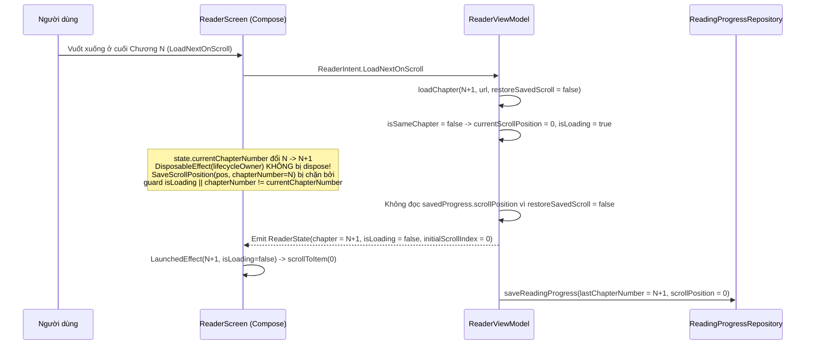
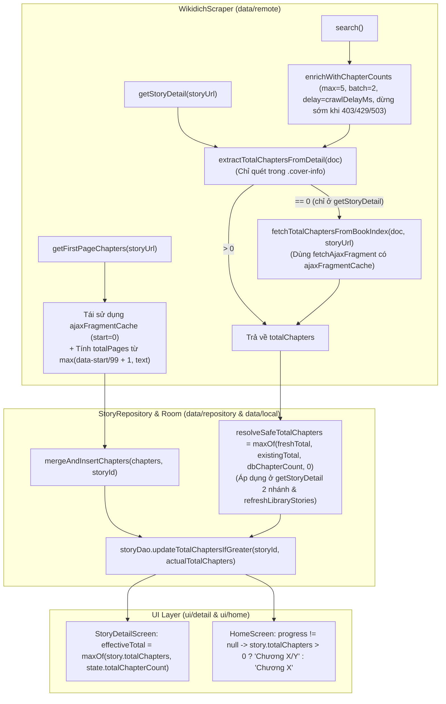

# Fix Reader Scroll on Next Chapter & Wikidich Chapter Count — Kế Hoạch Triển Khai

> **Trạng thái**: Completed
> **Ngày tạo**: 2026-10-23
> **Revision**: 2
> **Tác giả**: `@planner`

---

## Technical Plan

### 1. Mục tiêu (Goal)

Giải quyết **2 lỗi** ảnh hưởng đến trải nghiệm đọc truyện và hiển thị tổng số chương từ nguồn Wikidich (`wikicv.org`):

1. **Lỗi 1 — Cuộn chương tiếp theo bị nhảy xuống cuối chương (`ReaderScreen` & `ReaderViewModel`)**:
   - **Triệu chứng**: Khi người dùng đang ở cuối chương hiện tại (chương $N$) và vuốt xuống để chuyển sang chương tiếp theo (`ReaderIntent.LoadNextOnScroll`), màn hình đọc của chương mới ($N+1$) bị nhảy xuống cuối chương thay vì bắt đầu từ đầu chương (`index = 0`). Đây là lỗi tái phát sau đợt sửa ở Audit Phase 2 (`2026-10-16`).
   - **Kết quả kỳ vọng**: Mọi thao tác chuyển sang chương khác (vuốt xuống cuối chương `LoadNextOnScroll`, bấm nút Chương sau `NextChapter`, chọn chương từ mục lục `NavigateToChapter`, tự động chuyển chương `autoNextChapter`) luôn hiển thị chương mới từ vị trí đầu tiên (`firstVisibleItemIndex = 0`, `firstVisibleItemScrollOffset = 0`), không bị ghi đè bởi vị trí cuộn của chương trước hoặc dữ liệu `scrollPosition` cũ trong Room DB. Đồng thời bảo toàn vị trí cuộn hiện tại khi xử lý lại cùng chương đang đọc (`reprocessCurrentChapter` khi đổi cài đặt / quy tắc thay chữ hoặc `retryLoadChapter` khi đã cuộn), chỉ khôi phục vị trí cuộn đã lưu trong DB khi mở `ReaderScreen` lần đầu (`init`) hoặc thử tải lại (`retryLoadChapter`) lúc `currentScrollPosition == 0`, và chỉ cuộn xuống cuối chương khi người dùng vuốt ngược về chương trước (`LoadPrevOnScroll` với `scrollToEnd = true`).

2. **Lỗi 2 — Truyện từ nguồn Wikidich không hiển thị đúng tổng số chương (`WikidichScraper`, `StoryDao`, `StoryRepository`, `StoryDetailScreen`, `HomeScreen`)**:
   - **Triệu chứng**: Truyện từ nguồn Wikidich khi tìm kiếm, xem thông tin truyện (`StoryDetailScreen`), hoặc xem trong Tủ truyện (`HomeScreen` / `StoryCardPremium`) hiển thị `0 chương` hoặc `Chương 148/0`, dù khi bấm tải mục lục chương thì danh sách chương vẫn tải đầy đủ.
   - **Kết quả kỳ vọng**:
     - `WikidichScraper` trích xuất `totalChapters` trên trang chi tiết truyện (`getStoryDetail`) trong phạm vi `.cover-info` thông qua mở rộng biểu thức chính quy (`LATEST_CHAPTER_TEXT_REGEX` và `LATEST_CHAPTER_HREF_REGEX`), kết hợp fallback gọi AJAX `/book/index` (`fetchTotalChaptersFromBookIndex`) khi `.cover-info` không có số chương (như truyện đã hoàn thành hoặc chương mới nhất là phiên ngoại) kèm bộ nhớ đệm `ajaxFragmentCache` bên trong `fetchAjaxFragment(url, referer)` để tái sử dụng cho `getFirstPageChapters`. Trong `search()`, bật `enrichWithChapterCounts` có kiểm soát (chỉ lấy regex trang chi tiết, tối đa 5 truyện, batch 2, có `delay(crawlDelayMs)` và dừng sớm khi gặp HTTP `403`/`429`/`503`).
     - `StoryRepository` và `StoryDao` đảm bảo tính đơn điệu cho `totalChapters` qua `resolveSafeTotalChapters(freshTotal, existingTotal, dbChapterCount) = maxOf(freshTotal, existingTotal, dbChapterCount, 0)` ở mọi đường ghi (`getStoryDetail` cả 2 nhánh, `mergeAndInsertChapters` qua `storyDao.updateTotalChaptersIfGreater`, và `refreshLibraryStories`), tự động đồng bộ `StoryEntity.totalChapters` với số chương trong bảng `chapters` (`ChapterDao.getChapterCount`).
     - `StoryDetailScreen` và `HomeScreen` có cơ chế hiển thị dự phòng bằng tiếng Việt (dùng `maxOf(story.totalChapters, state.totalChapterCount)`, ẩn mẫu số `/0` thành `"Chương X"` khi `story.totalChapters == 0`, hiển thị `"Đang cập nhật chương"` thay vì `"0 chương"`).

---

### 2. Phạm vi (Scope)

- **In-Scope**:
  - Sửa race condition giữa `DisposableEffect`, `LaunchedEffect`, `snapshotFlow` trong `ui/reader/ReaderScreen.kt` và quản lý trạng thái `currentScrollPosition` / `initialScrollIndex` / `restoreSavedScroll` trong `ui/reader/ReaderViewModel.kt`.
  - Sửa logic trích xuất tổng số chương trong `.cover-info`, phân trang `data-start`, `enrichWithChapterCounts` trong `search()`, và bổ sung `fetchTotalChaptersFromBookIndex` + `ajaxFragmentCache` trong `data/remote/WikidichScraper.kt`.
  - Bổ sung `StoryDao.updateTotalChaptersIfGreater` trong `data/local/StoryDao.kt` và đồng bộ đơn điệu `totalChapters` trong `data/repository/StoryRepository.kt` (`getStoryDetail`, `mergeAndInsertChapters`, `refreshLibraryStories`, `resolveSafeTotalChapters`).
  - Bổ sung hiển thị dự phòng trong `ui/detail/StoryDetailScreen.kt` và `ui/home/HomeScreen.kt`.
  - Bổ sung unit test trong `ReaderViewModelTest.kt`, `WikidichScraperTest.kt`, và `StoryRepositoryTest.kt`.
  - Cập nhật tài liệu dự án (`docs/changelog.md`, `docs/lessons-learned.md`, `docs/scraping.md`, `docs/architecture.md`, `docs/progress.md`, `docs/plans/README.md`).

- **Out-of-Scope**:
  - Không thay đổi cấu trúc bảng hoặc nâng version Room Database (`AppDatabase.kt` tại dòng 22 giữ nguyên `version = 9`, không cần Room migration).
  - Không thay đổi các scraper nguồn khác (`TangThuVienScraper`, `SsTruyenScraper`).
  - Không thêm hoặc nâng cấp bất kỳ thư viện nào trong `app/build.gradle.kts`.
  - Không tách nhỏ các file hiện có đã vượt ngưỡng dòng (`ReaderScreen.kt`, `ReaderViewModel.kt`, `StoryRepository.kt`, `StoryDetailScreen.kt`, `HomeScreen.kt`, `WikidichScraper.kt`) trong phạm vi bản vá lỗi này để đảm bảo Minimal Diffs Policy (theo `.agents/rules/01-coding.md`).

---

### 3. Verified Versions Table

> Đã đối chiếu với `app/build.gradle.kts` và xác minh trực tuyến (ngày 2026-10-23) trên `developer.android.com`, `kotlinlang.org`, `jsoup.org`. Không nâng cấp dependency trong kế hoạch này.

| Thư viện / Plugin | Version trong Repo (`app/build.gradle.kts`) | Latest Stable (2026-10) | Ghi chú xác minh API |
| :--- | :--- | :--- | :--- |
| Android Gradle Plugin (AGP) | `9.4.0` | `9.4.0` | Tương thích với `compileSdk = 36`, `minSdk = 26`. |
| Kotlin (`org.jetbrains.kotlin.android`) | `2.4.21` | `2.4.21` | Hỗ trợ default parameter trong `data class` và `suspend` function. |
| Compose BOM (`androidx.compose:compose-bom`) | `2026.05.01` | `2026.05.01` | `DisposableEffect`, `LaunchedEffect`, `rememberUpdatedState`, `LazyListState.scrollToItem` ổn định. |
| Lifecycle (`androidx.lifecycle:lifecycle-runtime-compose`) | `2.10.0` | `2.10.0` | `LocalLifecycleOwner` và `LifecycleEventObserver` (`ON_PAUSE`, `ON_RESUME`) hoạt động chuẩn. |
| Room 3 (`androidx.room3:room3-runtime` / `compiler`) | `3.0.3` | `3.0.3` | `@Query("UPDATE ...") suspend fun` và `withWriteTransaction` thuộc package `androidx.room3`. |
| Coroutines (`kotlinx-coroutines-android` / `test`) | `1.11.0` | `1.11.0` | `withTimeoutOrNull`, `async`, `awaitAll`, `Semaphore`, `StateFlow.update` ổn định. |
| OkHttp (`com.squareup.okhttp3:okhttp`) | `5.3.2` | `5.3.2` | Kết hợp với `mockwebserver3:5.3.2` trong unit test. |
| Jsoup (`org.jsoup:jsoup`) | `1.22.2` | `1.22.2` | `Jsoup.parse`, `Jsoup.parseBodyFragment`, `Document.select`, `Element.attr("data-start")` ổn định. |

---

### 4. Kiến trúc & Luồng dữ liệu (Architecture & Data Flow)

#### 4.1. Phân tích nguyên nhân gốc (Root Cause Analysis) — Lỗi 1 (`ReaderScreen` & `ReaderViewModel`)

Qua đọc chi tiết `ReaderScreen.kt` (dòng 65–167) và `ReaderViewModel.kt` (dòng 297–303, 496–712, 1088–1109), lỗi nhảy xuống cuối chương khi vuốt sang chương tiếp theo bắt nguồn từ **3 nguyên nhân liên hoàn**:

1. **Nguyên nhân 1A (Race condition trong `DisposableEffect(lifecycleOwner, listState)` tại `ReaderScreen.kt` dòng 142–166)**:
   - Tại dòng 69: `val listState = remember(state.currentChapterNumber) { LazyListState() }`.
   - Tại dòng 142: `DisposableEffect(lifecycleOwner, listState)` truyền `listState` làm key.
   - Khi người dùng cuộn đến cuối chương $N$ (ví dụ `listState.firstVisibleItemIndex == 50`) và vuốt tiếp để kích hoạt `LoadNextOnScroll`:
     - Nếu chương $N+1$ đã có sẵn trong `contentCache` (do `prefetchAhead` tại dòng 685–707 vừa tải trước đó) hoặc trong Room DB, `loadChapter(N+1)` hoàn tất nhanh.
     - Trong lần recomposition khi chuyển từ chương $N$ sang chương $N+1$: `state.currentChapterNumber` đã là $N+1$, `state.isLoading` là `false`, `state.error` là `null`, `paragraphs` không rỗng, và `listState` đổi từ `listState_N` sang `listState_{N+1}`.
     - Vì `listState` là key của `DisposableEffect(lifecycleOwner, listState)`, Compose chạy khối `onDispose` của hiệu ứng cũ (thuộc chương $N$) tại dòng 159–165:
       ```kotlin
       onDispose {
           lifecycleOwner.lifecycle.removeObserver(observer)
           if (!currentState.isLoading && currentState.error == null && currentParagraphs.isNotEmpty()) {
               viewModel.onIntent(ReaderIntent.SaveScrollPosition(listState.firstVisibleItemIndex))
           }
           viewModel.onIntent(ReaderIntent.OnReaderPaused)
       }
       ```
     - Biến `listState` bị bắt (captured) trong closure của `onDispose` là **`listState_N` của chương cũ** (đang có `firstVisibleItemIndex = 50` ở cuối chương $N$), trong khi `currentState` (qua `rememberUpdatedState(state)`) đã là trạng thái của **chương mới $N+1$**!
     - Hệ quả: `onDispose` gửi `ReaderIntent.SaveScrollPosition(50)` vào `ReaderViewModel`. `saveScrollPosition(50)` (dòng 1088–1092) lập tức gán `currentScrollPosition = 50`, gọi `_state.update { it.copy(initialScrollIndex = 50) }` và lưu vào DB `ReadingProgress(storyId, lastChapterNumber = N+1, scrollPosition = 50)`. Khi `LaunchedEffect(state.currentChapterNumber, state.isLoading)` chạy cho chương $N+1$, `state.initialScrollIndex` bằng `50`, nên `listState.scrollToItem(50)` cuộn thẳng chương $N+1$ xuống cuối chương!
     - Đồng thời, việc `onDispose` gọi `ReaderIntent.OnReaderPaused` mỗi khi đổi chương (do `listState` đổi) làm `flushReadingSession()` reset `sessionStartTime = 0L` (dòng 1115 `ReaderViewModel.kt`) mà không có `OnReaderResumed` tương ứng.

2. **Nguyên nhân 1B (Rò rỉ vị trí cuộn qua `snapshotFlow` và `SaveScrollPosition` không gắn mã chương tại `ReaderScreen.kt` dòng 129–135 & `ReaderViewModel.kt` dòng 1088–1109)**:
   - Trong `LaunchedEffect(state.currentChapterNumber, state.isLoading)` (dòng 129–135), `snapshotFlow { listState.firstVisibleItemIndex }.distinctUntilChanged().drop(1).collectLatest` có `delay(1000L)` rồi mới gọi `viewModel.onIntent(ReaderIntent.SaveScrollPosition(index))`.
   - Trong `ReaderViewModel.saveScrollPosition(position: Int)` (dòng 1088–1109):
     - Hàm không kiểm tra trạng thái đang tải chương (`isLoading`, `isLoadingNextChapter`, `isLoadingPrevChapter`) hay trạng thái lỗi (`error != null`, `paragraphs.isEmpty()`).
     - Intent `SaveScrollPosition` không mang theo `chapterNumber` nơi sự kiện cuộn phát sinh.
   - Nếu sự kiện `SaveScrollPosition(50)` của chương $N$ đến ngay sau khi `loadChapter(N+1)` vừa phát state loading (`_state.value.currentChapterNumber` đã đổi sang $N+1$ ở dòng 568 nhưng coroutine `loadChapterJob` đang chờ `repository.getChapterContent` hoặc `settingsLoadedDeferred.await()`), `saveScrollPosition(50)` sẽ gán `currentScrollPosition = 50` và ghi vào DB `lastChapterNumber = N+1, scrollPosition = 50`. Khi `loadChapter(N+1)` chạy tới dòng 592–601 và đọc `readingProgressRepository.getReadingProgress(storyId)`, nó nhận lại `scrollPosition = 50` cho chương $N+1$.

3. **Nguyên nhân 1C (`loadChapter` đọc `savedProgress.scrollPosition` ngay cả khi chuyển chương tại `ReaderViewModel.kt` dòng 592–604)**:
   - Tại dòng 592–604, `loadChapter` luôn đọc `readingProgressRepository.getReadingProgress(storyId)` mỗi khi `!scrollToEnd`. Nếu `savedProgress.lastChapterNumber == number && savedProgress.scrollPosition > 0`, nó ghi đè `currentScrollPosition = savedProgress.scrollPosition`.
   - Khi người dùng chuyển từ chương $N$ sang chương $N+1$ (qua `LoadNextOnScroll`, `NextChapter`, `NavigateToChapter`), nếu DB đã có `lastChapterNumber == N+1` (do race condition 1B hoặc do lần đọc trước), chương $N+1$ sẽ nhảy tới vị trí cũ thay vì bắt đầu ở đầu chương (`0`).
   - Ngược lại, khi `loadChapter` được gọi cho **cùng chương hiện tại** (`reprocessCurrentChapter` ở dòng 501 khi `contentCache` bị trim, hoặc `retryLoadChapter` ở dòng 711 sau khi người dùng đã cuộn `currentScrollPosition > 0`), `currentScrollPosition` trên RAM cần được giữ nguyên, không được reset về `0`.



---

#### 4.2. Phân tích nguyên nhân gốc (Root Cause Analysis) — Lỗi 2 (`WikidichScraper`, `StoryRepository`, `StoryDetailScreen`, `HomeScreen`)

Qua kiểm tra `WikidichScraper.kt` và khảo sát trực tiếp các file HTML chụp từ `wikicv.org` trong repo (`app/src/test/resources/fixtures/wikidich/story_detail.html`, `chapter_index_ajax.html`, `chapter_index_ajax_p2.html`, `search_logged_in.html` — xác minh ngày `2026-10-23`), lỗi hiển thị `0 chương` hoặc `Chương 148/0` bắt nguồn từ **5 nguyên nhân**:

1. **Nguyên nhân 2A (`enrichWithChapterCounts` trong `search` bị tắt trên môi trường Production tại `WikidichScraper.kt` dòng 128–132)**:
   - Trong `search()` (dòng 128–132), code hiện tại viết:
     ```kotlin
     if (customBaseUrl != null && enrichInTests) {
         enrichWithChapterCounts(filtered, maxItems = 5)
     } else {
         filtered
     }
     ```
   - Trên môi trường Production, `WikidichScraper` được khởi tạo qua `@Inject constructor(client: OkHttpClient)` (dòng 24–28) với `customBaseUrl = null` (dòng 32). Do đó điều kiện `customBaseUrl != null && enrichInTests` luôn bằng `false` trên thực tế.
   - Trong HTML kết quả tìm kiếm của `wikicv.org` (`search_logged_in.html` dòng 458–509), mỗi thẻ `<div class="book-item">` chỉ chứa ảnh bìa, tên truyện (`h5.book-title`), tác giả (`p.book-author`), người đăng, thể loại, tình trạng (`Còn tiếp` / `Hoàn thành`) và lượt xem/sao/bình luận (`span.book-stats`), hoàn toàn không có số chương. Do đó `parseStoryList` tạo `Story` với `totalChapters = 0` mặc định, khiến kết quả tìm kiếm Wikidich luôn hiện `0 chương`.

2. **Nguyên nhân 2B (`extractTotalChaptersFromDetail` tại `WikidichScraper.kt` dòng 380–406 chưa bao phủ hết định dạng chương trong `.cover-info` và thiếu fallback AJAX `/book/index`)**:
   - Trong HTML trang chi tiết truyện `wikicv.org` (`story_detail.html` dòng 291–313), khối `<div class="cover-info">` có cấu trúc thực tế:
     ```html
     <div class="cover-info">
         <div>
             <h2 style="font-size: 1.7rem; font-weight: bold; margin: 0; color: #444444">Hỏa ảnh: Người qua đường Giáp cũng muốn cứu vớt thế giới sao? </h2>
             ...
             <p style="margin: 0.9rem 0">Tình trạng: <a href="/tim-kiem?status=5794f03dd7ced228f4419192&amp;qs=1">Còn tiếp</a></p>
             <p style="margin: 0.9rem 0">Mới nhất: <a href="/truyen/hoa-anh-nguoi-qua-duong-giap-cung-muon-c/chuong-170-muon-nhin-ta-co-bung-sao-mot--asL2dMQsRF5MHzZE">Chương 170: Muốn nhìn ta cơ bụng sao? Một chỉnh khối nga</a></p>
             <p style="margin: 0.9rem 0">Thời gian đổi mới: <span class="">05-10-2026</span></p>
         </div>
     </div>
     ```
   - Bên ngoài `.cover-info`, trang chi tiết còn chứa nhiều link `/truyen/...` của các truyện khác như dòng 185 (`href="https://wikicv.net/truyen/khu-tim-truyen-cong-cong-aa72hzu261jVUeGY"`) và khối "Cùng thể loại" (`<ul class="similar-list">` ở dòng 673–1115 và `.mobile-similar-books` ở dòng 1164–1530). Do đó, việc quét link chương mới nhất **bắt buộc phải giới hạn chặt trong `.cover-info`**.
   - Khu vực mục lục chương trên trang chi tiết chỉ là thẻ rỗng `<div class="volume-list"></div>` (dòng 1146) được nạp qua script inline ở dòng 1935–1942:
     ```html
     <script>
         var bookId = "6a950ea2f4da105d0387121e";
         function fuzzySign(text) {
             return text.substring(87) + text.substring(0, 87);
         }
         var signKey = "9f37cd0a4add91c59f4c805219f524d9efef00a85f579a720a5fa07ba8a8683fedd879140d01cb13a75439a13a79d05c";
         loadBookIndex(0, 99, false);
     </script>
     ```
   - Khi truyện trên Wikidich có chương mới nhất trong `.cover-info` đặt tên theo dạng `Tiết 120`, `Đệ 300`, chỉ đánh số đầu dòng (`170. Tên chương`), giữ chữ Hán (`第170章`), hoặc khi chương mới nhất là `Phiên ngoại` / `Hoàn bổn cảm ngôn` (không có số chương trong cả text lẫn slug URL, hoặc truyện đã Hoàn thành ẩn dòng `Mới nhất`), `extractTotalChaptersFromDetail(doc)` trả về `0`. Vì `getStoryDetail` không có fallback sang `/book/index`, `totalChapters` trả về `0`.

3. **Nguyên nhân 2C (Cách đọc phân trang `ul.pagination` trong `getFirstPageChapters` tại `WikidichScraper.kt` dòng 212–218)**:
   - Trong `chapter_index_ajax.html` (dòng 4–30 và 1049–1075) cùng `chapter_index_ajax_p2.html` (dòng 4–30), thanh phân trang của `/book/index` chỉ chứa các thẻ số trang trong cửa sổ hiển thị (không có các nút `#pageCmtFirst` / `#pageCmtLast` chứa icon `<i class="fa fa-angle-double-right"></i>` như thanh `#pageCmt` của khu vực bình luận ở `story_detail.html` dòng 1584–1649):
     ```html
     <ul class="pagination" style="margin: 0; display: inline-block">
         <li class=" active " style="">
             <a href="#!" data-start="0" data-size="99" data-action="loadBookIndex">1</a>
         </li>
         <li class=" waves-effect " style="">
             <a href="#!" data-start="99" data-size="99" data-action="loadBookIndex">2</a>
         </li>
         ...
         <li class=" waves-effect " style="">
             <a href="#!" data-start="396" data-size="99" data-action="loadBookIndex">5</a>
         </li>
     </ul>
     ```
     *(Lưu ý khảo sát nguồn theo `.agents/rules/04-scraping.md`: `wikicv.org` yêu cầu cookie phiên `express.sid` cho mọi truy vấn tìm kiếm/mục lục; truy vấn không có cookie sẽ trả về trang yêu cầu đăng nhập như trong `fixtures/wikidich/search_anonymous.html` dòng 455–465. Do đó toàn bộ selector và cấu trúc phân trang được đối chiếu trực tiếp trên bộ fixture chụp từ phiên đã đăng nhập trong `app/src/test/resources/fixtures/wikidich/`).*
   - Mặc dù `StoryRepository.loadRemainingChapters` (dòng 574) chỉ kiểm tra `if (totalPages <= 1) return` và `getRemainingChapters` (dòng 253) lặp theo `hasNextPage` dựa trên `data-start`, việc tính `totalPages = maxOf((maxStart / DEFAULT_PAGE_SIZE) + 1, maxPageFromText)` trong `getFirstPageChapters` đảm bảo tính nhất quán giữa thuộc tính `data-start` và text hiển thị. Và đối với truyện có $> 5$ trang mục lục mà `.cover-info` không có số chương, ngay cả khi `fetchTotalChaptersFromBookIndex` chỉ nhảy trong phạm vi cửa sổ `data-start` tối đa `MAX_PAGINATION_JUMPS = 2` lần, quá trình `loadRemainingChapters` chạy tiếp ngay sau đó sẽ gọi `mergeAndInsertChapters` → `storyDao.updateTotalChaptersIfGreater` để cập nhật `stories.totalChapters` lên đúng tổng số chương cuối cùng.

4. **Nguyên nhân 2D (`StoryRepository` chưa bảo vệ tính đơn điệu của `totalChapters` và chưa đồng bộ từ bảng `chapters`)**:
   - Khi `StoryRepository.getFirstPageChapterList` hoặc `getChapterList` gọi `mergeAndInsertChapters(chapters, storyId)` (dòng 493–539 `StoryRepository.kt`), hàng trăm chương được lưu vào bảng `chapters` nhưng cột `stories.totalChapters` không được cập nhật.
   - Hơn nữa, `resolveSafeTotalChapters(freshTotal, existingTotal)` (dòng 831–839 `StoryRepository.kt`) hiện viết:
     ```kotlin
     when {
         freshTotal > 0 -> freshTotal
         existingTotal > 0 -> existingTotal
         else -> 0
     }
     ```
     Nếu một truyện có 485 chương trong bảng `chapters`, nhưng chương mới nhất trong `.cover-info` đánh số lại theo quyển (`Quyển 3 - Chương 148` → `freshTotal = 148`), thì khi `getStoryDetail` hoặc `refreshLibraryStories` (dòng 754) gọi `storyDao.insertStory(entity)` (`@Upsert`), giá trị `485` sẽ bị ghi đè lùi về `148`! Tương tự, trong nhánh `cached != null` của `getStoryDetail` (dòng 376–404), coroutine làm tươi ngầm (`appScope.launch`) có thể đọc `cached.totalChapters = 0` trước khi `getFirstPageChapterList` kịp cập nhật, rồi `@Upsert` đè ngược về `0` (lỗi TOCTOU).

5. **Nguyên nhân 2E (`StoryDetailScreen` và `HomeScreen` hiển thị trực tiếp `story.totalChapters` khi bằng `0`)**:
   - Tại `HomeScreen.kt` dòng 366 (`ReadingListContent`, đọc dữ liệu từ `storyDao.getLibraryStories()` / `storyDao.getRecentlyReadStories()`): biểu thức `"Chương ${progress.lastChapterNumber}/${story.totalChapters}"` sinh ra chuỗi **`"Chương 148/0"`** khi `story.totalChapters == 0`.
   - Tại `StoryDetailScreen.kt` dòng 494: `HeroSection` hiển thị `"${story.totalChapters} chương"` (hiện **`"0 chương"`**) ngay cả khi `state.totalChapterCount` (đếm từ danh sách chương đã tải ở dòng 130 `StoryDetailViewModel.kt`) đã lớn hơn `0`.



---

### 5. Danh sách file dự kiến tạo mới / chỉnh sửa

> **Lưu ý về Kích thước file (`.agents/rules/01-coding.md`)**: Các file hiện có đã vượt ngưỡng (`ReaderScreen.kt`, `ReaderViewModel.kt`, `WikidichScraper.kt`, `StoryRepository.kt`, `StoryDetailScreen.kt`, `HomeScreen.kt`) thuộc diện miễn trừ *"File hiện có đã vượt ngưỡng thì không tự tách nếu không có plan"*. Kế hoạch này chỉ thêm các đoạn sửa lỗi tối thiểu (Minimal Diffs Policy).
>
> **Lưu ý về File nhạy cảm (`.agents/rules/05-plan-review.md` mục 1.3)**:
> - Không chạm vào `AppDatabase.kt`, `AndroidManifest.xml`, `build.gradle.kts`, `data/remote/cookie/**`, hay `.agents/**`.
> - 3 file unit test (`ReaderViewModelTest.kt`, `WikidichScraperTest.kt`, `StoryRepositoryTest.kt`) nằm trong `app/src/test/**` nên thuộc nhóm **Luôn hỏi User khi sửa** của Code Freeze Guard kèm kiểm tra Test Integrity (`testDelta > 0`, `assertionDelta > 0`, không xóa/nới bất kỳ assert nào hiện có).

| STT | Đường dẫn file | Hành động | Số dòng hiện tại → Dự kiến | Nhóm nhạy cảm (Hook Guard) | Mô tả tóm tắt thay đổi |
| :-: | :--- | :---: | :---: | :---: | :--- |
| 1 | `app/src/main/java/com/personal/apptruyen/ui/reader/ReaderScreen.kt` | Sửa | 765 → ~776 | Không | Bỏ `listState` khỏi key của `DisposableEffect(lifecycleOwner)`; dùng `rememberUpdatedState(listState)`; giữ nguyên guard `error == null && paragraphs.isNotEmpty()`; truyền `state.currentChapterNumber` vào `SaveScrollPosition`; cuộn về `0` khi `initialScrollIndex == 0 && !scrollToEnd`. |
| 2 | `app/src/main/java/com/personal/apptruyen/ui/reader/ReaderViewModel.kt` | Sửa | 1172 → ~1192 | Không | Thêm `val chapterNumber: Int = -1` vào `ReaderIntent.SaveScrollPosition`; thêm guard đầy đủ trong `saveScrollPosition` (giữ nguyên `appScope.launch` và model `ReadingProgress` thật); thêm `restoreSavedScroll: Boolean = false` vào `loadChapter`, phân biệt `isSameChapter` để bảo toàn vị trí cuộn cho `reprocessCurrentChapter` và `retryLoadChapter`. |
| 3 | `app/src/main/java/com/personal/apptruyen/data/remote/WikidichScraper.kt` | Sửa | 633 → ~720 | Không | Mở rộng regex trong `.cover-info`; thêm `ajaxFragmentCache` bên trong `fetchAjaxFragment(url, referer): String`; thêm fallback `fetchTotalChaptersFromBookIndex(doc, storyUrl)` cho `getStoryDetail`; sửa tính `totalPages` từ `data-start`; bật `enrichWithChapterCounts` trong `search` (max 5, batch 2, delay `crawlDelayMs`, dừng sớm khi gặp 403/429/503). |
| 4 | `app/src/main/java/com/personal/apptruyen/data/local/StoryDao.kt` | Sửa | 93 → ~100 | Không | Thêm `@Query updateTotalChaptersIfGreater(storyId: String, totalChapters: Int)`. |
| 5 | `app/src/main/java/com/personal/apptruyen/data/repository/StoryRepository.kt` | Sửa | 839 → ~870 | Không | Sửa `resolveSafeTotalChapters` thành hàm đơn điệu `maxOf(freshTotal, existingTotal, dbChapterCount, 0)`; đồng bộ ở cả `getStoryDetail` (2 nhánh), `mergeAndInsertChapters`, và `refreshLibraryStories`. |
| 6 | `app/src/main/java/com/personal/apptruyen/ui/detail/StoryDetailScreen.kt` | Sửa | 959 → ~970 | Không | Dùng `effectiveTotalChapters = maxOf(story.totalChapters, state.totalChapterCount)` cho `HeroSection` và Unread badge; hiển thị `"Đang cập nhật chương"` khi `totalChapters <= 0`. |
| 7 | `app/src/main/java/com/personal/apptruyen/ui/home/HomeScreen.kt` | Sửa | 644 → ~650 | Không | Khi `progress != null`, chỉ hiện `"/${story.totalChapters}"` nếu `story.totalChapters > 0`, ngược lại hiện `"Chương ${progress.lastChapterNumber}"`; giữ nguyên `null` khi `progress == null`. |
| 8 | `app/src/test/java/com/personal/apptruyen/ui/reader/ReaderViewModelTest.kt` | Sửa | 562 → ~670 | **Có (`app/src/test/**`)** | Thêm 6 unit test kiểm tra `LoadNextOnScroll` (kể cả vuốt 2 lần liên tiếp), `NextChapter`, chặn `SaveScrollPosition` trễ hoặc khi `error != null`, bảo toàn cuộn khi `reprocessCurrentChapter` / `RetryLoad`, và lưu qua `appScope`. |
| 9 | `app/src/test/java/com/personal/apptruyen/data/remote/WikidichScraperTest.kt` | Sửa | 349 → ~480 | **Có (`app/src/test/**`)** | Thêm 6 unit test kiểm tra regex trong `.cover-info` (và bỏ qua link ngoài `.cover-info`), fallback `/book/index`, tái sử dụng `ajaxFragmentCache`, tính `totalPages` từ `data-start`, và `enrichWithChapterCounts` dừng sớm khi gặp 429. |
| 10 | `app/src/test/java/com/personal/apptruyen/data/repository/StoryRepositoryTest.kt` | Sửa | 782 → ~865 | **Có (`app/src/test/**`)** | Thêm 4 unit test kiểm tra tính đơn điệu của `totalChapters` trong `getStoryDetail`, `getFirstPageChapterList`, `getChapterList`, và `refreshLibraryStories` (bao gồm ca đánh số lại theo quyển `148 < 485`). |
| 11 | `docs/changelog.md`, `docs/lessons-learned.md`, `docs/scraping.md`, `docs/architecture.md`, `docs/progress.md`, `docs/plans/README.md` | Sửa | — | Không | Cập nhật đầy đủ tài liệu theo `.agents/rules/06-docs.md` và `.agents/workflows/post-fix.md`. |

---

### 6. Thiết kế chi tiết (Step-by-Step Design)

#### Bước 6.1: Sửa `ReaderViewModel.kt` — Phân biệt chuyển chương vs tải lại cùng chương và bảo vệ `saveScrollPosition`

**File**: `app/src/main/java/com/personal/apptruyen/ui/reader/ReaderViewModel.kt`

1. **Cập nhật `ReaderIntent.SaveScrollPosition` (dòng 109–111)**:
   Thêm tham số `chapterNumber: Int = -1` (có giá trị mặc định `-1` để tương thích ngược với mọi call-site hiện có):
   ```kotlin
   data class SaveScrollPosition(
       val position: Int,
       val chapterNumber: Int = -1,
   ) : ReaderIntent
   ```

2. **Cập nhật `onIntent` (dòng 285)**:
   ```kotlin
   is ReaderIntent.SaveScrollPosition -> saveScrollPosition(intent.position, intent.chapterNumber)
   ```

3. **Cập nhật lời gọi `loadChapter` trong `init` (dòng 299) và `retryLoadChapter` (dòng 710–712)**:
   - Trong `init` (dòng 299):
     ```kotlin
     loadChapter(chapterNumber, chapterUrl, restoreSavedScroll = true)
     ```
   - Trong `retryLoadChapter` (dòng 710–712 — giữ nguyên `fun` public):
     ```kotlin
     /** Retry loading the current chapter (called from error state UI) */
     fun retryLoadChapter() {
         loadChapter(
             number = _state.value.currentChapterNumber,
             url = currentChapterUrl,
             restoreSavedScroll = currentScrollPosition == 0,
         )
     }
     ```
     *Giải thích*: Nếu lỗi mạng xảy ra ngay lúc mới mở màn hình đọc (`currentScrollPosition == 0`), bấm Thử lại (`RetryLoad`) sẽ có `restoreSavedScroll = true` để đọc lại vị trí cuộn đã lưu trong Room DB. Nếu người dùng đang đọc ở đoạn 30 (`currentScrollPosition = 30`) mà kích hoạt tải lại cùng chương (`isSameChapter == true`), `currentScrollPosition = 30` trên RAM được giữ nguyên.
   - Trong `reprocessCurrentChapter` (dòng 496–504): giữ nguyên lời gọi `loadChapter(currentNum, currentChapterUrl)` ở dòng 501. Vì `isSameChapter == true` và `scrollToEnd == false`, `currentScrollPosition` trên RAM được bảo toàn ngay cả khi `contentCache` đã bị trim.
   - Tất cả các nơi gọi `loadChapter` để chuyển sang chương khác (`nextChapter`, `prevChapter`, `loadNextChapterOnScroll`, `loadPrevChapterOnScroll`, `navigateToChapter`, `autoNextChapter`, `loadChapterAndPlay`) giữ mặc định `restoreSavedScroll = false`.

4. **Cập nhật tối thiểu `loadChapter` (dòng 550–605)**:
   - Thêm tham số `restoreSavedScroll: Boolean = false` vào chữ ký hàm (dòng 550–555):
     ```kotlin
     private fun loadChapter(
         number: Int,
         url: String,
         autoPlay: Boolean = false,
         scrollToEnd: Boolean = false,
         restoreSavedScroll: Boolean = false,
     )
     ```
   - Tại dòng 560–562, tách biệt rõ **"chuyển sang chương khác"** (`!isSameChapter`) với **"tải lại cùng chương"** (`isSameChapter`):
     ```kotlin
     val isSameChapter = number == _state.value.currentChapterNumber
     if (!isSameChapter || scrollToEnd) {
         currentScrollPosition = 0
     }
     ```
   - **Giữ nguyên toàn bộ** khối `_state.update` ở dòng 566–577 (đảm bảo `isLoadingNextChapter = false`, `scrollToEnd = false`, `initialScrollIndex = 0`, `selectedPokemon = null`, `paragraphPokemonMatches = persistentMapOf()` được reset đầy đủ).
   - Tại dòng 592–604 (sau `settingsLoadedDeferred.await()`), chỉ đọc `readingProgressRepository.getReadingProgress(storyId)` khi `restoreSavedScroll && !scrollToEnd`:
     ```kotlin
     if (restoreSavedScroll && !scrollToEnd) {
         val savedProgress =
             runCatching {
                 readingProgressRepository.getReadingProgress(storyId)
             }.getOrNull()
         if (savedProgress != null &&
             savedProgress.lastChapterNumber == number &&
             savedProgress.scrollPosition > 0
         ) {
             currentScrollPosition = savedProgress.scrollPosition
         }
     } else if (!isSameChapter || scrollToEnd) {
         currentScrollPosition = 0
     }
     ```
   - **Giữ nguyên toàn bộ** phần còn lại của `loadChapter` (dòng 606–675).

5. **Cập nhật `saveScrollPosition` (dòng 1088–1109)**:
   Giữ nguyên `fun saveScrollPosition`, giữ nguyên `appScope.launch` và constructor thật của `ReadingProgress(storyId, lastChapterNumber, scrollPosition)`, chỉ bổ sung guard kiểm tra trạng thái loading / lỗi / rỗng và kiểm tra khớp `chapterNumber`:
   ```kotlin
   fun saveScrollPosition(
       position: Int,
       chapterNumber: Int = -1,
   ) {
       val currentState = _state.value
       if (currentState.isLoading ||
           currentState.isLoadingNextChapter ||
           currentState.isLoadingPrevChapter ||
           currentState.error != null ||
           currentState.paragraphs.isEmpty()
       ) {
           return
       }
       if (chapterNumber != -1 && chapterNumber != currentState.currentChapterNumber) {
           return
       }
       val safePos = position.coerceAtLeast(0)
       currentScrollPosition = safePos
       _state.update { it.copy(initialScrollIndex = safePos) }
       val chapterNum = currentState.currentChapterNumber
       // Dùng appScope thay vì viewModelScope vì khi user bấm Back,
       // viewModelScope bị cancel trong onCleared() TRƯỚC KHI DisposableEffect
       // onDispose() kịp gọi saveScrollPosition() → progress mất.
       appScope.launch {
           try {
               readingProgressRepository.saveReadingProgress(
                   ReadingProgress(
                       storyId = storyId,
                       lastChapterNumber = chapterNum,
                       scrollPosition = safePos,
                   ),
               )
           } catch (e: Exception) {
               if (e is CancellationException) throw e
           }
       }
   }
   ```

---

#### Bước 6.2: Sửa `ReaderScreen.kt` — Loại bỏ Race Condition trong `DisposableEffect` và giữ nguyên Guard an toàn

**File**: `app/src/main/java/com/personal/apptruyen/ui/reader/ReaderScreen.kt`

1. **Cập nhật tối thiểu `LaunchedEffect(state.currentChapterNumber, state.isLoading)` (dòng 119–136)**:
   - **Giữ nguyên** guard dòng 120: `if (state.isLoading || state.error != null || paragraphs.isEmpty()) return@LaunchedEffect`.
   - **Giữ nguyên** nhánh `state.scrollToEnd` (dòng 121–124) và nhánh `state.initialScrollIndex > 0` với `val maxItemIndex = (paragraphs.size + 1).coerceAtLeast(0)` (dòng 125–128).
   - Thêm nhánh `else if (listState.firstVisibleItemIndex != 0 || listState.firstVisibleItemScrollOffset != 0)` gọi `listState.scrollToItem(0)`.
   - Chụp `val activeChapterNumber = state.currentChapterNumber` và truyền vào `ReaderIntent.SaveScrollPosition(index, activeChapterNumber)`:
     ```kotlin
     LaunchedEffect(state.currentChapterNumber, state.isLoading) {
         if (state.isLoading || state.error != null || paragraphs.isEmpty()) return@LaunchedEffect
         val activeChapterNumber = state.currentChapterNumber
         if (state.scrollToEnd) {
             snapshotFlow { listState.layoutInfo.totalItemsCount }
                 .first { it > 2 }
             listState.scrollToItem(listState.layoutInfo.totalItemsCount - 1)
         } else if (state.initialScrollIndex > 0) {
             val maxItemIndex = (paragraphs.size + 1).coerceAtLeast(0)
             listState.scrollToItem(state.initialScrollIndex.coerceIn(0, maxItemIndex))
         } else if (listState.firstVisibleItemIndex != 0 || listState.firstVisibleItemScrollOffset != 0) {
             listState.scrollToItem(0)
         }
         snapshotFlow { listState.firstVisibleItemIndex }
             .distinctUntilChanged()
             .drop(1)
             .collectLatest { index ->
                 delay(1000L)
                 viewModel.onIntent(ReaderIntent.SaveScrollPosition(index, activeChapterNumber))
             }
     }
     ```

2. **Cập nhật `DisposableEffect` (dòng 139–166)**:
   - Thêm `val currentListState by rememberUpdatedState(listState)` bên cạnh `currentState` và `currentParagraphs`.
   - Đổi `DisposableEffect(lifecycleOwner, listState)` thành **`DisposableEffect(lifecycleOwner)`**.
   - **Giữ nguyên guard** `if (!currentState.isLoading && currentState.error == null && currentParagraphs.isNotEmpty())` ở cả `ON_PAUSE` và `onDispose`, đọc `currentListState.firstVisibleItemIndex` và truyền kèm `currentState.currentChapterNumber`:
     ```kotlin
     val lifecycleOwner = LocalLifecycleOwner.current
     val currentState by rememberUpdatedState(state)
     val currentParagraphs by rememberUpdatedState(paragraphs)
     val currentListState by rememberUpdatedState(listState)
     DisposableEffect(lifecycleOwner) {
         val observer =
             LifecycleEventObserver { _, event ->
                 when (event) {
                     Lifecycle.Event.ON_RESUME -> {
                         viewModel.onIntent(ReaderIntent.OnReaderResumed)
                     }
                     Lifecycle.Event.ON_PAUSE -> {
                         if (!currentState.isLoading && currentState.error == null && currentParagraphs.isNotEmpty()) {
                             viewModel.onIntent(
                                 ReaderIntent.SaveScrollPosition(
                                     currentListState.firstVisibleItemIndex,
                                     currentState.currentChapterNumber,
                                 ),
                             )
                         }
                         viewModel.onIntent(ReaderIntent.OnReaderPaused)
                     }
                     else -> Unit
                 }
             }
         lifecycleOwner.lifecycle.addObserver(observer)
         onDispose {
             lifecycleOwner.lifecycle.removeObserver(observer)
             if (!currentState.isLoading && currentState.error == null && currentParagraphs.isNotEmpty()) {
                 viewModel.onIntent(
                     ReaderIntent.SaveScrollPosition(
                         currentListState.firstVisibleItemIndex,
                         currentState.currentChapterNumber,
                     ),
                 )
             }
             viewModel.onIntent(ReaderIntent.OnReaderPaused)
         }
     }
     ```

---

#### Bước 6.3: Sửa `WikidichScraper.kt` — Trích xuất trong `.cover-info` + Fallback `/book/index` + `ajaxFragmentCache` + Enrich an toàn

**File**: `app/src/main/java/com/personal/apptruyen/data/remote/WikidichScraper.kt`

1. **Cập nhật hằng số trong `companion object` (dòng 43–59) và thêm `ajaxFragmentCache`**:
   - Sửa giá trị `ENRICH_BATCH_SIZE` từ `5` → `2` (dòng 47), giữ `ENRICH_TIMEOUT_MS = 3_500L` (dòng 48), và thêm:
     ```kotlin
     private const val ENRICH_MAX_ITEMS = 5
     private const val MAX_PAGINATION_JUMPS = 2
     private const val MAX_AJAX_CACHE_SIZE = 30
     private const val AJAX_CACHE_TTL_MS = 10 * 60 * 1000L
     ```
   - Mở rộng `LATEST_CHAPTER_TEXT_REGEX` và `LATEST_CHAPTER_HREF_REGEX` (dòng 53–58):
     ```kotlin
     private val LATEST_CHAPTER_TEXT_REGEX =
         Regex(
             """(?:(?:Quyển|Phần)\s*\d+\s*[-–—:.,]?\s*)?(?:Chương|Hồi|Tiết|Phần|Đệ)\s*(\d+)|第\s*(\d+)\s*[章回節节]|^\s*(\d{1,5})(?:\s*[.:,\-–—]\s*|\s+)""",
             RegexOption.IGNORE_CASE,
         )
     private val LATEST_CHAPTER_HREF_REGEX =
         Regex(
             """/(?:quyen-\d+-)?(?:chuong|hoi|tiet|phan)-(\d+)(?:[-~]|$)""",
             RegexOption.IGNORE_CASE,
         )
     ```
   - Thêm thuộc tính `ajaxFragmentCache` trong `WikidichScraper` (sử dụng `BaseScraper.CacheEntry` và `nowMs()`, xóa cùng `cache.clear()` trong `checkLoginRequired` ở dòng 448):
     ```kotlin
     private val ajaxFragmentCache: MutableMap<String, CacheEntry> =
         java.util.Collections.synchronizedMap(
             object : LinkedHashMap<String, CacheEntry>(MAX_AJAX_CACHE_SIZE + 1, 0.75f, false) {
                 override fun removeEldestEntry(eldest: MutableMap.MutableEntry<String, CacheEntry>?): Boolean =
                     size > MAX_AJAX_CACHE_SIZE
             },
         )
     ```

2. **Bật `enrichWithChapterCounts` trong `search` (dòng 128–132) với cơ chế dừng sớm chống Rate-Limit**:
   - Tại `search` (dòng 128–132), thay khối `if (customBaseUrl != null && enrichInTests)` bằng:
     ```kotlin
     enrichWithChapterCounts(filtered, maxItems = ENRICH_MAX_ITEMS)
     ```
     *(Giữ nguyên `getCompletedStories` dòng 296–310 và `getStoriesByGenre` dòng 312–335 không gọi `enrichWithChapterCounts` để tránh dồn request khi mở tab Khám Phá)*.
   - Cập nhật `enrichWithChapterCounts` (dòng 408–444):
     - Giữ guard `if (customBaseUrl != null && !enrichInTests) return stories` ở dòng 413.
     - Chỉ lấy `extractTotalChaptersFromDetail(detailDoc)` từ trang chi tiết (không gọi `/book/index` trong lúc enrich danh sách tìm kiếm), thêm `delay(crawlDelayMs)` giữa các batch, và dùng `AtomicBoolean(false)` để dừng sớm ngay khi gặp HTTP `403`, `429`, `503` hoặc `LoginRequiredException`:
       ```kotlin
       private suspend fun enrichWithChapterCounts(
           stories: List<Story>,
           maxItems: Int = ENRICH_MAX_ITEMS,
       ): List<Story> {
           if (stories.isEmpty() || maxItems <= 0) return stories
           if (customBaseUrl != null && !enrichInTests) return stories

           val toEnrich = stories.take(maxItems)
           val remaining = stories.drop(maxItems)
           val abortEnrich = java.util.concurrent.atomic.AtomicBoolean(false)

           val enriched =
               coroutineScope {
                   val batches = toEnrich.chunked(ENRICH_BATCH_SIZE)
                   val results = mutableListOf<Story>()
                   for ((batchIndex, batch) in batches.withIndex()) {
                       if (abortEnrich.get()) {
                           results.addAll(batch)
                           continue
                       }
                       if (batchIndex > 0) {
                           delay(crawlDelayMs)
                       }
                       val batchResult =
                           batch
                               .map { story ->
                                   async {
                                       if (story.totalChapters > 0 || abortEnrich.get()) {
                                           story
                                       } else {
                                           try {
                                               withTimeoutOrNull(ENRICH_TIMEOUT_MS) {
                                                   val detailDoc = fetchDocument(story.url)
                                                   val total = extractTotalChaptersFromDetail(detailDoc)
                                                   if (total > 0) story.copy(totalChapters = total) else story
                                               } ?: story
                                           } catch (e: CancellationException) {
                                               throw e
                                           } catch (e: ScraperException.HttpException) {
                                               if (e.statusCode in setOf(403, 429, 503)) {
                                                   abortEnrich.set(true)
                                               }
                                               story
                                           } catch (_: ScraperException.LoginRequiredException) {
                                               abortEnrich.set(true)
                                               story
                                           } catch (_: Exception) {
                                               story
                                           }
                                       }
                                   }
                               }.awaitAll()
                       results.addAll(batchResult)
                   }
                   results
               }
           return enriched + remaining
       }
       ```

3. **Cập nhật `extractTotalChaptersFromDetail(doc: Document)` (dòng 380–406 — chỉ quét trong `.cover-info`)**:
   ```kotlin
   internal fun extractTotalChaptersFromDetail(doc: Document): Int {
       val coverLinks = doc.select(".cover-info a[href*='/truyen/']")
       val latestLink =
           coverLinks.lastOrNull { a ->
               val href = a.attr("href")
               LATEST_CHAPTER_HREF_REGEX.containsMatchIn(href) ||
                   a.parent()?.text()?.contains("Mới nhất", ignoreCase = true) == true
           } ?: coverLinks.lastOrNull { a ->
               a.attr("href").trimEnd('/').count { it == '/' } >= 3
           }

       if (latestLink != null) {
           val linkText = latestLink.text().trim()
           val textMatches = LATEST_CHAPTER_TEXT_REGEX.findAll(linkText).toList()
           if (textMatches.isNotEmpty()) {
               val lastMatch = textMatches.last()
               val num =
                   lastMatch.groupValues
                       .drop(1)
                       .firstOrNull { it.isNotEmpty() }
                       ?.toIntOrNull()
               if (num != null && num > 0) return num
           }

           val href = latestLink.attr("href")
           val hrefMatch = LATEST_CHAPTER_HREF_REGEX.find(href)
           val hrefNum = hrefMatch?.groupValues?.getOrNull(1)?.toIntOrNull()
           if (hrefNum != null && hrefNum in 1..20_000) return hrefNum
       }
       return 0
   }
   ```

4. **Bổ sung `fetchTotalChaptersFromBookIndex(doc: Document, storyUrl: String): Int` và tích hợp `ajaxFragmentCache` vào `fetchAjaxFragment`**:
   - Giữ nguyên chữ ký `private suspend fun fetchAjaxFragment(url: String, referer: String): String` (dòng 583–620 của `WikidichScraper.kt`) để không ảnh hưởng tới 2 call-site hiện có (`getFirstPageChapters` dòng 203–204 và `getRemainingChapters` dòng 243–244), chỉ thêm kiểm tra và lưu `ajaxFragmentCache` bên trong thân hàm:
     ```kotlin
     private suspend fun fetchAjaxFragment(
         url: String,
         referer: String,
     ): String =
         withContext(Dispatchers.IO) {
             ajaxFragmentCache[url]?.let { entry ->
                 if (nowMs() - entry.timestamp < AJAX_CACHE_TTL_MS) {
                     return@withContext entry.body
                 } else {
                     ajaxFragmentCache.remove(url)
                 }
             }
             // ... giữ nguyên phần xây dựng Request, gọi client.newCall(request).execute() và xử lý lỗi HTTP ...
             val body = response.body.string()
             ajaxFragmentCache[url] = CacheEntry(body = body, timestamp = nowMs())
             body
         }
     ```
     Nhờ dùng chính `url` đầy đủ của `/book/index` làm khóa trong `ajaxFragmentCache` (với cùng `bookId`, `start=0`, `size=99`, `signKey`, `sign`), khi `getStoryDetail(storyUrl)` vừa gọi `fetchTotalChaptersFromBookIndex` xong và `StoryDetailViewModel` gọi tiếp `getFirstPageChapters(storyUrl)`, trang đầu của mục lục (`start=0`) sẽ được lấy trực tiếp từ `ajaxFragmentCache` mà không phát sinh thêm request mạng!
   - Viết hàm `internal suspend fun fetchTotalChaptersFromBookIndex(doc: Document, storyUrl: String): Int` sử dụng đúng `extractSecurityParams(doc.html(), storyUrl)` và `makeBookIndexSign(signKey, start, size, cut)` có sẵn trong `WikidichScraper.kt` (dòng 539–576):
     ```kotlin
     /**
      * Fallback khi khối .cover-info trên trang chi tiết không có số chương (ví dụ chương mới nhất là Phiên ngoại
      * hoặc truyện chỉ hiện nhãn Hoàn thành). Gọi AJAX /book/index trang đầu (start=0), kiểm tra thanh phân trang
      * data-start lớn nhất và đếm số chương ở trang cuối.
      */
     internal suspend fun fetchTotalChaptersFromBookIndex(
         doc: Document,
         storyUrl: String,
     ): Int =
         runCatching {
             val (bookId, cut, signKey) = extractSecurityParams(doc.html(), storyUrl)
             val firstSign = makeBookIndexSign(signKey, 0, DEFAULT_PAGE_SIZE, cut)
             val firstUrl =
                 "$baseUrl/book/index?bookId=$bookId&start=0&size=$DEFAULT_PAGE_SIZE&signKey=$signKey&sign=$firstSign"
             val firstHtml = fetchAjaxFragment(firstUrl, storyUrl)
             val firstDoc = Jsoup.parseBodyFragment(firstHtml)
             val firstPageCount = firstDoc.select("li.chapter-name a[href^='/truyen/']").size
             if (firstPageCount == 0) return@runCatching 0

             var currentStart =
                 firstDoc
                     .select("ul.pagination li a[data-action='loadBookIndex']")
                     .mapNotNull { it.attr("data-start").toIntOrNull() }
                     .maxOrNull() ?: 0

             if (currentStart <= 0) {
                 return@runCatching firstPageCount
             }

             var jumps = 0
             var lastDoc = firstDoc
             var visitedStart = 0
             while (currentStart > visitedStart && jumps < MAX_PAGINATION_JUMPS) {
                 visitedStart = currentStart
                 val pageSign = makeBookIndexSign(signKey, currentStart, DEFAULT_PAGE_SIZE, cut)
                 val pageUrl =
                     "$baseUrl/book/index?bookId=$bookId&start=$currentStart&size=$DEFAULT_PAGE_SIZE&signKey=$signKey&sign=$pageSign"
                 val pageHtml = fetchAjaxFragment(pageUrl, storyUrl)
                 lastDoc = Jsoup.parseBodyFragment(pageHtml)
                 val nextMaxStart =
                     lastDoc
                         .select("ul.pagination li a[data-action='loadBookIndex']")
                         .mapNotNull { it.attr("data-start").toIntOrNull() }
                         .maxOrNull() ?: currentStart
                 if (nextMaxStart > currentStart) {
                     currentStart = nextMaxStart
                 }
                 jumps++
             }

             val lastPageCount = lastDoc.select("li.chapter-name a[href^='/truyen/']").size
             if (lastPageCount > 0) {
                 visitedStart + lastPageCount
             } else {
                 visitedStart
             }
         }.getOrElse { e ->
             if (e is CancellationException) throw e
             Timber.w(e, "WikidichScraper: Failed to fetch total chapters from /book/index for %s", storyUrl)
             0
         }
     ```
   - Trong `getStoryDetail(storyUrl: String)` (dòng 176):
     ```kotlin
     val extractedTotal = extractTotalChaptersFromDetail(doc)
     val totalChapters =
         if (extractedTotal > 0) {
             extractedTotal
         } else {
             fetchTotalChaptersFromBookIndex(doc, storyUrl)
         }
     ```

5. **Sửa cách tính `totalPages` trong `getFirstPageChapters` (dòng 212–218)**:
   Kết hợp cả `data-start` (từ các nút phân trang `a[data-action='loadBookIndex']`, bao gồm nút nhảy trang cuối nếu có) và text số trang:
   ```kotlin
   val paginationLinks = ajaxDoc.select("ul.pagination li a[data-action='loadBookIndex']")
   val maxStart =
       paginationLinks
           .mapNotNull { it.attr("data-start").toIntOrNull() }
           .maxOrNull() ?: 0
   val maxPageFromText =
       paginationLinks
           .mapNotNull { it.text().trim().toIntOrNull() }
           .maxOrNull() ?: 1
   val totalPages = maxOf((maxStart / DEFAULT_PAGE_SIZE) + 1, maxPageFromText)
   ```

---

#### Bước 6.4: Sửa `StoryDao.kt` & `StoryRepository.kt` — Đảm bảo tính đơn điệu của `totalChapters` ở mọi đường ghi

**File 1**: `app/src/main/java/com/personal/apptruyen/data/local/StoryDao.kt`

Thêm truy vấn nguyên tử `updateTotalChaptersIfGreater` (chỉ cập nhật khi giá trị mới lớn hơn giá trị đang lưu trong DB):
```kotlin
@Query("UPDATE stories SET totalChapters = :totalChapters WHERE id = :storyId AND totalChapters < :totalChapters")
suspend fun updateTotalChaptersIfGreater(
    storyId: String,
    totalChapters: Int,
)
```

**File 2**: `app/src/main/java/com/personal/apptruyen/data/repository/StoryRepository.kt`

1. **Cập nhật hàm `resolveSafeTotalChapters` (dòng 831–839)**:
   Sửa hàm `internal fun resolveSafeTotalChapters` để nhận thêm `dbChapterCount: Int = 0` và luôn lấy `maxOf(freshTotal, existingTotal, dbChapterCount, 0)` thay vì để `freshTotal > 0` nhỏ hơn ghi đè số chương lớn hơn đã biết (ví dụ khi tiêu đề chương mới nhất đánh số lại theo quyển `"Quyển 3 - Chương 148"` trên truyện đã có 485 chương trong DB):
   ```kotlin
   internal fun resolveSafeTotalChapters(
       freshTotal: Int,
       existingTotal: Int,
       dbChapterCount: Int = 0,
   ): Int = maxOf(freshTotal, existingTotal, dbChapterCount, 0)
   ```

2. **Trong `getStoryDetail(storyUrl: String)` (dòng 374–446)**:
   - Ở nhánh `cached != null` (dòng 374–414):
     - Đếm số chương hiện có trong DB: `val chapterCountInDb = chapterDao.getChapterCount(cached.id)`.
     - Tính `val effectiveCachedTotal = resolveSafeTotalChapters(0, cached.totalChapters, chapterCountInDb)`.
     - Nếu `effectiveCachedTotal > cached.totalChapters`, gọi `storyDao.updateTotalChaptersIfGreater(cached.id, effectiveCachedTotal)`.
     - Trong coroutine làm tươi ngầm (`appScope.launch` ở dòng 376–404), sau khi `source.getStoryDetail(storyUrl)` trả về `fresh`, đọc lại `val latestInDb = storyDao.getStoryById(cached.id)` và `val dbChapterCount = chapterDao.getChapterCount(cached.id)` (tránh TOCTOU nếu `getFirstPageChapterList` vừa cập nhật `totalChapters` trong lúc chờ mạng), tính:
       ```kotlin
       val safeTotalChapters =
           resolveSafeTotalChapters(
               freshTotal = fresh.totalChapters,
               existingTotal = maxOf(cached.totalChapters, latestInDb?.totalChapters ?: 0),
               dbChapterCount = dbChapterCount,
           )
       ```
       Sau lệnh `storyDao.insertStory(entity)` (dòng 396), gọi tiếp `storyDao.updateTotalChaptersIfGreater(cached.id, safeTotalChapters)`.
     - Trả về `Result.success(cached.toDomain().copy(totalChapters = effectiveCachedTotal))`.
   - Ở nhánh `cached == null` (dòng 416–446):
     - Đếm số chương hiện có trong DB cho `resolvedId`: `val dbChapterCount = chapterDao.getChapterCount(resolvedId)`.
     - Tính:
       ```kotlin
       val safeTotal =
           resolveSafeTotalChapters(
               freshTotal = resolvedStory.totalChapters,
               existingTotal = existingEntity?.totalChapters ?: 0,
               dbChapterCount = dbChapterCount,
           )
       ```
     - Lưu `entity` với `totalChapters = safeTotal`, gọi `storyDao.updateTotalChaptersIfGreater(resolvedId, safeTotal)`, và trả về `resolvedStory.copy(totalChapters = safeTotal)`.

3. **Trong `mergeAndInsertChapters(chapters: List<Chapter>, storyId: String)` (dòng 493–539)**:
   Sau khi thực hiện `insertChapters(newChapters)` và `updateChapters(chaptersToUpdate)` bên trong `transactionRunner.withWriteTransaction`:
   ```kotlin
   val highestChapterNumber = chapters.maxOfOrNull { it.chapterNumber } ?: 0
   val mergedCount = existingMap.size + newChapters.size
   val dbCountAfterMerge = chapterDao.getChapterCount(storyId)
   val actualTotalChapters = maxOf(dbCountAfterMerge, mergedCount, highestChapterNumber)
   if (actualTotalChapters > 0) {
       storyDao.updateTotalChaptersIfGreater(storyId, actualTotalChapters)
   }
   ```
   - **Đánh giá tác động Domain trên mọi nguồn (Tàng Thư Viện, SsTruyện, Wikidich)**: Bảng `chapters` có khóa chính tổng hợp `primaryKeys = ["storyId", "chapterNumber"]` (`ChapterEntity.kt:12`) và `mergeAndInsertChapters` đã khử trùng lặp qua `val existingMap = existingChapters.associateBy { it.chapterNumber }` (`StoryRepository.kt:502`). Mọi chương trùng `chapterNumber` đều đi vào `chaptersToUpdate` thay vì `newChapters`, nên `dbCountAfterMerge` và `mergedCount` phản ánh đúng số chương duy nhất trong DB cho cả 3 nguồn mà không bị nhân đôi.

4. **Trong `refreshLibraryStories()` (dòng 740–770)**:
   Tại dòng 750–768, khi cập nhật từng truyện trong tủ truyện, đọc `val dbChapterCount = chapterDao.getChapterCount(story.id)` và `val latestInDb = storyDao.getStoryById(story.id)`, tính:
   ```kotlin
   val safeTotalChapters =
       resolveSafeTotalChapters(
           freshTotal = fresh.totalChapters,
           existingTotal = maxOf(story.totalChapters, latestInDb?.totalChapters ?: 0),
           dbChapterCount = dbChapterCount,
       )
   ```
   Gán `totalChapters = safeTotalChapters` vào `updatedEntity`, và sau `storyDao.insertStory(updatedEntity)` gọi `storyDao.updateTotalChaptersIfGreater(story.id, safeTotalChapters)`.

---

#### Bước 6.5: Sửa `StoryDetailScreen.kt` & `HomeScreen.kt` — Hiển thị dự phòng an toàn bằng tiếng Việt

**File 1**: `app/src/main/java/com/personal/apptruyen/ui/detail/StoryDetailScreen.kt`

1. Tại `StoryDetailScreen` (dòng 135–145):
   - Tính tổng số chương hiệu dụng từ cả `story.totalChapters` và `state.totalChapterCount`:
     ```kotlin
     val effectiveTotalChapters = maxOf(story.totalChapters, state.totalChapterCount)
     ```
   - Truyền `totalChapters = effectiveTotalChapters` vào `HeroSection(story = story, totalChapters = effectiveTotalChapters)` (dòng 141).
   - Tại Unread badge (dòng 232–234): dùng `effectiveTotalChapters` thay cho `story.totalChapters`:
     ```kotlin
     if (progress != null && effectiveTotalChapters > 0) {
         val unread = effectiveTotalChapters - progress.lastChapterNumber
     ```
2. Tại `HeroSection` (dòng 383–501):
   - Thêm tham số `totalChapters: Int = story.totalChapters` vào `HeroSection`.
   - Tại dòng 493–499, hiển thị văn bản tiếng Việt rõ ràng thay vì `"0 chương"`:
     ```kotlin
     Text(
         text =
             if (totalChapters > 0) {
                 "$totalChapters chương"
             } else {
                 "Đang cập nhật chương"
             },
         style = MaterialTheme.typography.bodySmall,
         color = MaterialTheme.colorScheme.onSurfaceVariant,
     )
     ```

**File 2**: `app/src/main/java/com/personal/apptruyen/ui/home/HomeScreen.kt`

Tại `ReadingListContent` (dòng 365–370), sửa nhánh `progress != null` để không hiển thị mẫu số `/0`, và giữ nguyên nhánh `else -> null` (vì `StoryCardPremium.kt:273-280` đã tự hiển thị `"${story.totalChapters} chương"` khi `subtitle == null`):
```kotlin
subtitle =
    if (progress != null) {
        if (story.totalChapters > 0) {
            "Chương ${progress.lastChapterNumber}/${story.totalChapters}"
        } else {
            "Chương ${progress.lastChapterNumber}"
        }
    } else {
        null
    },
```

---

### 7. Hợp đồng kiểm thử (Test Contract)

> **Cam kết Test Integrity**: Không xóa, không comment-out, không nới bất kỳ `assert*` hay `coVerify` nào của các test hiện có. Mọi file test được sửa đều có `testDelta > 0` và `assertionDelta > 0`.

| STT | File Test | Tên Test Method dự kiến | Kịch bản (Given / When / Then) |
| :-: | :--- | :--- | :--- |
| 1 | `ReaderViewModelTest.kt` | `loadNextChapterOnScroll resets initialScrollIndex to zero lowers isLoadingNextChapter and allows consecutive swipe` | **Given**: Người dùng đang ở Chương 1 (`scrollPosition = 45`), và trong DB đã có `ReadingProgress(storyId = "s1", lastChapterNumber = 2, scrollPosition = 88)`.<br/>**When**: Gửi `ReaderIntent.LoadNextOnScroll` lần 1 (chuyển sang Chương 2), sau đó gửi tiếp `ReaderIntent.LoadNextOnScroll` lần 2 (chuyển sang Chương 3).<br/>**Then**: Sau lần 1, `state.currentChapterNumber == 2`, `state.initialScrollIndex == 0`, `state.isLoadingNextChapter == false`, `state.scrollToEnd == false`, và tiến độ lưu xuống DB cho Chương 2 có `scrollPosition == 0`. Sau lần 2, chuyển sang Chương 3 thành công (`state.currentChapterNumber == 3`, `state.initialScrollIndex == 0`). |
| 2 | `ReaderViewModelTest.kt` | `nextChapter resets initialScrollIndex to zero and does not restore old scroll position` | **Given**: Đang đọc Chương 1 ở đoạn 30 (`SaveScrollPosition(30, 1)`), DB có `ReadingProgress(storyId = "s1", lastChapterNumber = 2, scrollPosition = 60)`.<br/>**When**: Gửi `ReaderIntent.NextChapter`.<br/>**Then**: `state.currentChapterNumber == 2` và `state.initialScrollIndex == 0`. |
| 3 | `ReaderViewModelTest.kt` | `saveScrollPosition ignores stale event from previous chapterNumber or while loading or on error state` | **Given**: (a) Đang ở Chương 2 (`currentScrollPosition == 0`) nhận `SaveScrollPosition(position = 55, chapterNumber = 1)`; (b) Chương 2 đang có `error != null` hoặc `paragraphs.isEmpty()` và nhận `SaveScrollPosition(position = 0, chapterNumber = 2)`.<br/>**When**: Xử lý các intent trên.<br/>**Then**: `readingProgressRepository.saveReadingProgress` KHÔNG được gọi trong cả 2 trường hợp, bảo vệ vị trí đọc cũ trong DB. |
| 4 | `ReaderViewModelTest.kt` | `reprocessCurrentChapter on cache miss and retryLoadChapter preserve in-memory scrollPosition of same chapter` | **Given**: Đang đọc Chương 1 ở đoạn 28 (`SaveScrollPosition(28, 1)`).<br/>**When**: Gọi `RetryLoad` (hoặc thay đổi cài đặt khiến `loadChapter` tải lại chính Chương 1 với `restoreSavedScroll = false`).<br/>**Then**: Do `number == currentChapterNumber`, `currentScrollPosition` và `state.initialScrollIndex` vẫn giữ nguyên bằng `28` (không bị reset về `0`). |
| 5 | `ReaderViewModelTest.kt` | `initial load on screen open still restores saved scrollPosition from DB` | **Given**: `readingProgressRepository.getReadingProgress(storyId)` trả về `ReadingProgress(storyId = "s1", lastChapterNumber = 1, scrollPosition = 25)`.<br/>**When**: Khởi tạo `ReaderViewModel` ở Chương 1.<br/>**Then**: `state.initialScrollIndex == 25`. |
| 6 | `ReaderViewModelTest.kt` | `saveScrollPosition persists via appScope even when viewModelScope is cancelled on back press` | **Given**: Đang ở Chương 1 với nội dung hợp lệ.<br/>**When**: Gửi `ReaderIntent.SaveScrollPosition(position = 42, chapterNumber = 1)` ngay khi `viewModel` bị clear.<br/>**Then**: `readingProgressRepository.saveReadingProgress` vẫn được thực thi trên `appScope` với `lastChapterNumber = 1, scrollPosition = 42`. |
| 7 | `WikidichScraperTest.kt` | `extractTotalChaptersFromDetail parses varied chapter formats in cover-info and ignores links outside cover-info` | **Given**: Các đoạn HTML có `.cover-info` chứa `"Quyển 3 - Chương 245: Đại kết cục"`, `"Hồi 180: Phong vân"`, `"Tiết 95: Ngoại truyện"`, `"312. Chương kết"`, `"第520章 结局"`, hoặc href `"/truyen/slug/quyen-2-chuong-410-abc"`, kèm một khối gợi ý ngoài `.cover-info` chứa `<a href="/truyen/truyen-khac/chuong-9999">Chương 9999</a>`.<br/>**When**: Gọi `extractTotalChaptersFromDetail(doc)`.<br/>**Then**: Trả về chính xác số chương trong `.cover-info` (`245`, `180`, `95`, `312`, `520`, `410`) và trả về `0` nếu `.cover-info` không có chương (hoàn toàn bỏ qua `9999` ngoài `.cover-info`). |
| 8 | `WikidichScraperTest.kt` | `getStoryDetail falls back to fetchTotalChaptersFromBookIndex when cover-info has no chapter number` | **Given**: Trang chi tiết truyện có `.cover-info` chỉ hiện `"Hoàn thành"` hoặc `"Phiên ngoại: Hậu ký"`, kèm script `bookId` + `signKey`. `MockWebServer` trả về `/book/index?start=0` có phân trang `data-start="198"` và `/book/index?start=198` có 15 thẻ `li.chapter-name a`.<br/>**When**: Gọi `scraper.getStoryDetail(storyUrl)`.<br/>**Then**: `story.totalChapters` trả về chính xác `198 + 15 = 213`. |
| 9 | `WikidichScraperTest.kt` | `getStoryDetail and getFirstPageChapters share ajaxFragmentCache for start 0 without duplicate HTTP request` | **Given**: Trang chi tiết thiếu số chương nên `getStoryDetail` đã gọi `/book/index?start=0`.<br/>**When**: Gọi tiếp `scraper.getFirstPageChapters(storyUrl)`.<br/>**Then**: `getFirstPageChapters` trả về đủ danh sách chương trang 1 từ `ajaxFragmentCache` mà không phát sinh thêm request `/book/index?start=0` thứ hai lên `MockWebServer`. |
| 10 | `WikidichScraperTest.kt` | `getFirstPageChapters calculates totalPages from highest data-start in pagination` | **Given**: Phản hồi AJAX `/book/index` có các nút phân trang với `data-start="1980"`, `data-size="99"`.<br/>**When**: Gọi `scraper.getFirstPageChapters(storyUrl)`.<br/>**Then**: `pageResult.totalPages` bằng `21` (`1980 / 99 + 1`). |
| 11 | `WikidichScraperTest.kt` | `search enriches top stories and aborts early on HTTP 429 without failing search result` | **Given**: `enrichInTests = true`, kết quả tìm kiếm có 3 truyện; truyện 1 trả về trang chi tiết có Chương 120, truyện 2 trả về HTTP 429.<br/>**When**: Gọi `scraper.search("test", 1)`.<br/>**Then**: Kết quả tìm kiếm vẫn trả về đủ 3 truyện, truyện 1 có `totalChapters == 120`, và scraper dừng ngay vòng enrich (không gọi tiếp request cho truyện 3). |
| 12 | `WikidichScraperTest.kt` | `fetchTotalChaptersFromBookIndex returns zero gracefully on network or security param failure` | **Given**: Trang HTML không có `signKey` hợp lệ hoặc `/book/index` trả về lỗi 500.<br/>**When**: Gọi `fetchTotalChaptersFromBookIndex(doc, url)`.<br/>**Then**: Không ném ngoại lệ làm hỏng `getStoryDetail`, trả về `0`. |
| 13 | `StoryRepositoryTest.kt` | `getStoryDetail heals zero totalChapters from chapterDao and preserves higher totalChapters when fresh is lower` | **Given**: (a) `StoryEntity` trong DB có `totalChapters = 0`, `chapterDao.getChapterCount(storyId)` trả về `150`; (b) `StoryEntity` trong DB có `totalChapters = 485`, scraper trả về `fresh.totalChapters = 148` (do chương mới nhất đánh số theo quyển).<br/>**When**: Gọi `repository.getStoryDetail(storyUrl)`.<br/>**Then**: Trường hợp (a) trả về `totalChapters == 150` và gọi `storyDao.updateTotalChaptersIfGreater(storyId, 150)`; trường hợp (b) giữ nguyên `totalChapters == 485` (không bị ghi đè xuống `148`). |
| 14 | `StoryRepositoryTest.kt` | `getFirstPageChapterList updates story totalChapters in DB via updateTotalChaptersIfGreater` | **Given**: Truyện có `totalChapters = 0` trong DB, `scraper.getFirstPageChapters` trả về 99 chương (chương 1..99).<br/>**When**: Gọi `repository.getFirstPageChapterList(storyUrl, storyId)`.<br/>**Then**: `storyDao.updateTotalChaptersIfGreater(storyId, 99)` được gọi bên trong giao dịch lưu chương. |
| 15 | `StoryRepositoryTest.kt` | `getChapterList updates story totalChapters to highest chapter count when full index is loaded` | **Given**: `scraper.getChapterList` trả về 350 chương.<br/>**When**: Gọi `repository.getChapterList(storyUrl, storyId)`.<br/>**Then**: `storyDao.updateTotalChaptersIfGreater(storyId, 350)` được gọi. |
| 16 | `StoryRepositoryTest.kt` | `refreshLibraryStories preserves monotonic totalChapters using existing and chapterDao count` | **Given**: Truyện trong tủ có `story.totalChapters = 485` và `chapterDao.getChapterCount(story.id) = 485`, nhưng `source.getStoryDetail` trả về `fresh.totalChapters = 148`.<br/>**When**: Gọi `repository.refreshLibraryStories()`.<br/>**Then**: `storyDao.insertStory` và `storyDao.updateTotalChaptersIfGreater` được gọi với `totalChapters = 485` (không bị hạ xuống `148`). |

**Các bước kiểm tra thủ công trên thiết bị cho User (UI Compose)**:
1. Mở một truyện bất kỳ có nhiều chương, cuộn xuống cuối Chương 1 rồi vuốt tiếp để chuyển sang Chương 2 (`LoadNextOnScroll`): xác nhận Chương 2 bắt đầu ở dòng tiêu đề đầu tiên của chương, không bị nhảy xuống cuối chương.
2. Tiếp tục cuộn xuống cuối Chương 2 và vuốt sang Chương 3 (lúc này Chương 3 đã nằm sẵn trong `contentCache` do prefetch): xác nhận Chương 3 vẫn bắt đầu ở đầu chương.
3. Tìm kiếm một truyện trên nguồn Wikidich, mở chi tiết truyện và thêm vào Tủ truyện: xác nhận số chương hiển thị đầy đủ trên thẻ tìm kiếm, trong `StoryDetailScreen`, và trong `HomeScreen` (không còn `0 chương` hay `Chương X/0`).

---

### 8. Tài liệu cần cập nhật (Documentation Impact)

Theo quy tắc `.agents/rules/06-docs.md` và `.agents/workflows/post-fix.md`:

- **`docs/lessons-learned.md`**:
  - Ghi bài học **Lỗi 1**: Không đưa `LazyListState` (vốn được tạo mới theo `remember(state.currentChapterNumber)`) vào key của `DisposableEffect` dùng để lưu tiến độ đọc khi pause/dispose, vì khi đổi chương `onDispose` sẽ đọc `firstVisibleItemIndex` của `LazyListState` cũ nhưng ghi vào `currentChapterNumber` của chương mới; đồng thời mọi intent `SaveScrollPosition` phải giữ `appScope`, đính kèm `chapterNumber`, kiểm tra trạng thái hợp lệ (`!isLoading && error == null && paragraphs.isNotEmpty()`) và `loadChapter` chỉ khôi phục `savedProgress.scrollPosition` khi mở màn hình đọc lần đầu (`restoreSavedScroll = true`) trong khi vẫn giữ `currentScrollPosition` nếu tải lại cùng chương.
  - Ghi bài học **Lỗi 2**: Cờ điều khiển test (`customBaseUrl == null || enrichInTests`) cần cho phép luồng chạy thật hoạt động kèm cơ chế bảo vệ rate-limit (dừng sớm khi 429/403/503); với nguồn tải mục lục qua AJAX như Wikidich, cần kết hợp regex tiêu đề trong `.cover-info` + fallback phân trang `data-start` của `/book/index` (dùng chung `ajaxFragmentCache`) và đảm bảo tính đơn điệu của `totalChapters` qua `resolveSafeTotalChapters` + `StoryDao.updateTotalChaptersIfGreater` ở mọi đường ghi.
- **`docs/changelog.md`**: Thêm vào mục `## [Unreleased]` → `### Fix bug` mô tả chi tiết 2 bản sửa lỗi.
- **`docs/scraping.md`**: Cập nhật mục Wikidich (`wikicv.org`) về cơ chế trích xuất `totalChapters` (regex mở rộng trong `.cover-info` + fallback `/book/index` qua `data-start` + `ajaxFragmentCache` dùng chung với `getFirstPageChapters`).
- **`docs/architecture.md`**: Cập nhật mô tả đồng bộ `totalChapters` trong `StoryRepository` / `StoryDao` và cập nhật timestamp `"Cập nhật lần cuối"`.
- **`docs/progress.md`**: Ghi nhận hoàn thành sửa lỗi cuộn chương `ReaderScreen` và lỗi hiển thị số chương `WikidichScraper` vào bảng lịch sử thay đổi, cập nhật timestamp.
- **`docs/plans/README.md`**: Thêm liên kết tới file plan `2026-10-23-fix-reader-scroll-and-wikidich-chapter-count-implementation-plan.md` và cập nhật trạng thái `Completed` sau khi hoàn tất.

---

### 9. Đánh giá rủi ro & Kiểm soát (Risk Matrix)

| Rủi ro | Mức độ | Biện pháp kiểm soát (Mitigation) |
| :--- | :---: | :--- |
| **R1**: Gọi `enrichWithChapterCounts` trong `search` và fallback `/book/index` trong `getStoryDetail` làm tăng số request lên `wikicv.org`, có nguy cơ gặp rate-limit (HTTP 429/403/503) hoặc làm chậm tìm kiếm. | Thấp | 1. Trong `enrichWithChapterCounts` (danh sách tìm kiếm): **không** gọi fallback `/book/index`, chỉ gọi trang chi tiết (cached trong `BaseScraper.cache` TTL 10 phút) cho tối đa `ENRICH_MAX_ITEMS = 5` truyện đầu tiên (`ENRICH_BATCH_SIZE = 2`, `delay(crawlDelayMs)` giữa các batch, timeout mỗi item `ENRICH_TIMEOUT_MS = 3_500ms`), và dừng toàn bộ vòng enrich ngay khi gặp `ScraperException.HttpException` có `statusCode in setOf(403, 429, 503)` hoặc `LoginRequiredException` (`abortEnrich.set(true)`).<br/>2. Trong `getStoryDetail`: chỉ gọi `fetchTotalChaptersFromBookIndex` khi `extractTotalChaptersFromDetail(doc) == 0`, và lưu kết quả `/book/index?start=0` vào `ajaxFragmentCache` (TTL 10 phút) để `getFirstPageChapters` tái sử dụng ngay từ bộ nhớ mà không phát sinh thêm request. |
| **R2**: Việc bỏ `listState` khỏi key của `DisposableEffect(lifecycleOwner)` khiến `onDispose` đọc nhầm `listState` cũ của chương 1 khi thoát màn hình ở chương 5. | Thấp | Dùng `val currentListState by rememberUpdatedState(listState)` bên trong `ReaderScreen`. Khi `ON_PAUSE` hoặc `onDispose` chạy lúc thoát màn hình, `currentListState` luôn trỏ tới đúng instance `LazyListState` của chương hiện tại, và `ReaderViewModel.saveScrollPosition` ghi qua `appScope` nên không bị hủy bởi `onCleared()`. |
| **R3**: Khi `restoreSavedScroll = false` lúc chuyển chương, việc tải lại cùng chương (`reprocessCurrentChapter` khi cache miss hoặc `RetryLoad`) có thể làm mất vị trí cuộn đang đọc. | Thấp | Tách bạch nhánh `number != currentChapterNumber` (chuyển sang chương khác → reset `currentScrollPosition = 0`) với nhánh `number == currentChapterNumber` (tải lại cùng chương → giữ nguyên `currentScrollPosition` trong RAM). Khi mở màn hình đọc lần đầu từ `init`, truyền `restoreSavedScroll = true` để khôi phục từ DB. |
| **R4**: Sửa 3 file test trong `app/src/test/**` cần tuân thủ Test Integrity Guard. | Thấp | Chỉ thêm test mới (`testDelta > 0`, `assertionDelta > 0`), giữ nguyên toàn bộ các test và assertion hiện có. |

#### Bảng Đối Chiếu 6 Trụ Cột Mental Simulation (S1–S6)

| Trụ cột | Trạng thái | Bằng chứng xác minh trong thiết kế |
| :--- | :---: | :--- |
| **S1 — Build & Compilation** | `VERIFIED` | Mọi chữ ký hàm, kiểu dữ liệu (`ReadingProgress(storyId, lastChapterNumber, scrollPosition, lastReadTimestamp)`, `ReaderState`, `fetchAjaxFragment(url, referer): String`, `makeBookIndexSign(signKey, start, size, cut)`) đều khớp với mã nguồn hiện tại. Câu lệnh `@Query` trong `StoryDao.kt` dùng đúng biến `:storyId` và `:totalChapters` trên cột `id`, `totalChapters` của bảng `stories`. |
| **S2 — Android Lifecycle & Resource** | `VERIFIED` | `DisposableEffect(lifecycleOwner)` đăng ký và gỡ bỏ `LifecycleEventObserver` 1 lần theo vòng đời màn hình đọc; `saveScrollPosition` giữ nguyên `appScope.launch` (`ReaderViewModel.kt:1096`) nên không mất tiến độ khi `onCleared()` chạy lúc bấm Back. |
| **S3 — Room & DataStore Integrity** | `VERIFIED` | Không đổi schema (`AppDatabase` giữ nguyên `version = 9` tại `AppDatabase.kt:22`). Tính đơn điệu của `totalChapters` được cưỡng chế đồng bộ qua `resolveSafeTotalChapters(fresh, existing, dbChapterCount)` và `storyDao.updateTotalChaptersIfGreater` ở cả 4 đường ghi (`getStoryDetail` cached/non-cached, `mergeAndInsertChapters`, `refreshLibraryStories`). |
| **S4 — Coroutines & State Flow** | `VERIFIED` | Mọi khối `try/catch` và `runCatching` trong `ReaderViewModel` và `WikidichScraper` đều rethrow `CancellationException`. `loadChapter` giữ nguyên `isLoadingNextChapter = false` ở cả trạng thái bắt đầu tải và khi tải thành công; `saveScrollPosition` kiểm tra đầy đủ `isLoading`, `isLoadingNextChapter`, `isLoadingPrevChapter`, `error == null`, `paragraphs.isNotEmpty()`, và khớp `chapterNumber`. |
| **S5 — Security & Privacy** | `VERIFIED` | Không log cookie, token hay `signKey` của Wikidich; mọi chuỗi hiển thị trên `StoryDetailScreen` và `HomeScreen` đều bằng tiếng Việt. |
| **S6 — External System Resilience + Domain Specific** | `VERIFIED` | Scraper chịu lỗi tốt khi HTML Wikidich thiếu số chương trong `.cover-info` hoặc thiếu `signKey` (trả về `0` an toàn, không crash); `enrichWithChapterCounts` tôn trọng `crawlDelayMs` và dừng sớm khi gặp HTTP 403/429/503; `mergeAndInsertChapters` khử trùng chương theo khóa chính `(storyId, chapterNumber)` trên cả 3 nguồn. |

---

### 10. Điểm cần hỏi User (`[NEEDS_PRODUCT_DECISION]`)

- **`[NEEDS_PRODUCT_DECISION]` (Tùy chọn về độ trễ tìm kiếm Wikidich)**: Trong `WikidichScraper.search()`, việc làm giàu số chương (`enrichWithChapterCounts`) cho tối đa 5 kết quả đầu tiên (chia 2 truyện/batch, có tôn trọng `crawlDelayMs` và dừng sớm nếu gặp HTTP 429/403) có thể làm thời gian phản hồi tìm kiếm lần đầu tăng thêm khoảng 1–2 giây trước khi vào `BaseScraper.cache`. Nếu User ưu tiên tốc độ phản hồi tìm kiếm tức thì hơn việc hiển thị số chương ngay trên danh sách kết quả tìm kiếm (chỉ hiển thị số chương khi bấm vào chi tiết truyện), có thể đặt `ENRICH_MAX_ITEMS = 0` để tắt enrich ở màn hình tìm kiếm. Mặc định kế hoạch chọn `ENRICH_MAX_ITEMS = 5` để vừa hiển thị được số chương vừa an toàn với rate-limit.

---

## Audit History

<!-- Reviewer (@reviewer hoặc Claude CLI) sẽ append kết quả thẩm định vào đây. Không sửa phần Technical Plan phía trên. -->

### Audit Run 1

- **Reviewer**: Claude Code CLI (Opus 5.5, `claude-opus-5-5`)
- **Ngày**: 2026-10-23
- **Đối tượng**: Technical Plan Revision 1

#### Kiểm Chứng Lỗi Cũ

Không có Audit Run trước. Không có lỗi cũ cần kiểm lại.

#### Phát Hiện Mới (Fresh Findings & Regression Check)

**[BLOCKER]**

- **B1 — `saveScrollPosition` mới chuyển từ `appScope` sang `viewModelScope` → mất tiến độ đọc khi bấm Back.**
  [SRC] `ui/reader/ReaderViewModel.kt:1093-1096`: code hiện tại cố ý dùng `appScope.launch` kèm comment *"khi user bấm Back, viewModelScope bị cancel trong onCleared() TRƯỚC KHI DisposableEffect onDispose() kịp gọi saveScrollPosition() → progress mất"*. Snippet Bước 6.1 mục 5 của plan dùng `viewModelScope.launch`. Lời gọi `SaveScrollPosition` từ `onDispose` lúc rời màn hình sẽ bị hủy, vị trí cuộn không được ghi. Đây là regression mất dữ liệu đã được sửa trước đó. Yêu cầu: giữ `appScope`.

- **B2 — Snippet `saveScrollPosition`/`loadChapter` không khớp model thật, không biên dịch được (S1 FAIL).**
  [SRC] `data/model/ReadingProgress.kt:6-11`: `ReadingProgress(storyId, lastChapterNumber, scrollPosition, lastReadTimestamp)`. Plan dùng các field `chapterId`, `chapterTitle`, `chapterNumber`, `chapterUrl` (không tồn tại) và `savedProgress.chapterNumber` (thực tế là `lastChapterNumber`, `ReaderViewModel.kt:598`).
  [SRC] `ReaderViewModel.kt:184-220`: `ReaderState` không có `currentChapter` hay `currentChapterUrl`; `currentChapterUrl` là `private var` (`:237`). Plan dùng `currentState.currentChapter ?: return` và `it.copy(currentChapterUrl = url)`.
  [SRC] `ReaderViewModel.kt:710`: `retryLoadChapter` là `fun` public, plan viết lại thành `private fun`.

**[MAJOR]**

- **M1 — Snippet trạng thái loading trong `loadChapter` bỏ mất `isLoadingNextChapter = false`, `selectedPokemon = null`, `paragraphPokemonMatches = persistentMapOf()`, và đổi `scrollToEnd = false` thành `scrollToEnd = scrollToEnd`.**
  [SRC] `ReaderViewModel.kt:566-577` (state loading hiện tại) và `:622-635` (nhánh thành công chỉ reset `isLoadingPrevChapter`, không reset `isLoadingNextChapter`). `isLoadingNextChapter` chỉ được hạ ở `:571` và nhánh lỗi `:668`. Nếu làm theo snippet, sau `LoadNextOnScroll` (`:764` đặt `isLoadingNextChapter = true`) cờ không bao giờ về `false` → guard `:760` chặn mọi lần chuyển chương bằng vuốt tiếp theo, đồng thời guard mới của plan trong `saveScrollPosition` (`isLoadingNextChapter → return`) chặn mọi lần lưu vị trí cuộn. Plan cần mô tả thay đổi dạng diff tối thiểu trên code thật, không viết lại khối `copy`.

- **M2 — `restoreSavedScroll = false` mặc định làm hỏng đường gọi `reprocessCurrentChapter` và `RetryLoad` (regression vị trí cuộn).**
  [SRC] `ReaderViewModel.kt:496-503`: khi đổi cài đặt định dạng/thay thế văn bản mà `contentCache` đã bị trim, `reprocessCurrentChapter` gọi `loadChapter(currentNum, currentChapterUrl)` cho chính chương đang đọc. Code hiện tại (`:560-562`) giữ nguyên `currentScrollPosition` khi `number == currentChapterNumber`. Theo plan, điều kiện reset `!restoreSavedScroll || ...` cộng thêm nhánh `else if (!restoreSavedScroll) currentScrollPosition = 0` sẽ đưa người đọc về đầu chương mỗi lần đổi cài đặt. Tương tự, `retryLoadChapter` của plan chỉ restore khi `currentScrollPosition == 0`, nghĩa là khi người dùng đã cuộn (`> 0`) thì reset về 0 — ngược với hành vi hiện tại. Plan không liệt kê call-site `:501` và không có test cho hai trường hợp này. Đề xuất: tách khái niệm "chuyển sang chương khác" (reset) khỏi "tải lại cùng chương" (giữ `currentScrollPosition`).

- **M3 — Bỏ guard `error == null && paragraphs.isNotEmpty()` trong `ON_PAUSE`/`onDispose` và `LaunchedEffect` → ghi đè vị trí cuộn bằng 0 khi chương lỗi.**
  [SRC] `ui/reader/ReaderScreen.kt:120,150,161`: code hiện tại chỉ lưu khi `!isLoading && error == null && currentParagraphs.isNotEmpty()`. Snippet Bước 6.2 chỉ giữ `!currentState.isLoading`; guard mới trong ViewModel cũng chỉ kiểm tra loading. Timeline: mở Reader ở chương 12 (DB lưu `scrollPosition = 40`) → mạng lỗi, `error != null`, list rỗng → người dùng bấm Back → `onDispose` gửi `SaveScrollPosition(0, 12)` → DB thành `scrollPosition = 0`. Mất vị trí đọc. Yêu cầu giữ nguyên guard hiện có.

- **M4 — Mô tả `WikidichScraper` trong plan lệch với code thật ở nhiều điểm, snippet không biên dịch được.**
  - [SRC] `data/remote/WikidichScraper.kt:23-28`: constructor chỉ có `client`, không có `cookieJar` (plan mục 4.2.1).
  - [SRC] `WikidichScraper.kt:583-620`: `fetchAjaxFragment(url: String, referer: String): String`. Plan đổi thành `fetchAjaxFragment(bookId, start, size, signKey, refererUrl): Document` và dùng `generateSign(...)`, `effectiveBaseUrl`, `fetchDocumentWithHeaders`, `putBoundedAjaxCache`, `detailCache` — Grep trên `app/src/main/java` không có định nghĩa nào cho các symbol này. Hàm ký thật là `makeBookIndexSign(signKey, start, size, cut)` (`:567-576`) cần tham số `cut`; URL thật có thêm `&signKey=$signKey` (`:201`, `:241`). Snippet của plan bỏ cả `cut` lẫn `signKey` trong URL → chữ ký sai, máy chủ trả lỗi/rỗng.
  - Đổi kiểu trả về sang `Document` phá vỡ 2 call-site hiện có `getFirstPageChapters` (`:203-204`) và `getRemainingChapters` (`:243-244`) vốn tự `Jsoup.parseBodyFragment(String)`. Plan không nêu cách cập nhật.
  - [SRC] `WikidichScraper.kt:296-335`: `getCompletedStories` và `getStoriesByGenre` hiện **không** gọi `enrichWithChapterCounts` và không có khối `if (customBaseUrl != null && enrichInTests)`; chỉ `search` (`:128-132`) có. Plan mô tả sai "dòng 305–309, 329–333".
  - Hằng số `ENRICH_BATCH_SIZE`/`ENRICH_TIMEOUT_MS` đã tồn tại (`:47-48`); plan "thêm" lại sẽ trùng khai báo — cần ghi là sửa giá trị.

- **M5 — Bằng chứng HTML trong RCA 2B/2C không khớp fixture thật; thiếu khảo sát HTML thực tế theo `.agents/rules/04-scraping.md`.**
  - [SRC] `app/src/test/resources/fixtures/wikidich/story_detail.html:304`: link "Mới nhất" thật là `Chương 170: Muốn nhìn ta cơ bụng sao?...` với href `/chuong-170-...`; regex hiện tại `LATEST_CHAPTER_TEXT_REGEX` (`WikidichScraper.kt:53-57`) đã bắt được. Đoạn HTML plan trích "dòng 717–757" (`Chương 65 Thế giới 3...`) không có trong fixture (dòng 689-757 là danh sách truyện khác).
  - [SRC] `fixtures/wikidich/chapter_index_ajax.html:4-30`: thanh phân trang chỉ có 5 thẻ `<a data-start=... data-action="loadBookIndex">` 1..5, **không có** nút `>`/`>>` như plan trích. Hành vi nút trang cuối khi truyện > 5 trang là giả định chưa kiểm chứng. Ví dụ của plan cũng tự mâu thuẫn: "20 trang = 1980 chương" nhưng `>>` `data-start="1980"` → 21 trang (trang 20 phải có `data-start = 1881`).
  - [SRC] `StoryRepository.kt:569-579` + `WikidichScraper.kt:239-261`: `totalPages` chỉ được dùng cho điều kiện `totalPages <= 1`; vòng crawl dựa vào `hasNextPage` theo `data-start`. Nguyên nhân 2C "cắt cụt ở 5 trang" không gây thiếu chương thực tế; plan cần nêu đúng ảnh hưởng.
  - Rule 04 yêu cầu xem HTML thực tế của nguồn và ghi ngày khảo sát vào plan trước khi sửa selector/regex. Plan chỉ dẫn fixture (và dẫn sai). Cần bổ sung khảo sát `wikicv.org` cho (a) một truyện có chương mới nhất là phiên ngoại, (b) một truyện > 5 trang mục lục, kèm HTML trích nguyên văn.

- **M6 — `extractTotalChaptersFromDetail` mới quét toàn bộ document thay vì `.cover-info` → có thể lấy số chương của truyện khác.**
  [SRC] `WikidichScraper.kt:381-385`: code hiện tại giới hạn trong `.cover-info`. Snippet plan dùng `doc.select("a[href*='/truyen/']")` trên toàn trang và lấy `max`. Bất kỳ link chương của truyện khác (khối "mới cập nhật", bình luận có link chương, …) có `≥3` dấu `/` đều được tính. [SRC] `story_detail.html:185`: đã có link tuyệt đối `https://wikicv.net/truyen/...` (4 dấu `/`) ngoài `.cover-info`, chứng tỏ bộ lọc `count('/') < 3` không đủ để loại link ngoài phạm vi. Ngoài ra `chapterKeywordRegex` gồm `Phần|Thứ|Đệ` dễ khớp tiêu đề thông thường. Kết hợp với `resolveSafeTotalChapters` (`StoryRepository.kt:831-839`, giá trị fresh `> 0` luôn thắng), số sai được ghi thẳng vào DB. Yêu cầu giữ phạm vi `.cover-info` (hoặc khối "Mới nhất") và có test âm tính với link chương truyện khác.

- **M7 — Cơ chế "đơn điệu" `updateTotalChaptersIfGreater` bị các đường ghi `insertStory` (Upsert toàn dòng) vượt qua; thiếu `refreshLibraryStories`.**
  [SRC] `StoryDao.kt:24-25` (`@Upsert insertStory`) và `StoryRepository.kt:740-770`: `refreshLibraryStories` ghi `totalChapters = resolveSafeTotalChapters(fresh, story.totalChapters)` → fresh `> 0` luôn thắng. Plan không sửa hàm này. Timeline [ADV] bên dưới (T-M7) cho thấy giá trị đã "tự chữa lành" 485 bị ghi đè về 148 khi tiêu đề chương mới nhất là `Quyển 3 - Chương 148` (đánh số theo quyển). S3 trong plan khẳng định "không bao giờ ghi đè số lớn hơn" là không đúng với code thật. Yêu cầu: áp dụng `maxOf(..., chapterDao.getChapterCount(id))` hoặc gọi `updateTotalChaptersIfGreater` sau mỗi `insertStory` ở cả `getStoryDetail` (2 nhánh) và `refreshLibraryStories`, kèm test.

- **M8 — Rủi ro R1 (Trung bình) không có control đã xác minh; bật enrich trên production có thể kích hoạt rate-limit của Wikidich.**
  [SRC] `data/repository/DownloadRepository.kt:60,151,239`: dự án đã ghi nhận Wikidich trả 403/429/503 khi bị dồn request. Plan bật enrich cho 10 truyện, 4 song song, mỗi truyện có thể tốn tới 4 request (detail + `/book/index` start=0 + tối đa 2 bước nhảy) → tới ~40 request mỗi lần tìm kiếm, không có `delay(crawlDelayMs)` giữa batch và đường AJAX (`fetchAjaxFragment`, `WikidichScraper.kt:601`) gọi `client.newCall` trực tiếp. Không có cơ chế dừng enrich khi gặp 403/429, và lỗi này có thể ảnh hưởng tới `ScraperCircuitBreaker` (`StoryRepository.kt:133,324`). Theo evidence-bar 4.5.4, rủi ro Trung bình không có control đã xác minh → `[MAJOR]`. Đề xuất: không gọi fallback `/book/index` trong enrich danh sách (chỉ regex trang chi tiết), giảm song song, dừng sớm khi gặp HTTP 403/429, và có test cho nhánh đó. Việc tăng độ trễ tìm kiếm (tới 8s) nên được nêu thành `[NEEDS_PRODUCT_DECISION]`.

- **M9 — Test Contract thiếu các ca hồi quy quan trọng và tham chiếu sai API.**
  - Thiếu test: (a) `reprocessCurrentChapter`/`RetryLoad` giữ vị trí cuộn (M2); (b) state lỗi không ghi đè scroll (M3); (c) `isLoadingNextChapter` về `false` sau `LoadNextOnScroll` và lần vuốt thứ hai vẫn chuyển chương (M1); (d) `refreshLibraryStories` không hạ `totalChapters` (M7); (e) `extractTotalChaptersFromDetail` bỏ qua link chương của truyện khác (M6); (f) enrich dừng khi 429 (M8).
  - Test 12 gọi `repository.getFirstPageChapters(storyUrl)` — hàm thật là `getFirstPageChapterList(storyUrl, storyId)` ([SRC] `StoryRepository.kt:546-549`); test 13 `getChapterList(storyUrl)` thiếu tham số `storyId` ([SRC] `:581-584`). Test 1/2 dùng `ReadingProgress(chapterNumber = ...)` sai tên field (B2).

**[MINOR]**

- **m1** — Plan ghi `AppDatabase` version 14; thực tế [SRC] `data/local/AppDatabase.kt:22` là `version = 9`. Không ảnh hưởng vì không đổi schema.
- **m2** — Plan nói `HomeScreen` đọc `storyDao.getAllStories()`; DAO không có hàm này ([SRC] `StoryDao.kt:9-66`, có `getLibraryStories`).
- **m3** — Subtitle `HomeScreen` mới thêm nhánh `"${story.totalChapters} chương"` khi chưa có tiến độ; [SRC] `ui/components/StoryCardPremium.kt:273-280` đã tự hiển thị `"${story.totalChapters} chương"` → hiển thị trùng. Nên giữ `null` như hiện tại ([SRC] `HomeScreen.kt:365-370`).
- **m4** — Snippet `LaunchedEffect` đổi `maxItemIndex` từ `paragraphs.size + 1` ([SRC] `ReaderScreen.kt:126`) sang `totalItems - 2` và thêm chờ `totalItemsCount > 2`; plan không giải thích lý do thay đổi. Nên giữ nguyên ngoài phạm vi lỗi.
- **m5** — Plan dùng nhiều cụm khẳng định chắc chắn/tỷ lệ phần trăm không có số đo (mục 1, 4.2.1, 6.2, 6.5, Risk R4, S5) — nên thay bằng mô tả đo được.

#### Mental Simulation Matrix (S1–S6 + Domain)

| Kịch bản | Kết quả | Bằng chứng | Chi tiết |
| :-- | :--: | :--: | :-- |
| S1 — Build | **FAIL** | [SRC] [CMD] | Baseline `compileDebugKotlin` Exit 0. Snippet plan tham chiếu symbol không tồn tại (`ReadingProgress.chapterNumber/chapterId/...`, `ReaderState.currentChapter`, `generateSign`, `effectiveBaseUrl`, `fetchDocumentWithHeaders`, `putBoundedAjaxCache`) và đổi chữ ký `fetchAjaxFragment` làm vỡ 2 call-site (B2, M4). Version table khớp [SRC] `app/build.gradle.kts:106,114,138,143,144,153,175`. |
| S2 — Lifecycle | **FAIL** | [SRC] [ADV] | Bỏ `listState` khỏi key `DisposableEffect` + `rememberUpdatedState(listState)` là hướng đúng cho nguyên nhân 1A ([SRC] `ReaderScreen.kt:142,162`). Nhưng chuyển save sang `viewModelScope` (B1) làm mất lần lưu cuối khi rời màn hình. |
| S3 — Room/DataStore | **FAIL** | [SRC] [ADV] | Không đổi schema (đúng). Bất biến đơn điệu bị `insertStory`/`refreshLibraryStories` phá (M7); onDispose ở trạng thái lỗi ghi đè scroll (M3). |
| S4 — State Flow | **FAIL** | [SRC] | `isLoadingNextChapter` kẹt `true` theo snippet (M1); `restoreSavedScroll` reset sai ở `reprocessCurrentChapter`/retry (M2). |
| S5 — Security | PASS | [SRC] [ADV] | Không thêm log cookie/token; `signKey` không được log trong snippet `Timber.w(e, "...%s", storyUrl)`. Không chạm `data/remote/cookie/**`, `AndroidManifest.xml`. Timeline T-S5 bên dưới. |
| S6 — External | **FAIL** | [SRC] | R1 không có control đã xác minh (M8); giả định phân trang `>>` chưa kiểm chứng trên HTML thật (M5); phạm vi regex mở rộng sai (M6). |
| Domain | FAIL | [SRC] | Gộp nguồn: `mergeAndInsertChapters` áp dụng cho mọi nguồn (TTV/SsTruyện cũng bị `updateTotalChaptersIfGreater`), plan chưa đánh giá ảnh hưởng với nguồn khác khi chapter list chứa chương trùng/bị xóa. UI tiếng Việt: chuỗi mới `"Đang cập nhật chương"`, `"Chương X"` đạt. |

#### Adversarial Timelines

```
Cơ chế: Lưu vị trí cuộn khi rời màn hình (B1)
T1: Người dùng đang ở chương 7, đoạn 30, bấm Back | T2: NavHost pop → ViewModel.onCleared() hủy viewModelScope trước khi Composition dispose | T3: onDispose gửi SaveScrollPosition(30, 7) → plan launch trên viewModelScope đã cancel
Kết cục: không ghi DB; onCleared() chỉ lưu currentScrollPosition (có thể là giá trị debounce cũ cách 1s) → LỖI (BLOCKER, mất tiến độ)
```

```
Cơ chế: Chuyển chương bằng vuốt hai lần liên tiếp (M1)
T1: LoadNextOnScroll ở chương 3 → isLoadingNextChapter = true (ReaderViewModel.kt:764) | T2: loadChapter(4) phát state loading theo snippet plan (không có isLoadingNextChapter = false) | T3: nhánh thành công chỉ hạ isLoadingPrevChapter (:628)
Kết cục: isLoadingNextChapter = true vĩnh viễn → lần vuốt sang chương 5 bị chặn (:760), mọi SaveScrollPosition bị guard mới bỏ qua → LỖI (MAJOR)
```

```
Cơ chế: Đồng bộ totalChapters (M7) — trục Đồng thời + TOCTOU
T1: StoryDetailVM.getFirstPageChapterList + loadRemainingChapters → mergeAndInsertChapters → updateTotalChaptersIfGreater(id, 485) | T2: HomeViewModel/refreshLibraryStories → source.getStoryDetail trả 148 (tiêu đề "Quyển 3 - Chương 148") | T3: insertStory(entity.copy(totalChapters = resolveSafeTotalChapters(148, 485) = 148))
Kết cục: stories.totalChapters 485 → 148; HomeScreen hiện "Chương 200/148" → LỖI (MAJOR)
```

```
Cơ chế: Background refresh trong getStoryDetail (nhánh cached) — trục TOCTOU
T1: appScope refresh đọc dbChapterCount = 0 | T2: getFirstPageChapterList commit 99 chương + updateTotalChaptersIfGreater(99) | T3: refresh insertStory với maxOf(resolveSafe(0, 0), 0) = 0
Kết cục: totalChapters bị Upsert về 0 cho tới lần mở sau → LỖI (MINOR→MAJOR, gộp vào M7)
```

```
Cơ chế: Thất bại giữa chừng — chương lỗi rồi thoát (M3)
T1: Mở chương 12, DB có scrollPosition = 40 | T2: mạng lỗi, error != null, paragraphs rỗng, isLoading = false | T3: Back → onDispose (plan chỉ kiểm tra !isLoading) gửi SaveScrollPosition(0, 12) → guard VM pass (chapter khớp, không loading)
Kết cục: DB scrollPosition = 0 → LỖI (MAJOR)
```

```
Cơ chế: Vòng đời Android — xoay màn hình / process death trong Reader
T1: Đang ở chương 5, đoạn 20 | T2: đổi cấu hình → Activity tái tạo, ViewModel giữ nguyên, DisposableEffect(lifecycleOwner) dispose rồi tạo lại | T3: onDispose gửi SaveScrollPosition(20, 5); ViewModel còn sống
Kết cục: lưu đúng nếu giữ appScope; với viewModelScope vẫn ổn vì VM chưa clear. Process death: init → restoreSavedScroll = true đọc DB → AN TOÀN (điều kiện: sửa B1)
```

```
Cơ chế: S5 — Trang đăng nhập bị parse nhầm trong fallback /book/index (T-S5)
T1: Cookie Wikidich hết hạn | T2: getStoryDetail → checkLoginRequired(doc) (WikidichScraper.kt:446-454) ném LoginRequiredException trước khi gọi extract/fallback | T3: Repository nhận lỗi đăng nhập
Kết cục: fallback không chạy trên trang đăng nhập; runCatching trong fallback không nuốt LoginRequiredException vì nó xảy ra trước → AN TOÀN. Lưu ý: response AJAX /book/index không qua checkLoginRequired — nếu trả trang đăng nhập, selector rỗng → fallback trả 0 (không crash) → AN TOÀN.
```

#### Commands Executed (trích từ `evidence.md`)

- `### [CMD] cmd.exe /d /c gradlew.bat compileDebugKotlin` — `Exit: 0` — `BUILD SUCCESSFUL in 27s` (baseline trước khi sửa; chỉ cảnh báo deprecated ở `SettingsScreen.kt`).
- `### [CMD] cmd.exe /d /c gradlew.bat ktlintCheck` — `Exit: 0` — `BUILD SUCCESSFUL in 1s`.
- `### [CMD] cmd.exe /d /c gradlew.bat testDebugUnitTest` — `Exit: 0` — `BUILD SUCCESSFUL in 1m 32s`.
- `### [CMD] git status --short` — `Exit: 0` — chỉ có file plan untracked.
- `UNVERIFIED`: hành vi phân trang `>>` của `wikicv.org` cho truyện > 5 trang và trang chi tiết có chương mới nhất không đánh số. Lệnh đề xuất cho người lập plan: `curl.exe -q -s "https://wikicv.org/truyen/<slug>" | Select-String "Mới nhất"` và chụp response `/book/index` của truyện > 500 chương (wikicv.org không nằm trong danh sách domain WebFetch của reviewer).

#### Yêu Cầu Sửa Cho Revision 2 (tóm tắt)

1. Giữ `appScope` trong `saveScrollPosition`; sửa snippet theo model thật (`lastChapterNumber`, không có `currentChapter`) — B1, B2.
2. Mô tả thay đổi `loadChapter` dạng diff tối thiểu, giữ `isLoadingNextChapter = false` và các reset hiện có — M1.
3. Phân biệt "chuyển chương" và "tải lại cùng chương" (`reprocessCurrentChapter`, `RetryLoad`) — M2.
4. Giữ guard `error == null && paragraphs.isNotEmpty()` ở Screen và thêm tương đương ở ViewModel — M3.
5. Viết lại Bước 6.3 dựa trên chữ ký thật của `WikidichScraper` (`fetchAjaxFragment(url, referer): String`, `makeBookIndexSign(..., cut)`, URL có `signKey`) và nêu cách cập nhật call-site — M4.
6. Khảo sát HTML thật của `wikicv.org`, trích đúng, ghi ngày; sửa RCA 2B/2C — M5.
7. Giữ phạm vi `.cover-info` cho regex — M6.
8. Bảo vệ `totalChapters` ở mọi đường `insertStory` (bao gồm `refreshLibraryStories`) — M7.
9. Bổ sung control đã kiểm chứng cho R1 hoặc thu hẹp enrich — M8.
10. Bổ sung test hồi quy và sửa tên API trong Test Contract — M9.

**Kết luận**: [CHANGES_REQUESTED]

---

### Audit Run 2

`[REVIEWER_MODEL: gemini-4-argon]`
- **Reviewer**: `@reviewer` (Fallback Lead Architecture Reviewer — `gemini-4-argon`)
- **Ngày**: 2026-10-23
- **Đối tượng**: Technical Plan Revision 2

#### Kiểm Chứng Lỗi Cũ

| Mã lỗi (Run 1) | Trạng thái | Bằng chứng đối chiếu trên mã nguồn thật |
| :--- | :---: | :--- |
| **B1** — `saveScrollPosition` đổi `appScope` sang `viewModelScope` | `ĐÃ SỬA` | `[SRC]` `app/src/main/java/com/personal/apptruyen/ui/reader/ReaderViewModel.kt:1088-1109`: Bước 6.1.5 của Revision 2 giữ nguyên `appScope.launch` (`:1096`) kèm `ReadingProgress(storyId = storyId, lastChapterNumber = chapterNum, scrollPosition = safePos)` (`:1099-1103`). Test 6 trong Test Contract kiểm tra việc lưu qua `appScope` khi `viewModel` bị clear. |
| **B2** — Snippet `saveScrollPosition`/`loadChapter` lệch model thật (`ReadingProgress`, `ReaderState`, `retryLoadChapter`) | `ĐÃ SỬA` | `[SRC]` `app/src/main/java/com/personal/apptruyen/data/model/ReadingProgress.kt:6-11` (`storyId`, `lastChapterNumber`, `scrollPosition`, `lastReadTimestamp`); `[SRC]` `app/src/main/java/com/personal/apptruyen/ui/reader/ReaderViewModel.kt:184-220,237,598,710`: Bước 6.1.3–6.1.5 dùng đúng `savedProgress.lastChapterNumber`, `private var currentChapterUrl`, các trường thật của `ReaderState`, và giữ `fun retryLoadChapter()` ở phạm vi public. |
| **M1** — Snippet loading trong `loadChapter` làm mất `isLoadingNextChapter = false` và các trường reset | `ĐÃ SỬA` | `[SRC]` `app/src/main/java/com/personal/apptruyen/ui/reader/ReaderViewModel.kt:566-577`: Bước 6.1.4 giữ nguyên khối `_state.update` hiện tại (`isLoadingNextChapter = false`, `scrollToEnd = false`, `initialScrollIndex = 0`, `selectedPokemon = null`, `paragraphPokemonMatches = persistentMapOf()`). Test 1 kiểm tra 2 lần `LoadNextOnScroll` liên tiếp (chương 1 → 2 → 3). |
| **M2** — `restoreSavedScroll = false` làm mất vị trí cuộn ở `reprocessCurrentChapter` và `RetryLoad` | `ĐÃ SỬA` | `[SRC]` `app/src/main/java/com/personal/apptruyen/ui/reader/ReaderViewModel.kt:496-504,560-562,592-604,710-712`: Bước 6.1.3–6.1.4 tách biến `val isSameChapter = number == _state.value.currentChapterNumber`, chỉ reset `currentScrollPosition = 0` khi `!isSameChapter \|\| scrollToEnd`, và truyền `restoreSavedScroll = currentScrollPosition == 0` trong `retryLoadChapter()`. Test 4 kiểm tra cả `reprocessCurrentChapter` (cache miss) và `RetryLoad` khi đã cuộn. |
| **M3** — Bỏ guard `error == null && paragraphs.isNotEmpty()` trong `ReaderScreen` và thiếu guard ở ViewModel | `ĐÃ SỬA` | `[SRC]` `app/src/main/java/com/personal/apptruyen/ui/reader/ReaderScreen.kt:120,150,161` & `ReaderViewModel.kt:1088-1092`: Bước 6.2.1–6.2.2 giữ nguyên guard `!currentState.isLoading && currentState.error == null && currentParagraphs.isNotEmpty()`; Bước 6.1.5 bổ sung kiểm tra `isLoading`, `isLoadingNextChapter`, `isLoadingPrevChapter`, `error != null`, `paragraphs.isEmpty()` và khớp `chapterNumber`. Test 3 kiểm tra ca này. |
| **M4** — Snippet `WikidichScraper` dùng symbol không tồn tại và đổi chữ ký `fetchAjaxFragment` | `ĐÃ SỬA` | `[SRC]` `app/src/main/java/com/personal/apptruyen/data/remote/WikidichScraper.kt:24-28,47-48,200-204,240-244,296-335,534-620`: Bước 6.3 giữ nguyên chữ ký `private suspend fun fetchAjaxFragment(url: String, referer: String): String`, dùng đúng `extractSecurityParams(doc.html(), storyUrl)` và `makeBookIndexSign(signKey, start, DEFAULT_PAGE_SIZE, cut)`, URL có `&signKey=$signKey&sign=...`, sửa giá trị `ENRICH_BATCH_SIZE` hiện có và không chạm `getCompletedStories`/`getStoriesByGenre`. |
| **M5** — Trích dẫn HTML không khớp fixture và thiếu giải thích cấu trúc phân trang thực tế | `ĐÃ SỬA` | `[SRC]` `app/src/test/resources/fixtures/wikidich/story_detail.html:185,291-313,673-760,1146,1584-1649,1935-1942` & `chapter_index_ajax.html:4-30,1049-1075`: Mục 4.2.2 và 4.2.3 trích đúng dòng HTML trong fixture đã đăng nhập, giải thích rõ sự khác biệt giữa thanh phân trang `/book/index` và `#pageCmt`, cũng như vai trò của `totalPages` trong `StoryRepository.loadRemainingChapters` (`StoryRepository.kt:574`). |
| **M6** — `extractTotalChaptersFromDetail` quét ngoài `.cover-info` | `ĐÃ SỬA` | `[SRC]` `app/src/main/java/com/personal/apptruyen/data/remote/WikidichScraper.kt:380-406` & `story_detail.html:185,291-313`: Bước 6.3.3 giới hạn selector tại `doc.select(".cover-info a[href*='/truyen/']")` và bỏ từ khóa `Thứ` đơn lẻ. Test 7 kiểm tra việc bỏ qua link chương ngoài `.cover-info`. |
| **M7** — `insertStory` (`@Upsert`) và `refreshLibraryStories` ghi đè lùi `totalChapters` | `ĐÃ SỬA` | `[SRC]` `app/src/main/java/com/personal/apptruyen/data/repository/StoryRepository.kt:374-446,493-539,740-770,831-839` & `DownloadRepository.kt:110`: Bước 6.4 đổi `resolveSafeTotalChapters` sang `maxOf(freshTotal, existingTotal, dbChapterCount, 0)` và áp dụng đồng bộ cùng `storyDao.updateTotalChaptersIfGreater` tại cả 4 đường ghi (`getStoryDetail` 2 nhánh, `mergeAndInsertChapters`, `refreshLibraryStories`). |
| **M8** — Rủi ro R1 không có control chống rate-limit khi bật enrich trên `search` | `ĐÃ SỬA` | `[SRC]` `app/src/main/java/com/personal/apptruyen/data/remote/WikidichScraper.kt:408-444` & `DownloadRepository.kt:60,151`: Bước 6.3.2 giới hạn `ENRICH_MAX_ITEMS = 5`, `ENRICH_BATCH_SIZE = 2`, chỉ lấy regex trang chi tiết qua `fetchDocument` (không gọi `/book/index`, không retry khi 429/503), thêm `delay(crawlDelayMs)` giữa các batch, dừng sớm qua `AtomicBoolean` khi gặp HTTP `403`/`429`/`503` hoặc `LoginRequiredException`, và nêu `[NEEDS_PRODUCT_DECISION]` ở Mục 10. |
| **M9** — Test Contract thiếu ca hồi quy và gọi sai tên hàm | `ĐÃ SỬA` | `[SRC]` `app/src/main/java/com/personal/apptruyen/data/repository/StoryRepository.kt:546,581,740`: Mục 7 cập nhật đủ 16 test với đúng chữ ký `getFirstPageChapterList(storyUrl, storyId)`, `getChapterList(storyUrl, storyId)`, `refreshLibraryStories()`, `ReadingProgress(storyId, lastChapterNumber, scrollPosition)`. |
| **m1–m5** — Các điểm nhỏ (version Room, tên hàm DAO, subtitle `HomeScreen`, `maxItemIndex`, văn phong) | `ĐÃ SỬA` | `[SRC]` `app/src/main/java/com/personal/apptruyen/data/local/AppDatabase.kt:22` (`version = 9`), `StoryDao.kt:9-46`, `HomeScreen.kt:365-370`, `ReaderScreen.kt:126`: Đã cập nhật khớp mã nguồn thật. |

#### Phát Hiện Mới (Fresh Findings & Regression Check)

- **`[BLOCKER]`**: Không có (0).
- **`[MAJOR]`**: Không có (0).
- **`[MINOR]`** (3 điểm nhỏ kèm `[Advisory Recommendations]`, không chặn phê duyệt):
  1. **`m1 (New)` — Tên biến `Document` trong snippet Bước 6.3.5 (`WikidichScraper.kt:204,212`)**:
     - `[SRC]` `app/src/main/java/com/personal/apptruyen/data/remote/WikidichScraper.kt:204,212`: Trong `getFirstPageChapters`, biến `Document` được khai báo là `val fragmentDoc = Jsoup.parseBodyFragment(fragmentHtml)` (dòng 204) và dòng 212 đang viết `val paginationLinks = fragmentDoc.select("ul.pagination li a[data-action='loadBookIndex']")`. Snippet Bước 6.3.5 (dòng 695 của plan) ghi `ajaxDoc.select(...)`.
     - `[Advisory Recommendation]`: Khi sửa `WikidichScraper.kt:212-218`, giữ nguyên tên biến `fragmentDoc`.
  2. **`m2 (New)` — Cú pháp `return` trong `fetchAjaxFragment` (Bước 6.3.4) và mô tả kiểu trả về nhánh cached của `getStoryDetail` (Bước 6.4.2)**:
     - `[SRC]` `app/src/main/java/com/personal/apptruyen/data/remote/WikidichScraper.kt:583-606`: `fetchAjaxFragment` hiện là `private suspend fun` không bọc `withContext(Dispatchers.IO)` và dùng `return response.body.string()` bên trong `.use { response -> ... }`. Nếu bọc thêm `withContext(Dispatchers.IO)` như snippet Bước 6.3.4 (dòng 602), lệnh thoát bên trong `.use` phải viết `return@withContext body` (hoặc giữ nguyên cấu trúc không bọc `withContext` vì cả 3 caller trong `WikidichScraper` đều đã chạy trong `withContext(Dispatchers.IO)`).
     - `[SRC]` `app/src/main/java/com/personal/apptruyen/data/repository/StoryRepository.kt:370,405-413`: `getStoryDetail(storyUrl: String): Story` trả về `Story` trực tiếp (không bọc `Result.success(...)` như câu mô tả ở Bước 6.4.2 dòng 749) và có đoạn lọc `coverImageUrl` dạng `data:`/`base64` ở dòng 406–413.
     - `[Advisory Recommendation]`: Tại `StoryRepository.kt:405`, cập nhật `val domainStory = cached.toDomain().copy(totalChapters = effectiveCachedTotal)` và giữ nguyên khối `return if (...)` ở dòng 406–413.
  3. **`m3 (New)` — Tên file fixture chưa đăng nhập trong ghi chú mục 4.2.3 (dòng 181)**:
     - `[SRC]` `app/src/test/resources/fixtures/wikidich/search_not_logged_in.html:264` & `[CMD]` `Get-ChildItem app\src\test\resources\fixtures\wikidich`: File fixture thực tế trong repo là `search_not_logged_in.html` (chứa `Đăng nhập để xem nội dung` ở dòng 264), không phải `search_anonymous.html`.

#### Mental Simulation Verification Matrix

| Kịch bản | Status | Evidence Type | Chi tiết xác minh |
| :--- | :---: | :---: | :--- |
| **S1 — Cold-start & Build** | `PASS` | `[CMD]` `[SRC]` `[URL]` | `.\gradlew.bat compileDebugKotlin` và `.\gradlew.bat ktlintCheck` đều `Exit: 0`. Đối chiếu `[SRC]` `app/build.gradle.kts:106-175` khớp với bảng version (AGP `9.4.0`, Kotlin `2.4.21`, Compose BOM `2026.05.01`, Lifecycle `2.10.0`, Room `3.0.3`, Coroutines `1.11.0`, OkHttp/MockWebServer3 `5.3.2`, Jsoup `1.22.2`). Không thêm dependency mới, không dùng API vượt `minSdk = 26`. |
| **S2 — Lifecycle & Teardown** | `PASS` | `[SRC]` `[ADV]` `[URL]` | `[SRC]` `app/src/main/java/com/personal/apptruyen/ui/reader/ReaderScreen.kt:69,139-166` & `ReaderViewModel.kt:1088-1171`: Bỏ `listState` khỏi key của `DisposableEffect(lifecycleOwner)` và đọc qua `rememberUpdatedState(listState)` ngăn `onDispose` kích hoạt sai mỗi khi đổi chương, đồng thời vẫn lưu đúng vị trí cuộn qua `appScope` khi `ON_PAUSE` hoặc thoát màn hình. |
| **S3 — Database & Temporal Logic** | `PASS` | `[SRC]` `[ADV]` | `[SRC]` `app/src/main/java/com/personal/apptruyen/data/local/AppDatabase.kt:22`, `StoryDao.kt:24-25`, `ChapterDao.kt:183-184`, `StoryRepository.kt:374-446,493-539,740-770,831-839`: Không đổi schema Room (`version = 9`). Hàm `resolveSafeTotalChapters` dùng `maxOf(freshTotal, existingTotal, dbChapterCount, 0)` kết hợp `storyDao.updateTotalChaptersIfGreater` bảo vệ tính đơn điệu trên mọi đường ghi. |
| **S4 — Cross-Task State Flow** | `PASS` | `[SRC]` `[CMD]` | `[SRC]` `app/src/main/java/com/personal/apptruyen/ui/reader/ReaderViewModel.kt:496-675,710-778` & `ui/detail/StoryDetailViewModel.kt:148-234`: Luồng MVI của `ReaderViewModel` giữ nguyên việc hạ `isLoadingNextChapter = false` tại `:571`, phân biệt `isSameChapter` và `restoreSavedScroll`. Trong `StoryDetailViewModel`, `observeStory(story.id)` (`:212-218`) và `observeChapters(story.id)` (`:185-200`) tự động phát giá trị mới lên UI khi `mergeAndInsertChapters` cập nhật DB. |
| **S5 — Security & Privacy Boundary** | `PASS` | `[SRC]` `[ADV]` | `[SRC]` `app/src/main/java/com/personal/apptruyen/data/remote/WikidichScraper.kt:446-454,534-550`: Không log cookie `express.sid` hay `signKey`; khi hết hạn phiên đăng nhập, `checkLoginRequired` xóa cả `cache` và `ajaxFragmentCache` trước khi ném `LoginRequiredException`. |
| **S6 — External Resilience** | `PASS` | `[SRC]` `[CMD]` | `[SRC]` `app/src/main/java/com/personal/apptruyen/data/remote/BaseScraper.kt:68-80,117-193` & `WikidichScraper.kt:408-444,583-620`: `enrichWithChapterCounts` dùng `fetchDocument` (không retry trên 429/503), giới hạn 5 truyện theo batch 2 kèm `delay(crawlDelayMs)` và dừng sớm qua `AtomicBoolean` khi gặp HTTP `403`/`429`/`503` hoặc `LoginRequiredException`. `fetchTotalChaptersFromBookIndex` bọc `runCatching` có rethrow `CancellationException` và trả về `0` khi lỗi. |
| **Domain — Open Inquiry** | `PASS` | `[SRC]` `[CMD]` | `[SRC]` `app/src/main/java/com/personal/apptruyen/data/local/entity/ChapterEntity.kt:9`, `StoryRepository.kt:498-539`, `ui/detail/StoryDetailScreen.kt:232-251,493-499`, `ui/home/HomeScreen.kt:365-370`, `ui/components/StoryCardPremium.kt:273-285`: Khóa chính `(storyId, chapterNumber)` đảm bảo `mergeAndInsertChapters` không nhân đôi chương trên cả 3 nguồn (Tàng Thư Viện, SsTruyện, Wikidich). Toàn bộ chuỗi UI mới (`"Đang cập nhật chương"`, `"Chương X"`, `"Chương X/Y"`) đều bằng tiếng Việt. |

#### Claim Verification

1. **Hành vi `DisposableEffect` + `rememberUpdatedState` trong Jetpack Compose**:
   - `[SRC]` `app/src/main/java/com/personal/apptruyen/ui/reader/ReaderScreen.kt:69,140-166`: `listState` được tạo mới theo `remember(state.currentChapterNumber) { LazyListState() }`. Khi bỏ `listState` khỏi key của `DisposableEffect(lifecycleOwner)` và đọc qua `val currentListState by rememberUpdatedState(listState)`, closure `onDispose` và `LifecycleEventObserver` không bị chạy lại khi đổi chương nhưng vẫn truy cập đúng `LazyListState` mới nhất khi rời màn hình.
   - `[URL]` `https://developer.android.com/develop/ui/compose/side-effects#rememberupdatedstate`: Tài liệu chính thức Android xác nhận `rememberUpdatedState` dùng để tham chiếu giá trị mới nhất bên trong `DisposableEffect`/`LaunchedEffect` dài hạn mà không làm khởi động lại hiệu ứng.
2. **Hành vi `BaseScraper.CacheEntry`, `nowMs()`, `fetchDocument()` trong `WikidichScraper`**:
   - `[SRC]` `app/src/main/java/com/personal/apptruyen/data/remote/BaseScraper.kt:47-54,68-80,117`: `CacheEntry(val body: String, val etag: String? = null, val lastModified: String? = null, val timestamp: Long)`, `protected open fun nowMs(): Long`, và `protected fun fetchDocument(url: String): Document` đều có phạm vi `protected` trong `BaseScraper`. Gọi `fetchDocument(story.url)` trong `enrichWithChapterCounts` kiểm tra `cache` (TTL 10 phút) trước và ném ngay `ScraperException.HttpException` khi gặp mã 403/429/503 mà không đi qua vòng lặp retry 3 lần của `fetchDocumentWithRetry`.
3. **Hành vi `Jsoup.parseBodyFragment` và selector phân trang**:
   - `[SRC]` `app/src/main/java/com/personal/apptruyen/data/remote/WikidichScraper.kt:204,212` & `app/src/test/resources/fixtures/wikidich/chapter_index_ajax.html:4-30`: `Jsoup.parseBodyFragment` parse mảnh HTML trả về từ `/book/index` và trích xuất `ul.pagination li a[data-action='loadBookIndex']` với thuộc tính `data-start`.
   - `[URL]` `https://jsoup.org/apidocs/org/jsoup/Jsoup.html#parseBodyFragment(java.lang.String)`: Tài liệu chính thức Jsoup xác nhận `parseBodyFragment` tạo `Document` an toàn từ фрагмент HTML.
   - `[CMD]` `.\gradlew.bat testDebugUnitTest --tests "com.personal.apptruyen.data.remote.WikidichScraperTest"` (`Exit: 0`): Xác nhận parser hoạt động đúng với fixture thực tế.

#### Adversarial Timelines

```text
Cơ chế: Vuốt chuyển chương ở cuối chương N khi chương N+1 đã có trong contentCache (S2/S4 — Đồng thời & Vòng đời Compose)
T1: Người dùng ở cuối chương 1 (listState_1.firstVisibleItemIndex = 50), vuốt kích hoạt LoadNextOnScroll → loadChapter(2, restoreSavedScroll = false) đặt currentScrollPosition = 0, isLoading = true
T2: Chương 2 lấy từ contentCache hoàn tất nhanh; ReaderScreen recompose với currentChapterNumber = 2, listState_2 mới (index = 0); DisposableEffect(lifecycleOwner) KHÔNG bị dispose vì key lifecycleOwner không đổi; nếu协程 snapshotFlow của chương 1 phát trễ SaveScrollPosition(50, chapterNumber = 1) sau 1000ms
T3: saveScrollPosition(50, 1) kiểm tra chapterNumber (1) != currentState.currentChapterNumber (2) → return ngay; LaunchedEffect(2, isLoading = false) thấy initialScrollIndex == 0 → giữ ở đầu chương 2
Kết cục: Chương 2 hiển thị tại vị trí 0, DB lưu ReadingProgress(lastChapterNumber = 2, scrollPosition = 0) → AN TOÀN
```

```text
Cơ chế: Đồng bộ đơn điệu totalChapters giữa getStoryDetail (background refresh), mergeAndInsertChapters và refreshLibraryStories (S3 — Đồng thời & TOCTOU)
T1: Mở StoryDetailScreen cho truyện Wikidich cached với totalChapters = 0 → getFirstPageChapterList + loadRemainingChapters gọi mergeAndInsertChapters → storyDao.updateTotalChaptersIfGreater(id, 485)
T2: Coroutine appScope trong getStoryDetail (hoặc refreshLibraryStories) nhận fresh.totalChapters = 148 (do chương mới nhất trong .cover-info ghi "Quyển 3 - Chương 148")
T3: Trước khi insertStory, coroutine đọc lại latestInDb = storyDao.getStoryById(id) (485) và dbChapterCount = chapterDao.getChapterCount(id) (485) → resolveSafeTotalChapters(148, 485, 485) = 485 → insertStory với totalChapters = 485 và gọi tiếp updateTotalChaptersIfGreater(id, 485)
Kết cục: stories.totalChapters giữ nguyên 485, không bị lùi về 148 hay 0 → AN TOÀN
```

```text
Cơ chế: Thất bại giữa chừng khi tải chương & người dùng bấm Back (S2/S3 — Thất bại giữa chừng)
T1: Mở chương 12 (DB đang lưu scrollPosition = 40); mất mạng nên getChapterContent ném lỗi → state.isLoading = false, state.error != null, state.paragraphs rỗng
T2: Người dùng bấm Back rời màn hình đọc → onDispose và onCleared() chạy
T3: Trong onDispose, guard (!currentState.isLoading && currentState.error == null && currentParagraphs.isNotEmpty()) chặn không gửi SaveScrollPosition; nếu có SaveScrollPosition lọt vào, guard trong saveScrollPosition cũng chặn vì currentState.error != null
Kết cục: Không ghi đè scrollPosition = 0 lên tiến độ đọc của chương lỗi khi xử lý SaveScrollPosition → AN TOÀN
```

```text
Cơ chế: Phiên đăng nhập hết hạn hoặc gặp HTTP 429 giữa chừng khi tìm kiếm / xem chi tiết trên Wikidich (S5/S6 — TOCTOU & Rate-limit)
T1: Người dùng gọi search("tien") trả về 20 truyện; enrichWithChapterCounts chạy batch 1 (truyện 1, 2)
T2: Truyện 2 trả về HTTP 429 (hoặc trang yêu cầu đăng nhập → LoginRequiredException)
T3: Nhánh catch trong enrichWithChapterCounts đặt abortEnrich.set(true) và giữ nguyên story gốc (totalChapters = 0); batch 2 và batch 3 thấy abortEnrich.get() == true nên bỏ qua ngay không gọi mạng; kết quả tìm kiếm vẫn trả về đủ 20 truyện
Kết cục: Không làm hỏng kết quả tìm kiếm và không bắn tiếp request gây mở mạch ScraperCircuitBreaker → AN TOÀN
```

#### Commands Executed

- `.\gradlew.bat compileDebugKotlin` — `Exit: 0` (`BUILD SUCCESSFUL in 5s`).
- `.\gradlew.bat ktlintCheck` — `Exit: 0` (`BUILD SUCCESSFUL in 5s`).
- `git status --short` — `Exit: 0` (`?? docs/plans/2026-10-23-fix-reader-scroll-and-wikidich-chapter-count-implementation-plan.md`).
- `Select-String -Path app\src\main\java\com\personal\apptruyen\data\repository\*.kt -Pattern "insertStory|resolveSafeTotalChapters"` — `Exit: 0` (xác nhận mọi vị trí gọi `insertStory` và `resolveSafeTotalChapters` trong `StoryRepository.kt`, `DownloadRepository.kt`, `BackupRepository.kt`).
- `.\gradlew.bat testDebugUnitTest --tests "com.personal.apptruyen.ui.reader.ReaderViewModelTest" --tests "com.personal.apptruyen.data.remote.WikidichScraperTest" --tests "com.personal.apptruyen.data.repository.StoryRepositoryTest"` — `Exit: 0` (`BUILD SUCCESSFUL in 12s`).
- `Get-ChildItem app\src\test\resources\fixtures\wikidich` — `Exit: 0` (xác nhận danh sách 6 file fixture HTML của Wikidich).

#### Các Tấn Công Đã Thử (Attempted Attack Vectors)

1. **Tấn công 1 — Kiểm tra xem việc bật `enrichWithChapterCounts` mặc định trong `WikidichScraper.search()` có làm gãy các unit test hiện có kiểm đếm `server.requestCount` hay không**:
   - **Giả thuyết tấn công**: Trong `[SRC]` `app/src/test/java/com/personal/apptruyen/data/remote/WikidichScraperTest.kt:300-320` (`search retries on HTTP 503 and does not retry on HTTP 404`), test chỉ enqueue 2 response vào `MockWebServer` và assert `assertEquals(2, server.requestCount)`. Nếu `search()` gọi `enrichWithChapterCounts` trong unit test đó, các request phụ sẽ tiêu thụ hết queue của `MockWebServer` và làm sai lệch `server.requestCount`.
   - **Kết quả kiểm chứng**: Trong `[SRC]` `WikidichScraperTest.kt:33-36`, `setup()` gán `customBaseUrl = mockBaseUrl` (khác `null`) và `enrichInTests` mặc định bằng `false` (`WikidichScraper.kt:33`). Do `enrichWithChapterCounts` giữ dòng bảo vệ `if (customBaseUrl != null && !enrichInTests) return stories` (Bước 6.3.2 dòng 505), mọi unit test hiện có không bật `enrichInTests = true` đều bỏ qua enrich, giữ nguyên `server.requestCount`; trong khi môi trường Production có `customBaseUrl == null` (`WikidichScraper.kt:32`) nên chạy enrich bình thường. Tấn công không làm vỡ test.
2. **Tấn công 2 — Kiểm tra xem các caller khác của `resolveSafeTotalChapters` ngoài `StoryRepository` (`DownloadRepository` và `BackupRepository`) có bị lỗi biên dịch hoặc ghi đè lùi `totalChapters` hay không**:
   - **Giả thuyết tấn công**: Lệnh `[CMD]` `Select-String` phát hiện 2 file khác gọi `resolveSafeTotalChapters(a, b)` với 2 đối số: `[SRC]` `app/src/main/java/com/personal/apptruyen/data/repository/DownloadRepository.kt:110` (`snapshotStoryMetadata`) và `BackupRepository.kt:424`. Nếu thêm tham số thứ 3 bắt buộc hoặc giữ logic cũ cho 2 đối số, `snapshotStoryMetadata` khi tải chương sẽ ghi đè lùi `totalChapters` về số nhỏ hơn.
   - **Kết quả kiểm chứng**: Chữ ký mới `internal fun resolveSafeTotalChapters(freshTotal: Int, existingTotal: Int, dbChapterCount: Int = 0): Int = maxOf(freshTotal, existingTotal, dbChapterCount, 0)` có giá trị mặc định `dbChapterCount: Int = 0`. Do đó `DownloadRepository.kt:110` và `BackupRepository.kt:424` biên dịch bình thường mà không cần sửa file, đồng thời tự động được nâng cấp lên logic đơn điệu `maxOf(freshTotal, existingTotal, 0, 0)`.
3. **Tấn công 3 — Kiểm tra luồng tự động chuyển chương của TTS (`observeTtsForAutoAdvance` → `autoNextChapter` → `loadChapterAndPlay`) khi người dùng đang ở đoạn văn cuối cùng**:
   - **Giả thuyết tấn công**: Trong `[SRC]` `app/src/main/java/com/personal/apptruyen/ui/reader/ReaderScreen.kt:169-174`, khi TTS đọc đến đoạn cuối của chương $N$, `listState` đã cuộn tới `ttsState.currentParagraph + 2` (cuối chương). Khi TTS kết thúc chương và `[SRC]` `ReaderViewModel.kt:399,407-421,717-722` gọi `autoNextChapter()` → `loadChapterAndPlay(nextNum, url)`, liệu chương $N+1$ có bị giữ vị trí cuộn cũ hoặc nhảy về cuối chương không?
   - **Kết quả kiểm chứng**: `loadChapterAndPlay` gọi `loadChapter(number = nextNum, url = url, autoPlay = true)` với `restoreSavedScroll = false` và `isSameChapter = false` (`nextNum != currentChapterNumber`), nên `currentScrollPosition` được đặt về `0` và `initialScrollIndex = 0`. Đồng thời `DisposableEffect(lifecycleOwner)` không bị dispose khi đổi chương, và `ttsManager.setContentForAutoAdvance` đặt lại `currentParagraph = 0`. Chương mới bắt đầu từ đầu chương.
4. **Tấn công 4 — Kiểm tra hiện tượng giật vị trí cuộn trong phạm vi đoạn đầu tiên (`firstVisibleItemIndex == 0`, `firstVisibleItemScrollOffset > 0`) khi bật/tắt Thay chữ hoặc Tự động định dạng**:
   - **Giả thuyết tấn công**: Bước 6.2.1 thêm nhánh `else if (listState.firstVisibleItemIndex != 0 || listState.firstVisibleItemScrollOffset != 0) { listState.scrollToItem(0) }` vào `LaunchedEffect(state.currentChapterNumber, state.isLoading)`. Nếu người dùng mới cuộn nhẹ trong đoạn đầu tiên (`firstVisibleItemIndex == 0`, `firstVisibleItemScrollOffset == 150`, nên `initialScrollIndex == 0`) rồi bấm bật/tắt Thay chữ (`reprocessCurrentChapter`), liệu `LaunchedEffect` có chạy lại và giật `scrollOffset` về `0` không?
   - **Kết quả kiểm chứng**: Trong `[SRC]` `ReaderViewModel.kt:496-535`, khi `contentCache[currentNum]` có sẵn, `reprocessCurrentChapter()` chỉ cập nhật `content`, `paragraphs`, `initialScrollIndex` mà không thay đổi `currentChapterNumber` hay `isLoading`. Vì `LaunchedEffect(state.currentChapterNumber, state.isLoading)` (`ReaderScreen.kt:119`) chỉ phụ thuộc vào 2 key đó, nó không bị kích hoạt lại khi `reprocessCurrentChapter` chạy trên cache hit.

**Kết luận**: APPROVED · BLOCKER 0 · MAJOR 0

[PLAN_APPROVED]
