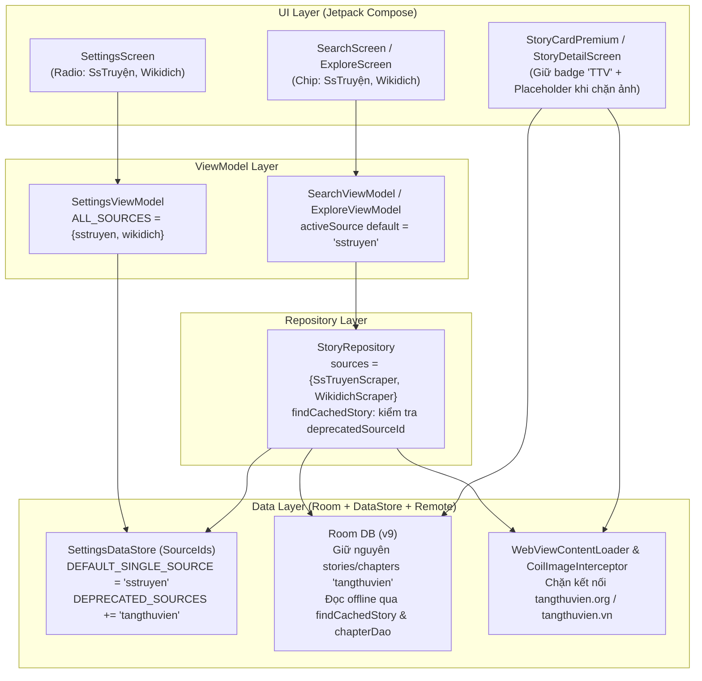

# Kế Hoạch Triển Khai: Gỡ Bỏ Nguồn Truyện Tàng Thư Viện (TangThuVien) & Bảo Toàn Đọc Offline

> **Ngày tạo**: 2026-10-30
> **Trạng thái**: Completed
> **Planner**: @planner ([PLANNER_MODEL: gemini-4-argon])
> **Reviewer**: Claude CLI / @reviewer
> **Revision**: 2

---

## Technical Plan

### 1. Mục tiêu

Gỡ bỏ hoàn toàn nguồn truyện **Tàng Thư Viện** (`tangthuvien` / `tangthuvien.org` / `truyen.tangthuvien.vn`) khỏi danh sách các nguồn cào trực tuyến (active online sources) của ứng dụng **AppTruyen**, sau khi trang Tàng Thư Viện chính thức thông báo đóng cửa vĩnh viễn và cảnh báo `tangthuvien.org` là website giả mạo.

Sau khi hoàn tất:
1. **Nguồn trực tuyến hoạt động**: Ứng dụng chỉ giữ lại **2 nguồn hoạt động** là **SsTruyện** (`sstruyen`, `sstruyen.vn` / `sstruyen.pics`) và **Wikidich** (`wikidich`, `wikicv.org`). Toàn bộ tính năng Tìm kiếm, Khám Phá (Theo thể loại / Truyện hoàn), Cài đặt nguồn truyện và tải chương mới trực tuyến không còn gọi tới `tangthuvien.org` hay `truyen.tangthuvien.vn`.
2. **An toàn mạng & WebView (Security Boundary — `[F1]`)**:
   - Loại bỏ `tangthuvien.org` và `tangthuvien.vn` khỏi danh sách tên miền được phép (`ALLOWED_DOMAINS`) trong `WebViewContentLoader` (`WebViewContentLoader.kt:37-46`).
   - Trong `CoilImageInterceptor` (`CoilImageInterceptor.kt:55-158`), bổ sung danh sách chặn `BLOCKED_IMAGE_HOSTS = setOf("tangthuvien.org", "tangthuvien.vn")` kèm hàm `isBlockedHost(host: String)` kiểm tra ngay ở đầu `intercept(chain)` **trước khi** gọi `chain.proceed(newRequest)` (ném `IOException("Đã chặn kết nối tải ảnh tới tên miền ngừng hoạt động: $rawHost")`), đồng thời gỡ bỏ nhánh `Referer` của Tàng Thư Viện trong `resolveRefererForHost`. Điều này đảm bảo không có bất kỳ kết nối mạng (DNS/TCP/HTTP) nào phát sinh tới `tangthuvien.org` hay `tangthuvien.vn` ngay cả khi hiển thị thẻ truyện TTV cũ bị trượt disk cache của Coil (`StoryCardPremium.kt:113-131,375-393` và `StoryDetailScreen.kt:358-369,432-450` tự động hiển thị khung placeholder gradient + icon sách).
3. **Tự động chuẩn hóa cài đặt người dùng cũ (`DataStore` — `[F5]`)**: Người dùng đang lưu `ENABLED_SOURCES = "tangthuvien"` trong `SettingsDataStore` sẽ được tự động chuẩn hóa sang nguồn mặc định mới `SourceIds.DEFAULT_SINGLE_SOURCE = "sstruyen"`:
   - Khi đọc qua `StoryRepository.observeActiveSource()` (`StoryRepository.kt:77-87`) hoặc `SettingsViewModel` (`SettingsViewModel.kt:149-154`), `SourceIds.resolveSingleSource("tangthuvien")` trả về ngay `"sstruyen"` trên UI.
   - Khi thực thi `StoryRepository.activeSources()` (`StoryRepository.kt:101-114`), lời gọi `dataStore.migrateWikidichEnabledSourcesIfNeeded()` (`SettingsDataStore.kt:181-198`) ghi đè bền vững `"sstruyen"` xuống DataStore, đồng thời giữ nguyên 100% lựa chọn của người dùng nếu họ đang chọn `"wikidich"` hoặc `"sstruyen"`.
4. **Bảo toàn 100% dữ liệu đọc Offline & Chống ghép chéo nguồn (`[F2, F4]`)**: Các truyện và chương có `sourceId = "tangthuvien"` (cả định dạng ID mới `"tangthuvien_<slug>"` lẫn định dạng ID cũ `"<slug>"`) đã lưu trong Room Database hoặc khôi phục từ file Backup vẫn mở được trang chi tiết từ cache (có đối chiếu `entity.sourceId == deprecatedSourceId` chống mở nhầm truyện của nguồn khác có cùng `rawSlug`), đọc được toàn bộ nội dung chương đã tải offline trên `ReaderScreen`, nghe TTS bình thường và giữ nguyên nhãn badge `"TTV"` trên `StoryCardPremium`. Nếu người dùng bấm đọc chương chưa tải của truyện Tàng Thư Viện cũ, `StoryRepository.getChapterContent` (`lines 693-771`) hiển thị thông báo tiếng Việt: `"Nguồn truyện này không còn hoạt động hoặc không được hỗ trợ"`.

---

### 2. Phạm vi

- **Trong phạm vi (In Scope)**:
  - **Tầng `data/remote` & `di`**:
    - Xóa file scraper `app/src/main/java/com/personal/apptruyen/data/remote/TangThuVienScraper.kt` (`[DELETE]`) và file unit test tương ứng `app/src/test/java/com/personal/apptruyen/data/remote/TangThuVienScraperTest.kt` (`[DELETE]`).
    - Gỡ bỏ `@Binds @IntoSet abstract fun bindTangThuVien(impl: TangThuVienScraper): StorySource` khỏi `app/src/main/java/com/personal/apptruyen/di/ScraperModule.kt:5,20-22`.
    - Gỡ bỏ `"tangthuvien.org"` và `"tangthuvien.vn"` khỏi `WebViewContentLoader.ALLOWED_DOMAINS` (`app/src/main/java/com/personal/apptruyen/data/remote/WebViewContentLoader.kt:39-40`, giữ nguyên các domain còn lại gồm `"sstruyen.pics"`, `"sstruyen.vn"`, `"sstruyen.net"`, `"wikicv.org"`, `"wikicv.net"` — `[F6]`).
    - Trong `app/src/main/java/com/personal/apptruyen/data/remote/CoilImageInterceptor.kt`: bổ sung `BLOCKED_IMAGE_HOSTS = setOf("tangthuvien.org", "tangthuvien.vn")`, hàm `isBlockedHost(host: String)` và guard chặn sớm bằng `IOException` ngay đầu `intercept(chain)` trước `chain.proceed` (`[F1]`), đồng thời xóa nhánh ánh xạ `Referer` `"https://tangthuvien.org/"` trong `resolveRefererForHost` (`lines 148-151`).
  - **Tầng `data/local` (`SettingsDataStore.kt`)**:
    - Trong `SourceIds` (`SettingsDataStore.kt:21-51`): chuyển `DEFAULT_SINGLE_SOURCE` từ `TANGTHUVIEN` sang `SSTRUYEN` (`"sstruyen"`); cập nhật `ORDERED_SOURCES = listOf(SSTRUYEN, WIKIDICH)`; cập nhật `ALL_ACTIVE_SOURCES = setOf(SSTRUYEN, WIKIDICH)`; chuyển `TANGTHUVIEN` vào `DEPRECATED_SOURCES = setOf("truyencom", "truyenfull", TANGTHUVIEN)`; gỡ bỏ mục `TANGTHUVIEN to "TàngThưViện"` khỏi `SOURCE_LABELS`.
  - **Tầng `data/repository` (`StoryRepository.kt` — `[F2]`)**:
    - Bổ sung hàm `deprecatedSourceIdForUrl(url: String): String?` nhận diện host của các nguồn đã ngừng hoạt động (`tangthuvien.org` / `tangthuvien.vn` → `SourceIds.TANGTHUVIEN`, `truyencom.com` → `"truyencom"`, `truyenfull.today` / `truyenfull.vn` → `"truyenfull"`).
    - Cập nhật `StoryRepository.findCachedStory(storyUrl)` (`StoryRepository.kt:540-542`) để khi `matchedSource == null`: nếu xác định được `deprecatedSourceId != null`, chỉ tra cứu `storyDao.getStoryById("${deprecatedSourceId}_$rawSlug")` và `storyDao.getStoryById(rawSlug)` với điều kiện bắt buộc `it.sourceId == deprecatedSourceId`; nếu `deprecatedSourceId == null`, chỉ nhận bản ghi `storyDao.getStoryById(rawSlug)` khi `it.sourceId !in SourceIds.ALL_ACTIVE_SOURCES`. Ngăn chặn triệt để việc mở nhầm truyện `SsTruyện`/`Wikidich` hoặc ghép chéo giữa các nguồn cũ.
  - **Tầng `ui` (`SettingsScreen.kt`, `StoryCardPremium.kt`)**:
    - Cập nhật dòng giới thiệu nguồn truyện ở thẻ thông tin ứng dụng cuối màn hình `SettingsScreen.kt:888` từ `"Đa nguồn: Tàng Thư Viện • SsTruyện • Wikidich"` thành `"Đa nguồn: SsTruyện • Wikidich"`.
    - Giữ nguyên ánh xạ badge `"tangthuvien" -> "TTV"` trong `StoryCardPremium.kt:245,253,259,423,435` để hiển thị đúng nhãn nguồn cho các truyện Tàng Thư Viện đã lưu trong Tủ truyện / Đã tải.
  - **Unit Tests & Documentation (`[F1, F2, F3]`)**:
    - Cập nhật các unit test khớp 100% cấu trúc file thật và giữ nguyên/tăng số lượng `assert*`/`coVerify`: `WebViewContentLoaderTest.kt`, `CoilImageInterceptorTest.kt`, `SettingsViewModelTest.kt`, `StoryRepositoryTest.kt`.
    - Cập nhật tài liệu dự án: `docs/scraping.md`, `docs/architecture.md`, `docs/progress.md`, `docs/changelog.md`, `docs/plans/README.md`.

- **Ngoài phạm vi (Out of Scope)**:
  - Không thay đổi Room Database schema (`AppDatabase` giữ nguyên `version = 9`) và không xóa bất kỳ bản ghi `stories`, `chapters`, `reading_progress` hay `bookmarks` nào có `sourceId = "tangthuvien"` trong máy người dùng.
  - Không thay đổi logic cào dữ liệu của `SsTruyenScraper` hay `WikidichScraper`.
  - Không sửa đổi các file quản trị hệ thống agent (`AGENTS.md`, `.agents/**`).

---

### 3. Thiết kế kỹ thuật

#### Skills Loaded & Applied
- **`.agents/skills/apptruyen-investigate/SKILL.md` (`/blast-radius`)**:
  - Đã đọc và thực thi phân tích phạm vi ảnh hưởng trên toàn bộ `app/src/main`, `app/src/test` và `app/src/androidTest` đối với `TangThuVienScraper`, `SourceIds`, `WebViewContentLoader`, `CoilImageInterceptor`, `StoryRepository` và các ViewModel/Screen liên quan.
  - Xác định và xử lý 2 điểm biên quan trọng khi gỡ `TangThuVienScraper`:
    1. Trong `StoryRepository.findCachedStory(storyUrl)` (`StoryRepository.kt:525-542`), khi `matchedSource == null`, phải suy ra `deprecatedSourceId` từ host của URL (`deprecatedSourceIdForUrl`) và kiểm tra chặt `entity.sourceId == deprecatedSourceId` cho cả khóa chính `"${deprecatedSourceId}_$rawSlug"` lẫn khóa cũ `rawSlug` (`[F2]`).
    2. Trong `CoilImageInterceptor.intercept` (`CoilImageInterceptor.kt:55-78`), phải chặn sớm các host thuộc `BLOCKED_IMAGE_HOSTS` trước khi gọi `chain.proceed` để ngăn Coil gửi request ảnh bìa tới `tangthuvien.org` khi disk cache bị evict (`[F1]`).
- **`.agents/rules/04-scraping.md` & `.agents/rules/03-ui.md`**:
  - Đã đọc và áp dụng quy tắc gỡ nguồn ngừng hoạt động (bảo toàn đọc offline, ném `ScraperException.ParseException` với thông báo tiếng Việt khi chương chưa tải, chặn domain không còn sử dụng trong `WebViewContentLoader` và `CoilImageInterceptor`).
  - Đảm bảo 100% văn bản hiển thị trên UI (`SettingsScreen.kt`, thông báo lỗi) bằng tiếng Việt.

#### 3.1. Luồng dữ liệu & Kiến trúc (Screen → ViewModel → Repository → Scraper | Room)



#### 3.2. Chi tiết thay đổi từng thành phần (kèm trích dẫn `[SRC]`)

1. **Xóa `TangThuVienScraper` và gỡ Hilt multibinding (`data/remote`, `di`)**:
   - Xóa `app/src/main/java/com/personal/apptruyen/data/remote/TangThuVienScraper.kt` (`lines 1-595`) và `app/src/test/java/com/personal/apptruyen/data/remote/TangThuVienScraperTest.kt` (`lines 1-162`).
   - Trong `app/src/main/java/com/personal/apptruyen/di/ScraperModule.kt:1-31`: xóa import `TangThuVienScraper` (`line 5`) và hàm `bindTangThuVien(impl: TangThuVienScraper): StorySource` (`lines 20-22`). Tập `Set<StorySource>` được Hilt inject vào `StoryRepository` và `DownloadRepository` lúc này chỉ gồm `SsTruyenScraper` và `WikidichScraper`.

2. **Cập nhật `SourceIds` và tự động di trú cài đặt nguồn trong `SettingsDataStore.kt` (`lines 21-51, 181-198` — `[F5]`)**:
   - Trong `app/src/main/java/com/personal/apptruyen/data/local/SettingsDataStore.kt`:
     - Đặt `DEFAULT_SINGLE_SOURCE = SSTRUYEN` (`"sstruyen"`, thay vì `TANGTHUVIEN` ở `line 26`). Lý do chọn `SSTRUYEN` làm mặc định: `SsTruyện` là phần tử kế tiếp trong `ORDERED_SOURCES` và hoạt động ngay lập tức khi mở app lần đầu mà không yêu cầu đăng nhập tài khoản/cookie như `Wikidich`.
     - Đặt `ORDERED_SOURCES: List<String> = listOf(SSTRUYEN, WIKIDICH)` (`line 27`).
     - Đặt `ALL_ACTIVE_SOURCES = setOf(SSTRUYEN, WIKIDICH)` (`line 29`).
     - Đặt `DEPRECATED_SOURCES = setOf("truyencom", "truyenfull", TANGTHUVIEN)` (`line 30`).
     - Trong `SOURCE_LABELS` (`lines 32-37`): chỉ giữ `SSTRUYEN to "SsTruyện"` và `WIKIDICH to "Wikidich"`.
   - Cơ chế tự động chuyển nguồn cho người dùng cũ (`[SRC]` `SettingsDataStore.kt:43-50, 181-198`, `StoryRepository.kt:77-87, 101-114`, `SettingsViewModel.kt:149-154`):
     - Hàm `SourceIds.resolveSingleSource(rawCsv)` lọc `.firstOrNull { it in ALL_ACTIVE_SOURCES } ?: DEFAULT_SINGLE_SOURCE`. Khi `rawCsv` là `"tangthuvien"` hoặc `"truyencom,truyenfull,tangthuvien"`, không có phần tử nào thuộc `ALL_ACTIVE_SOURCES`, hàm trả về `"sstruyen"`. Khi `rawCsv` là `"wikidich"` hoặc `"tangthuvien,wikidich"`, hàm trả về `"wikidich"`.
     - Trên UI Cài đặt, `SettingsViewModel` (`SettingsViewModel.kt:149-154`) chuẩn hóa ngay khi đọc qua `setOf(SourceIds.resolveSingleSource(prefs[SettingsKeys.ENABLED_SOURCES]))`, còn `StoryRepository.observeActiveSource()` (`StoryRepository.kt:77-87`) phát `SourceIds.resolveSingleSource(prefs[SettingsKeys.ENABLED_SOURCES])`.
     - Về lưu trữ bền vững, `StoryRepository.activeSources()` (`StoryRepository.kt:102`) gọi `dataStore.migrateWikidichEnabledSourcesIfNeeded()` (`SettingsDataStore.kt:181-198`). Điều kiện early-return tại `lines 185-191`:
       `if (isMigrated && currentRaw != null && !currentRaw.contains(",") && currentRaw.trim() in SourceIds.ALL_ACTIVE_SOURCES) return`
       Vì `"tangthuvien"` đã bị loại khỏi `SourceIds.ALL_ACTIVE_SOURCES`, mọi thiết bị đang lưu `ENABLED_SOURCES = "tangthuvien"` (kể cả khi `IS_WIKIDICH_MIGRATED == true` từ phiên bản trước) đều đi vào khối `edit { ... }` nguyên tử và được cập nhật `preferences[SettingsKeys.ENABLED_SOURCES] = "sstruyen"`.

3. **Chặn kết nối tới `tangthuvien.org` / `tangthuvien.vn` trong `WebViewContentLoader` và `CoilImageInterceptor` (`[F1, F6]`)**:
   - Trong `app/src/main/java/com/personal/apptruyen/data/remote/WebViewContentLoader.kt:37-46`: giữ nguyên chữ ký `val ALLOWED_DOMAINS = setOf(...)` và `"sstruyen.vn"`, chỉ xóa 2 phần tử `"tangthuvien.org"` (`line 39`) và `"tangthuvien.vn"` (`line 40`). Mọi URL thuộc các tên miền này sẽ bị `isAllowedDomain(host)` (`lines 48-59`) trả về `false`.
   - Trong `app/src/main/java/com/personal/apptruyen/data/remote/CoilImageInterceptor.kt:55-158`:
     - Bổ sung hằng số `private val BLOCKED_IMAGE_HOSTS = setOf("tangthuvien.org", "tangthuvien.vn")` trong `companion object` (`lines 156-158`) và hàm `internal fun isBlockedHost(host: String): Boolean` kiểm tra khớp chính xác hoặc dot-subdomain (`h == blocked || h.endsWith(".$blocked")` sau khi `trim().lowercase(Locale.ROOT).trimEnd('.')`).
     - Ngay đầu `intercept(chain: Interceptor.Chain): Response` (`line 58`, trước khi tạo request mới, trước khi tăng `hostCounter` và trước `chain.proceed(newRequest)` ở `line 78`), kiểm tra:
       ```kotlin
       val rawHost = request.url.host
       if (isBlockedHost(rawHost)) {
           throw IOException("Đã chặn kết nối tải ảnh tới tên miền ngừng hoạt động: $rawHost")
       }
       ```
     - Xóa nhánh `tangthuvien.org` / `tangthuvien.vn` (`lines 148-151`) khỏi `resolveRefererForHost(host: String)` (giữ nguyên `val h = host.lowercase(Locale.ROOT)` tại `line 144`).
     - **An toàn hiển thị UI khi chặn tải ảnh**: Nếu ảnh bìa của truyện TTV đã lưu có sẵn trong disk cache 50 MB của Coil (`CoilModule.kt:40-46`), Coil phục vụ từ disk cache trước khi gọi `OkHttpNetworkFetcher`. Nếu ảnh không có trong disk cache, `CoilImageInterceptor` ném `IOException` ngay lập tức (không phát sinh kết nối mạng ra ngoài), và `SubcomposeAsyncImage` trong `StoryCardPremium.kt:113-131,375-393` cũng như `StoryDetailScreen.kt:358-369,432-450` tự động render khối `error = { ... }` (nền gradient Amber kèm biểu tượng `Icons.Default.AutoStories`) nên giao diện hoàn toàn không bị vỡ.

4. **Bảo toàn đọc Offline và chống ghép chéo nguồn trong `StoryRepository.kt` (`[F2, F4]`)**:
   - Trong `app/src/main/java/com/personal/apptruyen/data/repository/StoryRepository.kt:516-542`:
     - Khi mở trang chi tiết truyện (`getStoryDetail(storyUrl)`), `findCachedStory(storyUrl)` trước hết tìm theo URL chính xác qua `storyDao.getStoryByUrl(normalizedUrl)` (`line 518`) và `storyDao.getStoryByUrl(trimmedUrl)` (`line 521`).
     - Nếu truy cập bằng biến thể URL không khớp chính xác chuỗi URL trong DB, `matchedSource = sources.firstOrNull { it.matchesUrl(normalizedUrl) }` (`line 525`) sẽ trả về `null` đối với URL của các nguồn đã ngừng hoạt động (`tangthuvien`, `truyencom`, `truyenfull`).
     - Để vừa tìm được cả bản ghi TTV lưu theo ID chuẩn hóa mới (`"tangthuvien_$rawSlug"`) lẫn bản ghi lưu theo ID cũ (`"$rawSlug"`), vừa **ngăn chặn tuyệt đối lỗi mở nhầm truyện của nguồn khác có cùng `rawSlug`** (`[F2]`), bổ sung hàm `deprecatedSourceIdForUrl(normalizedUrl)` và kiểm tra `it.sourceId`:
       - Nếu `deprecatedSourceId != null` (ví dụ host thuộc `tangthuvien.org` / `tangthuvien.vn` → `"tangthuvien"`, `truyencom.com` → `"truyencom"`, `truyenfull.today` / `truyenfull.vn` → `"truyenfull"`):
         1. Tìm `storyDao.getStoryById("${deprecatedSourceId}_$rawSlug")?.takeIf { it.id.isNotBlank() && it.sourceId == deprecatedSourceId }`.
         2. Nếu không có, tìm `storyDao.getStoryById(rawSlug)?.takeIf { it.id.isNotBlank() && it.sourceId == deprecatedSourceId }`.
       - Nếu `deprecatedSourceId == null`: chỉ nhận `storyDao.getStoryById(rawSlug)?.takeIf { it.id.isNotBlank() && it.sourceId !in SourceIds.ALL_ACTIVE_SOURCES }`.
   - Đối với đọc chương (`StoryRepository.getChapterContent`, `lines 693-771` — `[F4]`):
     - `chapterDao.getChapter(storyId, chapterNumber)` (`line 699`) được kiểm tra **trước** khi gọi `sourceFor(effectiveChapterUrl)` (`line 725`). Nếu chương đã tải offline (`cached != null && cached.isDownloaded && !cached.content.isNullOrBlank()`, `lines 702-720`), nội dung chương được trả về trực tiếp từ Room DB mà không cần `TangThuVienScraper`.
     - Nếu chương chưa tải offline, `sourceFor(effectiveChapterUrl)` (`lines 120-122`) không tìm thấy nguồn trong `sources` và ném `ScraperException.ParseException("Nguồn truyện này không còn hoạt động hoặc không được hỗ trợ")`, được khối `catch` của `getChapterContent` (`lines 758-764`) rethrow nguyên vẹn lên ViewModel để hiển thị thông báo tiếng Việt cho người dùng.

5. **Cập nhật giao diện `SettingsScreen.kt` và giữ nguyên badge `"TTV"` trên `StoryCardPremium.kt`**:
   - Trong `app/src/main/java/com/personal/apptruyen/ui/settings/SettingsScreen.kt:888`: đổi chuỗi `"Đa nguồn: Tàng Thư Viện • SsTruyện • Wikidich"` thành `"Đa nguồn: SsTruyện • Wikidich"`.
   - Các màn hình chọn nguồn (`SettingsScreen.kt:395`, `SearchScreen.kt:713`, `ExploreScreen.kt:123`) đều lặp động qua `SettingsViewModel.ALL_SOURCES` / `SourceIds.ORDERED_SOURCES` và hiển thị tên từ `SourceIds.SOURCE_LABELS`, nên tự động chỉ hiển thị 2 nguồn **SsTruyện** và **Wikidich**.
   - Trong `app/src/main/java/com/personal/apptruyen/ui/components/StoryCardPremium.kt:245,253,259,423,435`: giữ nguyên nhánh `"tangthuvien" -> "TTV"` (cùng `"truyencom" -> "TC"`, `"truyenfull" -> "TF"`) để các truyện đã tải của Tàng Thư Viện trong Tủ truyện vẫn hiển thị badge `"TTV"` màu xanh lục.

#### Caller-First Design Sketch

```kotlin
// 1. app/src/main/java/com/personal/apptruyen/di/ScraperModule.kt
@Module
@InstallIn(SingletonComponent::class)
abstract class ScraperModule {
    @Binds
    @IntoSet
    abstract fun bindSsTruyen(impl: SsTruyenScraper): StorySource

    @Binds
    @IntoSet
    abstract fun bindWikidich(impl: WikidichScraper): StorySource
}

// 2. app/src/main/java/com/personal/apptruyen/data/local/SettingsDataStore.kt
object SourceIds {
    const val TANGTHUVIEN = "tangthuvien"
    const val SSTRUYEN = "sstruyen"
    const val WIKIDICH = "wikidich"

    const val DEFAULT_SINGLE_SOURCE = SSTRUYEN
    val ORDERED_SOURCES: List<String> = listOf(SSTRUYEN, WIKIDICH)

    val ALL_ACTIVE_SOURCES = setOf(SSTRUYEN, WIKIDICH)
    val DEPRECATED_SOURCES = setOf("truyencom", "truyenfull", TANGTHUVIEN)

    val SOURCE_LABELS: Map<String, String> =
        mapOf(
            SSTRUYEN to "SsTruyện",
            WIKIDICH to "Wikidich",
        )

    fun resolveSingleSource(rawCsv: String?): String {
        if (rawCsv.isNullOrBlank()) return DEFAULT_SINGLE_SOURCE
        return rawCsv
            .split(",")
            .map { it.trim() }
            .firstOrNull { it in ALL_ACTIVE_SOURCES }
            ?: DEFAULT_SINGLE_SOURCE
    }
}

// 3. app/src/main/java/com/personal/apptruyen/data/remote/WebViewContentLoader.kt (lines 37-46)
val ALLOWED_DOMAINS =
    setOf(
        "sstruyen.pics",
        "sstruyen.vn",
        "sstruyen.net",
        "wikicv.org",
        "wikicv.net",
    )

// 4. app/src/main/java/com/personal/apptruyen/data/remote/CoilImageInterceptor.kt (lines 55-62, 143-159)
override fun intercept(chain: Interceptor.Chain): Response {
    val call = chain.call()
    val request = chain.request()
    val rawHost = request.url.host
    if (isBlockedHost(rawHost)) {
        throw IOException("Đã chặn kết nối tải ảnh tới tên miền ngừng hoạt động: $rawHost")
    }
    val builder = request.newBuilder()
    // ... giữ nguyên phần xử lý User-Agent, Referer, proceed và retry 502/503/504 ...
}

internal fun isBlockedHost(host: String): Boolean {
    val h = host.trim().lowercase(Locale.ROOT).trimEnd('.')
    if (h.isEmpty()) return false
    return BLOCKED_IMAGE_HOSTS.any { blocked ->
        h == blocked || h.endsWith(".$blocked")
    }
}

internal fun resolveRefererForHost(host: String): String? {
    val h = host.lowercase(Locale.ROOT)
    return when {
        h == "wikicv.org" || h.endsWith(".wikicv.org") -> "https://wikicv.org/"
        h == "sstruyen.pics" || h.endsWith(".sstruyen.pics") -> "https://sstruyen.pics/"
        else -> null
    }
}

companion object {
    private val SERVER_ERROR_CODES = setOf(502, 503, 504)
    private val BLOCKED_IMAGE_HOSTS = setOf("tangthuvien.org", "tangthuvien.vn")
}

// 5. app/src/main/java/com/personal/apptruyen/data/repository/StoryRepository.kt (lines 540-565)
// Fallback cho các nguồn cũ đã ngừng cào trực tuyến (truyencom, truyenfull, tangthuvien...) chỉ đọc offline
val deprecatedSourceId = deprecatedSourceIdForUrl(normalizedUrl)
if (deprecatedSourceId != null) {
    storyDao
        .getStoryById("${deprecatedSourceId}_$rawSlug")
        ?.takeIf { it.id.isNotBlank() && it.sourceId == deprecatedSourceId }
        ?.let { return it }
    return storyDao
        .getStoryById(rawSlug)
        ?.takeIf { it.id.isNotBlank() && it.sourceId == deprecatedSourceId }
}
return storyDao
    .getStoryById(rawSlug)
    ?.takeIf { it.id.isNotBlank() && it.sourceId !in SourceIds.ALL_ACTIVE_SOURCES }

private fun deprecatedSourceIdForUrl(url: String): String? {
    val host =
        try {
            URI(url).host?.lowercase(Locale.ROOT)?.trimEnd('.')
        } catch (_: Exception) {
            null
        } ?: return null
    return when {
        host == "tangthuvien.org" ||
            host.endsWith(".tangthuvien.org") ||
            host == "tangthuvien.vn" ||
            host.endsWith(".tangthuvien.vn") -> SourceIds.TANGTHUVIEN
        host == "truyencom.com" || host.endsWith(".truyencom.com") -> "truyencom"
        host == "truyenfull.today" ||
            host.endsWith(".truyenfull.today") ||
            host == "truyenfull.vn" ||
            host.endsWith(".truyenfull.vn") -> "truyenfull"
        else -> null
    }
}
```

#### 3.3. Adversarial Timelines (Mục 4.5.2 `evidence-bar.md` — S3, S4, S5 & Cơ chế bất đồng bộ)

1. **Trục 1 — Đồng thời (Concurrent DataStore Migration qua `StoryRepository.activeSources()` khi Cold-start — `[F5]`)**:
   ```text
   Cơ chế: DataStore<Preferences>.migrateWikidichEnabledSourcesIfNeeded() khi ENABLED_SOURCES = "tangthuvien", IS_WIKIDICH_MIGRATED = true
   T1: ExploreViewModel.init kích hoạt song song getGenreList() và getCompletedStories() -> cả 2 coroutine cùng gọi StoryRepository.activeSources() (StoryRepository.kt:102)
   T2: Cả 2 lời gọi migrateWikidichEnabledSourcesIfNeeded() đọc snapshot (SettingsDataStore.kt:182-184) và đều không early-return tại lines 185-191 vì "tangthuvien" không thuộc SourceIds.ALL_ACTIVE_SOURCES
   T3: DataStore.edit tuần tự hóa (serialize) 2 transaction ghi; transaction thứ 2 đọc rawInside = "sstruyen" và ghi lại SourceIds.resolveSingleSource("sstruyen") = "sstruyen" (idempotent, lines 193-197)
   Kết cục: Preferences hội tụ về trạng thái duy nhất ENABLED_SOURCES = "sstruyen", IS_WIKIDICH_MIGRATED = true → AN TOÀN
   ```

2. **Trục 2 — Khoảng trống Check→Use (TOCTOU khi mở chương truyện Tàng Thư Viện cũ — `[F4]`)**:
   ```text
   Cơ chế: StoryRepository.getChapterContent(storyId, chapterNumber, chapterUrl) cho truyện có sourceId = "tangthuvien"
   T1: Người dùng mở một chương của truyện Tàng Thư Viện trong Tủ truyện; ReaderViewModel gọi repository.getChapterContent(storyId, chapterNumber, chapterUrl) (StoryRepository.kt:693)
   T2: Chương đó chưa được tải offline (hoặc người dùng vừa xóa dữ liệu offline của chương đó ngay trước đó), nên chapterDao.getChapter(storyId, chapterNumber) (line 699) trả về cached.isDownloaded = false / cached.content = null
   T3: StoryRepository gọi sourceFor(effectiveChapterUrl) (line 725 -> lines 120-122); vì TangThuVienScraper đã bị gỡ khỏi Set<StorySource>, sourceFor ném ScraperException.ParseException("Nguồn truyện này không còn hoạt động hoặc không được hỗ trợ"); khối catch tại lines 758-764 rethrow đúng thông điệp tiếng Việt này mà không gọi mạng tới tangthuvien.org
   Kết cục: Không có request mạng nào gửi tới trang giả mạo tangthuvien.org; người dùng nhận thông báo lỗi tiếng Việt rõ ràng → AN TOÀN
   ```

3. **Trục 3 — Thất bại giữa chừng (Tải hàng loạt truyện Tàng Thư Viện cũ còn chương chưa tải trong DownloadService — `[F4]`)**:
   ```text
   Cơ chế: DownloadRepository.downloadChapters(storyId, chapters) với truyện sourceId = "tangthuvien"
   T1: Người dùng bấm "Tải chương" trên một truyện Tàng Thư Viện cũ đã lưu trong Tủ truyện nhưng còn các chương chưa tải
   T2: DownloadRepository.downloadChapters gọi sourceFor(firstValidUrl) tại line 208 (DownloadRepository.kt:71-73) -> ném ScraperException.ParseException("Nguồn truyện không được hỗ trợ") trước khi emit hay gọi mạng
   T3: DownloadService catch Exception (DownloadService.kt:321-325) và chuyển trạng thái sang DownloadState.Completed(downloaded = 0, errors >= 1); không có lệnh ghi hay xóa chapter nào chạy trên Room DB
   Kết cục: Các chương đã tải offline được bảo toàn 100% trong Room DB; tiến trình tải kết thúc an toàn → AN TOÀN
   ```

4. **Trục 4 — Vòng đời Android (Khôi phục Backup chứa cài đặt nguồn `"tangthuvien"` cũ & Hiển thị ảnh bìa — `[F1, F4]`)**:
   ```text
   Cơ chế: BackupRepository.kt:562 gọi SettingsKeys.restoreSettingFromBackup(preferences, "enabled_sources", "tangthuvien,sstruyen") & Coil tải coverImageUrl = "https://tangthuvien.org/..."
   T1: Người dùng khôi phục file backup JSON từ phiên bản cũ; BackupRepository.kt:562 gọi SettingsKeys.restoreSettingFromBackup (SettingsDataStore.kt:127-128) ghi SourceIds.resolveSingleSource(value) = "sstruyen" trong cùng transaction edit
   T2: Người dùng mở Tủ truyện hiển thị các truyện TTV vừa khôi phục có coverImageUrl = "https://tangthuvien.org/covers/..." (chưa có trong disk cache của Coil)
   T3: CoilImageInterceptor.intercept kiểm tra isBlockedHost("tangthuvien.org") == true ngay ở đầu hàm và ném IOException trước khi gọi chain.proceed; SubcomposeAsyncImage (StoryCardPremium.kt:113-131) hiển thị khung placeholder mặc định
   Kết cục: Cài đặt nguồn sau khi restore luôn thuộc ALL_ACTIVE_SOURCES; tuyệt đối không phát sinh kết nối mạng tới tangthuvien.org → AN TOÀN
   ```

---

### 4. Verified Versions Table

Task này không thêm mới hoặc nâng cấp bất kỳ thư viện bên ngoài nào trong `app/build.gradle.kts` hay `build.gradle.kts`. Bảng dưới đây xác minh các thành phần hiện có liên quan trực tiếp tới thay đổi (`[SRC]` `build.gradle.kts:1-10`, `app/build.gradle.kts:1-201`):

| Thư viện / Thành phần | Version hiện tại (`[SRC]`) | Version đề xuất | Latest đã xác minh | Nguồn URL (`[URL]`) | Tương thích? |
|---|---|---|---|---|---|
| Kotlin / KSP | `2.3.10` / `2.3.6` (`build.gradle.kts:3-5`) | Giữ nguyên | `2.3.10` / `2.3.6` | https://kotlinlang.org/docs/releases.html | Tương thích 100% |
| Dagger Hilt | `2.59.2` (`build.gradle.kts:6`, `app/build.gradle.kts:145-146`) | Giữ nguyên | `2.59.2` | https://dagger.dev/hilt/ | Hỗ trợ `@Binds @IntoSet` |
| Room 3 | `3.0.0-alpha01` (`build.gradle.kts:7`, `app/build.gradle.kts:149-152`) | Giữ nguyên | `3.0.0-alpha01` | https://developer.android.com/jetpack/androidx/releases/room | Không đổi schema (v9) |
| DataStore Preferences | `1.2.1` (`app/build.gradle.kts:156`) | Giữ nguyên | `1.2.1` | https://developer.android.com/jetpack/androidx/releases/datastore | Hỗ trợ `edit` nguyên tử |
| OkHttp / Coil 3 | `5.3.2` / `3.4.0` (`app/build.gradle.kts:160,165-166`) | Giữ nguyên | `5.3.2` / `3.4.0` | https://square.github.io/okhttp/ | Tương thích 100% |
| JUnit 5 / MockK | `6.0.3` / `1.14.9` (`app/build.gradle.kts:183-189`) | Giữ nguyên | `6.0.3` / `1.14.9` | https://junit.org/junit5/ | Tương thích 100% |

---

### 5. Files cần chỉnh sửa / tạo mới

| Nhãn | File | Tầng | Ghi chú (Lý do bảo vệ / nhạy cảm) |
|---|---|---|---|
| `[DELETE]` | `app/src/main/java/com/personal/apptruyen/data/remote/TangThuVienScraper.kt` | `data/remote` | Xóa hoàn toàn scraper Tàng Thư Viện (`tangthuvien.org` / `truyen.tangthuvien.vn`) theo tiền lệ gỡ `TruyenComScraper` và `TruyenFullScraper` |
| `[MODIFY]` | `app/src/main/java/com/personal/apptruyen/di/ScraperModule.kt` | `di` | Xóa `import TangThuVienScraper` và `@Binds @IntoSet abstract fun bindTangThuVien` (`lines 5, 20-22`) |
| `[MODIFY]` | `app/src/main/java/com/personal/apptruyen/data/local/SettingsDataStore.kt` | `data/local` | Cập nhật `SourceIds`: `DEFAULT_SINGLE_SOURCE = SSTRUYEN`, `ORDERED_SOURCES = listOf(SSTRUYEN, WIKIDICH)`, `ALL_ACTIVE_SOURCES = setOf(SSTRUYEN, WIKIDICH)`, thêm `TANGTHUVIEN` vào `DEPRECATED_SOURCES`, gỡ `TANGTHUVIEN` khỏi `SOURCE_LABELS` |
| `[MODIFY]` | `app/src/main/java/com/personal/apptruyen/data/remote/WebViewContentLoader.kt` | `data/remote` | **`[F6]`** Xóa `"tangthuvien.org"` và `"tangthuvien.vn"` khỏi `ALLOWED_DOMAINS` (`lines 39-40`), giữ nguyên `val ALLOWED_DOMAINS = setOf(...)` và `"sstruyen.vn"` |
| `[MODIFY]` | `app/src/main/java/com/personal/apptruyen/data/remote/CoilImageInterceptor.kt` | `data/remote` | **`[F1, F6]`** Thêm `BLOCKED_IMAGE_HOSTS = setOf("tangthuvien.org", "tangthuvien.vn")`, hàm `isBlockedHost(host)` và chặn sớm bằng `IOException` ở đầu `intercept(chain)` trước `chain.proceed`; xóa nhánh `Referer` của TTV trong `resolveRefererForHost` (`lines 148-151`, giữ nguyên `Locale.ROOT`) |
| `[MODIFY]` | `app/src/main/java/com/personal/apptruyen/data/repository/StoryRepository.kt` | `data/repository` | **`[F2]`** Trong `findCachedStory(storyUrl)` (`lines 540-542`), thêm helper `deprecatedSourceIdForUrl(normalizedUrl)` và kiểm tra `it.sourceId == deprecatedSourceId` cho cả `"${deprecatedSourceId}_$rawSlug"` và `rawSlug` để vừa đọc offline được truyện TTV mới/cũ vừa chống mở nhầm truyện nguồn khác cùng slug |
| `[MODIFY]` | `app/src/main/java/com/personal/apptruyen/ui/settings/SettingsScreen.kt` | `ui/settings` | Cập nhật dòng text giới thiệu nguồn ở `line 888` thành `"Đa nguồn: SsTruyện • Wikidich"` |
| `[DELETE]` | `app/src/test/java/com/personal/apptruyen/data/remote/TangThuVienScraperTest.kt` | `test` | **[Nhạy cảm: Test Integrity — Loại C]** Xóa file unit test của `TangThuVienScraper` vì class `TangThuVienScraper` đã bị xóa hoàn toàn |
| `[MODIFY]` | `app/src/test/java/com/personal/apptruyen/data/remote/WebViewContentLoaderTest.kt` | `test` | **[Nhạy cảm: Test Integrity — Loại C, `[F3]`]** Trong hàm `isAllowedDomain validates exact domain and dot-subdomain boundaries`, giữ nguyên toàn bộ 12 boundary hiện có (`m.sstruyen.pics`, `wikicv.org`, `WIKICV.NET.`, `evil-tangthuvien.vn`, `tangthuvien.vn.evil.com`, `evilwikicv.org`, `null`, `"   "`, `"."`), chuyển 3 dòng `"tangthuvien.vn"`, `"tangthuvien.org"`, `"truyen.tangthuvien.vn"` từ `assertTrue` sang `assertFalse`, và thêm 2 dòng `assertTrue` cho `"sstruyen.vn"` và `"sstruyen.net"` (tổng số assert tăng từ 12 lên 14) |
| `[MODIFY]` | `app/src/test/java/com/personal/apptruyen/data/remote/CoilImageInterceptorTest.kt` | `test` | **[Nhạy cảm: Test Integrity — Loại C, `[F1]`]** Cập nhật `TC7 and TC8` dùng `assertEquals(null, ...)` cho `tangthuvien.org` / `www.tangthuvien.vn`; bổ sung test mới `TC13` xác minh `intercept` ném `IOException` và không gọi mạng (`server.requestCount == 0`) đối với `tangthuvien.org`, `www.tangthuvien.vn`, `truyen.tangthuvien.vn` |
| `[MODIFY]` | `app/src/test/java/com/personal/apptruyen/ui/settings/SettingsViewModelTest.kt` | `test` | **[Nhạy cảm: Test Integrity — Loại C]** Cập nhật các kỳ vọng `resolveSingleSource`, `enabledSources` và `selectSource` theo `DEFAULT_SINGLE_SOURCE = "sstruyen"` và `"tangthuvien" in DEPRECATED_SOURCES` (giữ nguyên hoặc tăng số lượng `assertEquals`) |
| `[MODIFY]` | `app/src/test/java/com/personal/apptruyen/data/repository/StoryRepositoryTest.kt` | `test` | **[Nhạy cảm: Test Integrity — Loại C, `[F2, F3]`]** (1) Trong `getStoryDetail does not collide across sources sharing the same raw slug`: bổ sung kiểm tra đọc offline `"tangthuvien_tien-nghich"`, kiểm tra chiều ngược (URL `tangthuvien.org` không trả bản ghi legacy `sourceId = "sstruyen"` cùng slug) và cách ly với `truyencom.com`; (2) Trong `observeActiveSource and setActiveSource`: cập nhật theo `DEFAULT_SINGLE_SOURCE = "sstruyen"`, thay `coVerify(exactly = 0) { ttvSource.search(any(), any()) }` bằng `coVerify(exactly = 0) { wikiSource.search(any(), any()) }` và `coVerify(exactly = 0) { sstSource.search("tiên", any()) }` (tăng số lượng `coVerify` và `assertEquals`) |
| `[MODIFY]` | `docs/scraping.md` | `docs` | Chuyển Tàng Thư Viện xuống mục "Nguồn Đã Ngừng Hoạt Động (Lưu Trữ)" kèm lý do đóng cửa chính thức và cảnh báo `tangthuvien.org` giả mạo |
| `[MODIFY]` | `docs/architecture.md` | `docs` | Cập nhật danh sách nguồn hoạt động (SsTruyện, Wikidich), sơ đồ kiến trúc và cấu trúc thư mục `data/remote/` |
| `[MODIFY]` | `docs/progress.md` | `docs` | Ghi nhận hoàn thành việc gỡ nguồn Tàng Thư Viện và bảo toàn đọc offline |
| `[MODIFY]` | `docs/changelog.md` | `docs` | Thêm mục thay đổi dưới `## [Unreleased]` (`### Xóa bỏ` / `### Sửa đổi`) |
| `[MODIFY]` | `docs/plans/README.md` | `docs` | Thêm kế hoạch `2026-10-30-remove-tangthuvien-source-implementation-plan.md` vào bảng chỉ mục |

---

### 6. Các bước thực hiện

- [ ] **Bước 1: Gỡ bỏ `TangThuVienScraper`, cập nhật Hilt `ScraperModule`, `WebViewContentLoader` và `CoilImageInterceptor` (`[F1, F6]`)**
  - Xóa file `app/src/main/java/com/personal/apptruyen/data/remote/TangThuVienScraper.kt`.
  - Trong `app/src/main/java/com/personal/apptruyen/di/ScraperModule.kt`: xóa import `TangThuVienScraper` (`line 5`) và hàm `bindTangThuVien` (`lines 20-22`).
  - Trong `app/src/main/java/com/personal/apptruyen/data/remote/WebViewContentLoader.kt`: giữ nguyên `val ALLOWED_DOMAINS = setOf(...)` và `"sstruyen.vn"`, chỉ xóa 2 dòng `"tangthuvien.org"` (`line 39`) và `"tangthuvien.vn"` (`line 40`).
  - Trong `app/src/main/java/com/personal/apptruyen/data/remote/CoilImageInterceptor.kt`:
    - Thêm `private val BLOCKED_IMAGE_HOSTS = setOf("tangthuvien.org", "tangthuvien.vn")` vào `companion object`.
    - Thêm `internal fun isBlockedHost(host: String): Boolean` kiểm tra khớp chính xác và dot-subdomain.
    - Ở đầu `intercept(chain: Interceptor.Chain): Response` (trước `chain.proceed`), nếu `isBlockedHost(request.url.host)` trả về `true` thì ném `IOException("Đã chặn kết nối tải ảnh tới tên miền ngừng hoạt động: ${request.url.host}")`.
    - Xóa nhánh `h == "tangthuvien.org" || h.endsWith(".tangthuvien.org") || h == "tangthuvien.vn" || h.endsWith(".tangthuvien.vn") -> "https://tangthuvien.org/"` trong `resolveRefererForHost` (`lines 148-151`, giữ nguyên `Locale.ROOT` ở `line 144`).

- [ ] **Bước 2: Cập nhật `SourceIds` trong `SettingsDataStore.kt`, chống ghép chéo nguồn trong `StoryRepository.kt` và cập nhật `SettingsScreen.kt` (`[F2]`)**
  - Trong `app/src/main/java/com/personal/apptruyen/data/local/SettingsDataStore.kt`:
    - Đổi `DEFAULT_SINGLE_SOURCE = SSTRUYEN` (`line 26`).
    - Đổi `ORDERED_SOURCES = listOf(SSTRUYEN, WIKIDICH)` (`line 27`).
    - Đổi `ALL_ACTIVE_SOURCES = setOf(SSTRUYEN, WIKIDICH)` (`line 29`).
    - Đổi `DEPRECATED_SOURCES = setOf("truyencom", "truyenfull", TANGTHUVIEN)` (`line 30`).
    - Xóa `TANGTHUVIEN to "TàngThưViện"` khỏi `SOURCE_LABELS` (`lines 32-37`).
    - Cập nhật KDoc tại `line 85`.
  - Trong `app/src/main/java/com/personal/apptruyen/data/repository/StoryRepository.kt`:
    - Bổ sung hàm `private fun deprecatedSourceIdForUrl(url: String): String?` ánh xạ host của `tangthuvien.org`/`tangthuvien.vn` → `SourceIds.TANGTHUVIEN`, `truyencom.com` → `"truyencom"`, `truyenfull.today`/`truyenfull.vn` → `"truyenfull"`.
    - Tại cuối hàm `findCachedStory(storyUrl: String)` (`lines 540-542`), khi `matchedSource == null`, tra cứu theo `deprecatedSourceId` với điều kiện `it.sourceId == deprecatedSourceId` cho cả `"${deprecatedSourceId}_$rawSlug"` và `rawSlug` (và nếu `deprecatedSourceId == null` thì yêu cầu `it.sourceId !in SourceIds.ALL_ACTIVE_SOURCES`) như trong Design Sketch mục 3.
  - Trong `app/src/main/java/com/personal/apptruyen/ui/settings/SettingsScreen.kt`:
    - Tại `line 888`, đổi `"Đa nguồn: Tàng Thư Viện • SsTruyện • Wikidich"` thành `"Đa nguồn: SsTruyện • Wikidich"`.
  - Chạy Tier 1 check: `.\gradlew.bat compileDebugKotlin` để xác nhận main source set biên dịch sạch.

- [ ] **Bước 3: Cập nhật Unit Tests theo Test Contract (Loại C — Approved Spec Change, `[F1, F2, F3]`)**
  - Xóa file `app/src/test/java/com/personal/apptruyen/data/remote/TangThuVienScraperTest.kt`.
  - Cập nhật `app/src/test/java/com/personal/apptruyen/data/remote/WebViewContentLoaderTest.kt` (`[F3]`):
    - Giữ nguyên tên hàm `@Test fun isAllowedDomain validates exact domain and dot-subdomain boundaries()` và toàn bộ 12 kiểm tra hiện có (`"m.sstruyen.pics"`, `"wikicv.org"`, `"WIKICV.NET."`, `"evil-tangthuvien.vn"`, `"tangthuvien.vn.evil.com"`, `"evilwikicv.org"`, `null`, `"   "`, `"."`).
    - Chuyển 3 dòng `"tangthuvien.vn"`, `"tangthuvien.org"`, `"truyen.tangthuvien.vn"` từ `assertTrue` sang `assertFalse`, đồng thời bổ sung `assertTrue(WebViewContentLoader.isAllowedDomain("sstruyen.vn"))` và `assertTrue(WebViewContentLoader.isAllowedDomain("sstruyen.net"))` (tổng số assert tăng từ 12 lên 14).
  - Cập nhật `app/src/test/java/com/personal/apptruyen/data/remote/CoilImageInterceptorTest.kt` (`[F1]`):
    - Trong `TC7 and TC8 - resolveRefererForHost returns matching source referer and null for third-party hosts` (`lines 69-78`), đổi `lines 74-75` sang `assertEquals(null, interceptor.resolveRefererForHost("tangthuvien.org"))` và `assertEquals(null, interceptor.resolveRefererForHost("www.tangthuvien.vn"))`.
    - Bổ sung `@Test fun TC13 - intercept blocks requests to deprecated tangthuvien hosts before proceeding on network()`: kiểm tra `isBlockedHost` trả `true` cho `"tangthuvien.org"`, `"cdn.tangthuvien.org"`, `"tangthuvien.vn"`, `"www.tangthuvien.vn"`, `"truyen.tangthuvien.vn"`, `"TANGTHUVIEN.ORG."` và `false` cho `"wikicv.org"`, `"sstruyen.pics"`, `"evil-tangthuvien.org"`; xác minh gọi `client.newCall(Request.Builder().url("https://tangthuvien.org/covers/1.jpg").build()).execute()` và `"https://truyen.tangthuvien.vn/covers/1.jpg"` đều ném `IOException` (`assertThrows(IOException::class.java)`) với `server.requestCount == 0`, trong khi request tới `server.url("/photo/ok")` vẫn qua `chain.proceed` bình thường (`server.requestCount == 1`).
  - Cập nhật `app/src/test/java/com/personal/apptruyen/ui/settings/SettingsViewModelTest.kt`:
    - Trong `enabledSources filters out legacy source IDs and toggleSource protects last active source` (`lines 136-170`): kiểm tra `"truyencom,truyenfull,tangthuvien,sstruyen"` lọc bỏ cả 3 ID cũ còn `setOf("sstruyen")`; `toggleSource("sstruyen")` giữ nguyên `setOf("sstruyen")`; `"truyencom,truyenfull,tangthuvien"` (chỉ chứa ID cũ) fallback về `setOf("sstruyen")`.
    - Trong `resolveSingleSource normalizes null blank multi-source CSV legacy IDs and whitespace to single active source` (`lines 173-204`): kiểm tra `null`, `""`, `"  "`, `"truyenfull,truyencom,tangthuvien"` trả về `"sstruyen"`; `" tangthuvien , sstruyen , wikidich "` trả về `"sstruyen"`; `"tangthuvien,wikidich"` trả về `"wikidich"`.
    - Trong `selectSource switches exclusively to selected source and ignores invalid sourceId` (`lines 207-243`): khởi tạo với `"sstruyen"`, chuyển sang `"wikidich"` thành công, và gọi `selectSource("tangthuvien")` bị bỏ qua (giữ nguyên `setOf("wikidich")`).
  - Cập nhật `app/src/test/java/com/personal/apptruyen/data/repository/StoryRepositoryTest.kt` (`[F2, F3]`):
    - Trong `getStoryDetail does not collide across sources sharing the same raw slug` (`lines 191-247`): khởi tạo `StoryRepository(setOf(ssSource), ...)` (không còn `ttvSource`), kiểm tra:
      1. Chiều xuôi: mở `"https://sstruyen.pics/truyen/pham-nhan-tu-tien"` khi DB có `legacyTtvEntity` (`id = "pham-nhan-tu-tien"`, `sourceId = "tangthuvien"`) không trả về bản ghi TTV mà gọi `ssSource.getStoryDetail` và lưu `"sstruyen_pham-nhan-tu-tien"`.
      2. Đọc offline TTV chuẩn hóa (F2-i): khi DB có `"tangthuvien_tien-nghich"` (`sourceId = "tangthuvien"`), gọi `repo.getStoryDetail("https://tangthuvien.org/tien-nghich")` trả về đúng truyện `"tangthuvien_tien-nghich"`.
      3. Chiều ngược chống ghép chéo (F2-ii): khi DB có bản ghi legacy `id = "cung-slug"`, `sourceId = "sstruyen"`, gọi `repo.getStoryDetail("https://tangthuvien.org/cung-slug")` KHÔNG trả về truyện SsTruyện mà ném `ScraperException.ParseException`.
      4. Cách ly giữa các nguồn cũ (F2-iii): gọi `repo.getStoryDetail("https://truyencom.com/tien-nghich")` KHÔNG trả về bản ghi `"tangthuvien_tien-nghich"` mà ném `ScraperException.ParseException`.
    - Trong `observeActiveSource and setActiveSource persist and emit single active source` (`lines 999-1063`): khởi tạo `StoryRepository(setOf(sstSource, wikiSource), ...)`, kiểm tra nguồn mặc định ban đầu là `"sstruyen"`, gọi `setActiveSource("wikidich")` -> `"wikidich"`, gọi `setActiveSource("sstruyen")` -> `"sstruyen"`, gọi `setActiveSource("tangthuvien")` -> bị bỏ qua (`assertEquals(listOf("sstruyen", "wikidich", "sstruyen"), emitted)`); giữ đủ và tăng số lượng `coVerify` (`coVerify(exactly = 1) { sstSource.search("kiếm", false) }`, `coVerify(exactly = 0) { wikiSource.search(any(), any()) }`, `coVerify(exactly = 0) { wikiSource.search(any(), any(), any(), any(), any()) }`, và sau khi chuyển sang `"wikidich"`: `coVerify(exactly = 1) { wikiSource.search("tiên", true, 2, true, "tien-hiep") }`, `coVerify(exactly = 0) { sstSource.search("tiên", any()) }`).

- [ ] **Bước 4: Chạy Quality Gate Tier 2 & Cập nhật Documentation**
  - Chạy đầy đủ các cổng kiểm tra chất lượng:
    `.\gradlew.bat ktlintCheck; .\gradlew.bat testDebugUnitTest; .\gradlew.bat assembleDebug`
  - Cập nhật `docs/scraping.md`, `docs/architecture.md`, `docs/progress.md`, `docs/changelog.md` và `docs/plans/README.md` theo mục 10.

---

### 7. Test Contract

> **Phân loại Triage (`.agents/rules/02-quality.md`)**: Toàn bộ các cập nhật test dưới đây thuộc **Loại C (Approved Spec Change)** do đặc tả nghiệp vụ thay đổi từ 3 nguồn hoạt động (`tangthuvien`, `sstruyen`, `wikidich`) sang 2 nguồn hoạt động (`sstruyen`, `wikidich`, với `DEFAULT_SINGLE_SOURCE = "sstruyen"` và `"tangthuvien"` chuyển vào `DEPRECATED_SOURCES`). Cam kết **không giảm số lượng `assert*`/`coVerify`** và **không nới lỏng matcher** trong mọi file test được sửa đổi.

| # | Hành vi nghiệp vụ | Điều kiện đầu vào (Input) | Kết quả mong đợi / Thông báo tiếng Việt | Boundary / Failure mode |
|---|---|---|---|---|
| 1 | Chuẩn hóa cài đặt nguồn đơn (`SourceIds.resolveSingleSource`) | `null`, `""`, `"  "`, `"tangthuvien"`, `"truyencom,truyenfull,tangthuvien"`, `" tangthuvien , sstruyen , wikidich "`, `"tangthuvien,wikidich"` | Các chuỗi rỗng hoặc chỉ chứa nguồn cũ (`tangthuvien`, `truyencom`, `truyenfull`) trả về `"sstruyen"` (`DEFAULT_SINGLE_SOURCE`); `" tangthuvien , sstruyen , wikidich "` trả về `"sstruyen"`; `"tangthuvien,wikidich"` trả về `"wikidich"` | Không bao giờ trả về `"tangthuvien"` hay chuỗi rỗng |
| 2 | Tự động di trú người dùng đang chọn `"tangthuvien"` trong DataStore | `Preferences` có `ENABLED_SOURCES = "tangthuvien"` và `IS_WIKIDICH_MIGRATED = true` (hoặc `false`) | `migrateWikidichEnabledSourcesIfNeeded()` phát hiện `"tangthuvien" !in ALL_ACTIVE_SOURCES`, tự động ghi `ENABLED_SOURCES = "sstruyen"` vào DataStore | Nếu người dùng đang chọn `"wikidich"` hoặc `"sstruyen"`, giữ nguyên 100% không ghi đè |
| 3 | Chọn nguồn hoạt động trên UI / ViewModel (`selectSource` / `setActiveSource`) | Gọi `selectSource("wikidich")`, `selectSource("sstruyen")`, sau đó gọi `selectSource("tangthuvien")` | Chuyển đổi hợp lệ giữa `"sstruyen"` và `"wikidich"`; lời gọi với `"tangthuvien"` bị từ chối và không làm thay đổi state | `toggleSource` trên nguồn duy nhất còn lại vẫn bảo vệ không cho phép tập nguồn rỗng |
| 4 | Chặn tên miền `tangthuvien.org` / `tangthuvien.vn` trong `WebViewContentLoader` (`[F3]`) | Gọi `WebViewContentLoader.isAllowedDomain` với `"tangthuvien.org"`, `"tangthuvien.vn"`, `"truyen.tangthuvien.vn"` và các boundary hiện có | `"tangthuvien.org"`, `"tangthuvien.vn"`, `"truyen.tangthuvien.vn"`, `"evil-tangthuvien.vn"`, `"tangthuvien.vn.evil.com"`, `"evilwikicv.org"`, `null`, `"   "`, `"."` trả về `false`; `"sstruyen.vn"`, `"sstruyen.net"`, `"m.sstruyen.pics"`, `"wikicv.org"`, `"WIKICV.NET."` trả về `true` | Bảo toàn đầy đủ 12 boundary gốc và nâng tổng số assert lên 14 |
| 5 | Chặn kết nối tải ảnh và gỡ `Referer` của Tàng Thư Viện trong `CoilImageInterceptor` (`[F1]`) | (a) Gọi `resolveRefererForHost("tangthuvien.org")` và `"www.tangthuvien.vn"`; (b) Gọi `intercept` với URL ảnh trên `tangthuvien.org`, `www.tangthuvien.vn`, `truyen.tangthuvien.vn` | (a) `resolveRefererForHost` trả về `null`; (b) `intercept` ném `IOException("Đã chặn kết nối tải ảnh tới tên miền ngừng hoạt động: ...")` trước `chain.proceed` (`server.requestCount == 0`) | Không phát sinh kết nối mạng tới domain giả mạo; `SubcomposeAsyncImage` hiển thị khung placeholder an toàn |
| 6 | Đọc Offline truyện & chương Tàng Thư Viện đã lưu và chống ghép chéo nguồn (`[F2]`) | (i) Truyện `"tangthuvien_tien-nghich"` (`sourceId = "tangthuvien"`) hoặc legacy `"pham-nhan-tu-tien"` (`sourceId = "tangthuvien"`) trong Room DB; (ii) Bản ghi legacy `"cung-slug"` có `sourceId = "sstruyen"`; (iii) URL `truyencom.com/tien-nghich` | (i) URL TTV trả về đúng truyện TTV từ cache; (ii) URL `tangthuvien.org/cung-slug` KHÔNG trả về truyện `sstruyen` mà ném `ParseException`; (iii) URL `truyencom.com/tien-nghich` KHÔNG trả về `"tangthuvien_tien-nghich"` | Chống ghép chéo 2 chiều giữa TTV, SsTruyện và các nguồn cũ khác |
| 7 | Bấm đọc/tải chương chưa tải của truyện Tàng Thư Viện cũ (`[F4]`) | Gọi `getChapterContent` hoặc `getStoryDetail` (chưa cache) với URL `https://tangthuvien.org/...` hoặc `https://truyen.tangthuvien.vn/...` | `StoryRepository` ném `ScraperException.ParseException("Nguồn truyện này không còn hoạt động hoặc không được hỗ trợ")`; `DownloadRepository.downloadChapters` ném `ScraperException.ParseException("Nguồn truyện không được hỗ trợ")` và `DownloadService` kết thúc an toàn | Tuyệt đối không phát sinh kết nối mạng tới `tangthuvien.org` hay `truyen.tangthuvien.vn` |

---

### 8. Verification Plan

1. **Unit Tests (JVM)**:
   - Chạy từng test class bị ảnh hưởng:
     ```powershell
     .\gradlew.bat testDebugUnitTest --tests "com.personal.apptruyen.data.remote.WebViewContentLoaderTest" --tests "com.personal.apptruyen.data.remote.CoilImageInterceptorTest" --tests "com.personal.apptruyen.ui.settings.SettingsViewModelTest" --tests "com.personal.apptruyen.data.repository.StoryRepositoryTest" --tests "com.personal.apptruyen.ui.search.SearchViewModelTest" --tests "com.personal.apptruyen.ui.explore.ExploreViewModelTest"
     ```
2. **Quality Gate đầy đủ (Tier 2)**:
   ```powershell
   .\gradlew.bat ktlintCheck; .\gradlew.bat testDebugUnitTest; .\gradlew.bat assembleDebug
   ```
   - Tiêu chí đạt: `ktlintCheck` 0 lỗi, `testDebugUnitTest` 100% pass, `assembleDebug` tạo APK thành công.
3. **Kiểm thử thủ công trên thiết bị (Manual Verification)**:
   - Mở **Khám Phá (`ExploreScreen`)**, **Tìm Kiếm (`SearchScreen` → Bộ lọc)** và **Cài đặt (`SettingsScreen` → Nguồn truyện)**: xác nhận chỉ hiển thị 2 nguồn **SsTruyện** và **Wikidich**; thẻ giới thiệu ở cuối màn hình Cài đặt hiển thị `"Đa nguồn: SsTruyện • Wikidich"`.
   - Mở một truyện đã tải từ Tàng Thư Viện trước đây trong **Tủ truyện / Đã tải**: xác nhận thẻ truyện vẫn hiện badge `"TTV"`, ảnh bìa chưa cache hiển thị placeholder Amber không gọi mạng tới `tangthuvien.org`, mở đọc chương đã tải và nghe TTS bình thường.

---

### 9. Rủi ro & Phòng ngừa

| Rủi ro | Mức độ | Technical Control cụ thể trong mã nguồn (`[SRC]` / `[CMD]`) |
|---|:---:|---|
| Ứng dụng vô tình gửi request tới website giả mạo `tangthuvien.org` qua trình tải ảnh Coil (khi hiển thị truyện TTV cũ trong Tủ truyện) hoặc qua WebView (`[F1]`) | **Cao** | Xóa `TangThuVienScraper.kt`; gỡ `"tangthuvien.org"` / `"tangthuvien.vn"` khỏi `WebViewContentLoader.ALLOWED_DOMAINS` (`WebViewContentLoader.kt:39-40`); bổ sung `BLOCKED_IMAGE_HOSTS` và `isBlockedHost(rawHost)` ở đầu `CoilImageInterceptor.intercept` (`CoilImageInterceptor.kt:58`) ném `IOException` trước khi gọi `chain.proceed`, đồng thời gỡ `Referer` trong `resolveRefererForHost` (`lines 148-151`). UI có sẵn nhánh `error = { ... }` trong `StoryCardPremium.kt:113-131,375-393` và `StoryDetailScreen.kt:358-369,432-450`. Được xác minh bằng `WebViewContentLoaderTest` và `CoilImageInterceptorTest` (`TC13`). |
| Truyện Tàng Thư Viện đã lưu theo ID mới (`"tangthuvien_<slug>"`) không tìm thấy trong cache hoặc URL biến thể của TTV/nguồn cũ mở nhầm truyện `SsTruyện` có cùng `rawSlug` (`[F2]`) | **Cao** | Trong `StoryRepository.findCachedStory` (`StoryRepository.kt:540-542`), dùng `deprecatedSourceIdForUrl(normalizedUrl)` suy ra nguồn cũ từ host và kiểm tra chặt `it.sourceId == deprecatedSourceId` cho cả `"${deprecatedSourceId}_$rawSlug"` và `rawSlug` (nếu không suy ra được host thì yêu cầu `it.sourceId !in SourceIds.ALL_ACTIVE_SOURCES`). Được xác minh bằng unit test cả chiều xuôi, chiều ngược và cách ly nguồn cũ trong `StoryRepositoryTest.kt`. |
| Người dùng cũ đang lưu `ENABLED_SOURCES = "tangthuvien"` trong DataStore bị kẹt ở nguồn không còn tồn tại khiến Tìm kiếm / Khám Phá trả về rỗng (`[F5]`) | **Cao** | Loại `"tangthuvien"` khỏi `SourceIds.ALL_ACTIVE_SOURCES` và đặt `DEFAULT_SINGLE_SOURCE = "sstruyen"` (`SettingsDataStore.kt:26-30`). Cả `observeActiveSource()` (`StoryRepository.kt:77-87`), `SettingsViewModel` (`SettingsViewModel.kt:149-154`), `activeSources()` (`StoryRepository.kt:101-114`) và `migrateWikidichEnabledSourcesIfNeeded()` (`SettingsDataStore.kt:181-198`) đều đi qua `SourceIds.resolveSingleSource`, tự động chuyển `"tangthuvien"` sang `"sstruyen"`. Được xác minh bằng `SettingsViewModelTest` và `StoryRepositoryTest`. |
| Thay đổi `DEFAULT_SINGLE_SOURCE` làm ảnh hưởng tới hành vi lọc `isWikidich` trong `SearchViewModel` và các unit test hiện hữu | **Trung bình** | Chọn `DEFAULT_SINGLE_SOURCE = SSTRUYEN` (`"sstruyen"`) thay vì `"wikidich"`, vừa giúp người dùng mới sử dụng ngay không cần đăng nhập, vừa giữ nguyên nhánh `isWikidich == false` mặc định trong `SearchViewModel.kt:227`. |
| Cảnh báo Test Integrity khi sửa các file unit test (`WebViewContentLoaderTest`, `CoilImageInterceptorTest`, `SettingsViewModelTest`, `StoryRepositoryTest` — `[F3]`) | **Trung bình** | Tuân thủ nghiêm ngặt quy tắc Triage Loại C (`.agents/rules/02-quality.md`) và hàm `assessTestIntegrity` (`.agents/scripts/code-freeze-guard.js:268-299`): bảo toàn toàn bộ 12 boundary trong `WebViewContentLoaderTest` (tăng lên 14 assertions), dùng `assertEquals(null, ...)` và thêm `TC13` trong `CoilImageInterceptorTest`, giữ nguyên/tăng số lượng `assertEquals` và `coVerify` trong `SettingsViewModelTest` và `StoryRepositoryTest`. |

---

### 10. Documentation Update Matrix

| File tài liệu | Nội dung cần cập nhật |
|---|---|
| `docs/scraping.md` | Cập nhật số nguồn hoạt động từ 3 xuống 2 (**SsTruyện**, **Wikidich**); chuyển toàn bộ mục **Tàng Thư Viện** từ danh sách nguồn hoạt động xuống mục **"Nguồn Đã Ngừng Hoạt Động (Lưu Trữ)"** kèm ghi chú ngày gỡ (`2026-10-30`), lý do Tàng Thư Viện chính thức đóng cửa & cảnh báo `tangthuvien.org` giả mạo, và cơ chế bảo toàn đọc offline. |
| `docs/architecture.md` | Cập nhật phần giới thiệu, sơ đồ luồng dữ liệu, danh sách scraper trong `data/remote/` (xóa `TangThuVienScraper.kt`), thông tin 2 nguồn hoạt động (`SsTruyện`, `Wikidich`) và timestamp `"Cập nhật lần cuối: 2026-10-30"`. |
| `docs/progress.md` | Cập nhật mục Scraper Đa Nguồn (2 nguồn hoạt động: SsTruyện, Wikidich; đã gỡ TruyenFull, TruyenCom, LacaTruyen, Tàng Thư Viện), bổ sung dòng vào bảng "Lịch sử thay đổi" và cập nhật timestamp `"Cập nhật lần cuối: 2026-10-30"`. |
| `docs/changelog.md` | Thêm mục mới dưới `## [Unreleased]` (`### Xóa bỏ` & `### Sửa đổi`) mô tả việc gỡ nguồn Tàng Thư Viện (`TangThuVienScraper`), chặn kết nối tới domain `tangthuvien.org` / `tangthuvien.vn` trong `WebViewContentLoader` và `CoilImageInterceptor`, chuyển `DEFAULT_SINGLE_SOURCE` sang `sstruyen`, và bảo toàn đọc offline chống ghép chéo nguồn cho truyện `"tangthuvien"` đã tải. |
| `docs/plans/README.md` | Thêm dòng `2026-10-30-remove-tangthuvien-source-implementation-plan.md` vào bảng danh sách kế hoạch triển khai (trạng thái `Approved` khi được duyệt → `Completed` sau khi hoàn tất). |

---

## Audit History

<!-- @reviewer hoặc Claude CLI sẽ append các lần đánh giá (Audit Run) vào bên dưới dòng này. @planner KHÔNG được sửa đổi hoặc xóa nội dung trong mục này. -->

### Audit Run 1

- **Reviewer**: Claude Code CLI (Claude Opus 5.5 — `claude-opus-5-5`)
- **Ngày**: 2026-10-30
- **Đối tượng**: Technical Plan — Revision 1

#### Kiểm Chứng Lỗi Cũ

Không có Audit Run trước. Không có lỗi cũ cần kiểm lại.

#### Đối chiếu các file `[MODIFY]` / `[DELETE]` với mã nguồn thật

| File | Khớp / Lệch | Bằng chứng |
|---|---|---|
| `di/ScraperModule.kt` | Khớp: import ở line 5, `bindTangThuVien` ở lines 20-22 | `[SRC]` `app/src/main/java/com/personal/apptruyen/di/ScraperModule.kt:5,20-22` |
| `data/local/SettingsDataStore.kt` | Khớp: `DEFAULT_SINGLE_SOURCE` line 26, `ORDERED_SOURCES` 27, `ALL_ACTIVE_SOURCES` 29, `DEPRECATED_SOURCES` 30, `SOURCE_LABELS` 32-37, KDoc 85. Lệch nhỏ: điều kiện early-return thật ở lines 185-191 có thêm `!currentRaw.contains(",")` (plan trích rút gọn, không đổi kết luận) | `[SRC]` `SettingsDataStore.kt:21-51,85,181-198` |
| `data/remote/WebViewContentLoader.kt` | Khớp lines 39-40. Lệch ở Design Sketch mục 3: code thật là `val ALLOWED_DOMAINS = setOf(...)` (public, có `"sstruyen.vn"`), sketch đổi sang `internal val ... listOf(...)`, bỏ `"sstruyen.vn"`, thêm `"api.sstruyen.pics"`, `"file.sstruyen.pics"` — mâu thuẫn với mục 3.2 (chỉ xóa 2 dòng) | `[SRC]` `WebViewContentLoader.kt:37-46` |
| `data/remote/CoilImageInterceptor.kt` | Khớp lines 148-151. Sketch bỏ `Locale.ROOT` trong `lowercase()` so với code thật line 144 | `[SRC]` `CoilImageInterceptor.kt:143-154` |
| `data/repository/StoryRepository.kt` | `findCachedStory` khớp lines 516-542. Lệch số dòng: `sourceFor` ở lines 120-122 (plan ghi 66-70); `getChapterContent` ở lines 693-771 và đọc cache bằng `chapterDao.getChapter(storyId, chapterNumber)` (line 699), không phải `getChapterByUrl` ở line 646 như plan; nhánh rethrow thông báo “không còn hoạt động” ở lines 763-764; `observeActiveSource` lines 77-87, `activeSources` lines 101-114 | `[SRC]` `StoryRepository.kt:77-122,516-542,693-771` |
| `ui/settings/SettingsScreen.kt` | Khớp line 888 | `[SRC]` `SettingsScreen.kt:888` |
| `TangThuVienScraper.kt` / `TangThuVienScraperTest.kt` | Class chỉ được tham chiếu ở `ScraperModule.kt`; `TestJsoup.java`, `ResilientDohDnsTest.kt`, `SearchViewModelTest.kt:386` chỉ dùng chuỗi `tangthuvien`, không import class → xóa không gãy biên dịch | `[SRC]` Grep `TangThuVien` trên `app/src` |
| `WebViewContentLoaderTest.kt` | **Lệch**: file thật chỉ có 1 test `isAllowedDomain validates exact domain and dot-subdomain boundaries` với 12 assert (lines 10-25). Plan (Bước 3 và mục 5) mô tả 2 test không tồn tại và nói “tổng số assert tăng từ 6 lên 9” | `[SRC]` `WebViewContentLoaderTest.kt:9-25` |
| `CoilImageInterceptorTest.kt` | Khớp lines 74-75 | `[SRC]` Grep `CoilImageInterceptorTest.kt:74-75` |
| `StoryRepositoryTest.kt` | Khớp lines 191-247 và 999-1063 | `[SRC]` `StoryRepositoryTest.kt:191-247,999-1063` |
| `BackupRepository.kt:335` (Trục 4) | **Lệch**: restore đi qua `SettingsKeys.restoreSettingFromBackup` gọi tại `BackupRepository.kt:562`, logic chuẩn hóa ở `SettingsDataStore.kt:127-128`. Hành vi vẫn đúng như plan mô tả | `[SRC]` `BackupRepository.kt:562`, `SettingsDataStore.kt:127-128` |

#### Phát Hiện Mới (Fresh Findings & Regression Check)

1. **[BLOCKER] F1 — Mục tiêu bảo mật “không kết nối tới `tangthuvien.org`” không có control thực sự cho trình tải ảnh (Coil).**
   - Coil tải `story.coverImageUrl` mà không lọc host: `[SRC]` `ui/components/StoryCardPremium.kt:95-100,357-362` (`SubcomposeAsyncImage(...data(story.coverImageUrl))`); ImageLoader dùng `buildImageOkHttpClient` không có host blocklist: `[SRC]` `di/CoilModule.kt:29-33`, `data/remote/CoilImageInterceptor.kt:164-177`.
   - Cover của truyện TTV đã lưu trỏ về `tangthuvien.org` khi URL tương đối: `[SRC]` `TangThuVienScraper.kt:49` (`BASE_URL = "https://tangthuvien.org"`) và line 468 (`"$baseUrl$decodedCover"`).
   - Plan chỉ gỡ nhánh `Referer` (`CoilImageInterceptor.kt:148-151`). Việc gỡ Referer **không chặn request**: `intercept` vẫn gọi `chain.proceed(newRequest)` (line 78). Do đó mỗi lần Tủ truyện / Đã tải / Chi tiết hiển thị truyện TTV cũ (chưa có trong disk cache 50 MB), app vẫn gửi request tới domain mà plan xác định là giả mạo. Điều này mâu thuẫn trực tiếp với Mục tiêu 2, Test Contract #7 (“Tuyệt đối không phát sinh kết nối mạng”) và dòng rủi ro **Cao** thứ 3 ở mục 9. Theo `evidence-bar.md` 4.5.4, rủi ro Cao không có control hiệu lực → `[BLOCKER]`.
   - Đề xuất: thêm control chặn host trong `CoilImageInterceptor` (ví dụ `BLOCKED_IMAGE_HOSTS = setOf("tangthuvien.org", "tangthuvien.vn")`, so khớp exact + dot-subdomain như `isAllowedDomain`, ném `IOException` có thông điệp tiếng Việt trước `chain.proceed`), kèm unit test dùng `Interceptor.Chain` giả/MockWebServer xác nhận `proceed` không được gọi (`verify(exactly = 0)`) với `tangthuvien.org`, `www.tangthuvien.vn`, `truyen.tangthuvien.vn` và vẫn được gọi với `sstruyen.pics`/`wikicv.org`. Badge/placeholder hiện có xử lý trường hợp ảnh lỗi nên UI không vỡ (cần plan xác nhận bằng `[SRC]` nhánh `error` của `SubcomposeAsyncImage`).

2. **[MAJOR] F2 — Regression ghép chéo nguồn trong `findCachedStory` sau khi gỡ `TangThuVienScraper`.**
   - Hiện tại, URL TTV khớp `matchedSource = ttv` nên nhánh legacy chỉ trả bản ghi khi `legacyCached.sourceId == matchedSource.sourceId` (`[SRC]` `StoryRepository.kt:527-537`, chú thích lines 531-532 xác nhận cả TTV và SsTruyện đều từng lưu ID legacy = `rawSlug`).
   - Sau khi gỡ, URL TTV rơi vào nhánh `matchedSource == null` (lines 540-541). Fallback đề xuất `getStoryById("tangthuvien_$rawSlug") ?: getStoryById(rawSlug)` **không kiểm tra `sourceId`**, nên:
     (a) URL biến thể của truyện TTV cũ có thể trả về bản ghi SsTruyện legacy có cùng `id = rawSlug` (`sourceId = "sstruyen"`) → mở nhầm truyện, danh sách chương fallback cũng là của truyện SsTruyện (`getFirstPageChapterList` catch → `chapterDao.getChaptersByStoryOnce(storyId)`, lines 631-638).
     (b) Tiền tố `tangthuvien_` được áp cho **mọi** URL không khớp nguồn (kể cả `truyencom`/`truyenfull`/host lạ), nên URL TruyenCom có slug trùng sẽ trả truyện TTV.
   - Test Contract #6 khẳng định “không bị ghi đè chéo dữ liệu” nhưng thiết kế không enforce, và Bước 3 không có test cho chiều ngược (URL TTV → bản ghi SsTruyện legacy cùng slug phải trả `null`/không khớp).
   - Đề xuất: suy ra `deprecatedSourceId` từ host (ví dụ map host `tangthuvien.org`/`tangthuvien.vn` → `SourceIds.TANGTHUVIEN`), chỉ tra `"${deprecatedSourceId}_$rawSlug"` khi suy ra được, và với cả 2 lần tra cứu yêu cầu `entity.sourceId == deprecatedSourceId` (giữ hành vi cũ cho `truyencom`/`truyenfull` nếu không suy ra được nhưng vẫn loại các bản ghi có `sourceId` thuộc `ALL_ACTIVE_SOURCES`). Bổ sung test: (i) `"tangthuvien_tien-nghich"` trả đúng; (ii) legacy `"pham-nhan-tu-tien"` có `sourceId = "sstruyen"` KHÔNG được trả cho URL `https://tangthuvien.org/pham-nhan-tu-tien`; (iii) URL `https://truyencom.com/x` không trả bản ghi `tangthuvien_x`.

3. **[MAJOR] F3 — Test Contract cho `WebViewContentLoaderTest` và `StoryRepositoryTest` không khớp file thật, có nguy cơ giảm assert (Test Integrity Loại C).**
   - `WebViewContentLoaderTest.kt` thật có 1 test, 12 assert (`[SRC]` lines 10-25), gồm các boundary `m.sstruyen.pics`, `WIKICV.NET.` (trailing dot + hoa), `evilwikicv.org`, `null`, `"   "`, `"."`. Plan liệt kê 2 tên test không tồn tại và danh sách assert (4 `assertTrue` + 6 `assertFalse` = 10) bỏ mất các boundary `null`/blank/`.`/trailing-dot/`evilwikicv.org`. Thực hiện đúng theo plan sẽ giảm số assert (12 → 10) và nới phủ boundary, vi phạm cam kết ở mục 7.
   - `StoryRepositoryTest.kt:1055` có `coVerify(exactly = 0) { ttvSource.search(any(), any()) }`; khi bỏ `ttvSource` khỏi `setOf(...)` (line 1030) dòng này mất, plan không nêu assert thay thế, trong khi cam kết “không giảm số lượng `coVerify`”.
   - Đề xuất: viết lại Bước 3 theo đúng tên test thật, giữ toàn bộ boundary hiện có, đổi 3 `assertTrue` TTV (lines 11-13) thành `assertFalse` và thay bằng `assertTrue` cho `sstruyen.pics`/`sstruyen.net` (số assert ≥ 12); trong `StoryRepositoryTest` thay `coVerify` bị mất bằng assert tương đương (ví dụ `setActiveSource("tangthuvien")` không đổi `emitted`, hoặc `coVerify(exactly = 0)` trên `wikiSource.search` 2 tham số).

4. **[MINOR] F4 — Trích dẫn số dòng / hàm sai trong 3.2 mục 4, Trục 2, Trục 3, Trục 4**: `sourceFor` ở `StoryRepository.kt:120-122` (không phải 66-70); `getChapterContent` ở 693-771 dùng `chapterDao.getChapter(storyId, chapterNumber)` (line 699); trong `DownloadRepository`, `sourceFor` được gọi ở `downloadChapters` line 208 (không phải trong `fetchChapterWithRetry`) với thông điệp `"Nguồn truyện không được hỗ trợ"` (`DownloadRepository.kt:71-73`), không phải chuỗi “Nguồn truyện này không còn hoạt động…”; restore backup ở `BackupRepository.kt:562`. Kết cục an toàn vẫn đúng (xem Timeline T3 bên dưới), nhưng plan cần sửa trích dẫn.

5. **[MINOR] F5 — Mục tiêu 3 và Trục 1 nói `SettingsViewModel.init` gọi migration**: thực tế `init` chỉ gọi `healCorruptedIntPreferences` và auth (`[SRC]` `SettingsViewModel.kt:108-123`); `SettingsViewModel` chỉ chuẩn hóa khi đọc (`lines 149-154`), migration bền vững chỉ chạy trong `StoryRepository.activeSources()` (line 102). Hiển thị vẫn đúng (`"sstruyen"`), nhưng premise của Trục 1 cần sửa: cạnh tranh thật là giữa nhiều lời gọi `activeSources()` song song trong repository.

6. **[MINOR] F6 — Design Sketch mâu thuẫn với mục 3.2/Bước 1**: sketch `WebViewContentLoader` đổi visibility/kiểu và bỏ `"sstruyen.vn"`; sketch `resolveRefererForHost` bỏ `Locale.ROOT`. Cần sửa sketch để chỉ thể hiện đúng thay đổi đã nêu (xóa 2 domain; xóa nhánh TTV), tránh người triển khai copy sketch và gây thay đổi ngoài phạm vi.

#### Mental Simulation Matrix (S1–S6 + Domain)

| Kịch bản | Kết quả | Bằng chứng | Chi tiết |
|---|---|---|---|
| S1 Cold-start & Build | PASS | `[CMD]` `cmd.exe /d /c gradlew.bat compileDebugKotlin` Exit 0; `[SRC]` Grep `TangThuVien` | Baseline biên dịch sạch. `TangThuVienScraper` chỉ được tham chiếu ở `ScraperModule.kt:5,22`; không thêm dependency; không đổi `app/build.gradle.kts`. |
| S2 Lifecycle & Teardown | PASS | `[SRC]` `WebViewContentLoader.kt:106-112`; Grep `loadContent(` | Không thêm tài nguyên mới. `loadContent` không có caller trong `app/src/main`; `isAllowedDomain` chỉ được `SourceLoginScreen.kt:178` dùng với allowlist riêng của config. |
| S3 Database & Temporal | PASS | `[SRC]` `SettingsDataStore.kt:43-50,181-198`; `StoryRepository.kt:89-95,101-114` | Không đổi schema Room. Key DataStore giữ nguyên tên; `resolveSingleSource` với `ALL_ACTIVE_SOURCES = {sstruyen, wikidich}` chuyển `"tangthuvien"` → `"sstruyen"`; early-return (185-191) không chặn vì `"tangthuvien" ∉ ALL_ACTIVE_SOURCES`. Timeline T1 bên dưới. |
| S4 Cross-Task State Flow | FAIL | `[SRC]` `StoryRepository.kt:527-541,631-638` | Regression F2: nhánh `matchedSource == null` không kiểm `sourceId`, có thể trả truyện SsTruyện legacy cho URL TTV. |
| S5 Security & Privacy | FAIL | `[SRC]` `StoryCardPremium.kt:95-100,357-362`; `CoilModule.kt:29-33`; `CoilImageInterceptor.kt:64-78`; `TangThuVienScraper.kt:49,468` | F1: Coil vẫn gửi request ảnh bìa tới `tangthuvien.org`. Phần WebView PASS (domain bị loại khỏi allowlist, `isAllowedDomain` exact + dot-subdomain ở `WebViewContentLoader.kt:48-59`). |
| S6 External Resilience | PASS | `[SRC]` `StoryRepository.kt:120-122,698-720,758-770`; `DownloadService.kt:321-325` | Chương đã tải trả từ Room trước khi gọi `sourceFor`; chương chưa tải → `ParseException` “không còn hoạt động…” được rethrow (763-764). Tải hàng loạt: ngoại lệ ở `downloadChapters:208` được `DownloadService` catch chung, kết thúc `Completed` với errors ≥ 1. Background refresh trong `getStoryDetail` (425-455) bắt lỗi `sourceFor`, không gọi mạng. |
| Domain (gộp nguồn / offline / UI tiếng Việt) | PASS (trừ F2) | `[SRC]` `StoryCardPremium.kt:245,253,259,423,435`; `SettingsScreen.kt:395-396,888`; `SearchScreen.kt:710-711`; `ExploreScreen.kt:123-124` | Badge `TTV` giữ nguyên; các danh sách chọn nguồn lặp qua `SourceIds` nên tự giảm còn 2 nguồn; chuỗi mới tiếng Việt. |

#### Adversarial Timelines

```
Cơ chế: migrateWikidichEnabledSourcesIfNeeded() khi ENABLED_SOURCES = "tangthuvien", IS_WIKIDICH_MIGRATED = true
T1: ExploreViewModel kích hoạt 2 lời gọi repository song song → 2 lần activeSources() (StoryRepository.kt:102)
T2: Cả hai đọc snapshot (SettingsDataStore.kt:182-184), đều không early-return vì "tangthuvien" ∉ ALL_ACTIVE_SOURCES
T3: Hai lệnh edit được DataStore tuần tự hóa; lần 2 đọc rawInside = "sstruyen" và ghi lại "sstruyen" (idempotent, lines 193-197)
Kết cục: ENABLED_SOURCES = "sstruyen", IS_WIKIDICH_MIGRATED = true → AN TOÀN
```

```
Cơ chế: TOCTOU đọc chương TTV (StoryRepository.getChapterContent)
T1: Reader gọi getChapterContent(storyId, n, url) | T2: chương bị xóa offline ngay trước đó → cached.isDownloaded = false, content = null (line 699)
T3: sourceFor(effectiveChapterUrl) ném ParseException “không còn hoạt động…” (line 122) → catch line 758: cached.content rỗng → rethrow (763-764)
Kết cục: không có request mạng, thông báo tiếng Việt → AN TOÀN
```

```
Cơ chế: Tải hàng loạt truyện TTV cũ (DownloadRepository.downloadChapters)
T1: Người dùng bấm tải | T2: sourceFor(firstValidUrl) ném ParseException("Nguồn truyện không được hỗ trợ") tại line 208 trước khi emit
T3: DownloadService catch Exception (DownloadService.kt:321-325) → DownloadState.Completed(downloaded = 0, errors ≥ 1); không có lệnh ghi/xóa chapter nào chạy
Kết cục: chương đã tải giữ nguyên → AN TOÀN (thông điệp khác plan mô tả, xem F4)
```

```
Cơ chế: Vòng đời — restore backup có enabled_sources = "tangthuvien,sstruyen"
T1: BackupRepository.kt:562 gọi SettingsKeys.restoreSettingFromBackup | T2: process có thể bị kill sau khi ghi
T3: SettingsDataStore.kt:127-128 ghi resolveSingleSource(...) = "sstruyen" trong cùng transaction edit
Kết cục: giá trị lưu luôn thuộc ALL_ACTIVE_SOURCES → AN TOÀN
```

```
Cơ chế: Hiển thị Tủ truyện có truyện TTV cũ (Coil) — S5
T1: LazyColumn compose StoryCardPremium với coverImageUrl = "https://tangthuvien.org/..." | T2: ảnh không có trong disk cache (bị evict khi vượt 50 MB, CoilModule.kt:44)
T3: CoilImageInterceptor.intercept → chain.proceed(newRequest) (line 78), không có kiểm tra host
Kết cục: request mạng tới domain giả mạo → LỖI ([BLOCKER] F1)
```

```
Cơ chế: findCachedStory với URL TTV biến thể (S4)
T1: getStoryDetail("https://tangthuvien.org/pham-nhan-tu-tien/") không khớp URL lưu trong DB (lines 518-522)
T2: DB có bản ghi legacy id = "pham-nhan-tu-tien", sourceId = "sstruyen"; không có "tangthuvien_pham-nhan-tu-tien"
T3: matchedSource = null → fallback đề xuất trả getStoryById("pham-nhan-tu-tien") mà không so sourceId
Kết cục: mở nhầm truyện SsTruyện → LỖI ([MAJOR] F2)
```

#### Commands Executed (trích từ `evidence.md`)

- `### [CMD] git status --short` — `Exit: 0` — xác nhận `CoilImageInterceptor.kt`, `CoilImageInterceptorTest.kt` là file untracked (`??`), `TangThuVienScraper.kt` đang sửa (` M`).
- `### [CMD] cmd.exe /d /c gradlew.bat compileDebugKotlin` — `Exit: 0` — `BUILD SUCCESSFUL in 7s`.
- `### [CMD] cmd.exe /d /c gradlew.bat ktlintCheck` — `Exit: 0` — `BUILD SUCCESSFUL in 1s`.
- `### [CMD] cmd.exe /d /c gradlew.bat testDebugUnitTest` — `Exit: 0` — `BUILD SUCCESSFUL in 1m 30s`.
- Các lệnh trên phản ánh trạng thái **trước** khi triển khai (baseline). Chưa có bằng chứng cho test mới đề xuất: `UNVERIFIED` — lệnh đề xuất sau triển khai: `.\gradlew.bat testDebugUnitTest --tests "com.personal.apptruyen.data.remote.CoilImageInterceptorTest" --tests "com.personal.apptruyen.data.repository.StoryRepositoryTest" --tests "com.personal.apptruyen.data.remote.WebViewContentLoaderTest"`.

#### Các Tấn Công Đã Thử (Attempted Attack Vectors)

Đã có Phát Hiện Mới (F1–F6), mục này không bắt buộc; ghi lại các hướng đã thử nhưng không làm vỡ thiết kế:
1. Xóa class gây gãy biên dịch ở test/khác: không — chỉ `ScraperModule.kt` import (`[SRC]` Grep `TangThuVien` trên `app/src`).
2. `activeSources()` trả rỗng khi nguồn đã lưu không còn: không — `matched.ifEmpty { sources.take(1).toSet() }` (`StoryRepository.kt:113`) và `resolveSingleSource` luôn trả nguồn hoạt động.
3. Thứ tự hiển thị nguồn trên `SettingsScreen` sai do dùng `Set`: không — `setOf` giữ thứ tự chèn, `SettingsScreen.kt:395` lặp `ALL_ACTIVE_SOURCES = setOf(SSTRUYEN, WIKIDICH)`.

#### Kết luận

Còn 1 `[BLOCKER]` (F1) và 2 `[MAJOR]` (F2, F3); S4 và S5 FAIL. Planner cần bổ sung control chặn host ảnh trong Coil kèm test, sửa fallback `findCachedStory` có kiểm `sourceId` kèm test chiều ngược, và viết lại Test Contract theo đúng file test thật trước khi review lại.

[CHANGES_REQUESTED]

### Audit Run 2

- **Reviewer**: Claude Code CLI (Claude Opus 5.5 — `claude-opus-5-5`)
- **Ngày**: 2026-10-30
- **Đối tượng**: Technical Plan — Revision 2

#### Kiểm Chứng Lỗi Cũ

Danh sách lỗi của Audit Run 1 (kết luận CHANGES_REQUESTED) được kiểm lại trên mã nguồn hiện tại, không kế thừa kết luận cũ.

| Mã | Mức | Trạng thái | Bằng chứng trên code thật |
|---|---|---|---|
| F1 | BLOCKER | ĐÃ SỬA | Plan đặt guard `isBlockedHost(request.url.host)` ngay sau `val request = chain.request()` — khớp cấu trúc thật `[SRC]` `CoilImageInterceptor.kt:55-58`, nằm trước `chain.proceed` lần 1 (line 78) và lần retry (line 111), trước `hostCounter` (line 72). `IOException` và `Locale` đã import sẵn (`CoilImageInterceptor.kt:12,14`), `companion object` có sẵn (lines 156-158). Interceptor thực sự nằm trên đường tải ảnh của mọi `AsyncImage`/`SubcomposeAsyncImage`: `[SRC]` `AppTruyenApplication.kt:16,31-33` (`SingletonImageLoader.Factory` trả ImageLoader của Hilt) → `CoilModule.kt:29,33` → `CoilImageInterceptor.kt:175` (`addInterceptor(CoilImageInterceptor())`). Nhánh `error = {}` tồn tại: `[SRC]` `StoryCardPremium.kt:113,375`, `StoryDetailScreen.kt:358,432`. Còn khoảng hở hiển thị ở `DownloadsScreen` (xem N1) và redirect (xem N6), đều MINOR. |
| F2 | MAJOR | ĐÃ SỬA | Thiết kế mới thay đúng nhánh fallback thật `[SRC]` `StoryRepository.kt:540-541` và giữ nguyên nhánh `matchedSource != null` (lines 527-538). ID chuẩn của TTV là `"${sourceId}_$slug"` = `"tangthuvien_<slug>"`: `[SRC]` `TangThuVienScraper.kt:29,249,486` → tra `"${deprecatedSourceId}_$rawSlug"` là đúng. Fixture legacy của test có URL `https://truyen.tangthuvien.vn/...` (`[SRC]` `StoryRepositoryTest.kt:223`) được phủ bởi `endsWith(".tangthuvien.vn")`. Kỳ vọng `ParseException` ở test (ii)/(iii): `findCachedStory` trả `null` → `sourceFor(storyUrl)` (`StoryRepository.kt:469`) ném `ScraperException.ParseException` (line 122). `extractStoryId("https://tangthuvien.org/tien-nghich")` = `"tien-nghich"` (lines 544-550). |
| F3 | MAJOR | ĐÃ SỬA | Plan mô tả đúng file thật: 1 test, 12 assert (`[SRC]` `WebViewContentLoaderTest.kt:10-25`); đổi 3 `assertTrue` TTV (lines 11-13) sang `assertFalse` + thêm 2 `assertTrue` (`sstruyen.vn`, `sstruyen.net` — đều có trong `WebViewContentLoader.kt:42-43`) → 14 assert. `StoryRepositoryTest.kt:1055` (`ttvSource.search`) được thay bằng `coVerify(exactly = 0) { wikiSource.search(any(), any()) }` và bổ sung `coVerify(exactly = 0) { sstSource.search("tiên", any()) }`. Mô phỏng kỳ vọng `emitted`: prefs rỗng → `resolveSingleSource(null)` = `"sstruyen"`; `setActiveSource("tangthuvien")` return sớm (`StoryRepository.kt:90`) nên không phát thêm → `["sstruyen","wikidich","sstruyen"]` khớp plan (`distinctUntilChanged` line 87). |
| F4 | MINOR | SỬA MỘT PHẦN | Đã sửa: `sourceFor` 120-122, `getChapterContent` 693-771, `chapterDao.getChapter` line 699, `DownloadRepository.kt:71-73,208` với thông điệp `"Nguồn truyện không được hỗ trợ"`, `BackupRepository.kt:562`, catch 758-764 — đều khớp `[SRC]`. Còn lệch: `sourceFor(effectiveChapterUrl)` nằm ở `StoryRepository.kt:730` (plan ghi 725); vòng lặp nguồn ở `SearchScreen.kt:710` (plan ghi 713). Không đổi kết luận. |
| F5 | MINOR | ĐÃ SỬA | Plan nay nêu `SettingsViewModel` chỉ chuẩn hóa khi đọc (`[SRC]` `SettingsViewModel.kt:149-154`), migration bền vững qua `StoryRepository.activeSources()` (`StoryRepository.kt:102`); Trục 1 đổi sang nhiều coroutine của `ExploreViewModel` (`[SRC]` `ExploreViewModel.kt:71,86,113-115,139-153` có nhiều `viewModelScope.launch` gọi repository). |
| F6 | MINOR | ĐÃ SỬA | Sketch giữ `val ALLOWED_DOMAINS = setOf(...)` và `"sstruyen.vn"` khớp `[SRC]` `WebViewContentLoader.kt:37-46`; `resolveRefererForHost` giữ `lowercase(Locale.ROOT)` khớp `CoilImageInterceptor.kt:144`. |

#### Đối chiếu các file `[MODIFY]` / `[DELETE]` (Revision 2)

| File | Khớp / Lệch | Bằng chứng |
|---|---|---|
| `di/ScraperModule.kt` | Khớp import line 5, `bindTangThuVien` lines 20-22 | `[SRC]` `ScraperModule.kt:5,20-22` |
| `data/local/SettingsDataStore.kt` | Khớp lines 26, 27, 29, 30, 32-37, 85, 181-198 | `[SRC]` `SettingsDataStore.kt:21-51,85,181-198` |
| `data/remote/WebViewContentLoader.kt` | Khớp lines 39-40 | `[SRC]` `WebViewContentLoader.kt:37-46` |
| `data/remote/CoilImageInterceptor.kt` | Khớp lines 55-58, 78, 143-158 | `[SRC]` `CoilImageInterceptor.kt:55-158` |
| `data/repository/StoryRepository.kt` | Khớp lines 516-542. Lệch nhỏ ở sketch: dùng `URI(url)` nhưng file không import `java.net.URI` (imports lines 3-47) — xem N3 | `[SRC]` `StoryRepository.kt:3-47,516-542` |
| `ui/settings/SettingsScreen.kt` | Khớp line 888; vòng lặp nguồn line 395 | `[SRC]` `SettingsScreen.kt:395,888` |
| Tham chiếu class `TangThuVienScraper` | Chỉ `ScraperModule.kt:5,22`; các chuỗi `tangthuvien` còn lại trong test (`ResilientDohDnsTest`, `TestJsoup.java`, `SearchViewModelTest.kt:386`) không import class | `[SRC]` Grep `tangthuvien|TANGTHUVIEN|TangThuVien` trên `app/src` |
| `SearchViewModelTest` / `ExploreViewModelTest` | Dùng `SourceIds.DEFAULT_SINGLE_SOURCE` dạng tham chiếu (không hard-code `"tangthuvien"`) → tự theo giá trị mới | `[SRC]` `SearchViewModelTest.kt:46`, `ExploreViewModelTest.kt:40`; `SearchViewModel.kt:66,227` |
| `CoilImageInterceptorTest.kt` | Khớp lines 69-78; đã có test tên `TC13` (line 174) — xem N2 | `[SRC]` `CoilImageInterceptorTest.kt:69-78,174` |
| `SettingsViewModelTest.kt` | Khớp lines 136-170, 173-204, 207-243 | `[SRC]` `SettingsViewModelTest.kt:136-243` |
| `StoryRepositoryTest.kt` | Khớp lines 191-247, 999-1063 | `[SRC]` `StoryRepositoryTest.kt:191-247,999-1063` |

#### Phát Hiện Mới (Fresh Findings & Regression Check)

1. **[MINOR] N1 — `DownloadsScreen` không có placeholder khi ảnh bị chặn.** `[SRC]` `DownloadsScreen.kt:239-245` dùng `AsyncImage(model = info.story.coverImageUrl, ...)` không có `error`/`placeholder`; nhánh Surface Amber (lines 246-254) chỉ chạy khi `coverImageUrl` rỗng. Với truyện TTV đã tải có cover `tangthuvien.org`, sau khi guard F1 ném `IOException`, ô bìa 64×90 hiển thị trống (không crash). Mục 3.2 và Manual Verification mục 8.3 ("Đã tải ... hiển thị placeholder Amber") không đúng cho màn hình này. Đề xuất: hoặc sửa kỳ vọng kiểm thử thủ công, hoặc thêm `error = painterResource/ColorPainter` cho `AsyncImage` này (thay đổi nhỏ trong `ui/downloads`).
2. **[MINOR] N2 — Trùng nhãn `TC13`.** `CoilImageInterceptorTest.kt:174` đã có `TC13 - ReadOnlyWikidichCookieJar ...`. Tên hàm khác nên vẫn biên dịch, nhưng nên đặt test mới là `TC14` để tránh nhầm khi truy vết.
3. **[MINOR] N3 — Sketch `deprecatedSourceIdForUrl` dùng `URI(url)` + `catch (_: Exception) { null }`.** `StoryRepository.kt` chưa import `java.net.URI` nhưng đã import `okhttp3.HttpUrl.Companion.toHttpUrlOrNull` (line 42). Đề xuất `url.trim().toHttpUrlOrNull()?.host?.lowercase(Locale.ROOT)?.trimEnd('.') ?: return null` — bỏ được khối catch im lặng (`.agents/rules/01-coding.md:40`) và đồng nhất chuẩn hóa host.
4. **[MINOR] N4 — Assertion fallback trong `SettingsViewModelTest` không phân biệt được trạng thái cũ/mới.** Theo plan, trạng thái đầu là `setOf("sstruyen")` (từ `"truyencom,truyenfull,tangthuvien,sstruyen"`), sau đó đổi prefs sang `"truyencom,truyenfull,tangthuvien"` và kỳ vọng vẫn `setOf("sstruyen")` — test vẫn pass nếu state không được cập nhật. Đề xuất chuyển sang `"wikidich"` trước rồi mới đặt prefs chỉ chứa ID cũ. Ngoài ra trong `selectSource ...` (`SettingsViewModelTest.kt:234-242`) nên **giữ** `selectSource("invalid")` và **thêm** `selectSource("tangthuvien")`, không thay thế, để không giảm assert.
5. **[MINOR] N6 — Guard ở application interceptor không thấy các hop redirect.** OkHttp xử lý redirect ở `RetryAndFollowUpInterceptor`, chạy sau application interceptor, nên ảnh trên host khác redirect 30x về `tangthuvien.org` sẽ không bị chặn. Rủi ro thấp (cover TTV đã lưu trỏ trực tiếp `tangthuvien.org`/URL tương đối ghép `BASE_URL`, `[SRC]` `TangThuVienScraper.kt:49`), nên ghi nhận trong mục 9 là rủi ro còn lại; nếu muốn đóng hẳn có thể kiểm thêm `response.priorResponse`/host đích hoặc chặn ở tầng `Dns` của image client.

Không phát hiện `[BLOCKER]`/`[MAJOR]` mới. Không có vi phạm layer (thay đổi nằm trong `data/remote`, `data/local`, `data/repository`, `di`, `ui/settings`), không có công nghệ cấm, không đổi schema Room (`AppDatabase` v9) và không xóa dữ liệu người dùng.

#### Mental Simulation Matrix (S1–S6 + Domain)

| Kịch bản | Kết quả | Bằng chứng | Chi tiết |
|---|---|---|---|
| S1 Cold-start & Build | PASS | `[CMD]` `cmd.exe /d /c gradlew.bat compileDebugKotlin` Exit 0; `[SRC]` Grep `TangThuVien` | Baseline biên dịch sạch; class chỉ được tham chiếu ở `ScraperModule.kt:5,22`. Hilt `Set<StorySource>` còn 2 phần tử, không có consumer nào đòi kiểu `TangThuVienScraper`. Không thêm dependency. |
| S2 Lifecycle & Teardown | PASS | `[SRC]` `CoilImageInterceptor.kt:70-101` | Guard ném trước khi `computeIfAbsent`/`incrementAndGet` (lines 72-74) nên không rò bộ đếm `inFlightByHost`; không có response nào được mở nên không cần `close()`. |
| S3 Database & Temporal | PASS | `[SRC]` `SettingsDataStore.kt:43-50,127-128,181-198`; `StoryRepository.kt:86,90,101-114` | Không đổi schema/key. `"tangthuvien"` ∉ `ALL_ACTIVE_SOURCES` mới → early-return (185-191) không chặn, `edit` ghi `"sstruyen"`; `"wikidich"`/`"sstruyen"` đã migrated thì early-return giữ nguyên. Restore backup đi qua `resolveSingleSource` (line 128). Timeline A. |
| S4 Cross-Task State Flow | PASS | `[SRC]` `StoryRepository.kt:516-542,469,122`; `TangThuVienScraper.kt:249,486` | Thiết kế mới kiểm `sourceId == deprecatedSourceId` cho cả 2 khóa; URL nguồn cũ không khớp → `sourceFor` ném `ParseException`. Nhánh nguồn hoạt động (527-538) không đổi. Timeline C. |
| S5 Security & Privacy | PASS | `[SRC]` `AppTruyenApplication.kt:16,31-33`; `CoilModule.kt:29,33`; `CoilImageInterceptor.kt:55-78,111,175`; `WebViewContentLoader.kt:37-59` | Mọi request ảnh của Compose đi qua `CoilImageInterceptor`; guard đặt trước cả 2 lời gọi `proceed`. WebView loại domain khỏi allowlist, `isAllowedDomain` so exact + dot-subdomain. Rủi ro còn lại: redirect (N6, MINOR). Timeline B. |
| S6 External Resilience | PASS | `[SRC]` `StoryRepository.kt:425-455,626-639,699-720,758-770`; `DownloadRepository.kt:71-73,96-124,208`; `DownloadService.kt:321-325` | Chương đã tải trả từ Room trước `sourceFor`; danh sách chương fallback `chapterDao.getChaptersByStoryOnce`; background refresh và `snapshotStoryMetadata` bắt lỗi `sourceFor` mà không gọi mạng; tải hàng loạt kết thúc `Completed` có errors. |
| Domain (gộp nguồn / offline / UI tiếng Việt) | PASS | `[SRC]` `StoryCardPremium.kt:245,253,259,423,435`; `SettingsScreen.kt:395,888`; `SearchScreen.kt:710-711`; `ExploreScreen.kt:123-124`; `SearchViewModel.kt:189,227` | Badge `TTV` giữ nguyên; danh sách nguồn lặp qua `SourceIds` → còn 2 nguồn; thông điệp mới tiếng Việt; `isWikidich` mặc định `false` với `"sstruyen"`. Ghi chú N1 cho `DownloadsScreen`. |

#### Adversarial Timelines

```
A — S3: Hai coroutine cùng chạy migration (ENABLED_SOURCES = "tangthuvien", IS_WIKIDICH_MIGRATED = true)
T1: ExploreViewModel launch 2 tác vụ → 2 lời gọi activeSources() → migrateWikidichEnabledSourcesIfNeeded() (StoryRepository.kt:102)
T2: Cả hai đọc snapshot (SettingsDataStore.kt:182-184); "tangthuvien" ∉ ALL_ACTIVE_SOURCES → không early-return
T3: DataStore tuần tự hóa 2 edit; edit thứ 2 đọc rawInside = "sstruyen" → ghi lại "sstruyen" (lines 193-197, idempotent)
Kết cục: ENABLED_SOURCES = "sstruyen"; activeSources() lọc được SsTruyenScraper (line 112) → AN TOÀN
```

```
B — S5: Coil tải cover TTV khi disk cache bị evict, có retry
T1: StoryCardPremium compose với coverImageUrl = "https://tangthuvien.org/covers/x.jpg"; cache miss → OkHttpNetworkFetcher (CoilModule.kt:33)
T2: CoilImageInterceptor.intercept: request = chain.request() (line 57) → guard isBlockedHost = true → throw IOException
T3: Không tới line 72 (hostCounter), line 78 (proceed) hay line 111 (retry); Coil chuyển sang error = {} (StoryCardPremium.kt:113)
Kết cục: không có DNS/TCP/HTTP tới tangthuvien.org; hostCounter không lệch → AN TOÀN (riêng DownloadsScreen hiển thị ô trống — N1)
```

```
C — S4: URL TTV biến thể khi DB có bản ghi SsTruyện legacy cùng slug
T1: getStoryDetail("https://tangthuvien.org/cung-slug/") → getStoryByUrl miss (lines 518-522)
T2: matchedSource = null (không còn TTV trong sources); deprecatedSourceId = "tangthuvien"
T3: getStoryById("tangthuvien_cung-slug") = null; getStoryById("cung-slug") có sourceId = "sstruyen" → takeIf loại → null → sourceFor ném ParseException (line 122)
Kết cục: không mở nhầm truyện SsTruyện, không ghi đè bản ghi → AN TOÀN
```

```
D — Thất bại giữa chừng: đọc chương TTV vừa bị xóa offline
T1: Reader gọi getChapterContent(storyId, n, url) | T2: chapterDao.getChapter (line 699) trả isDownloaded = false, content = null
T3: sourceFor(effectiveChapterUrl) (line 730) ném ParseException "không còn hoạt động..." → catch (758) → rethrow (763-764)
Kết cục: không gọi mạng, thông báo tiếng Việt → AN TOÀN
```

#### Commands Executed (trích từ `evidence.md`)

- `### [CMD] git status --short` — `Exit: 0` — `CoilImageInterceptor.kt` và `CoilImageInterceptorTest.kt` là file untracked (`??`), `TangThuVienScraper.kt` đang sửa (` M`), plan là file mới (`??`).
- `### [CMD] cmd.exe /d /c gradlew.bat compileDebugKotlin` — `Exit: 0` — `BUILD SUCCESSFUL in 4s`.
- `### [CMD] cmd.exe /d /c gradlew.bat ktlintCheck` — `Exit: 0` — `BUILD SUCCESSFUL in 881ms`.
- `### [CMD] cmd.exe /d /c gradlew.bat testDebugUnitTest` — `Exit: 0` — `BUILD SUCCESSFUL in 1s` (`34 actionable tasks: 34 up-to-date`).
- `### [CMD] node --test .agents/scripts/code-freeze-guard.test.js` — `Exit: 0` — `pass 36`, `fail 0`.
- Các lệnh trên là baseline trước triển khai. Test mới (TC13/TC14, StoryRepositoryTest F2-i/ii/iii) chưa có bằng chứng chạy: `UNVERIFIED` — lệnh đề xuất sau triển khai: `.\gradlew.bat testDebugUnitTest --tests "com.personal.apptruyen.data.remote.CoilImageInterceptorTest" --tests "com.personal.apptruyen.data.repository.StoryRepositoryTest" --tests "com.personal.apptruyen.data.remote.WebViewContentLoaderTest" --tests "com.personal.apptruyen.ui.settings.SettingsViewModelTest"`.

#### Các Tấn Công Đã Thử (Attempted Attack Vectors)

1. **Compose dùng ImageLoader mặc định, bỏ qua interceptor** → không: `[SRC]` `AppTruyenApplication.kt:16,31-33` cài `SingletonImageLoader.Factory` trả ImageLoader Hilt; `CoilModule.kt:33` gắn `imageOkHttpClient` có `CoilImageInterceptor` (`CoilImageInterceptor.kt:175`). Cả 5 call site (`StoryCardPremium.kt:96,358`, `StoryDetailScreen.kt:341,415`, `DownloadsScreen.kt:240`) đi qua loader này.
2. **Đường mạng ngầm tới TTV ngoài Coil (refresh nền, snapshot metadata, prefetch chương)** → không: `getStoryDetail` refresh nền bắt lỗi `sourceFor` (`StoryRepository.kt:425-455`); `DownloadRepository.snapshotStoryMetadata` gọi `sourceFor` trong try/catch (`DownloadRepository.kt:96-124`); `getChapterContent` chặn ở `sourceFor` (line 730). Không còn `StorySource` nào có `baseUrl` TTV sau khi gỡ binding.
3. **`activeSources()` trả tập rỗng hoặc chọn sai nguồn khi prefs chứa ID cũ** → không: `resolveSingleSource` luôn trả phần tử thuộc `ALL_ACTIVE_SOURCES` hoặc `"sstruyen"` (`SettingsDataStore.kt:43-50`), và `matched.ifEmpty { sources.take(1) }` (`StoryRepository.kt:113`).
4. **Ghép chéo giữa các nguồn cũ qua host lạ** → không: với `deprecatedSourceId == null`, thiết kế loại bản ghi có `sourceId ∈ ALL_ACTIVE_SOURCES`; tiền tố `tangthuvien_` chỉ áp khi host là TTV.

#### Kết luận

Các lỗi F1 (BLOCKER), F2, F3 (MAJOR), F5, F6 đã được xử lý trong plan và khớp với mã nguồn hiện tại; F4 còn lệch số dòng nhỏ. Lượt này chỉ phát hiện thêm lỗi `[MINOR]` (N1–N4, N6). Không có kịch bản S1–S5 nào ở trạng thái UNVERIFIED. Đề nghị người triển khai xử lý N1–N4 trong lúc code (đặc biệt: đổi tên test sang `TC14`, dùng `toHttpUrlOrNull`, giữ `selectSource("invalid")`) và chạy lệnh test đề xuất ở trên trước khi đóng plan.

Kết luận: APPROVED

[PLAN_APPROVED]
